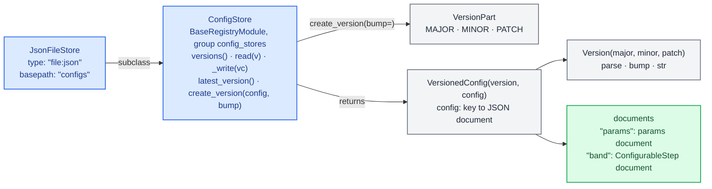
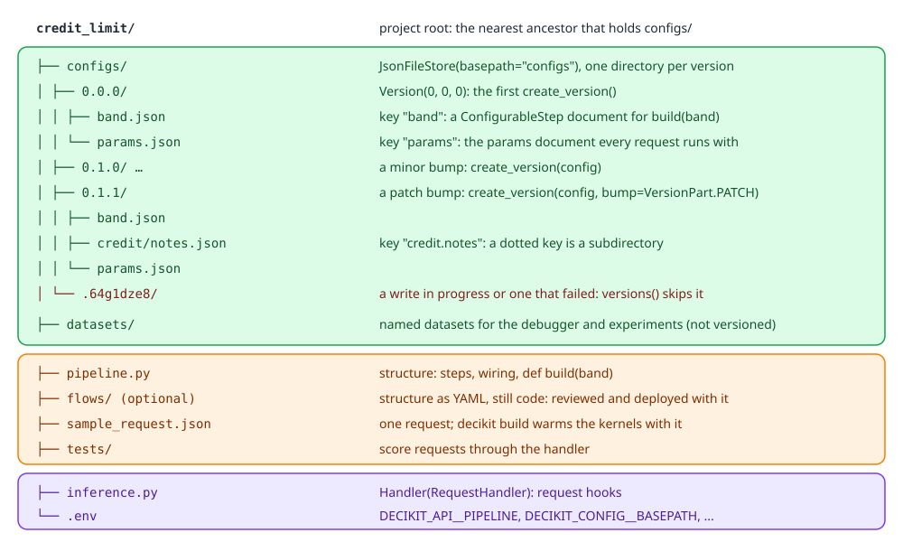
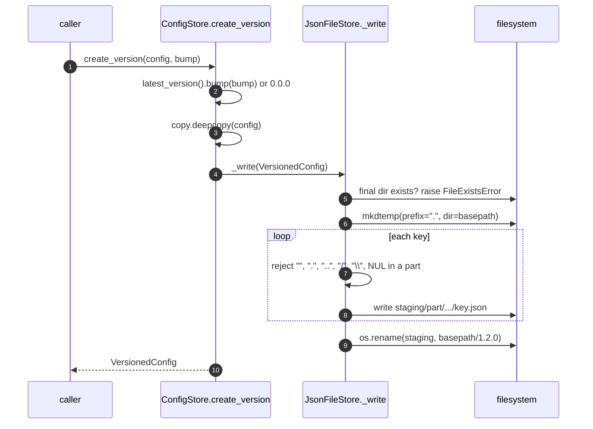
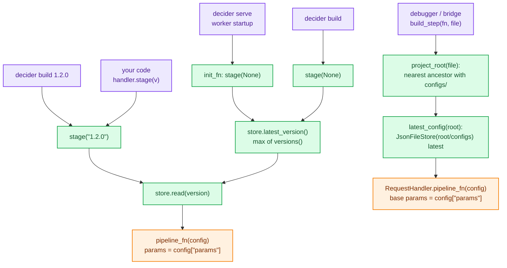

# Config store

A decision pipeline has two kinds of input that change at different speeds. The structure (which steps exist and how they are wired) changes with a code release. The values (cut-offs, multiples, tree bodies, table rows, scorecard bins) change with a policy decision, often weekly, and every past decision must stay explainable against the values it ran with. `decider.config` holds the second kind: immutable, numbered versions of JSON documents that a caller reads by version.

The package is small: `ConfigStore` (the interface), `JsonFileStore` (the one backend), `Version`, `VersionPart` and `VersionedConfig`. Serving reads from it at stage time ([Serving](serving.md)); the debugger reads the latest version of a project ([Editor bridge](editor-bridge.md)); the documents themselves are params documents ([Params](engine/params.md)) and `ConfigurableStep` documents ([Configurable steps](configurable-steps/index.md)). The user-level walkthrough is in [Projects and serving](../guides/projects-and-serving.md).

## Files

| File | What it holds |
|---|---|
| `decider/config/__init__.py` | Exports `ConfigStore`, `JsonFileStore`, `Version`, `VersionPart`, `VersionedConfig`. |
| `decider/config/_store.py` | `ConfigStore`: the abstract methods, `latest_version()` and `create_version()`. |
| `decider/config/_file.py` | `JsonFileStore`: directories of JSON files, atomic writes. |
| `decider/config/_versions.py` | `Version` (a `major.minor.patch` named tuple), `VersionPart`, `VersionedConfig`. |
| `decider/_settings.py` | `DeciderConfigSettings`: builds the store a server uses from `DECIDER_CONFIG__*`. |

## The data structures



`Version` is a `NamedTuple` of three ints, so it compares and sorts numerically (`0.10.0` sorts after `0.9.0`, which string sorting gets wrong) and hashes for use as a key. `Version.parse` accepts a `Version` unchanged or a string of exactly three dot-separated integers. `bump` resets the lower parts: a major bump of `1.2.3` is `2.0.0`, a minor bump is `1.3.0`, a patch bump is `1.2.4`.

`VersionedConfig` pairs a version with its `config`, a plain `dict` from key to JSON document. Two keys have a meaning to the rest of decider:

- `"params"` is the params document, keyed by step path (`{"credit": {"limit": {"multiple": 3.0}}}`). `RequestHandler.stage()` runs every request of that version with it.
- Any other key whose name matches an argument of the pipeline's `build` function is a `ConfigurableStep` document (a tree, decision table or scorecard) that `build` receives loaded. In a flow file, `step: band` can name it too.

Other keys are stored and returned like any document; nothing reads them unless your code does.

`ConfigStore` is a registry root (`group="config_stores"`), the same mechanism steps and dataset providers use (see [Foundation](foundation.md)). A store is a pydantic model with `extra="forbid"`, so its settings validate, and the server builds one from its `type` tag: `ConfigStore.resolve("file:json").model_validate({"type": "file:json", "basepath": "configs"})`. A package can ship another backend under the `decider.config_stores` entry point group.

## On disk

<div class="diagram" markdown>


*Green: versioned values in the store. Orange: structure and code, versioned by commit. Purple: how the project is served.*
</div>

`JsonFileStore` maps a version to `{basepath}/{major.minor.patch}/` and each key to `{key}.json` inside it. A dotted key is a path: `"credit.notes"` is `credit/notes.json`. Every file is written with `json.dumps(value, indent=2)`, so a version reviews well in a diff. The params document of a first version, `store.create_version({"params": {"credit": {"limit": {"multiple": 3.0}}}})`, is this file at `store_demo/0.0.0/params.json`:

```json
{
  "credit": {
    "limit": {
      "multiple": 3.0
    }
  }
}
```

Because a version is a plain directory of JSON files, the usual review flow works: a policy change is a new directory in a pull request, and `diff -r configs/0.1.0 configs/0.1.1` shows exactly which values moved.

This script builds the store the serving page uses, three versions of a small credit-limit project:

```python
store = JsonFileStore(basepath="configs")
print(store.create_version({"band": BAND, "params": {"credit": {"limit": {"multiple": 3.0}}}}).version)
print(store.create_version({"band": BAND, "params": {"credit": {"limit": {"multiple": 4.0}}}}).version)
print(store.create_version({"band": BAND, "params": {"credit": {"limit": {"multiple": 4.5}}},
                            "credit.notes": {"owner": "risk"}}, bump=VersionPart.PATCH).version)
print(store.versions(), store.latest_version())
print(sorted(Path("configs").rglob("*.json")))
print(Version.parse("0.10.0") > Version(0, 9, 0), str(Version(1, 2, 0).bump(VersionPart.MAJOR)))
print(list(store.read("0.1.1").config))
```

```text
0.0.0
0.1.0
0.1.1
[Version(major=0, minor=0, patch=0), Version(major=0, minor=1, patch=0), Version(major=0, minor=1, patch=1)] 0.1.1
[PosixPath('configs/0.0.0/band.json'), PosixPath('configs/0.0.0/params.json'), PosixPath('configs/0.1.0/band.json'), PosixPath('configs/0.1.0/params.json'), PosixPath('configs/0.1.1/band.json'), PosixPath('configs/0.1.1/credit/notes.json'), PosixPath('configs/0.1.1/params.json')]
True 2.0.0
['band', 'credit.notes', 'params']
```

The first version of an empty store is `0.0.0`. Each later one is the latest bumped by `bump`, `VersionPart.MINOR` by default.

### Reading

`read(version)` parses the version, checks that the directory exists, then reads every `*.json` under it recursively (`rglob`, sorted) and turns each relative path back into a dotted key. Files with another suffix are ignored. A version that does not exist is `FileNotFoundError: config version 9.9.9 not found in 'store_demo'`.

`versions()` lists the entries of `basepath`, keeps the directories whose name parses as a version and returns them sorted. A name that does not parse is skipped, which is how unfinished writes stay invisible. An absent `basepath` is an empty store, not an error.

The store keeps no cache and no "current" pointer. Two `JsonFileStore` objects on the same directory see the same versions, and a fresh one sees what another process wrote (`test_fresh_store_loads_what_another_wrote`).

### Writing



Three properties come out of this:

- A version is immutable. `_write` refuses a version directory that already exists, and `create_version` deep-copies the caller's dicts so a later edit to them cannot change what was stored (`test_stored_version_is_unaffected_by_later_edits_to_the_input`).
- A version appears whole or not at all. Files go into a hidden staging directory first, and one `os.rename` puts it in place. The rename is atomic on a single filesystem, so a reader never sees half a version (`test_failed_write_leaves_no_version`).
- A key cannot escape its version directory. Each dotted part is checked, and `"../escape"`, `"a..b"` (an empty part) and `"a/b"` are refused with `ValueError: config key '../escape' is not a safe path: a dotted key must be plain names`.

A refused write leaves its hidden staging directory behind (the check runs after `mkdtemp`). `versions()` skips it because `.64g1dze8` does not parse as a version, but the directory stays on disk until someone deletes it. A value `json.dumps` cannot write (an arbitrary object) fails the same way with a `TypeError`.

The failure messages, from a script that tries each one against a store holding only `0.0.0`:

```python
for bad in ("1.2", "v1.2.0", "1.2.x"):
    Version.parse(bad)                       # each raises ValueError
for key in ("../escape", "a..b", "a/b"):
    store.create_version({key: {}})          # each raises ValueError
print(sorted(p.name for p in Path("store_demo").iterdir()))
print(store.versions())
store.read("9.9.9")                          # FileNotFoundError
store._write(store.read("0.0.0"))            # FileExistsError
```

```text
ValueError: invalid version '1.2'; expected 'major.minor.patch'
ValueError: invalid literal for int() with base 10: 'v1'
ValueError: invalid literal for int() with base 10: 'x'
ValueError: config key '../escape' is not a safe path: a dotted key must be plain names
ValueError: config key 'a..b' is not a safe path: a dotted key must be plain names
ValueError: config key 'a/b' is not a safe path: a dotted key must be plain names
['.64g1dze8', '.h_qz9pao', '.ny0y_vdl', '0.0.0']
[Version(major=0, minor=0, patch=0)]
FileNotFoundError: config version 9.9.9 not found in 'store_demo'
FileExistsError: config version 0.0.0 already exists in 'store_demo'
```

The three refused keys left three hidden directories; the store still has one version.

### A document round trip

A `ConfigurableStep` document goes into the store as plain JSON and comes back as the same step. Here a scorecard is stored with a major bump and read through a second store object on the same directory:

```python
store.create_version({"card": doc, "params": {}}, bump=VersionPart.MAJOR)
other = JsonFileStore(basepath="store_demo")
latest = other.latest_version()
card = ConfigurableStep.load(other.read(latest).config["card"])
print(latest, type(card).__name__, card.run(pl.DataFrame({"age": [20.0, 40.0]}))["score"].to_list())
print(JsonFileStore(basepath="store_demo").model_dump())
```

```text
1.0.0 ScorecardConfig [5.0, 10.0]
{'type': 'file:json', 'basepath': 'store_demo'}
```

`ConfigurableStep.load` resolves the document's `type` tag (`"scorecard"`) through the registry, the same lookup the store itself uses for `"file:json"`.

Two processes calling `create_version` at the same moment both compute the same next version. The `exists()` check can pass for both, and then the second `os.rename` onto the first's non-empty directory fails with an `OSError`. Nothing is overwritten, but the second caller has to retry. Release tooling that writes versions should run from one place.

## How a version is selected

The store never picks a version on its own. Each caller decides:



- A server stages the latest version when each worker starts. Which version is live is therefore decided by what is in `configs/` at deploy time, not at request time. A version written after startup is not served until the next start (or a `stage()` and `activate()` your own code calls).
- `decider build [VERSION]` stages one version exactly as the server would, the latest when none is given, and fails with `Error: config version 9.9.9 failed to build: FileNotFoundError: config version 9.9.9 not found in 'configs'` for an unknown one.
- `RequestHandler.stage("1.2.0")` takes an explicit version, and `rollback()` goes back to the previously active one without reading the store again (it keeps the built `Live`).
- The editor bridge and `python -m decider._tooling.bridge.run` look for the project root of the pipeline's file (the nearest ancestor holding `configs/`) and read its latest version, the same one `decider serve` would pick from that directory. A module's own `PARAMS` still wins over the version's params document there, so a notebook-style module can pin its values.

To replay a stored decision, read the version it ran with, never whatever `configs/` holds now: `store.read(version)` returns exactly the documents of that version.

## Why structure is not in config

A config version holds params documents and `ConfigurableStep` documents. It never holds the list of steps, their order or their wiring. Two notes give the reasons.

The structure-in-Python note records what happened in the previous engine, where structure lived in config:

- Execution order was kept by hand in JSON with typed UUIDs and was known to be wrong: `main.json` had 51 steps, the generated `flow.json` had 120, and the real C# flow had 192.
- Values were duplicated between config and code (`"max_term": 84` in a config file and `84.0` hardcoded in two modules), so editing the JSON might not change behaviour.
- The graph could not be drawn without building it, and building it needed valid params for every registered type.

When structure is code, it is reviewed, versioned by commit and its order comes from the graph. Config references code only by registered `type` tag (`"decision_table"`, `"tree"`, `"mypkg.steps:Scaled"`), and the registry refuses a tag that names an unregistered class, so a config file cannot point at arbitrary code (`"os:system"` is rejected).

The flow-files note amends this without reversing it. A flow file (`flow.yaml`) states structure in YAML, but it lives with the code, is the only copy of that structure and is deployed with the components it names. It is still never inside a config version. A configurable flow that could change structure without a deploy was considered and not built, and the note says adding it would reverse the earlier decision. See [Flow files](../guides/flow-files.md) and [Expressions and flow files](configurable-steps/expr-and-flowfile.md).

The practical split for a project:

| Changes with | Where it lives | Versioned by |
|---|---|---|
| a code release: steps, wiring, branch and loop structure, function bodies | `pipeline.py`, `flows/*.yaml` | git commit |
| a policy decision: thresholds, multiples, rates | `configs/<version>/params.json` | config version |
| a policy decision: tree bodies, table rows, scorecard bins | `configs/<version>/<name>.json` | config version |
| an operator: which store, which pipeline, which mode | `.env`, `DECIDER_*` variables | deployment |

## A project directory

`decider template NAME` writes the smallest project that follows this split; see [CLI and MCP internals](tooling.md) for the template files. The project directory is itself a Python package (it has an `__init__.py`), so `import NAME.pipeline` resolves to it and two projects on one `PYTHONPATH` never shadow each other's `pipeline` module. The `.env` it writes points the server at that package and at `configs/`:

```text
DECIDER_API__PIPELINE=loan_check.pipeline:build
DECIDER_API__HANDLER=loan_check.inference:Handler
DECIDER_CONFIG__BASEPATH=configs
```

`configs/` doubles as the marker of a project root. `project_root(start)` in `decider/lab/data/_providers/catalog.py` walks up from a file to the first directory that holds `configs/`, and the datasets folder (`datasets/`) and the checks file (`checks.yaml`) are found relative to it: `DeciderSettings.datasets_path` defaults to `${PROJECT_ROOT}/datasets` and `checks_path` to `${PROJECT_ROOT}/checks.yaml`. Datasets are not versioned with the config; see [Data](lab/data.md).

## Behaviour pinned by tests

`tests/config/test_store.py` covers the store on its own:

| Test | What it pins |
|---|---|
| `test_create_version_writes_one_json_file_per_key` | one file per key |
| `test_fresh_store_loads_what_another_wrote` | no in-memory state |
| `test_versions_increment_and_latest_wins` | `0.0.0`, then minor bumps, latest is the max |
| `test_versions_sort_numerically_and_ignore_other_entries` | `0.10.0` after `0.9.0`; stray files and dirs ignored |
| `test_empty_store_has_no_latest` | `latest_version()` is `None` |
| `test_dotted_keys_are_subdirectories` | `"a.b"` is `a/b.json` |
| `test_a_key_that_escapes_the_version_dir_is_rejected` | the path-safety check |
| `test_stored_version_is_unaffected_by_later_edits_to_the_input` | the deep copy |
| `test_failed_write_leaves_no_version` | the staging rename |
| `test_read_errors_propagate` | a missing version or bad JSON raises |
| `test_configurable_step_and_params_round_trip` | a step's `model_dump` survives the store and loads back |
| `test_settings_build_the_store` | `DeciderConfigSettings.get()` builds a `JsonFileStore` |

## When a version does not load

| Symptom | Cause | What to do |
|---|---|---|
| `FileNotFoundError: config version 9.9.9 not found in 'configs'` | the version directory does not exist under `basepath` | check `DECIDER_CONFIG__BASEPATH` and the server's working directory; `store.versions()` lists what is there |
| `json.JSONDecodeError` from `read` | a hand-edited file is not valid JSON | fix the file; a stored version should not be edited by hand at all |
| `RuntimeError: the config store has no versions to stage.` | an empty or wrong `basepath` | the first `create_version` writes `0.0.0` |
| `KeyError: the config version has no 'band' document ...` at stage | `build(band)` needs a key the version lacks | add the document to a new version |
| `ParamsError` at stage | the params document fails a step's declared bounds or types | fix the value in a new version; the active version keeps serving |
| a new version is not served | servers pick the latest version only at startup | restart, or call `stage()` and `activate()` |
| `LookupError` naming the type from `DeciderConfigSettings.get()` | `DECIDER_CONFIG__TYPE` names no registered store | `file:json` is the built-in one (`test_settings_build_the_store` pins the message for `file:yaml`) |

## Writing another backend

Subclass `ConfigStore`, give it a `type` literal and implement three methods: `versions()` (every stored version, oldest first), `read(version)` (one `VersionedConfig`) and `_write(versioned)` (store one new version, refusing one that exists). `latest_version()` and `create_version()` come from the base class and need nothing else. Keep the two guarantees the file store gives: a version appears whole or not at all, and a stored version never changes. Register the class under the `decider.config_stores` entry point group so `DECIDER_CONFIG__TYPE=<tag>` can name it, and put its own fields (a bucket, a table name) in `DECIDER_CONFIG__<FIELD>` variables; `DeciderConfigSettings` allows extra fields and passes them to the model.
