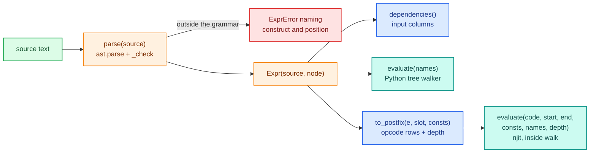
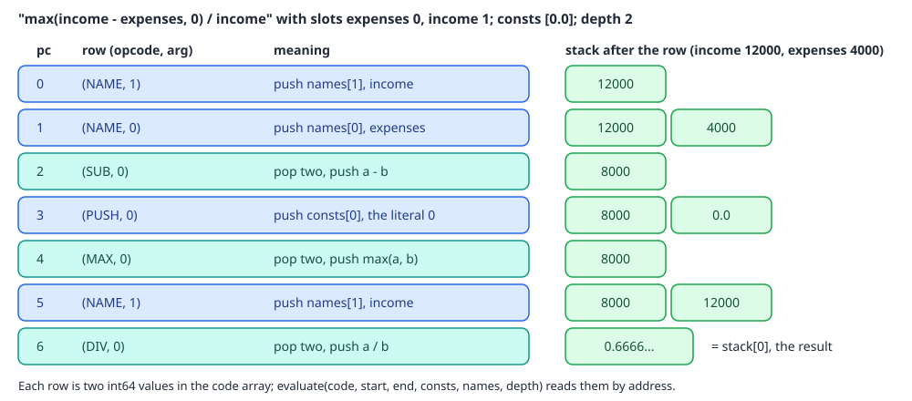
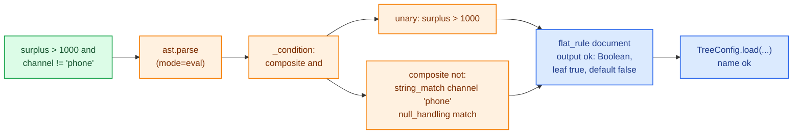
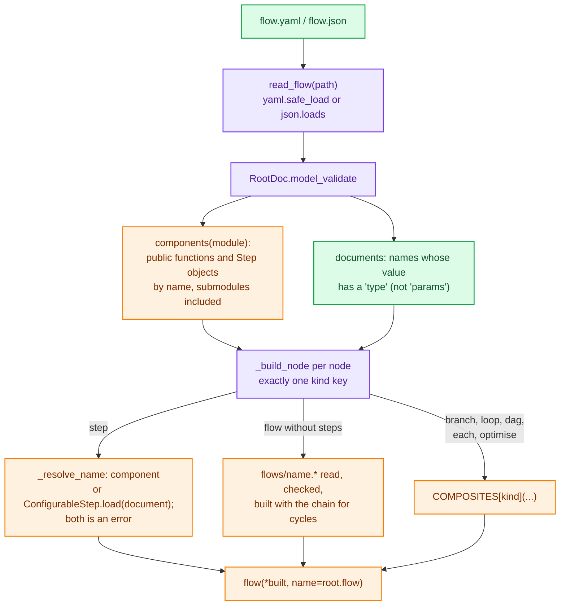

# Expressions and flow files

Two text formats sit in front of the step model. The expression grammar lets a tree document compute a feature (`"income - expenses"`) and lets a flow file write a condition (`"surplus > 1000 and channel != 'phone'"`) without admitting arbitrary Python. Flow files state a pipeline's structure in YAML or JSON and build the same `flow`, `branch` and `loop` objects a developer would write by hand. Neither adds anything new to the engine: an expression becomes postfix rows a tree already walks, or a one-rule tree document, and a flow file becomes an ordinary `Step`.

The user-side guide for flow files is [flow files](../../guides/flow-files.md); computed features are used in the [trees, tables and scorecards guide](../../guides/trees-tables-scorecards.md).

## Where the code lives

| File | Role |
|---|---|
| `decider/steps/expr/__init__.py` | `parse`, `Expr` (`dependencies`, `evaluate`), the admitted grammar, `ExprError` |
| `decider/steps/expr/_postfix.py` | `to_postfix` (an `Expr` as opcode rows) and `evaluate`, the njit stack machine |
| `decider/steps/trees/_condition.py` | `expr_condition`: a boolean expression compiled into a one-output tree |
| `decider/steps/flowfile/_schema.py` | The pydantic models of a flow file: `RootDoc` and one model per node kind |
| `decider/steps/flowfile/_load.py` | `load_flow`, `read_flow`, `components` |
| `decider/steps/_composites.py` | `COMPOSITES`, the constructor for each composite node kind, shared with `decider ids` |

`load_flow` is exported from `decider` itself.

## The expression grammar

`parse(source)` parses `source` with `ast.parse(mode="eval")` and walks the tree once, refusing anything outside a fixed whitelist. Nothing is evaluated while parsing. What is admitted:

| Construct | Admitted |
|---|---|
| Names | any identifier except dunder names (`__class__`) |
| Literals | `int` and `float`; booleans and strings are refused |
| Arithmetic | `+ - * / // % **`, unary `-` |
| Comparison | one of `< <= > >= == !=` per comparison; chains such as `a < b < c` are refused |
| Logic | `and`, `or`, `not` |
| Calls | `min` and `max` (two or more arguments) and `abs` (one), positional only |
| Nesting | up to `MAX_DEPTH` (200) levels; deeper is a clean `ExprError`, not a `RecursionError` |

Every refusal names the construct and its position:

```text
'income.__class__': attribute access is not admitted in an expression at line 1, column 1 of 'income.__class__'
"open('x')": call to 'open' is not admitted; only abs, max, min are whitelisted at line 1, column 1 of "open('x')"
'a < b < c': a chained comparison (e.g. 'a < b < c') is not admitted; write 'a < b and b < c' at line 1, column 1 of 'a < b < c'
'x if y else z': conditional expression (a ternary 'x if c else y') is not admitted in an expression at line 1, column 1 of 'x if y else z'
"'gold'": str literal 'gold' is not admitted (only numbers are) at line 1, column 1 of "'gold'"
```

`ExprError` subclasses both `DeciderError` and `ValueError`, so a computed feature's error surfaces as an ordinary pydantic validation error when a tree document loads.

`Expr` is a frozen dataclass of the source and the validated `ast` node. `dependencies()` returns every free name (call targets excluded), which is how a tree knows the input columns a computed feature reads. `evaluate(names)` walks the `ast` in Python; comparisons and `and`/`or`/`not` give bools, the way a kernel's 1.0/0.0 does. The Python tree walker uses `evaluate`; the compiled walker uses the postfix form.



## Expressions as postfix rows

`to_postfix(e, slot, consts)` turns an `Expr` into a list of `(opcode, argument)` rows in postfix order and returns the stack depth they need. `slot(name)` says where a name sits in the float tuple the kernel is given; each literal is appended to `consts` and pushed by its position. The opcodes are `PUSH, NAME, ADD, SUB, MUL, DIV, FLOORDIV, MOD, POW, NEG, NOT, LT, LE, GT, GE, EQ, NE, AND, OR, MIN, MAX, ABS`, numbered 0 to 21. `min` and `max` with more than two arguments fold pairwise, as do `and` and `or`.

For `max(income - expenses, 0) / income`:

```python
e = expr.parse("max(income - expenses, 0) / income")
consts = []
rows, depth = to_postfix(e, {"expenses": 0, "income": 1}.__getitem__, consts)
code, lits = np.array(rows, np.int64), np.array(consts, np.float64)
print(rows, depth, consts)
print(evaluate(code.ctypes.data, 0, len(rows), lits.ctypes.data, (4000.0, 12000.0), depth))
```

```text
[(1, 1), (1, 0), (3, 0), (0, 0), (20, 0), (1, 1), (5, 0)] 2 [0.0]
0.6666666666666666
```

<div class="diagram" markdown>


*`Expr.evaluate` gives the same 0.6666666666666666 by walking the `ast`.*
</div>

`evaluate(code, start, end, consts, names, depth)` is a plain `@njit` stack machine. It reads the code and the literals by address (`load_i64`, `load_f64`), so no array is reference-counted per call, and it reads names from a tuple. It allocates its stack (`np.empty(depth)`) once per evaluation; the code marks that as a `ponytail` shortcut, with a fixed-size stack as the upgrade if computed features get hot.

Inside a tree, every distinct computed feature's rows go into the `EXPR_CODE` region of the tree's int array, `EXPR_STARTS` records where each one starts, and its literals go into `EXPR_CONSTS` in the float array (see the packed layout on the [trees page](trees.md)). A `CMP_E` program row names the expression by index, and the walker calls `evaluate` with the row's float features as `names`. Two conditions using the same expression text share one encoding. Because the literals are data, editing a number inside an expression changes array contents only; `test_editing_a_literal_inside_an_expression_never_recompiles` pins that.

Two semantic points follow from the encoding:

- Everything is float64 arithmetic. A computed feature may read only `float` features, and a null input reaches it as NaN, which makes the comparison unknown.
- `and` and `or` evaluate both sides. A guard such as `x == 0 or 1 / x > 2` raises where Python would short-circuit. The code leaves a `ponytail` comment naming jump opcodes as the fix if a tree needs it.

## `expr_condition`: an expression as a one-rule tree

`expr_condition(source, *, name, feature_types=None)` returns a `TreeConfig` whose single Boolean output `name` is true where the expression holds. There is no separate expression evaluator: the expression is translated into a flat-rule tree document, and the tree walker runs it. A numeric or exact-string condition therefore compiles into the shared walker with no fallback (`test_numeric_condition_compiles_without_falling_back`, `test_string_condition_compiles_without_falling_back`).

The translation in `_condition`:

| Source | Becomes |
|---|---|
| `a and b`, `a or b` | a `composite` with `op` `and` / `or` |
| `not a` | a `composite` `not`, with the negation tracked downwards |
| `score >= 600`, `600 <= score` | a unary comparison, flipped so the feature is on the left; `-5` is a plain threshold |
| `income - expenses > 1000` | a comparison on a computed feature |
| `a < b` (no number on either side) | `(a) - (b) < 0` on a computed feature |
| `channel == "app"`, `channel != "app"` | a `string_match` on the name, wrapped in `not` for `!=` |
| `flag` (a bare name) | `is_true` |

Anything else (a chained comparison, a string compared with `<`, a string compared with an expression) is an `ExprError`.

Nulls make the expression false, also under negation. A numeric test on a null is unknown, and the tree's three-valued logic already makes `not unknown` unknown, which takes the otherwise branch (false). A string match's null result is a plain true or false that NOT flips, so under an odd number of negations the translator sets the match's `null_handling` to `match`, making the negated match false for a null. `test_null_input_is_false_under_negation_via_not_equal` and its neighbours pin each case.

```python
cond = expr_condition("surplus > 1000 and channel != 'phone'", name="ok")
print(json.dumps(cond.model_dump(mode="json")["tree"]))
```

The generated document (as dumped, with defaults filled in):

```json
{"name": "output", "output": {"data": [{"ok": true}], "default": {"ok": false}, "dtypes": [["ok", "Boolean"]], "type_defs": {}},
 "parameters": {}, "input_schema": null, "type": "flat_rule",
 "rule": {"meta": {"name": null, "description": null},
          "rule": {"then": {"type": "leaf", "id": null, "result_idx": 0}, "otherwise": null,
                   "type": "composite", "id": null, "op": "and",
                   "conditions": [{"type": "unary", "feature": "surplus", "threshold": 1000, "op": ">"},
                                  {"type": "composite", "id": null, "op": "not",
                                   "conditions": [{"type": "unary", "feature": "channel", "op": "string_match",
                                                   "patterns": ["phone"], "match_type": "exact",
                                                   "case_sensitive": true, "trim_whitespace": false,
                                                   "null_handling": "match"}]}]}}}
```

Run in fused mode:

```text
┌─────────┬─────────┬───────┐
│ surplus ┆ channel ┆ ok    │
│ ---     ┆ ---     ┆ ---   │
│ f64     ┆ str     ┆ bool  │
╞═════════╪═════════╪═══════╡
│ 3000.0  ┆ app     ┆ true  │
│ 3000.0  ┆ phone   ┆ false │
│ 500.0   ┆ app     ┆ false │
│ null    ┆ app     ┆ false │
│ 3000.0  ┆ null    ┆ false │
└─────────┴─────────┴───────┘
```

The last row shows the negation rule: a null `channel` is not `'phone'`, yet the expression is false, because a null makes any condition false.

One rough edge is recorded in both the code and `flow-files.md`: `a OP b` with no constant side is compiled as `(a) - (b) OP 0` in float arithmetic, so exact equality of two large integers can be off by rounding.



## Flow files

A flow file is a YAML or JSON document describing a pipeline's structure: which steps run, in what order, under which branches and loops. `load_flow(path, *, components=None, documents=None)` reads it and returns the `Step` that `flow`, `branch`, `loop`, `dag`, `each` and `optimise` would build by hand. The engine, compiler, serving, debugger and experiments see an ordinary step and need nothing new.

### Schema

The root document is a `RootDoc`: `flow` (its name), `components` (an import path, optional), `id`, `suppress_checks` and `steps` (at least one node). Every node is a mapping with exactly one kind key:

| Node | Keys | Builds |
|---|---|---|
| `step: name` | `as`, `suppress_checks`, `path_columns` | the component or document called `name`; `as` renames the step (its path), not its output |
| `flow: name` | `steps` (optional), `id`, `suppress_checks` | an inline `flow(...)` with `steps`, or without them the file `flows/<name>.yaml`, `.yml` or `.json` |
| `branch: name` | `when`, `modifies`, `then`, `else` (optional), `id`, `suppress_checks` | `branch(condition, then[, else], modifies=...)`; no `else` is a one-arm branch where false rows pass through |
| `loop: name` | `while`, `carries`, `max`, `steps`, `id`, `suppress_checks` | `loop(condition, body, carries=..., max_iterations=...)` |
| `dag: name` | `steps`, `inputs`, `id`, `suppress_checks` | `dag(...)` |
| `each: name` | `column`, `steps`, `output`, `id`, `suppress_checks` | `each(column, body, output=...)` |
| `optimise: name` | `count`, `evaluate`, `score`, `disqualify`, `max_candidates`, `id`, `suppress_checks` | `optimise(...)` |

Every model has `extra="forbid"`, so a misspelt key is a `WiringError` naming the node's location (`flow.yaml: steps[2]`). A list of several nodes under `then`, `else`, `steps`, `count` or `evaluate` becomes an anonymous `flow` of them; a single node is used as is. `modifies` and `carries` are required, as they are in Python. A module-level `assert` in `_load.py` checks that every key of `COMPOSITES` has a node kind, so a new composite constructor cannot be added without one.

A condition (`when`, `while`) is one of three things:

- a string naming a component step, which is used as the condition;
- any other string, read as a bool column (a loop wraps it in `_column_condition`, an identity step reading that column);
- `{expr: "...", feature_types: {...}}`, turned into `expr_condition(expr, name="<node>_when")` (or `_while`).

### How `load_flow` builds a step



Details that matter when a flow file does not load:

- The project directory is the file's directory, or its parent when the file sits in a `flows/` directory, so a root file and a referenced file both find `flows/<name>.*`.
- `components` defaults to the root's `components:` key and may be passed in as a module or an import path. A referenced file may repeat the root's `components:`, but naming a different one is an error.
- `components(module)` collects public functions defined in that module (imported ones are ignored) and `Step` instances by their `name`, walking submodules of a package. The same name in two modules is an error.
- A `step:` name found in both the components and the documents is an error, never a precedence rule. An unknown name is a `WiringError` with a did-you-mean.
- A resolved name is cached for the load, so two `step: x` nodes share one step object, and a referenced file is read once.
- A `flow:` node with inline `steps` while `flows/<name>.*` also exists is ambiguous and refused, as are two files for one name, a file whose `flow:` key does not match its file name, and a reference cycle (`flow reference cycle: credit -> pricing -> credit`).
- `path_columns: fn` on a `step:` node looks `fn` up among the component functions and sets it on a tree with `_replace`; any other step type refuses it.
- `suppress_checks` on a `step:` node is merged with the step's own, without duplicates.

### A worked example

A small credit flow: compute a surplus, price an offer when the surplus is large enough and the channel is not the phone, otherwise offer nothing, then run a review tree from the config version.

```yaml
# flowproj/flow.yaml
flow: credit
components: credit_components
steps:
  - step: surplus
  - branch: affordable
    when: {expr: "surplus > 1000 and channel != 'phone'"}
    modifies: [offer]
    then:
      - flow: pricing
    else:
      - step: no_offer
  - step: risk_tree
```

```yaml
# flowproj/flows/pricing.yaml
flow: pricing
components: credit_components
steps:
  - step: offer
```

```python
# flowproj/credit_components.py
from decider import step


def surplus(income: float, expenses: float) -> float:
    return income - expenses


def offer(surplus: float) -> float:
    return round(surplus * 6, 2)


def _zero() -> float:
    return 0.0


no_offer = step(_zero, name="no_offer", output="offer")
```

`risk_tree` is not a component; it comes from `documents`, as a config version would supply it:

```python
RISK = {"type": "tree", "name": "risk_tree", "tree": {
    "nodes": [{"id": "root", "data": {"type": "unary", "condition": {"op": ">", "feature": "offer", "threshold": 20000}}},
              {"id": "high", "data": {"type": "leaf", "result_idx": 0}}],
    "edges": [{"source": "root", "target": "high", "data": {"sourceIndex": 0}}],
    "output": {"data": [{"review": True}], "default": {"review": False}, "dtypes": [["review", "Boolean"]]}}}
pipe = load_flow("flowproj/flow.yaml", documents={"risk_tree": RISK, "params": {}})
for n in iter_nodes(to_ir(pipe)):
    print(f"  {type(n).__name__:13} {n.origin.path:28} {n.origin.source}")
```

The IR is what the hand-written pipeline would give, with the `expr` condition as a tree named `affordable_when` and the subflow as a named sequence:

```text
  SequenceNode  credit                       decider.steps:SequentialStep
  CallNode      credit/surplus               credit_components:surplus
  BranchNode    credit/affordable            decider.steps:BranchStep
  CallNode      credit/affordable/affordable_when decider.steps.trees:TreeConfig
  SequenceNode  credit/affordable/pricing    decider.steps:SequentialStep
  CallNode      credit/affordable/pricing/offer credit_components:offer
  CallNode      credit/affordable/no_offer   credit_components:_zero
  CallNode      credit/risk_tree             decider.steps.trees:TreeConfig
```

`offer` is an intermediate (the tree reads it), so it is kept with `.emit("offer")` to show it:

```text
┌─────────┬──────────┬─────────┬────────┬─────────┐
│ income  ┆ expenses ┆ channel ┆ review ┆ offer   │
│ ---     ┆ ---      ┆ ---     ┆ ---    ┆ ---     │
│ f64     ┆ f64      ┆ str     ┆ bool   ┆ f64     │
╞═════════╪══════════╪═════════╪════════╪═════════╡
│ 12000.0 ┆ 4000.0   ┆ app     ┆ true   ┆ 48000.0 │
│ 9000.0  ┆ 7500.0   ┆ app     ┆ false  ┆ 9000.0  │
│ 5000.0  ┆ 1000.0   ┆ phone   ┆ false  ┆ 0.0     │
└─────────┴──────────┴─────────┴────────┴─────────┘
```

Without `documents`, the same file fails at the node that needs one:

```text
WiringError flowproj/flow.yaml: steps[2]: unknown step 'risk_tree'.
```

`as:` is `.named()`: it renames the step's path, not its output. With `step: zero_offer` and `as: offer` in the `else` arm, the arm would write a `zero_offer` column and the branch's merged `offer` would be null on every false row. To write another column name, give the component its own output name, as `no_offer` does.

## Why flow files live with the code

Pipeline structure is code, because decider_old's structure in config produced copies that drifted apart (the [configurable steps overview](index.md) has the numbers). A flow file states structure in YAML, which looks like a reversal. It is not: a flow file is the only copy of the structure, and it lives in the repository next to the components it names, reviewed and deployed with them. Params and `ConfigurableStep` documents stay in config versions. The `components:` import path is a pointer in reviewed source, not in deployable config.

Also deliberately not built: a `FlowConfig(ConfigurableStep)` that could live inside a config version, which would let structure change without a deploy. It is to be added only if that is wanted, and treated as reversing the earlier decision.

The flow file is modelled on the granting-decisioning service's `flow.yaml` (a tree of `step`/`subflow`/`when`/`loop` nodes). Two problems there shaped this one: subflows were copy-pasted between flow variants, so `flow: name` loads a shared file by reference, and `when`/`loop` took free-text expressions, so conditions here are a column, a component, or the closed `expr` grammar.

Serving reads a flow file directly: with `DECIDER_API__PIPELINE=flow.yaml`, `RequestHandler.pipeline_fn` calls `load_flow(self.pipeline, documents=config)` with the active config version, so `step:` names resolve to that version's documents. The [serving page](../serving.md) covers versions and activation.
