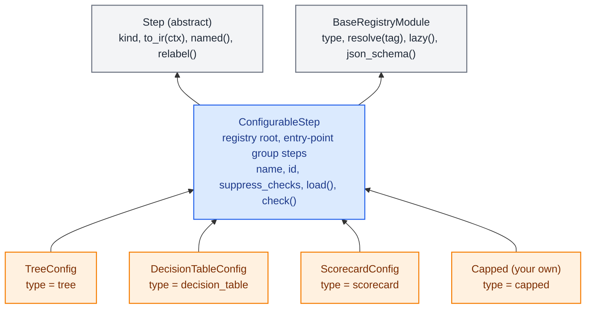
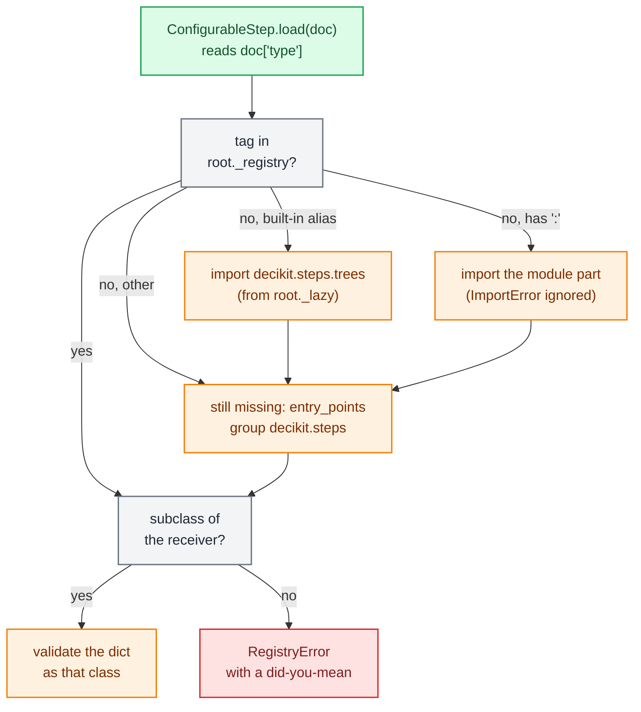
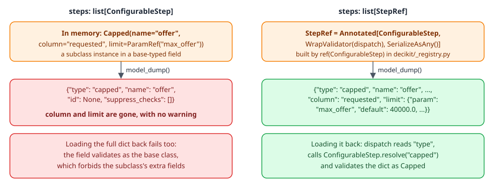

# Configurable steps

A credit team edits a decision tree in a browser, a pricing analyst adds a row to a rate table, a risk modeller moves a scorecard bin edge. None of them should need a code review or a recompile for that. A `ConfigurableStep` is the step type that makes this possible: its whole definition is a JSON document, validated by pydantic, found by a `type` tag, and lowered to IR like any other step. Trees, decision tables and scorecards are the three built-in kinds, and a project can add its own.

The code lives in a handful of files:

| File | What it holds |
|---|---|
| `decikit/steps/_configurable.py` | `ConfigurableStep`, `StepRef`, and the lazy aliases for the built-in types |
| `decikit/_registry.py` | `BaseRegistryModule` (tag registration and lookup) and `ref()` |
| `decikit/steps/_values.py` | `Value[T]`, `ParamRef`, `TableRef`, `TableValue` |
| `decikit/_engine/ir/context.py` | `IRContext`: `call`, `expand`, `value`, `table`, `origin` |
| `decikit/steps/trees/`, `tables/`, `scorecard/` | The three built-in types, one page each: [trees](trees.md), [tables](tables.md), [scorecards](scorecards.md) |

How to author and run these steps is in the [trees, tables and scorecards guide](../../guides/trees-tables-scorecards.md); this page and the four after it cover how they work inside.

## From document to kernel

Every configurable step goes through the same five stages. The registry finds the class the document's `type` names, pydantic validates the document into a frozen model, the model's `to_ir` returns one IR node, and the engine compiles or interprets that node like any other.

<div class="diagram" markdown>


*What each kind of edit touches, for the loan tree on the [trees page](trees.md).*
</div>

The lower half of the picture is the reason for the design. A tree's thresholds, a table's rows and a scorecard's bin edges reach the kernel as runtime data, either as params or as arrays the node's consts point at. Editing them never changes the kernel's numba signature, so it never recompiles. Only a change to the shape of the data the kernel sees (a new input column, a new output, a renamed param) produces a new signature, and that compiles once and then comes from the disk cache. The [compile page](../engine/compile.md) and the [kernel cache page](../engine/cache.md) cover the compile side.

## A minimal configurable step

The smallest useful subclass declares a `type` alias, its fields, and `to_ir`. This one caps a requested loan amount at a limit that the params document can retune:

```python
import typing as t

import polars as pl

from decikit import ConfigurableStep, Value
from decikit.ir import to_ir


def cap(amount: float, limit: float) -> float:
    return min(amount, limit)


class Capped(ConfigurableStep):
    type: t.Literal["capped"] = "capped"
    column: str
    limit: Value[float] = 50000.0

    def to_ir(self, ctx):
        return ctx.call(self, cap, inputs={"amount": self.column}, values={"limit": self.limit})


doc = {"type": "capped", "name": "offer", "column": "requested",
       "limit": {"param": "max_offer", "default": 40000.0}}
step = ConfigurableStep.load(doc)
print(step.model_dump_json())
print(to_ir(step))
df = pl.DataFrame({"requested": [10000.0, 75000.0]})
print(step.run(df))
print(step.run(df, params={"offer": {"max_offer": 60000.0}}))
print(step.parameters())
```

The document round-trips, with the defaults filled in:

```text
{"type":"capped","name":"offer","id":null,"suppress_checks":[],"column":"requested","limit":{"param":"max_offer","default":40000.0,"shared":false}}
```

`to_ir` gives one scalar `CallNode`. The `ParamRef` became a `ParamDecl` called `max_offer` that feeds the function argument `limit`, and the node's origin records the class by import path:

```text
CallNode(origin=Origin(path='offer', source='__main__:Capped', locator=None, id=None, suppress_checks=()),
         kind='scalar', fn=<function cap at 0x7fa1bbe13690>,
         inputs=(Input(name='requested', annotation=<class 'float'>, null_policy=<NullPolicy.REQUIRED: 'required'>, fill=None, arg='amount'),),
         outputs=(Output(name='offer', annotation=<class 'float'>),),
         params=(ParamDecl(name='max_offer', annotation=<class 'float'>, default=40000.0, field_info=None, required=False,
                           shared_key=None, on_invalid='error', schema=None, arg='limit'),),
         reference=None, nogil=False, consts=())
```

Running it and retuning it:

```text
shape: (2, 2)
┌───────────┬─────────┐
│ requested ┆ offer   │
│ ---       ┆ ---     │
│ f64       ┆ f64     │
╞═══════════╪═════════╡
│ 10000.0   ┆ 10000.0 │
│ 75000.0   ┆ 40000.0 │
└───────────┴─────────┘
shape: (2, 2)
┌───────────┬─────────┐
│ requested ┆ offer   │
│ ---       ┆ ---     │
│ f64       ┆ f64     │
╞═══════════╪═════════╡
│ 10000.0   ┆ 10000.0 │
│ 75000.0   ┆ 60000.0 │
└───────────┴─────────┘
{'offer': {'max_offer': {'type': 'float', 'default': 40000.0}}}
```

Written as a literal (`limit=45000.0`), the same field lands in the node's `consts` instead of its `params`: `to_ir(...).consts` is `(('limit', 45000.0),)` and `params` is `()`. Consts are arguments too, so editing the literal builds a new node but reuses the compiled kernel.

## The `ConfigurableStep` base class

`ConfigurableStep` derives from both `Step` (so it composes with `flow`, `branch` and `|`) and `BaseRegistryModule` (so it has a `type` tag and a registry). Its class line is `class ConfigurableStep(Step, BaseRegistryModule, root=True, group="steps")`: it opens its own registry, and installed packages extend it through the `decikit.steps` entry-point group.

What every subclass inherits:

| Member | Purpose |
|---|---|
| `model_config = ConfigDict(frozen=True, extra="forbid")` | A config never changes in place, and a misspelt field is an error instead of being ignored |
| `kind = "configurable"` | The step kind tools and `describe` report |
| `name: str` | The node's path segment and the key of its params in the params document |
| `id` (optional `str`) | A durable opaque id stored next to `name` in the JSON |
| `suppress_checks: list[str]` | Check aliases or codes silenced for this step; the [checks package](../lab/checks.md) reads them from the node's origin |
| `reads`, `writes` | Relabels set from Python with `.relabel()`; excluded from the dump and from the JSON schema, because placement is code |
| `load(source)` | Reads a file path, JSON text or a dict, looks at `type`, resolves the class, and validates |
| `check(ctx)` | A hook for findings about the document itself; `decikit.lab.checks` calls it once per configurable step in the pipeline |
| `_replace(**changes)` | `model_copy(update=...)`, which `named()` and `relabel()` use to return a changed copy |

Because the model is frozen, the IR cache in `IRContext.build` can key built IR on the step object: an unchanged step returns the same IR, and a changed document is a new object whose IR is built afresh. The cache is keyed by `id()` and cleared by a `weakref.finalize`, since pydantic models compare by value.

`load` accepts a subclass as the receiver. `TreeConfig.load({...})` works without a `type` key; if the key is present it must name that class or one of its own subclasses.



## Registration and lookup by tag

A class registers itself when pydantic finishes building it, in `BaseRegistryModule.__pydantic_init_subclass__`. Abstract classes and the root itself are skipped, which is why `ConfigurableStep` (whose `to_ir` is abstract) never appears as a type. Every concrete subclass is stored under its import path, `"<module>:<QualName>"`, and also under its alias when it declares `type: Literal["alias"]`. A dump writes the alias when there is one and the import path otherwise, and both spellings load.

The rules at registration time:

- Two different classes claiming one alias is a `ValueError` at class definition. The message names both import paths and suggests a new `Literal` alias, or `str` for the import path.
- The same import path registering again replaces the old class. That is what a notebook cell re-run or the editor bridge's hot reload does.
- A `type` annotation that is a `Literal` of anything other than one string is a `TypeError`.

`resolve(tag)` is a dictionary lookup with three fallbacks, tried in order, each only when the tag is still missing:



Only a class registered under this root is ever returned. Naming arbitrary code fails, because importing `os` registers nothing:

```text
RegistryError 'tre' is not a registered ConfigurableStep type. Did you mean 'tree'? Import the module that defines it first, or name it by import path, '<module>:<Class>'.
RegistryError 'os:system' is not a registered ConfigurableStep type. Import the module that defines it first, or name it by import path, '<module>:<Class>'.
```

The three built-in types load lazily. The last statement in `_configurable.py` is

```python
ConfigurableStep.lazy({"tree": "decikit.steps.trees", "decision_table": "decikit.steps.tables",
                       "scorecard": "decikit.steps.scorecard"})
```

so `import decikit` does not pull in numba-heavy modules, and a document with `"type": "tree"` still loads without the user importing anything. `decikit/__init__.py` does the same for the names `TreeConfig`, `DecisionTableConfig` and `ScorecardConfig` through a module `__getattr__`.

`ConfigurableStep.json_schema()` imports every lazy module first, then returns `{tag: JSON schema}` for every registered subclass, with `type` pinned to a `const`. The tree editor and other form-based tools use it. In the session that ran the `Capped` example it returned the keys `['capped', 'decision_table', 'scorecard', 'tree']`.

### Why a lookup and not a union

The measurements behind this: decider_old rebuilt a discriminated union over every registered class each time one registered. Each rebuild moved nested unions forward by only one level, a late registration left a stale union with no error, and registration was superlinear (333 ms for 175 types). The union's error message for a bad tag was 1332 characters long and listed every tag. On a 63-node, three-level config the union validated in 74.1 µs, the plain dict registry in 73.5 µs, and a native-recursion hybrid in 58.5 µs. The roughly 15 µs that the lookup gives up does not matter, because configs are validated once and cached, and the lookup has no ordering rule and gives a short did-you-mean.

## Values, params and tables inside a document

A document field that the business may retune is typed `Value[T]`, which is `Union[T, ParamRef]`. A literal (`0.45`) is fixed in the document; a `ParamRef` (`{"param": "max_dti", "default": 0.45}`) is read from the params document at run time. `{"param": "base_rate", "shared": true}` reads `shared.base_rate`, so several steps share one knob. A param name must be a Python identifier that does not start with `_`, because it becomes a field of the step's params namedtuple; the validator suggests a fix (`'cf-0412'` becomes `'cf_0412'`).

`IRContext.value(v, annotation, arg=...)` turns either form into what a node needs:

| Document value | `ctx.value(...)` returns | Where it goes on the node |
|---|---|---|
| `0.45` | `0.45` | `consts` as `("threshold", 0.45)` |
| `{"param": "max_dti", "default": 0.45}` | `ParamDecl("max_dti", float, 0.45, arg=...)` | `params` |
| `{"param": "max_dti"}` (no default) | `ParamDecl(..., required=True)` | `params`; the params document must supply it |
| `{"param": "base_rate", "shared": true}` | `ParamDecl(..., shared_key="base_rate")` | `params`; read from `shared` |

Tables have their own pair. `TableValue` is either rows inline (a list of dicts, or `{"data": [...]}`) or a `TableRef` (`{"table": "prices"}`). `ctx.table(value, schema)` passes inline rows through and turns a `TableRef` into a required `ParamDecl` of type `FrameDoc` that carries the column schema, so rows are checked when the params document arrives. The [tables page](tables.md) shows how the decision table hangs its packing on that param, and the [params page](../engine/params.md) covers how params documents are validated and cached.

## How a configurable step lowers

`to_ir(ctx)` must return one IR node whose origin comes from `ctx.origin(self)`. There are three ways to build it, and the built-in types use all three:

| Approach | Helper | Node | Used by |
|---|---|---|---|
| One plain function per row | `ctx.call(self, fn, inputs=, outputs=, values=)` | scalar `CallNode` | `Capped` above; a scorecard's constant and adjusted variables |
| Assemble other steps | `ctx.expand(self, helper_step)` | whatever the helper builds, with the root's origin replaced by the owner's | a `RuleSet` over `StepRef` members |
| A hand-built row node | `CallNode(ctx.origin(self), "row", fn, inputs, outputs, params, reference=..., consts=...)` | row `CallNode` with a Python twin | `TreeConfig`, `DecisionTableConfig`, a scorecard's scored variables |

`ctx.call` reads `fn`'s signature the way `step(fn)` does, rejects `inputs` or `values` keys that are not arguments of `fn` (an `IRError` listing the real ones), and splits `values` into consts and params with `ctx.value`. A row node is the lower-level form: `fn(row, params, consts)` gets three tuples in declared order and returns a tuple of outputs, and `reference(row, params, consts, visit)` is its plain-Python twin. The interpreted runner calls the reference when there is one, passing a `visit` callback, which is how a tree reports every node it passes and a table every row it tries. The compiled runners call `fn`. The [IR page](../engine/ir.md) defines `CallNode` and its kinds.

The three built-in types lower like this:

| Type | IR | `fn` | `reference` | `consts` |
|---|---|---|---|---|
| `TreeConfig` | one row `CallNode` | `trees._walker.walk`, one `@njit(cache=True)` for every tree; a Python closure when the tree needs regex, case folding or trimming | `trees._reference.reference(...)`, a separate Python walker | addresses of an int64, a float64 and a byte array, a layout tuple, output specs |
| `DecisionTableConfig` | one row `CallNode` | `tables._matcher.match`, one `@njit(cache=True)` for every table | `tables._reference.reference(...)` | program address, entry row, output specs, and the packed `Rows` when rows are inline |
| `ScorecardConfig` | a `SequenceNode` of one node per variable plus a total | `score_bins`, `score_bins_tuned`, `adjust`, `constant`, `total` | none (the functions are plain Python that numba also compiles) | bin bounds and points as numpy arrays; `score`, `scale`, `offset` as floats |

### Consts that are addresses

A tree's and a table's consts are integers that hold the addresses of numpy arrays, read in the kernel with the Arrow shim's `load_i64`, `load_f64` and `load_u8` intrinsics. The reason: when the arrays themselves crossed the per-row call, numba reference-counted each one in and out (about 60 atomic NRT calls a row), and a one-node tree cost 525 ns a row. Passing addresses made it 30 ns. The arrays must outlive every call, so the node's `reference` holds them (`reference.arrays`), and the node holds its reference. Nothing else keeps them alive, which is an invariant any new array-backed configurable step has to copy. The [boundary page](../engine/boundary.md) describes the intrinsics.

## Nested steps and the `SerializeAsAny` trap

A configurable step can hold other configurable steps, for example a rule set that is a list of rules. The field type for that is `StepRef`, defined in `_configurable.py` as `ref(ConfigurableStep)`:

```python
t.Annotated[root, WrapValidator(dispatch), SerializeAsAny()]
```

`dispatch` passes an instance through, and for a dict with a string `type` it calls `root.resolve(type)` and validates the dict as that class. `SerializeAsAny` makes the dump use the runtime class instead of the declared one. Without it, pydantic dumps a subclass instance in a base-typed field as the base class and silently drops every subclass field. This is easy to miss, because the dump looks fine until it is loaded again.

Run against the `Capped` step from above, the two field types behave like this:

```python
from pydantic import BaseModel
from decikit import ConfigurableStep, StepRef


class Plain(BaseModel):
    steps: list[ConfigurableStep]


class Tagged(BaseModel):
    steps: list[StepRef]


print("plain :", Plain(steps=[step]).model_dump())
print("tagged:", Tagged(steps=[step]).model_dump())
print(Tagged.model_validate({"steps": [doc]}).steps[0])
```

```text
plain : {'steps': [{'type': 'capped', 'name': 'offer', 'id': None, 'suppress_checks': []}]}
tagged: {'steps': [{'type': 'capped', 'name': 'offer', 'id': None, 'suppress_checks': [], 'column': 'requested', 'limit': {'param': 'max_offer', 'default': 40000.0, 'shared': False}}]}
type='capped' name='offer' id=None suppress_checks=[] column='requested' limit=ParamRef(param='max_offer', default=40000.0, shared=False)
```

`Plain.model_validate({"steps": [doc]})` fails with `2 validation errors for Plain`, since the base class forbids the extra `column` and `limit` keys.

<div class="diagram" markdown>


*The same `Capped` instance in two field types.*
</div>

Any nested polymorphic pydantic field in the code base needs the same treatment. The `CLAUDE.md` rule for the repository says so, and `registry-dispatch-by-lookup.md` records that the drop was checked directly on pydantic 2.13.4.

## Structure is code, documents are data

A configurable step carries the interior of one step: a tree's body, a table's rows, a scorecard's bins. Which steps exist, in what order, and how they are wired is Python (or a [flow file](expr-and-flowfile.md) that lives next to the Python). Config holds two kinds of document only: params documents and `ConfigurableStep` documents. A config version references code by registered tag and never contains code or an unregistered pointer.

<div class="diagram" markdown>


*What lives where, and how the two sides refer to each other.*
</div>

decider_old kept structure in config, and the copies drifted: its hand-maintained `main.json` listed 51 steps, the generated `flow.json` 120, and the real C# flow 192. A value such as `"max_term": 84` sat in a config file while `84.0` was also hardcoded in two modules, so editing the JSON might change nothing. When structure is code, it is reviewed, versioned by commit, and its order comes from the graph.

decider_old also accepted `output_fn` as a `{module_name, function_name}` pointer in config. It was `null` in every production config, and tree documents now reject it by name (see the [trees page](trees.md)).

## Who loads documents

Several places turn stored documents into steps, all through `ConfigurableStep.load`:

- `ConfigStore` subclasses (`decikit/config/_store.py`) store a version as a dict of named documents plus a `params` document; the [config store page](../config-store.md) covers versions.
- `RequestHandler.pipeline_fn` (`decikit/serving/_handler.py`) loads the document named by each argument of the pipeline builder function (`def build(tree: ConfigurableStep) -> Step`), or passes the whole version to `load_flow(..., documents=config)` when the pipeline is a flow file. See the [serving page](../serving.md).
- `load_flow` resolves a `step: name` node to a document of that name when one is passed in `documents` ([expressions and flow files](expr-and-flowfile.md)).
- The editor bridge loads a user module into `sys.modules` under its own name, so classes defined in it resolve by import path ([editor bridge](../editor-bridge.md)).
- `decikit.lab.checks` walks the step map and calls `check(ctx)` on every configurable step whose path has a node, after the registered checks have run ([checks](../lab/checks.md)).

## Extending: a new configurable step

A new type needs the subclass, its alias, and a `to_ir`. If its module is not imported by the pipeline code, register it for lookup one of two ways: name it by import path in documents (`"type": "credit_risk.steps:Capped"`), or declare an entry point in the package's `pyproject.toml`:

```toml
[project.entry-points."decikit.steps"]
capped = "credit_risk.steps:Capped"
```

Things a new type has to get right, each learnt from the built-in ones:

- Every retunable number is a `Value[T]`, and `to_ir` routes it through `ctx.value` or `ctx.call(values=...)`. A number baked into a Python closure would need a new node for every edit and would be invisible to `parameters()`.
- Fields that point at code (functions, classes) are `SkipJsonSchema` and `exclude=True`, as `TreeConfig.path_columns` is. A document never holds code.
- A nested polymorphic field uses `StepRef` or `ref(...)`.
- Array consts passed by address are kept alive by the node's `reference`.
- Findings about the document itself (an empty range, an unreachable branch) go in `check(ctx)`, so they show up in `decikit check` with the step's path.

The [extending guide](../../guides/extending.md) walks through a complete example from the user's side.

## Debugging a configurable step

- A document that does not load raises a pydantic `ValidationError` whose location names the field (`variables.0.scored`), or a `RegistryError` for an unknown tag.
- `to_ir(step)` (from `decikit.ir`) shows the node it lowers to, with its inputs, outputs, params and consts. For a tree or table, the consts are addresses; the reference's `arrays` attribute holds the arrays they point at.
- Interpreted mode runs the Python reference with a `visit` callback, so `session.break_at("loan_tree#surplus")` stops on a tree node and `"pricing#2"` on a table row. The [debug page](../engine/debug.md) explains sessions and locators.
- `Engine(strict_compile=True)` turns a silent fallback to Python into an error, which shows when a tree needs Python (regex) or a scorecard has string bins. The [compile and fallback guide](../../guides/compile-and-fallback.md) has the details.
