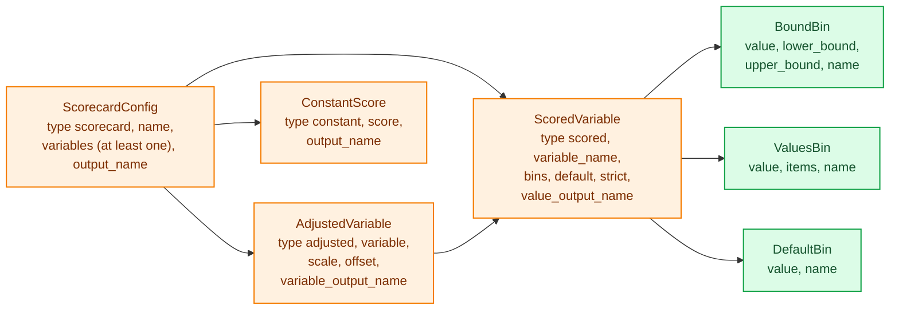
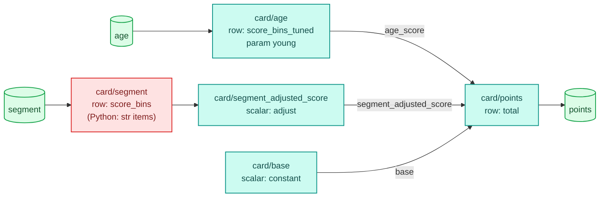
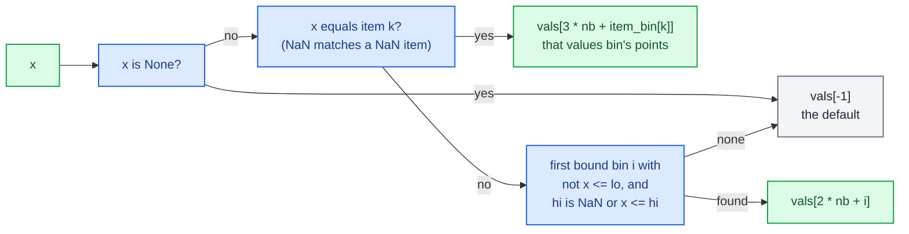

# Scorecards

A points scorecard bins each of a few inputs, gives every bin a number of points, and sums the points into a score. `ScorecardConfig` is that model as a configurable step. Unlike a tree or a table it does not lower to one row node: each variable becomes its own small IR node, and a last node adds them up, so every variable's points come out as a column of their own next to the total. Every bin edge and every points value can be a param, so moving an edge through the params document changes the score without rebuilding or recompiling anything.

The user-side guide is [trees, tables and scorecards](../../guides/trees-tables-scorecards.md). The [configurable steps overview](index.md) covers the registry and the lowering helpers this page uses.

## Where the code lives

| File | Role |
|---|---|
| `decider/steps/scorecard/__init__.py` | Exports `ScorecardConfig` |
| `decider/steps/scorecard/_config.py` | The document model (`ScorecardConfig`, the three variable kinds, the three bin kinds), bin validation, and the lowering in each variable's `nodes()` |
| `decider/steps/scorecard/_kernels.py` | `score_bins`, `score_bins_tuned`, `adjust`, `constant` and `total`: plain numeric Python that numba also compiles |

## The document model



All of these are frozen pydantic models with `extra="forbid"`. The three variable kinds are a union discriminated on `type`. The two bin kinds have no `type` field: a bin with an `items` key is a `ValuesBin`, anything else a `BoundBin`. Every numeric field (`value`, `lower_bound`, `upper_bound`, `scale`, `offset`, `score`) is a `Value[float]`, so it is a literal or a `ParamRef`.

| Model | Writes | Notes |
|---|---|---|
| `ScoredVariable` | `value_output_name`, default `"{variable_name}_score"` | bins are checked in order, values bins first; the default scores a null input or a value no bin takes |
| `AdjustedVariable` | `variable_output_name`, default `"{variable_name}_adjusted_score"`, plus the inner variable's own output | `score * scale + offset`; the template may use `{variable_name}` and `{score_value_output_name}` |
| `ConstantScore` | `output_name`, default `"constant_score"` | the same points on every row |
| `ScorecardConfig` | `output_name`, default `"score"` | the sum of every variable's output |

A bin's `name` (`{"value": 0, "name": "unknown"}`) round-trips through the document but is not used when the scorecard runs. There are no reason-code outputs beyond the per-variable points columns; the code comments that those columns serve as reason codes.

### Validation

`ScoredVariable._check_bins` walks the bins in order when the document loads:

- Values bins may not share an item: `Duplicate values {'a'} found in ValuesBin at index 1`.
- A bound bin needs `lower_bound < upper_bound`.
- Bound bins must be in order and not overlap: `BoundBin at index 1 has lower_bound 5.0 which is less than previous highest_bound 10.0. Bound bins must be in order and non-overlapping.`
- With `strict` (the default), each bound bin's lower bound must equal the previous one's upper: `BoundBin at index 1 lower_bound (12.0) must be equal to (in strict mode) previous upper_bound (10.0) defined in BoundBin at index 0.` With `strict: false`, gaps are allowed and score the default.
- Of two neighbouring bound bins, at least one must define the shared edge.

These checks use a `ParamRef`'s default in place of its value. A param moved at run time is not re-checked, so a retune can produce overlapping bins; the kernel then gives the first bin that matches.

`ScorecardConfig._unique_names` refuses two scored or adjusted variables with the same `variable_name`, because the name becomes a path segment and a params key.

## A worked example

```python
CARD = {
    "type": "scorecard", "name": "card", "output_name": "points",
    "variables": [
        {"type": "constant", "score": 600, "output_name": "base"},
        {"type": "scored", "variable_name": "age", "default": {"value": -10, "name": "unknown"},
         "bins": [{"value": 5, "upper_bound": {"param": "young", "default": 25}},
                  {"value": 15, "lower_bound": {"param": "young", "default": 25}, "upper_bound": 60},
                  {"value": 10}]},
        {"type": "adjusted", "scale": 2.0, "offset": -5,
         "variable": {"type": "scored", "variable_name": "segment", "default": {"value": 0},
                      "bins": [{"value": 20, "items": ["gold", "platinum"]}, {"value": 8, "items": ["silver"]}]}},
    ],
}
card = ScorecardConfig.load(CARD)
df = pl.DataFrame({"age": [19.0, 25.0, 25.5, 70.0, None],
                   "segment": ["gold", "silver", "bronze", None, "platinum"]})
print(Engine().bind(card, mode="fused").run(df))
```

Interpreted and fused mode give the same frame:

```text
┌──────┬──────────┬────────┬───────┬───────────┬───────────────┬────────────────────────┐
│ age  ┆ segment  ┆ points ┆ base  ┆ age_score ┆ segment_score ┆ segment_adjusted_score │
│ ---  ┆ ---      ┆ ---    ┆ ---   ┆ ---       ┆ ---           ┆ ---                    │
│ f64  ┆ str      ┆ f64    ┆ f64   ┆ f64       ┆ f64           ┆ f64                    │
╞══════╪══════════╪════════╪═══════╪═══════════╪═══════════════╪════════════════════════╡
│ 19.0 ┆ gold     ┆ 640.0  ┆ 600.0 ┆ 5.0       ┆ 20.0          ┆ 35.0                   │
│ 25.0 ┆ silver   ┆ 616.0  ┆ 600.0 ┆ 5.0       ┆ 8.0           ┆ 11.0                   │
│ 25.5 ┆ bronze   ┆ 610.0  ┆ 600.0 ┆ 15.0      ┆ 0.0           ┆ -5.0                   │
│ 70.0 ┆ null     ┆ 605.0  ┆ 600.0 ┆ 10.0      ┆ 0.0           ┆ -5.0                   │
│ null ┆ platinum ┆ 625.0  ┆ 600.0 ┆ -10.0     ┆ 20.0          ┆ 35.0                   │
└──────┴──────────┴────────┴───────┴───────────┴───────────────┴────────────────────────┘
```

Age 25 scores 5 because an upper bound is inclusive. The third age bin has no bounds in the document; its lower edge is filled from the previous bin's upper (60) and its upper is open, so 70 scores 10. A null age scores the default, -10. The `segment` variable has string items, so in fused mode it runs in Python, with a warning:

```text
FallbackWarning: card/segment runs in Python, row by row: reads 'segment' as str, which no kernel holds
```

The parameter report shows the one param, under the variable's own path:

```text
{'card/age': {'young': {'type': 'float', 'default': 25}}}
```

Retuning it moves the edge between the first two bins: with `params={"card": {"age": {"young": 30.0}}}`, age 25.5 scores 5 instead of 15.

## How a scorecard lowers

`ScorecardConfig.to_ir` builds a child context under the scorecard's name, collects each variable's nodes, appends a `total` node, and wraps them in a `SequenceNode` that emits every output, not only the total. For the example:

```text
SequenceNode card ('base', 'age_score', 'segment_score', 'segment_adjusted_score', 'points')
  card/base              scalar constant         in=[] out=['base'] params=[]
      score = 600.0
  card/age               row    score_bins_tuned in=['age'] out=['age_score'] params=['young']
      nb = 3
      vals = array([ nan,  nan,  60.,  nan,  60.,  nan,   5.,  15.,  10., -10.])
      items = array([], dtype=float64)
      item_bin = array([], dtype=int64)
      slots = array([-1,  0, -1,  0, -1, -1, -1, -1, -1, -1])
  card/segment           row    score_bins       in=['segment'] out=['segment_score'] params=[]
      nb = 0
      vals = array([20.,  8.,  0.])
      items = array(['gold', 'platinum', 'silver'], dtype=object)
      item_bin = array([0, 0, 1])
  card/segment_adjusted_score scalar adjust           in=['segment_score'] out=['segment_adjusted_score'] params=[]
      scale = 2.0
      offset = -5.0
  card/points            row    total            in=['base', 'age_score', 'segment_adjusted_score'] out=['points'] params=[]
```



Each variable kind lowers in its `nodes(ctx, owner)` method:

- A `ScoredVariable` is one row `CallNode` named after the variable, with one input (`x`, `float | None` or `str | None` when an item is a string, `OPTIONAL`) and one float output. Its consts are `nb` (the number of bound bins), `vals`, `items` and `item_bin`, plus `slots` when any value is a param.
- An `AdjustedVariable` is its inner variable's nodes followed by a scalar `CallNode` calling `adjust(score, scale, offset)`. `scale` and `offset` go through `ctx.value`, so each is a const or a param.
- A `ConstantScore` is a scalar `CallNode` calling `constant(score)` with no inputs.
- The total is a row `CallNode` calling `total`, whose inputs are every variable's output (the adjusted one for an adjusted variable).

The total reads the adjusted output, not the unadjusted one, which is why `segment_score` (20) and `segment_adjusted_score` (35) both appear but only 35 is summed.

### The `vals` array

`vals` packs every number a scored variable needs into one float64 array: `nb` lower bounds, `nb` upper bounds, `nb` bound-bin points, one points value per values bin, and the default points last. A missing bound is taken from the neighbouring bin (a lower from the previous bin's upper, an upper from the next bin's lower) and is NaN when there is none. A param's position holds NaN as a placeholder, and `slots` maps each position to its param's index in the params tuple, or -1.

<div class="diagram" markdown>
![The age variable's bins on a number line (5 points up to the param young, 15 points up to 60, 10 points above 60, -10 for a null age) and its vals array: three lower bounds, three upper bounds, three points values and the default, with the two param positions marked and the slots array mapping them to params[0]](../../assets/diagrams/configurable-scorecard-bins.svg)

*The `age` variable from the example. One param, `young`, fills two positions.*
</div>

Neighbour filling uses `or`, not `is None`: `b.lower_bound or bound[i - 1].upper_bound`. A literal bound of 0 is therefore treated as unset and replaced by the neighbour's bound, or left open. The code keeps this deliberately so existing scorecards score the same, and `test_a_zero_bound_counts_as_unset` pins it: a single bin with `lower_bound=0.0, upper_bound=10.0` scores -5.0 as inside the bin.

## The kernels

`_points(x, nb, vals, items, item_bin)` is decorated `@register_jitable`, so the same function runs as plain Python in interpreted mode and is compiled by numba when a kernel calls it.



The lower test is written `not x <= lo` instead of `x > lo`. With a NaN `lo` (no bound) both forms are true for a number; for a NaN input the first form is true for every lower bound, so a NaN clears every lower edge, as polars does. A NaN input therefore scores the first bin whose upper edge is open, or the default if there is none (`test_a_null_input_scores_the_default_and_nan_clears_every_lower_bound`: a null scores 0.0, a NaN scores 20.0). A null (`None`) always scores the default.

The row functions around it:

| Function | Kind | Why it exists |
|---|---|---|
| `score_bins(row, params, consts)` | row | a scored variable whose bins have no params |
| `score_bins_tuned(row, params, consts)` | row | the same with params: it copies `vals` and writes each `params[slots[j]]` into position `j`. It is a separate function because numba cannot index an empty params tuple |
| `adjust(score, scale, offset)` | scalar | `score * scale + offset` |
| `constant(score)` | scalar | returns its const or param |
| `total(row, params, consts)` | row | sums the row tuple in float64 |

None of these has a `reference`. They are ordinary Python, so the interpreted runner calls them directly, and compiled modes compile them like any other step function; the [kernel page](../engine/kernels.md) describes how scalar and row calls become kernels.

## String bins

A `ValuesBin` with string items makes the variable's input `str | None` and its `items` an object array. No kernel holds a Python `str`, so compiled modes run that one node in Python, with the `FallbackWarning` shown above, and give the interpreted answers. Before this rule, a scorecard's string bins silently never matched in compiled modes; `test_value_bins_match_strings_in_compiled_modes` and `test_string_values_bins_fall_back_to_python_when_compiled` pin the current behaviour. `Engine(strict_compile=True)` turns the fallback into an error. `@allow_fallback` cannot be used to declare it, because a scorecard is not one function; it raises `TypeError` for a tree, table or scorecard.

A numeric scorecard compiles completely: `test_compiled_kernels_give_the_interpreted_answers` compiles a numeric card's plan, checks that every unit is a kernel, and compares the outputs with interpreted mode before and after a retune.

## Retuning and params

Every param of a scored variable lives under `<scorecard>/<variable_name>`, because the variable's node is named with `ctx.origin(owner, self.variable_name)` inside the scorecard's child context. A constant's and an adjusted variable's params live under their output names (`card/base`, `card/segment_adjusted_score`). A `ParamRef` used twice in one variable (the `young` edge above) is one `ParamDecl`, deduplicated by equality, so one knob moves both sides of the edge.

Retuning changes only the params tuple. `test_retuning_an_edge_and_points_changes_the_output_without_rebuilding_ir` checks that the IR object is the same before and after.

## Failure modes

| Symptom | Cause |
|---|---|
| `ValidationError` at `variables.0.scored` | a bin rule above; the message names the bin index |
| `Duplicate variable_name 'age' found in ScoreCard variables` | two variables scoring the same input |
| `FallbackWarning: card/segment runs in Python, row by row: reads 'segment' as str` | string items in a values bin; expected |
| A value of 0 scores in an unexpected bin | a literal bound of 0 counts as unset, and the neighbour's bound (or no bound) is used instead |
| A retuned edge overlaps its neighbour | params are not re-checked against the bin order; the first matching bin wins |
