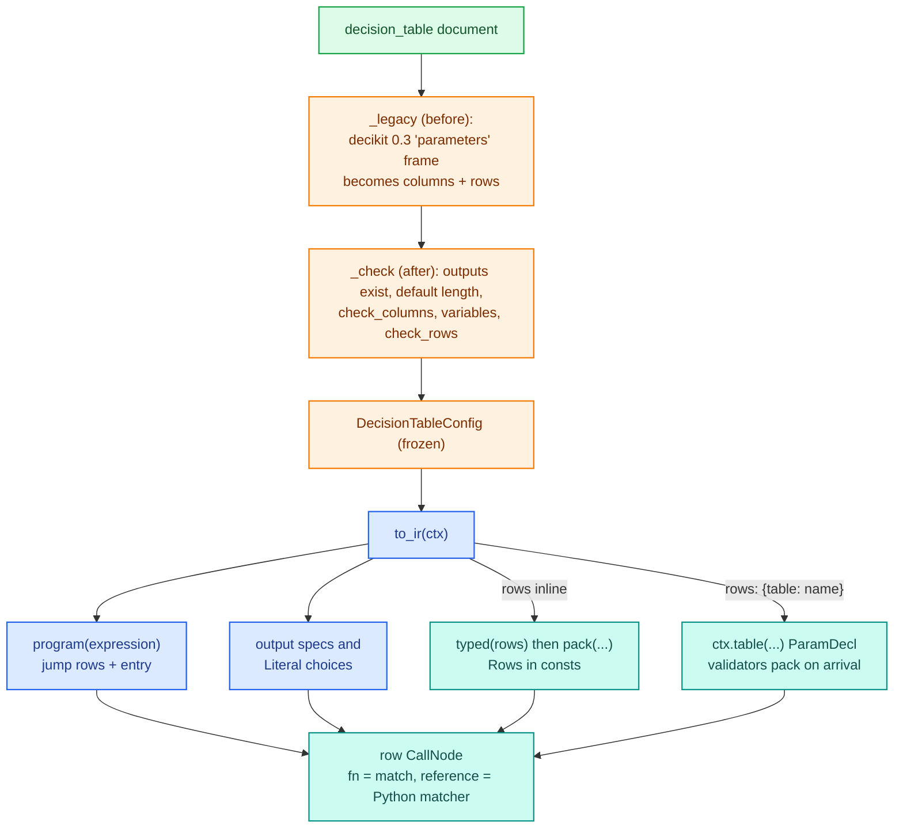
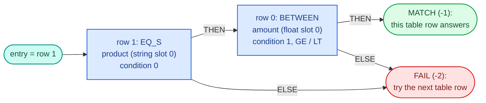
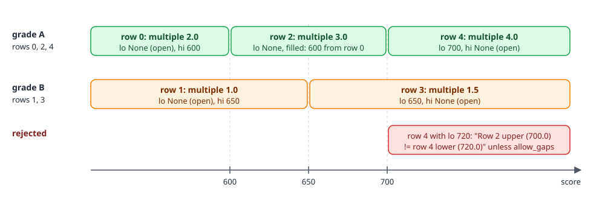
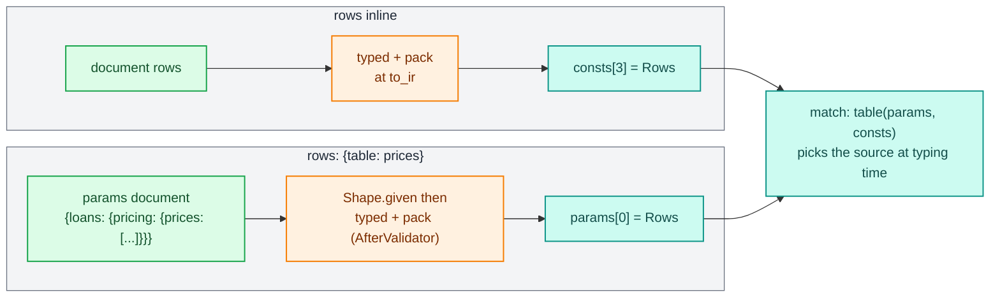

# Decision tables

`DecisionTableConfig` finds, for each record, the first table row the record matches and writes that row's output columns, or the table's `default` when no row matches. A pricing table, a limit band table or a channel eligibility table is one of these. Like a tree, the whole table is one row node: its conditions become a small jump program, its rows become packed arrays, and one numba matcher, shared by every table, scans them. Rows can be written inline in the document or arrive at run time from the params document, and in both cases editing them never recompiles.

The user-side guide is [trees, tables and scorecards](../../guides/trees-tables-scorecards.md), and rows from params are covered from the user's side in [parameter tables](../../guides/parameter-tables.md). The design builds on the [tree walker](trees.md), whose byte matcher and comparison opcodes it reuses.

## Where the code lives

| File | Role |
|---|---|
| `decikit/steps/tables/__init__.py` | `DecisionTableConfig`: fields, the decider 0.3 `parameters` spelling, validation, `to_ir` |
| `decikit/steps/tables/schema.py` | The condition vocabulary (`and`, `or`, `between`, `in`, `is_true`, `eq`), band ladders (`groups`, `bounds`) and `check_rows` |
| `decikit/steps/tables/_encode.py` | Column kinds, `variables`, `program` (the jump rows), `typed` (casting rows to the declared dtypes), `Shape`, `pack`, `Rows` |
| `decikit/steps/tables/_matcher.py` | `match`, the compiled matcher, with `_scan`, `_holds` and the `pick` overload |
| `decikit/steps/tables/_reference.py` | `reference`, the Python matcher |
| `decikit/_engine/params/tables.py` | `rows_like`, which formats the expected row shape in error messages |

## From document to row node



## The document

| Field | Meaning |
|---|---|
| `columns` | Every column of the table and its polars dtype: `"Float64"`, `"String"`, `{"type": "List", "inner": "String"}`, `{"type": "Enum", "categories": [...]}` |
| `rows` | The rows inline (a list of dicts, or `{"data": [...]}`), or `{"table": "<param>"}` to read them from the params document |
| `expression` | How a record matches a row, in decider 0.3's vocabulary |
| `outputs` | The columns written, one output column each |
| `default` | One value per output for records that match no row; absent means nulls |

The expression vocabulary:

| Condition | Holds when |
|---|---|
| `{"type": "eq", "variable": v, "value_column": c}` | the record's `v` equals the row's value in `c` |
| `{"type": "in", "variable": v, "values_column": c}` | `v` is in the row's list in `c` (a `List` of numbers or strings) |
| `{"type": "between", "variable": v, "lower_bound_column": lo, "upper_bound_column": hi, "mode": ..., "allow_gaps": ...}` | `v` lies in the row's band; `mode` is `lower_inclusive` (`[lo, hi)`, the default) or `upper_inclusive` (`(lo, hi]`), the same enum as a tree's `RangeEndLogic` |
| `{"type": "is_true", "variable": v}` | the boolean `v` is true; it reads no column, so it holds for every row or none |
| `{"type": "and" / "or", "expressions": [...]}` | every / some sub-expression holds |

There is no NOT in the vocabulary, so a table never has to tell a null result apart from a false one.

Validation happens when the document loads. `_legacy` rewrites decider 0.3's `"parameters": {"data": [...], "dtypes": {...}}` into `columns` and `rows` (inferring dtypes with polars when they are missing) and drops `unnest_output`. `_check` then refuses an output column the table lacks or one that is a list, a `default` of the wrong length, a condition naming an unknown column or one of the wrong type (`Lower bound column 'lo' must be numeric, got str`), a variable compared as two different kinds, and, for inline rows, rows that do not fit the declared dtypes or bands that do not resolve.

## A worked example: loan pricing

Rates depend on the product and, for loans, on the amount:

```python
DOC = {
    "type": "decision_table", "name": "pricing",
    "columns": {"product": "String", "lo": "Float64", "hi": "Float64", "rate": "Float64", "tier": "String"},
    "rows": [
        {"product": "loan", "lo": None, "hi": 10000.0, "rate": 0.20, "tier": "small"},
        {"product": "loan", "lo": 10000.0, "hi": None, "rate": 0.15, "tier": "large"},
        {"product": "card", "lo": 0.0, "hi": None, "rate": 0.22, "tier": "card"},
    ],
    "expression": {"type": "and", "expressions": [
        {"type": "eq", "variable": "product", "value_column": "product"},
        {"type": "between", "variable": "amount", "lower_bound_column": "lo", "upper_bound_column": "hi"}]},
    "outputs": ["rate", "tier"], "default": [None, "none"],
}
t = DecisionTableConfig.load(DOC)
df = pl.DataFrame({"product": ["loan", "loan", "card", "card", "auto", None],
                   "amount": [5000.0, 25000.0, 900.0, None, 100.0, 50.0]})
print(Engine().bind(t, mode="fused").run(df))
```

```text
┌─────────┬─────────┬──────┬───────┐
│ product ┆ amount  ┆ rate ┆ tier  │
│ ---     ┆ ---     ┆ ---  ┆ ---   │
│ str     ┆ f64     ┆ f64  ┆ str   │
╞═════════╪═════════╪══════╪═══════╡
│ loan    ┆ 5000.0  ┆ 0.2  ┆ small │
│ loan    ┆ 25000.0 ┆ 0.15 ┆ large │
│ card    ┆ 900.0   ┆ 0.22 ┆ card  │
│ card    ┆ null    ┆ null ┆ none  │
│ auto    ┆ 100.0   ┆ null ┆ none  │
│ null    ┆ 50.0    ┆ null ┆ none  │
└─────────┴─────────┴──────┴───────┘
```

The `card` row first had both bounds `None`. That fails validation, because a row that is alone in its band ladder can leave one edge open but not both:

```text
Value error, Row 2: both bounds are unresolvable; give it a lower or an upper bound. Only the first row of its group (rows sharing its eq values) (row 2) may leave its lower bound None and only the last (row 2) its upper.
```

`to_ir(t)` gives one row node:

```text
CallNode row match
inputs: [('amount', <class 'float'>, 'MISSING_AS'), ('product', bytes | None, 'OPTIONAL')]
outputs: [('rate', float | None), ('tier', typing.Literal['small', 'large', 'card', 'none'])]
entry: 1 outputs: ((2, 0.0, 0), (3, 3))
```

Inputs are ordered float, bool, string (the same `split` the tree walker uses). A number variable is `missing_as(NaN)`, which no comparison matches; bool and string variables are `T | None`. `rate` is nullable because the default is null. `tier` is a `Literal` whose choices are the rows' values plus the default.

## The jump program

`program(expression, types, slots)` compiles the conditions into rows of seven int64 columns: `KIND, VAR, LEAF, LO_OP, HI_OP, THEN, ELSE`. `KIND` is one of `BETWEEN, EQ_F, EQ_B, EQ_S, IN_F, IN_S, TRUE`; `VAR` is the variable's slot within its kind; `LEAF` is the condition's number, which says where its row data sits in the packed rows; `LO_OP` and `HI_OP` are the band's comparison opcodes (`GE`/`LT` for `lower_inclusive`, `GT`/`LE` for `upper_inclusive`). A target of `MATCH` (-1) means the table row matches, `FAIL` (-2) that it does not.

AND and OR are jumps, exactly as in a tree: `and` chains its sub-conditions through `THEN`, `or` through `ELSE`, built from the last sub-condition backwards. Nothing is expanded to disjunctive normal form, so a table with 400 conditions (`test_a_400_condition_table_builds_and_answers_correctly`) is 400 program rows.

The pricing table's program, from the reference's arrays:

```text
program rows: [[0, 0, 1, 4, 0, -1, -2], [3, 0, 0, 4, 0, 0, -2]]
```



The program does not depend on the rows, so it is built at `to_ir` from the expression alone and passed as an address (`consts[0]`). The reference holds the program array (`fn.arrays = [code]`) to keep it alive.

## Packed rows

`pack(data, shape)` turns the typed rows into a `Rows` value: the addresses of an int64, a float64 and a byte array, and the row count `n`. Where each condition's and each output's data starts depends on the rows (string lengths, list lengths), so the int array opens with a header of two starts per condition and per output: one into the int array, one into the float array.

<div class="diagram" markdown>


*The arrays printed from `to_ir(t)` for the pricing example.*
</div>

What each condition and output stores:

| Part | Int array | Float array |
|---|---|---|
| `between` | `n` has-lower flags, then `n` has-upper flags | `n` resolved lower bounds, then `n` upper bounds (0.0 where open) |
| `eq` on a String column | `n + 1` byte offsets into `chars`, then `n` has-value flags | nothing |
| `eq` on a number or bool column | `n` has-value flags | `n` values as float64 |
| `in` on a `List[String]` | `n + 1` starts into a list of byte offsets, then the offsets | nothing |
| `in` on a `List` of numbers | `n + 1` starts into the float array | the items as float64 |
| `between`, `eq` or `in` on a variable declared `int` | has-flags as above; `between` then `n` lower and `n` upper bounds, `eq` `n` values, `in` the items | nothing |
| a float output | `n` validity flags | `n` values |
| an int, bool or String output | `n` validity flags, then `n` values (a String output's values are indices into its `Literal` choices) | nothing |

`between` bounds are resolved when the rows are packed (the next section), so the kernel reads a finished `(has_lo, lo, has_hi, hi)` per row and never looks at a neighbour. Numbers compare as float64, exact up to 2**53, unless the document declares the variable `int` in `variable_types`: the table then reads it as an int64 input (null is `-2**63`) and compares exactly, using integer columns only. Nothing is inferred from a column's dtype, so a document without `variable_types` compiles to the same program as before.

## Matching

`match(row, params, consts)` is `@njit(cache=True)`:

1. `split(row)` gives the float, bool and span inputs.
2. `table(params, consts)` is an `overload` that resolves at typing time: when the node has no params, the rows are `consts[3]`; when it has a table param, they are `params[0]`.
3. `_scan` loops over the table rows. For each row it runs the jump program from `entry` until `pc` is negative; `MATCH` returns the row number, `FAIL` moves on. No row matching returns -1.
4. `pick`, an `overload` inlined by LLVM (`forceinline`), reads each output at the matched row, or its default for -1. An output spec is `(header slot, default)` or, for a nullable output, `(header slot, default, default is valid)`.

`_holds(r, ...)` evaluates one program row against table row `r`. A null input never matches: a NaN float, a `None` bool, or a string span of length -1 makes every condition on it false. A null value in the row (`has_value` 0) also never matches. String equality and `in` over strings compare the record's UTF-8 bytes with the row's bytes through the tree walker's `_matches(..., EXACT)`; nothing becomes a dictionary code.

The scan is linear in the number of rows, and the first matching row wins. The cost of a linear scan on the earlier generated-code design was 70 ns a row at 2 bands, 1045 ns at 1000. Compile cost does not depend on the row count at all, since the rows are data.

## Band ladders

decider_old filled a missing band bound from the neighbouring row of the whole table and allowed an open edge only on the table's first and last rows. A table keyed by grade with bands per grade then needed `±inf` sentinels and `allow_gaps`, which turned off the contiguity check the table wanted. The decider toolkit groups the rows instead: rows with equal values in every `eq` column form one ladder, in row order, and open edges, neighbour fill and contiguity apply within each ladder. Rows of different ladders may interleave. `in` lists do not split ladders, because band tables whose rows carry different channel lists but share one ladder are common, and splitting them would silently open their edges.

This limit-multiple table interleaves grades A and B:

```python
LIMITS = {
    "type": "decision_table", "name": "limit_band",
    "columns": {"grade": "String", "lo": "Float64", "hi": "Float64", "multiple": "Float64"},
    "rows": [
        {"grade": "A", "lo": None, "hi": 600.0, "multiple": 2.0},
        {"grade": "B", "lo": None, "hi": 650.0, "multiple": 1.0},
        {"grade": "A", "lo": None, "hi": 700.0, "multiple": 3.0},
        {"grade": "B", "lo": 650.0, "hi": None, "multiple": 1.5},
        {"grade": "A", "lo": 700.0, "hi": None, "multiple": 4.0},
    ],
    "expression": {"type": "and", "expressions": [
        {"type": "eq", "variable": "grade", "value_column": "grade"},
        {"type": "between", "variable": "score", "lower_bound_column": "lo", "upper_bound_column": "hi"}]},
    "outputs": ["multiple"], "default": [0.0],
}
```

`groups` and `bounds` from `schema.py` resolve it to:

```text
ladders: [[0, 2, 4], [1, 3]]
bounds: [(None, 600.0), (None, 650.0), (600.0, 700.0), (650.0, None), (700.0, None)]
```

<div class="diagram" markdown>


*Each `eq` group is its own ladder. Row 2's missing lower bound comes from row 0, the previous row of the same grade.*
</div>

```text
┌───────┬───────┬──────────┐
│ grade ┆ score ┆ multiple │
│ ---   ┆ ---   ┆ ---      │
│ str   ┆ f64   ┆ f64      │
╞═══════╪═══════╪══════════╡
│ A     ┆ 550.0 ┆ 2.0      │
│ A     ┆ 650.0 ┆ 3.0      │
│ A     ┆ 720.0 ┆ 4.0      │
│ B     ┆ 600.0 ┆ 1.0      │
│ B     ┆ 700.0 ┆ 1.5      │
│ C     ┆ 700.0 ┆ 0.0      │
└───────┴───────┴──────────┘
```

Moving row 4's lower bound to 720 leaves a gap in grade A's ladder, and the document is rejected: `Row 2 upper (700.0) != row 4 lower (720.0): ranges are not contiguous. Set allow_gaps=True to permit this.`

`check_rows` runs the same checks for inline rows at load time and for param rows when the params document arrives; `pack` calls it too.

## Rows inline or from params

`rows: {"table": "prices"}` makes the rows a required param of the step called `prices`. `to_ir` asks `ctx.table(ref, schema)` for the `ParamDecl` (type `FrameDoc`, carrying the column schema) and attaches two validators to its `field_info`:

- a `BeforeValidator`, `Shape.given`, which refuses a value that is not a list of dicts before pydantic reads it as a frame;
- an `AfterValidator`, `Shape.arrive`, which casts the rows to the declared dtypes with `typed` and returns `pack(...)`, a `Rows` value.

So validating the params document is what packs the rows. The params cache keeps the validated bundle, so a document is packed once and the arrays live as long as its cache entry. `field_info` is left out of `ParamDecl` equality, so two tables can share one `shared` table param.



Both sources produce the same `Rows` type, a namedtuple subclass that numba types as a named tuple of four int64. Changing the rows or their count never changes a type, so it never recompiles; the `no_recompile` tests cover `run` on a frame and on a record, and a zero-row table. The pricing table with param rows, inside `flow(pt, name="loans")`:

```text
{'loans/pricing': {'prices': {'type': 'table', 'schema': {'product': 'String', 'lo': 'Float64', 'hi': 'Float64', 'rate': 'Float64', 'tier': "Enum(categories=['small', 'large', 'card', 'none'])"}, 'required': True}}}
```

It answers exactly as the inline version did. Bad rows fail as a `ParamsError` naming the step, the param, the row and the column, and showing the expected shape:

```text
ParamsError invalid params (affects 6 rows):
loans/pricing: param 'prices': Value error, rows don't fit the declared columns: row 0, column 'lo': 'x' is not a Float64; expected a list of rows like [{"product": String, "lo": Float64, "hi": Float64, "rate": Float64, "tier": Enum(categories=['small', 'large', 'card', 'none'])}, ...] (got [{'product': 'loan', 'lo': 'x', 'hi': None, 'rate': 0.1, 'tier': 'small'}])
```

When polars refuses the frame as a whole, `typed` re-casts cell by cell (`_misfit`) to name the first value that does not fit. An `Enum` column turns a value outside its categories into a null instead of failing, so `typed` also compares the cast rows with the raw ones and reports that case.

One engine detail follows from this: the compile probe builds a defaults bundle to type a node ahead of time, and a defaults bundle has no `Rows`, so a node with a table param skips the probe and compiles on first use. The [params page](../engine/params.md) covers the params bundle and its cache.

## Outputs and the `Enum` rule

A String output is a `Literal` output, decoded after the kernel like a tree's. Its choices are part of the IR. Inline rows give them (the distinct values in row order, plus the default). Rows that arrive later do not, so a String output of a param-rows table must be declared `{"type": "Enum", "categories": [...]}`; otherwise `to_ir` raises:

```text
ValueError pricing: output column 'tier' is a String and its rows come from params, so its values aren't known up front; declare it {"type": "Enum", "categories": [...]}
```

Adding a category is then a schema change, which rebuilds the IR as a schema change should. The alternative that was turned down, running the table in Python whenever it has a String output, would have made the common case slow.

A numeric output is `T | None` when the default is null or some inline row's value is null. Param rows can hold anything, so their numeric outputs are always `T | None`. An inline edit that introduces the first null therefore changes the output type and compiles once.

There is no matched-row output (the counterpart of a tree's `path_output`). It would need a new output kind in `pick` and in the reference, and it is left until someone asks.

## Null semantics

decider_old evaluated a table as polars `when/then`, so a comparison with a null is null and never matches. The pricing output shows each case: the `card` record with a null amount fails the band, the `auto` record matches no product, and the null product matches nothing; all three take the default. A null `eq` value in a row also never matches; decider2 treated it as a wildcard and the decider toolkit does not. A null list in an `in` column matches nothing, and nulls inside a list are skipped.

## The Python reference

`reference(expression, names, outputs, default, table, rows)` returns `match(row, params, consts, visit)`. It walks the expression model over the typed rows as dicts, resolves bands itself through `_band` and `_nearest` (the nearest row with the same `eq` values), and calls `visit(str(r))` for every row it tries. For grade A and a score of 650 in the limit table:

```text
(3.0,) ['0', '1', '2']
```

Row 2 answered after rows 0 and 1 were tried, so a session can stop on `limit_band#2`. `test_corpus.py` checks the reference against the kernel on random tables and records with nulls, in every mode.

## Measured

From `benchmarks/table_match.py` (12 bands writing String, Int64 and Float64 outputs; 1M rows through `run(df)`, 20k `run(dict)`; dev box at load average about 4):

| Table | Engine | ns/row | `run(record)` p50 | `run(record)` p99 |
|---|---|---|---|---|
| bands | decider2 fused | 304 | 42.9 µs | 53.1 µs |
| bands | decikit fused | 164 | 27.4 µs | 36.1 µs |
| bands | decikit fused, rows param | 178 | 95.9 µs | 109.2 µs |
| bands AND string `in` | decider2 fused | 398 | 75.4 µs | 86.8 µs |
| bands AND string `in` | decikit fused | 413 | 69.6 µs | 111.6 µs |
| bands AND string `in` | decikit fused, rows param | 423 | 137.1 µs | 157.4 µs |

The rows-param rows paid for hashing the whole params document on every call. After `ParamsCache.key` started remembering the last document object and its hash, rows-param `run(record)` p50/p99 went from 88.6/191.9 µs to 35.8/42.9 µs. Documents are treated as immutable once passed for that reason.

## Failure modes

| Symptom | Cause |
|---|---|
| `Output column 'x' not found in parameters columns` | an output is not declared in `columns` |
| `Default values length (1) must match outputs length (2)` | `default` has the wrong number of values |
| `Values column 'c' must be a list type` | an `in` condition points at a non-list column |
| `variable 'v' is compared as float and as str` | one variable used against columns of different kinds |
| `Row i: both bounds are unresolvable` / `ranges are not contiguous` | a band ladder with a hole or two open edges; fix the rows or set `allow_gaps` |
| `ParamsError ... param 'prices' is required but missing` | a param-rows table with no rows in the params document |
| `ParamsError ... rows don't fit the declared columns` | a row with an undeclared column, a missing column, or a value of the wrong type |
| `output column 'tier' is a String and its rows come from params` | declare the column as an `Enum` |

To see why a record took a row (or none), run the table in interpreted mode and break on `<name>#<row>`, or call `to_ir(table).reference(row, params, (), print)` with the inputs in the node's order.
