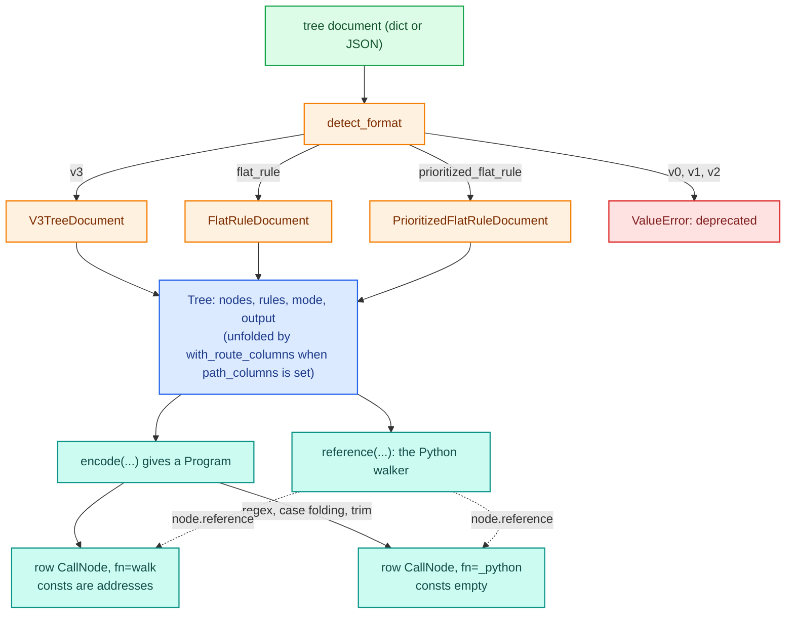
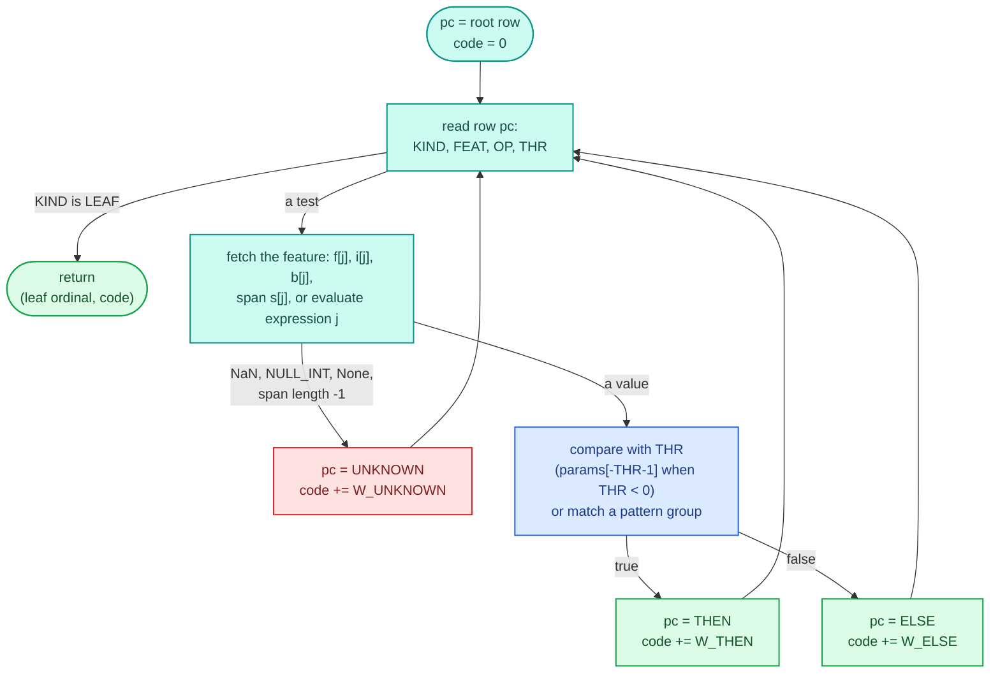

# Trees

`TreeConfig` runs a decision tree as one step. The tree arrives as a JSON document saved by the tree editor or written by hand, it is validated into a graph, encoded into three flat arrays, and walked per row by a single numba function that every tree in the process shares. A second walker, written in plain Python over the same graph, runs in interpreted mode, reports each node it passes, and is the reference the compiled walker is tested against.

Using trees (writing documents, retuning thresholds, reading `path_output`) is covered in the [trees, tables and scorecards guide](../../guides/trees-tables-scorecards.md). The [configurable steps overview](index.md) explains the registry and lowering pattern this page builds on.

## Where the code lives

| File | Role |
|---|---|
| `decider/steps/trees/__init__.py` | `TreeConfig`: fields, `to_ir`, and `_python` (the fallback row function for regex, case folding and trimming) |
| `decider/steps/trees/schema/document.py` | `TreeDocument` (the discriminated union of formats), `detect_format`, `load_document` |
| `decider/steps/trees/schema/v3.py` | `V3TreeDocument`: positioned nodes and edges, as the editor saves them; `to_flat_rules()` |
| `decider/steps/trees/schema/flat.py` | `FlatRuleDocument`, `PrioritizedFlatRuleDocument`: rules that nest their branches |
| `decider/steps/trees/schema/tree.py` | `Tree`, `Node`, `Rule`, `TreeOutput`: the one model every format normalises into |
| `decider/steps/trees/schema/nodes.py` | Node kinds (`LeafNode`, `UnaryNode`, `CasesRanges`, `CasesStringMatch`, `CasesIsIn`, `CompositeNode`) and `arity` |
| `decider/steps/trees/schema/conditions.py` | Features, thresholds and the eleven unary conditions; range validation |
| `decider/steps/trees/schema/_output_types.py` | Custom categorical and struct output types, flattened into plain columns |
| `decider/steps/trees/_encode.py` | `encode`: `Tree` to `Program` (inputs, params, outputs, consts, arrays); feature kind inference |
| `decider/steps/trees/_walker.py` | `walk`, the compiled walker, and its helpers |
| `decider/steps/trees/_reference.py` | `reference`, the Python walker |
| `decider/steps/trees/_trace.py` | Path counting and enumeration for `trace_output` |
| `decider/steps/trees/_routes.py` | `path_columns`: `Route`, `Visit`, and unfolding a tree so every route ends at its own leaf |
| `decider/steps/trees/_condition.py` | `expr_condition`, covered on the [expressions and flow files page](expr-and-flowfile.md) |
| `decider/steps/trees/_ops.py` | The six comparison opcodes (`LT, LE, EQ, GT, GE, NE`), shared with tables |

## From document to row node



`TreeConfig.tree` holds the document, not the normalised `Tree`, so a v3 tree keeps its node positions for the editor when it is dumped again. Each format's `model_validator(mode="after")` builds the `Tree` once at validation time and stores it in a private attribute, so a structural error (a cycle, an unknown edge target, a wrong branch count) surfaces when the document loads, and `to_tree()` is free afterwards.

## Document formats

`detect_format(doc)` decides which model validates a document. A `type` of `flat_rule` or `prioritized_flat_rule` picks the flat formats. Otherwise the version comes from `formatVersion`, then `format_version`, then a `type` of the form `"v<n>-tree"`. A document with none of these is a v0 document if `nodes` is a dict, and a v3 document otherwise. v0, v1 and v2 are refused with `v1 tree documents are deprecated and no longer supported; save the tree again as a v3 tree or as flat rules` (with the version filled in).

### v3: nodes and edges

The editor's format. `nodes` is a list of `{id, position, data}`; `edges` wire branch `sourceIndex` of `source` to `target`. `sourceIndex` may be one integer or a list, so one edge can carry several branches of a cases node. A branch with no edge selects the default output row. The root is the node no edge points at; if there are several, the first listed in `subtrees` wins, else the first in `nodes`. Only nodes reachable from the root are kept.

Two leniencies come from how the editor behaves. An edge whose `source` is not a node is dropped (deleting a node in the editor can leave its outgoing edges behind), while an edge to an unknown `target` is still an error. And the editor saves trees with `type: "ui-tree"`, accepted alongside `"v3-tree"`.

`V3TreeDocument.to_flat_rules()` converts back to one nested flat rule, repeating a shared node under each parent.

### Flat and prioritized flat rules

A flat rule nests its branches: a unary or composite rule has `then` and `otherwise`, a cases rule has `conditions` (each `{when, then: <branch index>}`), `otherwise` (a branch index) and `branches`. Nodes without an `id` get one from their path: the root is `"0"`, its `then` branch `"0.0"`, a cases node's `branches[2]` is `"<id>.2"`. Path ids, not random ones, so the same document always gives the same ids for breakpoints and cache keys.

Two cases that point at the same `branches[j]` become one node, which keeps the graph small. This document routes scores below 600 to leaf 0 and everything else to an `is_true` check on `vip`, with the cases node's `otherwise` reusing branch 1:

```python
flat = TreeConfig.load({"type": "tree", "name": "t", "tree": {"type": "flat_rule", "output": OUT, "rule": {"rule": {
    "type": "cases", "op": "ranges", "feature": "score",
    "conditions": [{"when": {"max": 600}, "then": 0}, {"when": {"min": 600}, "then": 1}],
    "otherwise": 1,
    "branches": [{"type": "leaf", "result_idx": 0},
                 {"type": "unary", "condition": {"op": "is_true", "feature": "vip"}, "then": leaf(1)}]}}}})
print({k: (type(v.data).__name__, v.children) for k, v in flat.nodes.items()})
```

```text
{'0.0': ('LeafNode', ()), '0.1.0': ('LeafNode', ()), '0.1': ('UnaryNode', ('0.1.0', None)), '0': ('CasesRanges', ('0.0', '0.1', '0.1'))}
```

A `prioritized_flat_rule` document holds several rules in `rules` (each `{meta: {name, description}, rule}`) and a `mode`. With `first_match` the first rule that reaches a leaf other than the default answers; with `all` every rule answers, and the outputs are named `<rule name>.<column>` (`rule_<i>` when unnamed) because a row node writes flat columns.

### What older documents carry

- `{"key": "name"}`, decider_old's input reference, is read as `{"param": "name"}`.
- A `parameters` block (`{name: {type, default_value}}`) gives every local `ParamRef` to `name` without a default that default.
- `output_fn`, `post_process_fn` and `format_prioritized_fn` name Python functions and are rejected by name: a document never holds code.
- `input_schema` is checked for shape and round-trips on dump, but the tree never reads it.

## The `Tree` model

Every format normalises to the same `Tree`:

| Field | Meaning |
|---|---|
| `nodes: dict[str, Node]` | Each node's `data` (what it tests) and `children`, a tuple where `children[i]` is the node id branch `i` leads to, or `None` for the default row |
| `rules: tuple[Rule, ...]` | Root node ids in priority order, with optional names; a v3 or flat document has one |
| `mode` | `first_match` or `all` |
| `output: TreeOutput` | `data` (the rows leaves select), `default`, `dtypes`, `type_defs` |
| `name` | The document's name (unused by the step, which has its own) |

`Tree._structure` checks that each node has exactly `arity(data)` children (0 for a leaf, 2 for unary and composite nodes, one per case plus one for otherwise), that every child exists, and that the graph has no cycle, using Kahn's algorithm: whatever never reaches in-degree zero sits on a cycle. A node with two parents is allowed. The tree is a DAG, and the walker does not care how a node was reached.

`add_node` refuses two different nodes under one id but accepts the same node twice, because decider_old's v3-to-flat conversion duplicated shared subtrees under one id.

### Node kinds and conditions

| Node | Branches | Notes |
|---|---|---|
| `leaf` | none | `result_idx` selects `output.data[i]`; `-1` selects the default row |
| `unary` | 0 when the condition holds, 1 otherwise | `condition` is one of the eleven conditions below |
| `composite` | 0 when it holds, 1 otherwise | `op` is `and`, `or` or `not` over nested conditions; `not` takes exactly one; an empty composite is rejected |
| `cases` / `ranges` | `i` for the first band that holds, `len(conditions)` otherwise | bands `{min, max}`; `end_logic` closes `[lo, hi)` (`lower_inclusive`, the default) or `(lo, hi]`; with `strict` (default) literal bands must be sorted and contiguous |
| `cases` / `string_match` | first case whose patterns match | `match_type`, `case_sensitive`, `trim_whitespace` |
| `cases` / `isin` | first value set holding the feature | values are numbers or one `ParamRef` |

Empty cases nodes are accepted and always take `otherwise`.

The unary conditions are `<`, `<=`, `==`, `>`, `>=`, `!=` (with a `threshold`), `between` (closed at both ends, either bound optional), `isin` (a list of values, or one `ParamRef` meaning equality with that param), `string_match` (patterns plus `match_type`, `case_sensitive`, `trim_whitespace` and `null_handling`), `is_true` and `is_false`.

A threshold is `Value[int | float]`. It stays an int when written as one, so an int64 id above 2**53 is compared exactly instead of being rounded through a float. Bounds, values and patterns all accept `ParamRef`s.

## Features and their kinds

A feature is a column name or a computed feature, `{"type": "computed", "expression": "income - expenses"}`, parsed by the closed expression grammar on the [expressions page](expr-and-flowfile.md). The walker reads each feature from a typed slot, so each needs a kind: `float`, `int`, `bool` or `str`. `feature_types` may declare one per feature (Python types or polars names such as `"Int64"` or `"String"`); otherwise `feature_kinds` infers it from use. A `string_match` makes a feature `str`, only `is_true`/`is_false` uses make it `bool`, and anything else is `float`. Declare an int64 column `int` to compare it exactly.

A use that makes no sense for the kind is an error naming the node, raised when the step lowers:

```text
ValueError tree node '0': a numeric comparison on the string feature 'channel'; use string_match
ValueError tree node '0': string_match on the float feature 'score'; declare it str in feature_types
```

Computed features are float arithmetic and may read only float features. `feature_types` naming a column the tree does not read is also an error, as is a fractional literal threshold on an `int` feature.

## A worked example: the loan tree

This tree declines a high debt-to-income ratio, routes branch and digital applications to an affordability check on a computed surplus, and leaves every other channel to the default row. `max_dti` is a param, and the step asks for both the answering leaf and the full path:

```python
DOC = {
    "type": "tree", "name": "loan_tree", "path_output": "leaf", "trace_output": "path",
    "tree": {
        "nodes": [
            {"id": "dti", "data": {"type": "unary", "condition": {
                "op": ">", "feature": "dti", "threshold": {"param": "max_dti", "default": 0.45}}}},
            {"id": "channel", "data": {"type": "cases", "op": "string_match", "feature": "channel",
                                       "conditions": [{"patterns": ["branch"]}, {"patterns": ["app", "web"]}]}},
            {"id": "surplus", "data": {"type": "unary", "condition": {
                "op": ">=", "feature": {"type": "computed", "expression": "income - expenses"}, "threshold": 5000}}},
            {"id": "decline", "data": {"type": "leaf", "result_idx": 0}},
            {"id": "approve", "data": {"type": "leaf", "result_idx": 1}},
            {"id": "refer", "data": {"type": "leaf", "result_idx": 2}},
        ],
        "edges": [
            {"source": "dti", "target": "decline", "data": {"sourceIndex": 0}},
            {"source": "dti", "target": "channel", "data": {"sourceIndex": 1}},
            {"source": "channel", "target": "surplus", "data": {"sourceIndex": [0, 1]}},
            {"source": "surplus", "target": "approve", "data": {"sourceIndex": 0}},
            {"source": "surplus", "target": "refer", "data": {"sourceIndex": 1}},
        ],
        "output": {
            "data": [{"decision": "decline", "limit": 0}, {"decision": "approve", "limit": 50000},
                     {"decision": "refer"}],
            "default": {"decision": "manual"},
            "dtypes": [["decision", "String"], ["limit", "Int64"]],
        },
    },
}
tree_cfg = TreeConfig.load(DOC)
```

<div class="diagram" markdown>


*The validated `Tree`. Two branches of `channel` share `surplus`. The `(+n)` on each edge is the path weight the encoder assigns for `trace_output`.*
</div>

The `Tree` the document validates into, with children by branch:

```text
rules: (Rule(root='dti', name=None),)
  dti      UnaryNode          children=('decline', 'channel')
  channel  CasesStringMatch   children=('surplus', 'surplus', None)
  surplus  UnaryNode          children=('approve', 'refer')
  refer    LeafNode           children=()
  approve  LeafNode           children=()
  decline  LeafNode           children=()
```

Run over five applications in fused and interpreted mode, it gives the same frame:

```text
┌──────┬─────────┬─────────┬──────────┬──────────┬───────┬─────────┬─────────────────────────────┐
│ dti  ┆ channel ┆ income  ┆ expenses ┆ decision ┆ limit ┆ leaf    ┆ path                        │
│ ---  ┆ ---     ┆ ---     ┆ ---      ┆ ---      ┆ ---   ┆ ---     ┆ ---                         │
│ f64  ┆ str     ┆ f64     ┆ f64      ┆ str      ┆ i64   ┆ str     ┆ str                         │
╞══════╪═════════╪═════════╪══════════╪══════════╪═══════╪═════════╪═════════════════════════════╡
│ 0.6  ┆ app     ┆ 9000.0  ┆ 3000.0   ┆ decline  ┆ 0     ┆ decline ┆ dti>decline                 │
│ 0.3  ┆ branch  ┆ 12000.0 ┆ 4000.0   ┆ approve  ┆ 50000 ┆ approve ┆ dti>channel>surplus>approve │
│ 0.3  ┆ web     ┆ 7000.0  ┆ 4000.0   ┆ refer    ┆ null  ┆ refer   ┆ dti>channel>surplus>refer   │
│ 0.3  ┆ phone   ┆ 12000.0 ┆ 1000.0   ┆ manual   ┆ null  ┆ null    ┆ dti>channel                 │
│ null ┆ app     ┆ 12000.0 ┆ 1000.0   ┆ approve  ┆ 50000 ┆ approve ┆ dti>channel>surplus>approve │
└──────┴─────────┴─────────┴──────────┴──────────┴───────┴─────────┴─────────────────────────────┘
```

The `phone` row reaches the default row, so its `leaf` is null and its `path` stops at `channel`. The last row has a null `dti`: under the default `null_handling="otherwise"` the comparison is unknown and the node takes its otherwise branch. Retuning with `params={"loan_tree": {"max_dti": 0.7}}` turns the first row into an approval without rebuilding or recompiling anything.

The rest of this page follows that document through `encode` and `walk`.

## Encoding: `Tree` to `Program`

`encode(tree, feature_types, ctx.value, null_handling, path_output, trace_output)` returns a `Program`:

| Field | For the loan tree |
|---|---|
| `inputs` | `dti`, `expenses`, `income` as `float` with `MISSING_AS` NaN, then `channel` as an optional `bytes`, `OPTIONAL` |
| `params` | `max_dti: float = 0.45` |
| `outputs` | `decision: Literal['refer', 'approve', 'decline', 'manual']`, `limit: Optional[int]`, `leaf: Literal['refer', 'approve', 'decline']`, `path: Literal['dti>decline', 'dti>channel>surplus>approve', 'dti>channel>surplus>refer', 'dti>channel']` |
| `consts` | `ints`, `floats`, `chars` (three addresses), `layout`, `outputs` (specs) |
| `python` | `False`: every string match compares bytes |
| `arrays` | the three numpy arrays the addresses point at |

The encoder visits nodes in post-order (iteratively, so a chain thousands of nodes deep encodes), so every child's entry row exists before its parent's rows jump to it. Each node becomes a short run of program rows.

### Program rows

A program row has ten int64 columns: `KIND, FEAT, OP, THR, THEN, ELSE, UNKNOWN, W_THEN, W_ELSE, W_UNKNOWN`. `KIND` is one of `LEAF`, `CMP_F` (float feature), `CMP_I` (int), `CMP_B` (bool), `CMP_E` (computed expression) and `MATCH` (string). A leaf row's `FEAT` column holds the leaf's ordinal, `-1` for the default row.

The loan tree's eight rows, decoded:

| Row | Node | Kind | Test | Then, else, unknown | Weights |
|---|---|---|---|---|---|
| 0 | refer | `LEAF` | leaf ordinal 0 | | |
| 1 | approve | `LEAF` | leaf ordinal 1 | | |
| 2 | surplus | `CMP_E` | expression 0 `GE` float threshold 0 (5000.0) | 1, 0, 0 | 0, 1, 1 |
| 3 | channel, otherwise | `LEAF` | -1, the default row | | |
| 4 | channel, case 1 | `MATCH` | string slot 0 `EXACT` pattern group 0 (app, web) | 2, 3, 3 | 0, 4, 4 |
| 5 | channel, case 0 | `MATCH` | string slot 0 `EXACT` pattern group 1 (branch) | 2, 4, 4 | 0, 0, 0 |
| 6 | decline | `LEAF` | leaf ordinal 2 | | |
| 7 | dti | `CMP_F` | float slot 0 `GT` threshold -1, the first float param (`max_dti`) | 6, 5, 5 | 0, 1, 1 |

The root's entry row is 7. Leaf ordinals (0 `refer`, 1 `approve`, 2 `decline`) are the order the encoder met the leaves, not their `result_idx`.

How each condition turns into rows:

- A comparison is one row. A literal threshold is an index into the float or int threshold list; a `ParamRef` is a negative index, `-1` for the first param of that kind, so the walker reads `params[-t - 1]`.
- `between` and a range band are two comparison rows chained through `THEN`. `isin` over a list is one `EQ` row per value chained through `ELSE`, and `isin` with a `ParamRef` is one `EQ` row against the param.
- `and` chains sub-conditions through `THEN`, `or` through `ELSE`, and `not` swaps the targets it passes down. No row is duplicated and no condition is normalised to DNF.
- A cases node is built from its last case backwards, each case's rows falling through to the next on `ELSE`, the last falling through to the otherwise branch.
- `is_true` / `is_false` on a bool feature are `CMP_B` rows against `0` with `NE` / `EQ`.
- A string match is one `MATCH` row per pattern group. Literal patterns of one condition go into one group in the byte array; each `ParamRef` pattern is its own row reading a param span.
- Numbers are always compared in the feature's own kind: an `int` feature against int64 thresholds in the int region, a `float` one against float64 thresholds.

### Unknown targets

The `UNKNOWN` column is how null handling costs no extra rows. A test on a null feature is unknown. Starting at the node (where unknown goes where false goes) and pushing down through AND, OR and NOT, unknown always ends where false ends, or, under an odd number of NOTs, where true ends. So each row records one extra target, its `ELSE` normally and its `THEN` when the row sits under an odd number of NOTs (the encoder passes a `flip` flag down for this), and the walker jumps there on a null. No three-valued state is carried at run time and no subtree is encoded twice.

A string match is different: its null result is a plain true or false given by its own `null_handling` (`no_match`, the default, or `match`), so its `UNKNOWN` target is simply `THEN` or `ELSE` and a NOT flips it like any other result.

### The packed arrays

`_pack` puts everything the walker reads into one int64 array, one float64 array and one byte array, then records where each part starts in a `layout` tuple of eleven integers.

<div class="diagram" markdown>


*The real offsets for the loan tree, printed from `encode(...)`.*
</div>

Outputs are laid out per leaf, not per output row: each output has one value per leaf ordinal plus one for the default row, last. The leaf index a walk ends at then names the leaf too, so `path_output` is just one more output with values `0..n-1`, and the walker needed no change to support it. An output spec is `(rule slot, offset, count, zero)` for a non-null column, with a fifth field (the offset of a validity region) for a nullable one, and `(rule slot, offset)` for a trace. Rule slot `-1` means first match over all rules; in `mode: "all"` each rule's outputs carry its own slot.

Why the inputs are ordered floats, ints, bools, strings: a row node gets its inputs as one tuple, and numba cannot index a mixed tuple with a runtime index. `split`, a numba `overload`, slices the tuple at compile-time bounds into four homogeneous tuples (an empty group becomes a one-item dummy tuple so it still types). Params are ordered the same way. No source is generated: the overload is an ordinary closure over the slice bounds.

## Walking: the compiled walker

`walk(row, params, consts)` is decorated `@njit(cache=True, no_cpython_wrapper=True)`. It splits the row and params, unpacks the consts, finds the leaf, and picks every output. numba compiles it once per type of `(row, params, consts)`: the feature kinds and counts, the param names (the params bundle class), the output dtypes and count. Editing a threshold, adding a node or retuning a param changes only array contents or param values, so it reuses the compiled code. `test_the_tree_walker_is_a_disk_cache_hit_in_a_fresh_process` pins that the cache survives a process restart.



The application `{dti: 0.3, channel: "web", income: 7000, expenses: 4000}` walks:

1. Row 7: `0.3 > max_dti (0.45)` is false, so `pc = 5`, `code = 1`.
2. Row 5: `"web"` does not equal `"branch"` byte for byte, so `pc = 4`, `code` stays 1.
3. Row 4: `"web"` is in group 0, so `pc = 2`.
4. Row 2: the postfix code computes `7000 - 4000 = 3000`, which is not `>= 5000`, so `pc = 0`, `code = 2`.
5. Row 0 is a leaf: ordinal 0, path number 2.

`pick` then reads `decision` at `ints[97 + 0] = 0`, the choice `'refer'`; `limit`'s validity at `ints[105 + 0] = 0`, so null; `leaf` at `ints[109 + 0] = 0`, `'refer'`; and `path` at `ints[113 + 2] = 2`, `'dti>channel>surplus>refer'`. `score()` on that record returns exactly that:

```text
{'dti': 0.3, 'channel': 'web', 'income': 7000.0, 'expenses': 4000.0, 'decision': 'refer', 'limit': None,
 'leaf': 'refer', 'path': 'dti>channel>surplus>refer'}
```

### Helpers and why they are separate calls

- `_leaf(rule, ctx)` walks one rule, or for first match (`rule == -1`) walks the rules in order until one reaches a leaf other than the default, adding each rule's path base.
- `_match` compares a span against one pattern group or one param span with `_matches`: exact, prefix, suffix or contains over UTF-8 bytes. An empty pattern is a prefix, suffix and part of every string.
- `pick` is a numba `intrinsic`. The number and dtypes of outputs differ per tree, so its codegen loops over the output specs in Python and emits one call per output to `_value`, `_nullable` or `_trace`, each compiled once per output type. Consecutive outputs of one rule reuse that rule's walk.
- `_read` is an `overload` that reads a value from the float or int region typed as the output's zero value.

Earlier attempts failed: numba-level inlining of a type-level recursion over the outputs re-typed every level at every level (3 s to compile at 4 outputs, 48 s at 8), and a recursive version hit Python's recursion limit on a `mode: "all"` set of 521 rules. The intrinsic plus `no_cpython_wrapper` on `walk` (whose Python entry point had spent 50 s unboxing a 500-spec tuple) compiles a 521-output walk in 25 s and 128 outputs in 2 s. The walk loop, byte matching and expression evaluation are real calls instead of numba-inlined ones; before that change a one-output tree took 18 to 34 s to compile. A new shape otherwise costs about 0.5 to 6 s, then comes from the disk cache.

## Null handling

`TreeConfig.null_handling` decides what a null numeric or boolean feature does:

- `"otherwise"` (the default) reproduces decider_old, which built every tree as polars `when/then/otherwise`: a comparison with a null is null, NOT keeps it null, AND and OR follow Kleene logic, and a node takes its otherwise branch on a null. A cases node tries its next case. That is why the null-`dti` row above was approved, and why, in the flat example, a null `score` skipped both bands, took `otherwise` into the `vip` check and came out `B`.
- `"error"` makes every numeric and boolean feature a required input. A null is then a `MissingInputError` before the walker runs:

```text
MissingInputError input 'score' of step 't' is required but column 'score' has 1 null row(s) of 2. Fix the data, or declare `score: T = missing_as(fill)` or `score: T | None`.
```

A string match has its own per-condition `null_handling`: `no_match` (default, false), `match` (true) or `error`, which makes that string column a required input.

How a null reaches the walker depends on the kind. A `float` feature is `missing_as(NaN)` and an `int` feature `missing_as(-2**63)` (the walker's `NULL_INT`), so a NaN in the data is also a null, and a computed feature over a null is NaN and therefore unknown too. A bool feature has no spare value and stays `bool | None`; a string is `bytes | None` and arrives as a span of length -1. The fills exist for speed: declaring the numeric features `T | None` cost one mask array per feature per kernel launch, and on the 18-feature benchmark tree `score()` p50 went from 63 to 102 µs. With fills it is back at 58 to 61 µs.

## Strings

### String features are byte spans

A string feature is a `bytes | None` input. Compiled runners hand a string column to the kernel as `(address, byte length)` spans through the Arrow shim, length -1 for a null, and a `str` param of the node as a span of its UTF-8 bytes. The walker compares bytes against the pattern table; nothing is dictionary-encoded. For a single record (`score`) the runner encodes the record's own strings instead of building a frame. The [boundary page](../engine/boundary.md) describes the spans.

### Regex, case folding and trimming run in Python

numba has no regex engine, and Unicode case folding and whitespace need tables a kernel does not have. When a tree uses `match_type: "regex"`, `case_sensitive: false` or `trim_whitespace: true`, `encode` sets `program.python` and returns empty consts, and `to_ir` uses `_python(...)`: a closure over a second, shared-output instance of the reference walker that converts each string output back to its index. It is deliberately one call to a Python object, so numba fails to type it with a `NumbaError` and compiled modes fall back to it per step:

```text
FallbackWarning: rx runs in Python, row by row: TypingError: Failed in nopython mode pipeline (step: nopython frontend)
Untyped global name 'indexed': Cannot determine Numba type of <class 'function'>
```

The answers are the same in every mode; only the speed differs. `Engine(strict_compile=True)` turns this into an error. The [compile and fallback guide](../../guides/compile-and-fallback.md) and the [compile page](../engine/compile.md) cover fallback in general.

### String outputs are `Literal` indices

A kernel cannot write strings. A tree's `String` output column is declared `Literal["refer", "approve", "decline", "manual"]` (its distinct values, in leaf order), the walker returns the index, `-1` for null, and the engine decodes the index after the kernel (`decider/_engine/compile/outputs.py`). `path_output` and `trace_output` are `Literal` outputs too. A column that is null on every leaf still needs one choice, so it is declared `Literal[""]`.

Decoding is per reader: `score()` indexes a cached object array (about 0.1 µs a row), and `run()` gathers from a cached polars `String` column. A tree with 8192 leaves, each with its own String value, in fused mode, saw `score` fall from 639 to 14 µs when the choices table stopped being rebuilt per call.

List columns and struct outputs use the same mechanism through `lookup(values, dtype)`: the node returns an index into a table of values the engine holds. A struct column is flattened into one `column.field` column per field by `_output_types.resolve` before encoding; a list of struct records stays one list column.

## Path and trace outputs

`path_output` names an extra String column holding the id of the leaf that answered, null when the default row answered. Because outputs are laid out per leaf, it costs one more output spec.

`trace_output` names a String column holding the ordered path, the ids of every node walked joined with `>`. A kernel cannot build a variable-length string, and once a node has two parents the leaf no longer names the path, so the encoder numbers paths Ball-Larus style. `_trace.counts` gives each node its number of paths to an end (a missing branch is one path, a leaf is one). In `_Encoder.weigh`, the jump into branch `i` gets a weight equal to the summed path counts of branches `0..i-1`, and the walker adds the weight of every jump it takes. The sum is the path's index among its root's paths. Two branches into one row share a weight, since they are the same node sequence. For the loan tree the six path numbers map to four distinct strings: `[0, 1, 2, 1, 2, 3]`.

The cost is one add per row whether a tree is traced or not; it measured within noise (fused `score` p50 63.4 against 62.5 µs). A tree gets one string per distinct path, so a DAG whose shared nodes multiply paths past `MAX_PATHS` (100,000) is refused, and so is tracing a node that compiles to no rows, because its branches cannot be told apart.

### `path_columns`

`TreeConfig.path_columns` is a Python function `fn(route, tree) -> dict` whose keys become extra output columns. It is set in Python, or with `path_columns:` on a flow file's `step:` node naming a function in `components`; it is excluded from the dump and the JSON schema. `with_route_columns` unfolds the tree so every route (every branch of every node told apart) ends at a leaf of its own, calls `fn` once per route at build time, and stores the returned values in that leaf's output row. A `Route` has `visits` (one `Visit(node_id, node, branch, child)` per node passed) and `result_idx`. Every route must return the same keys, each column must hold one type, and a first-match tree with several rules is refused because no single route owns the default row.

## The Python reference walker

`reference(tree, inputs, kinds, columns)` returns `walk(row, params, consts, visit)`. It walks the `Tree` model node by node, calling `visit(node_id)` for every node it passes (leaves included), evaluates computed features with `Expr.evaluate`, matches strings with `str` methods and `re.search`, and applies three-valued logic explicitly in `_Row.holds`. It shares only the feature kinds with the encoder, so the tests that run random trees in all three modes compare two independent implementations of the semantics.

Called directly for the `web` application:

```python
from collections import namedtuple

p = encode(tree, {}, IRContext().value, "otherwise", "leaf", "path")
ref = reference(tree, p.inputs, p.kinds, p.columns)
P = namedtuple("P", ["max_dti"])     # stands in for the params bundle
visited = []
print(ref((0.30, 4000.0, 7000.0, "web"), P(0.45), (), visited.append), visited)
```

```text
('refer', None, 'refer', 'dti>channel>surplus>refer') ['dti', 'channel', 'surplus', 'refer']
```

The interpreted runner passes its own `visit`, which records a `NodeVisited` event per node with a row count and lets a session stop on a node: `session.break_at("loan_tree#surplus")` uses the locators `TreeConfig.nodes` lists. A tree runs as a single row node, so a node breakpoint pauses after the tree has run, with per-node row counts available in the session's events. The exception is a `mode: "all"` tree of more than `part_outputs` outputs (128 unless set; rules times columns, plus any `path_output` or `trace_output`): it runs as row nodes `<name>/part_0`, `<name>/part_1`, ... of whole rules, because compile time grows with the square of the outputs one call returns. A node breakpoint `rules#<id>` pauses after the part that reached the node, and a tree with params stays one node. The [debug page](../engine/debug.md) and [trace page](../engine/trace.md) cover sessions and trace events.

`TreeConfig.to_ir` builds the reference once and attaches the encoder's arrays to it (`ref.arrays = p.arrays`). The node holds the reference, and the reference keeps the arrays alive for as long as the node exists.

## Measured

From `benchmarks/tree_walk.py` (a 127-node tree over 18 features with a String, a Float64 and an Int64 output; 1M rows through `run(df)`, 20k `score(dict)` calls; dev box under load average about 15):

| Tree | Engine | ns/row | `score` p50 | `score` p99 |
|---|---|---|---|---|
| numeric | decider2 fused | 748 | 209 µs | 375 µs |
| numeric | decider fused | 592 | 58 µs | 78 µs |
| string-gated | decider2 fused | 614 | 257 µs | 326 µs |
| string-gated | decider fused | 689 | 101 µs | 117 µs |

The string-gated run adds a `starts_with` node on a `channel` column in front of the same tree. decider2's batch time includes decoding its String column.

Walking data won over generating code per tree, though generated trees were 2.0 to 2.7 times faster per row up to depth 7, but at depth 10 one measured 134 to 242 ns a row across identical reruns, compiled in 20 s, and a 128-node one-sided chain hit CPython's 100-level indentation limit. The data walker has no line cap and no per-shape compile, and every retune skips the compiler entirely.

## Failure modes

| Symptom | Cause |
|---|---|
| `ValueError: v1 tree documents are deprecated ...` | the document is v0 to v2; save it again as v3 or flat rules |
| `ValueError: tree has a cycle through node(s) [...]` | a v3 edge loops back |
| `node 'x' has 1 branches, expected 2` | a flat or v3 node with the wrong number of children |
| `tree node 'x': a numeric comparison on the string feature ...` | kind inference or `feature_types` disagrees with a condition |
| `param 'p' is used as float and as int` | one param used for an int and a float feature; split it |
| `trace_output: the tree has N distinct paths, more than 100000` | shared nodes multiply paths; use `path_output` |
| `FallbackWarning: ... runs in Python, row by row` | regex, case folding or trimming; expected |
| `MissingInputError` on a numeric feature | `null_handling: "error"` with a null in the data |
| `result_idx 5 is not a row of the output` | a leaf points past `output.data` |

When a tree gives an unexpected answer, run it in interpreted mode with a session and `break_at` on the suspicious node, or call `reference` directly as above with a `visit` that prints. `encode(...)` (with `IRContext().value` for the `value` argument) prints the program rows and layout shown on this page for any tree.
