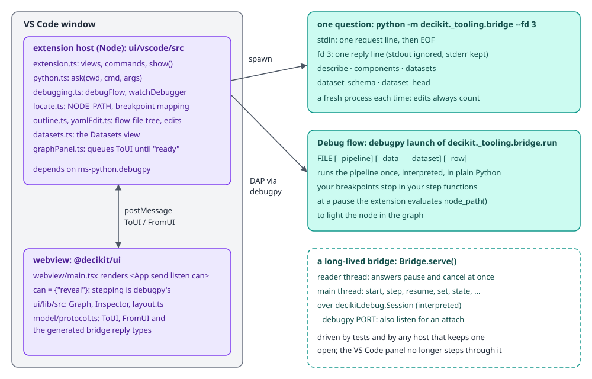
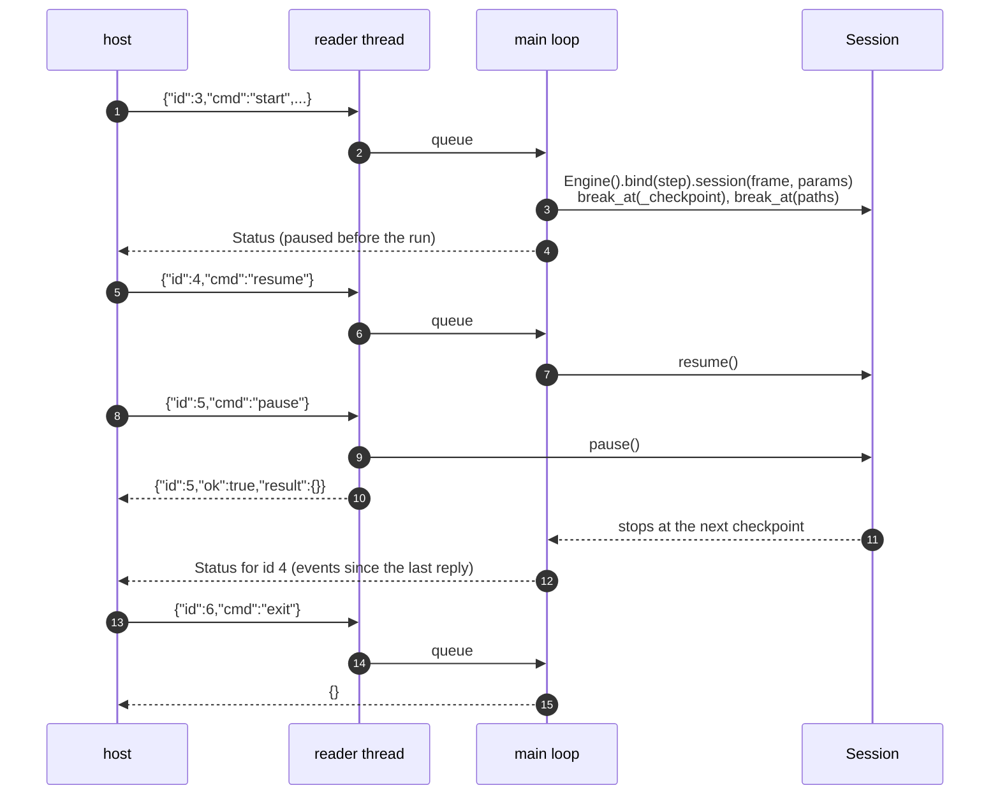
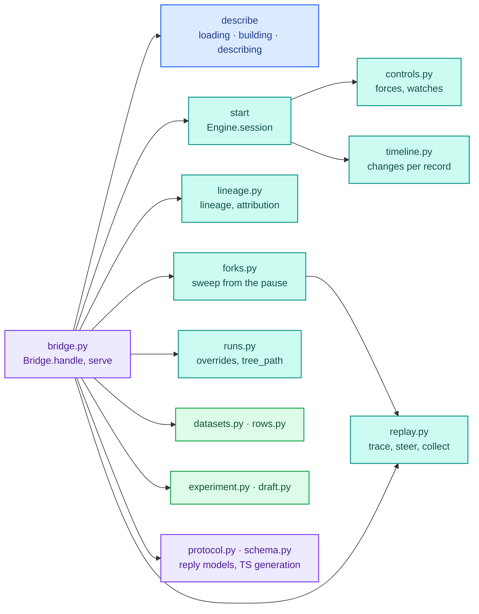
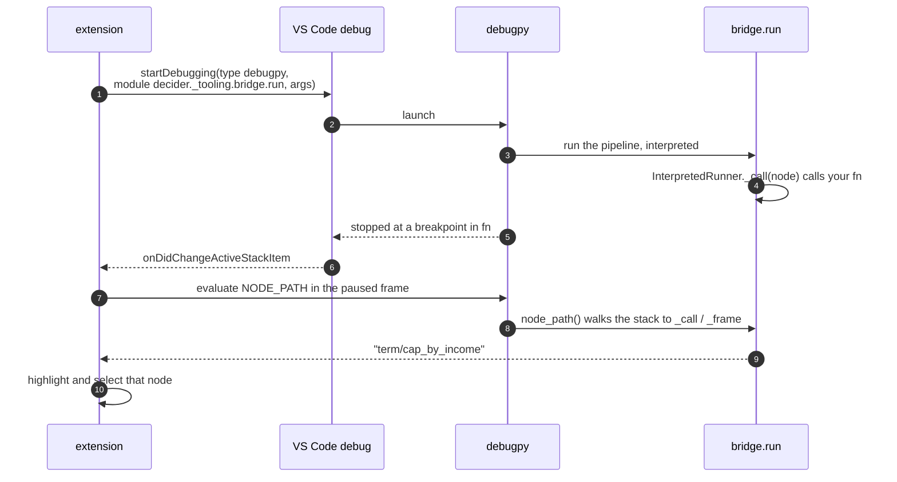
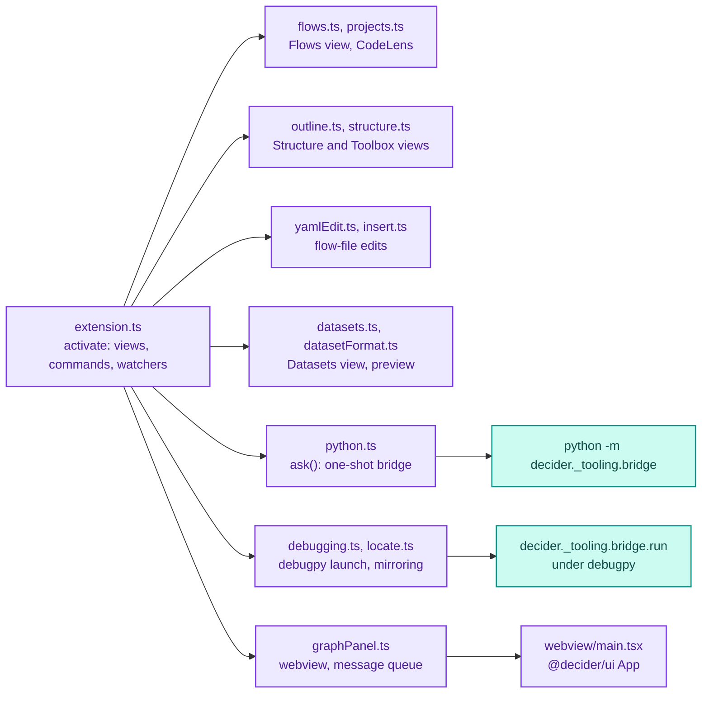

# Editor bridge

An editor that shows a decider flow needs facts only Python can produce: which pipelines a file defines, the IR with a source location for every node, the params each step declares, and, while debugging, what each record looks like at each checkpoint. The editor runs in Node (VS Code) or a browser (JupyterLab, the tree editor), so something has to stand between it and the library. That is the editor bridge, `decider/_tooling/bridge/`: a JSON-lines protocol over a child process's pipes, plus the adapters that turn a `decider.debug.Session` into the views an editor draws.

The bridge does not implement a second debugger. Running one checkpoint at a time, rewinding, overriding values and swapping steps are `Session` features, documented in [Debug sessions](engine/debug.md). The bridge adds what an editor needs on top: source locations, per-record history, lineage per record, forced branches, value breakpoints, scenario forks and comparisons, all as JSON.

This page covers the bridge, the processes around it and the UIs that sit on it: `ui/vscode`, `ui/lib` and `ui/tree-editor`. Using the debugger as a user is in [Debugging and testing](../guides/debugging-and-testing.md).

## Files

| File | What it holds |
|---|---|
| `bridge.py` | `Bridge`: the command dispatcher (`handle`), the stdio loop (`serve`) and `main` (`--fd`, `--debugpy`). |
| `__main__.py` | `python -m decider._tooling.bridge` calls `main()`. |
| `protocol.py` | The reply models (`Hello`, `DescribeResult`, `Status`, `StateResult`, `Lineage`, `Draft`, ...), `PROTOCOL_VERSION`, `capabilities()`, and the generator for `ui/lib/src/model/protocol.ts`. |
| `schema.py` | JSON Schema and TypeScript generation from pydantic models, for the protocol and the static-flow contract. |
| `loading.py` | `load_module` (import a file fresh), flow-file helpers, `latest_config`, `components`. |
| `building.py` | `build_step`: call a serving-style `def build(...)` with the project's latest config version; `base_params`. |
| `describing.py` | `find_pipelines`, `node_json` (IR to JSON with file, line and Python range), `formula`, `field_metadata`, `key_column`. |
| `controls.py` | `Controls`: forced branch arms and loop counts, value and iteration breakpoints. |
| `timeline.py` | `Timeline`: every change to every value per record, for history and "go back to". |
| `lineage.py` | Runtime lineage over a session's state, and per-record attribution (`writtenBy`, `changedBy`). |
| `runs.py` | `apply_overrides` on input rows, `tree_path` (re-walk a row node for one record), `debug_condition`. |
| `replay.py` | `trace`: run to the end and collect what every call wrote; `steer`; `collect`. |
| `forks.py` | `checkpoint_key`, `fork`, `sweep`: scenarios from the pause or from the start. |
| `rows.py` | `load_rows`: the `data` argument (a path, a record, a list of records) as `LoadedData`. |
| `datasets.py` | `datasets`, `dataset_schema`, `dataset_head` for the dataset picker. |
| `experiment.py` | `experiment` (run with streamed progress, cancellable), `experiment_schema`, `experiment_validate`. |
| `draft.py` | `draft_changes`: a paused session's changes as an experiment draft. |
| `run.py` | `python -m decider._tooling.bridge.run`: run a pipeline once under a Python debugger; `node_path()`. |

## The processes

<div class="diagram" markdown>


*The shipped VS Code extension uses the first two. The long-lived stepping bridge is driven by tests and by any host that keeps a session open.*
</div>

Three ways of running Python sit behind an editor:

1. One question, one process. `ask(cwd, cmd, args)` in `ui/vscode/src/python.ts` spawns `python -m decider._tooling.bridge --fd 3` in the file's directory, writes one request line, closes stdin and reads one reply line from file descriptor 3. stdout is ignored, so a `print()` in a step cannot corrupt the protocol; stderr is kept for the error message if the process dies. A fresh process per question means an edit saved a second ago always counts, with no reload logic in the bridge.
2. Debug flow. `debugFlow` in `debugging.ts` starts an ordinary `debugpy` launch of `python -m decider._tooling.bridge.run FILE [--pipeline P] [--data PATH | --dataset NAME] [--row N]`, which runs the pipeline once in interpreted mode. Breakpoints are ordinary Python breakpoints in step functions. The extension mirrors the debugger onto the flow (see [Native debugging](#native-debugging-with-debugpy)).
3. A long-lived bridge. `Bridge.serve()` keeps a session open across requests: `start`, then `step`, `resume`, `set`, `state`, `lineage`, `rewind`, forks and comparisons. The tests drive it, and it is what a panel with its own Continue and Step buttons would use. The VS Code panel stopped stepping through it when debugging moved to debugpy (the native-debugging note records that decision), so in the shipped extension these commands have no caller.

The interpreter is the `decider.python` setting (for example `["uv", "run", "python"]`), else the ms-python extension's active environment, else `python3`. For debugpy launches `configuredExecutable` resolves that command to a real `sys.executable`, since debugpy needs a file.

## The protocol

One JSON object per line in each direction:

```text
-> {"id": 1, "cmd": "describe", "file": "app/loan.py"}
<- {"id": 1, "ok": true, "result": {...}}
<- {"id": 2, "ok": false, "error": "ValueError: unknown command 'nope'"}
```

- A request has an `id` the reply echoes, a `cmd`, and the command's arguments as further keys. `handle` passes every key except `id` and `cmd` as keyword arguments to the method of the same name, so the argument names are the Python parameter names.
- A reply is `{"id", "ok": true, "result"}` or `{"id", "ok": false, "error": "<ExceptionType>: <message>"}`. Every exception a command raises becomes an error reply; the bridge keeps running.
- A long command may send extra lines on the same id before its reply. `experiment` streams `{"id": N, "progress": {"done": d, "total": t}}` as batches finish.
- Replies go to `--fd N` when given (the extension uses 3), else stdout. Writes take a lock, so progress lines from the experiment runner and replies from the reader thread never interleave.
- `exit` replies `{}` and ends the loop. EOF on stdin ends it too.

`serve` reads stdin on a separate thread. Two commands are answered on that thread at once, even while the main thread is inside a long `resume`: `pause` (calls `session.pause()`, which stops the run at its next checkpoint) and `cancel` (with `target`, the id of a running `experiment`, which stops at the next batch). Everything else queues for the main thread in order.

### Versioning and generated types

`hello` reports the protocol version, the static-flow contract version and what this install can do:

```json
{"protocol": "1", "contract_version": "1",
 "capabilities": {"contract_version": "1", "modes": ["fused", "interpreted", "stepped"],
                  "optional_dependencies": {"visualise": false, "serve-starlette": true, "serve-sanic": false,
                                            "notebook": true, "eval": false, "mcp": true, "prove": true},
                  "source_mapping": true}}
```

The reply shapes are pydantic models in `protocol.py`, and the TypeScript the UI compiles against is generated from them. `uv run python -m decider._tooling.bridge.protocol` rewrites the block between `// <generated: ...>` and `// </generated>` in `ui/lib/src/model/protocol.ts` with one `export interface` per model, field docs included. A field typed `Unset[...]` is left out of the wire when the producer did not set it (`wire()` dumps with `exclude_unset=True`) and becomes an optional field in TypeScript, so the JSON a host receives is exactly what the bridge put in, never a `null` it did not mean.

### Commands

| Command | Arguments | Reply |
|---|---|---|
| `hello` | | `Hello` |
| `describe` | `file`, `pipeline?` | `DescribeResult`: pipelines in the file, the chosen one's IR as JSON, params, values, outcome, field metadata, size |
| `components` | `file` (a flow file) | the names its `step:` nodes can use |
| `datasets`, `dataset_schema`, `dataset_head` | `file?`; `name`; `name`, `n=50` | the project's datasets folder, one dataset's columns, its first rows |
| `trace` | `file`, `pipeline?`, `data?` or `dataset?`, `params?`, `overrides?`, `row?`, `forces?` | the description plus what every call wrote, tree paths, output, data |
| `start` | as `trace`, plus `breakpoints`, `watches` | `Status` of a new session, paused before anything runs |
| `step`, `step_into`, `resume`, `step_out` | | `Status` |
| `pause` | | `{}`, answered at once |
| `rewind`, `go_to`, `rerun` | `path`; `change` or `path`, `row?`; `path`, `back?`, `when?` | `Status` |
| `break_at`, `clear_break` | `path` | `Status` |
| `set` | `name`, `value` | `Status` (the override is recorded for forks and drafts) |
| `set_controls` | `forces`, `watches` | `Status` |
| `state` | `row?` | `StateResult` |
| `column` | `name`, `row?` | every version of one value |
| `lineage` | `name`, `row?`, `depth=8` | `Lineage` |
| `changes` | `name`, `row?` | the value's history |
| `tree_path` | `path`, `row` | the positions a row node's reference reaches for one record |
| `debug_condition` | `path`, `row` | a debugpy condition true only for that record's inputs |
| `skip`, `reload_step`, `restore` | `path` | `Status` plus `formula` |
| `compare_edits` | `path?` | two traces: the flow as started and as edited |
| `sweep` | `scenarios`, `from_here=true`, ... | a baseline and one trace per scenario |
| `draft` | | `Draft` |
| `experiment`, `experiment_schema`, `experiment_validate` | `definition` or `def_` + `file`, `data?`, `input?`, `dataset?`, `out_dir?` | result, schemas, problems |
| `cancel` | `target` | `{}`, answered at once |
| `exit` | | `{}` |

Commands after `lineage` in `handle` need a session and raise `RuntimeError: no session: send start first` without one. `state`, `column`, `changes` and `step_out` are dispatched before that check, so sending one before `start` fails with an `AttributeError` about `None` instead (seen as `{"ok": false, "error": "AttributeError: 'NoneType' object has no attribute 'executable'"}`).

### A real conversation

This is a script driving `python -m decider._tooling.bridge --fd 3` over its pipes, on `ui/vscode/examples/loan.py`, exactly as the extension spawns it (long replies cut at 600 characters):

```text
>> {"id": 3, "cmd": "start", "file": ".../loan.py", "breakpoints": ["term/cap_by_income"]}
<< {"id": 3, "ok": true, "result": {"finished": false, "current": null, "events": [{"kind": "run_started", "rows": 2},
   {"kind": "params_validated", "paths": ["affordability/affordable", "term/term_cap", "term/cap_by_income",
   "term/by_sector/cap_private", "term/by_sector/cap_public"], "invalid": []}], "hit": null, "ran": [],
   "trace": {"available": false, "reason": "trace capture is off; showing live state"},
   "dataset": {"dataset": "", "fingerprint": "2fa7e5ef...", "columns": [["client_id", "Int64"], ...], "row_count": 2}}}
>> {"id": 4, "cmd": "resume"}
<< {"id": 4, "ok": true, "result": {"finished": false, "current": {"path": "term/cap_by_income", "when": "before"},
   "events": [{"kind": "node_started", "origin": {"path": "", "source": "decider.steps:SequentialStep", ...}}, ...
>> {"id": 6, "cmd": "lineage", "name": "term_cap", "row": 0}
<< {"id": 6, "ok": true, "result": {"name": "term_cap", "producer": "term/term_cap", "value": 60.0,
   "inputs": [{"name": "requested_term", "producer": null, "value": 72.0, "inputs": []}]}}
>> {"id": 7, "cmd": "set", "name": "term_cap", "value": 12.0}
<< {"id": 7, "ok": true, "result": {"finished": false, "current": {"path": "term/cap_by_income", "when": "before"},
   "events": [{"kind": "overridden", "name": "term_cap", "producer": "override@term/cap_by_income",
   "value": {"dtype": "Float64", "rows": 2, "nulls": 0, "preview": [12.0, 12.0]},
   "previous": {"dtype": "Float64", "rows": 2, "nulls": 0, "preview": [60.0, 36.0]}}], ...
>> {"id": 8, "cmd": "resume"}
<< {"id": 8, "ok": true, "result": {"finished": true, "current": null, "events": [...] ...
>> {"id": 9, "cmd": "changes", "name": "term_cap", "row": 0}
<< {"id": 9, "ok": true, "result": {"name": "term_cap", "input": false, "initial": null, "changes": [
   {"path": "term/term_cap", "iteration": null, "arm": null, "change": 6, "value": 60.0, "before": null},
   {"path": "override@term/cap_by_income", "iteration": null, "arm": null, "change": 7, "value": 12.0, "before": 60.0},
   {"path": "term/cap_by_income", "iteration": null, "arm": null, "change": 8, "value": 12.0, "before": 12.0, "kept": true},
   {"path": "term/by_sector/cap_private", "iteration": null, "arm": 0, "change": 10, "value": 12.0, "before": 12.0, "kept": true}]}}
>> {"id": 10, "cmd": "draft"}
<< {"id": 10, "ok": true, "result": {"converted": [{"target": "term_cap@term/cap_by_income", "value": 12.0, "source": "set"}],
   "dropped": [{"kind": "console_mutation", "detail": "Python console mutations are not tracked; any such changes are not in this draft"}]}}
>> {"id": 11, "cmd": "nope"}
<< {"id": 11, "ok": false, "error": "ValueError: unknown command 'nope'"}
>> {"id": 12, "cmd": "exit"}
<< {"id": 12, "ok": true, "result": {}}
```

The history shows what the timeline means by a change: `cap_by_income` wrote 12.0 onto a record that already held 12.0 (set by hand), so it is listed as `kept`, not as the step that made the value. Without the override the cap step would have changed 60.0 to 48.0 for record 0.



Each `Status` carries only the session events produced since the previous reply (`self.sent` marks how many were sent), so a host appends them instead of diffing.

## Inside the bridge



### Describing a file

`describe(file, pipeline)` is the command every host calls first. It does five things:

1. Imports the file fresh with `load_module`. A file inside a package (its directory has `__init__.py`) is imported by dotted name with the package's root on `sys.path`, after dropping every already-imported module of that package from `sys.modules`, so edits since the last describe count. A loose file is executed from its path under its stem name. Either way the import compiles into a fresh temporary `sys.pycache_prefix`: Python keys cached bytecode on mtime in whole seconds and file size, and an edit saved within the same second at the same length ran the old code (found in the large-project test runs the VS Code testing note describes). A flow file (`.yaml`, `.yml`, `.json`) instead imports its `components:` module and reads the flow's name.
2. Finds the pipelines with `find_pipelines`: module-level `Step` objects not contained in another, a top-level `def build`, and zero-argument factories named `pipeline`, `flow`, `*_pipeline` or `*_flow`. A single function step left unassembled, or a factory that needs arguments, is listed with `status: "invalid"` and a reason, so the UI can say why it is not offered. With no valid candidate the command fails with `no decider pipeline (...): define def build() or assign one at module level`. Without `pipeline`, the last valid candidate is chosen.
3. Builds the step. A `def build(...)` is called the way `decider serve` calls it (`building.build_step`): the project root is the nearest ancestor of the file holding `configs/`, its latest config version supplies the documents and the `"params"` document, and `sample_request.json` beside `configs/` supplies a sample record with its dates converted. See [Config store](config-store.md).
4. Lowers it with `to_ir` and turns the IR into JSON with `node_json`. Each node gets its path, its origin's `source`, its durable `id`, the file and line where it is assigned or defined, and for a call node its inputs, outputs, params with defaults, `callKind`, a `code` fingerprint (a hash of the function's source plus a `ConfigurableStep`'s JSON, so the UI can tell when a step changed), the first docstring line, the one-line `formula` when the function is a single `return`, its source when it is 15 lines or fewer, a table's match expression, and `python: {file, line, bodyLine, endLine}`: the Python that runs in interpreted mode, with `bodyLine` the first statement past the docstring (where a breakpoint stops on the call, not the `def`).
5. Adds the params schema (per node path, from `step.parameters()`), the module's `PARAMS` values, the `outcome` (emitted values plus what top-level branches set), the field metadata steps declare for their values (`Money`, `Percent`, decimals) and the size.

One call node from `loan.py`, as the describe reply carries it:

```json
{"path": "term/cap_by_income", "source": "loan:cap_by_income", "file": ".../loan.py", "line": 35,
 "id": null, "step_id": null, "kind": "call", "callKind": "scalar",
 "inputs": ["term_cap", "min_net_salary"], "outputs": ["term_cap"], "params": {"cap": 48.0},
 "python": {"file": ".../loan.py", "line": 35, "bodyLine": 38, "endLine": 38},
 "code": "4a52734b758e", "doc": "",
 "formula": "min(term_cap, cap) if min_net_salary < 5000 else term_cap",
 "body": "@step(output=\"term_cap\")\ndef cap_by_income(term_cap: float, min_net_salary: float = missing_as(0.0),\n                  cap: float = param(48.0)) -> float:\n    return min(term_cap, cap) if min_net_salary < 5000 else term_cap",
 "table": null}
```

### A session and its observers

`start` binds the step in interpreted mode (`Engine().bind(step).session(frame, params)`; see [Debug sessions](engine/debug.md)), then attaches two observers through the session's breakpoint hook. `_checkpoint` is registered first, before any user breakpoint, because `Session` evaluates breakpoints with `any` and stops at the first that says pause; the observer must see every checkpoint. At each checkpoint it records the checkpoint in the `Timeline`, applies any force that is due and evaluates the value breakpoints. It pauses only when a watch fires.

The input rows come from, in order: `data` (a path read with `lab.data.read`, one record, or a list of records), `dataset` (a name in the project's datasets folder; both at once is an error), the module's `SAMPLE`, or the build pipeline's `sample_request.json`. `overrides` with an optional `row` change input columns before the run. The data's identity (`InputFingerprint`: name, content hash, columns, row count) is reported in every `Status` so a host can show which data the run is on.

### Forces and value breakpoints

`Controls` steers a run without changing the pipeline. A force is `{"path", "arm" | "iterations", "row"?}`. At the checkpoint just after a branch's or loop's condition step, it overrides the condition's output with `session.set`: arm k becomes `True`/`False` for a bool condition (arm 0 is `True`) or the int k, and a loop forced to n iterations gets `True` before iterations 1 to n and `False` after. The runner reads the condition only after that checkpoint, so it routes as told, and the override is recorded like any other `set`, so lineage shows the value as set by you. The alternative, teaching the IR or the runner a forced arm, would have changed the engine for a debugging feature (the VS Code controls note records the choice).

A watch is one of three shapes: `{"name", "op", "value", "scope"?, "row"?}` pauses just after a step that writes `name`, when some record newly meets the condition there; `{"path", "iteration"}` pauses before a loop's condition at iteration k; `{"path"}` pauses before a step every time it runs. "Newly" is per record: a value that stays over a limit through five loop iterations pauses once. The comparison reads what the step wrote (`name@path` with its validity mask), not `session.value(name)`, because inside a loop the latest declared version is the carry, which takes the body's value only after the iteration ends.

Known limits, from the same note: `rewind` replays without evaluating breakpoints, so a force set after the branch ran applies only once the run is rewound to the branch (`rerun` does that); a loop forced past `max_iterations` stops at the maximum; and when the run is paused on a condition's "after" checkpoint, the bridge applies forces at the current checkpoint before every `step`, `step_into` or `resume`, because that checkpoint's breakpoint check has already run.

### Timeline, history and going back

`Timeline.record` runs at every checkpoint. After a call it compares what the call wrote with each record's current value and logs a change only where the value differs; a step that writes the value a record already had is logged as `kept`. A change carries the checkpoint index, the path, the loop iteration and branch arm, the records, their new and previous values and, when the new value equals one of the step's inputs (a cap that did not bind), `via`: the input and the step that computed it. Overrides log as `override@<path>` and forces as `force@<group>`.

`changes(name, row)` returns that history. `go_to(change)` rewinds the session to the step that made a change and steps forward until the step has finished as many times as it had then. A change inside a loop rewinds to before the outermost enclosing loop, because a rewind keeps upstream values as they are now, the loop's carry included. After a rewind, changes beyond the new position are kept as `pending` entries until the run passes them again. `state(row)` takes each record's current value from the timeline rather than the session for the same carry reason.

### Lineage and attribution

`lineage(session, name, row)` walks the plan's producers backwards from the latest written version of `name` (the latest one written on `row`, when a record is focused, since inside a branch arm the newest version covers only that arm's rows). Each entry names the producer, the record's value and the versions it was computed from, recursively to `depth` 8. A branch merge follows only the arm the record took; a loop carry follows the last iteration and the initial value. Values you set or forced are marked with `setBy` and `was`, and a forced branch condition lists the arms by name.

`state(row)` adds, per column, `writtenBy` (the last step that wrote the value on that record) and `changedBy` (the last that changed it). A branch or loop merge is never credited, since it only carries an arm's value on.

### Forks, sweeps and comparisons

A running Python generator cannot be copied, so a fork is a fresh session replayed to the same checkpoint. `checkpoint_key(session)` names the pause as `(path, when, n)`: the checkpoint and how many times the run has reached it. `fork` binds a new session, re-applies the original's forces, steps until `checkpoint_key` matches while re-applying each recorded `set` at the checkpoint where it was made, then applies the scenario's overrides and params and runs to the end. Steps are pure, so the replay reaches the same state. `sweep` runs the unchanged continuation plus one fork per scenario and returns traces ready to compare. A session that was rewound refuses to fork from the pause (`scenarios can't replay a session that was rewound; restart it first`), because the recorded history no longer describes the path to it.

`replay.trace` is the non-interactive version: run to the end with optional forces and collect, per call, what it wrote (`steps`), the tree positions each row node visited (`paths`) and the output. Comparing two traces is how the UI shows "arm 0 against arm 1" or "the flow as started against the flow with my edit" (`compare_edits`).

`skip`, `reload_step` and `restore` edit the paused run through `Session.delete` and `Session.replace`: drop a step, re-import the files and swap in the step now at that path, or put back the step as the run started it. The bridge records each edit so `compare_edits` can run the original and the edited flow side by side, one edit at a time or all together. `draft` turns a paused session's structured changes (`set` overrides and forces) into declared experiment overrides and lists everything it cannot convert (code edits, anything typed in a Python console) under `dropped`, so nothing is silently left out. See [Experiments](lab/experiments.md).

### Datasets, rows and experiments

`datasets(file)` lists the project's datasets folder (from the nearest `configs/` ancestor) without reading data: each dataset's name, provider type, key and local path, and an `error` for a broken entry rather than failing the listing. `dataset_schema` returns column names and dtypes and a row count only for Parquet, where the format holds it; `dataset_head` returns the first `n` rows. The VS Code Datasets view is built from these three. See [Data](lab/data.md).

```json
{"root": ".../examples/credit_flow/datasets",
 "datasets": [{"name": "applicants", "type": "file", "key": ["client_id"], "path": ".../datasets/applicants.csv"},
              {"name": "portfolio", "type": "folder", "key": null, "path": ".../datasets/portfolio"}]}
```

`experiment` runs an `experiment.json` (or an inline definition over the described file's pipeline) through the experiment runner with a callback that streams progress on the request's id and a `JobHandle` that `cancel` can stop at the next batch.

## Native debugging with debugpy



The extension has no debug adapter of its own. The native-debugging note records why: the earlier prototype ran a decider debug adapter over the bridge's session, with decider breakpoints on node paths, its own step commands and a second debugpy attach to get into a step's Python. That was two debuggers and two breakpoint models, and users reached for the Python one.

What makes the mirroring work:

- `node_path()` in `run.py` walks up the calling frames until it finds the interpreted runner's `_call` or `_frame` code object and returns `node.origin.path` from its locals. A function used at two nodes (a step that is also a branch condition) still maps to the node that called it. When the evaluate fails (decider not importable in the debuggee), `pausedAt` falls back to the innermost frame whose file and line fall inside a node's `[python.line, python.endLine]`.
- A breakpoint dot on a node becomes a source breakpoint at the node's `bodyLine`. In a function used by more than one node it gets the condition `__import__('decider._tooling.bridge.run', fromlist=['node_path']).node_path() == "<path>"`, so it stops at that node only. `breakpointPaths` maps every source breakpoint back to the nodes whose Python holds it, which is how dots appear when you set a breakpoint in the editor gutter.
- Tree and table nodes run decider's own reference walker, where `justMyCode` never stops, so `userCode` excludes `callKind: "row"` nodes from breakpoint actions.
- Any Python debug session that pauses inside the shown flow's steps is mirrored, including your own scripts and tests, as long as the pipeline runs interpreted.

`run.py` on its own is also a plain runner: `python -m decider._tooling.bridge.run loan.py --row 1` prints the output frame for that record, and `--row 5` on two rows exits with `--row 5 is out of range: the data has 2 rows`.

`--debugpy PORT` on the stdio bridge (`main`) calls `debugpy.listen(("127.0.0.1", PORT))` before serving, for a host that wants to attach a Python debugger to a long-lived bridge (`test_debugpy_flag_opens_an_attach_port`).

## The UIs on top

### `ui/lib`: the shared UI package

`@decider/ui` is a pnpm workspace package holding the React UI and the model code every host shares. `src/model/` has no DOM and no React: `protocol.ts` (the generated bridge types plus the UI message unions), `compare.ts`, `sweep.ts`, `events.ts` (folding session events into what has run, tree visits and edits), `breakpoints.ts`, `experiment.ts`, `datasetRows.ts`. The components (`App`, `Graph`, `Inspector`, `StateTable`, `Timeline`, `Compare`, `Scenarios`, `Params`, `Experiments`, ...) and `layout.ts` sit beside it. It builds to plain ESM JavaScript with `tsc` because a JupyterLab prebuilt extension bundles with webpack, which does not compile a dependency's TypeScript.

The host seam is one component:

```tsx
<App send={(m: FromUI) => void} listen={(on: (m: ToUI) => void) => unsubscribe} can={Set<EditorMessage>} />
```

`send` delivers UI messages to the host, the first being `{type: "ready"}`. `listen` subscribes to host messages (`describe`, `status`, `state`, `lineage`, `compare`, `sweep`, `select`, `controls`, ...). `can` lists the editor-only messages the host handles (`reveal`, `maximise`, `openDiff`, `debugStep`, `runTo`, `step`, `compareRevision`), and the UI hides the controls whose message is missing. A host that gains a capability handles the message and adds its name to `can`, so one message channel covers every feature.

Styling reads only `--decider-*` CSS variables, every rule is nested under `.decider`, and `.decider` is a size container so the narrow and wide layouts follow the panel, not the window. Each host maps its own theme onto the variables; the decider-ui note lists the 48 VS Code colour mappings.

The graph layout in `layout.ts` is dependency-free and replaced dagre. The flow-layout-scale note timed it on generated nested flows (Apple M2 Pro, Node 23): 0.8 ms for 1,000 calls and 8.8 ms for 10,000 calls fully unfolded, where dagre took 1.2 s at 1,000 and overflowed the stack at 2,000, and ELK took 0.46 s and 4.65 s. The remaining superlinear pass is `dataEdges`, 53 ms at 10,000 calls, marked in the code with a `ponytail:` comment naming the fix (an index of last writer per column).

### `ui/vscode`: the extension



The extension contributes four views under a decider activity-bar entry: Flows (every `flow.yaml` and every Python file that imports decider and defines a pipeline, grouped by project root), Datasets, Structure (the shown flow as a tree, with breakpoint and paused markers) and Toolbox (node types to drag into a flow file). The README lists three views; the Datasets view was added after it was written.

How the extension uses the bridge, end to end, when a flow is shown:

1. `show(uri)` opens the graph panel and calls `describe()`, which runs `ask(dirname(file), "describe", {file, pipeline})`. A generation counter drops a reply that arrives after a newer request.
2. The reply goes to the panel as `{type: "describe", describe}` and to the Structure view. For a flow file the Structure tree is built from the YAML itself in TypeScript (`yamlOutline`), not from `describe`, so a flow whose new `step:` names a function that does not exist yet still shows and stays editable. Paths follow the loader's naming, so items join the described IR by path.
3. Saving a Python file or flow file under the project re-runs `describe`. Editing a flow file re-renders the outline on every change.
4. Inserting a node asks the bridge for `components` (cached per file until a Python file is saved), prompts for what the node needs and writes the change through the `yaml` Document API as one `WorkspaceEdit`, so comments and layout survive and the edit can be undone.
5. The webview receives `can = {"reveal"}` and `showStructure={false}`: stepping belongs to the Python debugger, and the panel only opens source. Its breakpoint dots arrive as `controls` messages whose watches are plain `{path}` entries, and toggling a dot comes back as `setControls`, which the extension turns into source breakpoints.

Messages to the webview wait in a queue until it sends `ready` (`GraphPanel`), because a webview posts nothing until its script has loaded.

### The JupyterLab host

The jupyterlab-decider note describes a JupyterLab 4 extension that hosted the same `@decider/ui` beside notebooks. Its transport was a kernel comm named `decider` carrying the same `{id, cmd, ...}` requests and `{id, ok, result | error}` replies, chosen over a server extension because the objects worth debugging in a notebook (a pipeline built in a cell, a frame loaded in another) live in the kernel. `Bridge(notebook=...)` is the hook it used: when a request names no file, the pipeline, `SAMPLE` and `PARAMS` come from the module that callable returns, a snapshot of the notebook's namespace. A comm answers one message at a time, so that host had no `pause` during a long `resume`.

That extension is not in this repository's tree (the debug-bridge-relocation note says so too); `ui/pnpm-workspace.yaml` and the `notebook` parameter of `Bridge` are what remain of it. Notebook users get hot reload from the session side instead: `session.watch(...)` re-applies an edited pipeline after each cell (see [Debug sessions](engine/debug.md)).

### `ui/tree-editor`: the web tree editor

A separate web application for editing decision trees: a FastAPI backend (`backend/dsp_decider`, with Postgres, migrations and auth), a React UI (`ui/`) and Playwright end-to-end tests that export a tree and run it with decider. It does not use the bridge. The backend imports the library directly: `decider.steps.trees.schema.load_document` and `detect_format` validate a document and tell a v3 node/edge tree from a `prioritized_flat_rule` set, and `TreeConfig(name="tree", tree=data).parameters()` builds it to catch what would fail at run time. Data sources return `decider.PolarsSchema`. The image installs decider from the wheel in `dist/`, so the editor and the engine that runs its exports are the same version. How the trees themselves work is in [Trees](configurable-steps/trees.md).

## Guarantees and how they are tested

- A run in the bridge matches compiled runs exactly. `tests/bridge/test_parity.py` debugs a flow through the bridge and compares it with `run()` and `score()` in interpreted, stepped and fused modes using `decider.testing.equivalence.assert_equivalent` (NaN equals NaN, nothing else is approximate). See [Diff and equivalence](../guides/diff-and-equivalence.md).
- The protocol round-trips over real stdio (`test_the_stdio_protocol_round_trips`), and the one-shot form answers datasets from the project's working directory (`test_the_json_lines_protocol_answers_datasets_from_the_project_cwd`).
- A failing step is reported, not fatal: the reply carries `error` and the events hold the `Error` (`test_a_failing_step_is_reported_not_fatal`).
- The bridge lives inside `decider`, launched as `python -m decider._tooling.bridge`, with no separate distribution (`tests/bridge/test_relocation.py`).

The VS Code testing note describes four levels for the extension: pytest for the bridge, a DAP test client for the old adapter, `@vscode/test-electron` with mocha inside the editor for activation and commands, and Playwright driving the editor binary headless (`--ozone-platform=headless`) for what a person sees, with screenshots. `pnpm test` in `ui/vscode` runs the TypeScript unit tests (YAML outline and edits, breakpoint and pause mapping); `pnpm test:vscode` runs inside VS Code.

## Why it is shaped this way

- A child process per question. The extension host is Node, and a short-lived Python process needs no lifecycle management, cannot leak state between flows and always imports the code as it is on disk. The price is a Python start per question; describes are not on a hot path.
- Replies on their own file descriptor. User steps print; a protocol on stdout would break the first time one did.
- Reply types generated from Python. The Python models are the source; the TypeScript cannot drift because regenerating it is one command, and unset fields stay off the wire.
- debugpy rather than a decider debug adapter, for the reasons above. The stepping protocol stays in the bridge for hosts that want per-node stepping, rewind, forks and comparisons without a Python debugger.
- Forces as overrides of a condition's output. No engine change, and lineage already explains overrides.
