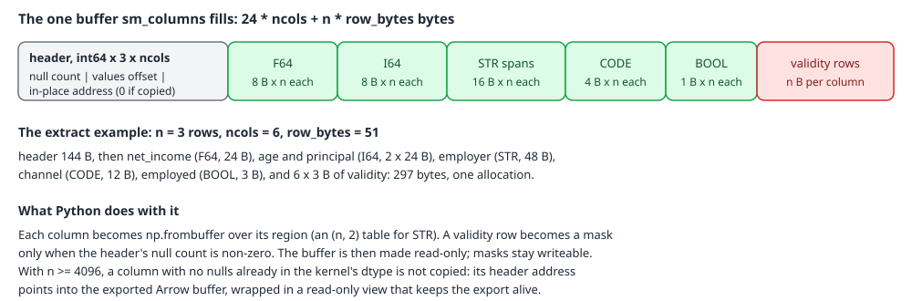
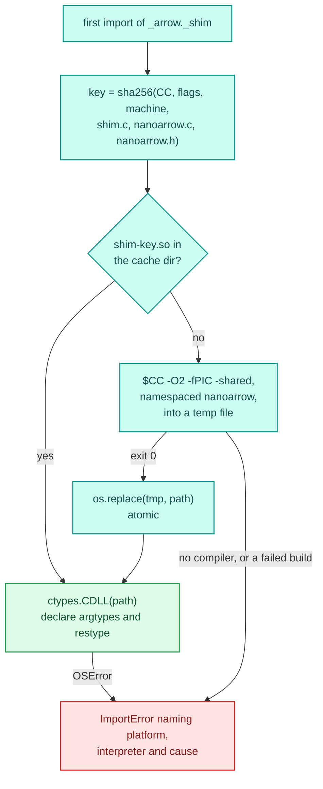
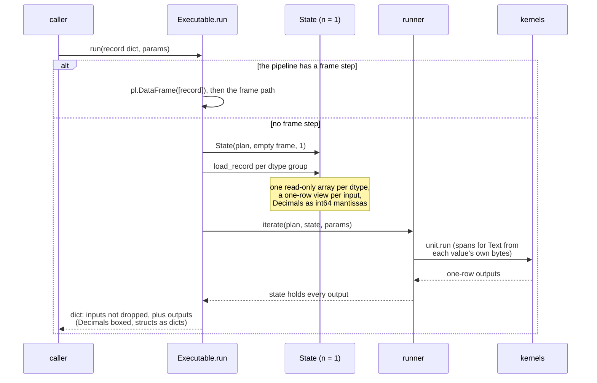

# The data boundary

A kernel reads typed, contiguous numpy arrays: float64, int64, bool, int32 codes and
`(address, length)` string spans. Data arrives as a polars frame (Arrow memory) or as a Python dict
for one record. The boundary moves values from one to the other with one export per frame and as
few copies and Python calls as it can, applies each input's null policy, and refuses what it
cannot read by naming the column.

It lives in `decikit/_engine/boundary/`:

| File | What it holds |
|---|---|
| `boundary/dtypes.py` | which polars dtypes each kind reads natively, which need one cast, which can't cross (`plan_column`, `cast_frame`, `decimal_mantissa`), and the `explain_boundary` diagnostic |
| `boundary/extract.py` | `extract_frame`: every declared input of a frame in one Arrow export |
| `boundary/nulls.py` | `check_required`: the REQUIRED check for direct callers |
| `boundary/errors.py` | `ArrowKindError`, `NeedsKernelSplit`, `ArrowImportError` |
| `boundary/_arrow/_build.py` | builds the C shim with `cc` into a content-keyed cache |
| `boundary/_arrow/_shim.py` | loads it with `ctypes` and declares every function's signature |
| `boundary/_arrow/plan.py` | `FramePlan`, `ColumnSpec`: what depends only on the declared columns |
| `boundary/_arrow/view.py` | `FrameView`: binds one frame at a time, reads its columns |
| `boundary/_arrow/nested.py` | `read_nested`: a `list<struct>` column as flat field arrays plus offsets |
| `boundary/_arrow/kernels.py`, `intrinsics.py` | numba loops and intrinsics that call the shim through raw addresses |
| `boundary/_arrow/doctor.py` | `available()` and `diagnose()` |
| `boundary/_arrow/c/shim.c`, `vendor/` | the C shim and vendored nanoarrow 0.9.0 |

The runners call it from `State.from_frame` in `decikit/_engine/run/state.py`, from the span
builder in `run/representations.py`, and from `build_struct` and `build_ragged` in
`compile/structs.py` and `compile/rows.py`. What the kernel does with the arrays is on
[compilation](compile.md); what a span or a decimal means inside it is on [kernel
semantics](kernels.md).

## A frame, traced

<div class="diagram" markdown>


*The path of a frame from polars to a kernel's `cols` tuple.*
</div>

`Executable.prepare(df)` first casts any column of polars' `Null` dtype (an all-null column, or a
list of all-empty lists) to a concrete type, since the Arrow import rejects `Null`. Then
`State.from_frame` calls `extract_frame` for the plan's typed inputs (`float`, `int`, `bool` and
`Decimal`), all read as OPTIONAL so that nulls survive as a mask. Each reading step applies its own
policy later, in the runner. Every other input column (a `str`, a list, a struct, a date) is kept as
Python objects, together with the polars Series it came from, so a `Text` or `Columnar[...]` reader
can still read that column's Arrow buffers in place (`State.source`).

`extract_frame(frame, inputs, path=...)` does this:

1. `check_required` raises `MissingInputError` for the first REQUIRED input that is null on any
   row or absent. One `frame.null_count()` covers every column.
2. An absent column is added as an all-null literal, so it takes the same fill or mask path as a
   column of nulls.
3. `_schema_plan(inputs, columns, dtypes)` is cached by the whole schema. For each input,
   `plan_column` decides from the dtype alone whether its kind reads it natively, needs one
   frame-tier cast, or cannot read it.
4. `cast_frame` applies the casts to a clone with `replace_column`, which the source comment puts
   at about 10 µs a column against about 40 µs through `with_columns`. The caller's frame is
   never re-typed.
5. A `FrameView` for the plan is checked out of a per-thread pool, bound to the frame, and asked
   for its columns: one export, three C calls, one allocation.
6. Each column becomes an `ExtractedColumn(name, values, validity, plan, categories, has_nulls)`.
   An OPTIONAL column with no nulls gets one shared, read-only all-true mask.

`explain_boundary(frame, inputs)` reports the same decisions without raising, one `ColumnPlan` per
column with the Arrow type nanoarrow saw. For a loan frame:

```python
df = pl.DataFrame({
    "net_income": [9200.0, 4100.0, None],
    "age": pl.Series([34, 51, 29], dtype=pl.Int32),
    "employed": [True, False, True],
    "employer": ["GOV HEALTH", None, "acme"],
    "channel": pl.Series(["web", "branch", "web"], dtype=pl.Categorical),
    "principal": pl.Series([Std("1000.50"), Std("2.5"), Std("12.345")], dtype=pl.Decimal(18, 3)),
})
inputs = [Input("net_income", float, NullPolicy.OPTIONAL), Input("age", int),
          Input("employed", bool), Input("employer", bytes, NullPolicy.OPTIONAL),
          Input("channel", str), Input("principal", Currency)]
for p in explain_boundary(df, inputs):
    print(p.name, p.dtype, p.kind.name, p.cast, p.arrow_type, p.note)
```

```text
net_income  Float64        F64   cast=None   arrow='double'
            native: nanoarrow reads the frame's own buffers
age         Int32          I64   cast=None   arrow='int32'
            native: nanoarrow reads the frame's own buffers
employed    Boolean        BOOL  cast=None   arrow='bool'
            native: nanoarrow reads the frame's own buffers
employer    String         STR   cast=None   arrow='string_view'
            native: nanoarrow reads the frame's own buffers
channel     Categorical    CODE  cast=None   arrow='dictionary(uint32)<string_view>'
            native: nanoarrow reads the frame's own buffers
principal   Decimal(18,3)  I64   cast=Int64  arrow='int64'
            Decimal: Decimal(precision=18, scale=3) -> int64 mantissa at scale 4
```

And what `extract_frame` hands back for the same frame:

```text
net_income  dtype=float64 shape=(3,)   validity=[True, True, False]
            values [9200.0, 4100.0, nan]
age         dtype=int64   shape=(3,)   validity=None
            values [34, 51, 29]
employed    dtype=bool    shape=(3,)   validity=None
            values [True, False, True]
employer    dtype=int64   shape=(3, 2) validity=[True, False, True]
            values [[140283828757300, 10], [0, -1], [140283828757332, 4]]
channel     dtype=int32   shape=(3,)   validity=None   cats=('web', 'branch')
            values [0, 1, 0]
principal   dtype=int64   shape=(3,)   validity=None
            values [10005000, 25000, 123450]
```

Every array is read-only (`writeable=False`), so batch columns and single records type as the same
numba array and share a kernel specialisation. The Int32 column arrived as int64 without a polars
cast: the C code widens it as it copies. The Decimal arrived as its int64 mantissa at
`Currency`'s scale of 4.

## Kinds and casts

Each declared input has a `FeatureKind`, from its annotation:

| Kind | Annotation | Array dtype | Reads natively | One frame-tier cast from |
|---|---|---|---|---|
| F64 | `float`, and any annotation not listed here | float64 | Float64, Float32 | other numerics, Boolean, temporals (by storage integer) |
| I64 | `int`, `Decimal`, `Currency` | int64 | every integer width, Date, Datetime, Duration, Time | other numerics, Boolean; a Decimal or integer column for a `Decimal` input |
| BOOL | `bool` | bool | Boolean | numerics |
| CODE | `str` | int32 dictionary index | Categorical, Enum | String |
| STR | `bytes`, `Text` | `(n, 2)` int64 spans | String (exported as `string_view`) | Categorical, Enum |

A List, Struct, Array, Object, Binary or Unknown column raises `NeedsKernelSplit` before any
export. A pair with no cast (a String declared `float`) is left for the import to refuse by its
Arrow type, with a hint for the common mistakes:

```text
ArrowKindError : column 'x' is Arrow string_view but is declared F64,
  which cannot read it.
NeedsKernelSplit : column 'x' (List(Float64)) has no flat-array extraction;
  needs the kernel-split escape (nested/object columns do not enter the kernel)
MissingInputError : input 'x' of step 'p/step' is required but column 'x'
  has 1 null row(s) of 2. Fix the data, or declare `x: T = missing_as(fill)`
  or `x: T | None`.
```

A failed cast (a Rust panic included, which surfaces as pyo3's `PanicException`, not an
`Exception`) is caught and re-raised as `NeedsKernelSplit` naming the column.

### Decimals

A `Decimal[p, s]` or `Currency` input reads a polars Decimal or integer column as the int64
mantissa at the declared scale: the column is cast to `Decimal(38, s)` (polars rescales half-even,
and an integer column is whole units) and then to its physical int64. A value that does not fit
int64 at that scale fails by name: `a value does not fit a Decimal at scale 2 in int64 (at most
...)`. A float column declared a Decimal is refused. A `missing_as`
fill on a Decimal input is stored as its int64 too.

### Codes and code tables

A CODE column is a dictionary index, and the dictionary it indexes is the one in the Arrow export:
`ExtractedColumn.categories` holds it in index order (`('web', 'branch')` above). It is not
`Series.cat.get_categories()`: polars' physical codes are process-global, while its export carries a
dictionary per batch. A null code takes the fill -1. A `str` input with a string `missing_as` fill
is refused, since the fill must be an int code.

The engine's runners no longer send a semantic `str` input into a kernel as a code. A step reading
`str` runs in Python, and one reading `Text` gets spans (see [kernel semantics](kernels.md) for the
measurement behind that). On the way out, a row node's `Literal` or `lookup(...)` output is an int64
index into a `CodeTable` built once per kernel, decoded to Python values for `run(record)` and gathered
into a polars column for `run()` ([compilation](compile.md) has the details).

## Inside the shim

The shim is about 400 lines of C99 over vendored nanoarrow, loaded with `ctypes`. Every value it
hands out comes from a nanoarrow field or accessor; nothing in it decodes an Arrow layout by hand.

- `sm_import_frame` pulls the schema and the first chunk from the `ArrowArrayStream`, initialises an
  `ArrowArrayView` from the schema and sets the array with `ArrowArrayViewSetArrayMinimal` (no
  buffer walk). A second chunk is an error; polars rechunks on export, so it does not happen today.
- `sm_resolve_all` fills one `SmColDesc` per declared column (validity and data pointers, the
  child view, the offset a sliced frame carries, the fill, the kind, the slot, the integer width
  and sign) and checks the Arrow storage type against the kind. A dictionary-encoded column is
  only CODE; Float and Double are F64; every integer and temporal storage type is I64 or CODE.
  It returns the first column that does not match, which `FrameView` turns into an `ArrowKindError`
  naming the column, the Arrow type and the kind.
- `sm_columns` reads every column of the batch, one column at a time, into one buffer. A null
  slot never has its value read: it gets the fill (NaN, 0, False, -1 for CODE, a `missing_as`
  value), the same values the per-row `sm_gather_row` writes.

<div class="diagram" markdown>


*One allocation and one C call read a whole batch.*
</div>

### Borrowing instead of copying

With 4096 rows or more (`_BORROW_ROWS`), a column the kernel can read as it is (double as F64,
int64 as I64, int32 as CODE) and that has no nulls is not copied. Its numpy array is a read-only
view of the exported Arrow buffer, and the exported `ArrowArray` is moved (a bitwise move, which the
C data interface allows) into a small `_Export` owner that every such view holds. The buffer then
lives exactly as long as the last array reading it, whatever happens to the frame. Below 4096 rows
a copy is cheaper than wrapping:

```text
100 rows:  copied     (values.base is an ndarray)
5000 rows: borrowed   (values.base is a _Borrowed view)
```

The lifetime rule this depends on: anything that hands a raw
address to a kernel must stay reachable from a live Python object for the whole kernel call, and
nothing may rechunk, cast, slice or mutate the owning frame in between. `_Export` owns borrowed
columns; `ExtractedFrame.kernel_frame` keeps the frame string spans point into; a state keeps an
`alive` list beside each representation it builds and drops both when the values are written
again; `FrameView.release()` invalidates every span it handed out, which is why views are pooled
per thread and popped while in use.

### Strings

A STR column comes out of the same call as an `(n, 2)` int64 table of `(address, byte length)`
pairs into the frame's own string buffers, length -1 for a null. The bytes are never copied, only
the 16-byte pairs. `FrameView.describe()` shows what nanoarrow saw:

```text
{'name': 'employer', 'arrow_type': 'string_view', 'storage_type': 'string_view',
 'kind': 'STR', 'slot': 0, 'offset': 0, 'length': 3, 'null_count': 1, 'has_validity': True,
 'n_variadic_buffers': 0, 'dictionary_length': None, 'dictionary_storage_type': None}
```

The runner builds spans for a `Text` input with `spans()` in `run/representations.py`. Up to 32
values (one record's run) it encodes each value and points at that `bytes` object's own buffer,
which is cheaper than building a frame to export. Above that it exports the input frame's own
column when the state still holds it, or a new String Series for an override or a row subset.

### Nested columns

A `list<struct<...>>` column read as `Columnar[Item]` needs no rebuild: Arrow already stores it as
offsets plus one flat array per struct field. `read_nested` binds the column to a `FrameView`,
reads the list offsets (int32 or int64), windows each field to the items the batch's rows own (a
sliced frame keeps the whole child array), and returns the field arrays with per-row starts and
stops. A bit-packed bool field is unpacked, a narrower numeric field is widened, a nulled float
field becomes NaN where the item declares `float | None`, and a string field becomes spans. A null
list is a row with no items. A layout it cannot read returns `None`, and the caller builds the
arrays from the Python values instead; [compilation](compile.md) covers the 256-row threshold below
which it always does.

A `Struct[Item]` column is unnested (zero-copy: polars hands back the child Series) and each field
goes through `extract_frame` as an ordinary column.

### Calling the shim from numba

Numba code calls the shim through function addresses passed in as `uint64` arguments
(`GATHER_ADDR`, `GET_STRING_ADDR`), never as captured constants. A captured symbol address would
make a `cache=True` kernel uncacheable; an argument keeps it cacheable, which
`tests/boundary/test_shim.py` checks with a second process. The `load_u8`, `load_i64` and
`load_f64` intrinsics in `_arrow/intrinsics.py`, which the span overloads, the tree walker, the
table matcher and the expression evaluator use to read memory at an address, follow the same rule.

## Building the shim



The shim is a plain shared library, not a CPython extension, compiled on first import with `$CC`
(default `cc`) into `$XDG_CACHE_HOME/decikit/arrow-shim/` (default `~/.cache/decikit/arrow-shim/`).
The file name carries the first 16 hex digits of a sha256 over the compiler, the flags, the machine
and the bytes of the C sources and header, so an edit can never load a stale build. The write goes
to a temp file and `os.replace`, so two processes importing at once never load a half-written file.
nanoarrow is compiled with `NANOARROW_NAMESPACE=DecikitArrow`, so every exported symbol is `sm_*` or
`DecikitArrow*`, and another nanoarrow in the process (pyarrow, adbc) cannot interpose on it.

`diagnose()` reports what is installed and never raises:

```text
{
 "shim": "loaded",
 "nanoarrow": "0.9.0",
 "vendor_pin": "nanoarrow 0.9.0 (apache-arrow-nanoarrow-0.9.0.tar.gz,
                released 2026-07-31)",
 "extension": "/home/sholto/.cache/decikit/arrow-shim/shim-6576b11e908bd9df.so"
}
```

There is no pure-Python path for the boundary. A machine without a C compiler gets one
`ImportError`: `decikit's compiled Arrow shim could not be loaded on <platform> / <interpreter>
(<machine>): <cause>. There is no pure-Python path for the data boundary. Install a C compiler (set
CC to choose one) so the shim is built on first import.` Nothing is re-exported from
`decikit._engine.boundary`, so importing the package does not build the shim; `extract`,
`explain_boundary`, `view` and `kernels` need it, while `plan`, `nulls`, `intrinsics` and
`diagnose()` do not.

The build explains the choice. The package builds with hatchling, which has no
C-extension support, and a build on first import needs only a compiler, not the CPython headers
(the system Python on the development machine has none). A deployment image with a read-only home
or no compiler has to import the boundary once at image build time, or ship a prebuilt wheel;
Windows (MSVC) is not supported by the first-import build. Old builds are not removed from the
cache directory: each source change leaves one `.so` of about 86 KB behind.

The vendored sources are pinned: `vendor/VERSION` names the release and its sha512, and
`vendor/SHA512SUMS` lists each kept file, which `tests/boundary/test_shim.py` checks against the
files and the header's version.

## One record: `run(record)`



A pipeline without frame steps never builds a polars frame for one record. `Executable` groups the
plan's input versions by dtype once, at bind time. Per call, `load_record` writes the record's
values for each group into one array, marks it read-only like a frame column (so one kernel
specialisation serves both paths) and gives each input a one-row view of it; a `None` becomes a
zero with a false validity bit. A `Decimal` input arrives as a str, int, float, `Decimal` or
`decimal.Decimal` and is converted to its int64 mantissa at the input's scale. Inputs the kernel
does not type (a `Text`, a list) go into one object array, element by element. The output dict
starts from the record's own keys, minus dropped ones, and adds each output: `None` where its
validity is false, a boxed `Decimal`, or a dict for a struct record.

Building one `np.array` per input cost about 8 µs of a 36 µs call, hence the per-dtype
array. On the flagship pipeline, a 30.4 µs `run(record)` splits into
1.17 µs to make the state, 6.68 µs to load the record, 1.54 µs to look up the params bundle,
18.9 µs in the runner around a 2.1 µs kernel, and 2.28 µs for the output dict.

For the same record, `run()` on a one-row frame goes through the Arrow export and builds an output
frame. On a two-step pipeline in this run, fused mode, p50 of 3,000 calls after 500 warm-up calls:

```text
run(record) p50 33.3 us; run(one-row frame) p50 125.5 us
```

## Measured

The table records the change from a per-row gather (one C call per row
through a numba loop, then a copy of every column) to the column-at-a-time read described here,
fused mode, on a loaded machine where p99 and 1M times moved by up to 50% between runs:

| Pipeline | Boundary | run, 1 row | run, 100k rows | run, 1M rows |
|---|---|---|---|---|
| flagship | per-row gather | 225 µs | 5.8 ms | 231 ms |
| flagship | column at a time | 122 µs | 0.73 ms | 5.7 ms |
| 127-node tree | per-row gather | 480 µs | 38.5 ms | 1140 ms |
| 127-node tree | column at a time | 239 µs | 22.6 ms | 227 ms |
| string-gated tree | per-row gather | 531 µs | 51.6 ms | 944 ms |
| string-gated tree | column at a time | 292 µs | 32.4 ms | 360 ms |

Before the change, a one-row flagship run spent 105 µs in `State.from_frame`; afterwards about
60 µs, of which the polars export itself (`get_schema` and `get_next`) was about 10 µs. Whether an Arrow request body could reach a kernel with no copy was
measured too: polars
copies on `read_ipc_stream` before the decider toolkit sees anything, and at one row the copy that remains is a
few dozen bytes. The codec was worth about 2 µs of a 39.4 µs request, so requests stay JSON and go
through `run(record)`.

## Debugging the boundary

- `explain_boundary(df, inputs)` shows each column's kind, cast and Arrow type, and the reason a
  column cannot cross, without raising.
- `FrameView(FramePlan(...)).bind(df).describe()` shows storage type, offset, null count,
  validity, variadic buffers and dictionary per column.
- `decikit._engine.boundary._arrow.diagnose()` shows whether the shim loaded, from which file, and
  the vendored nanoarrow pin.
- A column that is wrong only on a sliced or multi-chunk frame points at offsets: the shim reads
  each child's own offset, and `tests/boundary/test_boundary_extract.py` pins that fresh, sliced
  and multi-chunk frames extract identically.
