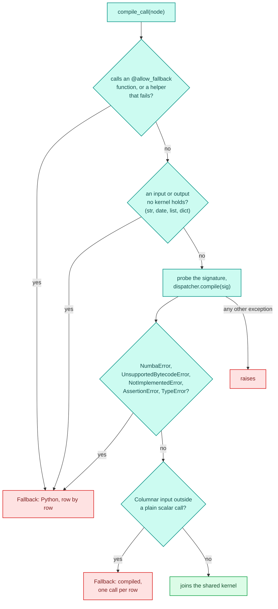
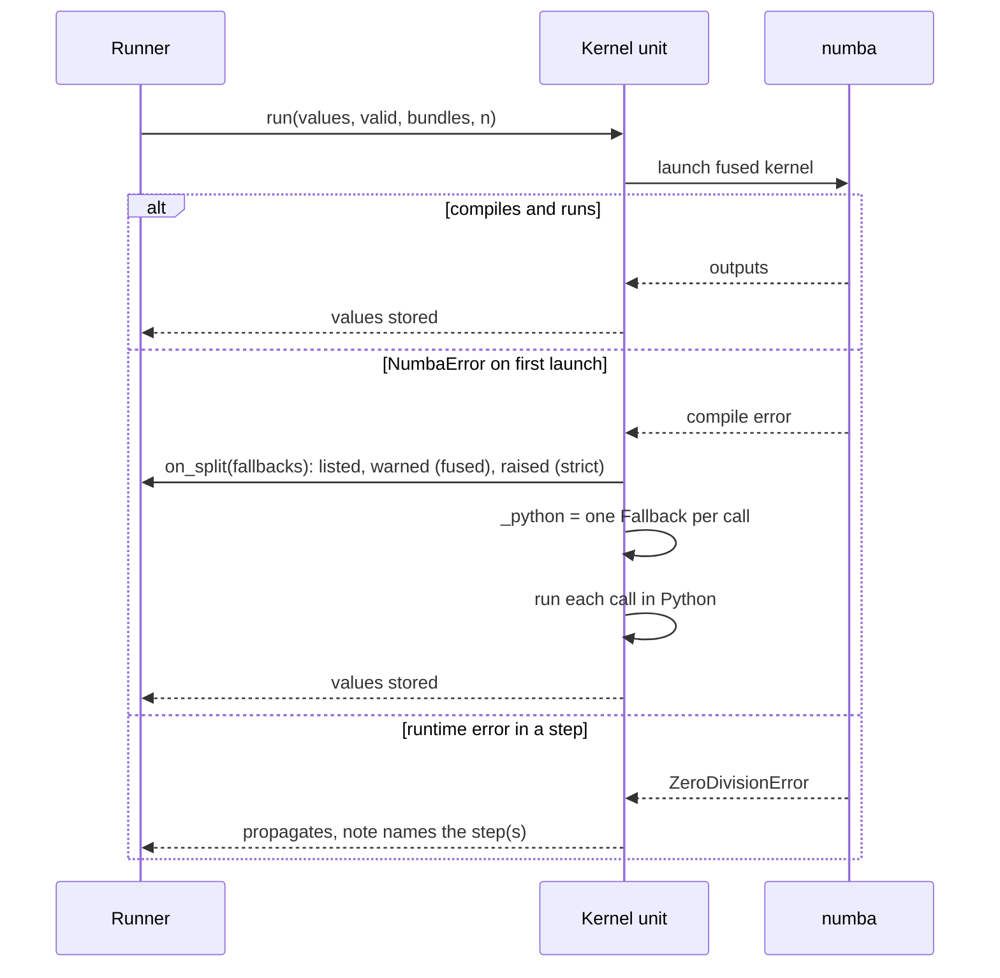

# Compile cache and fallback

Compiling a step with numba takes a noticeable fraction of a second, and a serving worker should
not pay it on its first request. The compile cache makes compiled code reusable across pipelines,
notebook re-runs and processes, without ever serving machine code that no longer matches its
source. Fallback is the other half of the same decision: when numba refuses a step, that step runs
in Python and says so, and the steps around it stay compiled.

The code is in `decikit/_engine/compile/njit.py` (`jit`, the salted disk cache, `compile_call`,
`FALLBACK_ERRORS`), `compile/fingerprint.py` (`fingerprint`, `cpu_target`), `compile/kernel.py`
(the fused kernel cache) and `compile/units.py` (`Fallback`). The [stepped runner](runners.md)
turns fallbacks into warnings, `Engine(strict_compile=True)` in `decikit/_engine/run/engine.py`
turns them into errors, and `decikit build` and `decikit serve` in `decikit/_tooling/cli/` record
and check the CPU target. How a compiled kernel is assembled is on [compilation](compile.md).

## Three caches

| Cache | Keyed by | Lives | Holds |
|---|---|---|---|
| step dispatchers (`_DISPATCHERS`) | `fingerprint(fn)` | the process | one numba dispatcher per distinct function content |
| numba's disk cache, salted | signature, CPU target, bytecode, `SALT`, `fingerprint(fn)` | `__pycache__/` beside the step's file | the machine code of each step signature |
| fused kernels (`_KERNELS`) | the program's shape and its calls' content keys | the process | one njit kernel per distinct program |

Two smaller ones sit beside them: `_REASONS` remembers why a `(content key, signature)` failed to
compile, so a refused step is not retried, and the [Arrow shim](boundary.md) has its own
content-keyed build cache. All in-process caches are filled through `once()` in
`decikit/_engine/concurrency.py`: reads take no lock, and a build runs once under the cache's lock
however many threads ask (see [concurrency](concurrency.md)).

<div class="diagram" markdown>


*What each cache is keyed by, and what it leaves out.*
</div>

## The content key

`fingerprint(fn)` is a sha256 over what the compiled code depends on and nothing else:

- the bytecode and its constants (a set constant is sorted first, so the hash does not move with
  the process's hash seed), and the argument layout;
- the value of every closure cell;
- every global the function reads: a function by its own content (recursively), a module by name
  plus the functions, submodules and data the code reaches through it (so editing `rates.rate`
  changes a caller of `rates.rate(x)`, and editing `rates.LIMIT` changes a caller of `rates.LIMIT`),
  a literal by value, a numpy array or polars frame by its data, a class by `module:qualname` plus
  its own methods (by bytecode) and constants (an enum also by its members), an enum member by class
  and name, a date, Decimal, regex or `lru_cache` wrapper (by the function it wraps) by value, a tuple,
  list, dict or set by its contents, and anything else by identity;
- a function of the standard library or an installed package is keyed by module, qualname, the
  package version, its own bytecode and its closure values, not walked: its helpers and constants
  are not the step's data. Two lambdas of one module, or two closures from one factory, share a
  qualname, so the code and closure keep them apart. A wrapper such as a decorator still keys the
  function it closes over. The decider toolkit's own functions are walked, and so is the step function itself,
  wherever it is installed.

It leaves out the function's name, file and line, and the node's origin path. Real output:

```python
def fee(amount: float, rate: float = param(0.0175)) -> float:
    return amount * rate

def fee_copy(amount: float, rate: float = param(0.0175)) -> float:
    return amount * rate

def fee_edited(amount: float, rate: float = param(0.0175)) -> float:
    return amount * rate + 0.0

def make_rule(threshold):
    def over(amount: float) -> bool:
        return amount > threshold
    return over
```

```text
fee        094e72b141594d3e
fee_copy   094e72b141594d3e
edited     15a2b2bfcd1de91d
rule(2.0)  f82c118f0abf9ff9    rule(3.0)  9d92e9effe0e2665
same dispatcher: True _SaltedCache
```

`fee` and `fee_copy` share one dispatcher. The two closures differ only in a captured value, and
get different keys: keying on the bytecode alone would compile `make_rule(2.0)` once and silently
answer with its threshold for `make_rule(3.0)` too.

`fingerprint(fn, strict=True)` raises `ValueError` instead of keying an object by identity, for
callers that need a key stable across processes. `hidden_state(fn)` runs the same walk and lists
those objects (and the `dict`, `list` and `set` globals the key does see by value but a step can
edit in place), so `Engine.bind` can warn about them and the key cannot disagree with the warning. A captured polars frame is hashed row by row on
every call (a `ponytail:` comment in the source puts it at about 0.5 ms for a small frame and 13 ms
per million rows).

### Why origins stay out of keys

A path or a name never goes into a compiled-code key. Renaming a
step, nesting it one level deeper or reusing it under a second path changes its origin but not its
code. numba's disk cache is sensitive to identity: a same-content file renamed or moved to another
directory missed and recompiled in 4.6 to 4.8 s at 200 arguments, against 0.18 s warm. The previous
engine keyed generated classes by name and had two different namedtuple classes of the same name
collide in dispatch, a correctness bug. `tests/compile/test_compile_cache.py` pins the in-process
behaviour: renaming a parent step or moving a step under another parent does not recompile, and
editing one step recompiles only its kernel.

## The disk cache

`jit(fn)` returns `(key, dispatcher)`. The first time a content key is seen it wraps `njit(fn)` and
attaches a `_SaltedCache`, a subclass of numba's `FunctionCache` whose index key appends `SALT` and
`fingerprint(fn)` to numba's own `(signature, CPU target, sha256 of co_code and closure)`.
numba writes the index and the machine code next to the step's source:

```text
.scratch/F/__pycache__/
  c4_cache.fee-9.py314.nbi
  c4_cache.fee-9.py314.1.nbc
  c4_cache.instalment-50.py314.nbi
  c4_cache.instalment-50.py314.1.nbc
```

In a second process the same steps load from it:

```text
fee         cache hits {(float64, float64): 1} misses {}
instalment  cache hits {(float64, float64): 1} misses {}
```

The two additions close gaps in numba's own key:

- numba hashes `co_code`, which excludes `co_consts`. In a
  reproduction, an edit that replaced a constant used once, kept the file size, restored the mtime, and got a cache
  HIT returning the pre-edit answer (49.39775 instead of 49.29765). `fingerprint` hashes the
  constants.
- numba's key covers the step's own bytecode and none of the overloads its code calls. `SALT` covers
  every file under `compile/semantics/`, `span.py`, `decimal_type.py` and `decikit/ops/`, so an
  edit to how `round` or a `Decimal` compiles misses every step once
  ([kernel semantics](kernels.md) lists the files).

numba also invalidates an index whose source file's `(mtime, size)` changed, and its key includes
the CPU target. `_TolerantIndexFile` treats an index it cannot unpickle (one written by another
decider toolkit version naming a type that has since moved) as empty, so it is rewritten instead of
crashing the load.

A function with a closure, or one defined where there is no file (a notebook cell, `exec`), gets
no disk cache: numba cannot locate its source. Dispatchers are shared by content, so if the first
copy seen had no file and a later copy does, `jit` attaches the cache then.

### No generated source

No source is generated. `exec`'d code cannot
be cached at all (`RuntimeError: cannot cache function 'f': no locator available for file
'<string>'`), and a generated file rewritten on every start changes its mtime, so every entry
misses. Cold against warm in a fresh process was 4.93 s against 0.177 s at 200 arguments and
46.99 s against 0.197 s at 800. So user steps are the only code on disk, in the files their authors
wrote, and the fused kernel is built from LLVM IR by an intrinsic, once per process. It closes over
the step dispatchers, and a closure over a dispatcher never hits numba's disk cache.

The fused kernel compile therefore stays in every new process. In this run of a one-step pipeline,
the first `score()` of a fresh process took 391 ms with a cold step cache and 345 ms with the step
loaded from disk; most of that is building the kernel around it. Serving pays it during warm-up:
`decikit build`, and each serving worker as it stages a config version, score a warm-up record
through every kernel, and a worker answers `/ping` only after that (see [serving](../serving.md)).

### The CPU target

numba compiles for the host CPU, and its cache key includes the LLVM triple, the CPU name and the
CPU feature string. A cache built on one machine misses silently on another. `cpu_target()`
returns that tuple:

```text
x86_64-unknown-linux-gnu  raptorlake  +64bit,+adx,+aes,-amx-avx512,-amx-bf16,...
```

`decikit build` writes it after its warm-up, next to numba's disk cache (in `NUMBA_CACHE_DIR` when
that is set, else in the project's code path). `decikit serve` compares it
with the host and, when they differ, warns that `decikit build` ran for another CPU, that numba's
disk cache won't hit, and that every worker will compile at startup. It is a warning, since warm-up
still compiles everything before the worker answers. The engine leaves `NUMBA_CPU_NAME` to the
deployment; the container image sets it to `generic` by default, which makes entries portable at a
per-record cost that measured below 3% (see the serving decisions).

## Python fallback

A step numba cannot compile runs in Python, row by row, as its own unit. The kernel splits around
it, so the steps before and after it stay compiled (see the grouping rules on
[compilation](compile.md)). Three rules keep this honest.

### Compile errors only

`FALLBACK_ERRORS` is `(NumbaError, UnsupportedBytecodeError)`. `NumbaError` covers numba's typing,
lowering and unsupported-feature errors. `UnsupportedBytecodeError` is what numba 0.67 raises for
an `import` inside a step, and it does not subclass `NumbaError`. Around `dispatcher.compile(sig)`
alone, `compile_call` also catches `NotImplementedError` (numba's bytecode reader meeting an opcode
it lacks, such as `LOAD_COMMON_CONSTANT` on Python 3.14), a bare `AssertionError` (numba's own
lowering asserts) and a `TypeError` (numba boxing a literal it can't hash, such as a list of dicts with
mixed value types). Compiling runs no step code, so none of them can come from the step.

Anything else raises. A runtime error inside a compiled step propagates, with a note naming the
step, exactly as in interpreted mode:

```text
ZeroDivisionError: division by zero
  in step loan/instalment
ZeroDivisionError: division by zero
  in one of the steps ['two/fee', 'two/instalment'], fused into one kernel;
  run in mode='stepped' to see which
```

The scope is this narrow for measured reasons. Catching every `Exception`
would turn a real bug, such as a `ZeroDivisionError`, into a silent fallback. And a per-node
fallback inside a fused kernel can only be numba's `objmode`, which is slower than giving up: over
200k rows and 4 steps, the whole driver in plain Python took 167.3 ms (23.5x all-njit), one node
through per-row `objmode` 548.4 ms (77.0x), and `objmode` inside `prange` 4380.6 ms (614.7x).

### The decision, per step

`compile_call` decides once per step, cheapest checks first, and returns the reason with the
function it will run:



A pipeline with one refused step, in fused mode:

```python
def uses_regex(amount: float) -> float:
    import re
    return 1.0 if re.match(r"\d+", str(amount)) else 0.0

def instalment(amount: float, months: float) -> float:
    return amount / months

pipeline = flow(fee, uses_regex, instalment, name="loan")
exe = pipeline.compile("fused")
exe.run(pl.DataFrame({"amount": [1000.0, 50.0], "months": [12.0, 6.0]}))
exe.fallbacks()
```

```text
FallbackWarning : loan/uses_regex runs in Python, row by row:
  UnsupportedBytecodeError: Use of unsupported opcode (IMPORT_NAME) found.
  Raised from .../c4_cache.py (46)

{'loan/uses_regex': 'UnsupportedBytecodeError: Use of unsupported opcode
  (IMPORT_NAME) found. Raised from .../c4_cache.py (46)'}

[('Kernel', ['loan/fee']), ('Fallback', ['loan/uses_regex']),
 ('Kernel', ['loan/instalment'])]
```

In fused mode there is one `FallbackWarning` per step and executable, raised when the runner
builds its units; stepped mode only lists the step in `fallbacks()`.
A step that still runs compiled but outside the shared kernel (a `Columnar[...]` input read by a
row node, or an OPTIONAL one) gets a different message: `... runs compiled, one call per row
outside the shared kernel: ...`. `exe.fallbacks()` reports both kinds by step path.

### Accepting it, or refusing it

- `@allow_fallback` on a step says the author accepts that it runs in Python: no warning, and
  `fallbacks()` still lists it, prefixed `@allow_fallback: `. On a function a step calls, it marks
  an intentional Python boundary, and the calling step falls back instead of compiling it. Trees,
  tables, scorecards, branches and loops fall back as a whole, so the decorator on one raises
  `TypeError`; filter the warning category for those.
- `Engine(strict_compile=True)` turns an unaccepted Python fallback into an error at the first
  run. It raises a plain `ValueError` (not a `DecikitError`):

```text
ValueError : loan/uses_regex runs in Python, row by row:
  UnsupportedBytecodeError: Use of unsupported opcode (IMPORT_NAME) found.
  Raised from .../c4_cache.py (46); accept it with @allow_fallback,
  or run mode='interpreted'
```

  A step that runs compiled one call per row only warns, even under `strict_compile`.

### Fallback at launch

Each call of a kernel compiled alone, but a kernel can still fail as a whole when it is launched:
a value numba only meets then (a param it cannot type, for instance) makes the kernel's own
compile fail. `Kernel.run` catches `FALLBACK_ERRORS` on that launch, replaces itself with one
`Fallback` per call for the rest of its life, and reruns. The split is reported like a build-time
fallback, through the `on_split` callback the runner installs: listed in `fallbacks()` as
`split at launch: <error>`, warned about in fused mode, refused under `strict_compile`. A step
returning a `dict`, a TypedDict, a `list`, a `tuple`, a `set` or an array never reaches a kernel:
`compile_call` refuses it, so it falls back alone at build. A `Packed` branch or loop does not split;
it raises, and the [fused runner](runners.md) drops the packing for that path and runs the branch
or loop unpacked from then on.



## How it fails

| Symptom | Cause | What to do |
|---|---|---|
| every worker compiles at startup | the CPU target differs from the `decikit build` host, or `SALT` changed with a decider toolkit upgrade | run `decikit build` on the serving host type |
| a step is recompiled after a harmless rename | the file moved: numba's disk cache is keyed by file path and line | expected once; the in-process cache still shares it |
| a step never hits the disk cache | it has a closure, or it was defined without a file | move it to module level in a `.py` file |
| a `FallbackWarning` names numba's long candidate listing | a typing error, for example a `Decimal` mixed with a float | read the decider toolkit line in the middle of the listing ([kernel semantics](kernels.md)) |
| a `ZeroDivisionError` with a note listing several steps | a runtime error in a fused kernel | rerun in `mode="stepped"` to see which step |

`dispatcher.stats.cache_hits` and `cache_misses` (the dispatcher from `jit(fn)`) show whether a
step came from disk. Old shim builds and old cache index entries are never evicted; both are small
(an index entry is a few KB).
