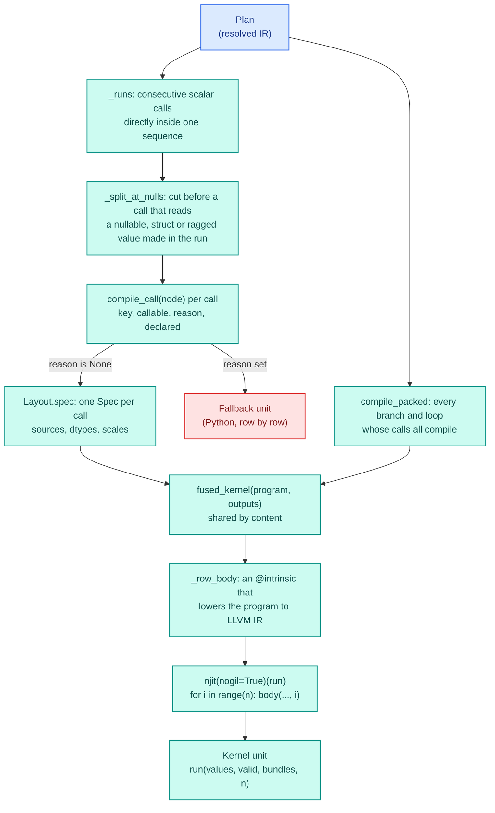
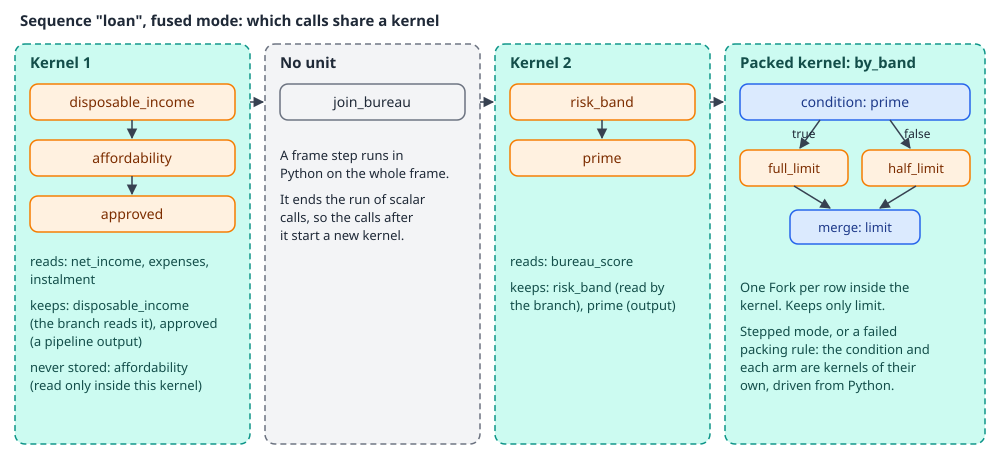
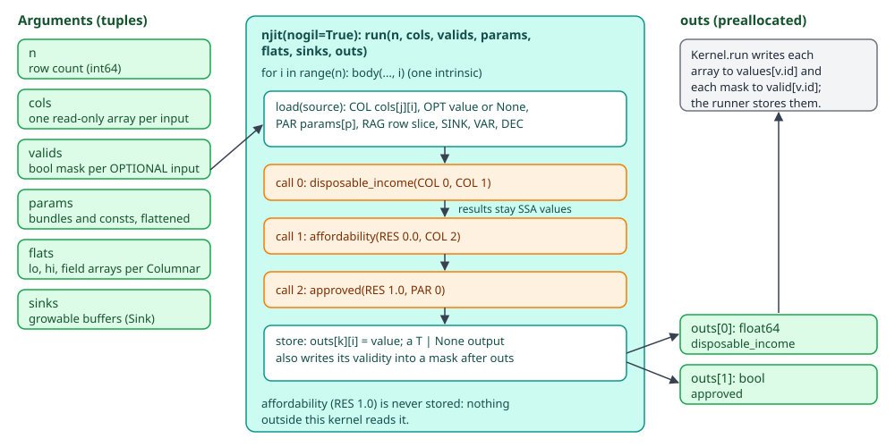
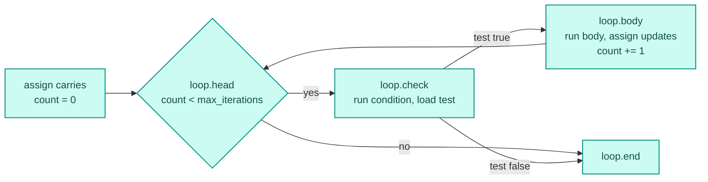

# Compilation

The `stepped` and `fused` modes run each step's Python body as machine code over every row, so a
batch costs one loop per kernel instead of one interpreter call per row and step. The compiler
turns the calls of a resolved plan into numba kernels, groups consecutive scalar steps into one
kernel in `fused` mode, and packs whole branches and loops into one kernel when every call inside
can be compiled. It lives in `decikit/_engine/compile/`.

The compiler does not decide when a unit runs. The [stepped and fused runners](runners.md) walk
the plan and call each unit's `run`. What arithmetic means inside a kernel (rounding, `**`,
`Decimal`, `Text`) is on [kernel semantics](kernels.md); how compiled code is cached and when a
step falls back to Python is on [the compile cache](cache.md); how frame columns and records
become the arrays a kernel reads is on [the data boundary](boundary.md). The plan itself comes
from [wiring](wiring.md), over the node classes described in [the IR](ir.md).

## Files

| File | What it holds |
|---|---|
| `compile/units.py` | `compile_plan`, the grouping rules, `Layout` (where each value comes from), and the two unit classes `Kernel` and `Fallback` |
| `compile/packed.py` | `compile_packed` and `Packed`: a whole branch or loop as one kernel |
| `compile/kernel.py` | `fused_kernel`, the `Spec`/`Fork`/`Repeat` program items, `SrcKind`, and the intrinsic that emits each row's body as LLVM IR |
| `compile/njit.py` | `compile_call` (compile one node, or say why not), `jit` (the shared dispatcher per content), signature probing, `@helper` wiring |
| `compile/fingerprint.py` | `fingerprint` (the content hash of a function) and `cpu_target` |
| `compile/outputs.py` | `output_dtype`, and the code tables (`CodeTable`, `Coded`) for `Literal` and `lookup(...)` outputs |
| `compile/rows.py` | `Columnar[Item]` inputs: `build_rows`, `build_ragged`, `Ragged` |
| `compile/structs.py` | `Struct[Item]` inputs: `struct_dtype`, `build_struct` |
| `compile/sink.py` | `Sink`, the growable buffer a `Columnar[Item]` output drains into |
| `compile/span.py` | `SpanType` and `SpanArray`: a `Text` value in compiled code |
| `compile/decimal_type.py` | `DecimalType`: a `Decimal` in compiled code |
| `compile/semantics/` | the overloads that make kernel arithmetic answer as CPython does, and `SALT` |

The last three belong to [kernel semantics](kernels.md), `fingerprint.py` to [the cache](cache.md).

## From plan to kernel



`compile_plan(plan, fuse=..., python=...)` returns a dict from call id to the unit that runs it.
A unit covering several calls appears once per call, and the runner starts it when its walk
reaches `unit.calls[0]`. Frame calls get no unit at all: the runner runs them in Python. Branches
and loops get no unit from `compile_plan`; only the calls inside them do. In `fused` mode the
runner also calls `compile_packed(plan)`, which returns a `Packed` kernel per branch or loop path
that can run as one kernel.

No Python source is generated at any point. User step functions are compiled from the files they
were written in, and the fused kernel around them is assembled from LLVM IR by a numba
`@intrinsic`. [The compile cache](cache.md) explains why.

## A worked example

This loan pipeline has a straight run of three scalar steps, a frame step, two more scalar steps
and a branch:

```python
import polars as pl
from decikit import branch, flow, frame_step, param, step

def disposable_income(net_income: float, expenses: float) -> float:
    return net_income - expenses

def affordability(disposable_income: float, instalment: float) -> float:
    return disposable_income / instalment

def approved(affordability: float, min_ratio: float = param(1.5)) -> bool:
    return affordability >= min_ratio

@frame_step(reads=["client_id"], writes=["bureau_score"])
def join_bureau(df: pl.DataFrame) -> pl.DataFrame:
    return df.with_columns(bureau_score=pl.lit(640.0))

def risk_band(bureau_score: float) -> int:
    return 0 if bureau_score >= 600.0 else 1

def prime(risk_band: int) -> bool:
    return risk_band == 0

@step(output="limit")
def full_limit(disposable_income: float, multiple: float = param(3.0)) -> float:
    return disposable_income * multiple

@step(output="limit")
def half_limit(disposable_income: float) -> float:
    return disposable_income * 1.5

pipeline = flow(
    disposable_income, affordability, approved,
    join_bureau, risk_band, prime,
    branch(prime, full_limit, half_limit, modifies=["limit"], name="by_band"),
    name="loan")

df = pl.DataFrame({"client_id": [1, 2], "net_income": [9200.0, 4100.0],
                   "expenses": [3100.0, 2600.0], "instalment": [1200.0, 900.0]})
exe = pipeline.compile("fused")
exe.run(df)

for unit in {id(u): u for u in exe.runner.units.values()}.values():
    print(type(unit).__name__, [c.node.origin.path for c in unit.calls])
    print("  reads", [v.name for v in unit.reads],
          "writes", [(v.name, str(d)) for v, d in unit.writes])
print("packed:", list(exe.runner.packed))
```

```text
Kernel ['loan/disposable_income', 'loan/affordability', 'loan/approved']
  reads ['net_income', 'expenses', 'instalment']
  writes [('disposable_income', 'float64'), ('approved', 'bool')]
Kernel ['loan/risk_band', 'loan/prime']
  reads ['bureau_score'] writes [('risk_band', 'int64'), ('prime', 'bool')]
Kernel ['loan/by_band/prime']
  reads ['risk_band'] writes [('prime', 'bool')]
Kernel ['loan/by_band/full_limit']
  reads ['disposable_income'] writes [('limit', 'float64')]
Kernel ['loan/by_band/half_limit']
  reads ['disposable_income'] writes [('limit', 'float64')]
packed: ['loan/by_band']
```

`exe.runner.units` and `exe.runner.packed` are filled on the first run (or the first call to
`exe.fallbacks()`). The branch's condition and arms still get units of their own: the runner uses
them when it cannot launch the packed kernel for a batch (see the section on packed branches
and loops below).

<div class="diagram" markdown>


*What fused mode builds for the `loan` sequence, and what each kernel keeps.*
</div>

## Compiling one call

`compile_call(node)` compiles a single scalar or row node and returns `(key, callable, reason,
declared)`. `key` is the content hash of the function (see [the cache](cache.md)); `callable` is
the njit dispatcher, or the plain Python function when `reason` says why numba can't take it;
`declared` is true when `@allow_fallback` marks the step or a function it calls.

It answers in this order, cheapest first, and stops at the first reason:

1. A scalar step's globals are scanned for functions it calls. One marked `@allow_fallback` makes
   the step run in Python. One marked `@helper(signatures=...)` is compiled for each declared
   signature and swapped into a copy of the step's globals, so every caller shares one helper
   dispatcher. A recursive helper is refused.
2. A `Struct[...]` input whose item has a field that is not `float`, `int` or `bool`, or whose null
   policy is not REQUIRED, is refused: a record has no per-field validity.
3. An input whose annotation no kernel takes (`date`, `list`, `dict`) is refused without asking
   numba, which would otherwise type it as float64 and fail at the first run.
4. A scalar `bytes` input (not `Text`) is refused, and so is any step reading or writing a
   semantic `str`, or a function step writing a `Literal`.
5. The signature is probed: each input, param and const is typed as the value the kernel will
   pass (`_probe_signature`), and `dispatcher.compile(sig)` runs. Its failure, if any, is cached
   per `(key, sig)`.
6. Output checks that need the compiled return type: a `Struct[...] | None` output, a `Struct`
   returned as a dict, a `Columnar[...]` returned as a list of dicts, or one declared `| None`.
7. A `Columnar[...]` input that is OPTIONAL, or read by a row node, runs as a per-row
   dispatcher outside the shared kernel. A `Columnar[Item]` output is wrapped to drain into a
   sink, described below.

A param whose declaration has a schema (a table param) has no numba type up front, so its node
skips the probe and compiles on first use. Anything that is not one of numba's compile errors
raises: [the cache page](cache.md) covers which errors count.

## Grouping rules

Grouping follows fixed rules, with no cost model:

- In `fused` mode, consecutive scalar calls that sit directly inside one sequence share a kernel.
  In `stepped` mode (`fuse=False`) every call is its own unit.
- A row call (a tree, table or scorecard) is always its own unit.
- A frame call, a branch, a loop or a scatter-gather ends the run. The calls inside a branch or
  loop form runs of their own.
- `_split_at_nulls` cuts a run before a call that reads a value made earlier in the same run when
  that value is nullable (`T | None`), a `Struct[Item]` record, or a `Columnar[Item]` output. A
  nullable value has to reach its reader through the driver, which applies the reader's null
  policy as interpreted mode does. A struct is a record pointer inside the kernel but a record
  array in the state, and a ragged output only exists after `Kernel.run` drains its sink.
- A call that cannot compile becomes a `Fallback` unit and splits its run: the calls before it and
  after it stay compiled.

There is no heuristic because fusion is non-monotone: at a fixed 1M rows
the split/fused time ratio was 3.26 at 3 modules and 13.00 at 20 for a cheap straight-line body,
but 0.76 and 0.22 for a heavy body. The mechanism is register pressure (a fused
kernel of 20 modules spilled 47 times per iteration), and no static signal predicts it. One
grouping serves both a batch and `run(record)`, so there is one code path and one cache surface.

### What a kernel keeps

`_kept(plan)` decides which values a fused kernel writes back. A version is stored when it is a
pipeline output, a branch merge input or output, a loop carry, a branch or loop condition, a
scatter-gather field, or when a call outside this kernel reads it. In the example `affordability`
is read only by `approved` in the same kernel, so it is never stored: it lives in a register for
the length of one row. A plan with a frame call of unknown lineage keeps everything, since that
step may read any column. In `stepped` mode every written value is kept.

## The kernel program

`Layout.spec(call, key, fn)` turns each call into a `Spec`: the function, one source per
positional argument, the output dtypes, and flags for nullable, struct and decimal outputs. A
source is a tagged tuple, tagged by `SrcKind`:

| Tag | Meaning |
|---|---|
| `COL j` | element `i` of input column `j` |
| `OPT j m` | the same element, or `None` where mask `m` is false (an OPTIONAL input) |
| `RES s k` | output `k` of call `s` earlier in this kernel |
| `VAR v` | a variable set by a `Fork` merge or a `Repeat` carry |
| `PAR p` | element `p` of the flattened params tuple (bundle values, then consts) |
| `DEC scale src` | an int64 source seen as a decimal of that scale |
| `RAG schema b` | row `i`'s items of a `Columnar[Item]` input, sliced from `flats[b:]` |
| `SINK b` | a growable output buffer shared by every row |
| `ROW (src, ...)` | several sources packed into one tuple argument (a row node's feature tuple) |

The real program of the first kernel above:

```text
Spec(key=69f36fbeb4bb..., fn=disposable_income,
     args=((COL, 0), (COL, 1)), dtypes=(float64,), unpack=False)
Spec(key=4851d918ce32..., fn=affordability,
     args=((RES, 0, 0), (COL, 2)), dtypes=(float64,), unpack=False)
Spec(key=b2203cb841df..., fn=approved,
     args=((RES, 1, 0), (PAR, 0)), dtypes=(bool,), unpack=False)
outputs ((RES, 0, 0), (RES, 2, 0))
layout  ((2, True, (), False),)
```

Arguments are matched by the step's own parameter names, so a param and an input never swap
places; a name that is no input, const or param fails at build time with
`argument(s) [...] are not an input, const or param`. A row node always gets three arguments:
`ROW` of its inputs, its bundle, and its consts. The `layout` entry says call 2 has a params
bundle, which `Kernel.run` flattens into `params` on every launch. Bundle values are kernel
arguments, so retuning a param reuses the same kernel; only a change in a param's type adds a
signature.

## The kernel

`fused_kernel(program, outputs, variables, trace_refs)` builds one function of the signature
`run(n, cols, valids, params, flats, sinks, outs)` and compiles it with `njit(nogil=True)`. Its
loop calls `body(cols, valids, params, flats, sinks, outs, i)` for each row, and `body` is a numba
`@intrinsic` whose code generator walks the program:

- `load(source)` emits the read for each tag above. A `COL` of a 2-d int64 table (a `bytes`
  column) becomes a span; an `OPT` becomes a numba `Optional`.
- `call(spec)` resolves each callee through numba's own `get_call_type` and `get_function`, the
  same sequence a direct call in jitted source goes through, so a step is inlined like any other
  njit function. Each result is cast to its declared dtype when produced, so a fused value is
  bit-identical to the one a single-call kernel stores.
- A decimal output is stored as its int64 at the declared scale (a coarser scale rounds
  half-even). A `Struct[Item]` output, returned as a tuple of fields, is packed into a record.
- `store` writes `outs[k][i]`. A nullable output stores its value and writes its validity into a
  bool array placed after the value arrays.

Kernels are cached in process by `(program key, outputs, variables, trace, trace_refs)`, where the
program key holds each call's content key, never its node path. Two pipelines with the same steps
share one kernel whatever their nodes are called.

<div class="diagram" markdown>


*Data flow of Kernel 1 for one row `i`.*
</div>

### The generated code

There is no Python source to read, but every kernel is an ordinary numba dispatcher, so
`inspect_llvm` shows what LLVM produced:

```python
k0 = next(u for u in {id(u): u for u in exe.runner.units.values()}.values()
          if isinstance(u, Kernel) and len(u.calls) == 3)
print(k0.fn.signatures)
print(k0.fn.inspect_llvm(k0.fn.signatures[0]))
```

```text
[(int64,
  UniTuple(Array(float64, 1, 'C', True, aligned=True), 3),
  Tuple(()),
  UniTuple(float64, 1),
  Tuple(()),
  Tuple(()),
  Tuple((Array(float64, 1, 'C', False, aligned=True),
         Array(bool, 1, 'C', False, aligned=True))))]
```

The signature is the seven arguments: `n`, three read-only float64 columns, no masks, one param
(`min_ratio`), no flats, no sinks, and two writeable output arrays. The loop body, trimmed of
reference counting:

```llvm
B32.endif:
  %.173148152 = phi i64 [ %.180, %B32.endif.endif.endif.endif ], [ 0, %B32.endif.preheader ]
  %scevgep15 = getelementptr i8, ptr %arg.cols.2.4, i64 %0
  %.324 = load double, ptr %scevgep15, align 8            ; instalment[i]
  %.6.i7 = fcmp oeq double %.324, 0.000000e+00
  br i1 %.6.i7, label %B32.endif.if.if, label %B32.endif.endif.endif.endif   ; raise ZeroDivisionError

B32.endif.endif.endif.endif:
  %.240 = load double, ptr %scevgep17, align 8            ; net_income[i]
  %.270 = load double, ptr %scevgep16, align 8            ; expenses[i]
  %.6.i = fsub double %.240, %.270                        ; disposable_income
  %.15.i = fdiv double %.6.i, %.324                       ; affordability
  %.6.i8 = fcmp oge double %.15.i, %arg.params.0          ; approved: >= min_ratio
  %.7.i = zext i1 %.6.i8 to i8
  store double %.6.i, ptr %scevgep, align 8               ; outs[0][i]
  store i8 %.7.i, ptr %4, align 1                         ; outs[1][i]
  %exitcond.not = icmp eq i64 %arg.n, %.180
  br i1 %exitcond.not, label %B60, label %B32.endif
```

All three steps are inlined into one loop. `affordability` is a register (`%.15.i`) and never
reaches memory. The comparison against zero is CPython's division semantics: a zero instalment
raises `ZeroDivisionError` out of the kernel, where plain float division would write `inf`.

### Kernel flags

Every fused, packed and single-call kernel is built with `nogil=True` and without `fastmath`:

```text
targetoptions {'nogil': True, 'nopython': True, 'boundscheck': None}
```

`tests/compile/test_compile_kernel.py` pins both.
With 16 threads calling one kernel under a 20 ms budget, `nogil=True` kept p99 at 883 µs, while
`nogil=False` reached 254.1 ms because each call held the GIL for its whole run. With `fastmath`
off, Python and njit agreed bit for bit over a 16-term log/exp/sqrt/div chain on 20,000 rows; with
it on, 46 to 73% of rows differed by up to 17 ULP for a 1.09x speedup on that chain. Identical
answers across modes is a property the [equivalence checks](../../guides/diff-and-equivalence.md)
rely on, so `fastmath` stays off. [Concurrency](concurrency.md) covers what `nogil` means for
serving threads.

## Packed branches and loops

In `fused` mode a branch or loop whose every call compiles becomes one kernel, and each row takes
its own arm, or its own iterations, inside it. The program gains two items besides `Spec`:

- `Fork(test, arms, merges)`. A bool test is an LLVM `if/else`: true runs arm 0, false arm 1. An
  int test is a `switch` over the arm index; an index with no arm jumps to a block that raises
  `ArmOutOfRange`. After an arm runs, each merged variable is set from that arm's source.
- `Repeat(carries, condition, test, body, updates, max_iterations)`. Carried variables are set
  from their initial sources, then a counted loop runs the condition, stops unless the test is
  true, runs the body and sets each carry from its update.

Values that cross a block (merged and carried names) live in stack slots that LLVM promotes back
to registers. Every update loads all its sources before it writes any variable, so no carry sees
another's new value.



The real program of the `by_band` branch in the example, and of a repayment loop
(`loop(unpaid, flow(pay, tick), carries=["balance", "months"], max_iterations=360)`):

```text
by_band: Spec(prime, args=((COL, 0),), dtypes=(bool,))
         Fork(test=(RES, 0, 0),
              arms=((Spec(full_limit, args=((COL, 1), (PAR, 0))),),
                    (Spec(half_limit, args=((COL, 1),)),)),
              merges=((0, ((RES, 1, 0), (RES, 2, 0))),))
         writes [('limit', 'float64')]  guarded ['disposable_income']

repay:   Repeat(carries=((0, (COL, 0)), (1, (COL, 1))),
                condition=(Spec(unpaid, args=((VAR, 0),)),), test=(RES, 0, 0),
                body=(Spec(pay, args=((VAR, 0), (COL, 2), (PAR, 0))),
                      Spec(tick, args=((VAR, 1),))),
                updates=((0, (RES, 1, 0)), (1, (RES, 2, 0))), max_iterations=360)
         variables (float64, int64)
         writes [('balance', 'float64'), ('months', 'int64')]
```

LLVM optimises the packed body as one unit. For a branch `prime -> full_limit | half_limit`
(`score >= 600`, then `income * multiple` or `income * 1.5`), the emitted loop has no branch at
all: the condition became a vector `select` of the multiplier, four rows per instruction.

```llvm
%5  = fcmp ult <4 x double> %wide.load, splat (double 6.000000e+02)
%9  = select <4 x i1> %5, <4 x double> splat (double 1.500000e+00), <4 x double> %broadcast.splat
%13 = fmul <4 x double> %wide.load17, %9
store <4 x double> %13, ptr %sunkaddr130, align 8
```

### Packing rules

`compile_packed` packs a branch or loop when all of these hold, and otherwise leaves it to the
Python-driven path of stepped mode, which gives the same answers:

- every call inside (condition, arms, body, nested branches and loops) is a scalar call that
  `compile_call` compiles, and none is in the runner's forced-Python set;
- no call inside has a nullable output;
- every merged or carried name is `float`, `int`, `bool` or a `Struct[Item]`, with one dtype across
  the arms or the carry's versions;
- nothing made inside, other than what the branch merges or the loop carries, is a pipeline output;
- with `params_validation="lazy"`, no call except the construct's own condition has params,
  because launching the kernel validates every call in it.

At run time the [fused runner](runners.md) checks `Packed.guarded` before each launch. If a value
the kernel only copies (a merge's earlier value, a carry's initial value) or a REQUIRED input of a
call that may not run has a null on a row in the batch, it takes the unpacked path for that
launch. `ArmOutOfRange` also sends the branch down the unpacked path, which raises the usual error
naming the branch, the arm and the row count. A packed kernel numba cannot build as a whole is
dropped for the life of the runner.

Measured against the previous engine on the same box:
41.6 to 44.3M rows/s for a branch over 1M rows (14.8M rows/s Python-driven in stepped mode) and
6.33M rows/s for a loop of up to 360 iterations over 200k rows (0.81M stepped). `run(record)` through
that branch was 23 µs p50 fused against 66 µs stepped.

## Values that are not one number

### Rows: `Columnar[Item]` inputs

A `Columnar[Item]` input is a list column read as one flat array per item field. In a shared
kernel it is a `Ragged`: per-row `lo` and `hi` offsets plus the field arrays, unsliced. The kernel
gets them in `flats` (`lo`, `hi`, then one array per field), and the `RAG` source slices row `i`
into a namedtuple of array views (`rows_class(schema)`, one class per field name and type
sequence). A branch or loop row subset is `ragged[rows]`, which indexes `lo` and `hi` only.

`build_ragged` reads a column straight out of its Arrow buffers when the input frame still holds
it and the batch has at least 256 rows (`ARROW_ROWS`): Arrow's `list<struct>` layout already is
offsets plus one flat array per field ([the boundary](boundary.md) covers the reader). Below that,
or for computed values, it builds the arrays from the Python lists. `build_rows` makes one
namedtuple of views per row instead, for the per-row dispatchers (a row node or a `Fallback`).

### Records: `Struct[Item]`

A `Struct[Item]` value is one numpy record per row, with an aligned dtype built from the item's
fields (`struct_dtype`), so `applicant["income"]` reads the same in Python and in a kernel. Fields
must be `float`, `int` or `bool`. Inputs are filled from the struct column's Arrow children through
the ordinary column boundary, or from dicts. An output is produced by a step that returns a tuple
of the fields:

```python
class Offer(TypedDict):
    limit: float
    tier: int

def offer(affordability: float, arrears: float) -> Struct[Offer]:
    return (affordability * 3.0 - arrears, 1 if arrears > 0.0 else 0)

def offer_limit(offer: Struct[Offer]) -> float:
    return offer["limit"]
```

```text
Kernel ['credit/affordability', 'credit/arrears', 'credit/offer']
   reads ['applicant'] ragged ['accounts']
   writes [('offer', "{'names': ['limit', 'tier'], 'formats': ['<f8', '<i8'],
                       'offsets': [0, 8], 'itemsize': 16, 'aligned': True}")]
Kernel ['credit/offer_limit']
   reads ['offer'] writes [('offer_limit', 'float64')]
```

Inside the first kernel, `offer` is a record pointer to a stack buffer; `offer_limit` reads the
stored record array, so the run is split before it. A step returning a dict for a `Struct` output
still runs, in Python.

### Sinks: `Columnar` outputs

A `Columnar[Item]` output has a variable number of items per row, which no fixed-stride output
column holds. `compile_call` wraps the step: the wrapper calls it, pushes each returned tuple into a
`Sink`, and returns the sink's running length. `Sink` is a numba `jitclass` holding a
`(rows, n_fields)` float64 buffer that doubles when full, so every item schema shares one buffer
shape. The kernel stores the running length as an ordinary int64 output, and `Kernel.run` turns
it back into one `list[dict]` per row (`_ragged_values`), narrowing bool and int fields again.

### Coded outputs

A row node (a tree or table) declaring a `Literal` of strings, or a `lookup(...)` of lists or
records, returns the index of its value. `output_dtype` stores it as int64, and `Kernel.run` wraps
the column in `Coded(codes, CodeTable)`: the table holds the values once, as Python objects and
as a polars Series with null last. `decode()` gives Python values for `run(record)`, `series()` a
polars column for `run()` by gathering the codes, and code `-1` marks a null. A function step's
`Literal` output runs in Python.

## Units at run time

| Unit | `run(values, valid, bundles, n)` does |
|---|---|
| `Kernel` | gathers `cols`, one shared all-true mask for OPTIONAL inputs with no nulls, the flattened params, the ragged arrays and fresh sinks; allocates `outs` and masks; launches; stores each kept output |
| `Packed` | the same, for a branch or loop; stores only what it merges or carries, and raises instead of splitting |
| `Fallback` | calls the step once per row in Python with Python scalars, boxing Decimals; stores objects for non-numeric outputs |

If a `Kernel` launch raises one of numba's compile errors (a value numba only meets at launch),
the kernel switches to one `Fallback` per call for the rest of its life. A runtime error inside a
kernel propagates; the runner adds a note naming the step, or listing every step of a fused kernel
because a kernel cannot tell which of its steps raised:

```text
ZeroDivisionError: division by zero
  in one of the steps ['two/fee', 'two/instalment'], fused into one kernel;
  run in mode='stepped' to see which
```

With a trace sink, `Kernel.run` launches a second variant of the same kernel that also writes one
`STEP` event per call into a preallocated buffer. [Decision traces](trace.md) describe the
envelope.

## Debugging a kernel

- `exe.fallbacks()` lists every step outside the shared kernel and why. [The cache
  page](cache.md) shows a real one.
- `exe.runner.units` maps call ids to units; `unit.calls`, `unit.reads` and `unit.writes` show the
  grouping; `exe.runner.packed` lists packed branches and loops by path.
- `unit.fn.signatures`, `unit.fn.inspect_llvm(sig)` and `unit.fn.inspect_asm(sig)` show the
  compiled code.
- `mode="stepped"` gives one kernel per call, so an error names one step and a [debug
  session](debug.md) can pause between steps.

## Extending

A new value type for kernels touches several places at once, which the money investigation listed
for `Decimal`: a numba type with a data model and casts, a source tag or wrap in `kernel.py` so
every source kind (column, optional column, result, variable, param) carries it, the probe type in
`njit.py`, `Layout.spec` for scalar sources and params, the Python side in `Fallback.run`, and the
overloads under `semantics/`, whose files feed the cache `SALT`. Add a packed test asserting that a
branch and a loop over the new type land in `exe.runner.packed`: a type error inside a packed
kernel only drops the packing, and answers stay right, so nothing else shows it.
