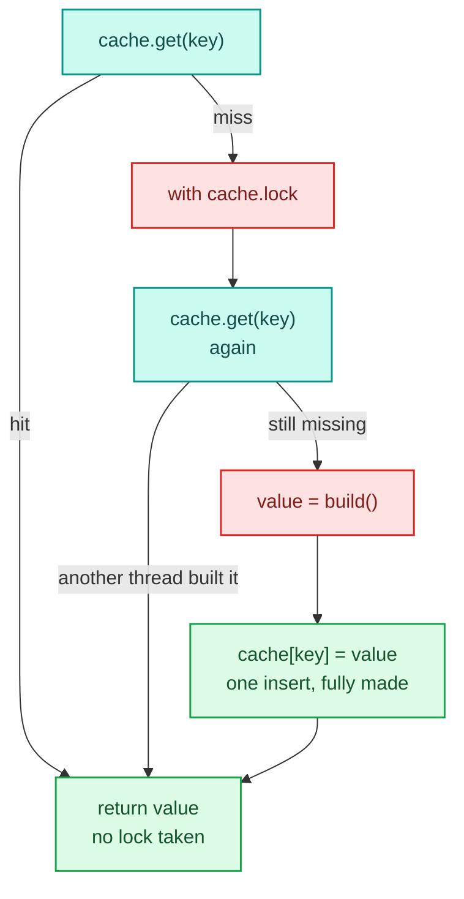
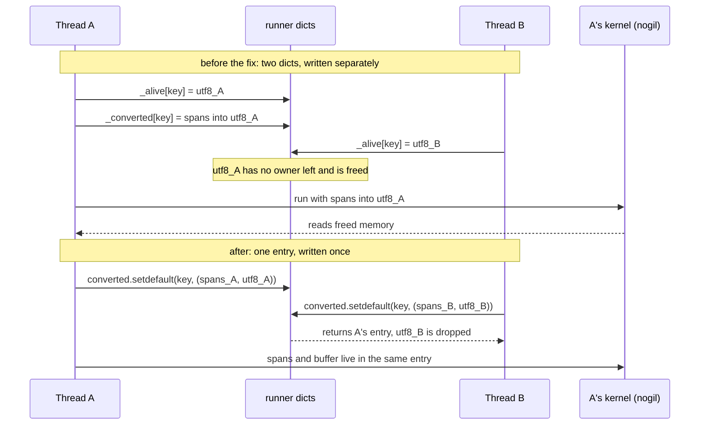

# Concurrency

Serving answers every request from one shared `Executable`, and an embedder may call that executable from as many threads as it likes. So everything on the `run` and `score` path has to be safe when many threads call it at once, including the very first call, which compiles. Everything else (debug sessions, trace sinks, experiments, the bridge) is single-caller by contract.

Two helpers in `decider/_engine/concurrency.py` implement most of the contract: `once`, for caches built once and read without a lock, and a per-thread pool for reusable scratch. Serving's own request handling is in [Serving](../serving.md).

## The contract

| Must be safe from many threads | Why |
|---|---|
| `Executable.run` and `score` on one shared executable: same or different params documents, traced or not, including the first call | `RequestHandler` serves every request from one executable, and kernels are `nogil=True` so threads overlap |
| `RequestHandler.process_fn` while `stage`, `activate` or `rollback` run | versions are swapped under load |
| `Engine().bind(...)` while other executables run | staging a new version compiles while the old one serves, and both touch the module-global compile caches |
| registry `resolve` and `lazy` | loading a document can import and register types while requests run |
| input extraction, `raw_str` codes, params validation and conversion | all reached from `run` and `score` |

| Single caller by contract | Why |
|---|---|
| `Session` | one debugger drives one session; it may be opened from a shared executable without disturbing it |
| `TraceSink` | one sink per call; its counters are plain ints |
| experiments, checks, diff, data loaders, the bridge, MCP | tools with one caller; experiments already isolate revisions in subprocesses |
| user step functions | decider cannot make them safe; the `impure` and `mutates_input` checks flag the common ways they fail |

The docstrings say it in one line each: `Executable` is "Safe to call from many threads at once", `Session` and `TraceSink` are "Not thread-safe: use one per thread" and "use one per call".

## What is shared and what is not

<div class="diagram" markdown>

</div>

The rules the code follows, from the thread-safety note:

1. An `Executable` and its runner are immutable once compiled. Everything that varies per call travels in the call: the `State`, the `RunParams`, the trace sink and its table. Nothing per call is stored on `self`.
2. Compile once, publish once. A runner builds its compiled form into locals under its own lock, double-checked on the plan, and publishes one immutable snapshot with a single assignment. A call reads that snapshot once and uses it throughout.
3. Caches are write-once, and an entry carries its own keep-alives. Inserts use `setdefault` and never overwrite. An entry that holds raw pointers also holds the buffers they point into.
4. Reusable scratch is pooled per thread and popped while in use.
5. Module-global build caches use a double-checked lock: a lock-free `dict.get` on the hit path, a lock, a second check, the build and one insert on the miss path.
6. No rule depends on the GIL making dict operations atomic. Decider runs on CPython with the GIL today; rule 3's `setdefault` relies only on per-object dict atomicity, which free-threaded CPython keeps.

Locks appear only on miss paths, so a warm `score()` takes none.

## `once(cache, key, build)`

```python
_MISSING = object()


class Cache(dict):
    """A dict that `once` fills: lock-free reads, one lock for the builds."""

    __slots__ = ("lock",)

    def __init__(self) -> None:
        super().__init__()
        self.lock = threading.RLock()


def once(cache: Cache, key: Any, build: Callable[[], Any]) -> Any:
    value = cache.get(key, _MISSING)
    if value is _MISSING:
        with cache.lock:
            value = cache.get(key, _MISSING)
            if value is _MISSING:
                value = cache[key] = build()
    return value
```



The value is assigned to the dict only after `build()` returns, so no thread ever sees a half-made entry. The lock is an `RLock`, so a build that needs another entry of the same cache can take it again on the same thread. `build` runs under the cache's lock, so it may be slow (a numba compile is), and other threads asking for any key of the same cache wait for it.

Sixteen threads released at once on a cold cache, with a 10 ms build and the interpreter switching threads every microsecond:

```python
import sys, threading, time
from concurrent.futures import ThreadPoolExecutor
from decider._engine.concurrency import Cache, once, checkout, checkin

sys.setswitchinterval(1e-6)
cache, builds = Cache(), []
def build():
    builds.append(threading.get_ident()); time.sleep(0.01); return object()
barrier = threading.Barrier(16)
def ask(_):
    barrier.wait(); return once(cache, "kernel", build)
with ThreadPoolExecutor(16) as pool:
    got = list(pool.map(ask, range(16)))
print("builds:", len(builds), "distinct values:", len({id(g) for g in got}))
```

```text
builds: 1 distinct values: 1
```

The caches that go through `once`:

| Cache | Where | Keyed by | Holds |
|---|---|---|---|
| `_DISPATCHERS` | `decider/_engine/compile/njit.py` | the function's content fingerprint | the shared numba dispatcher for that code |
| `_REASONS` | `decider/_engine/compile/njit.py` | fingerprint and signature | why numba refused a function, or `None` |
| `_KERNELS` | `decider/_engine/compile/kernel.py` | the program's content, outputs, variables, trace refs | a built fused kernel |
| `_DTYPES` | `decider/_engine/compile/structs.py` | a struct schema | its numpy record dtype |
| `_LAYOUTS` | `decider/_engine/compile/rows.py` | a nested-row schema | its row layout class |
| `Executable._checked` | `decider/_engine/run/engine.py` | params document key | that namespaces were checked (and, when eager, every bundle built) |
| `Executable._warned` | `decider/_engine/run/engine.py` | a param name found in the input | that its warning was issued, so it fires once |

`rows.py` and `structs.py` call it as `_LAYOUTS.get(schema) or once(...)`, which saves a function call on the hot path. `jit()` attaches numba's disk cache to a dispatcher inside the `build`, before the dispatcher is published; when a later copy of the same code has a real file and the shared dispatcher still has none, it attaches the cache under `_DISPATCHERS.lock`. Compile caching itself is covered in [Compile cache](cache.md).

## The per-thread pool

```python
_local = threading.local()


def checkout(pool: str, key: Any, make: Callable[[Any], Any]) -> Any:
    item = _local.__dict__.setdefault(pool, {}).pop(key, None)
    return make(key) if item is None else item


def checkin(pool: str, key: Any, item: Any) -> None:
    _local.__dict__.setdefault(pool, {})[key] = item
```

Each thread has its own dict of pools. `checkout` pops the item, so while it is in use nobody else on the thread can get it; a re-entrant call on the same thread makes a fresh one. `checkin` puts it back for the next call.

```python
made = []
def make(key):
    made.append(key); return bytearray(8)
a = checkout("views", "plan", make)
b = checkout("views", "plan", make)   # re-entrant: a is still checked out
print("re-entrant gets its own:", a is not b, "made:", len(made))
checkin("views", "plan", a)
print("reused after checkin:", checkout("views", "plan", make) is a)
other = []
t = threading.Thread(target=lambda: other.append(checkout("views", "plan", make)))
t.start(); t.join()
print("another thread gets its own:", other[0] is not a, "made:", len(made))
```

```text
re-entrant gets its own: True made: 2
reused after checkin: True
another thread gets its own: True made: 3
```

The one user today is input extraction. `decider/_engine/boundary/extract.py` checks out a `FrameView` per `FramePlan` from the `"views"` pool, binds it to the incoming frame, reads the columns, then calls `view.release()` and checks it back in. A `FrameView` hands raw buffer addresses to kernels and `release()` invalidates them, so two threads sharing one view would free each other's spans mid-kernel. See [The boundary](boundary.md) for the view itself.

The serving-latency note plans a per-(plan, thread) reusable `State` for `score()` on the same pattern; it has not landed.

## The runner's compiled snapshot

`SteppedRunner` (and `FusedRunner`, which subclasses it) keeps everything it compiled in one `Compiled` named tuple: the plan it was built for, the units (kernels and fallbacks), what each unit reads, which params enter as UTF-8 spans, the fallback reasons, the converted-bundle cache and the packed branches and loops. `iterate` reads `self._compiled` once:

```python
def iterate(self, plan, state, params, trace=None, table=None):
    compiled = self._compiled
    if compiled.plan is not plan:
        compiled = self._compile(plan, params.lazy)
    return self._drive(state, params, _Context(trace, table, compiled), plan)

def _compile(self, plan, lazy):
    with self._lock:
        compiled = self._compiled
        if compiled.plan is not plan:
            compiled = self._compiled = self._build(plan, lazy)
        return compiled
```

The call then carries `compiled` in its `_Context`, so every node of the call sees the same snapshot even if another thread publishes a new one halfway through. Two later writes keep the same discipline:

- `_bundle` converts a node's `str` params to `(address, length)` spans of their UTF-8 bytes. The entry is the pair `(bundle, utf8)`, inserted with `converted.setdefault(key, ...)`. A thread that loses the race uses the winner's entry, and the buffers the spans point into live as long as that entry.
- `_drop`, which removes a packed kernel numba refused at run time, takes the lock and publishes `now._replace(packed=...)`, a new snapshot without that path, instead of mutating the dict in place.

A convention test enforces rule 1 mechanically. `test_runners_and_executable_keep_no_per_call_state` in `tests/test_conventions.py` walks the AST of every class in `decider/_engine/run/engine.py` and `decider/_engine/run/runners/` and fails on any assignment to `self.<attr>`, any subscript assignment through `self`, and any mutating method call (`update`, `pop`, `append`, `setdefault`, ...) on something reached from `self`, outside `__init__`, `_compile`, `_build` and `with self._lock:` blocks. The one allowlisted exception is `Executable._params`, which writes a `threading.local`.

## Per-thread report

`exe.report` describes the params validation of the latest call. With one shared executable "latest" has no single answer, so `Executable._latest` is a `threading.local` and `report` is a property over it: the report of the latest call on the calling thread. For single-threaded code (tests, notebooks, MCP) that is the same value as before. A thread that has not called yet gets an empty `RunReport`.

`ParamsCache` is shared on the executable. `validate` inserts each `Validation` with `setdefault`, so threads validating the same node of the same document at once end up using the first result. `key(doc)` keeps one slot `(doc, key)`, replaced by a single tuple assignment and checked by identity, which tolerates races: a thread that reads a stale slot just hashes the document again.

## Why kernels release the GIL

Every compiled kernel is built with `njit(nogil=True)` in `decider/_engine/compile/kernel.py`, unconditionally. Stepped mode wraps each call in a one-call kernel built the same way, so it releases the GIL too. A compiled kernel touches no Python objects, so releasing the GIL is safe for any of them.

The kernel-flags note has the measurement that decided it: 1 to 16 threads calling the same compiled kernel, against a 20 ms budget.

| Threads | `nogil=True` p99 | `nogil=False` p99 | `nogil=False` max |
|---|---|---|---|
| 1 | 879 µs | 890 µs | 2.4 ms |
| 2 | 904 µs | 6.2 ms | 7.6 ms |
| 8 | 893 µs | 115.8 ms | 342.5 ms |
| 16 | 883 µs | 254.1 ms | 378.7 ms |

Throughput was bound by the GIL at about 1,020 to 1,190 calls per second either way. The tail was the problem: with `nogil=False` each call holds the GIL for its whole run and the calls queue behind each other, a convoy that put the 16-thread p99 at 12.7 times the budget. With `nogil=True` the p99 stayed flat.

The note records the alternatives. decider2 made `nogil` opt-in per step, and a fused group got it only if every step had it. An earlier finding had `nogil=True` losing to `nogil=False` (26% against 55% of throughput retained) when serving competed with a background compile thread. The note sets that aside because compilation had moved to a subprocess, which retained 97.9%. In decider, `RequestHandler.stage` binds and warms the new version in the serving process, under the handler's lock, so a stage under load is the case that earlier finding measured. GC tuning was ruled out as a tail fix: disabling or freezing the collector left p50 to p99 unchanged.

Releasing the GIL is also why the lifetime rules matter. Once a kernel runs without the GIL, another thread can run Python at the same moment, including Python that frees a buffer the kernel is reading. The serving-latency note puts it as a rule: anything that hands a raw address to a kernel must stay reachable from a live Python object for the whole call. With a thread pool, a shared buffer is a use-after-free, and that ends in a segfault.

Two details sit outside the guarantee. A `Fallback` that calls a numba dispatcher once per row from Python goes through the dispatcher's normal entry, which holds the GIL while it runs. And `step(nogil=...)` sets `CallNode.nogil`, which is part of a step's content (it changes the hot-reload key and the diff hash) but is not read by the compiler: every kernel releases the GIL whatever the flag says.

## Inside one serving process

`RequestHandler.process_fn` calls `score()` or `run()` directly on the event loop. With Starlette, one worker process therefore runs requests one at a time, and its `nogil` kernels never overlap. Concurrency today comes from embedders calling one executable from their own threads, and from running several processes. The contract holds either way. Moving scoring to a thread pool (`anyio.to_thread.run_sync`) would trade a thread hop per request for not blocking the loop; the thread-safety note leaves that to a benchmark.

`stage`, `activate` and `rollback` take the handler's `_lock` and swap the active `Live` with one assignment. `Live.dates` defaults to an empty `MappingProxyType`, so the shared default cannot be mutated. The registry takes its root's `RLock` on the miss path of `resolve` and `lazy`, and `bundle_class` in `decider/_engine/params/bundles.py` builds each namedtuple class under a module lock.

## The races that were found and fixed

The first audit (the racecondition-investigation-results note) read the code for shared state; the thread-safety note re-checked every finding, added three, and turned them into the contract above. Every fix kept the API and single-threaded behaviour unchanged.

| # | Race | Fix |
|---|---|---|
| 1 | Use-after-free of `str` param spans. `_alive[key]` and `_converted[key]` were written separately, so a concurrent call on the same key overwrote `_alive` and freed the first call's UTF-8 buffer under its running kernel. | one immutable `(bundle, utf8)` entry, inserted with `setdefault` |
| 2 | First-call compile race. Two cold calls both compiled; the second rebound the converted and alive dicts while the first's kernel read spans from the old ones, and attributes were published one by one. | lock, double-check, one `Compiled` snapshot |
| 3 | The trace sink was stored on the shared runner for the length of `iterate`, so overlapping traced and untraced calls sent events to the wrong sink or dropped them. | the sink travels in the per-call `_Context` |
| 4 | `exe.report` was last-writer-wins, and `_checked`, `_warned` and the params cache were mutated per call. | `report` over a `threading.local`; `_checked` and `_warned` through `once` |
| 5 | `ParamsCache._results` read-modify-write: duplicated validation, lost report updates. | `setdefault` |
| 6 | Module-global compile caches were check-then-act, and `dispatcher._cache` was swapped on a shared dispatcher. | `once`; the disk cache attached before publishing |
| 7 | The fused runner mutated `packed` in place when a branch fell back. | copy-on-write under the lock |
| 8 | `Session` shallow-copies the shared runner; it was safe only because compile happened to rebind its dicts. | safe by construction once the shared parts are an immutable snapshot; a test opens a session mid-load |
| 9 | The registry was mutated at runtime by `resolve` imports and `lazy`. | the root's lock on the miss path |
| 10 | `Live.dates` had a mutable `{}` default shared by every instance. | `MappingProxyType({})` |
| 11 | `_BatchRunner`'s lazy `bind` in `each`. | gone: `each` became a `ScatterGather` IR node |

The first four could corrupt results or crash; the rest wasted work or lost updates. Number 1 is the one the audit called dangerous: a request could read freed memory.



## The tests that pin it

`tests/serving/test_concurrency.py` is the stress test. An autouse fixture sets `sys.setswitchinterval(1e-6)` so the interpreter switches threads every microsecond, `together` releases one thread per item through a barrier, and `hammer` runs a 16-thread pool. Every answer is compared with what a single thread gets. Races are probabilistic, so a failure is a real bug and a pass is only evidence.

| Test | Covers |
|---|---|
| `test_concurrent_first_calls_on_a_cold_executable_agree_with_one_thread` | race 2, `score`, every mode |
| `test_concurrent_first_frame_runs_on_a_cold_executable_agree_with_one_thread` | race 2, `run`, every mode |
| `test_str_params_on_the_span_path_survive_concurrent_first_use` | race 1 |
| `test_each_traced_call_gets_exactly_its_own_events` | race 3 |
| `test_report_is_the_latest_call_on_the_calling_thread`, `test_a_thread_that_has_not_called_yet_has_an_empty_report` | race 4 |
| `test_a_param_in_the_record_warns_once_however_many_threads_see_it` | `_warned` through `once` |
| `test_stage_and_activate_under_load_never_serve_a_wrong_answer`, `test_process_fn_under_load_while_a_version_is_activated` | the handler swap |
| `test_arm_out_of_range_under_load_raises_for_those_rows_only_and_keeps_the_kernel`, `test_a_packed_kernel_numba_refuses_is_dropped_once_and_every_call_still_answers` | race 7 |
| `test_each_under_concurrent_first_calls_agrees_with_one_thread` | race 11 stays gone |
| `test_a_session_opened_on_a_shared_executable_neither_disturbs_nor_is_disturbed` | race 8 |
| `test_concurrent_jit_of_one_function_gives_one_dispatcher`, `test_concurrent_row_layouts_of_one_schema_are_one_class`, `test_cold_executables_sharing_a_kernel_compile_at_once_and_agree` | race 6 |
| `test_concurrent_first_validations_of_one_document_share_one_result` | race 5 |
| `test_registry_resolves_a_lazy_module_and_lists_while_classes_register` | race 9 |
| `test_the_default_dates_of_a_live_version_cannot_be_changed` | race 10 |

Together with the debug and trace suites, this file passed in 30.6 s (130 tests) on 2026-10-08.

## Adding shared state

- A cache that is built once and read forever: a module-level `Cache()` filled with `once`.
- Scratch a call reuses: `checkout`/`checkin` with a pool name of its own, and pop it while in use.
- Anything that varies per call: pass it down (in the `State`, the `RunParams` or the `_Context`), never on `self`. The convention test will fail otherwise, and an exception goes in `SHARED_STATE` in `tests/conventions_allowlists.py` with a reason.
- Anything that hands an address to a kernel: keep the owning buffer in the same object as the address, so the address cannot outlive it.
