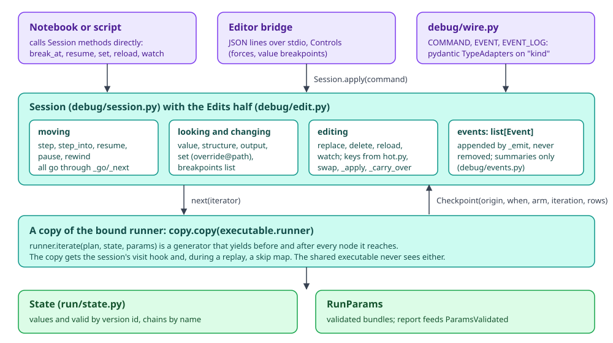
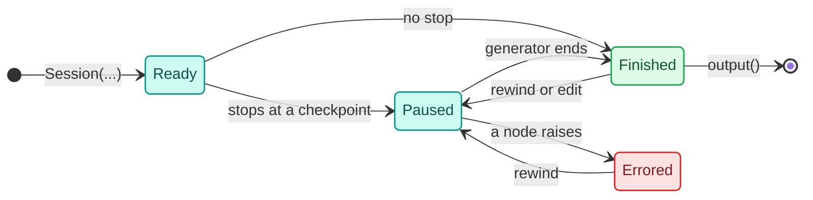
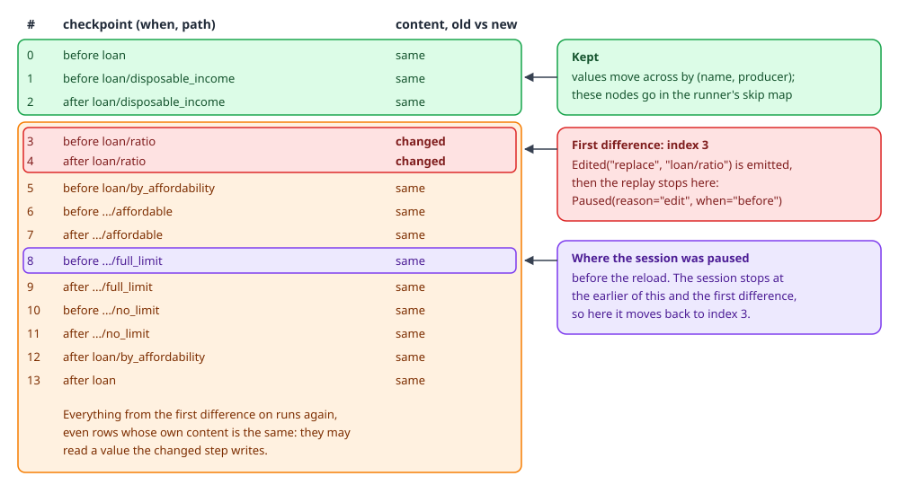
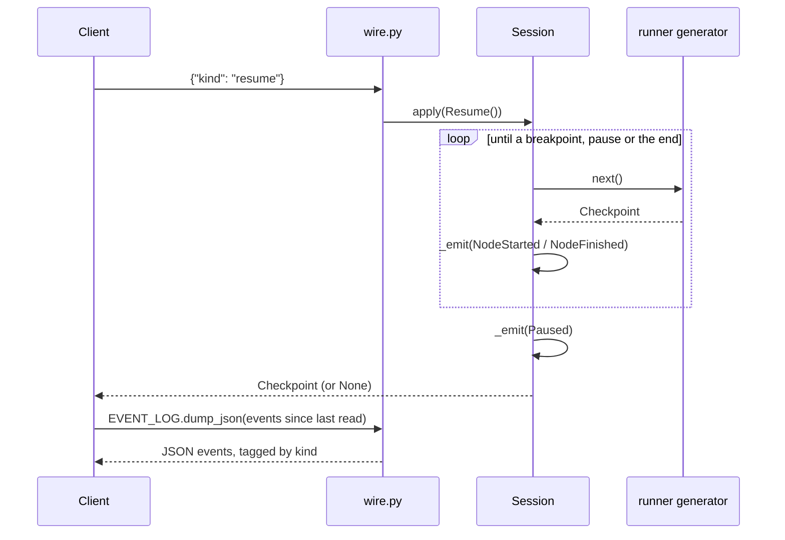

# Debug sessions

A debug session runs a bound pipeline one checkpoint at a time over a whole batch. Between checkpoints the caller can look at any value produced so far, override one, rewind, or swap a step's code and carry on without starting over. The same session works in all three modes. The editor bridge, notebooks and scripts all drive the one class, `Session`, and talk to it either through its methods or through JSON commands and events.

The user side (opening a session from a notebook, what to type at each pause) is in [Debugging and testing](../../guides/debugging-and-testing.md).

## Where it lives

| File | What it holds |
|---|---|
| `decider/_engine/debug/session.py` | `Session`: breakpoints, stepping, `set`, `rewind`, `value`, `structure`, `output`, the event log |
| `decider/_engine/debug/edit.py` | `Edits`, the half of `Session` that changes the pipeline mid-run: `replace`, `delete`, `reload`, `watch`; plus `swap` |
| `decider/_engine/debug/hot.py` | `keys` (the content of every checkpoint, for reload), `same`, `ModuleWatcher` |
| `decider/_engine/debug/commands.py` | one frozen dataclass per command (`BreakAt`, `StepOver`, `SetValue`, ...) and the `Command` union |
| `decider/_engine/debug/events.py` | one frozen dataclass per event (`Paused`, `NodeFinished`, ...), `RunSummary`, `summarize` |
| `decider/_engine/debug/wire.py` | the pydantic `TypeAdapter`s `COMMAND`, `EVENT`, `EVENT_LOG` |
| `decider/debug.py` | the public facade: `Session` and the event classes |
| `decider/_tooling/bridge/controls.py` | `Controls`: forced arms, forced loop counts, value and iteration breakpoints, built on top of a session |

A session is opened with `Step.session(df, params, mode=...)` or `Executable.session(df, params)`. Both end in `Session(executable, frame, params)`.

<div class="diagram" markdown>


*Clients call methods or send commands; the session pulls checkpoints from its own copy of the runner.*
</div>

## A runner is a generator

Every runner implements one method, `iterate(plan, state, params, trace=None, table=None)`, and it returns a generator of `Checkpoint`s (`decider/_engine/run/runners/base.py`). `Executable.run` drains it without looking. A session calls `next()` on it one checkpoint at a time, and the generator frame holds everything in between: the current scope, the rows of the arm being run, the loop's active rows. Nothing about pausing is written into the runners, so the [runners](runners.md) page describes the only control flow there is.

A `Checkpoint` has four fields a session uses:

| Field | Meaning |
|---|---|
| `origin` | the node's `Origin`: `path`, `source`, optional durable `id` |
| `when` | `"before"` or `"after"` the node |
| `arm` | the arm index of the innermost branch the node is inside, or `None` |
| `iteration` | the iteration (from 1) of the innermost loop, or `None`; the condition checked before iteration k carries k |

It also carries `rows`, the indices of the records the node runs on, which the session does not compare.

The session is built only on that protocol. It reads two optional attributes when the runner has them: `units` and `packed` (the compiled kernels, so it can tell which steps one fused kernel covers) and `visit` (a hook a row node's Python reference calls at each internal position). A runner with fewer checkpoints pauses less often. `tests/debug/test_session.py` pins this with a toy runner that yields only call checkpoints: a breakpoint on a branch that never yields a checkpoint of its own still stops at the first checkpoint under it.

`Session.__init__` does five things, in order:

1. `copy.copy(executable.runner)`: a shallow copy, so the session can set `visit` and, later, `skip` without touching the runner the bound `Executable` keeps serving with.
2. `_start()`: `executable.prepare(frame, params)` builds a fresh `State` and `RunParams`, and `runner.iterate(...)` creates the generator. No node has run yet.
3. `_index()`: from the plan and the runner's kernels, it builds the tables it needs later: which paths are sequences, which versions each node produces, which steps each fused kernel covers, and which versions only live inside a kernel.
4. `keys(plan, step_map(step))`: the content of every checkpoint, snapshotted now for [hot reload](#hot-reload).
5. It emits `RunStarted(rows)` and, from the params report, `ParamsValidated`.

## Moving: `_go` and `_next`

Every command that moves the session goes through `_go(reason, until)`. It pulls checkpoints with `_next()` until one of three things holds, checked in this order:

1. `pause()` was called. The flag is a plain bool, so another thread may set it while this one is inside `resume`.
2. Any breakpoint hits (`any(...)`, so the first breakpoint that answers true wins).
3. `until(cp)` holds: `step` waits for the matching `after`, `step_into` takes the next checkpoint, `resume` never stops on its own.

When it stops it emits `Paused(origin, when, reason, kernel, arm, iteration)` and returns the checkpoint. When the generator ends it returns `None`.

`_next()` turns each checkpoint into events whether or not the session pauses there: `NodeStarted` at a `before`, `NodeFinished` with a summary of every value the node produced at an `after`, and before that one `NodeVisited` per position a row node reached. At `StopIteration` it emits `RunFinished` with a summary of every output column. If the runner raises, it emits `ErrorEvent(message, path)` and re-raises.



While paused, every command is allowed: moving commands go back to `Paused` or on to `Finished`, and `set`, `rewind`, `replace`, `delete` and `reload` leave the session paused. A node can also raise from `Ready`, on the first `resume`. The session's state is three fields: `current` (the checkpoint it is paused at, or `None`), `finished`, and `_iterator` (the generator, or `None` once the run has ended or failed). `_next` raises `RuntimeError("the run is over")` once finished and `RuntimeError("the run stopped on an error; rewind() it")` after an error, so a moving command in either state fails loudly. `output()` raises `RuntimeError("the run hasn't finished; resume() it first")` until the run is finished.

## A session traced end to end

The pipeline below has a scalar sequence, a branch and a loop: a three-row loan batch where each applicant's affordability decides their limit and a repayment loop counts months.

```python
import polars as pl

from decider import branch, flow, loop, param, step


@step(output="disposable_income")
def disposable_income(net_income: float, expenses: float) -> float:
    return net_income - expenses


@step(output="ratio")
def ratio(disposable_income: float, instalment: float) -> float:
    return disposable_income / instalment


def affordable(ratio: float, min_ratio: float = param(1.5)) -> bool:
    return ratio >= min_ratio


@step(output="limit")
def full_limit(disposable_income: float) -> float:
    return disposable_income * 6.0


@step(output="limit")
def no_limit(disposable_income: float) -> float:
    return 0.0


def unpaid(balance: float) -> bool:
    return balance > 0.0


@step(output="balance")
def pay(balance: float, instalment: float) -> float:
    return balance * 1.01 - instalment


@step(output="months")
def tick(months: int) -> int:
    return months + 1


pipeline = flow(
    disposable_income,
    ratio,
    branch(affordable, full_limit, no_limit, modifies=["limit"], name="by_affordability"),
    loop(unpaid, flow(pay, tick, name="month"), carries=["balance", "months"], max_iterations=12, name="repay"),
    name="loan",
)

df = pl.DataFrame({
    "net_income": [5200.0, 3100.0, 7400.0],
    "expenses": [2100.0, 2600.0, 3000.0],
    "instalment": [1500.0, 900.0, 2000.0],
    "balance": [4000.0, 1500.0, 2500.0],
    "months": [0, 0, 0],
})
```

The session opens, breaks before `loan/ratio`, overrides the income it is about to read, steps over `ratio`, then steps into the branch and the loop:

```python
s = pipeline.session(df)
print([e.kind for e in s.events])
s.break_at("loan/ratio")
cp = s.resume()
print(cp.when, cp.origin.path, s.events[-1].reason)
print(s.value("disposable_income").to_list())
s.set("disposable_income", [5200.0, 900.0, 4400.0])
print(s.events[-1].producer, s.events[-1].previous.preview)
cp = s.step()
print(cp.when, cp.origin.path, s.events[-2].outputs["ratio"].preview)
while (cp := s.step_into()) is not None and cp.origin.path != "loan/repay/month":
    print(f"{cp.when:6} {cp.origin.path:34} arm={cp.arm} iteration={cp.iteration}")
s.clear_break("loan/ratio")
s.resume()
print(s.output().select("limit", "balance", "months"))
print([v.producer for v in s.state.versions("disposable_income@*")])
```

```text
['run_started', 'params_validated']
before loan/ratio breakpoint
[3100.0, 500.0, 4400.0]
override@loan/ratio (3100.0, 500.0, 4400.0)
after loan/ratio (3.466666666666667, 1.0, 2.2)
before loan/by_affordability              arm=None iteration=None
before loan/by_affordability/affordable   arm=None iteration=None
after  loan/by_affordability/affordable   arm=None iteration=None
before loan/by_affordability/full_limit   arm=0 iteration=None
after  loan/by_affordability/full_limit   arm=0 iteration=None
before loan/by_affordability/no_limit     arm=1 iteration=None
after  loan/by_affordability/no_limit     arm=1 iteration=None
after  loan/by_affordability              arm=None iteration=None
before loan/repay                         arm=None iteration=None
before loan/repay/unpaid                  arm=None iteration=1
after  loan/repay/unpaid                  arm=None iteration=1
shape: (3, 3)
┌─────────┬──────────┬────────┐
│ limit   ┆ balance  ┆ months │
│ ---     ┆ ---      ┆ ---    │
│ f64     ┆ f64      ┆ i64    │
╞═════════╪══════════╪════════╡
│ 31200.0 ┆ -423.946 ┆ 3      │
│ 0.0     ┆ -278.85  ┆ 2      │
│ 26400.0 ┆ -1469.75 ┆ 2      │
└─────────┴──────────┴────────┘
['loan/disposable_income', 'override@loan/ratio']
```

The override changed row 0 from 3100 to 5200 and row 1 from 500 to 900. Row 1's ratio is then exactly 1.0, below `min_ratio`, so it took arm 1 and got a zero limit; row 0's limit is 6 × 5200. The run finished on its own because the only breakpoint was cleared, and the version list shows the override as a second version of `disposable_income` produced by `override@loan/ratio`.

Breakpoint paths are full paths from the root. A breakpoint on `"ratio"` here matches nothing: it is registered, never fires, and the run goes to the end. `structure()` lists every path with its kind and source, and is the way to find them (here with the pipeline saved as `loan.py`):

```text
{'path': 'loan', 'kind': 'sequence', 'source': 'decider.steps:SequentialStep'}
{'path': 'loan/disposable_income', 'kind': 'scalar', 'source': 'loan:disposable_income'}
{'path': 'loan/ratio', 'kind': 'scalar', 'source': 'loan:ratio'}
{'path': 'loan/by_affordability', 'kind': 'branch', 'source': 'decider.steps:BranchStep'}
{'path': 'loan/by_affordability/affordable', 'kind': 'scalar', 'source': 'loan:affordable'}
...
```

## Breakpoints

`break_at(target)` appends to `session.breakpoints`, a plain list, and `clear_break(target)` removes an equal entry. `_hits` reads a target three ways:

| Target | Hits at | Notes |
|---|---|---|
| `"loan/repay"` (a path or a prefix) | a `before` checkpoint at or under the path | only on entering: the previous checkpoint must be outside the subtree |
| `"pricing/risk_tree#n1"` (path and locator) | the `after` checkpoint of that row node | only if some row reached locator `n1` inside it; needs a runner with a `visit` hook |
| a callable | any checkpoint where `target(cp)` is true | sees every checkpoint, `before` and `after` |

Firing on entry is the reason a prefix breakpoint on a flow stops once, not before every node inside it. A loop body is entered once per iteration, so a breakpoint on `loan/repay/month` stops at every iteration.

Locator breakpoints exist because a row node (a tree, a table) is one call: the runner cannot yield in the middle of it. In interpreted mode the row node's Python `reference` calls `visit(locator)` at each position, the session counts the calls per locator while the node runs, and at the node's `after` it emits one `NodeVisited(origin with locator, rows)` per locator. A `path#locator` breakpoint pauses at that `after`. With a one-split tree over three rows:

```python
import polars as pl
from decider import flow
from decider._engine.debug import NodeVisited
from decider.steps.trees import TreeConfig

tree = TreeConfig(name="risk_tree", trace_output="risk_path", tree={
    "nodes": [{"id": "n0", "data": {"type": "unary", "condition":
                                    {"op": ">", "feature": "requested_term", "threshold": 60}}},
              {"id": "n1", "data": {"type": "leaf", "result_idx": 0}}],
    "edges": [{"source": "n0", "target": "n1", "data": {"sourceIndex": 0}}],
    "output": {"data": [{"risk_band": 1}], "default": {"risk_band": 0}, "dtypes": [["risk_band", "Int64"]]},
})
df = pl.DataFrame({"requested_term": [72.0, 50.0, 84.0]})
p = flow(tree, name="pricing")
s = p.session(df)
s.break_at("pricing/risk_tree#n1")
cp = s.resume()
print(cp.when, cp.origin.path)
for e in s.events:
    if isinstance(e, NodeVisited):
        print(e)
```

```text
after pricing/risk_tree
NodeVisited(origin=Origin(path='pricing/risk_tree', source='decider.steps.trees:TreeConfig', locator='n0', id=None, suppress_checks=()), rows=3, kind='node_visited')
NodeVisited(origin=Origin(path='pricing/risk_tree', source='decider.steps.trees:TreeConfig', locator='n1', id=None, suppress_checks=()), rows=2, kind='node_visited')
```

Trees report node ids and decision tables report the index of each row tried. Scorecards have no Python reference walker and report nothing. Stepped and fused modes run row nodes compiled, so they never call `visit`: the same session in stepped mode collected no `NodeVisited` events at all.

## Branches and loops are stepped over the batch

One step is one node over every row that reaches it. A branch whose rows go both ways is entered arm by arm, in arm order, each arm over its own rows; an arm no row takes yields no checkpoint. A loop is entered once per iteration over the rows still looping. The transcript above shows both: `full_limit` ran with `arm=0` for rows 0 and 2, then `no_limit` with `arm=1` for row 1.

Stepping per row was the other option. It would pause once per record and the checkpoints would differ between modes, so it was rejected. `step()` and `step_into()` differ only at a `before`:

- `step()` from `before X` runs to `after X` when X is a call, branch or loop. A sequence is entered.
- `step_into()` always moves to the next checkpoint, which enters each taken arm and each iteration.

After a loop, `value("balance")` returns the carried version, the one the loop hands on. The body's own write only holds the rows that iterated, so the carry follows the body's versions in the chain, the same way a branch's merge follows its arms.

## Sessions in stepped and fused mode

Stepped mode yields the same checkpoints as interpreted. Fused mode yields one checkpoint pair per kernel. A kernel that runs several steps reports its first step's origin, and a branch or loop packed into one kernel reports the branch's or loop's own path with nothing inside it.

<div class="diagram" markdown>

</div>

`_index` reads `runner.units` and `runner.packed` and builds `_kernels`, which maps a kernel's first path to every path it covers. `_covers` uses it, so a breakpoint on any step of a kernel stops before the whole kernel, and `Paused.kernel` lists the steps:

```python
s = pipeline.session(df, mode="fused")
s.break_at("loan/ratio")
p = (s.resume(), s.events[-1])[1]
print(p.origin.path, p.reason, p.kernel)
try:
    s.value("ratio")
except KeyError as e:
    print("KeyError:", e)
while (cp := s.step_into()) is not None:
    print(f"{cp.when:6} {cp.origin.path}  kernel={s.events[-1].kernel}")
```

```text
loan/disposable_income breakpoint ('loan/disposable_income', 'loan/ratio')
KeyError: "'ratio' is neither an input column nor a value produced so far"
after  loan/disposable_income  kernel=('loan/disposable_income', 'loan/ratio')
before loan/by_affordability  kernel=('loan/by_affordability', 'loan/by_affordability/affordable', 'loan/by_affordability/full_limit', 'loan/by_affordability/no_limit')
after  loan/by_affordability  kernel=('loan/by_affordability', 'loan/by_affordability/affordable', 'loan/by_affordability/full_limit', 'loan/by_affordability/no_limit')
before loan/repay  kernel=('loan/repay', 'loan/repay/unpaid', 'loan/repay/month/pay', 'loan/repay/month/tick')
after  loan/repay  kernel=('loan/repay', 'loan/repay/unpaid', 'loan/repay/month/pay', 'loan/repay/month/tick')
after  loan  kernel=()
```

Pausing before the kernel was chosen over calling the breakpoint unreachable: nothing in the kernel has run yet, and `set` on its inputs still works. A value that only lives inside a kernel is never stored, so `value` and `set` on it raise a `KeyError`. `_check_stored` makes that error name the kernel and suggest `mode='stepped'` when the name was produced inside a kernel but nothing of it is stored; when the name has never been produced at all (as for `ratio` above, paused before its kernel ran), the plain "neither an input column nor a value produced so far" message comes first.

One consequence is that a session can disagree with interpreted mode. Breaking on step 2 of a kernel and setting a value step 1 reads gives a different answer, because in interpreted mode step 1 has already run at that point. The same break and set on an input only later steps read agrees in every mode. `tests/debug/test_session_modes.py` pins the agreeing cases across all three modes.

## Overriding a value with `set`

`set(name, value)` takes one value for every row or a list with one per row (`None` is a null) and casts it to the name's declared dtype; a failed cast raises `ValueError`. Then it writes the cast values over every version of the name written so far, records a new version with producer `override@<current path>`, and emits `Overridden(name, producer, value, previous)`.

Overwriting every version follows from how versions work. Wiring binds each read to a specific version id at resolve time (see [Wiring](wiring.md)), so a later node does not read "the latest `ratio`", it reads one particular version id. A branch may still read the value from before it, a loop its carry. Overwriting only the newest version would leave those readers on the old value. The cost is that `name@producer` for an earlier producer now shows the override too; the `Overridden` event keeps the previous summary for the record.

Two limits are marked in the code: earlier producers' values are overwritten, not kept, and a frame step reads input columns from the frame, so it does not see an override of an input column.

## Rewinding

`rewind(path)` re-runs from just before the node at or under `path`. Runners cannot seek, so it starts a fresh run (`_start`), drains the new generator silently to the first matching `before`, then calls `State.restore` to put back the current values of everything already written upstream and of every input, overrides included. The replay rebuilt the runner's internal scope (an arm's row subset, a loop's active rows) on the way. If no node at or under `path` runs, it raises `ValueError` and restores the old state, generator and params unchanged.

The replay does not evaluate breakpoints, and branch routing inside it comes from the original values. The code marks the second one: re-routing would need runners that can seek. `rewind` is also the only way out of an error:

```text
ZeroDivisionError('division by zero') ['in step loan/broken_ratio, row 0']
ErrorEvent(message='ZeroDivisionError: division by zero', path='loan/broken_ratio', kind='error')
RuntimeError: the run stopped on an error; rewind() it
before loan/broken_ratio rewind
```

## Forcing a branch arm or a loop count

Forced arms, forced loop counts, value breakpoints and iteration breakpoints live outside the engine. `Controls` in `decider/_tooling/bridge/controls.py` builds them out of `set` and a predicate breakpoint:

- A force is an override of the condition's output. At the `after` checkpoint of a branch's condition step, `Controls` calls `session.set` on the condition's output: `True`/`False` for a bool condition (arm 0 is `True`), the int k otherwise. A loop forced to n iterations gets `True` before iterations 1 to n and `False` after. The runner reads the condition only after that checkpoint, so it routes as told, and the override shows in lineage like any other.
- `Controls.check` is registered as the first breakpoint. It applies forces and returns false unless a watch fires. Being first matters because `_go` stops at the first breakpoint that answers true.
- A value breakpoint is checked just after a step that writes the name, inside the watch's scope. It reads `name@path` (what that step wrote) because `session.value` inside a loop returns the carry, which lags one iteration. It pauses only for records that newly meet the condition.
- An iteration breakpoint pauses before the loop's condition step at iteration k.

Run on the loan pipeline with arm 0 forced on `loan/by_affordability`, `loan/repay` forced to one iteration and a watch on `balance < 1000`. `Controls` takes the described IR the bridge builds:

```python
from decider.ir import to_ir, step_map
from decider._tooling.bridge.describing import node_json
from decider._tooling.bridge.controls import Controls

ir = node_json(to_ir(pipeline), step_map(pipeline), {})
s = pipeline.session(df)
c = Controls(ir)
c.set(forces=[{"path": "loan/by_affordability", "arm": 0}, {"path": "loan/repay", "iterations": 1}],
      watches=[{"name": "balance", "op": "<", "value": 1000}])
c.attach(s)
cp = s.resume()
print("paused:", cp.when, cp.origin.path, cp.iteration, c.take_hit())
print([e for e in s.events if e.kind == "overridden"][:2])
s.resume()
print(s.output().select("limit", "balance", "months"))
```

```text
paused: after loan/repay/month/pay 1 {'watch': 0, 'path': 'loan/repay/month/pay', 'rows': [1, 2], 'values': [615.0, 525.0], 'text': 'balance < 1000'}
[Overridden(name='affordable', producer='override@loan/by_affordability/affordable', value=RunSummary(dtype='Boolean', rows=3, nulls=0, preview=(True, True, True)), previous=RunSummary(dtype='Boolean', rows=3, nulls=0, preview=(True, False, True)), kind='overridden')]
shape: (3, 3)
┌─────────┬─────────┬────────┐
│ limit   ┆ balance ┆ months │
│ ---     ┆ ---     ┆ ---    │
│ f64     ┆ f64     ┆ i64    │
╞═════════╪═════════╪════════╡
│ 18600.0 ┆ 2540.0  ┆ 1      │
│ 3000.0  ┆ 615.0   ┆ 1      │
│ 26400.0 ┆ 525.0   ┆ 1      │
└─────────┴─────────┴────────┘
```

Row 1 took the full-limit arm (3000 = 500 × 6) and every row stopped after one month. Two limits follow from the design. `rewind` replays without breakpoints, so a force set after the branch ran applies only once the run is rewound to the branch. A loop forced past `max_iterations` stops at the maximum. The [editor bridge](../editor-bridge.md) page covers how the VS Code extension uses `Controls`.

## Editing the pipeline mid-run

`replace(path, step)` and `delete(path)` change the pipeline while the session keeps its place. Both go through `_edit`, and through the same `_apply` that `reload` uses:

1. `swap(root, path, new)` builds a copy of the authoring tree with the step at `path` replaced or removed. Steps are frozen, so every parent along the path is rebuilt; every other step is the same object, so its `to_ir` result comes from the IR cache. The replacement is renamed to the old step's name, so its path, params, breakpoints and `name@path` lookups carry over.
2. `resolve` wires the new tree into a plan. `_check_producers` refuses an edit that would leave a name some later step reads with no producer. Without the check that name would silently become an input column read from the frame.
3. A new `Executable` is made for the new plan, and the session iterates it on a fresh copy of its runner. The stepped and fused runners compile the new plan into that copy's own snapshot; unchanged steps hit the content-keyed dispatcher cache (see [Compile cache](cache.md)).
4. `_order` lists every checkpoint of the new plan as if every arm ran and every loop ran once. The target is the edited node's `before` (for a delete, the first checkpoint after the deleted one). The session will stop at the earlier of the target and where it was paused.
5. `_skips` marks every node that ends before that point. The runner's `skip` map tells it to pass over those nodes and hand on their versions without running them. Two exceptions run again: a loop around the stop point (iterations cannot be skipped) and a frame step with unknown lineage (it replaces the frame later nodes see).
6. `_carry_over` copies values from the old state for inputs and for every skipped producer. Version ids are positional per plan, so values move by `(name, producer)`; overrides are re-recorded.
7. The new generator is advanced to the stop point with the skip map set, the session swaps in the new executable, runner, state and generator, and it emits `Edited(action, path)` followed by `Paused(..., reason="edit")`.

Everything is built on copies first, so a failure (a `WiringError`, a missing path) leaves the running session as it was. `Replace` carries a Python object, so it has no JSON form; `Delete` does.

!!! warning "Edits refuse pipelines that overwrite an input column"
    `_check_producers` treats every name that is both a plan input and a name an old step produced as orphaned. A loop whose carry starts from an input column (`balance` and `months` above), or a waterfall step that writes over an input, therefore makes every `replace`, `delete` and changed `reload` raise, even when the edit touches something else:

    ```text
    WiringError: after editing 'loan/ratio' nothing produces 'balance', which 'a later step' reads; keep a step that writes it, or edit the reader too
    ```

    The edits in the next section use a pipeline without the loop for that reason.

## Hot reload

`reload(pipeline)` takes an edited copy of the whole pipeline and re-runs from the first checkpoint whose content changed. `keys(plan, steps)` in `decider/_engine/debug/hot.py` lists every checkpoint as `(when, path, content)`, in `_order`'s order:

- A function call's content is the fingerprint of its function (and of its `reference`), its inputs, outputs, params with their defaults, consts, `nogil` and the `(name, producer)` pairs it reads. Defaults are listed separately because `ParamDecl` equality leaves `default` out.
- A configurable step (a tree, a table, a scorecard) is keyed by its class name, `model_dump_json()`, its reads and writes, and the fingerprints of its class's methods. Its IR would not do: a tree's IR holds array addresses that change on every load.
- A sequence, branch or loop is keyed on its own fields (emits, modifies, carries), never its children.

`reload` compares the session's snapshot with the new list, and the first index where `(when, path)` or the content differs is where the run restarts. Every checkpoint before it is the same code reading the same versions, so its values are kept. One `Edited` event is emitted per changed path, with action `"replace"`, `"add"` or `"delete"`; if nothing changed, nothing happens and no event is emitted.

<div class="diagram" markdown>

</div>

Here the session was paused before `full_limit` when `ratio` was replaced:

```python
@step(output="ratio")
def ratio_v2(disposable_income: float, instalment: float) -> float:
    return disposable_income / (instalment * 1.1)


def build(r):
    return flow(disposable_income, r,
                branch(affordable, full_limit, no_limit, modifies=["limit"], name="by_affordability"),
                name="loan")


s = build(ratio).session(df)
s.break_at("loan/by_affordability/full_limit")
s.resume()
n = len(s.events)
cp = s.reload(build(ratio_v2.named("ratio")))
print(s.events[n:])
print(s.value("disposable_income").to_list())
n = len(s.events)
print(s.reload(build(ratio_v2.named("ratio"))), s.events[n:])
```

```text
[Edited(action='replace', path='loan/ratio', kind='edited'), Paused(origin=Origin(path='loan/ratio', source='__main__:ratio_v2', locator=None, id=None, suppress_checks=()), when='before', reason='edit', kernel=(), arm=None, iteration=None, kind='paused')]
[3100.0, 500.0, 4400.0]
Checkpoint(origin=Origin(path='loan/ratio', source='__main__:ratio_v2', locator=None, id=None, suppress_checks=()), when='before', arm=None, iteration=None) []
```

The session was paused at `full_limit`, after the changed step, so it moved back to just before `loan/ratio` with `disposable_income` kept from the first run. The second, identical reload found no difference, returned the current checkpoint and emitted nothing.

The keys are snapshotted when the session opens and after every edit. In a notebook, redefining a helper that a step calls changes the step's fingerprint; comparing against the current globals would see the new helper on both sides and report no change.

Two ways feed `reload`:

- `watch(source)` registers an IPython `post_run_cell` hook. With a callable (`lambda: flow(income, ratio)`), the lambda looks the names up again after every cell, so a cell that only redefines `ratio` is picked up. A failed reload emits `ReloadFailed(error)`, re-raises, and keeps the pipeline the session had.
- `ModuleWatcher("pkg.pipeline:pipeline")` watches the files of every imported module under the target's directory (outside `site-packages` and `decider`). On a change it drops all of them from `sys.modules` and imports the target afresh, so `from features import ratio` in another module never keeps the old function. It deletes their `.pyc` files first because a `.pyc` stamps whole seconds, and a same-size edit inside one second would load stale code. A failed import puts the old modules back.

Re-resolving functions by `__qualname__` in `__main__` was considered and rejected: `ratio_v1 = ratio` followed by a new `def ratio` would swap the step the user kept on purpose, lambdas and closures have no global to find, and patching `__code__` in place mutates objects the IR cache assumes never change.

Time from an edit to the updated `output()`, measured on a 28-core box:

| Edit | interpreted | stepped | fused |
|---|---|---|---|
| file, 3-step flow, a constant in step 2 | 5 to 6 ms, 0 compiles | 186 ms, 2 compiles | 142 to 151 ms, 1 compile |
| file, back to an earlier version | | 7 ms, 0 compiles | 7 ms, 0 compiles |
| cell, 3-step flow, `reload` vs per-path `replace` | 1.5 vs 0.9 ms | 182 vs 189 ms | 148 vs 156 ms |

The compiles are the edited step's dispatcher plus the fused glue of the kernel that contains it; unchanged steps compile nothing because the dispatcher cache is keyed by fingerprint. `keys()` for the larger example pipeline took 1.6 ms, paid on every open and every edit. A global that is a DataFrame or array is fingerprinted by identity, so re-importing a module that builds one counts the step as changed and re-runs it: extra work, never stale values.

Serving never hot reloads. A code change is a new deploy, because the decision audit must map to one code version, and an in-process reload would compile on the request path (142 to 186 ms per edited step, above).

## Events

Events are frozen, slotted dataclasses in `decider/_engine/debug/events.py`. Each has a `kind` literal, which is also its JSON tag.

| Event | `kind` | Emitted when |
|---|---|---|
| `RunStarted(rows)` | `run_started` | the session opens |
| `ParamsValidated(paths, invalid)` | `params_validated` | the params report grew (eagerly at open, or lazily as nodes run) |
| `WarningEvent(message)` | `warning` | a params value was replaced by its default |
| `NodeStarted(origin, arm, iteration)` | `node_started` | every `before` checkpoint |
| `NodeVisited(origin, rows)` | `node_visited` | at a row node's `after`, once per locator it reached; `origin.locator` is set |
| `NodeFinished(origin, outputs)` | `node_finished` | every `after` checkpoint; `outputs` summarises each version the node produced |
| `Paused(origin, when, reason, kernel, arm, iteration)` | `paused` | the session stopped; `reason` is `breakpoint`, `step`, `pause`, `rewind` or `edit` |
| `Overridden(name, producer, value, previous)` | `overridden` | `set` |
| `Edited(action, path)` | `edited` | `replace`, `delete` or `reload`; a `Paused` follows |
| `ReloadFailed(error)` | `reload_failed` | a watched reload failed; the session keeps going |
| `ErrorEvent(message, path)` | `error` | the run raised; only `rewind` works afterwards |
| `RunFinished(output)` | `run_finished` | the generator ended |

No event carries full column values, because a batch may hold personal data. `RunSummary` has the dtype, row count, null count and the first `PREVIEW_ROWS` (5) values; `tests/debug/test_session_wire.py` checks that the log never holds a full column. `ReloadFailed` is separate from `ErrorEvent` because they mean different things: after an error the run cannot continue, after a failed reload it can.

The log only grows. Clients read the tail since their last read; the editor bridge does exactly that, keeping a counter of how many events it has sent.

## The wire format

JSON exists only at the edge. `decider/_engine/debug/wire.py` holds three pydantic `TypeAdapter`s over discriminated unions: `COMMAND` for one command, `EVENT` for one event and `EVENT_LOG` for a list. A command's `kind` is the name of the `Session` method it calls, so `Session.apply` dispatches with `getattr(self, command.kind)` and passes the remaining fields positionally.

| Command | `kind` | Fields |
|---|---|---|
| `BreakAt` | `break_at` | `target` |
| `ClearBreak` | `clear_break` | `target` |
| `StepOver` | `step` | |
| `StepInto` | `step_into` | |
| `Resume` | `resume` | |
| `Pause` | `pause` | |
| `SetValue` | `set` | `name`, `value` |
| `Rewind` | `rewind` | `path` |
| `Delete` | `delete` | `path` |
| `Replace` | `replace` | `path`, `step` (a Python object, so not in `Command`) |



Driving a session entirely from JSON:

```python
from decider._engine.debug import COMMAND, EVENT, EVENT_LOG

s = pipeline.session(df)
for line in ['{"kind": "break_at", "target": "loan/by_affordability"}',
             '{"kind": "resume"}',
             '{"kind": "set", "name": "ratio", "value": [1.0, 2.0, 0.5]}',
             '{"kind": "step"}']:
    s.apply(COMMAND.validate_json(line))
print(EVENT.dump_json(s.events[-1]).decode())
print(EVENT.dump_json(next(e for e in s.events if e.kind == "overridden")).decode())
assert EVENT_LOG.validate_json(EVENT_LOG.dump_json(s.events)) == s.events
```

```text
{"origin":{"path":"loan/by_affordability","source":"decider.steps:BranchStep","locator":null,"id":null,"suppress_checks":[]},"when":"after","reason":"step","kernel":[],"arm":null,"iteration":null,"kind":"paused"}
{"name":"ratio","producer":"override@loan/by_affordability","value":{"dtype":"Float64","rows":3,"nulls":0,"preview":[1.0,2.0,0.5]},"previous":{"dtype":"Float64","rows":3,"nulls":0,"preview":[2.066666666666667,0.5555555555555556,2.2]},"kind":"overridden"}
```

The editor bridge (`decider/_tooling/bridge/bridge.py`) does not use `COMMAND`. It speaks its own JSON-lines protocol over stdio, calls `Session` methods directly, and serialises the new events with `EVENT.dump_python(e, mode="json")` into each reply. A reader thread handles `pause` at once, even while the main thread is inside `resume`; every other request is queued and run in order, so the session's state is never read while it is being written. See [Editor bridge](../editor-bridge.md).

## Thread safety

`Session` is not thread-safe: one session per thread. `pause()` is the one exception and only sets a flag. A session may be opened from an `Executable` that is serving other threads: it shallow-copies the runner, the shared part of the copy is the runner's immutable compiled snapshot, and `visit` and `skip` are only ever set on the copy. `tests/serving/test_concurrency.py` opens a session on a shared executable under load and checks that neither side disturbs the other. [Concurrency](concurrency.md) has the full contract.

## Debugging the debugger

- `session.events` is the full record of what happened. `[type(e).__name__ for e in s.events]` usually shows where a run went.
- `session.structure()` gives every path, so a breakpoint that never fires can be checked against the real paths.
- `session._kernels` shows which paths each fused kernel covers.
- `session.state.versions("name@*")` lists every version of a name, overrides included, with its producer.
- `session._keys` is the snapshot reload compares against; `keys(resolve(new), step_map(new))` gives the other side, and the first differing tuple is where a reload will restart.

The tests are in `tests/debug/`: `test_session.py` (interpreted stepping, breakpoints, `set`, rewind, row-node visits), `test_session_modes.py` (stepped and fused), `test_session_edit.py` (`replace` and `delete`), `test_session_reload.py` (reload, `watch` in an IPython shell, `ModuleWatcher` on real files) and `test_session_wire.py` (JSON round trips). `Controls` is tested in `tests/bridge/test_controls.py`.

## Why it is shaped this way

- The VS Code extension debugs step code with an ordinary debugpy session and has no decider debug adapter. An earlier prototype drove a decider DAP adapter and needed a second debugpy attach to get into a step's Python, so there were two debuggers with two breakpoint models, and users reached for the Python one. Per-node stepping, rewind, value breakpoints and edits stay in `Session` for notebooks and the bridge.
- Edits rebuild and replay instead of patching a running plan. Version ids are positional, so a patched plan would have to renumber everything after the edit; a fresh resolve plus a carry-over by `(name, producer)` reuses the code paths a normal run takes.
- One rebuild handles every kind of change. Per-path edits cannot insert a step or replace an anonymous root flow, and N changed paths would cost N re-resolves and N replays. The first-difference rebuild restarts at the same point a sequence of per-path edits would.
