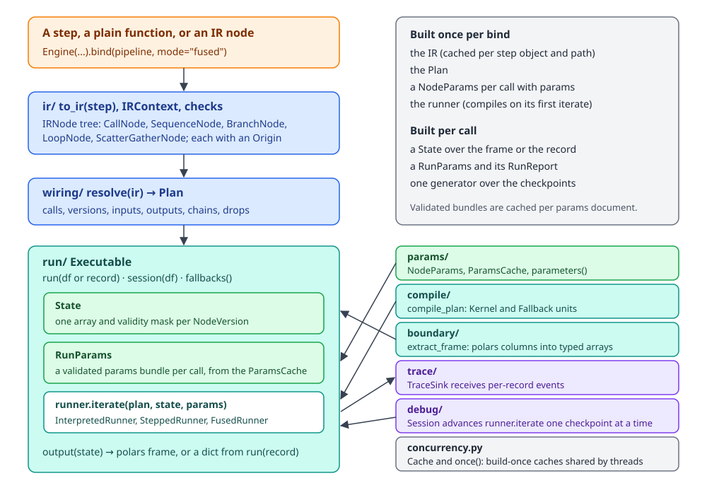
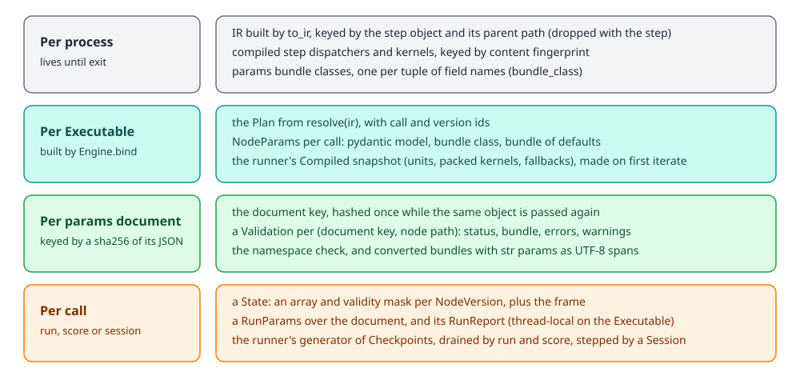
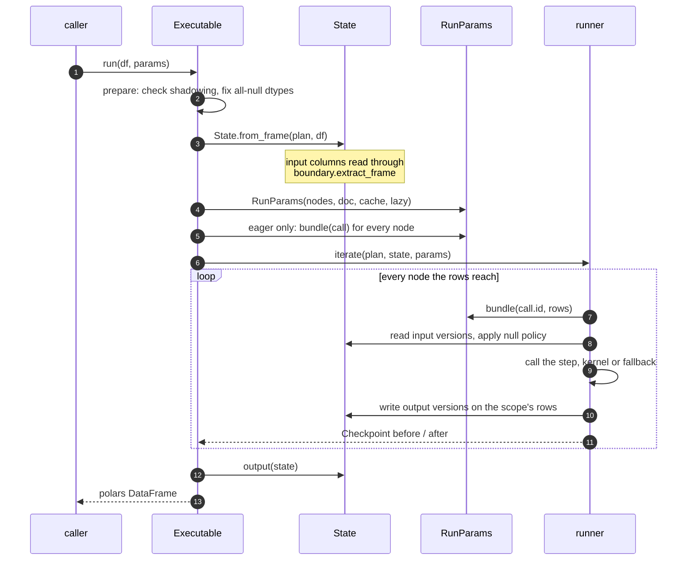
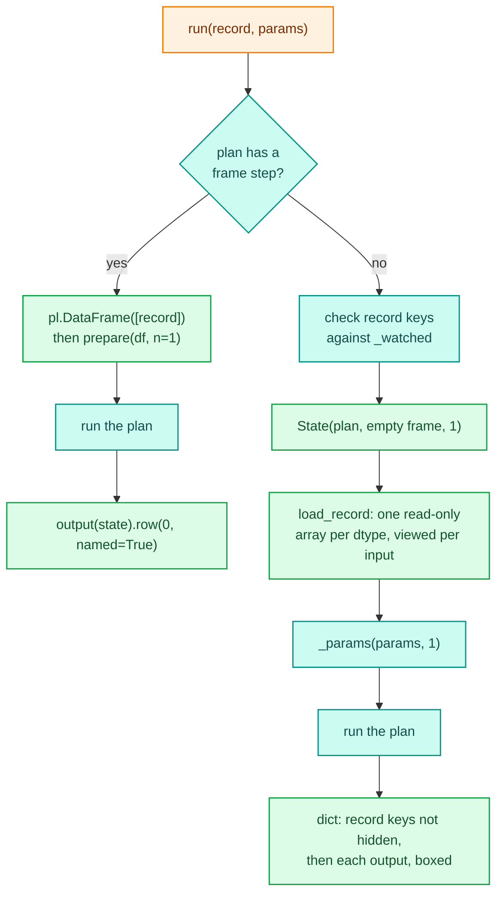

# The engine

The engine turns a pipeline into something that runs. It takes a step, a plain function or an IR node, lowers it
to the [IR](ir.md), binds every name the IR reads to a version of a value ([wiring](wiring.md)), prepares the
[params](params.md), and drives one of three [runners](runners.md) over a polars frame or a single dict record.
Everything lives under `decikit/_engine/`. Users reach it through the engine classes and `Executable` (all exported
from `decikit`), or through `Step.run`, `Step.compile` and `Step.session`, which resolve an engine and call `bind`.

```python
from decikit import FusedEngine

exe = FusedEngine(params_validation="lazy").bind(pipeline)
exe.run(df, params=doc)          # a polars DataFrame
exe.run(record, doc)             # a dict
exe.session(df)                  # a debug Session, paused before anything runs
```

The rest of this section takes one component per page. This page covers how they fit together, what `bind`
builds, and what happens on each call.

## Components

<div class="diagram" markdown>


*The main line runs top to bottom on the left. The boxes on the right are used by the Executable at run time.*
</div>

| Sub-package | Files | What it holds | Page |
|---|---|---|---|
| `ir/` | `context.py`, `nodes.py`, `decls.py`, `origin.py` | `to_ir`, `IRContext`, the node classes, `Input`/`Output`/`ParamDecl`, `Origin` | [IR](ir.md) |
| `wiring/` | `resolve.py`, `plan.py`, `interface.py` | `resolve(ir) -> Plan`: every read bound to a `NodeVersion` | [Wiring](wiring.md) |
| `params/` | `declare.py`, `harvest.py`, `models.py`, `bundles.py`, `validate.py`, `schema.py`, `tables.py` | `param()`, `missing_as()`, `param_table()`, per-node pydantic models, bundles, the validation cache | [Params](params.md) |
| `run/` | `engine.py`, `params.py`, `state.py`, `representations.py`, `runners/` | `Engine`, `Executable`, `RunParams`, `State`, the three runners | [Runners](runners.md) |
| `compile/` | `kernel.py`, `units.py`, `njit.py`, `fingerprint.py`, ... | numba compilation of calls into `Kernel` and `Fallback` units | [Compile](compile.md), [Kernels](kernels.md), [Cache](cache.md) |
| `boundary/` | `extract.py`, `dtypes.py`, `nulls.py`, `_arrow/` | reading polars columns into typed arrays through Arrow, `MissingInputError` | [Boundary](boundary.md) |
| `debug/` | `session.py`, `edit.py`, `hot.py`, ... | `Session`, which drives a runner one checkpoint at a time | [Debug](debug.md) |
| `trace/` | `envelope.py`, `sink.py` | `TraceSink` and the per-record events runners emit | [Trace](trace.md) |
| `concurrency.py` | | `Cache` and `once()`, the build-once caches shared by threads | [Concurrency](concurrency.md) |
| `types.py` | | annotation helpers every layer shares (below) | this page |

`decikit/_engine/__init__.py` exports `to_ir`, `IRContext` and `step_map` directly and `Engine` through a module
`__getattr__`. `Engine` pulls in numba, and `import decikit` must not, so the import waits until something asks
for it. `decikit/__init__.py` does the same for `Engine` and `Executable`.

The engine sits in layer 1 of the package's layer map, next to `steps`, `ir`, `trace`, `debug` and `config`.
`tests/test_conventions.py` checks that imports only go down that map and that no package outside the core
(`decikit`, `steps`, `ir`, `trace`, `debug`) imports from `decikit._engine`. The [package layout](../package-layout.md)
page has the full map.

## Engine and bind

An engine is a settings document in the registry, named by its `type` tag. `Engine` is the abstract root;
`InterpretedEngine`, `SteppedEngine` and `FusedEngine` (tags `"interpreted"`, `"stepped"`, `"fused"`) are the built-in
ones, under `NumbaEngine`. `Engine.registered()` gives `{tag: class}` and `Engine.resolve(tag)` the class. `compile` and
`session` take a tag or an instance (`engine="fused"`, `FusedEngine(strict_compile=True)`).

`Step.run` and `Step.compile` with no engine follow the context-scoped default: `decikit.engine(...)` sets it for a block
(a `ContextVar`, so threads and tasks started inside inherit it), and unset it is the fused engine. `Step.session` opens
interpreted and ignores the default; serving names its engine in its own document and never reads it. `run` does not
cache executables, so a fused `run` binds and builds on every call; compile once to avoid that.

| Setting | Default | Effect |
|---|---|---|
| `params_validation` | `"eager"` | `"eager"` validates every node's params the first time a params document is seen and raises on any invalid one. `"lazy"` validates a node the first time it runs, so an invalid param in a node no row reaches never fails a run. |
| `strict_compile` | `False` | On `SteppedEngine` and `FusedEngine`, a step that would fall back to Python raises at the first run instead of running, unless the step is marked `@allow_fallback`. On every engine, a `HiddenStateWarning` finding raises `EngineError` at `bind`. |

`NumbaEngine.bind(step_or_ir)` builds its runner (passing `strict=` to the two compiled ones), calls
`resolve(step_or_ir)` to get the [Plan](wiring.md), and returns `Executable(plan, runner, lazy, step_or_ir, engine=self)`.
`resolve` calls `to_ir` when it is given anything but an IR node, so `bind` accepts a step, a plain function or a
hand-built IR.

Both the tag and the settings are checked up front:

```text
>>> credit.compile("turbo")
RegistryError: 'turbo' is not a registered Engine type. Import the module that defines it first, ...
>>> FusedEngine(params_validation="sometimes")
ValidationError: ... params_validation ...
```

The three engines give the same answers. They differ in what runs compiled and where a debug session can pause:

| Engine | Runner | What runs compiled | Pauses at |
|---|---|---|---|
| `interpreted` | `InterpretedRunner` | nothing; plain Python, row by row | every node, and inside trees through `visit` |
| `stepped` | `SteppedRunner` | each scalar or row call as its own numba kernel | every node |
| `fused` | `FusedRunner` | each innermost sequence of scalar steps as one kernel; some branches and loops as one packed kernel | kernel boundaries |

The [runners](runners.md) page covers how the two compiled runners reuse the interpreted driver. Compiling itself
is on the [compile](compile.md) page.

## What an Executable holds

`Executable.__init__` does every piece of work that does not depend on the data or the params document, so a
call only does the rest. For the plan it was given it builds:

- `nodes`: a `NodeParams` for every call that declares params, keyed by call id, plus one for each
  scatter-gather (`each`) node, keyed by its path. Each holds the node's pydantic model, its bundle class and its
  bundle of defaults ([params](params.md)).
- `cache`: the `ParamsCache` of validation results for this executable.
- `_produced`, `_params_at` and `_watched`: the names the pipeline writes, and where each param lives in a params
  document. A frame or record holding one of these names is an error or a warning (below).
- `_declared`: the polars dtype each input column is cast to when the frame holds an all-null column.
- `_inputs`: the input versions grouped by numpy dtype, so `run(record)` fills one array per dtype.
- `_results`, `_boxers`, `_structs`, `_hidden`: the output versions, which of them are Decimals or structs, and
  which frame columns the output leaves out.
- `_record_path`: true when the plan has no frame steps, so `run(record)` can skip polars entirely.
- `_trace_table`: the per-run `StepTable` of origins a [trace](trace.md) sink receives.

None of this changes after `__init__`. The convention test `test_runners_and_executable_keep_no_per_call_state`
walks `engine.py` and every runner file and fails if any method other than `__init__`, `_compile` or `_build`
assigns to `self`. The one allowed exception is `Executable._params`, which writes the latest `RunReport` to a
`threading.local`. That rule is what makes one `Executable` safe to call from many threads; the
[concurrency](concurrency.md) page has the details.

<div class="diagram" markdown>


*What is built once, and what each call builds again.*
</div>

## Life of a run call

The example used through this section is a small credit pipeline. A branch picks a limit multiple by employment
type, and a shared param sets the affordability ratio:

```python
import polars as pl
from decikit import branch, flow, missing_as, param, step

def disposable_income(net_income: float,
                      expenses: float = missing_as(0.0)) -> float:
    return net_income - expenses

def salaried(employment_type: int) -> bool:
    return employment_type == 1

@step(output="limit")
def salaried_limit(disposable_income: float,
                   multiple: float = param(3.0, ge=1, le=6)) -> float:
    return disposable_income * multiple

@step(output="limit")
def other_limit(disposable_income: float, multiple: float = param(1.5)) -> float:
    return disposable_income * multiple

def affordable(disposable_income: float, instalment: float,
               min_ratio: float = param(1.2, shared_key="min_ratio")) -> bool:
    return disposable_income / instalment >= min_ratio

credit = flow(
    disposable_income,
    branch(salaried, salaried_limit, other_limit,
           modifies=["limit"], name="by_employment"),
    affordable,
    name="credit",
)

df = pl.DataFrame({
    "net_income": [9000.0, 4000.0, 12000.0, 3000.0],
    "expenses": [3000.0, None, 5000.0, 2500.0],
    "employment_type": [1, 2, 1, 2],
    "instalment": [1500.0, 1000.0, 2000.0, 1000.0],
})
```

```text
>>> InterpretedEngine().bind(credit).run(df)
shape: (4, 6)
┌────────────┬──────────┬─────────────────┬────────────┬─────────┬────────────┐
│ net_income ┆ expenses ┆ employment_type ┆ instalment ┆ limit   ┆ affordable │
│ ---        ┆ ---      ┆ ---             ┆ ---        ┆ ---     ┆ ---        │
│ f64        ┆ f64      ┆ i64             ┆ f64        ┆ f64     ┆ bool       │
╞════════════╪══════════╪═════════════════╪════════════╪═════════╪════════════╡
│ 9000.0     ┆ 3000.0   ┆ 1               ┆ 1500.0     ┆ 18000.0 ┆ true       │
│ 4000.0     ┆ null     ┆ 2               ┆ 1000.0     ┆ 6000.0  ┆ true       │
│ 12000.0    ┆ 5000.0   ┆ 1               ┆ 2000.0     ┆ 21000.0 ┆ true       │
│ 3000.0     ┆ 2500.0   ┆ 2               ┆ 1000.0     ┆ 750.0   ┆ false      │
└────────────┴──────────┴─────────────────┴────────────┴─────────┴────────────┘
```

The input columns pass through, `limit` and `affordable` are added because nothing reads them, and
`disposable_income` is dropped because later steps consume it. The call goes through these stages:



1. `prepare` first checks the frame's columns against `_watched`. A column the pipeline also produces raises
   `EngineError`; a column named like a param warns. It then casts any column whose dtype is `Null` (all null, or
   all empty lists) to the declared type or to `String`, because the Arrow import rejects `Null`.
2. `State.from_frame` reads every input column. Typed ones (`float`, `int`, `bool`, Decimal) go through
   `boundary.extract_frame`, which returns a numpy array and a validity mask per column. Other columns become
   object arrays through `from_series`. The [boundary](boundary.md) page covers the extraction.
3. `_params` builds a `RunParams` over the document. The document's key comes from the `ParamsCache`, hashed once
   per document object. The first time a key is seen, `check_namespaces` checks that every entry names a node with
   params, and in eager mode every node is validated there and then. Later calls with the same key skip both.
4. `_iterate` drains `runner.iterate(plan, state, params, trace, table)`, a generator of `Checkpoint`s. Draining
   it runs the whole plan; a debug `Session` advances the same generator one checkpoint at a time.
5. `output(state)` builds the result: when no frame column is hidden it calls `frame.hstack(results)`, several
   times cheaper than building a new frame, and otherwise it builds a new `pl.DataFrame` from the kept columns and
   the outputs.

## run on a record: one record without polars

`run` dispatches on its input: a `dict` takes the record path at once, a `pl.LazyFrame` is collected and run as a
frame, a `pl.DataFrame` takes the frame path, any other `Mapping` takes the record path, and anything else raises
`TypeError`. The `dict` check comes first because the record path is the serving hot path: it costs about
0.06 µs, where the frame and `Mapping` checks would cost about 0.5 µs a record.

`run(record, params=None, trace=None)` takes a dict and returns a dict. When the plan has no frame steps
(`_record_path`), it never builds a polars frame:



`load_record` puts the record's values into one array per numpy dtype and gives each input a one-element view of
it. The array is read-only, like a column read from a frame, so batch and single-record calls share one kernel
specialisation. On the way out, a Decimal output is boxed from its int64 back to a `Decimal`, and a struct output
becomes the dict a step returns.

```text
>>> exe.run({"net_income": 9000.0, "expenses": 3000.0,
...            "employment_type": 1, "instalment": 1500.0})
{'net_income': 9000.0, 'expenses': 3000.0, 'employment_type': 1,
 'instalment': 1500.0, 'limit': 18000.0, 'affordable': True}
```

Building one array per input took about 8 µs of a 36 µs call,
and hashing an empty params document took 3.7 µs, so the empty document's key is now a constant. The benchmark
(`benchmarks/modes.py`, flagship pipeline, 20k calls, CPython 3.14) measured:

| Engine | Batch rows/s | `run(record)` p50 | `run(record)` p99 |
|---|---|---|---|
| decikit fused | 12.5M | 27.7 µs | 34.7 µs |
| decikit stepped | 12.9M | 37.1 µs | 47.6 µs |
| decikit interpreted | 0.25M | 59.1 µs | 84.5 µs |

Running the credit pipeline above in fused mode on a loaded development machine while writing this page gave a
`run(record)` p50 of 80.7 µs against 192.4 µs for `run` on the same record as a one-row frame. `run` takes a record as a dict
because matching keyword names against a 400-argument signature cost 1190 µs per call, against 60 µs for a dict.

## session and fallbacks

`session(df, params=None)` returns a `decikit.debug.Session` over the frame, paused before anything runs. It calls
the same `prepare` and the same `runner.iterate`, and advances the generator only as far as the user asks. The
[debug](debug.md) page covers it.

`fallbacks()` returns every step that runs outside a shared kernel, keyed by path, with the reason. It is empty for
the interpreted runner. For a compiled runner it compiles the plan if no call has done so yet:

```text
>>> FusedEngine().bind(credit).fallbacks()
{}
```

The [compile and fallback guide](../../guides/compile-and-fallback.md) shows it on steps that do fall back.

## Errors raised at the Executable

Most errors come from the layers underneath: `WiringError` from `resolve`, `ParamsError` from params validation,
`MissingInputError` from a null in a required input. The `Executable` adds three of its own checks.

A frame column with the name of a value the pipeline produces would be silently shadowed, so it is an error:

```text
>>> exe.run(df.with_columns(pl.lit(1.0).alias("limit")))
EngineError: 'limit' is produced by this pipeline and is also a column of
  the input frame. Drop or rename the frame column 'limit', or relabel the
  step that writes it (`.relabel(writes={'limit': 'limit_2'})`), so neither
  silently shadows the other.
```

A column or record key named like a param is ignored, with one warning per name per executable that shows the
params-document entry to use instead:

```text
UserWarning: 'min_ratio' is a param, not an input, so its value in the
  record or frame is ignored; pass it in the params document instead:
  {"shared": {"min_ratio": "..."}}
```

An exception raised inside a step keeps its type, and the runner adds a note naming the step and, in interpreted
mode, the row:

```text
>>> exe.run({"net_income": 1.0, "employment_type": 1, "instalment": 0.0})
ZeroDivisionError: division by zero
in step credit/affordable, row 0
```

## Shared annotation helpers

`decikit/_engine/types.py` answers questions about annotations that every layer asks, so the answers agree:

- `plain_annotation` strips `Annotated[...]`; `hoist_metadata` rewrites `Optional[Annotated[T, M]]` as
  `Annotated[T | None, M]` so the metadata sits in one place.
- `is_raw`, `raw_base` and `columnar_item` recognise `Text` and `Columnar[Item]`, the annotations that say how a
  value is read rather than what it is.
- `Representation` (`SEMANTIC_STRING`, `SEMANTIC_BYTES`, `RAW_BYTES`) and `representation_for` say how a compiled
  call stores a string value; the [runners](runners.md) page shows where they are used.
- `decimal_info`, `is_decimal`, `decimal_scale`, `decimal_boxer`, `to_raw` and `to_raw_input` cover `Decimal[p, s]`
  and `Currency`, which the engine stores as an int64 mantissa. `decimal_info` imports nothing: it looks for
  `decikit.ops.decimal` in `sys.modules`, because importing it would load numba.
- `cast_values` turns one value, or one per row, into a typed array and mask, refusing a lossy cast
  (`casting="same_kind"`).

The annotation questions are asked once per record on the hot path, so most of these sit behind an `lru_cache`
keyed by the plain type. `Annotated` metadata can be an unhashable dict; when it reaches the cache anyway, the
helper answers without it.

## Extending and debugging the engine

A new engine is a subclass of `Engine` with a `type` tag, registered by an entry point in the `decikit.engines`
group (the registry takes it from there). A numba engine subclasses `NumbaEngine` and supplies `_runner()`: a class with
an `iterate(plan, state, params, trace=None, table=None)` generator method (the `Runner` protocol in
`decikit/_engine/run/runners/base.py`). A compiled runner also implements `CompiledRunner`: `_compile(plan, lazy)` and `fallbacks()`. Subclassing `InterpretedRunner` and
overriding `_call` is how `SteppedRunner` does it.

To see what the engine is doing, drive the generator yourself:

```python
exe = InterpretedEngine().bind(credit)
state, params = exe.prepare(df)
for cp in exe.runner.iterate(exe.plan, state, params):
    print(cp.when, cp.origin.path, cp.arm, cp.rows)
print(exe.output(state))
```

`exe.plan` is the [wiring](wiring.md) plan, `state.versions("limit@*")` lists every version of a name, and
`exe.report` says which nodes the latest call on this thread validated. For a compiled runner,
`exe.runner.units` maps call ids to their compiled units and `exe.runner.packed` lists the branches and loops that
run as one kernel. The [runners](runners.md) page prints all of these for the example.

## Why the engine is shaped this way

The IR is a closed set of node types, so each runner, the compiler and the debugger implement each node type once,
and a new step type only implements `to_ir` ([IR](ir.md)). The two compiled runners are the interpreted driver
with compiled calls, so branches, loops, row subsets and frame steps have one implementation, and a debug session
gets the same checkpoints from every mode ([runners](runners.md)). Params are always runtime arguments: retuning
validates a new document and builds new bundles, and never rebuilds the IR or recompiles a kernel
([params](params.md)). `run` takes a record as a dict because keyword arguments cost more than the whole optimised call on
wide records.
