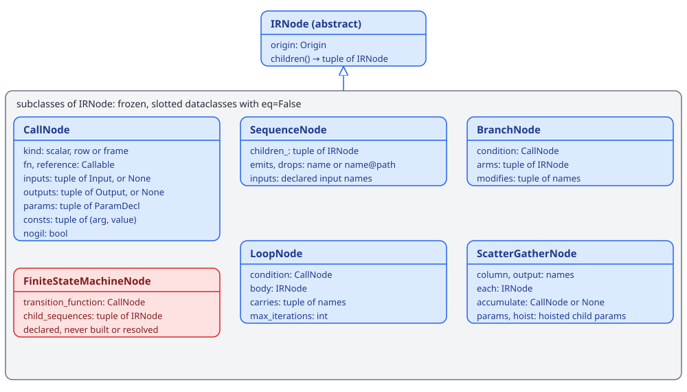
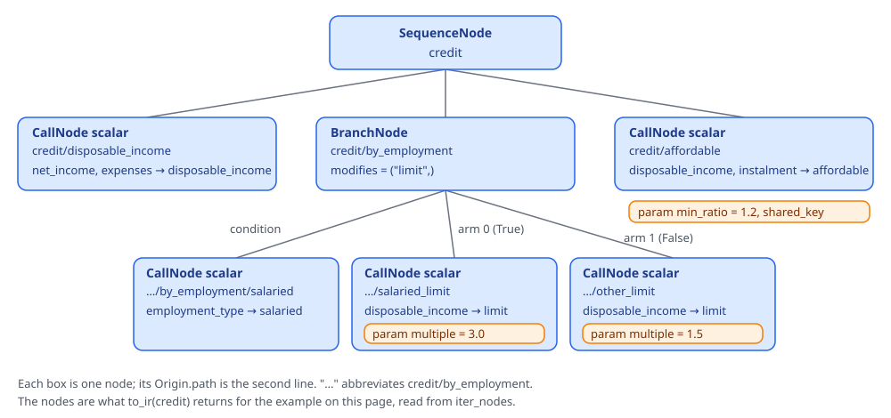
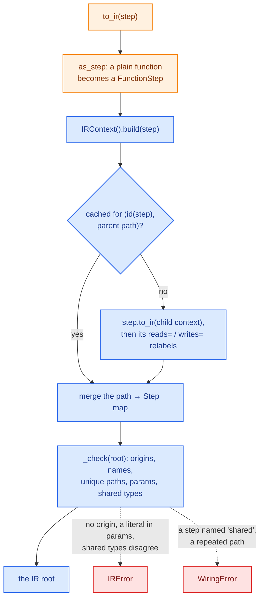

# IR internals

The IR is the tree the engine executes. Every step, from a plain function to a decision tree loaded from JSON,
produces it through `to_ir(ctx)`, and nothing downstream of it knows which step type it came from. The
[wiring](wiring.md) resolver, the three [runners](runners.md), the [compiler](compile.md), the [debugger](debug.md),
`parameters()` and the checks in `decider.lab` all read the same node classes. How each step type lowers to these
nodes is on the [steps and IR](../steps-and-ir.md) page. This page covers the data model itself.

The code lives in `decider/_engine/ir/`:

| File | Holds |
|---|---|
| `nodes.py` | `IRNode` and its subclasses, `iter_nodes` |
| `decls.py` | `Input`, `Output`, `ParamDecl`, `NullPolicy`, `FeatureKind` and the annotation helpers `base_annotation`, `nullable`, `is_typed`, `feature_kind`, `stored_fill` |
| `origin.py` | `Origin`, `check_id`, `check_name` |
| `context.py` | `IRContext`, `to_ir`, `step_map`, the build cache, the checks, relabelling |

Step-type authors import the public names from `decider.ir`.

## The node classes

<div class="diagram" markdown>


*The node classes in `decider/_engine/ir/nodes.py` and their fields. The red one is declared but nothing builds or runs it.*
</div>

Every node is a frozen, slotted dataclass with `eq=False`, so two nodes are equal only when they are the same
object. `children()` returns the nodes it runs, in order: a branch returns its condition then its arms, a loop its
condition then its body.

| Node | Made by | Runs |
|---|---|---|
| `CallNode` | `step(fn)`, `frame_step`, `ctx.call`, a tree, table or scorecard | one function |
| `SequenceNode` | `flow`, `dag`, `optimise`, the `|` operator | its children in written order (a `dag` is sorted before this) |
| `BranchNode` | `branch` | the arm its condition picks, per row |
| `LoopNode` | `loop` | its body while the condition holds, per row, at most `max_iterations` times |
| `ScatterGatherNode` | `each` | its child on every element of a list column, gathering the results back |
| `FiniteStateMachineNode` | nothing yet | declared only; see below |

The set started as `CallNode`, `SequenceNode`, `BranchNode` and `LoopNode`. `ScatterGatherNode` came later, for
`each`, and `FiniteStateMachineNode` is declared in `nodes.py` and exported from `decider.ir` without anything building or
running it: `resolve` raises `TypeError: can't resolve FiniteStateMachineNode`, the [wiring](wiring.md) `Plan`
has a `FiniteStateMachine` class documented as "not yet wired", and relabelling raises for it. Only the checks in
`decider/lab/checks/_builtin/ids.py` walk into it.

### CallNode and its three kinds

`kind` decides how a runner calls `fn`:

| `kind` | Call | Inputs and outputs |
|---|---|---|
| `scalar` | `fn(**{i.arg: value for i in inputs}, **dict(consts), **{d.arg: v for d in params})` per row | declared |
| `row` | `fn(row, params, consts)`: three tuples in declared order, returning a tuple of outputs | declared |
| `frame` | `fn(df, **params) -> df` over the whole frame | declared, or `None` for unknown lineage |

`Input.arg` is the function argument an input feeds, and `Input.name` is the column it reads. A relabel changes
only `name`, so a renamed input still reaches its argument. `ParamDecl.arg` does the same for params: the document
key is `name`, the argument is `arg`.

A `row` node is what a tree or a decision table compiles to, and what a scorecard totals its bins with. Its `fn`
is a numba kernel. When it has a `reference(row, params, consts, visit)`, its plain-Python twin, the interpreted
runner calls that instead and passes a `visit` callback, which the tree calls with each internal node's locator. That is how a debug session steps inside a tree.
`nogil=True` asks the compiler to release the GIL in the call's kernel.

`consts` holds named literal arguments, such as a config's inline `Value[T]`. Like params they arrive as arguments
at run time, so changing one never recompiles; unlike params they are not in the params document. `ctx.call` puts a
literal in `consts` and a `ParamRef` in `params`:

```python
def scale(x: float, factor: float) -> float:
    return x * factor

class Markup(ConfigurableStep):
    type: Literal["markup"] = "markup"
    column: str
    factor: Value[float] = 1.0
    def to_ir(self, ctx):
        return ctx.call(self, scale, inputs={"x": self.column},
                        values={"factor": self.factor})
```

```text
doubled  inputs [('income', 'x')]  consts (('factor', 2.0),)
         params []
marked   inputs [('income', 'x')]  consts ()
         params [('uplift', 'factor', 1.1)]
```

The first came from `"factor": 2.0`, the second from `"factor": {"param": "uplift", "default": 1.1}`. The second
`ParamDecl` has `name="uplift"` (its document key) and `arg="factor"` (the argument it feeds). A tree's `consts`
carry the addresses of its packed arrays:

```text
row Origin(path='risk', source='decider.steps.trees:TreeConfig', ...)
    reference: yes
    inputs  [('ratio', float, 'MISSING_AS')]
    outputs [('risk', int)]
    params  [('hi_ratio', 0.7)]
    consts  (('ints', 94560797780704), ('floats', 94560796512704),
             ('chars', 94560794498048),
             ('layout', (0, 30, 30, 1, 32, 32, 33, 34, 0, 0, 1)),
             ('outputs', ((-1, 35, 2, 0),)))
```

Those addresses change on every load, which is why the debugger's hot reload keys a config node by its document
and class code instead of by its IR fields (`decider/_engine/debug/hot.py`).

A `frame` node with `inputs=None` or `outputs=None` has unknown lineage: the function may read or rewrite any
column. The resolver treats one with unknown outputs as a barrier ([wiring](wiring.md)).

### Control-flow nodes

`BranchNode.condition` is always a `CallNode`. A `bool` result picks arm 0 for `True` and arm 1 for `False`; an
`int` picks the arm by index. `modifies` lists the names that leave the branch: everything else an arm writes stays
inside it. `LoopNode.carries` plays the same part for a loop, and `max_iterations` bounds it per row.

`SequenceNode` carries three name lists besides its children. `emits` and `drops` are `name` or `name@path`
specs that change what reaches the output. `inputs` declares names that are input columns on purpose, which turns
off the typo check for them ([wiring](wiring.md)).

`ScatterGatherNode` reads the list column `column`, runs `each` once per element, and writes the enriched list to
`output`. Its child's params are hoisted onto it: `params` holds them under the node's own path, and `hoist` pairs
each param name with the child path the runner forwards it to. `accumulate`, a fold `(acc, element) -> acc`, is
declared but `each()` always passes `None`.

```text
ScatterGatherNode fees  column=items  output=items
paths ['fees', 'fees/fee', 'fees/fee/item_fee']
```

## A real IR, printed

The credit pipeline from the [engine overview](index.md), printed by walking `to_ir(credit)`:

```text
SequenceNode credit  source=decider.steps:SequentialStep
  CallNode[scalar] credit/disposable_income
      source=loan:disposable_income
      in  net_income: float REQUIRED
      in  expenses: float MISSING_AS fill=0.0
      out disposable_income: float
  BranchNode credit/by_employment  modifies=['limit']
      source=decider.steps:BranchStep
    CallNode[scalar] credit/by_employment/salaried
        source=loan:salaried
        in  employment_type: int REQUIRED
        out salaried: bool
    CallNode[scalar] credit/by_employment/salaried_limit
        source=loan:salaried_limit
        in  disposable_income: float REQUIRED
        out limit: float
        param multiple: float default=3.0
    CallNode[scalar] credit/by_employment/other_limit
        source=loan:other_limit
        in  disposable_income: float REQUIRED
        out limit: float
        param multiple: float default=1.5
  CallNode[scalar] credit/affordable
      source=loan:affordable
      in  disposable_income: float REQUIRED
      in  instalment: float REQUIRED
      out affordable: bool
      param min_ratio: float default=1.2 shared_key=min_ratio
```

The script that printed it is a recursive walk over `children()`:

```python
from decider.ir import BranchNode, CallNode, to_ir

def show(node, depth=0):
    pad = "  " * depth
    if isinstance(node, CallNode):
        o = node.origin
        print(f"{pad}CallNode[{node.kind}] {o.path}  source={o.source}")
        for i in node.inputs:
            kind = i.annotation.__name__
            print(f"{pad}    in  {i.name}: {kind} {i.null_policy.name}")
        ...
        return
    o = node.origin
    print(f"{pad}{type(node).__name__} {o.path}  source={o.source}")
    for child in node.children():
        show(child, depth + 1)

show(to_ir(credit))
```

<div class="diagram" markdown>


*The same tree. Params are the orange tags; the condition and arms are the BranchNode's children in order.*
</div>

## Iterating the tree

`iter_nodes(node)` yields every node, parents before children, by following `children()`:

```text
>>> [n.origin.path for n in iter_nodes(to_ir(credit))]
['credit',
 'credit/disposable_income',
 'credit/by_employment',
 'credit/by_employment/salaried',
 'credit/by_employment/salaried_limit',
 'credit/by_employment/other_limit',
 'credit/affordable']
```

A node has no `path` attribute of its own; the path is `node.origin.path`. The module docstring of `decider/ir.py`
shows `node.path` in its example, which raises `AttributeError`.

## Ids, paths and origins

Every node carries an `Origin`, a frozen dataclass of plain strings, so events and traces carry it as is:

| Field | Example | Meaning |
|---|---|---|
| `path` | `credit/by_employment/salaried_limit` | the node's id within one IR: the names of named steps from the root, joined with `/` |
| `source` | `loan:salaried_limit` | the import path of the function or class that produced the node |
| `locator` | `n17` | a position inside a `row` node, shown as `path#n17` |
| `id` | `3f9a0c12be47` | an optional durable step id, 12 lowercase hex characters, committed in source |
| `suppress_checks` | `("DCD101",)` | check codes or aliases the step suppresses, read by `decider.lab.checks` |

Anonymous flows are transparent: they add no path segment. A `ConfigurableStep`'s nodes sit under its name. The
root has the root step's name as its path, or `""` when it is anonymous.

`check_name` refuses an empty name or one containing `/` or `#`, when a step is made or renamed:

```text
WiringError: step name 'a/b' must be a non-empty string without '/' or '#':
  paths join names with '/' and mark positions inside a node with '#'
```

`check_id` runs when `ctx.origin` builds the origin, so a malformed id fails at `to_ir`, not when the step is made:

```text
>>> to_ir(flow(step(ratio, id="ABC"), name="afford"))
WiringError: step id 'ABC' must be 12 lowercase hex characters
```

The path and source are derived ids, rebuilt from names and import paths on every build; renaming or moving a step
changes them. The `id` is the committed one. It survives a rename, an extraction or a reorder because it depends on
neither name nor position, and it is one per definition, so a step reused at two paths keeps one id at both. `decider ids` writes ids into source. With `id=None` everything else is
unchanged:

```text
Origin(path='afford', source='decider.steps:SequentialStep',
       locator=None, id='a1b2c3d4e5f6', suppress_checks=())
Origin(path='afford/ratio', source='__main__:ratio',
       locator=None, id='3f9a0c12be47', suppress_checks=())
```

Origins stay out of every cache key. Compiled code is keyed by the content of the function (see the
[cache](cache.md) page), because a rename, a deeper nesting or a second placement changes the origin without
changing the code. A path-sensitive key costs this much: a same-content file renamed or moved
misses numba's cache and recompiles in 4.6 to 4.8 s at 200 arguments, against 0.18 s warm.

## Inputs, outputs and null policies

`Input(name, annotation, null_policy, fill, arg)` is one declared input. `harvest` in `decider/_engine/params/harvest.py`
reads them from a function's signature:

| Declared as | `null_policy` | A null in the data |
|---|---|---|
| `x: float` | `REQUIRED` | an error naming the input, the step and the row count |
| `x: float = missing_as(0.0)` | `MISSING_AS`, `fill=0.0` | replaced by the fill |
| <code>x: float &#124; None</code> | `OPTIONAL` | passed to the step as `None` |
| `x: float = param(...)` | none: this is a `ParamDecl` | |
| `x: float = 0.0` | | `IRError`: use `param(0.0)` or `missing_as(0.0)` |

The policy belongs to the reader, not to the column. Two steps may read one column with different policies, so the
runner applies each `Input`'s policy when that call reads it ([runners](runners.md)). `stored_fill` gives the fill
as it is stored: the int64 mantissa for a Decimal input.

`Output(name, annotation)` is one declared output. A `Text` annotation on an output becomes `str`, because `Text`
says how an input is read and an output holding one is a plain string. Several outputs need a `tuple[...]` return
annotation of the same length, or `harvest` raises.

`decls.py` also holds `FeatureKind`, the typed array a value is gathered into in compiled trees (`F64`, `I64`,
`BOOL`, `CODE` for a `str` dictionary code, `STR` for a raw byte span). Compiled trees store these integers per node
and switch on them, so their values are fixed; `test_feature_kind_values_are_fixed` pins them.

## Param declarations

`ParamDecl` is one tunable param of a node:

| Field | Meaning |
|---|---|
| `name` | the key in the params document |
| `annotation` | the declared type; for a `param_table`, the cached pydantic type that checks its rows |
| `default` | the default value, ignored when `required` |
| `field_info` | the pydantic `FieldInfo` with bounds and descriptions, or `None` |
| `required` | no default: a document that leaves it out is invalid |
| `shared_key` | read from `doc["shared"][shared_key]` instead of the node's own entry |
| `on_invalid` | `"error"`, `"warn"` or `"default"` |
| `schema` | a table's `(column, dtype)` pairs, else `None` |
| `arg` | the function argument it feeds (default `name`) |

`default` and `field_info` are left out of `==` and `hash`, because a default may be a list or dict. A
`ParamDecl` is therefore hashable whatever its default, and two declarations differing only in default compare
equal. The [params](params.md) page covers how a declaration becomes a validated bundle.

## Building and checking: to_ir



`IRContext` carries the parent's `path` and a map from path to the `Step` built there. A step's `to_ir(ctx)` uses
four helpers on it:

- `ctx.child(name)` is the context for the step's members; `None` (anonymous) is transparent.
- `ctx.origin(step, name=None, locator=None)` builds the node's `Origin`, taking the source from the function or
  the config class and checking the id.
- `ctx.build(member)` builds a member's IR under this context, cached, with its relabels applied.
- `ctx.call(owner, fn, inputs=, outputs=, values=)` builds a scalar `CallNode` from `fn`'s signature, the same way
  `step(fn)` does. An argument name `fn` lacks is an `IRError`.

`ctx.expand(owner, helper)` builds helper steps as the body of a `ConfigurableStep`: the helper's nodes sit under
the owner's name and the root takes the owner's origin. `ctx.value(v)` and `ctx.table(t)` turn a config's
`Value[T]` or `TableValue` into a literal or a `ParamDecl`.

The checks in `_check` produce these messages:

```text
WiringError: two nodes have path 'p/dup' (__main__:dup and __main__:dup);
  did you mean to name one of them, e.g. .named('dup_2')?
WiringError: shared: no step may be named 'shared'; that key holds the
  shared params
IRError: shared param 'base_rate' is declared float by p/a and int by p/b
```

`shared` is reserved because it is the top-level key of the params document that holds the shared params.

`step_map(step)` returns the path to `Step` map the build collected, including branch conditions, arms and loop
bodies. `Step.walk()` is the authoring tree instead: named members of flows and dags only.

### Relabelling

`step.relabel(reads={...}, writes={...})` is applied to the built IR by `_relabel`. Outputs are renamed through
`writes`. An input is renamed through `writes` if a node inside the relabelled step produced it earlier, and through
`reads` otherwise, so a step can read its own earlier output under its new name. For a frame step with declared
columns, the function is wrapped so it sees the old names and returns the new ones (copies, since the frame may
already hold a column with the target name). A frame step of unknown lineage cannot be relabelled. `_relabel`
handles calls, sequences, branches and loops, and raises `TypeError` for any other node type.

### The build cache

`IRContext.build` caches each step's IR in a module dict keyed by `id(step)`, then by parent path. Pydantic steps
compare by value, so the key is the object's identity, and a `weakref.finalize` on the step drops the entry before
the id can be reused. Calling `to_ir` twice on an unchanged step returns the same object:

```text
>>> to_ir(credit) is to_ir(credit)
True
```

Re-running one notebook cell makes one new step object, so only that step's IR is rebuilt; its unchanged members
come back from the cache. The step map is kept out of the cache entry, which would otherwise hold the step alive.

## Content and hashing

The IR has no hash of its own. Identity and content are kept apart deliberately:

- Nodes compare by identity (`eq=False`). Two builds of the same step at the same path return the same node object
  from the cache; anything else is a different node.
- `Input`, `Output` and `ParamDecl` are value objects and hash by value (`ParamDecl` without its default).
- Compiled code is keyed by `fingerprint(fn)`, a sha256 over the function's bytecode, constants, closure values and
  the globals it reads, without its name, file or line ([cache](cache.md)).
- The debugger's hot reload compares a node's content (kind, function fingerprints, inputs, outputs, params with
  defaults, consts, the versions it reads) to find the first changed step ([debug](debug.md)).
- A params document is keyed by a sha256 of its JSON ([params](params.md)).

## Why a closed, small set of node types

The node set is fixed so that the engine implements each execution mode, the debugger and the compiler once per
node type, and a new step type, written by anyone, only implements `to_ir()` and needs no engine change. A tree
and a decision table are `row` CallNodes, a scorecard is a sequence of scalar and row calls, and `optimise` is a
`SequenceNode` of ordinary calls.
The two node types added after the first four (`ScatterGatherNode` for `each`, and the unwired `FiniteStateMachineNode`) are the
cost of that rule: every runner, the resolver and `parameters()` had to learn `ScatterGatherNode`, and the
compiled runners scatter and gather in the interpreted runner's Python code (only the calls inside run compiled).

IR nodes are also fully resolved when they leave `to_ir`. Relabels are applied, a `dag` is sorted into written
order, param namespaces are fixed by path, and each node carries its origin, so the engine needs no further
lookups. Steps do not know their parent; `to_ir` is called once per placement with the parent path in the
context, so one step object can sit in two pipelines with two sets of paths.
