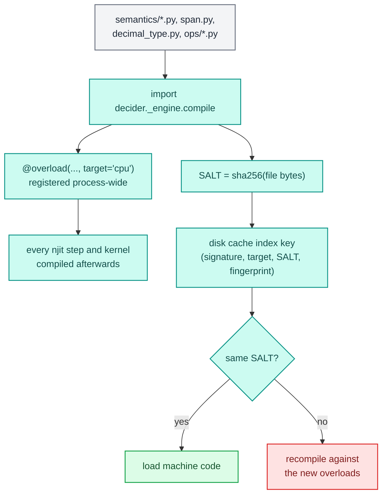
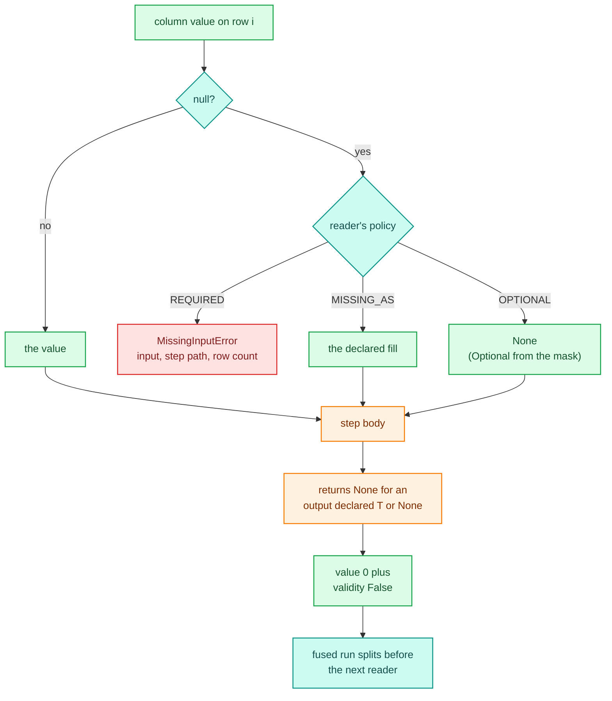

# Kernel semantics

A step gives the same answer in `interpreted`, `stepped` and `fused` mode, and in `run` and
`score`. Plain numba does not guarantee that: it rounds halves differently from CPython, computes
`x ** n` by repeated squaring, has no fixed-point decimal and types a string as its own unicode
object. Kernel semantics is the set of numba types and overloads that close those gaps, plus the
rules for nulls that every runner applies the same way. It lives in
`decider/_engine/compile/semantics/`, `compile/decimal_type.py`, `compile/span.py` and the user
types in `decider/ops/`.

How steps become kernels is on [compilation](compile.md). How cached machine code is invalidated
when these overloads change is on [the compile cache](cache.md). The user side of the same
material, with runnable examples, is in [types and money](../../guides/types-and-money.md).

## The semantics registry

`compile/semantics/__init__.py` imports three modules for their side effects. Each registers numba
overloads with `target="cpu"`, which outrank numba's generic builtins for the same operator:

| Module | Registers |
|---|---|
| `semantics/numbers.py` | `round(x, ndigits)` on a float and an int; `x ** n` and `x **= n` on a float and an int |
| `semantics/decimals.py` | every operator, `abs`, `min`, `max`, `float`, `int`, `bool`, the `Decimal(...)` and `Currency(...)` constructors, `.raw`, and `decimal.round` on `DecimalType` |
| `semantics/strings.py` | `==`, `!=`, `len`, `in`, `startswith`, `endswith` and `[]` on `SpanType` |

`compile/njit.py` imports the package before it compiles anything, so the overloads are in place
for the first step. They are global to the process: once `decider._engine.compile` is imported, a
plain `@njit` function written outside any pipeline gets them too. Every overload is keyed on its
own type (`DecimalType`, `SpanType`) or on float operands, so plain int arithmetic, tuples and
arrays keep numba's own behaviour.

The same import computes `SALT`, a sha256 over the bytes of every file whose code can change what a
step compiles to. The file list is found by walking, so a new file under `semantics/` or `ops/` is
covered without anyone listing it:

```text
6c966223198695dd5fc65fcf4f55149d4a6e64cc5e88de7143fe85af3b604a6a
decider/_engine/compile/decimal_type.py
decider/_engine/compile/semantics/__init__.py
decider/_engine/compile/semantics/decimals.py
decider/_engine/compile/semantics/numbers.py
decider/_engine/compile/semantics/strings.py
decider/_engine/compile/span.py
decider/ops/__init__.py
decider/ops/decimal.py
decider/ops/measures.py
decider/ops/nested.py
decider/ops/text.py
```

numba's disk cache keys a step by the step's own bytecode, so an edit to an overload would
otherwise keep serving the machine code compiled against the old one. `SALT` goes into every disk
cache index key, and [the cache page](cache.md) shows where.



## Floats

### `round(x, n)`

CPython rounds the exact value of the double, and goes half to even only on an exact tie. numba
rounds the scaled float, and `2.675 * 100` is `267.5` in floating point, so it rounds up. In a
process with only numba imported:

```text
plain numba round(2.675, 2) = 2.68   CPython: 2.67
plain numba round(0.125, 2) = 0.12   CPython: 0.12
```

With `decider._engine.compile` imported, the same `@njit` function prints `2.67`. The overload calls
`decimal.round(x, n, Rounding.HALF_EVEN)`, which is `round_float` in `decider/ops/decimal.py`, one
`@register_jitable` body that runs in Python and in a kernel. It splits `x * 10**n` into a double
and its exact error with Dekker's two-product (no fused multiply-add needed), then decides the
rounding from both parts. Negative `n` rounds to tens and hundreds; NaN and infinities pass
through; the sign of zero is kept; past 2**53 a double is already whole. Above 22 digits `10**n`
is not exact, and the code falls back to float scaling (a `ponytail:` comment in the source marks
that limit).

`decimal.round(x, n, mode)` exposes the same function with `HALF_UP` (the default),
`HALF_EVEN` and `DOWN`. The mode is an int, so one compiled step serves every mode.
`tests/compile/test_cpython_math.py` and `tests/ops/test_decimal.py` compare it against the
standard library `decimal` on the exact double, for ties, random values and values near 2**53.

### `x ** n`

numba computes a float to an int power by repeated squaring, which drifts a few ULP from the libm
`pow` CPython calls. The overload turns it into `x ** float(n)`, which is `pow`. Over 100,000 random
`(1 + rate) ** months` with `rate` in [0, 0.03] and `months` in [2, 360]:

```text
plain numba:          pow differs on 97309 of 100000
                      e.g. rate 0.00765..., months 255: 6.985595589299698 vs 6.985595589299625
decider's overloads:  pow differs on 0 of 100000
```

LLVM still folds a literal `x ** 2` into `x * x`, which can miss `pow` by an ULP (noted in the
source). `fastmath` stays off for the same reason: with it on, results stop matching Python bit
for bit (see [compilation](compile.md)).

### Division by zero

A kernel raises `ZeroDivisionError` on `x / 0.0`, as Python does; the generated code tests the
divisor before dividing (the LLVM listing on [compilation](compile.md) shows the test). The
interpreted runner and the Python fallback pass each column through `.tolist()`, so a step sees a
Python `float`; a numpy scalar would warn and return `inf`.

## Integers

An `int` is an int64 in every mode, and a kernel wraps on overflow without an error. Interpreted
mode computes with a Python int and fails when it stores a result that does not fit:

```python
def wrapped(cents: int) -> int:
    return cents * 4_000_000_000

flow(wrapped, name="w").compile("fused").score({"cents": 10_000_000_000})
flow(wrapped, name="w").compile("interpreted").score({"cents": 10_000_000_000})
```

```text
{'cents': 10000000000, 'wrapped': 3106511852580896768}
OverflowError: Python int too large to convert to C long
```

The true product is 40,000,000,000,000,000,000; int64 keeps its low 64 bits. The modes disagree
only where the answer was already out of range, and the `int64_overflow` check (DCD101, see
[checks](../../guides/checks.md)) flags the products that can reach it. The note on money and
overflow found a sum-of-squares accumulator over loan amounts in cents wrapping at 2,667 rows,
which is why running totals that can grow accumulate in float64, exact to 2**53.

## Decimal and Currency

Money in a float drifts (`0.1 + 0.2` is not `0.3`). `Decimal` is a fixed-point number: an int64
`raw` count of `10**-scale` units, with a scale from 0 to 18 and an optional display `units`
string. `Currency` is a `Decimal` of scale 4 (`Decimal[19, 4]`, up to 922,337,203,685,477.5807),
built from a float, a str, or exactly as `Currency(major, minor)`. Annotations carry precision and
scale for the tools: `Decimal[18, 2]`, `Currency["R"]`.

### In a kernel

`DecimalType(scale)` is a numba type with an int64 data model. It is keyed by scale alone, so a
`Currency` and a `Decimal[19, 4]` share one compiled signature, and `units` never reaches a kernel
or a cache key. Columns, params bundles and stored outputs stay plain int64; the `DEC` source tag
types an int64 as `decimal[scale]` at the kernel's edge. The note on decimals measured why: a
Python `Decimal` crossing the dispatcher costs 3.5 µs against 0.3 µs for an int, and 14 to 21 µs
inside a 2-tuple (the shape of a params bundle) against 0.4 to 0.6 µs.

Typing rules:

- `unify` takes the larger scale, so `x if c else y` over scales 2 and 4 is `decimal[4]`, and an int
  unifies with a decimal, so `total = 0; for ...: total += d` types as a decimal.
- A cast to a larger scale multiplies by the power of ten; a cast from an int is whole units.
- `store_as` turns a returned value into the int64 at the output's declared scale: a coarser
  decimal divides and rounds half-even, an int is whole units, an optional stays optional.

### Operators

| Expression | Result | How |
|---|---|---|
| `a + b`, `a - b` | larger scale | scale the smaller up, then int64 add (exact, wraps) |
| `a + 1`, `1 - a` | `a`'s scale | an int is whole units |
| `a * b` | larger scale | exact 128-bit product divided by `10**min(sa, sb)`, half-even |
| `a / b` | larger scale | 128-bit long division in chunks of 19 digits, half-even; `ZeroDivisionError` on zero |
| `a * 0.0175`, `a / 1.5` | `a`'s scale | `rint(float(raw) * f)`, half-even |
| `a < b`, `==` (any scales, ints) | `bool` | exact, compared in 128 bits |
| `a < 2.6` | `bool` | `float(raw) / 10**s` against the float, the same expression in Python |
| `-a`, `abs(a)`, `min`, `max` | decimal | `min` and `max` align scales |
| `float(a)`, `int(a)`, `bool(a)` | number | `int` truncates toward zero |
| `a + 1.5`, `1.5 / a`, `a // b`, `a % b`, `a ** n`, `round(a, n)` | error | a `TypingError` naming the operands, with advice |
| `Decimal(n, scale)`, `Currency(major, minor)` | decimal | int arguments, a literal scale |
| `decimal.round(a, digits, mode)` | `a`'s scale | zeroes the places below `digits` under the mode |

<div class="diagram" markdown>


*Two operations traced through the raw int64 values.*
</div>

The 128-bit work is hand-rolled in uint64 (`_mul64`, `_divlu`, a two-digit Knuth division):
LLVM's i128 division calls `__udivti3`, which aborts the process with a missing-symbol error that
nothing can catch. `tests/compile/test_decimal_kernel_typing.py` pins that no division helper ever
emits it. The note on decimals measured the cost at 6.0 ns for a 128-bit multiply and divide whose
product fits 64 bits and 21 ns for wide operands, against 2.3 ns for a plain int64 multiply and
floor divide (which rounds wrongly).

Both sides compute the same value. A fee and a three-way split, in both modes:

```python
def fee(amount: Currency, rate: float = param(0.0175)) -> Currency:
    return amount * rate

def split(amount: Currency) -> Currency:
    return amount / 3
```

```text
interpreted {'amount': '100.00', 'fee': Currency('1.7500'), 'split': Currency('33.3333')}
fused       {'amount': '100.00', 'fee': Currency('1.7500'), 'split': Currency('33.3333')}
interpreted {'amount': '0.5', 'fee': Currency('0.0088'), 'split': Currency('0.1667')}
fused       {'amount': '0.5', 'fee': Currency('0.0088'), 'split': Currency('0.1667')}
```

The one place they differ is overflow. A Python `Decimal` raises when a result leaves int64; a
kernel wraps:

```text
fused:       {'amount': 4611686018427387904, 'big': Decimal('-9223372036854775808')}
interpreted: OverflowError: 9223372036854775808 does not fit a Decimal's int64;
             a compiled step wraps instead
```

A mix the table calls an error makes numba refuse the step. It then runs in Python with a
`FallbackWarning`, where the Python class raises its own error (`TypeError: unsupported operand
type(s) for +: 'Currency' and 'float'` for `amount + 1.5`), so the spelling fails in every mode.
The reason `exe.fallbacks()` reports is numba's full candidate listing, with the decider line
(`decimal[4] + float64 is not defined for a Decimal: an int counts as whole units, a float is not
allowed`) in the middle of it.

## Text: string spans

A `Text` input is a string read in place. In a kernel its value is a `SpanType`: the
`(address, byte length)` of its UTF-8 bytes in Arrow memory, 16 bytes, with length -1 for a null.
It has its own numba type for two reasons, both written down in `span.py`. Overloading `==` on the
bare `UniTuple(int64, 2)` would capture every unrelated pair of ints in a step, so `(1, 2) == (1, 2)`
would answer False. And numba rewrites `len(t)` on a tuple argument to the constant 2 before type
inference, where no overload can reach it.

The overloads in `semantics/strings.py`:

- `==` and `!=` compare byte for byte with `load_u8`. A literal is lowered as one constant byte
  array; a span compares against another span, a module-level `str` constant or a `str` param.
  A string built at run time is a `TypingError`: compare against a literal, a module-level
  constant or a `param()`.
- `len` counts code points (bytes that are not UTF-8 continuation bytes), as CPython does. A null
  reads as length 0 through `len`, because `len` may not be negative outside a kernel; the byte
  length -1 stays in `span[1]`.
- `startswith`, `endswith` and `in` match bytes against a literal or another span.
- A null equals nothing, not even another null, and holds no prefix, suffix or part, as a NaN
  feature does.

Outside a kernel the same column is a `SpanArray` (a numpy view with the `SPAN_DTYPE` record
`(address, length)`), whose elements read back as `decider.ops.Text` objects. `Text` answers the same
operations in Python, so the Python fallback and interpreted mode agree with the kernel:

```python
def government(employer: Text | None) -> bool:
    return employer.startswith("GOV") or "DEPT" in employer

def name_len(employer: Text | None) -> int:
    return len(employer)

df = pl.DataFrame({"employer": ["GOV HEALTH", "ácme", None, "TRANSPORT DEPT"]})
```

```text
interpreted [True, False, False, True] [10, 4, 0, 14]
stepped     [True, False, False, True] [10, 4, 0, 14]
fused       [True, False, False, True] [10, 4, 0, 14]
```

`"ácme"` is five bytes and four code points. When a node reads a span, each of its `str` params
reaches the kernel as a span of the param's UTF-8 bytes too; the stepped runner converts those once
per params document and node and keeps the buffers alive beside the converted bundle. A semantic
`str` input never enters a kernel and runs in Python (see [the compile
cache](cache.md) for how that is reported). The note comparing codes and spans recorded why the
earlier int32 code representation for strings was removed: spans were 3x faster in a batch at 4
distinct values and 6 to 7x at 100,000, while codes needed a process-wide table that never forgot
a string and numbered values differently per worker.

## Nested values

`Struct[Item]` and `Columnar[Item]` (in `decider/ops/nested.py`) carry list and struct columns into
a kernel in shapes numba reads without Python objects.

<div class="diagram" markdown>


*The three compiled value shapes that are not a single number.*
</div>

- A `Struct[Item]` input is a numpy record array, one record per row, with an aligned dtype built
  from the item's fields. Fields are `float`, `int` or `bool`. A record has no per-field
  validity, so the input must be REQUIRED, and a null field raises `MissingInputError` naming
  `applicant.income`. An output is a tuple of fields packed into a record (see [compilation](compile.md)).
- A `Columnar[Item]` input is a struct of arrays: `items.price` is one array of every item's price
  for this row, read by position `items.price[j]`, and `len(items.price)` is the item count. Fields
  may be `float`, `int`, `bool`, `str` (a span), `float | None` (a null reads as NaN) or
  `str | None` (a null span). A null in any other field raises a `ValueError` of the form
  `'<field>' is null in item <k> of row <r>; a Columnar[Item] field cannot hold a null`. A field that
  is itself a list or struct is refused at bind time; the plain `list[dict]` or `dict`
  annotation runs in Python instead.
- A `Columnar[Item]` output drains into a `Sink`: a float64 buffer of `(rows, fields)` that every
  item schema shares, with bool and int fields narrowed back in Python.

The note on item records tested whether a record could also carry a span field. It can, with a
`types.Record` subclass that numba 0.67 tolerates, but the shared-array kernel path made ragged
flat arrays the cheaper shape, so struct fields remain numeric.

## Nulls, the same in every mode

Every input has a null policy, set by its declaration, and every runner applies it the same way:

- `income: float` is REQUIRED: a null or absent column raises `MissingInputError` before any step
  runs.
- `income: float = missing_as(0.0)` is MISSING_AS: the step sees the fill, written by the boundary
  or by the driver.
- `bonus: float | None` is OPTIONAL: the step sees `None`, which in a kernel is a numba `Optional`
  built from a validity mask.

A REQUIRED null gives the same error in `interpreted`, `stepped` and `fused` mode (checked on
all three), naming the input, the step path and the row count:

```text
MissingInputError: input 'employer' of step 't/government' is required but column
'employer' has 1 null row(s) of 4. Fix the data, or declare
`employer: T = missing_as(fill)` or `employer: T | None`.
```

An output declared `T | None` may be `None`. A kernel stores it as `T`'s dtype (so `int | None` is
int64) plus a validity mask, and the compiler splits a fused run before any later step of that
run that reads it, so the driver applies the reader's policy between the two kernels. A step
returning `None` writes a null in interpreted mode too.

```python
def bonus_or_zero(bonus: float | None) -> float:
    return 0.0 if bonus is None else bonus

def maybe(income: float) -> float | None:
    return None if income < 1000.0 else income * 0.1

def uses_maybe(maybe: float | None) -> float:
    return -1.0 if maybe is None else maybe
```

```text
interpreted [100.0, 0.0] [-1.0, 500.0]
stepped     [100.0, 0.0] [-1.0, 500.0]
fused       [100.0, 0.0] [-1.0, 500.0]
```



A few kinds have their own null forms: a null `Text` is a span of length -1 and needs no mask; a
null `Columnar[...]` list is a row with no items, so `missing_as([])` is the only fill it accepts;
a struct input has no null form at all. Inside a packed branch or loop, a value the kernel only
copies has no validity, so a null in it sends that launch down the unpacked path (see
[compilation](compile.md)).

## How it fails

- A typing error inside a step (a decimal mixed with a float, a span compared with a string built
  at run time, `//` on a decimal) is one of numba's compile errors: the step runs in Python with a
  `FallbackWarning`, or raises under `Engine(strict_compile=True)`. [The compile cache](cache.md)
  covers the decision.
- Overflow is silent in a kernel. Checks flag the risky products; tests should include large
  principals and `.xx5` ties, which random sampling rarely reaches (the note on money and overflow
  found the wrap point by binary search).
- An edit to an overload changes `SALT`, so every user step misses the disk cache once and is
  recompiled against the new code.

## Extending

A new overload goes in a module under `semantics/`, keyed on its own numba type so it captures
nothing else, with a `@register_jitable` body shared with the Python side where possible. Being
under `semantics/` puts it in `SALT` without further work (`tests/test_conventions.py` checks that every semantics, span, decimal type and ops file is
covered). Add a test that runs the operation in every mode and compares
with the Python answer over an edge corpus, as `tests/compile/test_decimal_kernels.py` does for
decimals.
