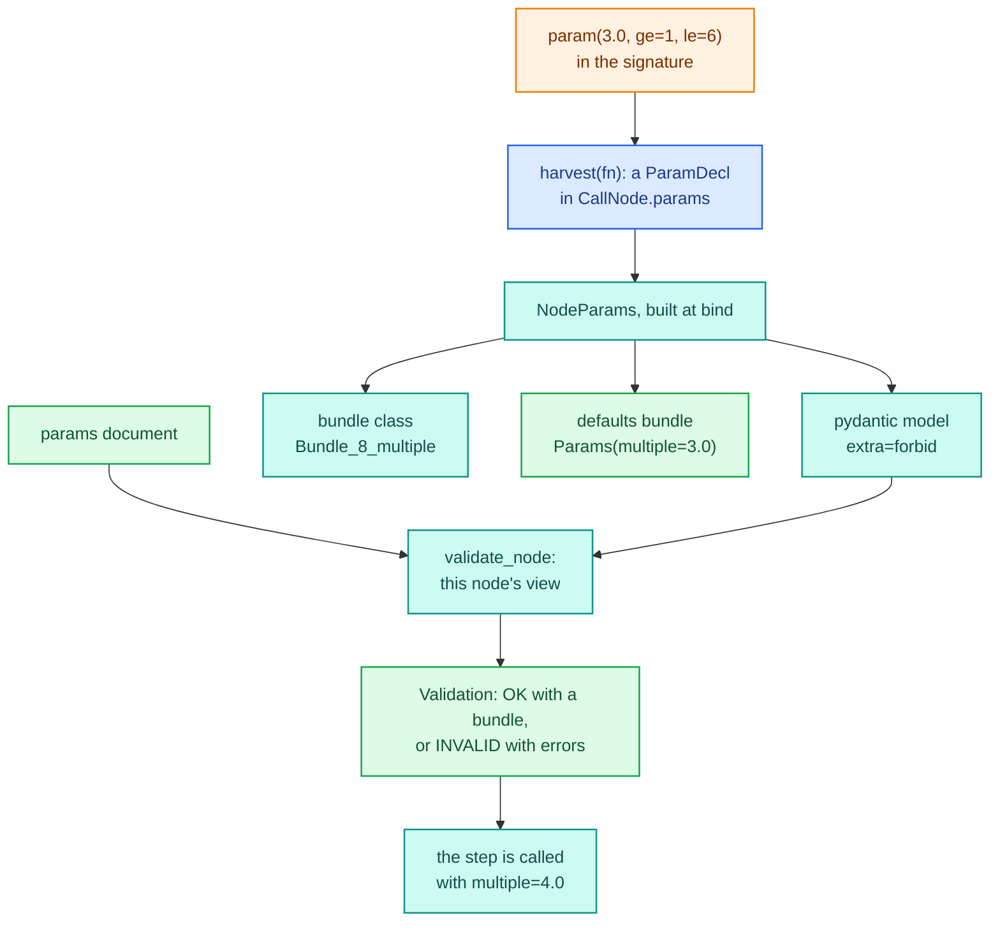
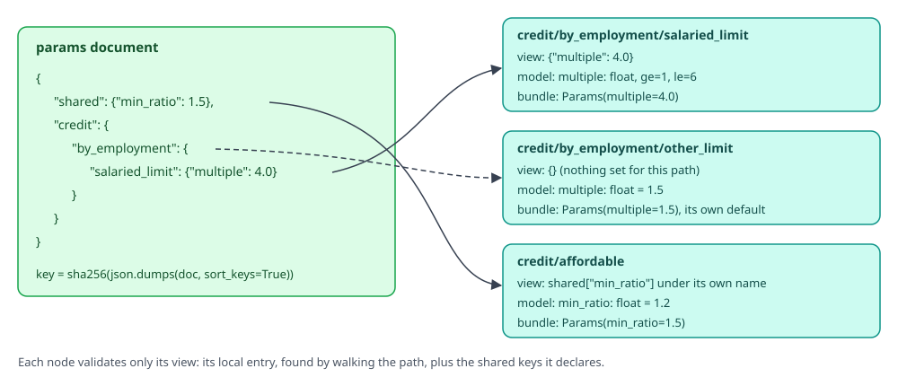
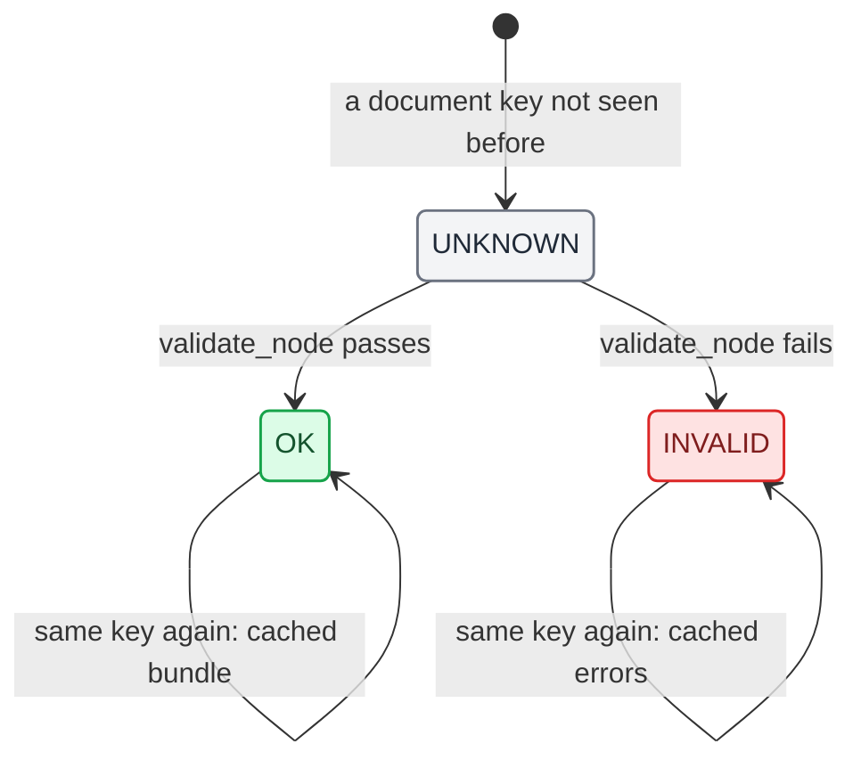
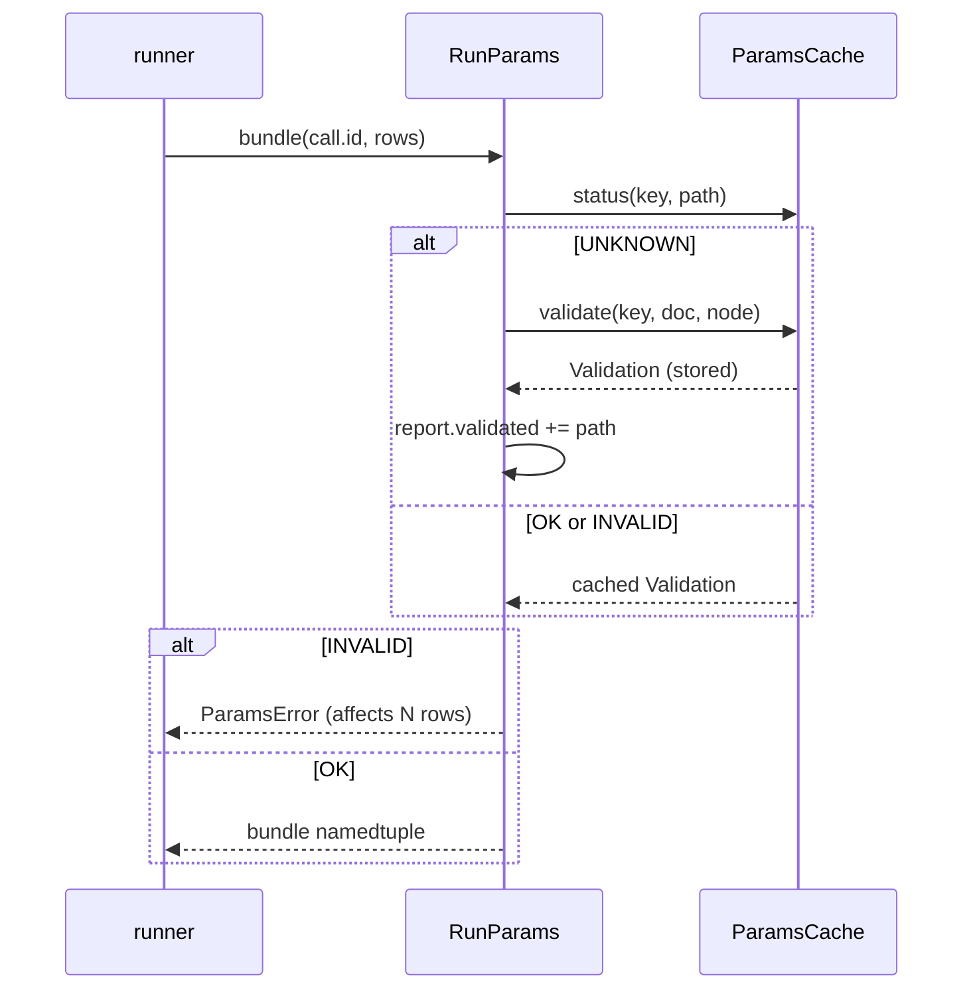

# Params

A param is policy that is the same for every record of a run: a limit multiple, a cut-off, a rate ladder. It is
declared in a step's signature, set in a params document keyed by step path, validated per node, and handed to the
step as an argument. Because it is an argument, changing a value never rebuilds the [IR](ir.md) and never
recompiles a kernel. This page follows a param from its declaration to the bundle a kernel receives. The
[steps and params guide](../../guides/steps-and-params.md) and the [parameter tables guide](../../guides/parameter-tables.md)
show the user side.

The code is split between two packages:

| File | Holds |
|---|---|
| `decikit/_engine/params/declare.py` | `param()`, `missing_as()`, the `ParamSpec` and `MissingAs` markers |
| `decikit/_engine/params/harvest.py` | `harvest(fn)`: a signature into `Input`s, `ParamDecl`s and `Output`s; `call_with_defaults` |
| `decikit/_engine/params/tables.py` | `param_table()`, `table_type(schema)` |
| `decikit/_engine/params/models.py` | `NodeParams`: one node's pydantic model, bundle class and defaults; `record_shared_type` |
| `decikit/_engine/params/bundles.py` | `bundle_class(fields)`: one namedtuple class per field tuple, picklable by reference |
| `decikit/_engine/params/validate.py` | `validate_node`, `Validation`, `Status`, `ParamsCache`, `document_key`, `check_namespaces`, `merge` |
| `decikit/_engine/params/schema.py` | `parameters(ir)` and `ParamsSchema`: what `Step.parameters()` returns |
| `decikit/_engine/run/params.py` | `RunParams` (one run's view of a document) and `RunReport` |

## From declaration to bundle



### Declaring: param, missing_as and the markers

`param(default, *, required=False, shared_key=None, on_invalid="error", **field_kwargs)` returns a marker. Extra
keywords (`ge`, `le`, `description`, ...) go to pydantic's `Field`, so the document is validated against them. A
param takes either a default or `required=True`, never both or neither.

The marker has to do two jobs. `harvest` must recognise it as a param, and the function must still work when
called directly, with the default in place of the argument. For a default whose type can be subclassed (`float`,
`int`, `str`, `list`, `dict`, `tuple`) the marker is an instance of a subclass of both the value's type and
`ParamSpec`, so the plain function `affordable(6000.0, 1500.0)` computes with `min_ratio` at `1.2` as it is. `bool` and `None` cannot be subclassed, so
for them the marker is a plain `ParamSpec` whose `__bool__` returns the default's truth: `if flag:` works on a
direct call, `flag is False` does not. `call_with_defaults(fn, ...)` replaces any marker left in a call with its
value, and `FunctionStep.__call__` uses it.

`missing_as(fill)` is the same trick for an input's null fill, with `MissingAs` as the marker. `missing_as(None)`
is refused: an input that should receive `None` is annotated `T | None`.

`param_table(columns, default=... | required=True, shared_key=None)` declares a table-valued param. Columns are
`int`, `float` or `bool` and must be identifiers, because they become namedtuple fields. The marker carries a
`schema` of `(column, type name)` pairs and, for a default, the default table itself, so a direct call gets its
columns.

### Harvesting into ParamDecl

`harvest(fn)` reads the signature once, when the step's IR is built. A parameter whose default is a `ParamSpec`
becomes a `ParamDecl`; the annotation goes to pydantic untouched, because a validator in `Annotated` metadata
checks something different depending on where it sits relative to `| None`. An unannotated param takes the
default's type. A table's annotation becomes `table_type(schema)`.

A bare default is refused, because it could mean either a param or a null fill:

```text
IRError: c: parameter 'cap' has a bare default (0.0). Use param(0.0) for a
  tunable param or missing_as(0.0) to fill nulls.
```

The fields of the resulting `ParamDecl` are listed on the [IR](ir.md) page. `default` and `field_info` stay out of
its hash, so declarations with list or dict defaults are hashable.

## Documents, paths and views

A params document nests each node's params under its path, one dict level per path segment. Shared params sit under
a top-level `"shared"` key. `Step.parameters()` (that is, `parameters(to_ir(step))`) reports what a pipeline
accepts; for the credit pipeline from the [engine overview](index.md):

```text
>>> credit.parameters()
{'shared': {'min_ratio': {'type': 'float', 'default': 1.2,
                          'used_by': ['credit/affordable']}},
 'credit/by_employment/salaried_limit': {
     'multiple': {'type': 'float', 'default': 3.0, 'ge': 1, 'le': 6}},
 'credit/by_employment/other_limit': {
     'multiple': {'type': 'float', 'default': 1.5}}}
>>> credit.parameters().defaults()
{'shared': {'min_ratio': 1.2},
 'credit': {'by_employment': {'salaried_limit': {'multiple': 3.0},
                              'other_limit': {'multiple': 1.5}}}}
```

`ParamsSchema` is a dict keyed by flat path. `defaults()` turns it into a nested document (a required table shows
as `[]` so the document says where its rows go; other required params are left out), `json_schema()` gives a JSON
Schema for forms, and `validate(doc)` checks a whole document without running anything:

```text
>>> doc = {"credit": {"by_employment": {"salaried_limit": {"multiple": 9.0}}}}
>>> credit.parameters().validate(doc)
Validation(status=<Status.INVALID: 'invalid'>, bundle=None,
  errors=("credit/by_employment/salaried_limit: param 'multiple': Input
  should be less than or equal to 6 (got 9.0)",), warnings=())
```

Each node sees only its own view of the document: the entry found by walking its path, plus the shared keys it
declares, each under the param's own name.

<div class="diagram" markdown>


*One document, three views. A node with nothing set falls back to its own defaults.*
</div>

Two nodes may declare one shared key with different defaults and different bounds; each validates its view
against its own model. Only the type must agree across the pipeline, and `to_ir` checks that with
`record_shared_type`:

```text
IRError: shared param 'base_rate' is declared float by p/a and int by p/b
```

## NodeParams: the model and the bundle class

`Executable.__init__` builds a `NodeParams(path, decls)` for every call with params (and every `each` node, which
carries its child's params hoisted to its own path). It holds:

- `model`: a pydantic model made with `create_model(path, extra="forbid", validate_default=True)`, one field per
  param, with the declared bounds and default. `extra="forbid"` makes a misspelled key an error.
- `bundle_type`: `bundle_class(names)`, the namedtuple class the function receives.
- `conversions`: per param, how a validated value becomes what the step receives. A Decimal param is validated as a
  `decimal.Decimal` (so `ge=` and `le=` work) and stored in the bundle as its int64 mantissa.
- `defaults`: a bundle of every default. A required param has no default, so it gets a placeholder of its type
  (`float()` for a float), because a compiled kernel needs one signature whatever the document says.

```text
call 2  credit/by_employment/salaried_limit
        fields ['multiple']   Bundle_8_multiple   Params(multiple=3.0)
call 3  credit/by_employment/other_limit
        fields ['multiple']   Bundle_8_multiple   Params(multiple=1.5)
call 4  credit/affordable
        fields ['min_ratio']  Bundle_9_min_ratio  Params(min_ratio=1.2)
```

Both limit nodes share one bundle class: `bundle_class` returns the same object for the same tuple of field names.
The class's qualified name encodes the fields (`Bundle_8_multiple` is one field, eight characters, `multiple`), and
it is registered on the `decikit._engine.params.bundles` module under that name. A module `__getattr__` decodes any
such name and rebuilds the class on demand. This exists for numba's disk cache, which pickles the argument types
of each compiled specialisation. It fixes this failure: a namedtuple made inside a function
pickles by value, comes back as a different class in the next process, and every cache lookup missed; for a
three-band table, 14 specialisations were saved again on every start.

## Validating a node

`validate_node(node, doc)` validates one node's view and returns a `Validation(status, bundle, errors, warnings)`:

1. Find the local entry by walking the path. A non-mapping there is invalid.
2. Report every key in the entry that is not one of the node's local params, with a suggestion. A key that is the
   argument name of a param whose document key differs gets a pointer to the right key.
3. Collect the local values and the shared values the node declares.
4. Run the model. A failing value is an error when the param is required or `on_invalid="error"`; under `"warn"`
   or `"default"` the value is dropped (so the default applies) and `"warn"` records a warning.
5. Build the bundle from the validated model, through the conversions.

The messages name the node path and the param:

```text
credit/by_employment/salaried_limit: param 'multiple': Input should be less
  than or equal to 6 (got 9.0)
credit/by_employment/salaried_limit: unknown param 'multipel'; did you mean
  'multiple'?
```

`check_namespaces(doc, nodes)` runs once per document per executable, before any node. It checks that every entry
names a path prefix of a node with params, at every depth, and that every shared key is used by some node. An empty
entry (`{}`) is accepted anywhere, because templates write one for steps without params:

```text
ParamsError: params document: no step with params at 'credit/by_employmnt'.
  Did you mean 'credit/by_employment'? The document nests params by step
  path; steps with params: credit/affordable (min_ratio);
  credit/by_employment/other_limit (multiple);
  credit/by_employment/salaried_limit (multiple).
  pipeline.parameters().defaults() builds a complete document.
ParamsError: params document: no step uses shared param 'min_ration'. Did
  you mean 'min_ratio'? Shared params: ['min_ratio'].
```

## The cache, per document and node



`ParamsCache` stores one `Validation` per `(document key, node path)`. A document seen before is never validated
again. The key is `document_key(doc)`, a sha256 of `json.dumps(doc, sort_keys=True)`, so equal documents share
results. Hashing costs time on every call, so `ParamsCache.key` keeps one slot holding the last document object and
its key: passing the same object again returns the key without hashing. That is why a params document is treated as
immutable once passed; editing one in place and passing it again keeps the old key. An empty document's key is a
module constant, because hashing it was measured at 3.7 µs of a single-record call.

The cache is unbounded (a `ponytail:` comment in `validate.py` marks the place to add eviction for a long-lived
server that sees many distinct documents), and `document_key` only handles JSON values.

`RunParams` is one call's view. `RunParams.bundle(call_id, rows)` returns `()` for a call without params; otherwise
it validates through the cache, appends to the run's `RunReport` the first time a node is validated, and on an
invalid node raises `ParamsError` saying how many rows it affects:



Running the credit pipeline twice with one document shows the cache at work:

```text
>>> exe.run(df, params=doc); exe.report
RunReport(validated=['credit/by_employment/salaried_limit',
                     'credit/by_employment/other_limit',
                     'credit/affordable'],
          invalid=[], warnings=[])
>>> exe.run(df, params=doc); exe.report
RunReport(validated=[], invalid=[], warnings=[])
```

`exe.report` is the report of the latest call on the calling thread; it lives in a `threading.local`.

## Eager and lazy validation

`FusedEngine(params_validation=...)` decides when nodes are validated:

| Mode | When a new document arrives | When a node runs |
|---|---|---|
| `eager` (default) | every node is validated; any invalid one raises before a row runs | the cached bundle |
| `lazy` | only the namespace check | validated on first use, then cached; invalid raises then |

The difference shows on a document with a bad value in an arm that some rows never take. Here `other_limit` gets
`"high"`, and the frame is filtered to salaried rows, which take the other arm:

```text
eager: ParamsError: invalid params (affects 2 rows):
  credit/by_employment/other_limit: param 'multiple': Input should be a
  valid number, unable to parse string as a number (got 'high')
lazy: ran, limit [18000.0, 21000.0]
  RunReport(validated=['credit/by_employment/salaried_limit',
                       'credit/affordable'], invalid=[], warnings=[])
```

Eager fails before anything runs and counts every row of the frame. Lazy runs, and its report lists only the nodes
that ran. On the full frame lazy raises too, when the arm runs, and counts only the rows in that arm:

```text
lazy, full frame: ParamsError: invalid params (affects 2 rows):
  credit/by_employment/other_limit: param 'multiple': Input should be a
  valid number, unable to parse string as a number (got 'high')
```

Eager keeps raising for a document it found invalid: the executable records a document as checked only when the
check passes.

### Lazy validation in compiled modes

A fused kernel could suspend at the first unvalidated node and resume after validation, but that is not built: a fused kernel is one innermost sequence of scalar
steps with no control flow inside, so every node in it runs on every row the kernel runs on. Suspending would
always stop at row 0 of each node, which is the same set of validations as validating all the kernel's nodes before
launching it. `SteppedRunner._run` does exactly that.

Packed branches and loops do contain control flow. With lazy validation a branch or loop packs only when no call
inside it, other than its own condition, has params; otherwise it runs through the Python driver, which validates
each call as it runs. Eager validation has checked everything before any kernel launches, so it packs regardless.
One difference is visible: when a kernel holds one node with invalid params and an earlier node of the
same kernel would raise a runtime error, fused mode reports the params error first and interpreted mode the runtime
error.

## Tables and hoisted params

A `param_table` value is a list of row dicts in the document. Its `ParamDecl` annotation is `table_type(schema)`, an
`Annotated[list[TypedDict], AfterValidator(columns)]` that is strict, forbids extra keys, and turns the rows into a
bundle of one read-only numpy array per column (int64, float64 or bool). `table_type` is cached per schema, so two
nodes sharing a table compare equal. The arrays are read-only because every call that shares the cached bundle sees
them.

```python
LADDER = [{"floor": 0, "rate": 0.2}, {"floor": 600, "rate": 0.12}]

def rate(score: int,
         rates: ParamTable = param_table({"floor": int, "rate": float},
                                         default=LADDER)) -> float:
    r = 0.0
    for i in range(len(rates.floor)):
        if score >= rates.floor[i]:
            r = rates.rate[i]
    return r

def fee(rate: float,
        cap: float = param(0.15, le=0.2, on_invalid="warn")) -> float:
    return min(rate, cap)

exe = FusedEngine().bind(flow(rate, fee, name="pricing"))
df = pl.DataFrame({"score": [550, 640, 720]})
rows = [{"floor": 0, "rate": 0.18}, {"floor": 700, "rate": 0.09}]
doc = {"pricing": {"rate": {"rates": rows},
                   "fee": {"cap": 0.5}}}
```

```text
>>> exe.run(df)["fee"].to_list()
[0.15, 0.12, 0.12]
>>> exe.run(df, params=doc)["fee"].to_list(); exe.report
[0.15, 0.15, 0.09]
RunReport(validated=['pricing/rate', 'pricing/fee'], invalid=[],
  warnings=["pricing/fee: param 'cap': Input should be less than or equal
  to 0.2 (got 0.5); using the default"])
>>> bad = {"pricing": {"rate": {"rates": [{"floor": "x", "rate": 0.1}]}}}
>>> exe.run(df, params=bad)
ParamsError: invalid params (affects 3 rows):
pricing/rate: param 'rates': row 0, column 'floor': Input should be a valid
  integer (got 'x'); expected a list of rows like
  [{"floor": int, "rate": float}, ...]
```

The two steps fused into one kernel, which still had one compiled signature after both documents. The `cap` of 0.5
broke its bound, and `on_invalid="warn"` replaced it with the default 0.15 and recorded the warning. The bundle the
step receives holds the arrays: `Params(rates=Params(floor=array([0, 600]), rate=array([0.2, 0.12])))`, with
`writeable` false on each array.

An `each` node hoists its child's params to its own path, so `parameters()` lists them there and the document sets
them there. At run time the interpreted runner's `_forward_params` copies each hoisted value from the node's entry
down into the child path it feeds, and validates against a `RunParams` over that copy. The child may not use shared
params or two params of one name.

## Converted bundles in compiled modes

A compiled call whose inputs are `bytes` spans (or a `Columnar[Item]` with a `str` field) compares strings as
`(address, length)` spans, so its `str` params must be spans too. `SteppedRunner._bundle` encodes each such param to
UTF-8 once per `(document key, call id)` and caches the converted bundle with the buffers its spans point into. Two
threads converting at once both end up with the first entry, so a buffer is never freed under a running kernel.
Converted bundles are cached because, at 50 nodes, converting a validated
model to a namedtuple cost 170.6 µs against 78.3 µs for validating it, and a memoised bundle costs about 0.23 µs.

## Why retuning never recompiles

numba compiles a kernel per argument type signature. A params bundle's type is its class (fixed by the field names)
and the types of its values (fixed by the declarations). The values themselves are runtime arguments. So a new
document produces a bundle of the same type with different values, and the existing specialisation runs it. The
defaults bundle exists for the same reason: before a node is validated, compiled code is built against a bundle of
the right type.

Retuning the fused credit pipeline three times leaves the number of compiled signatures unchanged:

```text
signatures after first score:
  {'credit/disposable_income': 1, 'credit/by_employment': 1,
   'credit/affordable': 1}
2.0 12000.0
4.0 24000.0
5.5 33000.0
signatures after three retunes:
  {'credit/disposable_income': 1, 'credit/by_employment': 1,
   'credit/affordable': 1}
```

(`credit/by_employment` is the packed branch kernel; the arm kernels never compiled because the packed path ran.)

What does change the type, and so recompiles: adding or renaming a param, changing its declared type, or changing a
`param_table`'s columns. Row edits and row counts do not, because a table is one 1-D array per column whatever its
length. The same holds for `consts` on a `CallNode`: a config literal is an argument, never a constant baked into
the kernel.

On the same development machine, scoring with the same document object took 80.1 µs per call, against 94.8 µs
when an equal document was built fresh for each call (so it was hashed each time but never revalidated).
