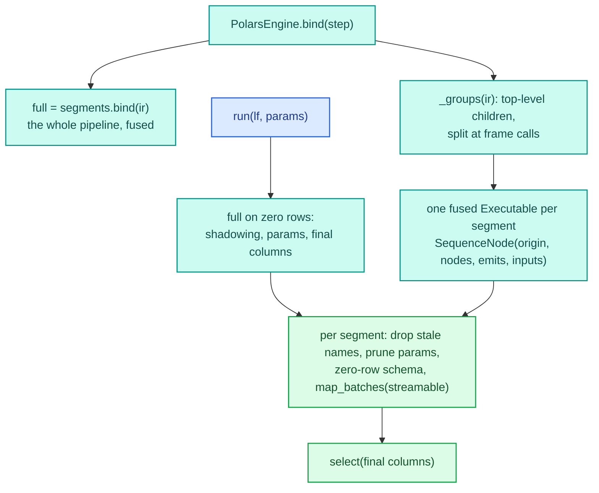

# Polars engine

`PolarsEngine` turns a pipeline into a polars `LazyFrame` plan. It translates nothing into polars
expressions: it cuts the pipeline into segments at its frame steps, binds each segment as an ordinary fused
`Executable`, and hands each one to polars as a `map_batches` node. Every step runs on the existing numba
engine; polars decides how rows are batched and on which threads. A final `select` makes the columns equal the
fused engine's output.

The code lives in `decikit/_engine/polars/`:

| File | Holds |
|---|---|
| `engine.py` | `PolarsEngine`: the registry document (`type: "polars"`, `segments: FusedEngine`), its `bind` and the `params_validation` check |
| `host.py` | `PolarsExecutable`: the segmenter, the per-call plan builder, schema derivation, the params prune and the batch function |

`PolarsEngine` registers lazily (`Engine.lazy({"polars": ...})` in `decikit/_engine/run/engines.py`, since its
module imports that one), so `pipeline.compile("polars")` and `Engine.resolve("polars")` find it, and
`import decikit` imports neither it nor numba. `Step.run(data, engine=None)` picks it for a `pl.LazyFrame`
whatever the default engine (a `PolarsEngine` default is used as it is, settings included); with an engine named, a numba engine collects the frame and runs it as one.



## Bind: built once

`PolarsExecutable(step_or_ir, bind, engine)` takes the binder (`PolarsEngine.segments.bind`) and knows nothing
else about how sub-plans are made. In `__init__` it:

1. Binds the whole pipeline: `full`. It runs dict records, and on zero rows it gives the shadowing check, the
   params validation and the final column list for each `run`.
2. Refuses a qualified output (`"name@path"` in `full.plan.outputs`): the final `select` works on plain names.
3. Groups the root sequence's top-level children (a root that is not a sequence is one child):
   - a child with a frame call anywhere under it (`CallNode.kind == "frame"`) is a segment of its own, not
     streamable; a branch or loop holding a frame step therefore sees the whole frame;
   - consecutive children without one form a streamable segment, except that a child writing a name an earlier
     child of the same segment read from outside it starts a new one. Wired on its own, the segment would see
     that name as an input column, and wiring refuses an input column a later node writes; a row-local segment
     can be split anywhere, so the split is free.
4. Binds each segment, last first, as `SequenceNode(root.origin, nodes, emits=..., inputs=every pipeline name)`:
   - `emits` is the segment's visible writes (`interface(node)[1]`: a branch's `modifies`, a loop's `carries`,
     an `each`'s output, never a name internal to them) that a later segment reads or the final output takes.
     Before a frame step of unknown inputs, which may read any column, a segment emits all its visible writes.
   - `inputs` declares every name of the whole pipeline, which switches off the typo heuristic: a value an
     earlier segment wrote is an input column here, and it may look like a name this segment writes.
   - `unneeded` lists the produced outputs no later segment and not the final output takes; the batch
     function drops them, so an untyped intermediate never reaches polars.
   - A `WiringError` from a segment (a read-then-rewrite inside one nested flow, which cannot be split) becomes
     an `EngineError` naming the segment.

Each segment keeps its step paths, whether it streams, its executable, the names it reads from outside and
writes, `unneeded`, and the param paths and shared keys its nodes accept. `segments` exposes
`((paths, streamable), ...)`.

## Run: a plan per call

```python
def run(self, data, params=None, trace=None):
    # trace -> EngineError; a Mapping -> full.run(record); a DataFrame -> run(lazy).collect(); else TypeError
    schema = data.collect_schema()
    final = _zero_rows(self.full, schema, params).columns
    lf = data
    for seg in self._segments:
        stale = (seg.writes - seg.reads) & set(schema.names())
        lf, schema = lf.drop(stale), schema minus stale
        doc = _params_for(params, seg)
        out, nulls = _output_schema(seg, schema, doc)
        lf = lf.map_batches(partial(_run_batch, seg.executable, doc, seg.unneeded, nulls),
                            schema=out, streamable=seg.streamable)
        schema = out
    return lf.select(final)
```

- **The whole-pipeline zero-row run** happens first: an input column the pipeline produces, an invalid params
  document or one naming a step that does not exist fails here with the fused engine's own message, before
  the plan exists. Its columns are the final `select`.
- **The stale drop.** A name a segment writes without reading it may already be a column, written by an earlier
  segment; the segment's shadowing check would refuse that frame, so the column is dropped first. A name it
  reads and rewrites stays: a self-read is an input, which the check allows.
- **The params prune.** A sub-plan refuses an entry for a step it does not hold, so `_params_for` keeps only the
  entries under the segment's param paths (walking the nesting as `check_namespaces` does) and its shared keys,
  or `None` when nothing remains. The pruned document is built once per `run` and reused by every batch, so
  each segment hashes it once per call.
- **Schema derivation.** `map_batches` needs each node's output schema, and validates every batch against it
  (`validate_output_schema=True`, order included). The schema comes from running the segment on a zero-row
  frame of its input schema, minus `unneeded`.
- **The batch function** runs the segment's executable on the batch, drops `unneeded`, and casts any column
  the zero-row run left `Null` that came back with another dtype to its declared one. polars casts a struct by field name
  (dropping a field the target lacks, null-filling one the batch lacks) and a float to an int by truncation,
  so the cast is kept only when every struct has the declared fields in the declared order and casting back
  gives the batch's values; otherwise the batch raises an `EngineError` naming the column and both dtypes. An
  `each`'s gathered list is checked the same way on every batch.
- **Emission.** Streamable segments are `streamable=True`; frame-step segments `streamable=False`, which
  polars runs once on all rows. Every node turns off predicate, projection and slice pushdown, which older polars
  enabled by default: a filter or `head` on the plan must not reach below a frame step. Under `collect()` every segment runs once on the whole frame.

### Columns empty on zero rows

A column built from Python values (a `str` or `date` output, a plain `dict`) has no dtype until it holds a
value, so the zero-row run returns it as `Null`. For each such column the host looks up the version's
annotation in the segment's plan: a polars dtype (a frame step's declared `writes={name: dtype}`) is used as
is, and otherwise `declared_dtype` maps it (`str` to `String`, `date` to `Date`, a TypedDict to a `Struct`).
The column goes into `nulls`, so a batch where it is all null is cast to that dtype. An annotation with no
dtype (`dict`, bare `list`, `Any`) is refused with an `EngineError` naming the column, its writer and what to
annotate.

An `each`'s gathered list (`gathered_dtype` in `decikit/_engine/run/gathered.py`, shared with the numba engines) is
typed as the gather builds it: `List(Struct)` of every field of the item, in its order, then each value the body
writes (`ScatterGather.new_fields`), a field the body rewrites keeping its place. The item's dtype comes from the
segment's input schema when the list is an input, from the declared type of the step that writes it otherwise
(`list[TypedDict]`, `Struct`), and from the enclosing item for a nested `each`, which recurses. Each body value takes
its annotation's dtype. The numba engines cast their own gathered column to the same dtype (`fitted`: only when that
adds null fields, reorders fields or widens values, never across time zones), so a batch of empty lists, a field no item fills and items
holding their keys in another order all come back declared. A batch whose items do not fit (a field the declaration
lacks) keeps their own fields there and raises here. A body value or an item with no declared type is refused with
an `EngineError` naming the `each` and the step to annotate.

## Errors

| Raised | When | Type |
|---|---|---|
| `trace=` given | `run` | `EngineError`, pointing to the numba engine |
| `session()` | always | `EngineError`, pointing to `pipeline.session(df)` |
| a qualified output | `bind` | `EngineError`, suggesting a relabel |
| a segment that does not wire on its own | `bind` | `EngineError` wrapping the `WiringError` |
| a frame step raising on zero rows | `run` | `EngineError` with the original chained; found by the driver's `in frame step <path>` note |
| a column with no knowable dtype | `run` | `EngineError` naming the column and its writer |
| a batch its declared dtype cannot hold unchanged (a fraction for an int, a record's fields in another name or order, an `each` item with a field its type lacks) | `collect()` or the sink | `EngineError` naming the column and both dtypes |
| input that is none of dict, `DataFrame`, `LazyFrame` | `run` | `TypeError` naming the accepted types |
| a step raising inside a batch | `collect()` or the sink | the step's own exception, its notes intact: polars re-raises the Python exception object unwrapped, in memory, streaming and sinks |
| `params_validation` differing from `segments.params_validation` | `PolarsEngine(...)` | pydantic `ValidationError` |

## Threading and state

`PolarsExecutable.run` writes nothing to `self`: the segments and `full` are built in `__init__`, and each
call's pruned documents and schemas are locals captured by the batch functions. The segment executables are
ordinary `Executable`s with their usual contract, so polars may run several batches of one segment on its
threads at once, and two threads may call `run` on one `PolarsExecutable` at once. The polars engine files
are in the walk of `tests/test_conventions.py::test_runners_and_executable_keep_no_per_call_state`.

## Where it differs from the fused engine

- A frame step that declares its reads sees the batch: the input columns and the values earlier segments
  emitted. On the fused engine it also sees every intermediate in scope. Only a frame step that reads a
  column it did not declare can tell.
- A Python fallback step's error note counts the row from the start of its batch when the plan streams.
