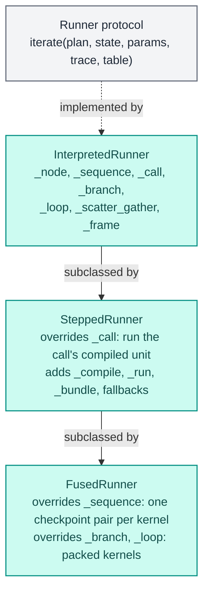
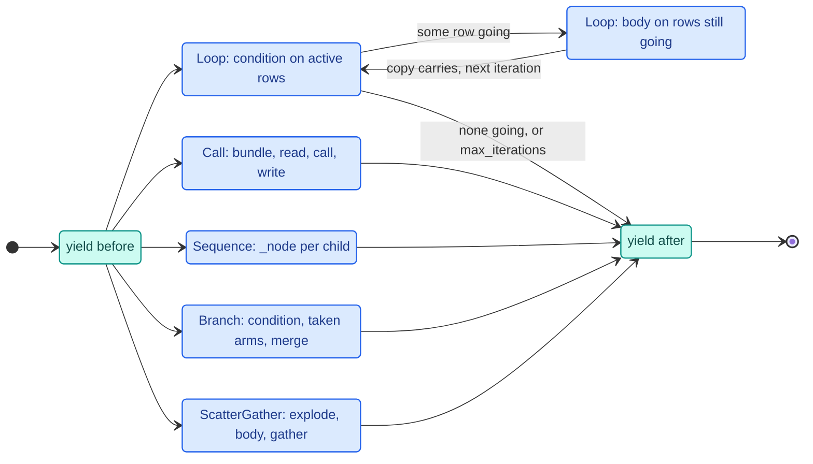
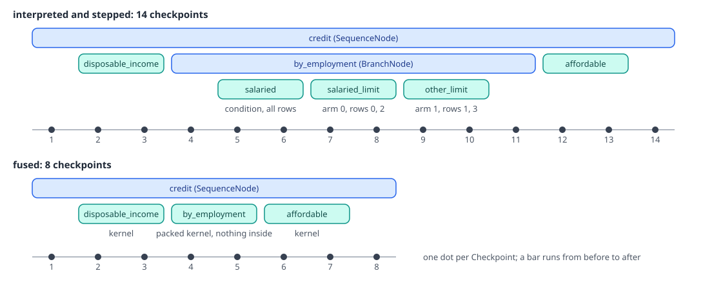

# Runners

A runner executes a [Plan](wiring.md) over a `State`. There are three, one per mode, and they share one driver:
`InterpretedRunner` walks the plan in Python and calls every step row by row, `SteppedRunner` replaces how a call
runs (a numba kernel per call), and `FusedRunner` also replaces how a sequence, a branch and a loop run (one kernel
for several calls). Every runner is a generator of checkpoints, so `run`, `score` and a debug session all go
through the same code.

The code lives in `decider/_engine/run/`:

| File | Holds |
|---|---|
| `runners/base.py` | the `Runner` and `CompiledRunner` protocols, `Checkpoint` |
| `runners/interpreted.py` | `InterpretedRunner`, the driver: scopes, calls, branches, loops, scatter-gather, frame steps |
| `runners/stepped.py` | `SteppedRunner`: compiled units under the same driver; the `Compiled` snapshot |
| `runners/fused.py` | `FusedRunner`: fused sequences, packed branches and loops |
| `state.py` | `State`, the values of one run, and the record and series helpers |
| `representations.py` | how `Text` strings become spans and back, shared by every runner |
| `engine.py`, `params.py` | `Engine`, `Executable`, `RunParams` (see the [engine overview](index.md) and [params](params.md)) |



## The State

`State` holds every value of one run, keyed by `NodeVersion.id`:

- `values`: one numpy array of `n` values per version (or a `Coded` array for a `Literal` output, decoded when
  read). Typed values are `float64`, `int64` or `bool` arrays; Decimals are `int64` mantissas; everything else is
  an object array.
- `valid`: a boolean mask per version that has nulls. A version with no entry is valid on every row.
- `frame`: the frame unread columns pass through from. It is the input frame, or what an unknown-lineage frame
  step returned.
- `chains`: every version of each name, copied from the plan so a debug override can append to it.
- `_sources`: for a version read straight from a frame column, the polars `Series` it came from, so a compiled
  call can read its Arrow buffers in place while the values are still that column's.
- `_representations`: compiled representations built from a version's values (spans, row records), dropped
  whenever the version is written again.

`write(version, values, rows=None, valid=None)` with `rows=None` stores the array as is, without copying. With
`rows`, it scatters the values into a full-length array, creating one of zeros (or `None`s) with an all-false mask
first, so the rows a write never touches stay null. `read(version, rows=None)` returns the values and mask on those
rows; a version never written reads as all null.

The input columns are loaded once, as nullable, by `State.from_frame` (through the [boundary](boundary.md)) or by
`load_record` on the `score` path. Raw values plus masks are loaded because
two steps may read one column with different null policies (`x: float` and `x: float | None`), so the policy is
applied per reader.

`versions(spec)`, `column(spec)`, `record(name, producer, values)` and `restore(old, keep)` serve the debugger:
the first two read `name`, `name@path` or `name@*`, `record` stores an override as a new version at the end of its
chain, and `restore` copies back the values of a previous run when a session re-runs from an edit.

```text
>>> for v in state.versions("limit@*"):
...     print(v.producer, *state.read(v), sep="\n  ")
credit/by_employment/salaried_limit
  [18000.     0. 21000.     0.]
  [ True False  True False]
credit/by_employment/other_limit
  [   0. 6000.    0.  750.]
  [False  True False  True]
credit/by_employment
  [18000.  6000. 21000.   750.]
  [ True  True  True  True]
>>> state.column("limit@credit/by_employment/salaried_limit").to_list()
[18000.0, None, 21000.0, None]
```

## Checkpoints and the driver

`Checkpoint(origin, when, arm=None, iteration=None, rows=None)` is a point the runner stops at: just `before` a
node runs, or just `after`. `arm` is the innermost branch arm's index, `iteration` the innermost loop's iteration
counted from 1, `rows` the absolute indices of the records the node runs on (`None` for every record).

`iterate(plan, state, params, trace=None, table=None)` returns a generator. `_node` is the heart of it: it yields
`before`, dispatches on the resolved node's class, and yields `after`. A node listed in `runner.skip` is passed
over without either.



Every node a run reaches yields one `before` and one `after`, whatever the row count. A node inside an arm no row
takes yields nothing. A loop body yields once per iteration. On the credit pipeline from the
[engine overview](index.md), the interpreted runner yields fourteen checkpoints:

```text
before credit                                 arm=None rows=None
before credit/disposable_income               arm=None rows=None
after  credit/disposable_income               arm=None rows=None
before credit/by_employment                   arm=None rows=None
before credit/by_employment/salaried          arm=None rows=None
after  credit/by_employment/salaried          arm=None rows=None
before credit/by_employment/salaried_limit    arm=0 rows=[0, 2]
after  credit/by_employment/salaried_limit    arm=0 rows=[0, 2]
before credit/by_employment/other_limit       arm=1 rows=[1, 3]
after  credit/by_employment/other_limit       arm=1 rows=[1, 3]
after  credit/by_employment                   arm=None rows=None
before credit/affordable                      arm=None rows=None
after  credit/affordable                      arm=None rows=None
after  credit                                 arm=None rows=None
```

`Executable.run` and `score` drain the generator with a `for _ in ...: pass`. A [debug session](debug.md) advances
it to a breakpoint, inspects or overrides values in `state`, and advances it again. Nothing in the runner knows
which of the two is driving it, so a breakpoint sees exactly the state a run would have at that point. Two hooks
serve the session: `visit` (called with each locator a tree's `reference` reports, so a session can step inside a
tree) and `skip` (nodes to pass over as already run, each with the versions it passes on, used while a session
replays a run up to an edit).

`iterate` itself is not a generator function: it builds a small `_Context` (trace sink, step table, compiled
snapshot) and returns the `_drive` generator. That saves one generator frame per checkpoint on the single-record
path.

### Scopes and row subsets

The driver passes a `_Scope` down the tree: `rows` (absolute indices, or `None` for all), `base` (the frame a
frame step sees on those rows), `names` (the versions in sight), the context, and the current `arm` and
`iteration`. `scope.child(keep)` narrows `rows` by a boolean mask over the current rows and filters `base` the same
way.

## A call

`_call` runs one `CallNode`:

1. A frame call goes to `_frame` (below).
2. `params.bundle(call.id, m)` gets the validated bundle, `m` being the number of rows in scope.
3. `_argument` reads each input version on the scope's rows and applies that input's null policy: a null in a
   `REQUIRED` input raises `MissingInputError`, `MISSING_AS` fills it (a fresh deep copy per row for a list, dict or
   tuple fill), `OPTIONAL` passes `None`. `.tolist()` turns each column into Python scalars, so `x / 0.0` raises
   `ZeroDivisionError` as it does in a kernel instead of giving `inf` with a numpy warning.
4. A Decimal input or param is boxed from its int64 into a `Decimal` for a scalar step.
5. The function runs once per row. A `scalar` call gets keyword arguments by `Input.arg`, consts and params; a `row`
   call gets `(row, bundle, consts)`, through `reference` with `visit` when the node has one.
6. Each output column is converted for storage: a struct step's tuple becomes a dict, a Decimal becomes its
   int64, a `Text` returned for a `str` output becomes its text. `_array` builds the array and its mask (a `None`
   result is a null), and `state.write` scatters it into the scope's rows.

A `MissingInputError` names the input, the step and how many rows are null, or says the column is absent:

```text
MissingInputError: input 'net_income' of step 'credit/disposable_income'
  is required but column 'net_income' has 2 null row(s) of 4. Fix the
  data, or declare `net_income: T = missing_as(fill)` or
  `net_income: T | None`.
MissingInputError: input 'instalment' of step 'credit/affordable' is
  required but column 'instalment' is not in the input frame or record.
  Fix the data, or declare `instalment: T = missing_as(fill)` or
  `instalment: T | None`.
```

An exception from the step keeps its type and gets a note (`add_note`, Python 3.11 and later) naming the step and
the frame row: `in step credit/affordable, row 0`.

### Frame steps

`_frame` builds the frame the step sees with `state.frame_of(scope.base, scope.names, scope.rows)`: the scope's
frame with every value computed so far overlaid. It calls `fn(df, **params)` and checks the result: it must be a
polars DataFrame, with the same number of rows, holding every column the step declares or later steps read.
Filtering belongs outside the pipeline. Each written column is read back into the state, keeping its `Series` as
the source. After an unknown-lineage frame step, the scope's frame becomes what it returned and the names in sight
are cleared, matching the barrier the [wiring](wiring.md) put there.

## Branches: rows split and merge

`_branch` runs the condition in a child scope, reads its output on the scope's rows, and turns it into an arm
index: `np.where(picked, 0, 1)` for a bool, the value itself for an int. An index outside the arms raises
`ValueError` naming the branch, the arm and the row count. Each arm with at least one row runs in a child scope
narrowed to its rows, with `arm` set. Then each `Merge` copies, arm by arm, the arm's version (or the prior one when
the arm left the name alone) on that arm's rows into the merged version.

<div class="diagram" markdown>


*Every write lands in a full-length array. Rows another arm took stay null, which is what `limit@…/salaried_limit` shows.*
</div>

An arm no row takes is skipped entirely: no checkpoints, no params validation. That is what lets lazy validation
ignore an invalid param in it ([params](params.md)).

## Loops: rows that are still going

`_loop` copies each carry's initial values into the carried version (a copy, because later iterations write into
it in place). Then for each iteration from 1 to `max_iterations` it runs the condition on the rows still active,
narrows the scope to the rows where it holds, runs the body on them, and copies each carry's `last` version into the
carried version on those rows. It stops when no row is going. Rows still going at `max_iterations` stop without an
error (a `ponytail:` comment marks this as a place to raise or flag later).

```python
def unpaid(balance: float) -> bool:
    return balance > 0.0

@step(output="balance")
def pay(balance: float, instalment: float, rate: float = param(0.01)) -> float:
    return balance * (1 + rate) - instalment

@step(output="months")
def tick(months: int) -> int:
    return months + 1

repay = loop(unpaid, flow(pay, tick, name="month"),
             carries=["balance", "months"], max_iterations=360, name="repay")
df = pl.DataFrame({"balance": [250.0, 0.0, 120.0],
                   "instalment": [100.0, 100.0, 100.0],
                   "months": [0, 0, 0]})
```

```text
before repay              iteration=None rows=None
before repay/unpaid       iteration=1 rows=None
after  repay/unpaid       iteration=1 rows=None
before repay/month        iteration=1 rows=[0, 2]
 ...                      (pay and tick, rows [0, 2])
after  repay/month        iteration=1 rows=[0, 2]
before repay/unpaid       iteration=2 rows=[0, 2]
after  repay/unpaid       iteration=2 rows=[0, 2]
before repay/month        iteration=2 rows=[0, 2]
 ...
before repay/unpaid       iteration=3 rows=[0, 2]
after  repay/unpaid       iteration=3 rows=[0, 2]
before repay/month        iteration=3 rows=[0]
 ...
before repay/unpaid       iteration=4 rows=[0]
after  repay/unpaid       iteration=4 rows=[0]
after  repay              iteration=None rows=None
```

Row 1 starts at a zero balance and never enters the body; row 2 leaves after two months, row 0 after three:

```text
┌────────────┬───────────┬────────┐
│ instalment ┆ balance   ┆ months │
╞════════════╪═══════════╪════════╡
│ 100.0      ┆ -45.43475 ┆ 3      │
│ 100.0      ┆ 0.0       ┆ 0      │
│ 100.0      ┆ -78.588   ┆ 2      │
└────────────┴───────────┴────────┘
```

## Scatter-gather (each)

`_scatter_gather` runs an `each` node's body over the elements of a list column. It explodes the lists into flat
per-field arrays (one row per element), builds a separate `State` for the elements, runs the body over it, and
gathers the body's outputs back into one enriched list per row. When the node has hoisted params, `_forward_params`
builds a `RunParams` over a copy of the document with each value moved into the child path it feeds.

There are two implementations. The per-element Python loop handles small inputs and row subsets. When the scope is
the whole frame, the column comes straight from a polars `List(Struct)` column of more than one row, and the lists
hold at least 1024 elements in total (`_SCATTER_ELEMENTS`), `_scatter_gather_vectorized` explodes, unnests and
regroups in polars instead. The threshold comes from the cost of the polars route: about ten lazy collects, each with
a Python to Rust round trip, which cost more than the Python loop below that size.

## Stepped: compiled calls under the same driver

`SteppedRunner` subclasses `InterpretedRunner` and overrides `_call`. On its first `iterate` for a plan it compiles
the plan under a lock into a `Compiled` snapshot, a named tuple published whole so a concurrent call never sees half
of it:

| Field | Holds |
|---|---|
| `plan` | the plan the snapshot was built for |
| `units` | call id to its `Kernel` or `Fallback` unit, from `compile_plan` |
| `reads` | per unit, the versions it reads from outside, with the null policy, dtype and representation of each, all decided once |
| `strs` | per call, the `str` params that must reach the kernel as UTF-8 spans |
| `fallbacks` | path to reason, for every step outside a shared kernel |
| `python` | calls that must run in Python |
| `converted` | cached bundles with their span buffers, per `(document key, call id)` |
| `packed` | fused mode only: branch or loop path to its packed kernel |

`_call` looks up the call's unit and runs it with `_run`; a call with no unit (a frame step) falls through to the
interpreted `_call`. `_run` validates the params of every call in the unit (they all run on every row the unit runs
on), reads each external input on the scope's rows, builds or fetches its compiled representation, applies the null
policy, runs the unit, and writes its outputs. While it builds the snapshot, `_build` warns once per step that falls
back to Python with a `FallbackWarning`, or raises under `strict=True` unless the step is `@allow_fallback`.

Branches, loops, row subsets, merges, frame steps and scatter-gather are the interpreted code, so stepped mode
yields exactly the checkpoints interpreted mode does.

## Fused: one kernel for several calls

`FusedRunner` sets `fuse = True`, so `compile_plan` groups each innermost sequence of scalar calls into one kernel,
and adds packed kernels for branches and loops of plain scalar steps. It overrides three methods:

- `_sequence` yields one `before`/`after` pair per kernel, with the origin of the kernel's first call; the later
  calls of that kernel yield nothing. A session that breaks on a later call maps it to its kernel through
  `runner.units[call.id]`.
- `_branch` and `_loop` run the packed kernel when there is one and every version it guards is present and non-null
  on the scope's rows; then the branch or loop yields only its own two checkpoints. Otherwise they fall back to the
  interpreted branch or loop. A packed kernel that fails to compile is dropped for the rest of the runner's life,
  under the lock. An arm index out of range sends the call down the unpacked path, which raises with the branch name.

<div class="diagram" markdown>


*The same run in two modes. Stepped yields exactly what interpreted yields; fused pauses only at kernel boundaries.*
</div>

The compiled units of the credit pipeline in fused mode, and its packed branch:

```text
Kernel ['credit/disposable_income']
Kernel ['credit/by_employment/salaried']
Kernel ['credit/by_employment/salaried_limit']
Kernel ['credit/by_employment/other_limit']
Kernel ['credit/affordable']
packed: ['credit/by_employment']
```

`disposable_income` and `affordable` are separate kernels because the branch sits between them in the sequence.
How kernels are built and packed is on the [compile](compile.md) and [kernels](kernels.md) pages.

## Representations

A string input reaches a step in one of three representations (`Representation` in `decider/_engine/types.py`):

| Annotation | Representation | What the step gets |
|---|---|---|
| `str` | `SEMANTIC_STRING` | Python `str` values; compiled modes fall back to Python for the step |
| `bytes` | `SEMANTIC_BYTES` | the UTF-8 `bytes` of each value, for a scalar step |
| `Text` | `RAW_BYTES` | a `Text` object in Python, an `(address, byte length)` span in a kernel |

`representations.py` keeps the runners in agreement. `span_objects` wraps values as `Text` objects (filling a
`missing_as` fill on null rows), `spans` builds the `(address, length)` pairs a kernel reads, zero-copy from the input
frame's Arrow buffers when the version still holds that column, and `despan` turns `Text` back into `str` for
output. For up to 32 values (the `score` path) `spans` borrows each value's own `bytes` buffer instead of exporting a
frame, and keeps those buffers alive alongside the result so a kernel never reads freed memory.

`State.representation(version, kind, build)` caches each built representation per version and kind, and drops the
cache when the version is written again (`test_a_compiled_representation_is_rebuilt_after_its_values_change`). An
interpreted step reading `Text` and a compiled one share the key `(RAW_BYTES, "objects")` for the object form.
`Columnar[Item]` inputs get a `("rows", schema)` or `("ragged", schema)` representation the same way.

## score without polars

On the record path (no frame steps), `score` builds a `State` over an empty frame with `n=1` and fills it with
`load_record`, one read-only array per dtype viewed per input, then runs the same `iterate`. Nothing in the runner
changes: it reads and writes arrays of length one. The output dict is built from `state.read` of each output version.
The [engine overview](index.md) has the flow and the numbers.

## Invariants

- Every node reached yields exactly one `before` and one `after`; checkpoints never depend on the row count
  (`test_every_node_yields_before_and_after_once_whatever_the_row_count`).
- Every write lands in a full-length array; rows outside the scope stay as they were, and rows never written are
  null.
- Null policy is applied by the reader, never stored on the column.
- A runner keeps no per-call state on `self`: everything per call lives in the `State`, the `RunParams` and the
  scope. Only `__init__` and the locked `_compile`/`_build` assign to `self`, and `tests/test_conventions.py` fails
  otherwise. The [concurrency](concurrency.md) page covers the threading model.
- All three modes give the same outputs, nulls included. A step returning `None` writes a null in every mode, and a
  kernel is split after a nullable output that a later step of the same run reads, so that reader's null policy runs
  in the driver.

## Measured

On example projects 07 and 08 (3000 synthetic rows), fused mode ran at about 3.3
and 4 times interpreted throughput. Most of the remaining time was the object boundary, frame steps and about 40
Python fallbacks per pipeline, not kernels (under 0.1 s of about 3 s). On the flagship benchmark
(`benchmarks/modes.py`, 1M rows), fused ran at 12.5M rows/s, stepped 12.9M and interpreted 0.25M.

## Why one driver

Both compiled runners are the interpreted driver with compiled calls.
`SteppedRunner` replaces only how a call runs, and `FusedRunner` also how a sequence, a branch and a loop run;
frame steps, branches, loops, row subsets and merges have one implementation, which the debugger and every mode
share. For checkpoints, a fused kernel takes its first step's origin. The enclosing sequence was the alternative,
but it already yields its own pair, and a sequence may hold several kernels.
