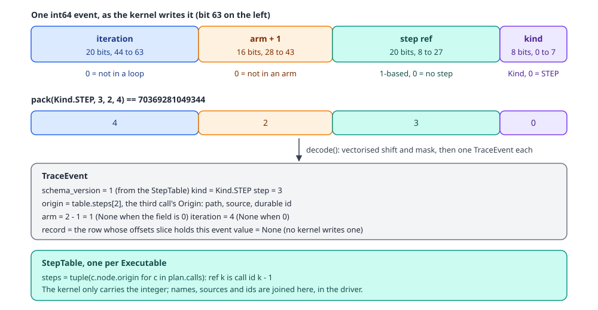
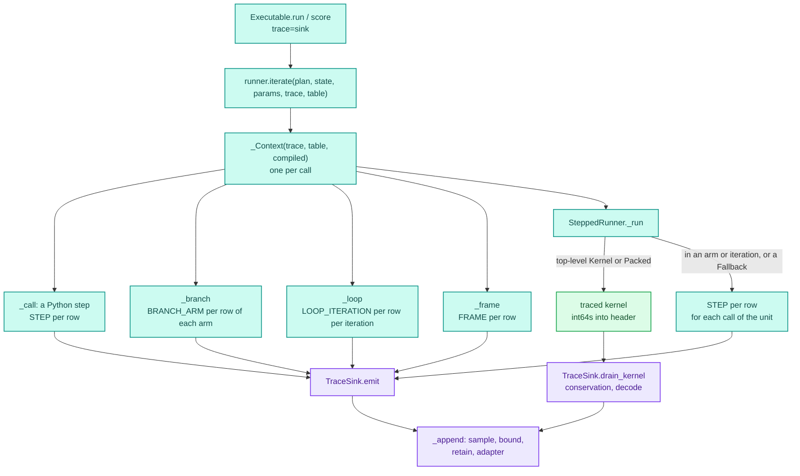
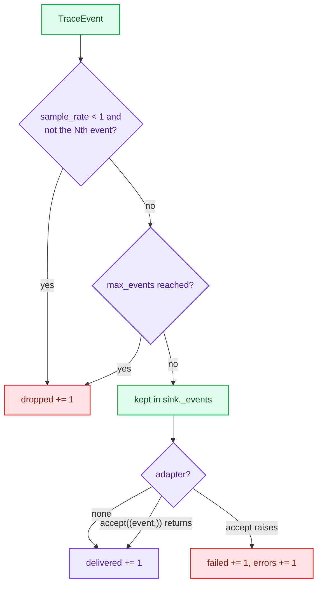

# Decision traces

A decision trace records, for each record, which steps ran, in which branch arm and loop iteration, with a durable reference to each step. It works in every mode, including fused, where the steps run inside one numba kernel and no Python sees an individual record. Tracing is off unless the caller passes a `TraceSink` to `run` or `score`, and an untraced call runs a kernel with no trace code in it at all.

How to turn tracing on and read the result is in [Tracing](../../guides/tracing.md).

## Where it lives

| File | What it holds |
|---|---|
| `decider/_engine/trace/envelope.py` | `Kind`, `pack`/`unpack`, the bit layout, `TraceEvent`, `StepTable`, `decode`, `bitcast`, `SCHEMA_VERSION` |
| `decider/_engine/trace/sink.py` | `TraceSink`, `Adapter`, `PassThroughAdapter`, `TraceLossError` |
| `decider/trace.py` | the public facade: `TraceSink`, `Kind`, `TraceEvent`, `Adapter`, `PassThroughAdapter`, `TraceLossError` |
| `decider/_engine/compile/kernel.py` | the traced variant of a fused kernel: writes one envelope per call into a header buffer |
| `decider/_engine/compile/units.py` | `Kernel.run` with a sink: allocates the buffers, runs the traced kernel, calls `drain_kernel` |
| `decider/_engine/compile/packed.py` | `_trace_factor`: the buffer capacity of a packed branch or loop |
| `decider/_engine/run/runners/interpreted.py` | `_emit_rows` and the driver-side events: `STEP`, `BRANCH_ARM`, `LOOP_ITERATION`, `FRAME` |
| `decider/_engine/run/runners/stepped.py` | picks between the in-kernel capture and driver-side events per unit |
| `decider/_engine/run/engine.py` | `Executable._trace_table` and `_iterate`, which pass the sink and table to the runner |

## Three records of a run

Decider has three ways to see what a run did. Each answers a different question, and they coexist.

| | `Session.events` | `TraceSink` | `trace_output` / `path_output` columns |
|---|---|---|---|
| Granularity | one event per node per batch | one event per step per record | one string per record per tree |
| Carries values | summaries (dtype, counts, five values) | no values, only identity and flow context | the path through one tree |
| Modes | all; fused only at kernel boundaries | all, same `STEP` evidence in each | all |
| Cost when off | no session, no cost | no sink, no cost | the column is only built when configured |
| Who reads it | the debugger, the editor bridge | audit, decision evidence, adapters | population analysis, experiments |

The session is covered in [Debug sessions](debug.md). The tree columns belong to the step and are covered in [Trees](../configurable-steps/trees.md).

## The envelope

A compiled kernel can only write fixed-width numbers. So a trace event inside a kernel is one int64, and everything with a name (path, source, durable id) is joined later in Python.

<div class="diagram" markdown>

</div>

`pack(kind, step, arm, iteration)` puts the fields together and `unpack` takes them apart:

```python
from decider._engine.trace import Kind, pack, unpack

print(pack(Kind.STEP, 3, 2, 4), unpack(pack(Kind.STEP, 3, 2, 4)))
```

```text
70369281049344 (0, 3, 2, 4)
```

The field widths bound what can be traced: 2^20 step refs per plan, 2^16 − 1 arms, 2^20 iterations. Zero means "none" in every field: step 0 is no step, an arm field of 0 is "not in an arm" (so arm k is stored as k + 1 and `decode` subtracts one), iteration 0 is "not in a loop".

The step ref is an index into the run's `StepTable`. `Executable.__init__` builds it once per bound pipeline as `StepTable(tuple(c.node.origin for c in plan.calls))`, so ref k is call id k − 1. Decoding joins each ref to the step's `Origin`, which has the path, the source and the optional durable id (see [the IR](ir.md) for ids). Both the envelope and the table carry `SCHEMA_VERSION` (1); bumping it is how a reader is told that an older layout cannot be decoded.

`TraceEvent` is the decoded form, a frozen dataclass:

| Field | Meaning |
|---|---|
| `schema_version` | the envelope version the event was written against |
| `kind` | a `Kind` |
| `step` | the 1-based ref into the step table, 0 for none |
| `origin` | the step's `Origin`, or `None` for an event with no step |
| `arm` | the branch arm from 0, or `None` |
| `iteration` | the loop iteration from 1, or `None` |
| `record` | the row index within the run the event belongs to |
| `value` | a numeric payload for the kinds that carry one, else `None` |

`bitcast(x)` turns a float64 into its int64 bits losslessly, so a float payload can ride in an int64 slot.

## Kinds

`Kind` is an `IntEnum` with eleven members. Four are emitted today:

| Kind | Value | Emitted by | Means |
|---|---|---|---|
| `STEP` | 0 | every runner, and the traced kernel | a step ran for this record |
| `BRANCH_ARM` | 1 | the Python branch driver | this record entered arm `arm` of a branch |
| `LOOP_ITERATION` | 2 | the Python loop driver | this record started iteration `iteration` |
| `FRAME` | 3 | the frame-step driver | a frame step ran over this record |
| `TABLE_ROW`, `TREE_PATH`, `BAND`, `ROUNDING`, `REASON`, `VALUE` | 4 to 9 | nothing yet | reserved for payload events (a matched row, a path number, a band, a rounded value) |
| `OVERRIDE` | 10 | nothing yet | reserved for a value replaced by a debug session |

The reserved kinds are part of the envelope so that adding an emitter later does not change the bit layout. Nothing in `decider/` writes them, and no event today has a `value`. A debug session has no sink either: the editor bridge reports `{"available": False, "reason": "trace capture is off; showing live state"}` in its status.

## Where events are emitted



The sink and its table travel in `_Context`, built per call and handed down through every `_Scope`. They used to be stored on the runner, set at the start of `iterate` and cleared at the end; two overlapping calls on one executable then sent events to the wrong sink. That was one of the races found in the thread-safety audit (see [Concurrency](concurrency.md)), and `tests/serving/test_concurrency.py` now checks that each traced call gets exactly its own events.

Driver-side events come from `_emit_rows(kind, origin, scope, m, step=...)`, which calls `trace.emit` once per row in scope and maps the scope's local row index to the record index through `scope.rows`. In-kernel events are written only at a plain top-level scope: no row subset, no arm, no iteration. A packed branch or loop carries its own arm and iteration inside the kernel. A single-call kernel inside an arm has neither, and its buffer's row-major offsets would label the wrong records, so the stepped runner emits its `STEP` events from Python instead.

## The same run in each mode

The loan pipeline from [Debug sessions](debug.md) (saved as `loan.py`) has a scalar sequence, a branch and a loop. Traced in each mode, record 1's events:

```python
from collections import Counter

from decider import Engine
from decider.trace import Kind, TraceSink
from loan import pipeline, df

for mode in ("interpreted", "stepped", "fused"):
    exe = Engine().bind(pipeline, mode=mode)
    sink = TraceSink()
    exe.run(df, trace=sink)
    ev = sink.events()
    print(f"== {mode}: {len(ev)} events", Counter(e.kind.name for e in ev), sink.status())
    for e in ev:
        if e.record == 1:
            print(f"  {e.kind.name:15} step={e.step:2} {e.origin.path if e.origin else None:32} arm={e.arm} it={e.iteration} rec={e.record}")
```

```text
== interpreted: 49 events Counter({'STEP': 36, 'LOOP_ITERATION': 10, 'BRANCH_ARM': 3}) {'delivered': 49, 'dropped': 0, 'failed': 0, 'errors': 0}
  STEP            step= 1 loan/disposable_income           arm=None it=None rec=1
  STEP            step= 2 loan/ratio                       arm=None it=None rec=1
  STEP            step= 3 loan/by_affordability/affordable arm=None it=None rec=1
  BRANCH_ARM      step= 0 loan/by_affordability            arm=1 it=None rec=1
  STEP            step= 5 loan/by_affordability/no_limit   arm=1 it=None rec=1
  LOOP_ITERATION  step= 0 loan/repay                       arm=None it=1 rec=1
  STEP            step= 6 loan/repay/unpaid                arm=None it=1 rec=1
  STEP            step= 7 loan/repay/month/pay             arm=None it=1 rec=1
  STEP            step= 8 loan/repay/month/tick            arm=None it=1 rec=1
  LOOP_ITERATION  step= 0 loan/repay                       arm=None it=2 rec=1
  STEP            step= 6 loan/repay/unpaid                arm=None it=2 rec=1
  STEP            step= 7 loan/repay/month/pay             arm=None it=2 rec=1
  STEP            step= 8 loan/repay/month/tick            arm=None it=2 rec=1
  LOOP_ITERATION  step= 0 loan/repay                       arm=None it=3 rec=1
  STEP            step= 6 loan/repay/unpaid                arm=None it=3 rec=1
== stepped: 49 events Counter({'STEP': 36, 'LOOP_ITERATION': 10, 'BRANCH_ARM': 3}) {'delivered': 49, 'dropped': 0, 'failed': 0, 'errors': 0}
  STEP            step= 1 loan/disposable_income           arm=None it=None rec=1
  ...             (the same 15 lines as interpreted)
== fused: 36 events Counter({'STEP': 36}) {'delivered': 36, 'dropped': 0, 'failed': 0, 'errors': 0}
  STEP            step= 1 loan/disposable_income           arm=None it=None rec=1
  STEP            step= 2 loan/ratio                       arm=None it=None rec=1
  STEP            step= 3 loan/by_affordability/affordable arm=None it=None rec=1
  STEP            step= 5 loan/by_affordability/no_limit   arm=1 it=None rec=1
  STEP            step= 6 loan/repay/unpaid                arm=None it=1 rec=1
  STEP            step= 7 loan/repay/month/pay             arm=None it=1 rec=1
  STEP            step= 8 loan/repay/month/tick            arm=None it=1 rec=1
  STEP            step= 6 loan/repay/unpaid                arm=None it=2 rec=1
  STEP            step= 7 loan/repay/month/pay             arm=None it=2 rec=1
  STEP            step= 8 loan/repay/month/tick            arm=None it=2 rec=1
  STEP            step= 6 loan/repay/unpaid                arm=None it=3 rec=1
```

The `STEP` events agree across modes: same step refs, arms, iterations and records. That is the property `tests/trace/test_decision_trace.py` pins (`test_step_evidence_is_equivalent_across_modes`). The structural markers differ. Fused mode packs the branch and the loop into kernels, which write only `STEP` envelopes, so it has no `BRANCH_ARM` or `LOOP_ITERATION` events; the arm and iteration are on each `STEP` instead. Row 1 took arm 1 (`no_limit`), looped twice, and the condition `unpaid` ran a third time and came back false.

Within one record, events are in execution order. Across records, the order is whatever the driver did: a kernel writes all of record 0's events, then record 1's, then the next kernel starts again from record 0. The sink's docstring leaves cross-record order unspecified, and readers should group by `record`.

## Inside a compiled kernel

`fused_kernel(program, outputs, variables, trace_refs=None)` builds the plain kernel. With `trace_refs` it builds a second, separate kernel from the same program: two more arguments (`header`, an int64 buffer, and `cursor`, a one-element int64 array) and an `offsets` array. Both variants share the content-keyed `_KERNELS` cache, with `trace` and `trace_refs` in the key, so the traced kernel is compiled the first time a traced call needs it and never on an untraced one.

In the generated row body, every call writes one `STEP` envelope right after it produces its results. The envelope is a compile-time constant, `pack(Kind.STEP, ref, arm, 0)`, ORed with the loop iteration shifted into place when the call is inside a packed loop. The write is two LLVM operations: `header[cursor[0]] = value` and an increment. No Python object is touched, so the traced kernel keeps `nogil=True`. After each row the kernel stores the cursor in `offsets[i]`, which is how the driver later tells which events belong to which record.

`Kernel.run` sizes the buffer as `n * len(refs) * factor` int64s. For a straight-line kernel the factor is 1 and every call runs once per row, so the expected count is exact: `n * len(refs)`. For a packed branch or loop, `_trace_factor` takes the product of each loop's `max_iterations` and its condition's and body's factors, and the largest arm's factor for a fork. That is an upper bound for the buffer, and such a kernel declares no exact count. The repay loop above has three calls and `max_iterations=12`, so its buffer holds 36 int64s, 288 bytes, per row.

## Draining and conservation

`TraceSink.drain_kernel(headers, offsets, table, written, expected)` runs right after the kernel returns:

1. If `expected` is set and `written != expected`, the shortfall is evidence that an optimisation dropped a trace point. With `strict=True` (the default) it raises `TraceLossError`. With `strict=False` it adds the shortfall to `dropped` and returns.
2. It builds a `records` array from `offsets`: event j belongs to the row i whose slice `[offsets[i-1], offsets[i])` holds j.
3. `decode` unpacks the whole buffer with vectorised shift and mask, then builds one `TraceEvent` per event, joining the step ref to its `Origin`.
4. Each event goes through `_append`.

Conservation runs before the adapter on purpose. An adapter may redact or drop events; if conservation ran after it, a redaction could hide that evidence never arrived. Packed kernels pass `expected=None`, so only straight-line kernels are checked.

`TraceLossError` can only fire if the traced kernel writes fewer envelopes than it has calls, and nothing in the code generator skips a write today. `tests/trace/test_decision_trace.py` exercises it by calling `drain_kernel` with a short buffer, as here:

```python
import numpy as np
from decider._engine.ir.origin import Origin
from decider._engine.trace import Kind, StepTable, TraceSink, pack

sink = TraceSink()
try:
    sink.drain_kernel(np.array([pack(Kind.STEP, 1)]), np.array([1]), StepTable((Origin("a", "m:a"),)), 1, expected=3)
except Exception as e:
    print(f"{type(e).__name__}: {e}")
sink = TraceSink(strict=False)
sink.drain_kernel(np.array([pack(Kind.STEP, 1)]), np.array([1]), StepTable((Origin("a", "m:a"),)), 1, expected=3)
print(len(sink.events()), sink.status())
```

```text
TraceLossError: trace conservation failed: 1 of 3 declared events were captured; an optimisation dropped a trace point
0 {'delivered': 0, 'dropped': 2, 'failed': 0, 'errors': 0}
```

With `strict=False` the one event the kernel did write is discarded too, and only the two missing ones are counted.

## The sink



`TraceSink(adapter=None, *, max_events=None, sample_rate=1.0, strict=True)`:

- `sample_rate` keeps a deterministic one in N events, with N = `round(1 / sample_rate)`. It must be in (0, 1]; anything else raises `ValueError`.
- `max_events` caps how many events are delivered; everything after is counted as `dropped`.
- The sink always keeps what it accepted, so `events()` works with or without an adapter.
- An adapter is anything with `accept(events)`. It is called synchronously, one event at a time. It must not raise for the run to go on: an exception is counted in `failed` and `errors` and the run continues. An adapter that wants to export off the request path enqueues in `accept` and delivers from its own thread.
- `status()` returns `{delivered, dropped, failed, errors}`, so loss is always reported, never silent.

Run on the fused loan pipeline:

```python
s = TraceSink(sample_rate=0.25)
exe.run(df, trace=s); print("sample 0.25:", len(s.events()), s.status())
s = TraceSink(max_events=10)
exe.run(df, trace=s); print("max 10:", len(s.events()), s.status())

class Redact:
    def __init__(self): self.out = []
    def accept(self, events):
        self.out.extend((e.kind.name, e.step, e.record) for e in events)
a = Redact()
s = TraceSink(a)
exe.run(df, trace=s); print("adapter got", len(a.out), a.out[:3], s.status())
```

```text
sample 0.25: 9 {'delivered': 9, 'dropped': 27, 'failed': 0, 'errors': 0}
max 10: 10 {'delivered': 10, 'dropped': 26, 'failed': 0, 'errors': 0}
adapter got 36 [('STEP', 1, 0), ('STEP', 2, 0), ('STEP', 1, 1)]
```

The adapter's first three events show the cross-record order: steps 1 and 2 for record 0 come from one kernel, then that kernel's events for record 1 follow.

`score` traces the same way, with every event on record 0:

```python
s = TraceSink()
print(exe.score({"net_income": 5200.0, "expenses": 2100.0, "instalment": 1500.0, "balance": 4000.0, "months": 0}, trace=s))
print([(e.kind.name, e.origin.path, e.iteration) for e in s.events()])
```

```text
{'net_income': 5200.0, 'expenses': 2100.0, 'instalment': 1500.0, 'balance': -423.9459999999999, 'months': 3, 'limit': 18600.0}
[('STEP', 'loan/disposable_income', None), ('STEP', 'loan/ratio', None), ('STEP', 'loan/by_affordability/affordable', None), ('STEP', 'loan/by_affordability/full_limit', None), ('STEP', 'loan/repay/unpaid', 1), ('STEP', 'loan/repay/month/pay', 1), ('STEP', 'loan/repay/month/tick', 1), ('STEP', 'loan/repay/unpaid', 2), ('STEP', 'loan/repay/month/pay', 2), ('STEP', 'loan/repay/month/tick', 2), ('STEP', 'loan/repay/unpaid', 3), ('STEP', 'loan/repay/month/pay', 3), ('STEP', 'loan/repay/month/tick', 3), ('STEP', 'loan/repay/unpaid', 4)]
```

## Trees, tables and scorecards

A tree, a decision table and a scorecard are each one row node, one call. In a trace each appears as one `STEP` event per record, with its path, in every mode. With the one-split tree `p` and frame `df` from the locator example in [Debug sessions](debug.md):

```python
for mode in ("interpreted", "fused"):
    sink = TraceSink()
    Engine().bind(p, mode=mode).run(df, trace=sink)
    print(mode, [(e.kind.name, e.origin.path, e.record) for e in sink.events()])
```

```text
interpreted [('STEP', 'pricing/risk_tree', 0), ('STEP', 'pricing/risk_tree', 1), ('STEP', 'pricing/risk_tree', 2)]
fused [('STEP', 'pricing/risk_tree', 0), ('STEP', 'pricing/risk_tree', 1), ('STEP', 'pricing/risk_tree', 2)]
```

The path a record took inside the node is not in the trace. It is available two other ways:

- A tree's `path_output` and `trace_output` add result columns: the leaf id, and the `>`-joined ids of the nodes walked (`n0>n1`). These are ordinary outputs, computed by the compiled walker, and they work in every mode. [Trees](../configurable-steps/trees.md) covers how they are encoded.
- In a debug session in interpreted mode, the tree's and the table's Python references call `visit(locator)` at each position, and the session turns that into `NodeVisited` events (see [Debug sessions](debug.md)).

`TREE_PATH`, `TABLE_ROW` and `BAND` are the reserved kinds meant to carry this into the trace itself, with the path number, row index or band as the payload.

## What a trace costs

Measured on 2026-10-08 on the loan pipeline above, through the repository's memory-capped runner on the development machine, after warm-up (one run for the 60,000-row cases, mean of 2,000 for `score`):

| Mode | Call | Untraced | Traced | Events |
|---|---|---|---|---|
| interpreted | `run`, 60,000 rows | 784 ms | 2,967 ms | 980,000 |
| interpreted | `score`, one record | 0.437 ms | 0.494 ms | |
| fused | `run`, 60,000 rows | 0.764 ms | 2,470 ms | 720,000 |
| fused | `score`, one record | 0.086 ms | 0.198 ms | |

The cost is on the Python side. A fused traced run spends almost all of its time turning 720,000 int64s into `TraceEvent` objects and appending them one by one, about 3.4 µs per event. For a single record that adds about 0.11 ms. For batches, `max_events` and `sample_rate` are there to keep the count bounded; they drop events after decoding, so they bound memory, not decode time.

## Failure modes

- `TraceLossError` from a straight-line kernel with `strict=True`: the kernel wrote fewer envelopes than calls.
- An adapter that raises: counted, run continues, `status()["failed"]` grows.
- A shared sink across threads: its counters are plain ints and its event list interleaves. The contract is one sink per call.
- With `strict=False`, a short kernel buffer is counted as `dropped` (the shortfall only) and the events it did write are discarded without being counted.
- A kernel that numba could not run as one unit splits into per-call Python fallbacks, and from then on `Kernel.run` runs those fallbacks and returns before any trace code. Traced calls through that kernel record no `STEP` events for its steps and report no loss.

## Extending it

An adapter is the extension point: a class with `accept(self, events)`. `PassThroughAdapter` is the reference implementation. Redaction, enrichment (joining `origin.id` to a policy catalogue), or export to a queue all fit there. Keep `accept` fast; it runs on the request path.

Emitting one of the reserved kinds from a kernel would mean a new envelope constant at the right point in `_row_body` and a matching count in `_trace_factor` or the exact expected count, so conservation still holds. A payload value would also need a second buffer: today `decode` always produces `value=None`, and the docstring says the payload "is attached by the driver, never written by the kernel".

## Why it is shaped this way

- One int64 per event keeps the kernel side to a store and an increment, with no allocation and the GIL released. Names, sources and ids are strings that a kernel cannot hold cheaply, so they live in the step table and are joined once, in the driver.
- The traced kernel is a separate compile, so an untraced call runs a kernel with no trace branch and no trace arguments.
- Durable identity rides on `Origin.id`, an optional 12-hex token committed in the source next to a step's declaration. A path changes when a step is renamed or moved; the id does not. A persisted trace keeps the id and the path and source as they were at capture time, so a reference that no longer resolves after a refactor still shows the old name.
- Tracing is opt-in because a trace is per-record evidence and may carry personal data. Building a `TraceSink` is the explicit act that turns capture on.
