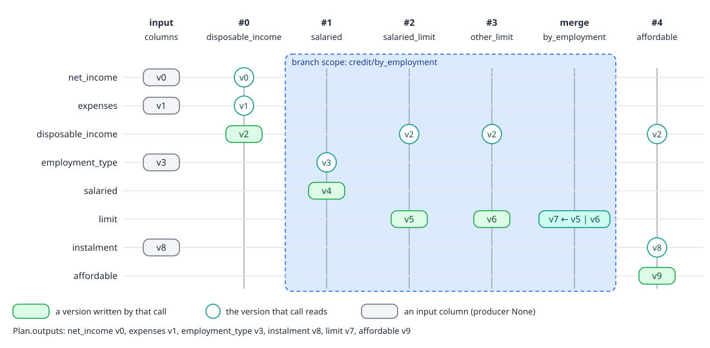
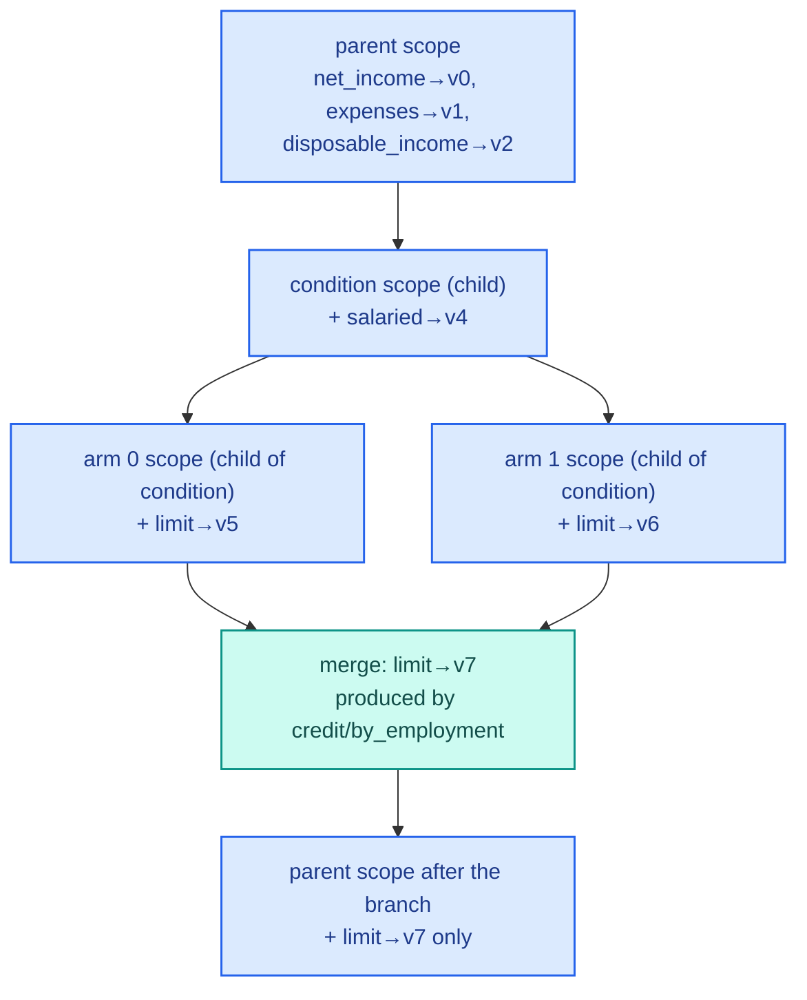
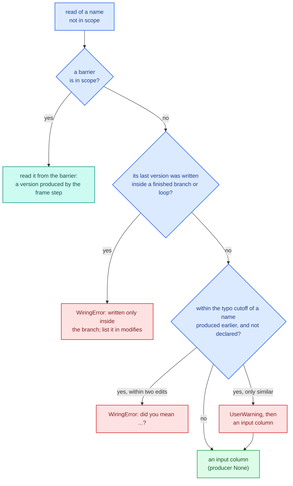
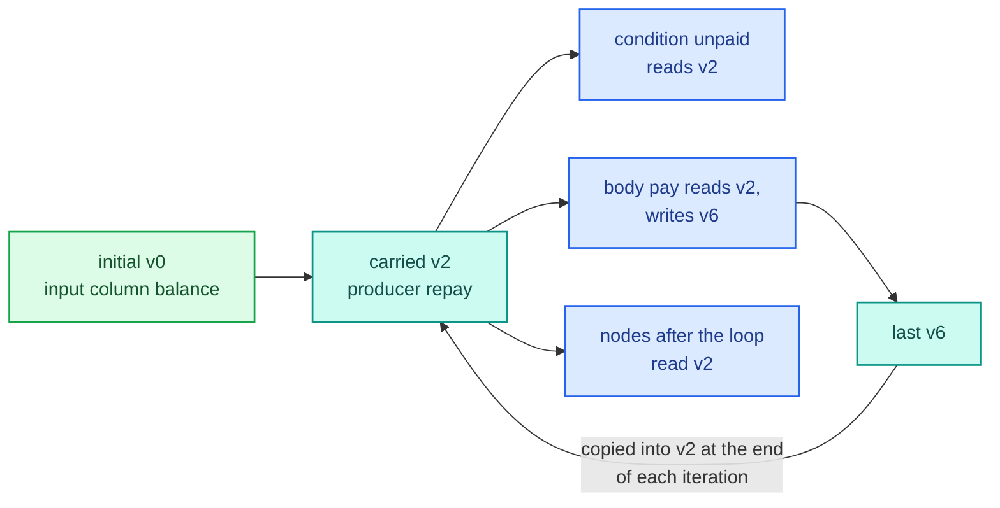

# Wiring

An [IR](ir.md) node names what it reads and writes, but a name alone is ambiguous. In a waterfall, `term_cap` is
written three times and each reader wants the latest write before it. In a branch, `limit` is written once per arm
and the step after the branch wants whichever arm each row took. Wiring settles this before anything runs:
`resolve(ir)` binds every read to one `NodeVersion`, a single written value of a name, and checks the result.
The output is a `Plan`, which every [runner](runners.md) and the [compiler](compile.md) execute.

The code lives in `decikit/_engine/wiring/`:

| File | Holds |
|---|---|
| `resolve.py` | `resolve`, the `_Resolver` walk and its `_Scope`, every wiring error |
| `plan.py` | `NodeVersion`, `Call`, `Sequence`, `Branch` and `Merge`, `Loop` and `Carry`, `ScatterGather`, `FiniteStateMachine`, `Plan` |
| `interface.py` | `interface(node)`: the names a node reads from outside and the names it writes |

## The rule

Written order is execution order. The resolver walks the IR once, depth first, the same order a runner runs it:

- A node reads the latest version of each name in its scope.
- Every write makes a new version. Nothing is overwritten, so every version stays readable by `name@path`.
- A name nothing has produced yet is a pipeline input column, unless it looks like a typo of a name produced earlier.
- A name read as an input column must not be written by a later node (a forward reference).
- Branch arms, branch conditions and loop bodies are scopes: only `modifies` and `carries` leave them.

## The Plan, on the example

For the credit pipeline from the [engine overview](index.md), `resolve(credit)` gives ten versions and five calls:

```text
versions:
  v0  net_income         producer=None
  v1  expenses           producer=None
  v2  disposable_income  producer=credit/disposable_income
  v3  employment_type    producer=None
  v4  salaried           producer=credit/by_employment/salaried
  v5  limit              producer=credit/by_employment/salaried_limit
  v6  limit              producer=credit/by_employment/other_limit
  v7  limit              producer=credit/by_employment
  v8  instalment         producer=None
  v9  affordable         producer=credit/affordable
calls:
  #0 credit/disposable_income             reads=(v0, v1) writes=(v2)
  #1 credit/by_employment/salaried        reads=(v3)     writes=(v4)
  #2 credit/by_employment/salaried_limit  reads=(v2)     writes=(v5)
  #3 credit/by_employment/other_limit     reads=(v2)     writes=(v6)
  #4 credit/affordable                    reads=(v2, v8) writes=(v9)
inputs: ['net_income', 'expenses', 'employment_type', 'instalment']
outputs: {'net_income': 'v0', 'expenses': 'v1', 'employment_type': 'v3',
          'instalment': 'v8', 'limit': 'v7', 'affordable': 'v9'}
chains: {'disposable_income': ['v2'], 'salaried': ['v4'],
         'limit': ['v5', 'v6', 'v7'], 'affordable': ['v9']}
merge limit v7 prior None arms ['v5', 'v6']
```

<div class="diagram" markdown>


*Every version of every name, by the call that writes it. `limit` has three versions: one per arm and the merge.*
</div>

`v7` is produced by the branch itself. It is the only version of `limit` visible after the branch, and it is what
`affordable` would read and what the output holds. `v5` and `v6` stay in `chains`, so
`emit("limit@by_employment/salaried_limit")` can still put one of them in the output.

## The data structures

All of these are in `decikit/_engine/wiring/plan.py`.

`NodeVersion(id, name, producer, annotation)` is one written value. `producer` is the origin path of the node that
wrote it, or `None` for a pipeline input column. A branch's merged value is produced by the branch path, a loop's
carried value by the loop path, and a name read after an unknown-lineage frame step by that frame step.

`Call(id, node, reads, writes)` is a `CallNode` with its versions: `reads[i]` feeds `node.inputs[i]` and
`writes[i]` receives `node.outputs[i]`. `reads` is `None` for a frame step of unknown inputs. Its `decimals` field,
computed in `__post_init__`, holds the Decimal boxers for inputs and params and the scale of each output, so a
runner never inspects annotations per call.

`Sequence(node, children)` keeps the IR's shape. `Branch(node, condition, arms, merges)` holds one
`Merge(version, prior, arms)` per `modifies` name: on each row, `version` takes the taken arm's `arms[k]`, or
`prior` when that arm leaves the name alone (`arms[k] is None`). `prior` is `None` only when every arm writes the
name, so a name every arm writes need not exist before the branch.

`Loop(node, condition, body, carries)` holds one `Carry(version, initial, last)` per carried name. `version` starts
as `initial`, is what the condition and the body read on every iteration, is set from `last` at the end of each
iteration, and is what nodes after the loop read.

`ScatterGather(node, column, body, fields, new_fields, out, accumulate)` pairs each item field the body reads with
a synthetic version produced by the node, lists the versions the body writes (gathered back into each item), and
`out`, the version of the list it hands on.

`Plan` collects it all:

| Field | Meaning |
|---|---|
| `root` | the resolved tree, the same shape as the IR |
| `calls` | every `Call` in execution order, a condition before its arms; `calls[i].id == i` |
| `versions` | every `NodeVersion`; `versions[i].id == i` |
| `inputs` | the input columns, as `Input`s declared by their first typed reader |
| `outputs` | output column name to version: input columns, values nothing reads, emitted values |
| `drops` | names to leave out of the output, frame columns included |
| `chains` | every produced version of each name, in production order |

Ids are positions: calls in walk order, versions in creation order. They depend on the IR's structure, never on
path text, so renaming a step leaves every id unchanged (`test_ids_do_not_depend_on_names`). A
[State](runners.md) is a dict from version id to array, and the [params](params.md) bundles are keyed by call id.

## How the walk works

`resolve` builds a `_Resolver` and walks the IR with a `_Scope`, a dict from name to the version in sight, plus
the current barrier and the first reader of each input column. A branch or loop gives its children child scopes
that start as copies of the parent's:



For each node the walk does this:

- A `CallNode` looks up each input in the scope, then writes each output as a new version produced by the call's
  path. A frame step with unknown outputs clears the scope and becomes the barrier.
- A `SequenceNode` walks its children in the same scope, then records its `emits` and `drops`.
- A `BranchNode` runs the condition in a child scope, each arm in a child of that, then makes one merged version per
  `modifies` name and puts only those back in the parent scope. The condition's output is for routing and is not
  visible after the branch.
- A `LoopNode` looks up each carry's initial version, makes the carried version, walks the condition and body in a
  child scope where the carry names point at the carried versions, and takes each carry's `last` version from what
  the body left. The carried version is moved to the end of its chain, after the body's versions.
- A `ScatterGatherNode` reads its list column (as `list[dict]`), makes a synthetic version for each name the body
  reads but never writes (the item's fields), walks the body in a child scope, and writes its output.

`FiniteStateMachineNode` is not handled: `resolve` raises `TypeError: can't resolve FiniteStateMachineNode`.

After the walk, `finish` builds the outputs and checks the drops.

## Reading a name nothing produced

`lookup` finds the name in the scope. When it is not there, `unbound` decides what the name is:



### Typos

Candidates are names produced earlier in the walk, minus the reading node's own outputs (so `term_cap_a` may read
`term_cap`). `suggest` finds the closest at a difflib ratio of 0.8 (`TYPO_CUTOFF` in `decikit/_suggest.py`).
`_is_typo` then counts the edits: within two, unless the two names differ only in digits, it is an error.

```text
>>> resolve(flow(disposable_income, ratio, name="credit"))
WiringError: credit/ratio: input 'disposible_income' is not produced by any
  earlier step. Did you mean 'disposable_income' (produced by
  'credit/disposable_income')? Rename it, or
  relabel(reads={'disposible_income': 'disposable_income'}).
```

A name that is similar but more than two edits away is read as an input column with a warning:

```text
UserWarning: risk/total: reading 'entity_bureau_score' as an input column.
  It looks like 'entity_base_score' (produced by 'risk/entity_base_score');
  if it's a typo, rename it or
  relabel(reads={'entity_bureau_score': 'entity_base_score'}).
```

`applicant2_income` next to `applicant1_income` differs only in a digit, so it gets the warning, not the error. A
flow can declare such names as input columns on purpose with `flow(..., inputs=["entity_bureau_score"])`; a
declared name is never a typo candidate and never warns. Only earlier names are candidates, so in a `dag` written
in reverse dependency order, a typo of a later sibling silently becomes an input column (a known limit).

### Forward references

`write` checks whether the name it is about to write was read earlier as an input column by another node. If so,
the earlier reader saw the input column while everything after the writer sees the writer's value, which is almost
always a mistake:

```text
WiringError: risk/score reads 'bureau_score' as an input column, but
  risk/floor_score, which runs later, writes 'bureau_score'. Order is
  execution order: risk/score saw the input column, while anything after
  risk/floor_score sees risk/floor_score's value. Move risk/floor_score
  before risk/score, or rename one of the two.
```

A node that reads and writes the same name (the self-read waterfall, `cap_by_income(term_cap) -> term_cap`) is
allowed: the reader and the writer are the same path. Reading an input and narrowing it later in another step is
rejected, as decider2 did.

### One type per input column

An input column arrives as one type, so every typed reader must declare the same one (`str`, `Text` and `bytes`
count as one, being three reads of one string column; `T` and `T | None` agree):

```text
WiringError: kyc/a reads input column 'age' as int, but kyc/b reads it as
  float; an input column has one type. Annotate both the same, and convert
  in the step that needs the other type.
```

The column's `Input` in `plan.inputs` comes from its first typed reader. An untyped reader (a frame step) that
comes first is replaced by the next typed one, so it does not hide a later step's `date` annotation. A Decimal adds
its scale: a reader and writer of one produced value must agree on Decimal-or-not and on the scale, or the reader
would see the wrong digits.

## Scopes: branches and loops

Names written inside an arm, a condition or a loop body stay there. Reading one after the branch, when nothing
outside wrote it, is an error rather than an input-column read, because otherwise the arm's write would be lost
silently:

```text
WiringError: credit/explain reads 'reason', but the only step writing it,
  credit/by_employment/lo, is inside branch credit/by_employment, which
  passes on only modifies=['limit'], so 'reason' is not visible after it.
  List 'reason' there to pass it on, or rename one of them if
  credit/explain means an input column.
```

`hidden` looks only at the last version of the name. An earlier version may have been passed on legitimately, into
a sibling arm's scope for instance. A scope still hides a name that also exists outside it: the reader after the
branch gets the outside version.

The branch and loop shapes have their own checks:

```text
WiringError: branch credit/by_employment: modifies 'limits', but no arm
  writes it
WiringError: branch credit/by_employment: the arms disagree on the type of
  'limit': credit/by_employment/hi writes float,
  credit/by_employment/lo_int writes int
WiringError: loop repay: carries 'balance', but the body never writes it
```

Arms must agree on a modified name's type because one merged column holds rows from different arms.

The loop carry works like this on the repayment loop from the [runners](runners.md) page:

```text
balance version 2 initial 0 None last 6 repay/month/pay
months  version 3 initial 1 None last 7 repay/month/tick
```



Reads inside the loop do not count as consuming the carried version, so a carried value nothing reads after the
loop still reaches the output.

## Frame barriers

A frame step with unknown outputs (`frame_step()` without `writes=`) may rewrite any column. After one, every name
not produced after it is read from it: `from_barrier` makes a version produced by the frame step's path and appends
it to the barrier `Call`'s `writes`. The runner then checks that the frame the step returned has each of those
columns. Names read after a barrier never become input columns and are never typo errors:

```python
@frame_step()
def enrich(df):
    return df

def uses(bureau: float) -> float:
    return bureau
```

```text
>>> p = resolve(flow(enrich, uses, name="f"))
>>> [(c.node.origin.path, [(v.name, v.producer) for v in c.writes])
...  for c in p.calls]
[('f/enrich', [('bureau', 'f/enrich')]), ('f/uses', [('uses', 'f/uses')])]
>>> [i.name for i in p.inputs]
[]
```

A frame step with declared `reads=` and `writes=` is no barrier; it wires like any other call. Inside an arm, a
barrier may write what the branch modifies, and `final` asks the barrier for it.

## Outputs, emits and drops

`finish` decides what reaches the output frame:

- every input column, including ones read only inside a branch or loop;
- every value in the root scope that nothing reads (`limit` and `affordable` above, but not `disposable_income`);
- every value read after a barrier;
- every emitted value.

`emit("name")` adds the latest version of a name. `emit("name@path")` adds one version by its producer, the path
relative to the flow that declares the emit or absolute, as `step_map` and run reports use it; the column is named
as written. `emit("name@*")` adds every version, each as `name@<relative path>`. Emitting an input column nothing
reads makes it required.

```python
@step(outputs=("limit", "reason"))
def lo(disposable_income: float) -> tuple[float, str]:
    return disposable_income, "self-employed"

by_employment = branch(salaried, hi, lo, modifies=["limit"], name="by_employment")
p = flow(by_employment, name="credit")
resolve(p.emit("reason@by_employment/lo")).outputs.keys()
# dict_keys(['employment_type', 'disposable_income', 'limit',
#            'reason@by_employment/lo'])
```

The emit and drop errors suggest the closest name:

```text
WiringError: credit: emit('disposable_incme'): no step produces
  'disposable_incme'. Did you mean 'disposable_income'? (Input columns
  pass through to the output without an emit.)
WiringError: credit: drop('disposable_income'): 'disposable_income' is an
  internal value, not an input column, a final value or an emitted one,
  so there is nothing in the output to drop.
```

A drop of a name the plan has never seen is kept, because it may be a frame column no step reads, unless it is a
close match for a known name.

## interface

`interface(node)` returns the names a node reads from outside and the names it writes. A branch writes only its
`modifies`, a loop only its `carries` (and reads them too), and a frame step of unknown lineage reads and writes
nothing known:

```text
>>> interface(to_ir(credit))
({'instalment', 'net_income', 'employment_type', 'expenses'},
 {'affordable', 'disposable_income', 'limit'})
```

`dag` uses it to sort members by dependency, `optimise` to check that its evaluator writes the score it names,
and `Step.relabel` to reject a name the step neither reads nor writes.

`interface` has no case for `ScatterGatherNode`, so it walks into the child and reports the item fields the child
reads instead of the list column. `relabel(reads={"items": "basket"})` on a flow holding `each("items", ...)` is
refused with `WiringError: p.relabel(reads={'items': 'basket'}): it reads no 'items'; it reads ['amount']`.

## Where wiring fails, and when

Every check runs at `resolve`, so at `Engine.bind`, `Step.compile`, `Step.run` and `Step.session`, before any data
is read. Every error is a `WiringError` (a `ValueError` and a `DecikitError`) naming the node path, except two:
an `Item` field that is itself a list or struct, in a `Columnar[Item]` or `Struct[Item]` input, is a `TypeError`
naming the Python spelling to use instead; and a `FiniteStateMachineNode` is a `TypeError`. A typo that is only
similar is a `UserWarning`. The [branches, loops and frames guide](../../guides/branches-loops-frames.md) shows how
users meet these errors.

## Why wiring is shaped this way

The choices are these. Unknown names become input columns, decider2's rule, with the typo
check on top for names close to an earlier output. Forward references are errors, a finding of decider2's review;
the rule also rejects reading an input and narrowing it later, as decider2 did. Scopes hide arm-internal names because a branch's
contract is its `modifies` list; reading past it used to turn the arm's write into an input-column read without a
word. Versions are kept instead of overwritten so that `name@path` emits, the debugger's `state.versions("name@*")`
and traces can show every intermediate value.
