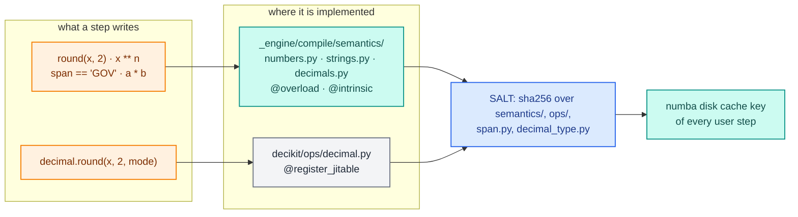
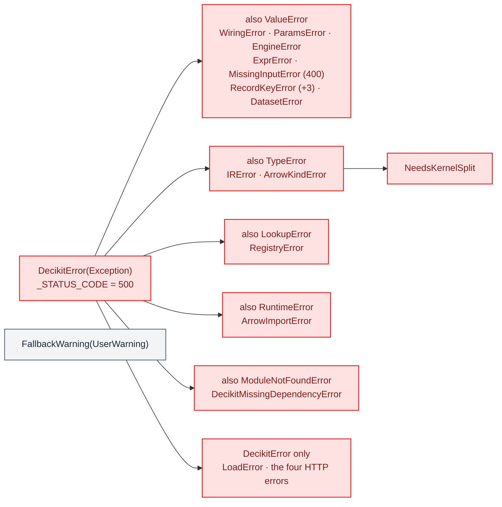
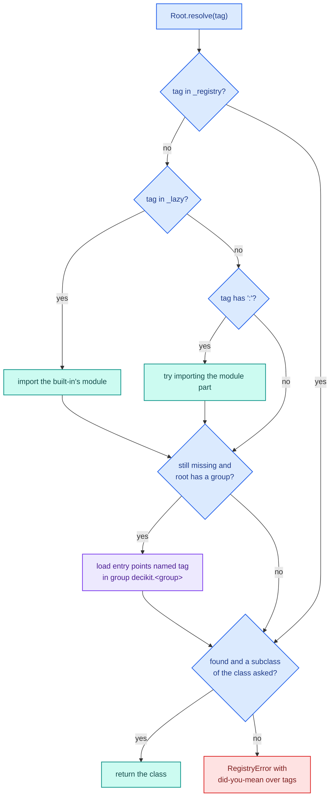
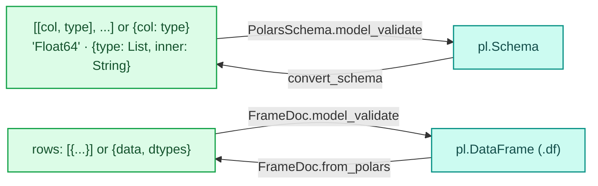

# Foundation packages

Layer 0 of the [layer map](package-layout.md) holds six units that every layer above may import and that import
nothing above them: `ops`, `exceptions`, `_registry`, `_serde`, `_settings` and `_suggest`. Two are public: `ops`
holds the value types a step declares (`Text`, `Decimal`, `Currency`, `Columnar`, `Struct`, `Percent`), and
`exceptions` holds the errors users catch. The four private ones are infrastructure: the type-tag registry behind
every pluggable document type, JSON forms of polars frames and dtypes, environment settings, and did-you-mean hints.

| Unit | Files | Public | Imported by |
|---|---|---|---|
| `ops` | `decikit/ops/{text,decimal,nested,measures}.py` | yes | user steps, `_engine` (24 imports), `lab`, `serving` |
| `exceptions` | `decikit/exceptions.py` | yes | every layer |
| `_registry` | `decikit/_registry.py` | no | `steps`, `config`, `lab`, `_engine.ir.context` |
| `_serde` | `decikit/_serde/{frame,schema}.py` | no | `steps` (table values, tree outputs), `_engine.ir.context`, `decikit/__init__.py` (`PolarsSchema`) |
| `_settings` | `decikit/_settings.py` | no | the CLI, `serving`, `lab.data`, `lab.checks` |
| `_suggest` | `decikit/_suggest.py` | no | `_registry`, `steps`, wiring, params validation, flow files, the ids check |

## ops: the value types a step declares

`decikit.ops` answers one question for each kind of value: what does a step write in its signature so that the value
means the right thing in plain Python and compiles in a kernel? It has one module per domain, and a type is imported
from the package while a function is reached through its module:

```python
from decikit.ops import Currency, Text, decimal
decimal.round(x, 2, decimal.Rounding.HALF_EVEN)
```

`Currency` and `Decimal` load lazily through a module `__getattr__`, because `decimal.py` imports numba and
`import decikit` must not.

### Two layers of kernel functions

Kernels must give the same answer as Python, so the functions they run come in two layers, described in
`docs/design_decisions/decisions/api-layout.md`:



- Implicit semantics: operators and builtins applied to a value inside a kernel. Users import nothing. The overloads
  live in `_engine/compile/semantics/` and are keyed on the decider toolkit's own numba types (`SpanType`, `DecimalType`), so a
  plain `int64` or tuple elsewhere in user code is never captured.
- Explicit functions: things CPython does not have, written once with `@register_jitable` in `decikit/ops/`. They run
  as Python in interpreted mode and in fallbacks, and are inlined into a kernel when a compiled step calls them.

numba keys a disk-cached step by its own bytecode, so an edit to an overload would otherwise keep serving stale
machine code. `decikit/_engine/compile/semantics/__init__.py` computes `SALT`, the sha256 of every file under
`semantics/` and `ops/` plus `span.py` and `decimal_type.py`, found by walking the directories, and the compiler mixes
it into each user step's cache key. Two convention tests hold this shape: `@overload` and `@intrinsic` may only appear
under `semantics/` (plus five allowlisted files), and `SALT` must cover every one of those files.
[Kernels](engine/kernels.md) and [Compile cache](engine/cache.md) go deeper.

### decimal: fixed-point money

`decikit/ops/decimal.py` defines `Decimal`, `Currency`, `Rounding`, `round` and `round_float`. A `Decimal` is an
immutable object with three slots: `raw`, an int64 count of `10**-scale` units; `scale`, from 0 to 18; and `units`, a
display string that never takes part in a comparison or a kernel. `Currency` is a `Decimal` fixed at scale 4.

<div class="diagram" markdown>
![Currency["R"] becomes an Annotated type with a DecimalSpec; a Currency value is raw int64 26500 at scale 4 with display units R; it travels as a polars Decimal(38, 4) column, an int64 State array, and a DecimalType(4) in a kernel](../assets/diagrams/arch-decimal-layout.svg)

*One `Currency` value in the annotation, as a Python object, and through a run.*
</div>

Subscripting builds the annotation: `Decimal[18, 2]` is `Annotated[Decimal, DecimalSpec(18, 2)]` and `Currency["R"]`
is `Annotated[Currency, DecimalSpec(19, 4, "R")]`. The precision is at most 19, the digits an int64 holds. The
arithmetic is exact in Python and rounds half-even once per operation:

```python
from decikit.ops import Currency, decimal
from decikit.ops.decimal import Decimal, Rounding

a = Decimal("2.50"); b = Decimal("0.05")
print(repr(a * b), repr(a + 1), a < 2.6, (a * b).raw, (a * b).scale)
print(repr(Currency(2, 6500, units="R")), Currency(2, 6500).raw, repr(Currency(-2, 5)))
print(repr(Currency(1999.99) / 3), repr(Currency(10) * 0.155))
print(repr(decimal.round(Decimal("2.675"), 2)), repr(decimal.round(Decimal("2.5"), 0, Rounding.HALF_EVEN)))
print(decimal.round(2.5), decimal.round(2.5, 0, Rounding.HALF_EVEN), decimal.round(2.675, 2),
      decimal.round(-2.99, 1, Rounding.DOWN))
```

```text
Decimal('0.12') Decimal('3.50') True 12 2
R 2.6500 26500 Currency('-2.0005')
Decimal('666.6633') Decimal('1.5500')
Decimal('2.680') Decimal('2.0')
3.0 2.0 2.67 -2.9
```

`0.125` rounds half-even to `0.12`. An int counts as whole units, so `a + 1` is `3.50`. `round_float` rounds the exact
value of the double, so `2.675` (stored as 2.67499...) gives `2.67` under every mode, which matches CPython. It works
without big integers: a Dekker two-product splits `x * 10**digits` into a double and its exact error, and a table of
powers of ten up to `10**22` replaces `pow()`. Past 22 digits it scales and rounds in floats, which the code marks with
a `ponytail:` comment as a known ceiling.

The guard rails are errors:

```text
TypeError: use decikit.ops.decimal.round(d, digits, mode) to round a Decimal
ValueError: a float needs a scale: Decimal(2.65, scale=2)
ValueError: Decimal[20, 2]: a Decimal is an int64, so its precision is at most 19; cast a wider column in the frame tier or keep it as a float
```

The same step gives the same answer in every mode. In a kernel a `Decimal` is an int64 typed as `DecimalType(scale)`
(`compile/decimal_type.py`), and the operators in `semantics/decimals.py` are overloads on that type only. They do
the 128-bit work in uint64 halves, because LLVM's i128 division calls `__udivti3`, which aborts the process:

```python
import polars as pl
from decikit import Engine, flow, param
from decikit.ops import Currency, decimal


def instalment(principal: Currency, rate: float = param(0.12), months: int = param(12)) -> Currency:
    return decimal.round(principal * (rate / 12) + principal / months, 2)


pipe = flow(instalment, name="loan")
df = pl.DataFrame({"principal": [10000.0, 2500.5]}).with_columns(pl.col("principal").cast(pl.Decimal(38, 4)))
for mode in ("interpreted", "stepped", "fused"):
    out = Engine.resolve(mode)().bind(pipe).run(df)
    print(mode, out["instalment"].to_list(), out.schema["instalment"])
print(pipe.compile("fused").run({"principal": Currency(10000)}))
```

```text
interpreted [Decimal('933.3300'), Decimal('233.3800')] Decimal(precision=38, scale=4)
stepped [Decimal('933.3300'), Decimal('233.3800')] Decimal(precision=38, scale=4)
fused [Decimal('933.3300'), Decimal('233.3800')] Decimal(precision=38, scale=4)
{'principal': Currency('10000.0000'), 'instalment': Currency('933.3300')}
```

One difference between modes is deliberate: a result outside int64 raises `OverflowError` in Python and wraps in a
kernel. The `int64_overflow` check in `decikit.lab.checks` looks for the risk statically. `Decimal` replaced the earlier integer-cents
money type; the reasons are in `docs/design_decisions/decisions/money.md`.

### text: strings a kernel reads in place

`Text` is a string column a compiled step reads without converting it. A `str` input runs the step in Python, row by
row; a `Text` input arrives in a kernel as an `(address, byte length)` span of its UTF-8 bytes, and the overloads in
`semantics/strings.py` give it `==`, `!=`, `len`, `in`, `startswith` and `endswith`. The Python class in
`decikit/ops/text.py` mirrors the kernel exactly, including nulls:

```python
from decikit.ops import Text
print(Text("private") == "private", Text(None) == Text(None), len(Text("héllo")),
      Text("GOV-12").startswith("GOV"), "DEPT" in Text("X DEPT"))
```

```text
True False 5 True True
```

A null equals nothing, not even another null, and has length 0 (a kernel's `len` can't be negative). `len` counts code
points as CPython does, although the kernel holds bytes. An output declared `Text` is written as a `str` column, in
Python.

### nested: list and struct columns

`Columnar[Item]` and `Struct[Item]` in `decikit/ops/nested.py` are markers with no behaviour of their own; `Item` is a
`TypedDict`. `Columnar[Item]` reads a `list[dict]` column as one flat array per field (struct of arrays), so
`items.price[j]` is the `j`th item's price and a kernel can loop over it. Its docstring prices the arrays at about
20 µs per `run(record)` call, so a short list with a one-line body is faster as a plain `list[dict]` step in Python.
`Struct[Item]` is one record per row. `struct_item(annotation)` returns the `Item` of a `Struct[Item]`. The engine's
`compile/rows.py` and `compile/structs.py` do the work; [Kernels](engine/kernels.md) covers them.

### measures: what a value means

`FieldMetadata` is a frozen dataclass attached with `Annotated`. The engine ignores it and runs the plain type; the
flow debugger formats values by it. `Percent` and `Duration(unit)` are the built-ins, `DecimalSpec` is what a
`Decimal[p, s]` annotation carries, and a subclass with its own `kind` adds a new kind. `metadata_of` finds it:

```python
import typing as t
from decikit.ops import Currency, Duration, Percent
from decikit.ops.measures import metadata_of
print(metadata_of(t.Annotated[float, Percent()]), metadata_of(t.Annotated[int, Duration("months")]).to_json(),
      metadata_of(Currency["R"]).to_json())
```

```text
Percent() {'kind': 'duration', 'unit': 'months'} {'kind': 'decimal', 'precision': 19, 'scale': 4, 'units': 'R'}
```

## exceptions: one root for every error

Every error the decider toolkit raises on purpose derives from `DecikitError` and also keeps a builtin base, so `except
ValueError` in existing code still catches a wiring mistake. Each class carries `_STATUS_CODE`, the HTTP status the
server answers with (`serving/_servers/core.py` reads it in `error_response`).



| Error | Defined in | Raised when |
|---|---|---|
| `WiringError` | `exceptions.py` | a bad step name, duplicate paths, a likely typo, a read of a name a branch keeps, a dag cycle or clash, a bad emit or drop |
| `IRError` | `exceptions.py` | a signature that can't be wired, a condition that isn't one call, a node with no origin, a shared param with two types |
| `ParamsError` | `exceptions.py` | a params document fails a node's model, or names a path with no params |
| `MissingInputError` | `exceptions.py` | a required input is null or absent; carries `input`, `path`, `null_count`; HTTP 400 |
| `EngineError` | `exceptions.py` | an input column that shadows a produced name, or a strict-compile refusal |
| `RegistryError` | `exceptions.py` | a `type` tag names no registered class, an engine tag included |
| `ExprError` | `exceptions.py` | an expression outside the admitted grammar (also exported by `decikit.steps.expr`) |
| `DecikitMissingDependencyError` | `exceptions.py` | an optional dependency is missing; raised through `wrap_import_errors(extra)` |
| `ArrowKindError`, `NeedsKernelSplit`, `ArrowImportError` | `_engine/boundary/errors.py` | the Arrow boundary can't read a column as its declared kind |
| `UnsupportedContentTypeError` (415), `InputParsingError` (400), `UnsupportedAcceptError` (406), `OutputFormattingError` (500) | `serving/_errors.py` | HTTP request handling |
| `LoadError`, `RecordKeyError` (+3), `DatasetError` | `lab/data/` | reading data, record keys, named datasets |

`decikit.exceptions` exports the first eight plus `FallbackWarning`, a `UserWarning` that is the category of every
fallback warning, so `warnings.filterwarnings("ignore", category=FallbackWarning)` silences them all. The HTTP and
Arrow errors live with the code that raises them, so a user can tell which errors are theirs. Two exceptions stay
outside the hierarchy on purpose: `TraceLossError` (a `RuntimeError`, from `decikit.trace`) and the private
`ArmOutOfRange` the fused runner catches to fall back to the unpacked path.

Real messages, each naming where and how to fix it:

```text
MissingInputError [400]: input 'debt' of step 'p/dti' is required but column 'debt' has 1 null row(s) of 2. Fix the data, or declare `debt: T = missing_as(fill)` or `debt: T | None`.
RegistryError [500]: 'fsued' is not a registered Engine type. Did you mean 'fused'? Import the module that defines it first, or name it by import path, '<module>:<Class>'.
EngineError [500]: 'dti' is produced by this pipeline and is also a column of the input frame. Drop or rename the frame column 'dti', or relabel the step that writes it (`.relabel(writes={'dti': 'dti_2'})`), so neither silently shadows the other.
ParamsError [500]: invalid params (affects 1 row):
p/ok: param 'limit': Input should be less than or equal to 1 (got 3.0)
ParamsError [500]: params document: no step with params at 'p/okk'. Did you mean 'p/ok'? The document nests params by step path; steps with params: p/ok (limit). pipeline.parameters().defaults() builds a complete document.
```

`wrap_import_errors(extra)` is a context manager that turns a `ModuleNotFoundError` into
`DecikitMissingDependencyError` naming `pip install decikit[extra]`. It catches only a missing module, since an
`ImportError` raised inside an installed package is a real bug.

!!! warning "Two extras named wrongly"
    `serving/_servers/sanic.py` and `starlette.py` call `wrap_import_errors("sanic")` and `wrap_import_errors("starlette")`,
    so the message says `pip install decikit[sanic]` or `decikit[starlette]`. The extras in `pyproject.toml` are
    `serve-sanic` and `serve-starlette`.

## _registry: type tags for pluggable documents

A config document names a class by a `type` tag: `{"type": "tree", ...}`. `decikit/_registry.py` turns tags into
classes for eight roots (`ConfigurableStep`, `ConfigStore`, `DatasetProvider`, `Check`, `Engine`, `Metric`, `Plot`, `Block`)
without ever letting a document name arbitrary code.

`BaseRegistryModule` is a pydantic `BaseModel` and an `ABC`. Its machinery runs at three moments:

1. Class creation with `root=True` (`__init_subclass__`) gives the root its own `_registry` dict, `_lazy` table,
   `_group` name and an `RLock`.
2. Every concrete subclass, once pydantic has finished its fields (`__pydantic_init_subclass__`), registers under its
   import path `"<module>:<QualName>"` and, if it declares `type: Literal["alias"]`, under the alias. A second class
   claiming the same alias is an error naming both; the same import path again (a notebook re-running a cell) replaces
   the entry. The class's `_tag` is the alias, else the import path.
3. Validation runs `_normalise_type` before the fields: a missing `type` becomes the tag, a mismatched one is an
   error, and either spelling is stored as the tag, so dumps write the alias when there is one.

`resolve(tag)` is the lookup:



Importing a module by path only runs it; the class is returned only if that import registered a subclass of the
class asked. So `"os:system"` imports `os` and still fails. The lock is held to change or list the registry and never
while importing, because an import runs class bodies that register.

```python
import typing as t
from decikit._registry import BaseRegistryModule, import_path, ref


class Rule(BaseRegistryModule, root=True):
    name: str


class Threshold(Rule):
    type: t.Literal["threshold"] = "threshold"
    cut: float


class Unaliased(Rule):
    note: str = ""


print(Rule.resolve("threshold") is Rule.resolve(import_path(Threshold)) is Threshold)
print(Threshold(name="hi", cut=0.7).model_dump(), Unaliased(name="u").model_dump())
for tag in ("threshhold", "os:system"):
    try:
        Rule.resolve(tag)
    except Exception as e:
        print(type(e).__name__ + ":", e)


class Pack(Rule):
    type: t.Literal["pack"] = "pack"
    rules: list[ref(Rule)]


print(Pack.model_validate({"name": "p", "rules": [{"type": "threshold", "name": "a", "cut": 1.0}]}).model_dump())
print(sorted(Rule.json_schema()))
```

```text
True
{'type': 'threshold', 'name': 'hi', 'cut': 0.7} {'type': '__main__:Unaliased', 'name': 'u', 'note': ''}
RegistryError: 'threshhold' is not a registered Rule type. Did you mean 'threshold'? Import the module that defines it first, or name it by import path, '<module>:<Class>'.
RegistryError: 'os:system' is not a registered Rule type. Import the module that defines it first, or name it by import path, '<module>:<Class>'.
{'type': 'pack', 'name': 'p', 'rules': [{'type': 'threshold', 'name': 'a', 'cut': 1.0}]}
['__main__:Unaliased', 'pack', 'threshold']
```

A second class claiming `"threshold"` fails at definition:

```text
ValueError: type alias 'threshold' is claimed by both __main__:Threshold and __main__:Other; give one its own `type` (a new `Literal` alias, or `str` for the import path).
```

`ref(root)` is the field type for a nested document: `Annotated[root, WrapValidator(dispatch), SerializeAsAny()]`. The
validator looks the tag up at validation time, and `SerializeAsAny` keeps the subclass's own fields on dump; without it
pydantic dumps a nested subclass as its declared base and drops its fields silently. `decikit.StepRef` is
`ref(ConfigurableStep)`. `json_schema()` imports every lazy module and returns `{tag: schema}` for UI forms.

Tags dispatch by lookup rather than through a pydantic union rebuilt on each registration.
decider 0.3's rebuilt union went stale when a plugin registered late, registered superlinearly (333 ms for 175 types)
and produced 1332-character errors listing every tag. On a 63-node, three-level config the lookup costs about 15 µs
more than the fastest option, paid once because configs are validated once and cached.

Entry points close the last gap: a root declared with `group="steps"` also searches
`importlib.metadata.entry_points(group="decikit.steps", name=tag)` on a miss, so an installed package's types load
without the user importing them. [Package layout](package-layout.md) lists the eight groups.

## _serde: frames and dtypes as JSON

Two things in step documents need a JSON form: a small table of rows (a decision table's inline rows, a tree's output
table) and a polars schema. `decikit/_serde/` holds both.



- `PolarsSchema` is a pydantic `RootModel` over a struct: an ordered list of `[column, type]` pairs or an unordered
  dict. A type is a dtype name matched case-insensitively against polars' dtype classes (`"Set"` is an alias of
  `List`), an explicit `{"type": ..., ...}` with constructor arguments (`inner`, `fields`, `shape`, `time_unit`,
  `precision`, `categories`), or a nested struct. A dict with a `"type"` key is always an explicit type, never a struct
  with a field called `type`, so a typo can't silently become a struct.
- `convert_schema` and `convert_dtype` go the other way and round-trip the arguments a dtype needs.
- `PrimitiveSchema` is one non-struct type.
- `FrameDoc` holds `data` (a list of row dicts) and optional `dtypes`; a bare list validates as `data`. It builds the
  polars frame once, at validation, and parses ISO strings in `Date`, `Datetime`, `Time` and `Duration` columns, nested
  ones included, because polars won't read a JSON string into a temporal column. It dumps back to the bare list when it
  has no dtypes.

```python
from decikit._serde import FrameDoc, PolarsSchema, PrimitiveSchema, convert_schema
sch = PolarsSchema.model_validate({"income": "Float64", "tags": {"type": "List", "inner": "String"}, "opened": "Date"})
print(sch.schema)
print(convert_schema(sch.schema))
doc = FrameDoc.model_validate({"data": [{"income": 1.0, "tags": ["a"], "opened": "2026-01-31"}], "dtypes": sch.model_dump()})
print(doc.df)
print(FrameDoc.model_validate([{"x": 1}]).model_dump())
print(PrimitiveSchema.model_validate({"type": "Array", "inner": "Int32", "shape": [4]}).polars_type)
```

```text
Schema({'income': Float64, 'tags': List(String), 'opened': Date})
[('income', 'Float64'), ('tags', {'type': 'List', 'inner': 'String'}), ('opened', 'Date')]
shape: (1, 3)
┌────────┬───────────┬────────────┐
│ income ┆ tags      ┆ opened     │
│ ---    ┆ ---       ┆ ---        │
│ f64    ┆ list[str] ┆ date       │
╞════════╪═══════════╪════════════╡
│ 1.0    ┆ ["a"]     ┆ 2026-01-31 │
└────────┴───────────┴────────────┘
[{'x': 1}]
Array(Int32, shape=(4,))
```

`TableValue` in `steps/_values.py` is `FrameDoc | TableRef`, so a configurable step's table field takes inline rows
or a reference to a table param, and `IRContext.table` passes a `FrameDoc` through as is. A decision table validates its `columns`
through `PolarsSchema`, and `PolarsSchema` is also exported from `decikit`.

## _settings: environment settings

`decikit/_settings.py` is a `pydantic_settings.BaseSettings` read from `DECIKIT_*` environment variables (case
insensitive, `__` for nesting) and built lazily: `get_settings()` is a `functools.cache` around `DecikitSettings()`,
so nothing reads the environment at import time, and `get_settings.cache_clear()` makes the next call read it again.

| Field | Default | Read by |
|---|---|---|
| `serve.host`, `serve.port`, `serve.workers`, `serve.server` | `0.0.0.0`, `8080`, `None` (2 x CPUs + 1 at serve time), `starlette` | `decikit serve` |
| `api.code_path`, `api.pipeline`, `api.handler`, `api.engine.type` | `.`, `pipeline:build`, `inference:Handler`, `fused` | `decikit build`, `decikit serve`, `RequestHandler` |
| `build.warn_shadowed_tables` | `True` | `RequestHandler.stage()` (so `decikit build` and every server start): `ShadowedTableWarning` for a params document that sets a table seeded from a config document |
| `config` | `{"type": "file:json"}` plus the store's own fields | `DecikitConfigSettings.get()`, which resolves a `ConfigStore` by tag |
| `datasets_path` | `${PROJECT_ROOT}/datasets` | `lab.data` dataset catalog |
| `checks_path` | `${PROJECT_ROOT}/checks.yaml` | `lab.checks` project config |

`${PROJECT_ROOT}` is replaced by the readers in `lab/data/_providers/catalog.py` and `lab/checks/_config.py` with the
nearest ancestor directory holding `configs/`.

```python
import os
from decikit._settings import get_settings
s = get_settings()
print(s.serve.port, s.api.engine.type, s.config.type, s.datasets_path)
os.environ["DECIKIT_SERVE__PORT"] = "9090"
os.environ["DECIKIT_API__ENGINE__TYPE"] = "stepped"
print(get_settings().serve.port)
get_settings.cache_clear()
print(get_settings().serve.port, get_settings().api.engine.type)
```

```text
8080 fused file:json ${PROJECT_ROOT}/datasets
8080
9090 stepped
```

`DecikitConfigSettings` has `extra="allow"`: the store's own fields (`basepath` for the JSON file store) ride along and
are validated by the store class its `type` names. That `get()` imports `decikit.config`, an L1 package, from L0; it is
one of the two allowlisted upward imports.

## _suggest: did-you-mean

`decikit/_suggest.py` is 19 lines over `difflib.get_close_matches`:

- `suggest(name, candidates, cutoff=0.6)` returns the closest candidate, never `name` itself.
- `hint(name, candidates, prefix="")` returns `" Did you mean 'x'?"` or an empty string, to append to a message.
- `TYPO_CUTOFF = 0.8` is the stricter cutoff for a caller that raises because of a match. Wiring uses it to decide
  that an unknown read is a typo of a produced name rather than an input column; a loose cutoff there would turn a real
  input column into a false error.

```python
from decikit._suggest import hint, suggest
print(suggest("instalmnet", ["instalment", "income"]), repr(hint("tre", ["tree", "decision_table"])))
```

```text
instalment " Did you mean 'tree'?"
```

The hints in the messages above (`Did you mean 'threshold'?`, `Did you mean 'p/ok'?`, `Did you mean 'n'?`) all come
from here.
