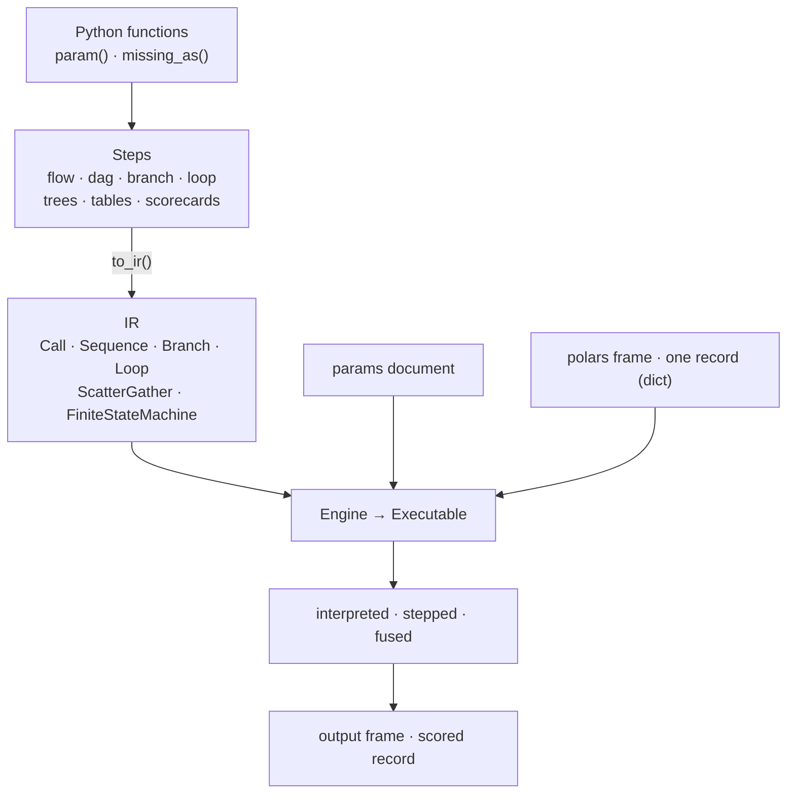

# Architecture overview

!!! note "Draft"
    The high-level picture is current; the pages it links to are outlines.

Decider turns plain Python functions into a decision pipeline that can run three ways (interpreted, stepped, fused) and be served, debugged, checked and compared without changing the code.

## From a function to an answer

You write **steps**. Each step expands itself into **IR**, a small closed set of node types. The **engine** runs the IR, so every mode, the debugger and the compiler work on the same nodes and a new step type only has to describe itself.

- **Params** are values read at run time, so retuning one never rebuilds or recompiles.
- **Modes** give the same answers. Interpreted is plain Python; stepped and fused compile with numba. A step a kernel can't hold runs in Python and says so with a `FallbackWarning`.
- **Debug and trace** hang off the engine: a session pauses at a node and streams events, and a trace sink records the decision each record took.

## How the packages stack

Packages only import downward. A leading underscore marks a package or file as private.

??? tip "Editing this diagram"
    The flow above is Mermaid, written as text in the page. This one is a draw.io file, `docs/diagrams/package-layers.drawio`: edit it in the VS Code draw.io extension or diagrams.net, or use the edit button on the diagram. Use Mermaid for simple flows and draw.io when the layout matters.

## Where to go next

| Page | Covers |
|---|---|
| [Steps and the IR](steps-and-ir.md) | How a step becomes IR, and the node types |
| [The engine](engine.md) | Modes, compilation and fallback, params, debug and trace |
| [Package layout](package-layout.md) | What lives in each package and the import rules |
| [Serving and tooling](serving-and-tooling.md) | Request handling, config versions, CLI, MCP, the editor bridge |
