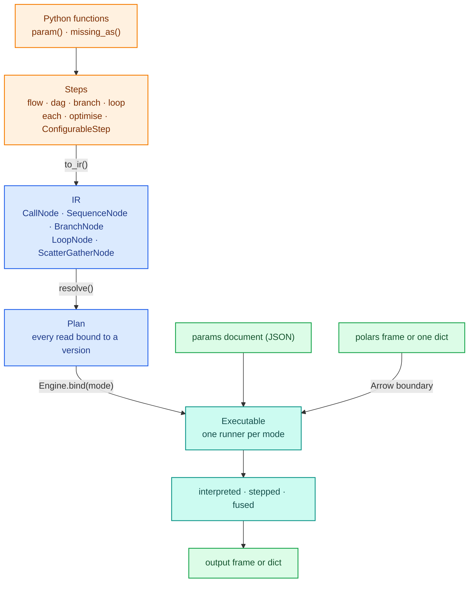
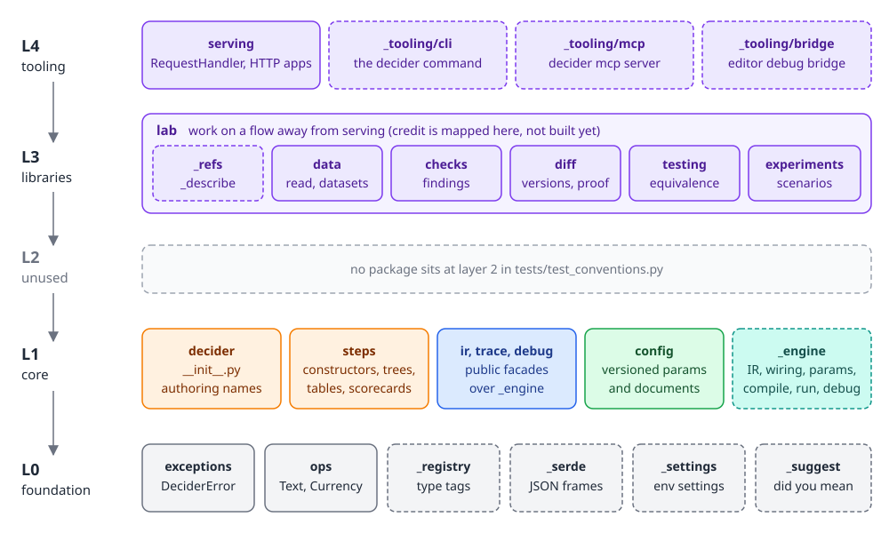
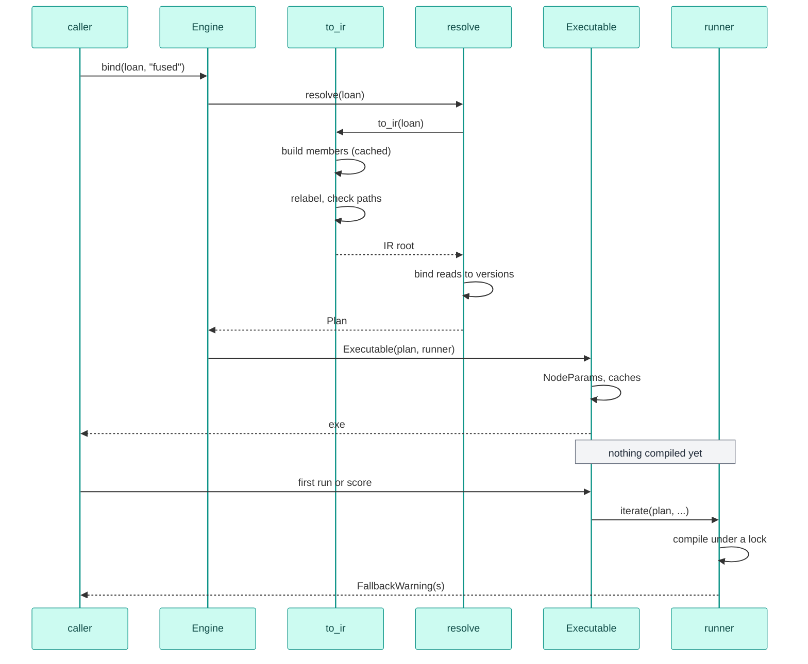
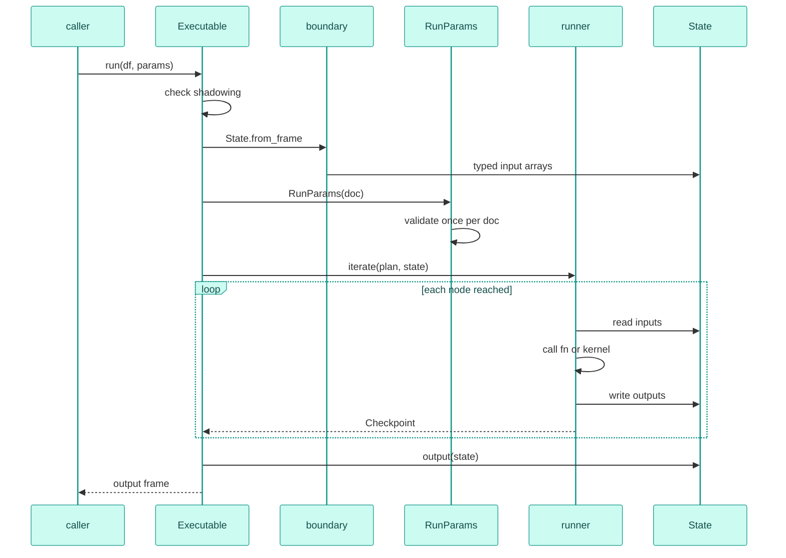
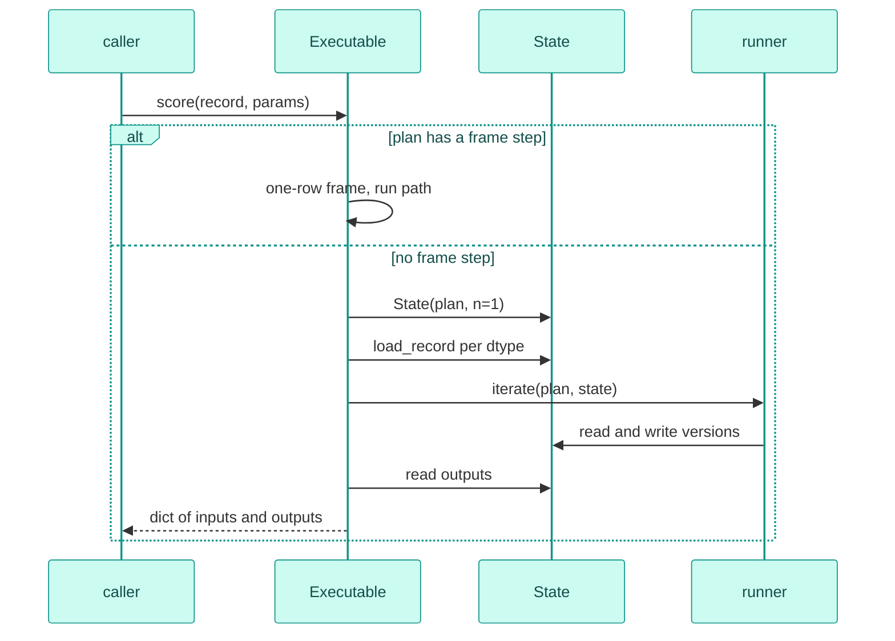
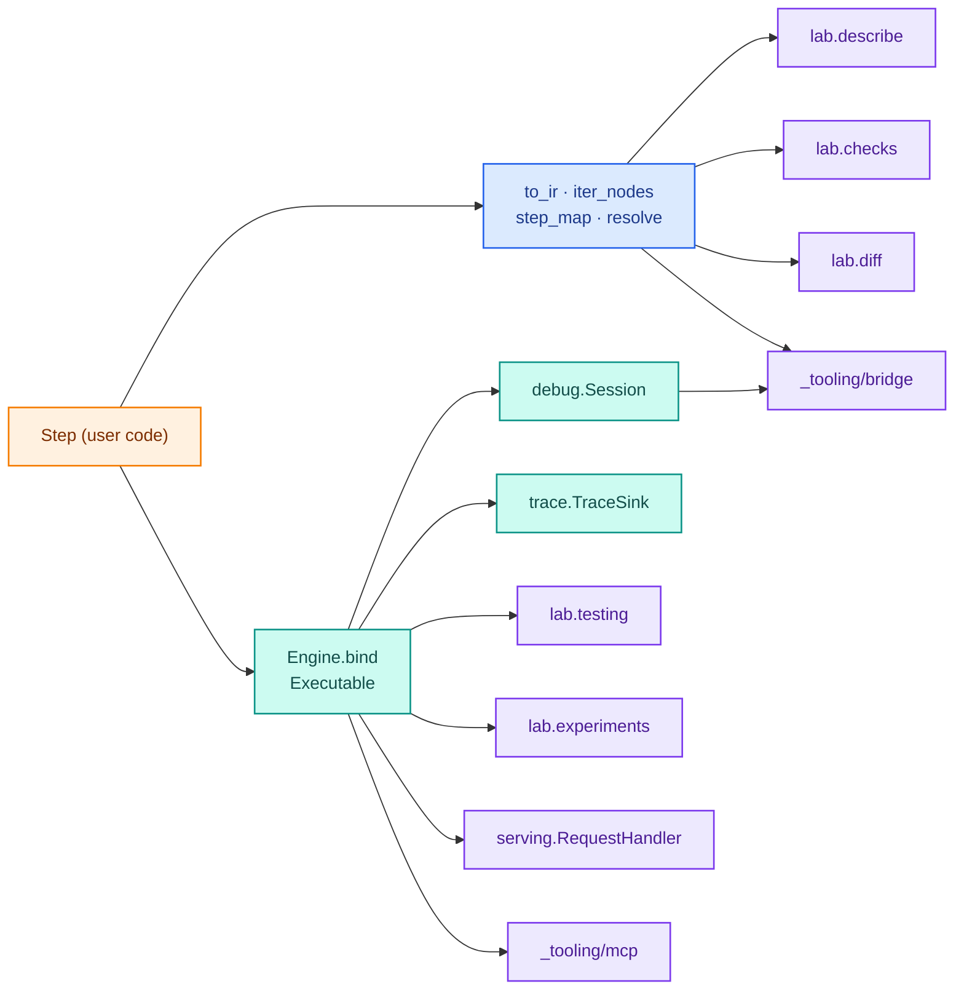

# Architecture overview

The decider toolkit turns plain Python functions into a decision pipeline. The same pipeline runs over a polars frame or one
record at a time, in plain Python or compiled with numba, and it can be served, stepped through in a debugger,
traced, checked, diffed against another version and run as an experiment without changing its code. All of that
works because every feature reads one structure: the IR, a small tree of nodes that each step produces for itself.

Below, one pipeline goes from the function you write to the answer the engine returns, followed by the package
layers, the three main lifecycles (a build, a run over a frame, a score of one record), the design decisions with the
measurements behind them, and the tooling that hangs off the same IR. Every other architecture page goes one level
deeper on one part of this picture.

## From a function to an answer



The running example is a small loan-affordability flow: six functions, one branch, three params and an input
with a fill for nulls.

```python
import polars as pl
from decikit import Engine, branch, flow, param, step, missing_as


def disposable_income(net_income: float, expenses: float) -> float:
    return net_income - expenses


def dti(disposable_income: float, instalment: float) -> float:
    return instalment / disposable_income


def affordable(dti: float, max_dti: float = param(0.4, ge=0, le=1)) -> bool:
    return dti <= max_dti


@step(output="limit")
def base_limit(disposable_income: float, multiple: float = param(3.0)) -> float:
    return disposable_income * multiple


@step(output="limit")
def cap_limit(limit: float, bureau_score: float = missing_as(0.0), cap: float = param(20000.0)) -> float:
    return min(limit, cap) if bureau_score < 650 else limit


@step(output="limit")
def no_limit(limit: float) -> float:
    return 0.0


loan = flow(disposable_income, dti, affordable, base_limit,
            branch("affordable", cap_limit, no_limit, modifies=["limit"], name="by_affordability"),
            name="loan")

df = pl.DataFrame({"net_income": [12000.0, 9000.0, 30000.0], "expenses": [4000.0, 7000.0, 9000.0],
                   "instalment": [2500.0, 1500.0, 3000.0], "bureau_score": [700.0, None, 610.0]})
print(loan.run(df))
```

```text
shape: (3, 5)
┌────────────┬──────────┬────────────┬──────────────┬─────────┐
│ net_income ┆ expenses ┆ instalment ┆ bureau_score ┆ limit   │
│ ---        ┆ ---      ┆ ---        ┆ ---          ┆ ---     │
│ f64        ┆ f64      ┆ f64        ┆ f64          ┆ f64     │
╞════════════╪══════════╪════════════╪══════════════╪═════════╡
│ 12000.0    ┆ 4000.0   ┆ 2500.0     ┆ 700.0        ┆ 24000.0 │
│ 9000.0     ┆ 7000.0   ┆ 1500.0     ┆ null         ┆ 0.0     │
│ 30000.0    ┆ 9000.0   ┆ 3000.0     ┆ 610.0        ┆ 20000.0 │
└────────────┴──────────┴────────────┴──────────────┴─────────┘
```

Six stages sit between that code and that frame.

### The authoring layer

A step is anything that can sit in a pipeline. `Step` is the abstract base in `decikit/steps/_base.py`, and every
constructor (`step`, `frame_step`, `flow`, `dag`, `branch`, `loop`, `each`, `optimise`) returns a frozen, slotted
dataclass subclass of it. `ConfigurableStep` is the one pydantic subclass: it loads from JSON, so trees, decision
tables and scorecards are documents. A plain function converts to a `FunctionStep` wherever a step is expected.

A function's signature is its contract. Plain arguments are the columns it reads, `param()` defaults are tunable
values from the params document, `missing_as()` and `T | None` say what a null does, and the function name (or
`output=`) is the column it writes. Steps never know their parent. [Steps and the IR](steps-and-ir.md) covers every
step type and how its signature is read.

### The IR

`to_ir()` turns a step into IR. Every step type implements it, and each one returns fully expanded nodes: a tree
config's `to_ir` returns the tree's row node directly, a `dag` returns its members already sorted. The node types are
a closed set in `decikit/_engine/ir/nodes.py`:

| Node | Made by | Holds |
|---|---|---|
| `CallNode` | function, frame and configurable steps | one function, its `Input`s, `Output`s, `ParamDecl`s and consts; `kind` is `scalar`, `row` or `frame` |
| `SequenceNode` | `flow`, `dag`, `optimise`, scorecards | children in execution order, plus emits and drops |
| `BranchNode` | `branch` | a condition `CallNode`, the arms, the names the arms may modify |
| `LoopNode` | `loop`, `optimise` | a condition, a body, the carried names, a bound |
| `ScatterGatherNode` | `each` | a list column, the child run once per element, the output column |
| `FiniteStateMachineNode` | nothing yet; no runner executes it | a transition function and child sequences |

Every node carries an `Origin`: its path (`loan/by_affordability/cap_limit`), the import path of the code that made it
(`credit.rules:cap_limit`) and optional durable id and check suppressions. Origins feed events, traces and the
debugger. They never enter a compile cache key. The IR data model itself is on [IR internals](engine/ir.md).

### Wiring

`decikit/_engine/wiring/resolve.py` walks the IR in execution order and binds every name a node reads to the version
of that name it reads. Each write makes a new `NodeVersion`, so a waterfall of three steps writing `limit` leaves
three versions, and an emit of `limit@*` can return all of them. A name nothing produced yet is an input column. The
result is a `Plan`: the resolved tree, every call, every version, the input columns and the outputs. Typos, reads of
names a branch keeps to itself and type clashes between readers are `WiringError`s here, before anything runs.
[Wiring](engine/wiring.md) has the rules.

### The engine and its three modes

`Engine(params_validation=..., strict_compile=...).bind(step, mode)` resolves the step and returns an `Executable`,
which holds the plan, one runner for the mode and the params caches. The three runners are generators that yield a
`Checkpoint` before and after each node they run (a fused kernel yields one pair for all of its steps):

- `InterpretedRunner` calls every function in Python. Row nodes (trees, tables) call their Python reference walker,
  which reports each internal node it passes.
- `SteppedRunner` subclasses it and compiles each scalar and row node into its own numba kernel. The Python driver
  between nodes is unchanged.
- `FusedRunner` subclasses that and compiles each innermost sequence of plain scalar steps into one kernel, and a
  branch or loop of plain scalar steps into one packed kernel when it can. It pauses at kernel boundaries only.

All three give the same answers, and `decikit.lab.testing.assert_equivalent` checks it. A step a kernel can't hold (one reading or
writing a plain `str`, a `date` or a `list`, or a body numba can't type) runs in Python for that step only, and fused mode
says so with a `FallbackWarning`. [Runners](engine/runners.md) traces the driver; [Compilation](engine/compile.md) and
[Kernels](engine/kernels.md) cover what compiling means.

```python
outs = {m: Engine().bind(loan, m).run(df) for m in ("interpreted", "stepped", "fused")}
print("modes agree:", all(outs["interpreted"].equals(o) for o in outs.values()))
print(loan.compile("fused").fallbacks())
```

```text
modes agree: True
{}
```

### Params

A `param()` is read at run time from a params document nested by node path, with a top-level `"shared"` key for
values several steps read. Params always reach a function as arguments (keyword arguments for a scalar call, a
namedtuple bundle for a row node), never as constants baked into compiled code, so retuning one never rebuilds the IR
or recompiles. Each node gets its own generated pydantic model; validation is cached per params document and node,
eagerly for every node or lazily on first hit. [Params](engine/params.md) covers it.

```python
exe = loan.compile("fused")
record = {"net_income": 12000.0, "expenses": 4000.0, "instalment": 2500.0, "bureau_score": 700.0}
print(exe.score(record))
print(exe.score(record, params={"loan": {"base_limit": {"multiple": 1.5}}}))
print(loan.parameters().defaults())
```

```text
{'net_income': 12000.0, 'expenses': 4000.0, 'instalment': 2500.0, 'bureau_score': 700.0, 'limit': 24000.0}
{'net_income': 12000.0, 'expenses': 4000.0, 'instalment': 2500.0, 'bureau_score': 700.0, 'limit': 12000.0}
{'loan': {'affordable': {'max_dti': 0.4}, 'base_limit': {'multiple': 3.0}, 'by_affordability': {'cap_limit': {'cap': 20000.0}}}}
```

### The boundary

Kernels read typed numpy arrays. `decikit/_engine/boundary/` gets them out of a polars frame through one Arrow C stream
export, read by a vendored nanoarrow shim compiled on first import, with a cast first for dtypes that need one. A
required input that holds a null raises `MissingInputError` naming the input, the step path and the row count. The
single-record path skips polars: `score()` writes the dict's values straight into one-row arrays. [The data
boundary](engine/boundary.md) covers both.

## How the packages stack

<div class="diagram" markdown>


*Imports only go down. A dashed border marks a private package (a leading underscore in its path).*
</div>

`decikit/` is one package with four populated layers, and `tests/test_conventions.py` fails when an import
points up, when two packages in one layer import each other, or when a package outside the core reaches into
`decikit._engine`. The core (layer 1) is what you need to write and run a pipeline. The libraries (layer 3, all
under `decikit.lab`) are what you do to a flow away from serving. The tooling (layer 4) is the HTTP server and the
programs `decikit` launches: the CLI, the MCP server and the editor bridge. [Package layout](package-layout.md) walks
every file; [Foundation packages](foundation.md) covers layer 0.

## Lifecycle of a build

`pipeline.compile("fused")` is `Engine().bind(pipeline, "fused")`. Building the IR, wiring it and setting up params
happen at bind time. A stepped or fused runner compiles on its first call (or the first `fallbacks()`), under its own
lock, and publishes the result whole.



The IR build is cached on the step object: `to_ir(step) is to_ir(step)` holds while the step lives, and rebuilding a
pipeline after one notebook cell changes rebuilds only the new step's subtree. Compiled code is shared within a process
by content, so a second `Executable` over the same functions reuses the kernels. [Compile cache](engine/cache.md)
covers the disk side.

## Lifecycle of a run over a frame



`run` drains the generator. A debug `Session` holds the same generator and advances it one checkpoint at a time, so
the debugger needs no second execution path. A params document is treated as immutable: the same object passed again
is neither hashed nor validated again. When a trace sink is passed, each runner also writes compact trace events, joined
with the plan's step table in the driver. [Debug sessions](engine/debug.md) and [Decision tracing](engine/trace.md)
cover both.

## Lifecycle of a score of one record



`score` takes a dict rather than keyword arguments. In decider2's measurements, binding 400 keyword arguments cost 1190 µs at p50 against 60 µs for a dict, about 6% of a 20 ms budget. Converted
params bundles are cached per document and node for the same reason: converting a validated model into a namedtuple
costs more than validating it (170.6 µs against 78.3 µs at 50 modules). The flagship pipeline's `score()` is
27.7 µs p50 in fused mode.

## Design principles and the decisions behind them

Each decision with a measurement is recorded in `docs/design_decisions/decisions/` and `docs/design_decisions/experiments/`.

| # | Decision | What it means in the code | Why |
|---|---|---|---|
| D1 | Pipeline structure lives in Python | config holds params documents and `ConfigurableStep` documents only; flow files are YAML that lives with the code | decider 0.3 kept structure in config, and the JSON order drifted from the real one (51 steps in `main.json`, 120 in `flow.json`, 192 in the C# flow) |
| D2 | Two layers: steps and the IR | `Step.to_ir(ctx)` is the only thing a step type must implement | one engine for every step type |
| D3 | The IR is closed | modes, the debugger and the compiler handle each node type once | a new step type never needs engine changes |
| D4 | Pydantic in three places only | `ConfigurableStep`, the generated params models, the JSON edge of debug events | everything else is a frozen, slotted dataclass |
| D5 | Functions convert automatically | `as_step(fn)` wherever a step is expected; `dag` sorts by dependencies, `flow` keeps written order | `@step` is needed only to override defaults |
| D6 | Every node has an origin, never in a cache key | `Origin(path, source, locator, id, suppress_checks)`; kernels keyed by content | renaming or nesting a step changes its path, not its code |
| D7 | numba first, polars for frames | no polars expression tier; `frame_step` for joins, filters and model calls | compiled kernels for row logic, polars where it is better |
| D8 | Missing values are an error by default | `NullPolicy.REQUIRED` unless `missing_as()` or an optional annotation | nulls are handled where they matter, per input |
| D9 | Params nested by path, shared by key | one type table for shared keys; each node validates its own view | two steps may bound one shared value differently |
| D10 | Config values are literals or param references | `Value[T]`, `TableRef`; `ctx.value` makes consts or `ParamDecl`s | retuning, table rows included, never rebuilds or recompiles |
| D11 | Type tags: import path or alias | `BaseRegistryModule` registers both; loading checks the subclass | a config can't name arbitrary code |
| D12 | Runners are generators | one yield per node, none per row | running and debugging share one path |
| D13 | Serving imports the pipeline from code | the handler builds steps from code and loads documents from the config store | explicit stage, activate and rollback instead of polling |

Several engine rules carry measured reasons:

- Fusion is a fixed rule, never a cost heuristic. Fused against split kernels
  swung from 1.33 times faster at one branch group to 0.17 times at 16 modules, and a 62 times spread from body
  cost alone, so no size threshold could choose well.
- Serving kernels compile with `nogil=True`. Without it, p99 measured 254.1 ms with 16
  threads, 12.7 times a 20 ms budget; with it, 883 µs.
- `fastmath` stays off. With it on, 46 to 73% of rows differed by up to 17 ULP from Python, which breaks the
  cross-mode agreement test.
- Only compile failures fall back to Python (`NumbaError`, `UnsupportedBytecodeError`, and a `NotImplementedError`
  from numba's bytecode reader). A runtime error always propagates. Per-row `objmode` was 77 times slower than all-njit
  in measurement, so the fallback runs a whole step in Python instead.
- Nested configurable steps dispatch by a dictionary lookup on the `type` tag. That measured about
  15 µs more than the fastest union on a 63-node config, paid once because configs are validated once.

The layout has its own three rules, covered on [Package layout](package-layout.md): a leading underscore anywhere in
a path means private, public packages are thin `__init__.py` files over private implementation files, and imports go
down the layer map.

## Tooling on the same IR

Nothing in the tooling has its own model of a pipeline. Each tool calls `to_ir`, `step_map`, `resolve` or
`Engine.bind` on the user's `Step` and reads what comes back.



| Tool | Where | What it reads |
|---|---|---|
| Debug sessions | `decikit/_engine/debug/`, public as `decikit.debug.Session` | the runner generator: one `Checkpoint` per node; overrides become new versions in `State` |
| Decision tracing | `decikit/_engine/trace/`, public as `decikit.trace` | `run(df, trace=sink)`; events keyed by call index, joined with each call's `Origin` |
| Describe | `decikit/lab/_describe.py` | `to_ir` for nodes and `resolve` for the data edges between them |
| Checks | `decikit/lab/checks/` | `CheckContext` exposes the IR, the resolved plan, the `step_map` and, for runtime checks, an interpreted run |
| Diff | `decikit/lab/diff/` | an IR content hash per node (the function's fingerprint, consts, inputs, outputs, params); trees and tables as z3 terms |
| Testing | `decikit/lab/testing/` | `Engine.bind` in every mode, then `run`, `score` and a session must agree |
| Experiments | `decikit/lab/experiments/` | an `Executable` in fused or stepped mode per scenario, fed in batches |
| Serving | `decikit/serving/` | `Engine().bind(...)` per config version, `score(record, params)` per request |
| Editor bridge | `decikit/_tooling/bridge/` | `to_ir` and `step_map` for the flow panel, a `Session` for stepping, `session.replace` for hot edits |
| MCP | `decikit/_tooling/mcp/` | `Engine().bind(step)` for runs, traces and sessions an agent asks for |

## Map of the architecture section

| Page | What it covers |
|---|---|
| [Package layout](package-layout.md) | every package and file in `decikit/`, the layer rule and how the tests enforce it |
| [Foundation packages](foundation.md) | `ops`, `_serde`, `_registry`, `_settings`, `_suggest` and the exception hierarchy |
| [Steps and the IR](steps-and-ir.md) | the Step classes, how each one lowers to IR, `step_map` and origins |
| [The engine](engine/index.md) | how the engine's parts fit, from IR to `Executable` |
| [IR internals](engine/ir.md) | the node classes, declarations, ids, origins and validation |
| [Wiring](engine/wiring.md) | binding names to versions, scopes, typo and type errors |
| [Params](engine/params.md) | declaring, validating and bundling params, eager and lazy |
| [Runners](engine/runners.md) | the interpreted driver and how stepped and fused reuse it |
| [Compilation](engine/compile.md) | compile units, fused and packed kernels, the Python fallback |
| [Kernels](engine/kernels.md) | kernel semantics for numbers, strings, decimals and nested data |
| [Compile cache](engine/cache.md) | content keys, the disk cache, the salt and the CPU target |
| [The data boundary](engine/boundary.md) | polars to typed arrays through the Arrow shim, nulls and dtypes |
| [Debug sessions](engine/debug.md) | `Session`, breakpoints, overrides, hot edits and events |
| [Decision tracing](engine/trace.md) | the trace envelope, sinks and adapters |
| [Concurrency](engine/concurrency.md) | the thread-safety contract for serving |
| [Configurable steps](configurable-steps/index.md) | how document-driven steps are built on the registry |
| [Trees](configurable-steps/trees.md) | tree documents, encoding and the compiled walker |
| [Decision tables](configurable-steps/tables.md) | the table program, packed rows and the matcher |
| [Scorecards](configurable-steps/scorecards.md) | scorecard variables, bins and kernels |
| [Expressions and flow files](configurable-steps/expr-and-flowfile.md) | the expression grammar and flow files as a front end |
| [The lab](lab/index.md) | refs, `describe` and how the lab packages depend on each other |
| [Data](lab/data.md) | reading files, named datasets and record keys |
| [Checks](lab/checks.md) | the check registry, findings, suppression and the catalogue |
| [Testing](lab/testing.md) | cross-mode equivalence, corpora and recompile guards |
| [Diff](lab/diff.md) | structure and output diffs, revisions and proof tiers |
| [Experiments](lab/experiments.md) | definitions, runner, metrics, plots and reports |
| [Serving](serving.md) | `RequestHandler`, request parsing and the HTTP servers |
| [Config store](config-store.md) | versioned params and documents, stage and activate |
| [Tooling](tooling.md) | the `decikit` CLI and the MCP server |
| [Editor bridge](editor-bridge.md) | the JSON-lines protocol behind the VS Code and JupyterLab debuggers |
