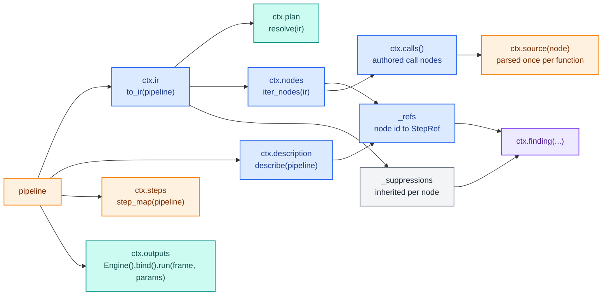
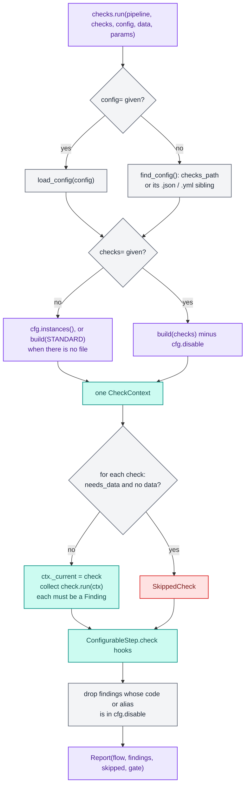
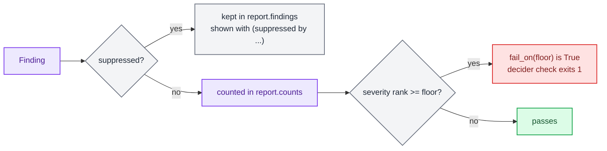
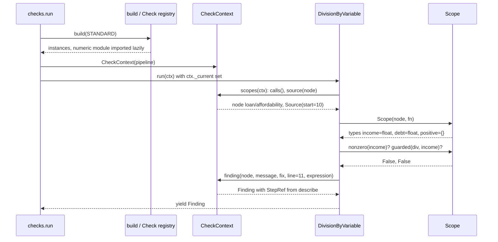

# Checks internals

`decider.lab.checks` runs diagnostics over a flow and returns a structured `Report`. Most checks read the step
source and the IR without running anything. A few need a frame, and a few run the flow. Every check has a stable
code, every finding points at a node through the same `StepRef` that [`describe`](index.md) produces, and the
project's `checks.yaml` decides what runs and what fails the build. The [checks guide](../../guides/checks.md)
covers using them; this page covers how they work.

| File | What it holds |
|---|---|
| `decider/lab/checks/__init__.py` | The public names: `Check`, `CheckContext`, `check`, `run`, `catalogue`, `standard`, `Finding`, `Report`, `Severity`, `SkippedCheck`, `Suppression` |
| `decider/lab/checks/_base.py` | `Check` (the registry root), the lazy alias table, `STANDARD`, `CheckContext`, the `@check` decorator, `registered()` |
| `decider/lab/checks/_run.py` | `run`, the `ConfigurableStep` hook pass, `catalogue` |
| `decider/lab/checks/_config.py` | `ChecksConfig`, `build`, `find_config`, `load_config` |
| `decider/lab/checks/_report.py` | `Severity`, `Suppression`, `Finding`, `SkippedCheck`, `Report` with `to_text` and `to_sarif` |
| `decider/lab/checks/_ast.py` | `Source`, `parse`, `source_file`: a step function's parsed source |
| `decider/lab/checks/_builtin/determinism.py` | DCD001 to DCD003 |
| `decider/lab/checks/_builtin/numeric/` | DCD101 to DCD110: `_scope.py` (type and bound inference), `money.py`, `floats.py` |
| `decider/lab/checks/_builtin/structure.py` | DCD201 to DCD208, including the z3 pass over trees and tables |
| `decider/lab/checks/_builtin/params.py` | DCD301 to DCD304 |
| `decider/lab/checks/_builtin/ids.py` | DCD401 to DCD403 |
| `decider/lab/checks/_builtin/data.py` | DCD502, DCD503, DCD504, DCD506: checks that need a frame |
| `decider/lab/checks/_builtin/runtime.py` | DCD501, DCD505: checks that run the flow over generated cases |

## A check is a registry module

`Check` is a `BaseRegistryModule` root in the `checks` group (see [Foundation](../foundation.md) for the
registry). That gives it, with no machinery of its own, naming from JSON by alias or by `"module:Class"` import
path, lazy built-ins, a JSON Schema per check for editor forms, and validation of options. A check class has:

| Member | Kind | Meaning |
|---|---|---|
| `type` | `Literal` field | The alias config names it by (`"division_by_variable"`) |
| `code` | `ClassVar[str]` | Stable code, never reused. Built-ins are `DCD` plus a family digit; a third-party check uses its own prefix |
| `needs_data` | `ClassVar[bool]` | The runner skips it, and lists it in `report.skipped`, when no `data=` is given |
| `executes` | `ClassVar[bool]` | It runs the flow. Shown by `catalogue()` and `decider check --list`; the runner does not gate on it |
| `severity` | field, default `warning` | The default, overridable per instance or per config entry |
| `run(ctx)` | abstract | Yields `Finding`s, normally built with `ctx.finding(...)` |

Checks are frozen pydantic models with `extra="forbid"`, so an option a check doesn't declare is a validation
error naming the check.

The 34 built-ins are registered lazily. `_base.py` calls `Check.lazy({...})` with every alias mapped to the module
that defines it, so `checks.run(pipeline, ["bare_round"])` imports only `_builtin/numeric`. `registered()` is the
full list: it loads every `decider.checks` entry point (that is how an installed package ships checks), then
resolves every name in `Check.json_schema()`. `catalogue()`, `decider check --list` and `DCD403` use it.

`checks.check(code, severity, alias)` turns a generator function `f(ctx)` into a check without a class. It builds
a `Check` subclass with `type(...)`, a `Literal` alias (the function name by default) and `run` delegating to the
function, and returns an instance ready for a `run` list.

`standard` is a tuple of aliases (`STANDARD` in `_base.py`): the 26 checks that need no data and no execution.
`table_overlap`, `table_gap`, `invalid_params_doc` and every `DCD5xx` check are opt-in.

## The check catalogue

<div class="diagram" markdown>


*The family is the digit after `DCD`. The data and runtime files share the `DCD5xx` range.*
</div>

`catalogue()` returns one row per registered check: alias, code, family, `needs_data`, `executes`, default
severity and the config JSON Schema. It derives `family` from the fourth character of a `DCD` code (`0`
determinism, `1` numeric, `2` structure, `3` params, `4` ids, `5` runtime) and calls anything else `custom`. So the
four data checks in `_builtin/data.py` are listed as `runtime`:

```text
$ decider check --list
DCD001  wall_clock  determinism  warning
DCD002  impure  determinism  warning
DCD003  mutates_input  determinism  warning
DCD101  int64_overflow  numeric  warning
...
DCD304  invalid_params_doc  params  error
DCD401  durable_ids  ids  warning
DCD402  duplicate_ids  ids  error
DCD403  unknown_suppression  ids  warning
DCD501  crash_probe  runtime  error [executes]
DCD502  nan_output  runtime  warning [needs_data] [executes]
DCD503  int64_range  runtime  warning [needs_data]
DCD504  missing_required  runtime  error [needs_data]
DCD505  mode_divergence  runtime  error [executes]
DCD506  constant_output  runtime  info [needs_data] [executes]
```

## `CheckContext`

One `CheckContext` is built per `checks.run` and shared by every check. Each attribute is computed on first use
and cached, so a run of AST-only checks never builds a wiring plan and a run without executing checks never runs
the flow.



| Member | What it is |
|---|---|
| `pipeline`, `params`, `frame` | What `run` was given (`frame` is the `data=` argument) |
| `ir` | `to_ir(pipeline)` |
| `plan` | The wiring `Plan`: reads, writes, producers, version chains, pipeline inputs and outputs |
| `description` | `describe(pipeline)`, the source of every finding's `StepRef` |
| `steps` | `step_map(pipeline)`: the step object behind each node path, used for configurable steps |
| `nodes` | Every IR node in pre-order |
| `outputs` | `(output frame, {output column: producing CallNode})` from one run over `frame` with `params`, or `None` when the run raises; the exception is kept on `ctx.crash` |
| `calls()` | Call nodes of authored code. Nodes whose function's module starts with `decider.steps` are skipped, because AST checks over generated tree, table and scorecard kernels are noise |
| `source(node)` | The parsed `Source` of the node's function, cached by function identity, or `None` when the source can't be read |
| `finding(node, message, fix=None, *, line=None, code=None, check=None, severity=None, **detail)` | A `Finding` with code, alias and severity from the running check, the node's `StepRef`, file and line filled in, and `suppressed` set when the node or an ancestor suppresses it |
| `node` | Set while a configurable step's hook or the z3 pass runs: the node being checked |
| `skipped` | Checks that couldn't run on one step; the runner appends them to `report.skipped` |

`_refs` pairs `ctx.nodes` with `ctx.description.nodes` by position, which holds because `describe` walks the IR in
the same pre-order. `describe` builds its own IR and plan, so a run that produces any finding builds the IR twice:
once for `ctx.ir` and once inside `describe`.

## The runner



`run(pipeline, checks=None, *, config=None, data=None, params=None)` in `decider/lab/checks/_run.py`:

1. Policy. `config=` names a file and `load_config` reads it; otherwise `find_config()` looks for the project's.
   With neither, there is no config.
2. The check list. Without `checks=`, it is the config's `instances()`, or `standard` when there is no config.
   With `checks=`, `build` turns the flat list into instances and the config's `disable` still removes entries.
   `build` accepts a `Check` instance, an alias (instantiated with defaults), a config dict validated through the
   registry (`{"type": "durable_ids", "severity": "error"}`), or a nested list, tuple or set such as
   `checks.standard`.
3. One `CheckContext` for the whole run.
4. Each check in order. A `needs_data` check with no `data=` becomes a `SkippedCheck` with the reason
   `needs data=; none was given`. Otherwise the runner sets `ctx._current` (so `ctx.finding` knows the code,
   alias and severity) and drains `check.run(ctx)`. Anything that isn't a `Finding` raises
   `DeciderError: check '<alias>' yielded <type>, not a Finding`. An exception inside a check propagates and ends
   the run: there is no per-check isolation.
5. The hook pass. For each step in `ctx.steps` that is a `ConfigurableStep`, the runner sets `ctx.node` to that
   step's node and collects `step.check(ctx)`. The base class returns nothing; a step type overrides it to check
   its own document, which source checks can't see. `ctx._current` is `None` here, so a hook passes `code=` and
   `check=` to `ctx.finding` itself.
6. The config's `disable` is applied once more to the collected findings, by code or by alias, so it also covers
   hook findings and findings one check emits under another check's code.
7. The `Report` carries the flow (`FlowRef` from the root origin), the findings, the skipped checks (the runner's
   plus `ctx.skipped`) and the gate: the config's `fail_on`, or `error`.

## The project config

`find_config(start=None)` expands the `checks_path` setting, default `"${PROJECT_ROOT}/checks.yaml"`, with the
same `project_root` rule datasets use (the nearest ancestor with `configs/`, else the cwd; see [Data](data.md)).
The environment variable is `DECIDER_CHECKS_PATH`. It returns the first of that path, its `.json` sibling and its
`.yml` sibling that exists.

`load_config(path)` reads JSON for a `.json` file and YAML otherwise (PyYAML, an optional dependency; a missing
install raises the usual missing-dependency error). An empty file is an empty config. Every problem is a
`DeciderError` that names the file:

```text
Error: .../proj/checks.yaml: invalid checks config:
1 validation error for ChecksConfig
checks.0
  Value error, 'nope' is not a registered Check type. Import the module that defines it first, or name it by import path, '<module>:<Class>'. [type=value_error, input_value={'type': 'nope'}, input_type=dict]
```

`ChecksConfig` has four fields:

| Field | Default | Meaning |
|---|---|---|
| `extends` | `"standard"` | `"standard"` or `null`. With `null`, only `checks` run |
| `checks` | `[]` | Check entries, each validated through the registry: an alias with options and severity, or an import path |
| `disable` | `[]` | Aliases or codes switched off project-wide |
| `fail_on` | `error` | The default gate for `Report.fail_on()` and `decider check` |

`instances()` builds the list. Entries in `checks` are deduplicated by `(type, options)`, so two entries of one
type with different options both run. A type that appears in `checks` replaces the `standard` entry of that type,
which is how `{type: durable_ids, severity: error}` promotes a check. Finally anything whose type or code is in
`disable` is dropped.

`disable` is not validated. A name that matches no alias and no code removes nothing and raises nothing. A config
with `disable: [numeric]` still runs all ten numeric checks, because `numeric` is a family, not an alias.

Here is a project with this `checks.yaml`, run against a flow with no durable ids:

```yaml
extends: standard
checks:
  - {type: durable_ids, severity: error}
  - {type: missing_required}
disable: [param_unconstrained, DCD204]
fail_on: error
```

```text
$ decider check risky:pipeline --select DCD4
error DCD401 durable_ids: flow 'loan' has no committed durable id
    fix: run `decider ids`
error DCD401 durable_ids: loan/affordability has no committed durable id
    fix: run `decider ids`
...
loan: 0 info, 0 warning, 5 error
$ echo $?
1
```

The CLI's `--select` filters findings and skipped checks by code prefix after the run; it does not change which
checks run. `--fail-on` overrides the config's gate for the exit status. The CLI imports the entry with
`import_flow`, which does not add the cwd to `sys.path`; run it from a directory where the module is importable
(or set `PYTHONPATH`), otherwise it ends in a `ModuleNotFoundError` traceback.

## Suppression

A step names the checks it silences with `suppress_checks=[alias_or_code]` on any constructor (`step`,
`frame_step`, `flow`, `dag`, `branch`, `loop`, `each`, `optimise`), as a `ConfigurableStep` field, or as a
flow-file key. The names land on the node's `Origin.suppress_checks`. Origins are kept out of compile cache keys,
so adding a suppression never recompiles.

`CheckContext._suppressions` walks the IR once and gives every node the list of `(name, path)` pairs from itself
and every ancestor. `ctx.finding` takes the first pair whose name equals the finding's code or alias and sets
`suppressed=Suppression(path=..., name=...)`. The finding stays in the report, so a review can list suppressions,
but it doesn't count in `counts`, `ok` or `fail_on`. A suppression name that matches no registered alias or code
is itself a finding, `DCD403`, with a did-you-mean hint. It is a finding and not a build error because a custom
check may not be imported when the flow is built.

## Findings and the report



`Severity` is an enum (`info`, `warning`, `error`) with a `rank` from its position. `Finding` is frozen:

| Field | Meaning |
|---|---|
| `code` | `"DCD104"`: what CI pins and users suppress |
| `check` | The alias, `"division_by_variable"` |
| `severity` | After instance and config overrides |
| `message` | What is wrong and where, in one sentence |
| `step` | The contract `StepRef`, so it joins with `describe()` nodes |
| `file`, `line` | From the step function's source when known |
| `fix` | One line saying what to do instead |
| `detail` | Machine-readable specifics: the expression, the column, the bounds |
| `suppressed` | `None`, or the `Suppression` that silenced it |

`Report` holds the `flow`, `findings`, `skipped` and `gate`. `counts` tallies unsuppressed findings per severity.
`fail_on(severity=None)` is true when an unsuppressed finding is at least that severe, defaulting to `gate`. `ok`
is `not fail_on("error")` and ignores `gate`: a project with `fail_on: warning` can have `report.ok` true while
`decider check` exits 1. The model uses `extra="ignore"` so a dumped report, which includes the computed `ok` and
`counts`, loads back.

Running `standard` over a small loan flow with a few defects gives this text form (paths shortened; the first line
is a finding suppressed on the step):

```python
import time
from decider import flow, param, step

def affordability(income: float, debt: float) -> float:
    return debt / income

@step(output="instalment")
def instalment(principal: int, months: int, rate: float = param(0.12)) -> float:
    return round(principal * (1 + rate) / months, 2)

@step(output="stamp", suppress_checks=["wall_clock"])
def stamp(income: float) -> float:
    return time.time()

def scaled(principal: int, factor: int = param(1000)) -> int:
    return principal * factor

pipeline = flow(affordability, instalment, stamp, scaled, name="loan")
print(checks.run(pipeline).to_text())
```

```text
risky.py:17: warning DCD001 wall_clock: loan/stamp reads time.time(); a wall-clock read makes the flow non-deterministic (suppressed by wall_clock on loan/stamp)
    fix: pass the value in as an input column
risky.py:21: warning DCD101 int64_overflow: loan/scaled: principal * factor is a product in int64, which wraps silently
    fix: bound the operands, or compute in float64 (exact to 2**53)
risky.py:12: warning DCD103 bare_round: loan/instalment: round(principal * (1 + rate) / months, 2) rounds differently in Python and compiled modes on .xx5
    fix: use decider.ops.decimal.round(x, n, Rounding.HALF_UP)
risky.py:7: warning DCD104 division_by_variable: loan/affordability: debt / income divides by income, which may be zero
    fix: guard it (`if b != 0`), use max(b, eps), or bound the param with gt=0
risky.py:12: warning DCD104 division_by_variable: loan/instalment: principal * (1 + rate) / months divides by months, which may be zero
    fix: guard it (`if b != 0`), use max(b, eps), or bound the param with gt=0
info DCD301 param_unconstrained: param 'rate' of loan/instalment has no bounds
    fix: add `ge=`/`le=` so a bad params document is refused
info DCD301 param_unconstrained: param 'factor' of loan/scaled has no bounds
    fix: add `ge=`/`le=` so a bad params document is refused
warning DCD401 durable_ids: flow 'loan' has no committed durable id
    fix: run `decider ids`
warning DCD401 durable_ids: loan/affordability has no committed durable id
    fix: run `decider ids`
warning DCD401 durable_ids: loan/instalment has no committed durable id
    fix: run `decider ids`
warning DCD401 durable_ids: loan/stamp has no committed durable id
    fix: run `decider ids`
warning DCD401 durable_ids: loan/scaled has no committed durable id
    fix: run `decider ids`
risky.py:16: info DCD204 unused_input: loan/stamp: argument 'income' is never used
    fix: remove the argument; if it only orders this step after its producer, keep it and suppress this check
loan: 3 info, 9 warning, 0 error, 1 suppressed
```

`report.ok` is `True` and `report.fail_on("warning")` is `True`. The order follows the check list, not the source.

`to_sarif()` produces SARIF 2.1.0, which GitHub code scanning and the VS Code SARIF viewer read. Rules are the
distinct codes with the alias as `name`; `info` maps to `note`. Each result's `partialFingerprints["decider/v1"]` is
`flow_id/step_id/code`, falling back to the report's flow id or name and to the step path when ids are missing, so a
result keeps its identity across edits once ids are committed. A suppressed finding carries an `inSource`
suppression:

```json
{
 "ruleId": "DCD001",
 "level": "warning",
 "message": {"text": "loan/stamp reads time.time(); a wall-clock read makes the flow non-deterministic"},
 "partialFingerprints": {"decider/v1": "loan/loan/stamp/DCD001"},
 "locations": [{"physicalLocation": {"artifactLocation": {"uri": "risky.py"}, "region": {"startLine": 17}}}],
 "suppressions": [{"kind": "inSource", "justification": "wall_clock on loan/stamp"}]
}
```

The JSON form is `report.model_dump_json()`, which is what the MCP `check_report` tool returns.

## Reading step source

`_ast.parse(fn, inputs)` returns a `Source`: the `ast` tree of the function, the line it starts on, its file, and
`inputs`, a map from argument name to declared annotation. It dedents first, because `inspect.getsourcelines`
keeps a nested function's indentation and `ast.parse` rejects it. It returns `None` when the source can't be read
(a builtin, a function defined at an interactive prompt); every AST check treats `None` as "nothing to inspect"
and stays quiet. `Source.line(node)` turns an AST line number into a file line.

The numeric checks need more than syntax: whether `cents` is an int, whether `months` is known to be positive.
`decider/lab/checks/_builtin/numeric/_scope.py` builds a `Scope` per step function from the IR:

- `types` maps each name to `int`, `float`, `decimal` (a `Decimal` or `Currency`) or unknown. Inputs and params
  come from their annotations, constants from `node.consts`, and local assignments by inference: the right-hand
  side's type, joined over every assignment to the name (int with float is float, decimal with int is decimal,
  anything else unknown), iterated three times so chains settle.
- `positive` is the names whose bounds prove them positive: `gt >= 0` or `ge > 0` on a param's `Field` or in
  `Annotated` metadata.
- `type_of(expr)` follows Python's rules (true division is float, a decimal operand makes most results decimal,
  `int()`, `len()`, `floor` return int, `float()`, `sqrt`, `exp`, `log` return float).
- `nonzero(expr)` is true for a non-zero constant, a positive name, a product or power of non-zero parts, and
  `max(x, c)` with a positive constant.
- `guarded(at, value)` is true when an enclosing `if`, conditional expression or `while` tests the same expression
  text, or an earlier `assert` or early-exit `if ...: return/raise` in an enclosing block mentions it.
- `money_output()` is true when an output is a `Decimal` or `Currency`.

## Worked trace: `DCD104` from source to finding

Take one step:

```python
def affordability(income: float, debt: float) -> float:
    return debt / income

pipeline = flow(affordability, name="loan")
```



Driving the same steps by hand prints each intermediate value:

```python
import ast
from decider.lab.checks import CheckContext
from decider.lab.checks._builtin.numeric._scope import scopes
from decider.lab.checks._config import build

[check] = build(["division_by_variable"])
print(type(check).__module__, type(check).__name__, check.code, check.severity)
ctx = CheckContext(pipeline)
print([n.origin.path for n in ctx.calls()])
node, src, scope = next(scopes(ctx))
print("start line", src.start, "inputs", src.inputs)
print("types", scope.types, "positive", scope.positive)
div = next(e for e in scope.walk() if isinstance(e, ast.BinOp))
print(ast.unparse(div), "nonzero", scope.nonzero(div.right), "guarded", scope.guarded(div, div.right), "line", src.line(div))
ctx._current = check
finding = ctx.finding(node, "msg", line=src.line(div))
print(finding.code, finding.check, finding.step.path, finding.line)
```

```text
decider.lab.checks._builtin.numeric.money DivisionByVariable DCD104 Severity.WARNING
['loan/affordability']
start line 10 inputs {'income': <class 'float'>, 'debt': <class 'float'>}
types {'income': 'float', 'debt': 'float'} positive set()
debt / income nonzero False guarded False line 11
DCD104 division_by_variable loan/affordability 11
```

1. `build(["division_by_variable"])` resolves the alias through the lazy table, which imports
   `_builtin/numeric/__init__.py` and with it `money.py`, and instantiates `DivisionByVariable` with its default
   severity.
2. `ctx.calls()` walks `ctx.nodes` and keeps `loan/affordability`, the one call node of authored code.
3. `ctx.source(node)` parses the function. Its `def` is on line 10 of the file, so the division on the second line
   of the function maps to line 11.
4. `Scope` reads the IR: both inputs are `float`, and neither has a bound, so `positive` is empty.
5. The check walks the body and finds a `BinOp` with `Div`. `nonzero(income)` is false (a name not in `positive`)
   and `guarded` is false (no enclosing test mentions `income`), so it yields a finding.
6. `ctx.finding` fills `code` and `check` from `ctx._current`, the `StepRef` from `ctx._refs` (built from
   `describe`), `file` from the function, and looks up suppressions for the node and its ancestors.

Either fix silences it, through a different branch of the same test:

```python
def guarded(income: float, debt: float) -> float:
    if income != 0:              # Scope.guarded: an enclosing if tests `income`
        return debt / income
    return 1.0

def clamped(income: float, debt: float) -> float:
    return debt / max(income, 1.0)   # Scope.nonzero: max with a positive constant
```

Both give no `DCD104` findings. So does declaring `income` with `Field(gt=0)`, which puts it in `positive`.

## The built-in families

Every check below reads only `ctx.calls()` (authored code) unless it says otherwise, and every AST check stays
quiet on a function whose source can't be read.

### Determinism (DCD0xx)

| Code | Alias | What it inspects |
|---|---|---|
| DCD001 | `wall_clock` | Every call in the step body, resolved to a qualified name through the function's own imports, then its module globals (a module, a function, or a bound method of a hidden instance such as `from random import random`). It reports calls to `time.time` and the other `time` clocks, `datetime.datetime.now`/`utcnow`/`today`, `datetime.date.today`, the `random` functions, `uuid.uuid1`/`uuid4`, the `secrets` functions and `os.urandom` (resolved from `posix.urandom`). `detail.call` is the call text |
| DCD002 | `impure` | `global` and `nonlocal` statements, and mutable defaults (a list, dict or set literal, or a `list()`, `dict()`, `set()` call) on positional and keyword-only arguments. The message says why: served steps run concurrently on one `Executable` |
| DCD003 | `mutates_input` | Arguments changed in place: a mutating method (`append`, `extend`, `insert`, `pop`, `remove`, `clear`, `update`, `sort`, `reverse`, `add`, `discard`, `setdefault`, `popitem`, `fill`), any method with `inplace=True`, or item, attribute or augmented assignment and `del` on a target rooted in an argument. An argument rebound anywhere in the body (`xs = list(xs)`) counts as a copy and is not checked |

All three default to `warning`. Reads of the environment, files or the network are not detected.

### Numeric (DCD1xx)

All ten use the `Scope` above, so they know which names are ints, floats and decimals.

| Code | Alias | What it inspects | Severity |
|---|---|---|---|
| DCD101 | `int64_overflow` | `*`, `**` and `<<` (unless both sides are constants), and `+=` inside a `for` or `while`, when both operands are int, or a decimal is involved and no float is | warning; error when a decimal is involved and the instance kept the default severity |
| DCD102 | `float_money` | `int(x * 100)` truncation, and a float-typed `return` from a step whose output is a `Decimal` or `Currency` | warning |
| DCD103 | `bare_round` | The builtin `round` (unless the module rebinds `round`) and `np.round`, `np.around`, `numpy.round`, `numpy.around` | warning; error on a money output |
| DCD104 | `division_by_variable` | `/`, `//`, `%` and their augmented forms whose divisor isn't `nonzero` and isn't `guarded` | warning |
| DCD105 | `int_true_division` | `/` between two int-typed operands that aren't both constants | info |
| DCD106 | `pow_exp_overflow` | `**` (DCD101 owns int to int powers), `exp`/`expm1`, and `pow`/`power`, when the exponent is neither a constant nor a `min`/`clip`/`minimum` call | warning |
| DCD107 | `float_equality` | `==` or `!=` with a float constant on either side, or between two float-typed names; one finding per comparison | warning |
| DCD108 | `nan_propagation` | An ordering comparison on a float input when no `isnan`/`isfinite`/`isinf` call in the body mentions it (once per name), and `sqrt`, `log`, `log2`, `log10`, `log1p` of an argument that isn't provably in domain | info |
| DCD109 | `accumulator_dtype` | Outputs of a loop body call that are loop carries, and outputs of an `each` accumulate call: `float32` always, int when the body's return grows by multiplication or by adding two non-constants (a counter `i + 1` doesn't count) | warning |
| DCD110 | `unsafe_cast` | Narrowing casts named `int8`, `int16`, `int32`, `uint8`, `uint16`, `uint32`, `float16`, `float32`, and `float(x)` on a decimal | warning |

The severity promotion in DCD101 and DCD103 passes `severity=Severity.ERROR` to `ctx.finding` only when the
instance's severity is still `warning`, so a config that sets `severity: info` on the check keeps it at info.

### Structure (DCD2xx)

| Code | Alias | What it inspects | Severity |
|---|---|---|---|
| DCD201 | `unreachable_branch` | Two passes. A z3 pass over every `TreeConfig` and `DecisionTableConfig` step (below). Then every `BranchNode`'s condition function: the `int` and `bool` constants its `return` statements give. An index past the last arm is a finding; when every return is a constant, each arm no constant picks is a finding | warning |
| DCD202 | `dead_output` | A value a call writes that nothing reads (no call reads that version, it is not a pipeline output, not a branch merge input, not a loop carry and not an `each` column or new field), with no later write of the same name under the same parent | info |
| DCD203 | `shadowed_write` | The same unused write when a later step under the same parent writes the same name: the later write wins | warning |
| DCD204 | `unused_input` | An argument whose name never appears in the function body; skipped when the body calls `locals()` or `vars()` | info |
| DCD205 | `unbounded_loop` | A loop with `max_iterations` above 100,000, or a condition that reads none of the carried names | warning |
| DCD206 | `opaque_frame_step` | A `frame` call node that doesn't declare its inputs or outputs | info |
| DCD207 | `table_overlap` | Emitted by the z3 pass: two live rows that can both match one input, with an example | info |
| DCD208 | `table_gap` | Emitted by the z3 pass: an input no row matches, with an example | info; warning when the table has no `default` |

DCD202 and DCD203 skip condition calls and frame steps with unknown outputs. `TableOverlap` and `TableGap` are
registered classes whose `run` yields nothing, so they exist for the catalogue, for config and for suppression;
their findings come from `unreachable_branch`, which is in `standard`. `disable: [table_overlap]` drops them
through the runner's final filter.

The z3 pass imports `decider.lab.diff._smt` at call time. Without the `prove` extra it adds a `SkippedCheck`
(`install decider[prove] to check this step's branches`) and moves on. A step the encoding can't model is skipped
with the solver's reason, and a table too large to compare in pairs skips DCD207 for that table. With z3
installed, a four-row pricing table with a covered row, an overlap and a gap below zero gives:

```text
warning DCD201 unreachable_branch | pricing/bands: row 2 (pricing/bands#2) can never win; the rows above it match everything it would | {'row': 2}
info DCD207 table_overlap | pricing/bands: rows 0 and 1 both match {'score': 550.0000305175781}; row 0 wins | {'rows': [0, 1], 'example': {'score': 550.0000305175781}}
warning DCD208 table_gap | pricing/bands: no row matches {'score': -5.509016039626555e-281}; it takes null outputs, the table has no default | {'example': {'score': -5.509016039626555e-281}}
```

The examples are whatever model z3 returns: any value in the overlap or the gap. The rows were
`[0, 600] low`, `[550, 700] mid`, `[560, 580] narrow`, `[700, ∞) high`, with no default. The solver encoding is
J's territory; see [Diff](diff.md).

### Params (DCD3xx)

| Code | Alias | What it inspects | Severity |
|---|---|---|---|
| DCD301 | `param_unconstrained` | An `int` or `float` `param()` with no `ge`/`gt`/`le`/`lt`, or a `Percent` without `ge >= 0` and `le <= 1` | info; at least warning for a `Percent` |
| DCD302 | `param_default_out_of_bounds` | A default that fails validation against the param's own bounds, and any param with `on_invalid="default"`, which swaps a bad value for the default without a warning | warning |
| DCD303 | `param_unused` | A declared param whose argument name never appears in a scalar step's body. Row kernels are skipped because they receive params by position | warning |
| DCD304 | `invalid_params_doc` | Runs `pipeline.parameters().validate(params)` and reports each error at the node whose path starts the message, or at the flow. Needs `params=`; without one it yields nothing and is not listed as skipped | error, opt-in |

### Ids (DCD4xx)

| Code | Alias | What it inspects | Severity |
|---|---|---|---|
| DCD401 | `durable_ids` | The root flow, when it has a path and no id, and every call node with no id except the helper calls that belong to their parent: a branch or loop condition, an `each` accumulate call, a state machine's transition function. Composite nodes below the root are not checked | warning |
| DCD402 | `duplicate_ids` | One id on two nodes with different paths. Nodes inside one row kernel share a path and an id by design and are not reported | error |
| DCD403 | `unknown_suppression` | Each `suppress_checks` entry that is neither a registered alias nor a registered code (entry points included), with a did-you-mean hint | warning |

### Data (`_builtin/data.py`, opt-in)

| Code | Alias | Needs | What it inspects | Severity |
|---|---|---|---|---|
| DCD504 | `missing_required` | data | Each pipeline input whose null policy is `REQUIRED`: absent from the frame, or with null rows. Reported at the first call that reads it | error |
| DCD502 | `nan_output` | data, executes | Float output columns of `ctx.outputs` with NaN or infinite rows, reported at the producing call | warning |
| DCD503 | `int64_range` | data | Interval arithmetic: each input column's observed `[min, max]` pushed through `+`, `-`, `*` in the step source. An int result reaching 2^63 is reported, as is a float `+=` term past 2^53. Calls, assignments inside `if`/`for`/`while`, and anything else unknown are never flagged. It does not run the flow | warning |
| DCD506 | `constant_output` | data, executes | An output column with one distinct value over two or more rows | info |

`int64_range` turns a static `DCD101` suspicion into a measured one. On this data:

```python
def exposure(limit_cents: int, multiplier: int) -> int:
    return limit_cents * multiplier
```

```text
DCD503 int64_range warning | risk/exposure: limit_cents * multiplier reaches [10, 18000000000000000000] on this data, beyond the int64 range | {'expression': 'limit_cents * multiplier', 'lo': 10, 'hi': 18000000000000000000}
```

`missing_required` reports a dropped column at its reader:

```text
required input column 'debt' is not in the data and has no default
```

`nan_output` and `constant_output` share `ctx.outputs`, one run of the flow in the default mode over the frame and
params, and look only at columns present in that run's output frame. With a NaN income in the data and a step
that always returns `1`:

```text
DCD502 nan_output warning | output 'rounded' has 1 NaN and 0 infinite row(s) on this data | risk/rounded
DCD506 constant_output info | output 'band' is 1 on all 3 rows of this data | risk/band
```

When that run raises, `ctx.outputs` is `None`, the exception is stored on `ctx.crash`, and both checks stay quiet.
No built-in check reads `ctx.crash`. In the example above, the unscaled `multiplier` column made `exposure`
overflow (`OverflowError('Python int too large to convert to C long')`), and the same two checks returned no
findings at all. `crash_probe` doesn't cover this case, because it runs over generated cases rather than over
`data=`. Run the flow over the data yourself when these two checks are silent.

### Runtime (`_builtin/runtime.py`, opt-in)

| Code | Alias | What it does | Severity |
|---|---|---|---|
| DCD501 | `crash_probe` | Binds the flow once and runs every frame of `testing.corpus(pipeline)` with `params`. Each exception is a finding at the flow root, naming the case frame | error |
| DCD505 | `mode_divergence` | Calls `testing.assert_equivalent(pipeline, frame, params, modes)` for every corpus frame. An `AssertionError` is a finding; any other exception is ignored, since `crash_probe` reports crashes. `modes` is an option, default all three | error |

Neither needs `data=`; both build their own inputs. Over a flow that divides by an unguarded `income`:

```text
DCD501 case 'boundary': ZeroDivisionError: division by zero
DCD501 case 'chunked': ZeroDivisionError: division by zero
```

The `single` and `empty` frames don't reach the zero-income row. How the corpus and the mode comparison work is on
the [Testing helpers](testing.md) page.

## The `ConfigurableStep.check` hook

AST checks can't see inside a tree, table or scorecard document; the generated kernels are excluded from
`ctx.calls()`. `ConfigurableStep.check(self, ctx)` is the seam for a step type to report on its own document. The
runner calls it for every configurable step after the registered checks, with `ctx.node` set, and the findings go
through the same suppression lookup and `disable` filter. A user's own `ConfigurableStep` gets the seam with no
registration.

The built-in tree and decision-table configs don't override the hook. Their structural checks live in the
`unreachable_branch` z3 pass, which iterates `ctx.steps` for `TreeConfig` and `DecisionTableConfig` instances
itself. No scorecard check exists.

## Writing a check

The [checks guide](../../guides/checks.md) has the user-level recipes. The mechanics:

- Subclass `Check`, give it a `type: Literal["..."]` alias and a `code` with your own prefix, set `needs_data`
  if it reads `ctx.frame`, and yield `ctx.finding(...)` from `run`. Options are ordinary pydantic fields and show
  up in `catalogue()`'s schema.
- Config names it by alias once its module is imported, or by `"package.module:Class"` at any time. An installed
  package can register its module under the `decider.checks` entry-point group so `registered()` sees it.
- Use `ctx.calls()` and `ctx.source(node)` rather than walking the IR yourself, so generated kernels are skipped and
  sources are parsed once per run.
- Put machine-readable values in `**detail`; editors and SARIF consumers read them.

## Why it is shaped this way

The redesign replaced two packages (`decider.check` and `decider.checks`) that imported
each other; checks that were plain callables with no stable code, configuration, suppression or listing; three
report shapes; an IR rebuilt by every check; findings with a weaker step reference that couldn't join to
`describe()` nodes; a numeric check that was pure AST with no type knowledge, so it flagged `cents * rate / 12`
and missed `a / b` and bare `round()`; and no CLI or gate, so CI had to write Python.

The redesign made a check a registry module so JSON, VS Code and MCP can name and configure it, built one shared
context, gave every finding the contract `StepRef`, and made the numeric checks read types and bounds from the
IR. Two rules shape the API: decider reports and the client decides (`Report.ok` and `--fail-on` are
the gate; default severity is advice), and nothing is skipped silently (a check that needs data and didn't get it
is in `report.skipped`). The suppression lives on the step (there are no inline `# ignore` comments and no suppressions by id in config), so it moves with the step
and is reviewed in the same diff. Check policy lives in `checks.yaml` beside `configs/` and not inside it, because
`configs/` is the versioned runtime store that `decider serve` stages and activates, and check policy is never
served.

## Where to go next

- [The checks guide](../../guides/checks.md) for running checks and writing your own.
- [Testing helpers](testing.md) for the corpus and `assert_equivalent` behind `DCD501` and `DCD505`.
- [Data](data.md) for `checks.yaml` discovery and the frames the data checks read.
- [The lab overview](index.md) for `StepRef` and `describe`.
