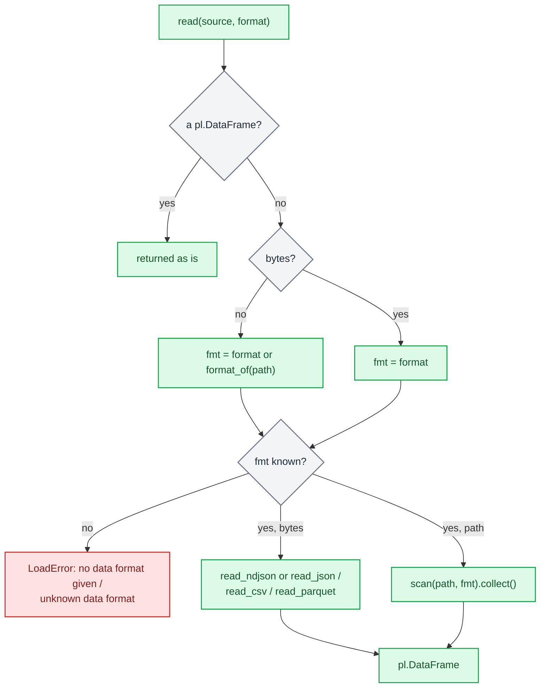
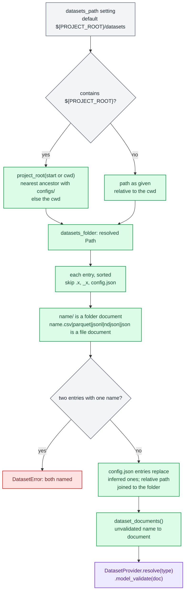
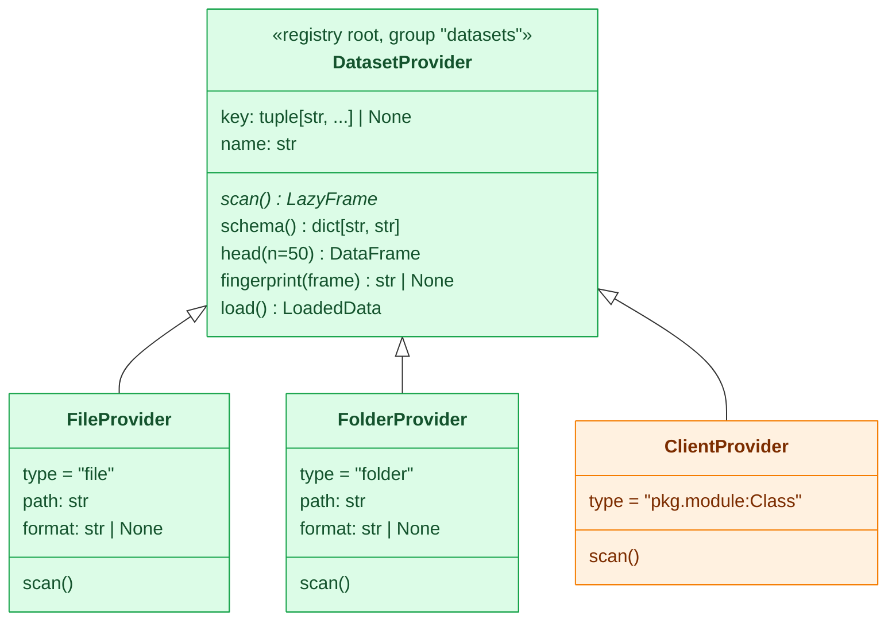
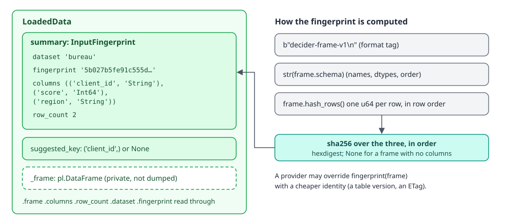

# Data

`decider.lab.data` gets data into the lab and the editors. It reads one file into a polars frame, finds a
project's named datasets and the provider behind each one, checks record keys, and wraps a loaded frame with
the schema, row count and content fingerprint that a run records. The user-level walkthrough is in the
[data and datasets guide](../../guides/data-and-datasets.md); this page covers how it works.

| File | What it holds |
|---|---|
| `decider/lab/data/__init__.py` | The public names: `read`, `scan`, `datasets`, `dataset`, `DatasetProvider`, `FileProvider`, `FolderProvider`, `LoadedData`, `InputFingerprint` and the error classes |
| `decider/lab/data/_formats.py` | `format_of` (suffix to format) and `scan` (format to polars reader): the one table every reader uses |
| `decider/lab/data/_load.py` | `read`, `LoadedData`, `InputFingerprint`, `LoadError` and the frame fingerprint |
| `decider/lab/data/_keys.py` | `suggest_key`, `check_key` and the `RecordKeyError` family |
| `decider/lab/data/_providers/base.py` | `DatasetProvider`, the registry root for one dataset, and `DatasetError` |
| `decider/lab/data/_providers/files.py` | The two built-in providers, `FileProvider` (`type: file`) and `FolderProvider` (`type: folder`) |
| `decider/lab/data/_providers/catalog.py` | `project_root`, `datasets_folder`, `dataset_documents`, `datasets`, `dataset`: finding and validating the catalogue |

`data` imports nothing else from the lab, so `checks`, `diff` and `experiments` can all build on it (see
[the lab overview](index.md)).

## Formats

`format_of(path)` looks only at the suffix, case-insensitively: `.json`, `.jsonl` and `.ndjson` are `json`,
`.csv` is `csv`, `.parquet` is `parquet`, and anything else is `None`. `scan(path, format=None)` maps the format
to a polars reader:

| Format | Suffix | Reader | Lazy? |
|---|---|---|---|
| `parquet` | `.parquet` | `pl.scan_parquet` | yes |
| `csv` | `.csv` | `pl.scan_csv` | yes |
| `json` | `.jsonl`, `.ndjson` | `pl.scan_ndjson` | yes |
| `json` | `.json` | `pl.read_ndjson`, falling back to `pl.read_json`, then `.lazy()` | no |

A `.json` file is either a Redshift `UNLOAD` export (one object per line) or an array of objects, and the two
can't be told apart without reading, so `scan` reads it eagerly: newline-delimited first, an array if that fails.
For a large export, name it `.jsonl` to get a real lazy scan. `scan` raises a plain `ValueError` for a path with no
known format and no `format=`; it is the only reader that doesn't wrap its errors in `LoadError`.

## `read`

`read(source, *, format=None)` returns an eager `pl.DataFrame`. It accepts a path, `bytes`, or a frame that is
already loaded.



Every exception on the way, including the reader's own, is caught and re-raised as
`LoadError("could not load '<file name>': <reason>")`, chained to the original. For `bytes` the file name is
empty. These are the real messages:

```python
from decider.lab.data import LoadError, read

print(read(b'{"income": 1000.0}\n{"income": 500.0}\n', format="json").height)   # 2
read("missing.parquet")
read(b"income\n1\n")
```

```text
2
LoadError: could not load 'missing.parquet': No such file or directory (os error 2): missing.parquet
LoadError: could not load '': no data format given; pass format='json'|'csv'|'parquet' or use a .json/.csv/.parquet path
```

`read` doesn't fingerprint, suggest a key or name a dataset. Those come with `LoadedData`, which a provider's
`load()` builds.

## Named datasets

A project keeps its named datasets in one folder. Every client of the catalogue (the editor's Datasets view, the
`--data` option of `decider check` and `decider diff`, an experiment's `input.dataset`) resolves names the same way.



### Where the folder is

`DeciderSettings.datasets_path` defaults to `"${PROJECT_ROOT}/datasets"`. The settings class reads environment
variables with the prefix `Decider_`, case-insensitively, so `DECIDER_DATASETS_PATH` overrides it.
`${PROJECT_ROOT}` is the only placeholder, and `datasets_folder(start, path)` expands it with
`project_root(start)`: the nearest ancestor of `start` (a file or a directory, default the cwd) that holds a
`configs/` directory, the same rule `decider serve` uses to find a project. With no such ancestor it falls back to
the cwd. Any other relative path is relative to the cwd.

The default goes through the project root because the VS Code extension launches Python with the cwd set to the
flow file's directory, which may be deep inside the project. One trap: `decider serve`
loads `.env` with python-dotenv, which expands `${...}` even inside single quotes, so writing `${PROJECT_ROOT}`
in a `.env` turns into an empty string (`/datasets`). Use an absolute or cwd-relative path there.

`checks.yaml` is found the same way through a `checks_path` setting (see [Checks](checks.md)), which is why
`project_root` lives here and `checks` imports it.

### What counts as a dataset

`dataset_documents(start, path)` lists the folder and returns `{name: provider document}` without validating
anything. Given this folder:

```text
dataproj/
├── configs/
└── datasets/
    ├── applications.jsonl
    ├── bureau/
    │   ├── region=na/part-0.parquet
    │   └── region=za/part-0.parquet
    ├── clients.parquet
    └── config.json
```

with this `config.json`:

```json
{"applications": {"type": "file", "path": "applications.jsonl", "key": ["application_id"]}}
```


The documents are (paths shortened):

```text
applications {'type': 'file', 'path': '.../datasets/applications.jsonl', 'key': ['application_id']}
bureau {'type': 'folder', 'path': '.../datasets/bureau'}
clients {'type': 'file', 'path': '.../datasets/clients.parquet'}
```

The rules, in order:

1. Entries are visited in sorted order. A name starting with `.` or `_`, and `config.json` itself, are skipped.
2. A directory becomes `{"type": "folder", "path": ...}` named after the directory.
3. A file whose suffix is `.csv`, `.parquet`, `.jsonl`, `.ndjson` or `.json` becomes `{"type": "file", "path": ...}`
   named after its stem. Other files are ignored.
4. Two inferred entries with one name are an error, even when only the suffix differs:
   `DatasetError: datasets '.../loans.csv' and '.../loans.jsonl' are both named 'loans'`.
5. Each entry of `config.json` replaces an inferred dataset of the same name. That is how a plain folder gets a
   `key`. A relative `path` in an entry is joined to the datasets folder; a path containing `://` (an `s3://` URL)
   is left alone. There is no other substitution: `config.json` gets no `${...}` expansion.

Listing never opens a data file.

### Validating: `datasets()` and `dataset(name)`

`_validated(name, doc)` resolves the document's `type` through the `DatasetProvider` registry, validates the
document into that class, and stores the name on a private attribute (`provider.name`). The two public entry
points differ in how they treat a bad entry:

- `datasets(start, path)` validates every entry and raises one `DatasetError` that names all the bad ones, so a
  user fixing `config.json` sees every problem at once.
- `dataset(name, start, path)` validates only the entry asked for, so a broken sibling never stops a run.
  Experiments, the debug bridge and the CLI use this one.

```text
DatasetError: invalid datasets:
bad: 1 validation error for FileProvider
path
  Field required [type=missing, input_value={'type': 'file'}, input_type=dict]
    ...
worse: 'nope' is not a registered DatasetProvider type. Import the module that defines it first, or name it by import path, '<module>:<Class>'.

DatasetError: unknown dataset 'loans'; known: applications, bureau, clients
```

## Providers

A provider is one dataset: where it lives and how to read it. The catalogue is only `name -> provider`.



`DatasetProvider` is a `BaseRegistryModule` root (the same registry machinery behind checks, configurable steps, config stores and experiment metrics; see
[Foundation](../foundation.md)) with `extra="forbid"`. Subclasses are named by a `type` alias or by import path.
The two built-ins are registered lazily: `file` and `folder` map to `decider.lab.data._providers.files`, which is
imported only when one of them is resolved. A client class such as a Redshift or Athena table is named in
`config.json` by `"package.module:Class"` and imported on demand; it reads its own credentials. Decider does no
`${VAR}` substitution for it.

Only `scan()` is abstract. The rest have defaults built on it:

| Method | Default |
|---|---|
| `schema()` | `scan().collect_schema()` as `{column: dtype string}`; for Parquet this reads metadata, not rows |
| `head(n=50)` | `scan().head(n).collect()` |
| `fingerprint(frame)` | The content hash below; override it when the source has a cheaper identity |
| `load()` | `scan().collect()`, `check_key` when `key` is set, then `LoadedData.from_frame` with `suggested_key = key or suggest_key(columns)` and `fingerprint = self.fingerprint(frame)` |

A subclass that overrides `fingerprint` changes what a run manifest binds:

```python
import typing as t
import polars as pl
from decider.lab.data import DatasetProvider

class Bureau(DatasetProvider):
    type: t.Literal["bureau"] = "bureau"
    snapshot: str

    def scan(self) -> pl.LazyFrame:
        return pl.LazyFrame({"client_id": ["C-1", "C-2"], "score": [640, 580]})

    def fingerprint(self, frame: pl.DataFrame) -> str | None:
        return f"bureau-snapshot-{self.snapshot}"

print(Bureau(snapshot="2026-09", key=("client_id",)).load().summary.model_dump())
```

```text
{'dataset': '', 'fingerprint': 'bureau-snapshot-2026-09', 'columns': (('client_id', 'String'), ('score', 'Int64')), 'row_count': 2}
```

`dataset` is empty because the provider was built directly; only the catalogue sets the name.

### `FileProvider`

`FileProvider(path, format=None, key=None)` is one file, a glob or an `s3://` URL. `scan()` takes `format` or
infers it from the suffix and hands off to `_formats.scan`. A path with no known suffix and no `format` raises
``DatasetError: cannot infer the format of '...'; set `format` to json, csv or parquet``. Remote paths work through
polars' own scanners with default credentials, which is why there is no separate `s3` type.

### `FolderProvider`

`FolderProvider(path, format=None, key=None)` is a dataset split into part files. A folder has exactly one format.
The format is inferred once per instance (cached on `_found`):

1. A remote path (`://`) can't be listed, so it needs `format`, else
   ``DatasetError: cannot list the remote folder 's3://bucket/loans'; set `format` to json, csv or parquet``.
2. Locally, every file under the folder (recursively, skipping anything under a hidden directory or named with a
   leading `.`) with a known suffix is grouped by format.
3. No files is `no data files in folder '...'`. More than one format is `mixed formats in folder '...': csv, parquet`.
   An explicit `format` with no files of that format is `no {fmt} files in folder '...'`.

Then `scan()` builds one glob:

| Format | Glob | Notes |
|---|---|---|
| `parquet` | `{path}/**/*.parquet` with `hive_partitioning=True` | `region=za/` directories become a `region` column |
| `csv` | `{path}/*.csv` | top-level parts only |
| `json` | `{path}/*{suffix}` through `scan_ndjson` | `suffix` is the first JSON suffix found, in sorted order |

Inference looks at files recursively, but the CSV and JSON globs read only the top level, and a folder holding
both `.json` and `.jsonl` parts reads only the `.json` ones. Keep CSV and JSON parts flat and under one suffix.

The `bureau` folder above loads with its partition column:

```text
┌───────────┬───────┬────────┐
│ client_id ┆ score ┆ region │
│ ---       ┆ ---   ┆ ---    │
│ str       ┆ i64   ┆ str    │
╞═══════════╪═══════╪════════╡
│ C-1       ┆ 640   ┆ za     │
│ C-2       ┆ 580   ┆ na     │
└───────────┴───────┴────────┘
```

## Record keys

A key is the set of columns that identifies one record. It matters wherever a record has to be found again: a
debug reproduction, an experiment's per-record result, a [`RecordRef`](index.md).

`suggest_key(columns)` is a heuristic and only a suggestion: the column named exactly `id`, else the first column
ending in `_id`, else the first starting with `id_`, else `None`. It never checks the data.

`check_key(frame, key)` is the validation. It raises:

| Error | When | Message |
|---|---|---|
| `MissingKeyColumnError` | a key column isn't in the frame | `key column ['loan_id'] is not in the data` |
| `MissingRecordKeyError` | any key value is null | `2 record(s) have a null value in the key columns ['client_id']` |
| `DuplicateRecordKeyError` | two rows share a key | `the key columns ['application_id'] do not uniquely identify every record` |

All three subclass `RecordKeyError`, which is both a `DeciderError` and a `ValueError` and maps to HTTP 400. An
empty key passes. A provider's `key` replaces the suggestion and is checked on every `load()`:

```text
DuplicateRecordKeyError: the key columns ['application_id'] do not uniquely identify every record
```

The check runs in `load()` only. `scan()`, `schema()` and `head()` don't check keys, and an experiment reads its
input with `dataset(name).scan()`, so a duplicate key in an experiment's input is not caught by the provider.

## `LoadedData` and `InputFingerprint`

<div class="diagram" markdown>


*The `bureau` dataset after `load()`. The frame is a private attribute, so dumping `LoadedData` never serialises data.*
</div>

`InputFingerprint` is the identity and shape of an input, small enough to put in a manifest: `dataset` (the name),
`fingerprint` (the content hash), `columns` (`(name, dtype)` pairs in column order, which is part of identity) and
`row_count`. It is frozen with `extra="forbid"`.

`LoadedData` is the loaded dataset: `summary` (an `InputFingerprint`), `suggested_key`, and the frame held in a
pydantic private attribute so `model_dump()` never includes data. `frame`, `columns`, `row_count`, `dataset` and
`fingerprint` are read-only properties. `LoadedData.from_frame(frame, dataset="", suggested_key=None,
fingerprint=None)` builds one from any frame, computing the fingerprint when none is passed.

The default fingerprint is a SHA-256 over the bytes `decider-frame-v1\n`, then `str(frame.schema)`, then
`frame.hash_rows()` as raw bytes. Consequences:

- It is sensitive to column names, dtypes, column order and row order. The same rows in a different order are a
  different fingerprint.
- A frame with no columns has no fingerprint (`None`).
- It rests on polars' `hash_rows`, which polars does not promise to keep stable across polars versions. Compare
  fingerprints made by the same environment.

Who builds them:

| Caller | How |
|---|---|
| `DatasetProvider.load()` | `from_frame` with the provider's name, key and `fingerprint()` |
| `decider/_tooling/bridge/rows.py` (`load_rows`) | A path goes through `read`, named after the file, with `suggest_key`; inline rows are wrapped with no name and no key |
| Experiment manifests | An eager frame gets `from_frame(...).summary`; a lazy input gets an `InputFingerprint` with the schema and row count but no content fingerprint |
| The bridge `Status` reply | Carries the `InputFingerprint` of the data a debug session started on |

## Errors

| Class | Bases | Raised by |
|---|---|---|
| `LoadError` | `DeciderError` (HTTP 400) | `read`, for every failure |
| `DatasetError` | `DeciderError`, `ValueError` (HTTP 400) | the catalogue and the built-in providers |
| `RecordKeyError` and its three subclasses | `DeciderError`, `ValueError` (HTTP 400) | `check_key`, through `load()` |
| `ValueError` | | `scan(path)` with no known format |

## Who uses it

- The editor bridge's dataset commands in `decider/_tooling/bridge/datasets.py`: `datasets(file)` lists names,
  types, keys and local paths, and calls `dataset(name)` per entry only to read its key, catching the error so one
  bad entry shows its message without hiding the rest; `dataset_schema` returns columns and, for Parquet only, a
  row count; `dataset_head` returns the first rows.
- `decider check --data` and `decider diff --data` take a path or a dataset name: an existing path goes through
  `read`, anything else through `dataset(name).load().frame`.
- The MCP `check_report` tool takes `data` as a path and reads it with `read`; it does not resolve dataset names.
- Experiments read `input.dataset` through `dataset(name, start=definition_file).scan()` (see
  [Experiments](experiments.md)).

## Why it is shaped this way

The decisions:

- A provider is one dataset. The catalogue is a dictionary built from the folder.
- Clients bring their own sources as `DatasetProvider` subclasses named by import path. An earlier design used a
  side-effect-imported extensions folder; the registry already does lookup by import path, lazy aliases and
  `json_schema()` for editor forms, so the providers reuse it.
- The built-ins are `file` and `folder` only. `s3://` works through polars, so no `s3` type exists.
- A folder has one format, and mixed formats are an error.
- Providers are read-only. A `save(frame, mode)` was considered and left out: the editor panel would never offer
  it, and write modes would add surface to every provider.
- An explicit `config.json` entry beats an inferred one, and Python is the only source of truth: the VS Code
  extension asks the bridge and keeps no datasets setting of its own.

## Where to go next

- [The data and datasets guide](../../guides/data-and-datasets.md) for the user-level tasks.
- [Checks](checks.md) for the data checks (`missing_required`, `nan_output`, `int64_range`, `constant_output`).
- [Experiments](experiments.md) for how a run manifest binds its input.
- [Editor bridge](../editor-bridge.md) for the Datasets view.
