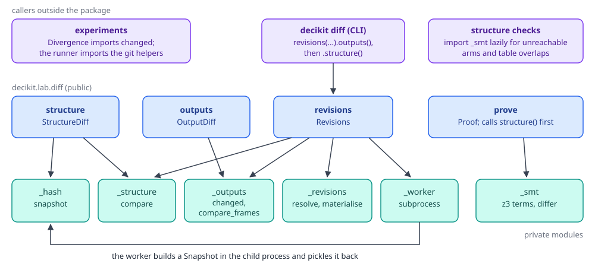
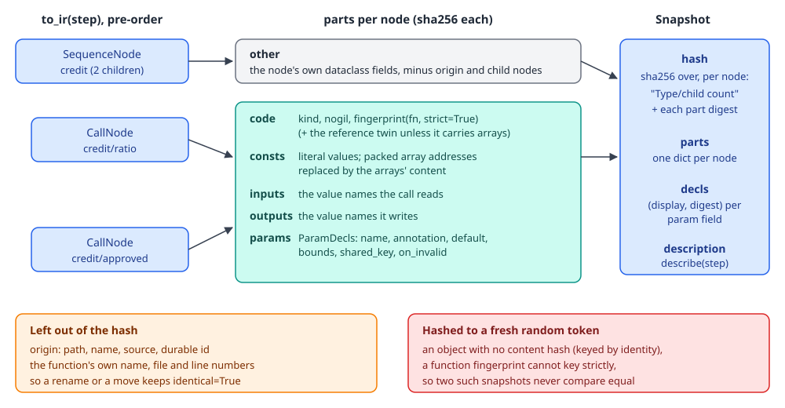
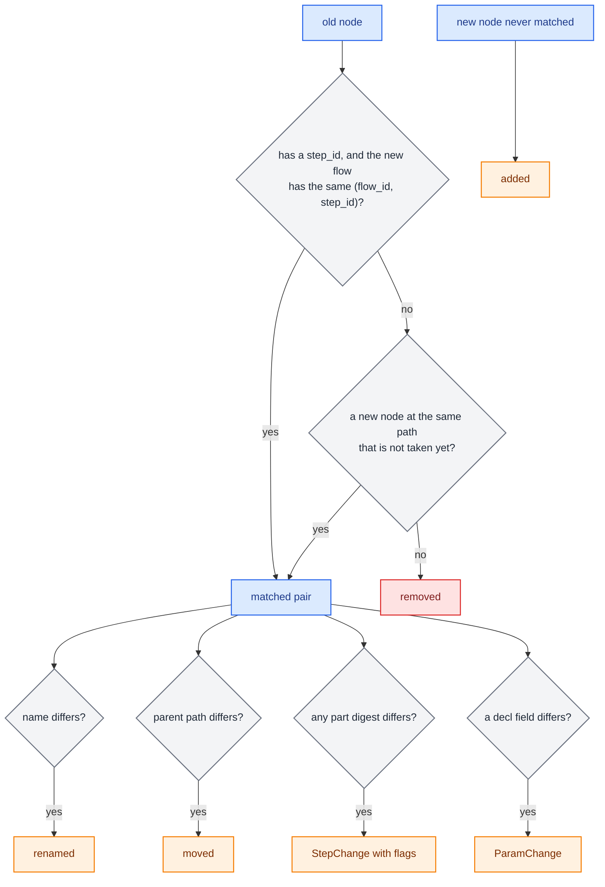
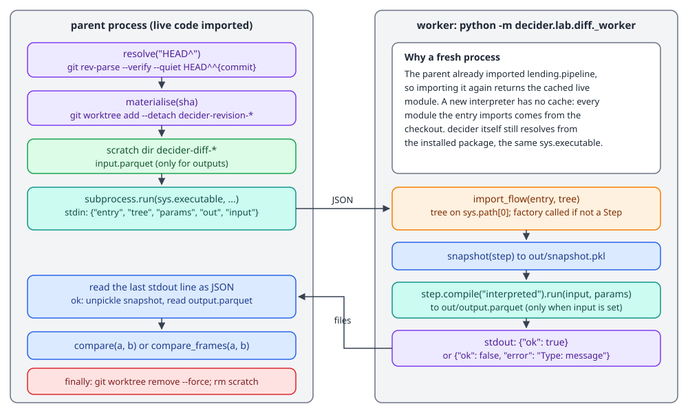
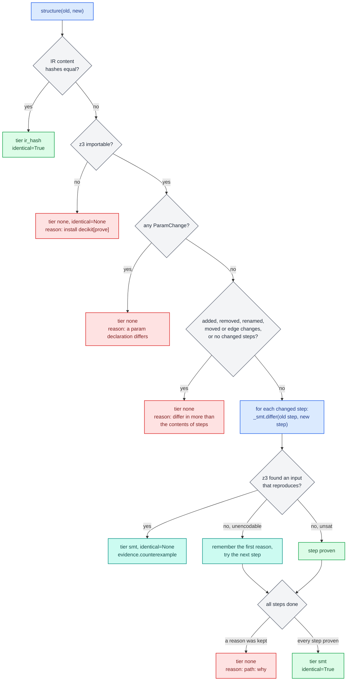
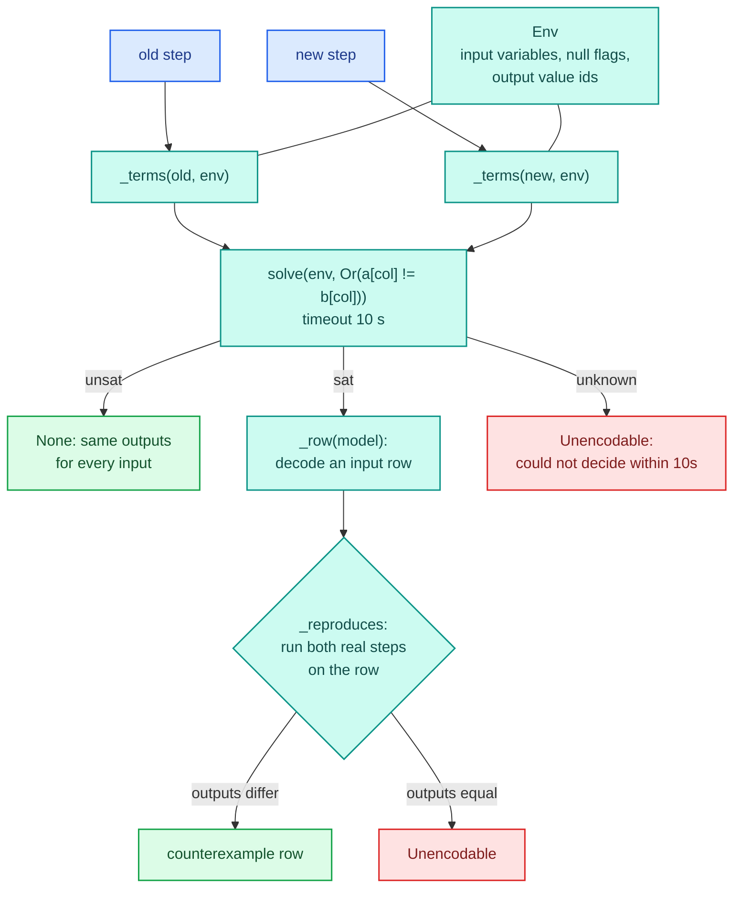

# Diff and proof

`decikit.lab.diff` answers questions about two versions of one pipeline. What changed in the code, params and wiring? Which rows of a frame come out different, and by how much? What changed between two git commits? Do the two versions provably compute the same thing? Each question has one function, and they share one data structure: a `Snapshot` of a flow's IR with a content hash per node.

The user-facing walkthrough is in [Diff and equivalence](../../guides/diff-and-equivalence.md). This page covers how the package works inside: the snapshot and its hash, how steps are matched across versions, how two git revisions are loaded without mixing their code, and how `prove` decides, including the z3 encoding of trees and decision tables.

## Where it lives

| File | What it holds |
|---|---|
| `decikit/lab/diff/__init__.py` | The public names: `structure`, `outputs`, `revisions`, `prove` and their result models |
| `decikit/lab/diff/_hash.py` | `Snapshot` and `snapshot(step)`: the IR content hash and the per-node parts |
| `decikit/lab/diff/_structure.py` | `StructureDiff` and its parts, step matching, `compare(a, b)` over two snapshots |
| `decikit/lab/diff/_outputs.py` | `OutputDiff`, `ColumnDiff`, the `changed` primitive and `compare_frames` |
| `decikit/lab/diff/_revisions.py` | `resolve`, `materialise`, `remove`, `compatible` and the `Revisions` class |
| `decikit/lab/diff/_worker.py` | The subprocess that loads one revision and writes its snapshot and output |
| `decikit/lab/diff/_prove.py` | `Proof`, `SmtEvidence` and the tier ladder in `prove` |
| `decikit/lab/diff/_smt.py` | Tree and decision-table steps as z3 terms; also the satisfiability helpers checks use |

Three other packages reach into it. The `decikit diff` command (`decikit/_tooling/cli/_diff.py`) is a thin wrapper over `revisions`. The structure checks in `decikit/lab/checks/_builtin/structure.py` import `_smt` lazily for `unreachable_arms` and `table_structure` (see [Checks internals](checks.md)). [Experiments](experiments.md) use `changed` inside the `Divergence` metric and the git helpers (`resolve`, `materialise`, `remove`, `compatible`) for revision scenarios.

<div class="diagram" markdown>

</div>

## Snapshot and the IR content hash

Every comparison that does not run data starts from `snapshot(step)` in `decikit/lab/diff/_hash.py`. It lowers the step with `to_ir`, walks the nodes in pre-order with `iter_nodes`, and builds a frozen dataclass:

```python
@dataclass(frozen=True)
class Snapshot:
    description: FlowDescription                              # describe(step)
    parts: tuple[dict[str, str], ...]                         # per node, aligned with description.nodes
    decls: tuple[dict[str, dict[str, tuple[str, str]]], ...]  # per node: param -> field -> (display, digest)
    hash: str
```

A `Snapshot` holds no live objects: digests, strings and the pydantic `FlowDescription`. That is what lets a worker process build one, pickle it and hand it to the parent. The [IR data model](../engine/ir.md) and [`describe`](../steps-and-ir.md) are documented on their own pages.

<div class="diagram" markdown>


*A snapshot of `flow(ratio, approved, name="credit")`: one digest per part, one hash over all of them.*
</div>

### Parts of a call node

A `CallNode` gets five digests. `code` covers the call kind, `nogil` and the content fingerprint of the function, from `decikit._engine.compile.fingerprint` (the same function the [numba cache](../engine/cache.md) keys on). That fingerprint covers the bytecode with its constants, the argument layout, closure values and the globals the function reads, and leaves out the function's name, file and line numbers. Two functions with the same body and different names fingerprint the same.

`consts` covers the constant values the call is built with. Trees and decision tables pass their packed arrays as raw memory addresses, which change from one build to the next. The hash replaces each address with the position of its array in the step's reference twin and hashes the arrays' bytes instead, so two builds of one tree hash the same. `inputs`, `outputs` and `params` hash the value names read, the value names written and the `ParamDecl`s.

Any other node (a sequence, branch, loop) gets one digest, `other`, over its own dataclass fields. The `origin` field and child nodes are skipped. Children are hashed in their own right, by position.

The whole-flow hash feeds, for every node in pre-order, the string `"<NodeType>/<child count>"` and then each part digest. Node type and child count fix the tree's shape, since a pre-order list with child counts can only be read back one way.

Running it on a two-step credit flow:

```python
from decikit import flow, param
from decikit.lab.diff._hash import snapshot

def ratio(income: float, debt: float) -> float:
    return debt / income

def approved(ratio: float, limit: float = param(0.4)) -> bool:
    return ratio <= limit

snap = snapshot(flow(ratio, approved, name="credit"))
print("hash", snap.hash)
for ref, parts in zip(snap.description.nodes, snap.parts):
    print(ref.path, {k: v[:10] for k, v in parts.items()})
```

```text
hash 026dd39bd004c987e42fd166d6b4c36df80915ee2541f2c946d73811b249aeb0
credit {'other': '49f29df3a2'}
credit/ratio {'code': 'c43e500c39', 'consts': '3a82f46c67', 'inputs': '8ce8141137', 'outputs': '701687db1c', 'params': 'f07969dda6'}
credit/approved {'code': 'e5f9416603', 'consts': '3a82f46c67', 'inputs': 'e525edbf40', 'outputs': '313546e798', 'params': 'c69d404852'}
```

Both calls have the same `consts` digest: neither has constants, so both hash an empty list.

### Values with no content hash

`_feed` hashes literals, tuples, lists, dicts (keys sorted by `repr`), enums, non-object numpy arrays, polars frames (through their IPC bytes), dataclasses field by field and types by qualified name. A callable goes through `fingerprint(fn, strict=True)`. Anything else, and any function that `fingerprint` could only key by identity, hashes to a fresh `uuid4` token. Such a value never equals another one, so a snapshot holding it never matches any other snapshot, not even one of the same object built twice. The test `test_a_hash_never_reads_an_identity_keyed_global_as_equal` pins this down for a function that reads a plain object global.

This is the safe direction for a proof. A false "different" costs a reviewer a look; a false "identical" would let a real change through.

### The param declarations

`decls` keeps, for each param of each call, a `(display, digest)` pair per field: `annotation`, `default`, `bounds`, `shared_key` and `on_invalid`. The digest decides whether the field changed; the display (a `repr` cut to 80 characters) is what a `ParamChange` shows. Annotations hash by their spelling and `FieldInfo` by its bounds metadata, since neither has a content hash of its own. A `param_table`'s annotation hashes by its schema, `table((column, type), ...)`: the class behind it is built per process and its spelling holds an address.

A `param_table` default (columns of `int`, `float` or `bool`) is hashed in bulk: per column its name, numpy dtype and raw bytes, after the row count, so a changed cell, row order, row count or column type changes the digest and the hash seed does not. Steps that share one default list hash it once per snapshot (`_ROWS`, cleared when the snapshot ends). The display takes the `repr` of the first 30 rows only, which is already longer than 80 characters.

## Structure diff

`structure(old, new)` snapshots both sides and calls `compare(a, b)`. `compare` takes snapshots, so `Revisions` can call it with snapshots that came from two worker processes.

### Matching steps across versions

Steps are matched before anything is compared. `_match` pairs nodes in two passes. The first pass matches by the durable global reference `(flow_id, step_id)` for every node that has a `step_id`. The second pass matches the rest by path, skipping new nodes already taken. An unmatched old node is `removed`, an unmatched new node is `added`. Durable ids come from `id=` on a step or flow, written into source by `decikit ids`.



For every matched pair, `compare` records a `StepMove` in `renamed` when the names differ and in `moved` when the parent path differs (one pair can be both). It compares the five part digests and sets a flag per differing part on a `StepChange`. A non-call node has only the `other` part, and a difference there sets the `code` flag. Param declarations are compared field by field into `ParamChange` records with `field` set to `added`, `removed` or the name of the field that changed.

Edges are compared last, and only data edges (the `kind == "data"` edges of the `FlowDescription`). Before comparing, every old edge's endpoints are rewritten to the matched new paths. A renamed step then keeps its edges and does not show up as a rewire.

### `identical` is the hash, not the lists

`StructureDiff.identical` is `a.hash == b.hash`. It does not look at the other fields. A pure rename changes `renamed` and leaves `identical` true, because names are not hashed. A value with no content hash makes `identical` false even when every list is empty.

```python
from decikit import flow, param, step
from decikit.lab import diff

def approved_v2(ratio: float, limit: float = param(0.35)) -> bool:
    return ratio <= limit

old = flow(ratio, approved, name="credit")
new = flow(ratio, step(output="approved", name="approved")(approved_v2), name="credit")
s = diff.structure(old, new)
print([(c.ref.path, c.code, c.params) for c in s.changed_steps])
print([(p.ref.path, p.name, p.field, p.old, p.new) for p in s.params], s.identical)

def fee(ratio: float) -> float:
    return ratio * 100.0

g = diff.structure(old, flow(ratio, approved, fee, name="credit"))
print("added", [r.path for r in g.added])
print("edges", [(e.change, e.edge.from_path, e.edge.to_path, e.edge.values) for e in g.edges])

tagged = flow(step(output="ratio", id="0123abcdef45")(ratio), approved, name="credit")
renamed = flow(step(output="ratio", id="0123abcdef45", name="debt_to_income")(ratio), approved, name="credit")
r = diff.structure(tagged, renamed)
print("renamed", [(m.old.path, m.new.path) for m in r.renamed], "identical", r.identical, "edges", r.edges)
```

```text
[('credit/approved', False, True)]
[('credit/approved', 'limit', 'default', '0.4', '0.35')] False
added ['credit/fee']
edges [('added', 'credit/ratio', 'credit/fee', ('ratio',))]
renamed [('credit/ratio', 'credit/debt_to_income')] identical True edges ()
```

`approved_v2` has a different function name and the same body, so `code` stays false and only `params` is flagged. The renamed step matched through its durable id, its edge to `approved` was rewritten to the new path, and nothing else changed.

## Output diff

`outputs(old, new, frame, params=None, key=None, rtol=1e-6, atol=1e-9)` collects a `LazyFrame`, runs both versions with `step.compile("interpreted").run(frame, params)`, and passes the two output frames to `compare_frames`. The interpreted runner is used so a diff never waits on a numba compile and never depends on a step compiling. Leaving `params` out runs each version on its own defaults, which is what a default change needs.

`compare_frames` works column by column over the columns both outputs share:

1. It refuses outputs of different heights: `the versions produced 3 and 2 rows from one frame; can't align them`. Rows align by position, and a key only labels them.
2. It refuses a `key` that is not an output column: `key 'application_id' is not a column of the output; columns: [...]`.
3. For each shared column it builds a change mask with `changed(old, new, rtol, atol)`. Two float columns compare with polars `is_close` relative to the old value, NaN equal to NaN. Anything else compares exactly. Null equals only null. If polars cannot compare the two dtypes at all (a number against a string), every row counts as changed.
4. A column with no changed rows and no dtype change is left out. For the rest it records a `ColumnDiff`: `changed` rows, `dtype_change` as a pair of dtype names, up to five `samples`, and for numeric columns `max_abs`, `max_rel` and `mean_delta` over `new - old`, skipping null and non-finite deltas. `max_abs` keeps the column's own type, so an integer amount gives an exact integer.
5. It also fills a long table with one row per changed value: the key (or `row`), the column name, old and new as strings, and the delta as a float.

```python
import polars as pl

def offer(income: float, approved: bool) -> int:
    return int(income * 3) if approved else 0

def offer_v2(income: float, approved: bool) -> int:
    return int(income * 4) if approved else 0

old = flow(ratio, approved, offer, name="credit")
new = flow(ratio, approved, step(output="offer", name="offer")(offer_v2), name="credit")
frame = pl.DataFrame({"application_id": ["A-1", "A-2", "A-3", "A-4"],
                      "income": [1000.0, 500.0, 2000.0, 800.0], "debt": [350.0, 400.0, 100.0, 200.0]})

o = diff.outputs(old, new, frame, key="application_id")
print(o.rows_compared, o.rows_changed, o.added_columns, o.removed_columns)
print(o.columns["offer"].model_dump())
print(o.table())
```

```text
4 3 [] []
{'changed': 3, 'max_abs': 2000, 'max_rel': 0.3333333333333333, 'mean_delta': 1266.6666666666667, 'dtype_change': None, 'samples': [{'application_id': 'A-1', 'old': 3000, 'new': 4000}, {'application_id': 'A-3', 'old': 6000, 'new': 8000}, {'application_id': 'A-4', 'old': 2400, 'new': 3200}]}
shape: (3, 5)
┌────────────────┬────────┬──────┬──────┬────────┐
│ application_id ┆ column ┆ old  ┆ new  ┆ delta  │
│ ---            ┆ ---    ┆ ---  ┆ ---  ┆ ---    │
│ str            ┆ str    ┆ str  ┆ str  ┆ f64    │
╞════════════════╪════════╪══════╪══════╪════════╡
│ A-1            ┆ offer  ┆ 3000 ┆ 4000 ┆ 1000.0 │
│ A-3            ┆ offer  ┆ 6000 ┆ 8000 ┆ 2000.0 │
│ A-4            ┆ offer  ┆ 2400 ┆ 3200 ┆ 800.0  │
└────────────────┴────────┴──────┴──────┴────────┘
```

A-2 was declined in both versions, so its offer is 0 on both sides and the row is not counted. Input columns pass through the output too, and they never differ, so they never appear. A step that changes its return type shows up as a `dtype_change` on its column (`('Float64', 'Int64')` for a ratio turned into an integer percentage), and every row still compares by value.

`changed` is the only comparison primitive in the lab. The [experiment](experiments.md) `Divergence` metric imports it, so a diff and an experiment agree on what "changed" means for the same tolerances.

## Revisions

`revisions(base, head, entry)` compares the flow that `entry` (`"module:qualname"`) builds at two git revisions of the current repository. It returns a `Revisions` object with the same `structure()` and `outputs(frame, ...)` methods, backed by two worker processes.

### Why each revision loads in its own process

Both revisions share module names. The caller has almost always imported the live pipeline already, and Python caches modules by name, so importing `lending.pipeline` from a checked-out tree inside the same process returns the cached live module. This happened in an earlier version of the experiment runner: comparing two real commits of a credit pipeline that added a $50 fee came back with zero differences. Removing the entry module from `sys.modules` fixed the one module and missed every module it imports. A process that never imported the live code loads the checked-out version at every import depth.

<div class="diagram" markdown>


*One revision load. `Revisions` does this once per side, and once more per `outputs` call.*
</div>

### Loading one side, step by step

`Revisions._load(i, frame, params)` does the following for side `i`:

1. `resolve(authored)` runs `git rev-parse --verify --quiet <authored>^{commit}` in the current working directory and returns the 40-character SHA, or `None`. `None` raises `DecikitError("revision 'nope' did not resolve")`.
2. `materialise(sha)` makes a temporary directory with the prefix `decikit-revision-` and runs `git worktree add --detach <dir> <sha>`. A failed checkout removes the directory and raises `DecikitError("could not check out revision ...")`.
3. A second temporary directory (`decikit-diff-`) gets `input.parquet` when there is a frame to run.
4. The parent runs `sys.executable -m decikit.lab.diff._worker` with one JSON request on stdin: `entry`, `tree`, `params`, `out` and, when there is a frame, `input`.
5. The worker calls `import_flow(entry, tree)`, which puts the tree first on `sys.path` for the import, imports the module, walks the qualname and calls it if the result is not already a `Step`. It writes `snapshot.pkl` and, given an input, runs the interpreted step and writes `output.parquet`. Its last stdout line is `{"ok": true}` or `{"ok": false, "error": "Type: message"}`.
6. The parent reads the last stdout line. A line that is not JSON becomes `subprocess exited <code>: <last 500 characters of stderr>`. An error raises `DecikitError("revision 'HEAD^': <error>")`.
7. A `finally` block removes the worktree with `git worktree remove --force` and deletes both temporary directories, whether the load worked or not.

The worker uses the same interpreter, so `decikit` resolves from the installed package; it is already imported by the time the tree goes on `sys.path`. Only the entry module and what it imports come from the checkout.

The worker can be driven by hand, which is the quickest way to see why a revision fails to load:

```bash
cd my-repo
echo '{"entry": "lending.pipeline:build", "tree": ".", "params": null, "out": "out"}' \
  | python -m decikit.lab.diff._worker
```

```text
{"ok": true}
```

With a bad qualname it answers `{"ok": false, "error": "AttributeError: module 'lending.pipeline' has no attribute 'nope'"}`.

### What `Revisions` caches

`Revisions` keeps the two snapshots. `structure()` loads a side only if it has no snapshot yet. `outputs()` always loads both sides again, because it needs fresh outputs, and stores the new snapshots. Calling `outputs` first and `structure` second costs two loads instead of four; the CLI does it in that order.

Each load costs a checkout plus a fresh interpreter. Measured, a load takes about 0.5 s for the worktree checkout and about 0.8 s for the subprocess spawn and `import decikit`.

### A worked example

A scratch repository with two commits of `lending/pipeline.py`. The first has `limit = param(0.4)`, the second `param(0.35)`:

```text
942181b limit 0.35
ed6f4f2 limit 0.4
```

```python
import polars as pl
from decikit.lab import diff

r = diff.revisions("HEAD^", "HEAD", entry="lending.pipeline:build")
s = r.structure()
print([(p.ref.path, p.name, p.field, p.old, p.new) for p in s.params], s.identical)
o = r.outputs(pl.read_parquet("loans.parquet"), key="application_id")
print(o.rows_changed, o.columns["approved"].samples)
```

```text
[('credit/approved', 'limit', 'default', '0.4', '0.35')] False
1 [{'application_id': 'A-1', 'old': True, 'new': False}]
```

The same comparison from the command line:

```bash
decikit diff HEAD^ HEAD lending.pipeline:build --data loans.parquet --key application_id
```

```text
structure: differs
  changed credit/approved: params
  param credit/approved.limit default: 0.4 -> 0.35
outputs: 1 of 3 rows changed
  approved: 1 changed
```

The command exits 1 when anything differs and 0 when nothing does (`decikit diff HEAD HEAD ...` prints `structure: identical`). With `--data`, "differs" means changed rows or added or removed columns; without it, it means `structure.identical` is false. An unknown revision prints `Error: revision 'nope' did not resolve` and exits 1. `--data` accepts a file path or the name of a project dataset (see [Data loading](data.md)), and `--format json` prints both diffs as one JSON object.

`compatible(spec, installed)` lives in this module but `Revisions` does not call it. An old revision whose code no longer imports under the installed `decikit` fails in the worker with the import error. Experiments check `flow.decikit` before running (see [Experiments internals](experiments.md)).

## Proof

`prove(old, new)` returns a `Proof`:

```python
class Proof(BaseModel):
    tier: Literal["ir_hash", "smt", "none"]
    identical: bool | None
    evidence: StructureDiff | SmtEvidence | None = None
    reason: str | None = None
```

`identical` is never `False`. It is `True` when a tier proved the versions the same, and `None` otherwise, whatever the reason. A counterexample from z3 is evidence about one step, judged on its own. The flow around that step may never produce that input, so even a counterexample does not prove the pipelines differ. Nothing in `prove` samples data.

### The tiers as a decision ladder



Tier 1 is the structure diff's hash comparison, so it costs one snapshot per side. It is exact for steps whose code, constants and declarations hash by content.

The z3 tier only runs when the versions differ in nothing but the contents of matched steps. A param declaration change stops it, because the encoding has no notion of params. Any change in shape (a step added or removed, a rename, a move, a rewired edge) stops it too, because z3 compares one step against its own other version and never a whole flow.

Inside the loop, the first counterexample ends the proof at once. An unencodable step does not: its reason is kept (only the first one) and the loop moves on, in case a later step yields a counterexample. If every step is proven, the result is `tier="smt", identical=True` with `evidence.steps` listing them.

`prove` imports `z3` and `_smt` inside a `try`, so `z3-solver` is optional. It is the `prove` extra (`pip install 'decikit[prove]'`), also included in `all`. It imports `z3` again on every call, even when `_smt` was imported earlier, so a test that hides `z3` sees the fallback.

### Running every tier

```python
from decikit import flow, param, step
from decikit.lab import diff
from decikit.steps.tables import DecisionTableConfig
from decikit.steps.trees import TreeConfig

print(diff.prove(flow(ratio, approved, name="credit"), flow(ratio, approved, name="lending")))
```

```text
tier='ir_hash' identical=True evidence=None reason=None
```

The flow name is a label, so renaming the whole flow keeps the hash.

For the z3 tier, a risk tree that tests bureau score and debt-to-income in either order:

```python
def risk_tree(first, second, threshold=600):
    tests = {"score": {"op": "<", "feature": "score", "threshold": threshold},
             "dti": {"op": ">", "feature": "dti", "threshold": 0.45}}
    nodes = [
        {"id": "root", "data": {"type": "unary", "condition": tests[first]}},
        {"id": "high_a", "data": {"type": "leaf", "result_idx": 0}},
        {"id": "next", "data": {"type": "unary", "condition": tests[second]}},
        {"id": "high_b", "data": {"type": "leaf", "result_idx": 0}},
        {"id": "low", "data": {"type": "leaf", "result_idx": 1}},
    ]
    edges = [{"source": "root", "target": "high_a", "data": {"sourceIndex": 0}},
             {"source": "root", "target": "next", "data": {"sourceIndex": 1}},
             {"source": "next", "target": "high_b", "data": {"sourceIndex": 0}},
             {"source": "next", "target": "low", "data": {"sourceIndex": 1}}]
    return TreeConfig.load({"type": "tree", "name": "risk", "feature_types": {"score": "Int64", "dti": "Float64"},
                            "tree": {"nodes": nodes, "edges": edges,
                                     "output": {"data": [{"band": "high"}, {"band": "low"}],
                                                "default": {"band": "low"}, "dtypes": [["band", "String"]]}}})

swapped = diff.prove(risk_tree("score", "dti"), risk_tree("dti", "score"))
print("swapped:", swapped.tier, swapped.identical, swapped.evidence.steps)

moved = diff.prove(risk_tree("score", "dti"), risk_tree("score", "dti", threshold=620))
print("moved:", moved.tier, moved.identical, moved.evidence.counterexample)
print("reason:", moved.reason)
```

```text
swapped: smt True ('risk',)
moved: smt None {'dti': 6.712506658080187e-155, 'score': 600}
reason: risk: z3 found an input on which the step differs; it judges the step alone, so the flow around it may never produce that input
```

The swapped tree has a different layout, so its hash differs, and z3 shows that no input separates the two. The moved threshold gives a concrete applicant: a score of exactly 600 is "low" under `score < 600` and "high" under `score < 620`. The tiny `dti` is whatever z3 picked for a value that does not matter here (any value at or below 0.45 works).

Decision tables go through the same path. Reordering rows that cannot overlap is proven identical; changing one rate gives the grade that exposes it:

```python
def grades(rows):
    return DecisionTableConfig.load({
        "type": "decision_table", "name": "rate", "columns": {"grade": "String", "rate": "Float64"},
        "rows": rows, "expression": {"type": "eq", "variable": "grade", "value_column": "grade"},
        "outputs": ["rate"], "default": [0.29]})

a = [{"grade": "A", "rate": 0.11}, {"grade": "B", "rate": 0.15}]
t = diff.prove(grades(a), grades(list(reversed(a))))
t2 = diff.prove(grades(a), grades([{"grade": "A", "rate": 0.11}, {"grade": "B", "rate": 0.16}]))
print("table reorder:", t.tier, t.identical)
print("table change:", t2.tier, t2.identical, t2.evidence.counterexample)
```

```text
table reorder: smt True
table change: smt None {'grade': 'B'}
```

And the two fallbacks most users meet:

```python
def approved_v2(ratio: float, limit: float = param(0.35)) -> bool:
    return ratio <= limit

def ratio_fee(income: float, debt: float) -> float:
    return (debt + 50.0) / income

f = diff.prove(flow(ratio, approved, name="credit"),
               flow(ratio, step(output="approved", name="approved")(approved_v2), name="credit"))
g = diff.prove(flow(ratio, approved, name="credit"),
               flow(step(output="ratio", name="ratio")(ratio_fee), approved, name="credit"))
print("param:", f.tier, f.identical, f.reason)
print("python:", g.tier, g.identical, g.reason)
```

```text
param: none None a param declaration differs, and z3 compares only params-free trees and tables
python: none None credit/ratio: a FunctionStep is not a tree or a decision table
```

When the tier is `none`, `evidence` is the `StructureDiff`, which tells a reviewer where to look.

### The z3 encoding

`decikit/lab/diff/_smt.py` turns one tree or table step into a set of z3 terms, one per output column, over shared input variables. `differ(old, new)` builds both sides in one `Env`, asserts that at least one output column differs, and asks z3 for a model.



The parts of the encoding:

- `Env.read(name, kind)` makes one variable per input. A float feature is an IEEE float64 (`z3.FP` with `Float64`), and NaN is its null. An int feature is an unbounded `z3.Int` with a separate null flag and a fact that keeps it strictly between `-(2**63)` and `2**63`, since the tree walker uses `INT64_MIN` as the int null. Bool and string features get a null flag too. One input read as a float by one version and an int by the other is unencodable.
- `Env.value(kind, v)` maps each distinct output value to a small integer, so equal outputs compare equal as integers. Floats go through `float(x) + 0.0` first, which folds `-0.0` into `0.0`, as Python equality does.
- Tree conditions follow the Python walker's three-valued logic. `_Tests.holds` returns a pair `(holds, fails)`; on a null both are false, which is "unknown". `NOT` swaps the pair, `AND` and `OR` combine them, and a node takes its otherwise branch when the condition is unknown. `_select` folds each node's branches into nested `z3.If` terms, memoised per node id.
- A tree in `first_match` mode gives one slot per output column. A tree in `all` mode gives one slot per rule, prefixed with the rule's name, as the step itself writes them. `path_output` adds a slot whose values are leaf ids, so two trees that answer from different leaves differ even when the answers are equal.
- Computed features support `+`, `-`, `*`, unary minus and `abs` over float64 with round-to-nearest-even. Anything else in the expression is unencodable.
- String matches support `exact`, `starts_with`, `ends_with` and `contains`, case-sensitive and untrimmed. A string match on a null is a plain true or false, set by `null_handling`.
- A decision table needs inline rows. Its `between` bands come from the same `bounds` and `groups` helpers the table step uses, a null input never matches, and the first matching row wins, which is the fold of `z3.If` from the last row upwards.

`differ` raises `Unencodable` for anything outside that list: params anywhere in the step, `null_handling="error"`, `trace_output`, regex or case-insensitive matches, rows from params, a leaf that points past the output rows, mismatched output columns between versions, and a tree against a table. The full statement of what is modelled is the `_smt` module docstring, which `SmtEvidence.modelled` carries in every z3 result.

`_reproduces` builds a one-row frame from the model, runs both real steps, and only returns the row if their outputs differ. A model that does not reproduce means the encoding and the step disagree. That is treated as "can't tell" (`Unencodable`), never reported as a counterexample. `test_the_verdict_matches_running_both_trees_over_every_region_of_the_inputs` checks the verdict against brute force: up to 25 random tree pairs, run over a grid that reaches every region between their whole-number thresholds, nulls included.

### The same encoding in checks

`_smt` has two more entry points. `unreachable_arms(cfg)` returns every tree branch that no input can take (among nodes that are themselves reachable). `table_structure(cfg)` returns the rows that can never win, pairs of live rows that can both match (skipped above 40 rows, one solve per pair), and an input with every variable present that no row matches. The structure checks import `_smt` lazily; without `z3`, or for a step it cannot encode, they record a skipped check (DCD201) with the reason. [Checks internals](checks.md) covers how those become findings.

## Invariants

- `prove` returns `identical=True` only from equal hashes or a z3 proof over every changed step. It never returns `identical=False`.
- A hash collision aside, equal hashes mean equal code fingerprints, constants, value names and declarations for every node, and the same tree shape. Values without a content hash make hashes unequal.
- Names, paths, sources and durable ids are not hashed. A rename changes `renamed`, never `identical`.
- A counterexample is always a row on which the two real steps were run and disagreed.
- A revision is always loaded in a fresh interpreter, and its worktree and scratch files are removed when the load ends, success or not.
- `outputs` aligns rows by position. Both versions must produce one output row per input row.

## How it fails

| Symptom | Cause | What to do |
|---|---|---|
| `prove` says `tier="none"` for an unchanged step | A constant or global in the step has no content hash, so it hashes to a fresh token | Look at `snapshot(step).parts` for the step; a `consts` or `code` digest that changes between two snapshots of the same object is the culprit |
| `ValueError: the versions produced N and M rows from one frame` | One version filters or explodes rows | Compare the versions with an experiment metric, or diff a frame step's output yourself |
| `DecikitError: revision 'x' did not resolve` | The name is not a commit in the repository of the current directory | Run from inside the repository, or pass a SHA |
| `DecikitError: revision 'HEAD^': ModuleNotFoundError: ...` | The entry's module does not exist at that revision, or its imports fail under the installed decider toolkit | Drive the worker by hand (above) at that checkout |
| `reason: ... z3 could not decide within 10s` | A large tree or table with many float conditions | `TIMEOUT_MS` in `_smt.py` is the knob; the result stays "can't tell" |

## Why it is shaped this way

Several tiers were considered. Tier 0 was the old `checks.compare` signature: path, kind, origin and function source text. It ignored constants and param defaults, so two configurable steps differing only in `factor=2.0` and `3.0` came back "structurally equivalent". The content hash replaced it, and it reuses the compile fingerprint that already had to be exact for the numba cache.

Tier 2 (normalised config documents) and tier 3 (exhaustive enumeration over threshold-partitioned inputs, `domain="thresholds"`) are not built. Tier 4 (z3) is expected to cover most of tier 2 for trees and tables, and the same encoding pays for itself twice, since checks use it for unreachable arms and table overlaps. The design's `Proof.tier` values `enumeration` and `corpus` do not exist in the code, and `OutputDiff.first_divergent_step` is deferred.

For revisions, two alternatives were rejected. Evicting the entry module from `sys.modules` fixed only that one module name. Running each revision under its own pinned `decikit` with `uv run --project <tree>` would compare old code under its own engine, but a cold `uv sync` in a fresh worktree took 23 seconds per revision, and the project had already decided to reject incompatible revisions through the `flow.decikit` window instead.
