# Experiments internals

An experiment runs a flow's baseline and a set of scenarios over the same records and measures the difference. A scenario is one controlled change: other params, a value written over an input or a step's output, or another git revision of the code. `decikit.lab.experiments` splits the work into a runner that only executes, metrics that collect through callback hooks, plots that draw a metric's summary, and a report that lays them out. The whole definition is data (`experiment.json`), so a notebook, the CLI and the editors all run the same thing.

How to write and run experiments is in the [Experiments guide](../../guides/experiments.md). This page covers the inside: the definition and result models, the runner's control flow, the process model for revision scenarios, the job and handle machinery, and every built-in callback, metric, plot and report block.

## Where it lives

| File | What it holds |
|---|---|
| `decikit/lab/experiments/__init__.py` | Public names; importing it registers the built-in metrics, plots, blocks and callbacks |
| `decikit/lab/experiments/_experiments.py` | `ExperimentDef`, `FlowSpec`, `InputSpec`, `Scenario`, `RunStatus`, `ScenarioResult`, `ExperimentResult`, `validate`, the `Experiment` builder |
| `decikit/lab/experiments/_runner.py` | `run`, `start`, `_run`, `_drive`, the `_Local` and `_Revision` executors, override writers, batching, status and manifest |
| `decikit/lab/experiments/_worker.py` | The subprocess that runs one scenario on a checked-out revision |
| `decikit/lab/experiments/callbacks.py` | `Callback` and its hooks, `Run`, `Batch`, `NodeBatch`, `Progress`, `JobProgress`, `WriteOutputs` |
| `decikit/lab/experiments/_jobs.py` | `JobStatus`, `Job`, `JobHandle`, `PartialResult` |
| `decikit/lab/experiments/_handle.py` | `RunHandle`, what `start()` returns |
| `decikit/lab/experiments/_manifest.py` | `RunManifest` and its parts, `manifest_schema`, version checks |
| `decikit/lab/experiments/_cost.py` | `CostEstimate` and `estimate_cost` |
| `decikit/lab/experiments/_entry.py` | `infer_entry`: the `module:name` of a live pipeline |
| `decikit/lab/experiments/metrics/` | `Metric` and `Summary` (`_base.py`), output metrics (`_outputs.py`), `Divergence` (`_compare.py`), `BranchFlows` (`_paths.py`) |
| `decikit/lab/experiments/plots/` | `Plot` and `Figure` (`_base.py`), `Bars` and `Changes`, `Distribution` and `Ranges`, `Sankey` with its Vega template `sankey.vg.json` |
| `decikit/lab/experiments/report/_blocks.py` | `Report`, `Block` and the built-in blocks, HTML rendering |

The package sits in the lab layer and depends downward: on the engine (`Engine`, the stepped and fused [runners](../engine/runners.md), `State`, params `merge`), on the lab's [data loading](data.md) for inputs, on [checks](checks.md) for the preflight report, and on [diff](diff.md) for the change primitive and the git helpers. Plots import altair and the report imports markdown-it-py, both only when something renders. They are the `experiments` extra (`pip install 'decikit[experiments]'`, which also brings IPython).

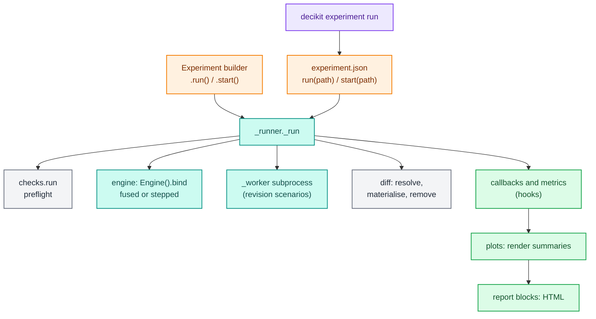

## The definition

`ExperimentDef` is the `experiment.json` asset, a pydantic model with `extra="forbid"`. Saving is `model_dump_json`, loading is `model_validate_json`; there is no other file format.

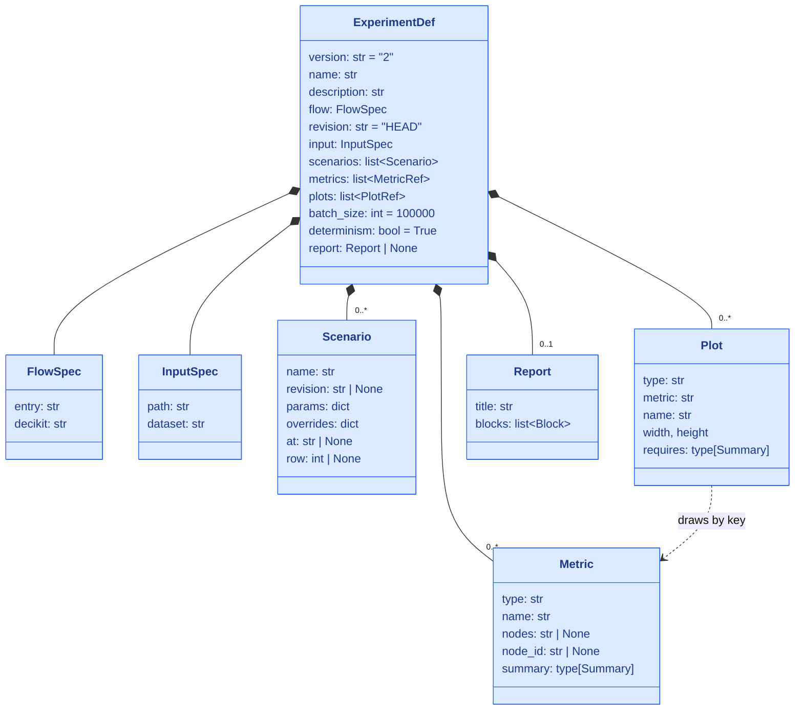

`FlowSpec.entry` is an import path (`"module:qualname"`), either a module-level pipeline or a zero-argument factory; `import_flow` in `decikit/steps/_entry.py` resolves both. `FlowSpec.decikit` is a version specifier the installed decider toolkit must satisfy. The runner checks it with `packaging.specifiers.SpecifierSet` and refuses with `DecikitError: flow needs decikit >=9.0, installed 0.0.2.dev548+g369d6dfb8`. `InputSpec` names a `.parquet`, `.csv`, `.json` or `.jsonl` file or a project dataset, and a validator refuses both at once.

`metrics` and `plots` are lists of registry models. `MetricRef = ref(Metric)` and `PlotRef = ref(Plot)` are field types from `decikit/_registry` that accept a dict and resolve it by its `type` tag, or an instance. Each built-in subclass declares `type: t.Literal["divergence"] = "divergence"` and so on, and a user subclass registers itself the same way when its module is imported. `Metric.json_schema()` and `Plot.json_schema()` return one schema per registered type, which the editor bridge uses for forms. A metric's `key` is its `name`, or its `type` when unnamed; a plot's `key` is its `name`, or the key of the metric it draws.

`version` is `"2"`. `check_experiment_version` reads the major number and refuses a newer one: `experiment version 3 is newer than 2; upgrade decikit`.

### The builder

`Experiment(name, step, frame, *, params=None, revision="HEAD", batch_size=100_000)` is a notebook front end that holds a live step, a frame, an optional baseline params document and a list of callbacks next to an `ExperimentDef` with an empty `flow.entry`. `.scenario()`, `.metric()`, `.plot()`, `.report()` and `.callback()` append and return `self`. Callbacks are live objects and are never saved.

`Experiment.save(path)` writes the definition, filling an empty `flow.entry` from `infer_entry(step)` so the file runs elsewhere. `infer_entry` looks in the module of the flow's first user step for a module-level variable that is the step object itself. It never calls anything, so a pipeline built by a factory (`build()`) is not found, and the entry stays empty. `Experiment.load(path)` and `Experiment.from_def(def_)` go the other way: import `flow.entry` when no step is passed and scan `input.path` (relative to the JSON file) or `input.dataset` (looked up in the project that holds the file) when no frame is passed.

### Validation

`validate(def_, step)` returns a list of problems instead of raising, so a UI can show them all at once. `_run` calls it and raises `ValueError` with the problems joined by `"; "`. It checks:

- no scenario is named `baseline`, and no two scenarios share a name;
- a scenario with a `revision` has a `flow.entry`, or one can be inferred;
- each override names an input or a produced value; a produced value needs `at`, and a step at or under `at` must produce it (the value slots come from [`describe`](../steps-and-ir.md));
- a step metric sets `nodes` or `node_id` but not both, its `node_id` exists, and its `nodes` glob matches at least one step path;
- metric keys and plot keys are unique;
- every report block names metrics and plots the experiment has;
- every plot's metric exists and its `summary` is a subclass of the plot's `requires`.

A definition that breaks most of them at once, against `flow(ratio, approved, name="credit")`:

```python
def_ = ExperimentDef.model_validate({
    "name": "bad", "flow": {"entry": ""},
    "scenarios": [{"name": "baseline"}, {"name": "force", "overrides": {"ratio": 0.1}},
                  {"name": "ghost", "overrides": {"salary": 1.0}}],
    "metrics": [{"type": "describe", "column": "ratio"}, {"type": "describe", "column": "approved"},
                {"type": "divergence", "column": "approved", "nodes": "credit/nope*"}],
    "plots": [{"type": "bars", "metric": "divergence"}],
})
for p in validate(def_, credit):
    print("-", p)
```

```text
- 'baseline' is the unchanged run; give the scenario another name
- force: override 'ratio' is produced, not an input; declare 'at: <step path>'
- ghost: override 'salary' is neither an input nor a produced value
- metric 'divergence': nodes='credit/nope*' matches no step
- two metrics are named 'describe'; set name= on one
- plot 'divergence' needs a Counts summary; metric 'divergence' gives Divergences
```

## The run, end to end

`run(def_or_path, frame=None, out_dir=None, callbacks=())` loads a definition, imports the flow and scans the input, then calls `_run`. `Experiment.run()` calls `_run` directly with its live step and frame. `start()` and `Experiment.start()` call the same `_run` on a background thread (see [jobs and handles](#jobs-and-handles)). The `decikit experiment run PATH [--out DIR]` command calls `run` and exits 0 only when the status is `completed`.

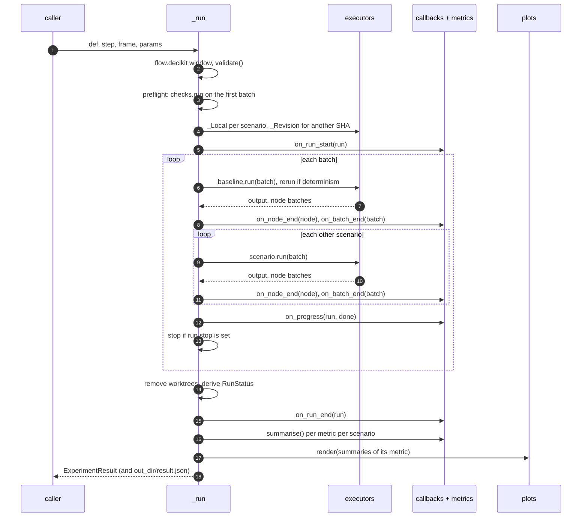

Step by step, `_run`:

1. Fills an empty `flow.entry` from `infer_entry(step)` if a scenario has a revision, checks `flow.decikit`, and runs `validate`.
2. Takes the baseline params: the `params` argument, or `step.parameters().defaults()`.
3. Counts the records (`frame.height`, or `select(pl.len())` on a lazy frame) and collects the first batch as a sample. `checks.run(step, ["missing_required", "invalid_params_doc"], data=sample, params=base_params)` produces the preflight report, which is stored on the result. A failing preflight does not stop the run. [Checks internals](checks.md) describes those two checks.
4. Prepends the baseline as `Scenario(name="baseline")`, builds the shared callbacks (the caller's, plus `JobProgress` when there is a job and `WriteOutputs` when there is an `out_dir`), and gives every scenario its own copy of every metric with `model_copy(deep=True)` and `reset()`.
5. Collects node selectors from the shared callbacks and the metrics that override `on_node_end`: their `nodes` globs and `node_id`s.
6. Opens a `decikit-experiment-*` temporary directory, builds one executor per scenario, calls `on_run_start` on everything, and drives the batches. A `finally` block removes every git worktree it made.
7. Derives the `RunStatus`, sets `run.status`, calls `on_run_end`, then collects `summaries[metric][scenario] = metric.summarise()` for every scenario that did not fail, and renders each plot with `Figure.of(plot.render(summaries[plot.metric]))`.
8. Builds the `ExperimentResult` and, with an `out_dir`, writes `result.json` next to the scenario outputs.

### Lockstep batches

`_drive` walks the input in slices of `batch_size` records. For each batch it runs the baseline first, then every scenario on the same records, before it moves on. That ordering is what lets a metric compare a scenario to the baseline in memory proportional to one batch: `Batch.baseline` is the baseline's output for exactly these rows, and `NodeBatch.baseline` is the baseline's values for the same node and loop iteration.

<div class="diagram" markdown>
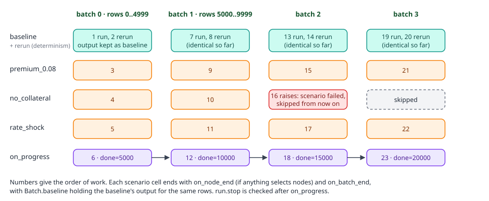

*Order of work for four batches. The failure in batch 2 is illustrative: if `no_collateral` raised there, it would be skipped from batch 3 on.*
</div>

With `determinism=True` the baseline runs each batch twice and compares the outputs with `DataFrame.equals`. The first difference sets `nondeterministic`, and the reruns stop. A scenario that raises is recorded in `errors` with `"Type: message"` and skipped for the rest of the run; the others go on. If the baseline is in `errors` after a batch, the loop stops. After every scenario has run the batch, `on_progress(run, offset + height)` fires, and a set `run.stop` ends the loop after the batch in progress.

The callback hooks run outside the `try` that guards a scenario. An exception in a metric or callback propagates out of `run`; it never turns into a failed scenario.

The callback below prints the hook order of the first batch of a 20,000-record run with `batch_size=5_000` and four scenarios:

```python
class Hooks(Callback):
    def on_run_start(self, run):
        print("on_run_start", run.scenarios, run.total, run.batch_size)

    def on_batch_end(self, batch):
        if batch.index == 0:
            print("on_batch_end", batch.scenario, batch.offset, batch.output.height)

    def on_progress(self, run, done):
        print("on_progress", done)

    def on_run_end(self, run):
        print("on_run_end", run.status)
```

```text
on_run_start ('baseline', 'premium_0.08', 'no_collateral', 'rate_shock', 'one_record') 20000 5000
on_batch_end baseline 0 5000
on_batch_end premium_0.08 0 5000
on_batch_end no_collateral 0 5000
on_batch_end rate_shock 0 5000
on_batch_end one_record 0 5000
on_progress 5000
on_progress 10000
on_progress 15000
on_progress 20000
on_run_end completed
```

`_batches` slices with `frame.slice(offset, size)` and collects each slice. A lazy parquet scan reads only what each slice needs. A lazy CSV scan rereads the file from the start for every slice, which the code marks as a known ceiling.

### The local executor: fused or stepped

`_Local` runs one scenario in this process. Its constructor merges the scenario's params over the baseline document with `merge` (nested dicts key by key) and binds the flow with `Engine().bind(step, mode=...)`. The mode is `"fused"` unless something needs to see inside the flow: a node selector from any metric or callback, or an override with `at`. Then it is `"stepped"`, which pauses after every node and is still compiled. The [runners page](../engine/runners.md) explains both modes.

`_Local.run(index, offset, batch)`:

1. Input overrides (`overrides` without `at`) are written into the batch columns before anything runs. With `row`, only that record is set, and only in the batch that holds it.
2. `exe.prepare(batch, params)` builds the state; then the runner's `iterate` generator is drained checkpoint by checkpoint.
3. At the `after` checkpoint of the node at `at`, `_set_values` writes the override into the state. It writes every version of that name produced so far (and the input column of that name, if there is one), the same way a debug session's `set` does, because later nodes may read any of them. The value is cast to the version's type with the engine's `cast_values`; a value that does not cast raises, which fails the scenario: `ValueError: can't set 'ratio' to 'high': it doesn't cast to float64`.
4. At each `after` checkpoint whose path matches a selector glob or whose durable id is selected, it reads what the node wrote into a small frame and records a `NodeBatch`. A call node hands its output columns. A branch node hands its `modifies` names merged over every record. A step inside a branch arm hands its outputs only for the records that arm took, and `NodeBatch.rows` holds their batch positions. Sequences and loops hand nothing.
5. It returns `exe.output(state)` and the node batches.

A node metric on the pricing branch of the example loan flow (`loans/pricing*`, eight records) sees these `NodeBatch`es for the first batch:

```text
{'path': 'loans/pricing/is_secured', 'id': None, 'columns': ['is_secured'], 'height': 8, 'rows': None, 'arm': None, 'has_baseline': True}
{'path': 'loans/pricing/secured', 'id': None, 'columns': ['rate'], 'height': 4, 'rows': [0, 2, 5, 7], 'arm': 0, 'has_baseline': True}
{'path': 'loans/pricing/unsecured', 'id': '03ed37e0af6b', 'columns': ['rate'], 'height': 4, 'rows': [1, 3, 4, 6], 'arm': 1, 'has_baseline': True}
{'path': 'loans/pricing', 'id': '7c354516dfb1', 'columns': ['rate'], 'height': 8, 'rows': None, 'arm': None, 'has_baseline': True}
```

The branch condition comes first, then each arm on its own records, then the branch itself with the merged `rate` for all eight.

### Revision scenarios in a subprocess

A scenario with `revision` resolves it to a SHA with the diff module's `resolve`. A revision that does not resolve fails that scenario. A revision that resolves to the experiment's own revision (or when the experiment's revision does not resolve) runs locally like any other scenario. Anything else gets a `_Revision` executor:

1. `materialise(sha)` checks the revision out into a detached git worktree, cached per SHA for the run, so scenarios on one revision share one checkout.
2. The whole input is written once to `input.parquet` in the run's temporary directory (`sink_parquet` for a lazy frame).
3. On the first batch, `_Revision.run` starts `python -m decikit.lab.experiments._worker` with a JSON request (`entry`, `tree`, `input`, `params`, the scenario's other fields, the selectors, `batch_size`, `out`) and waits for it to finish.
4. The worker imports the flow from the checkout, takes the request's params or else the old revision's own defaults, builds the same `_Local` executor the parent uses, runs every batch with the same boundaries, and pickles `(output, node batches)` to `<out>/<index>.pkl`. Its last stdout line is `{"ok": true}` or an error.
5. Every batch, including the first, unpickles `<index>.pkl`, so the revision's output joins the lockstep like a local scenario.

The reason for a fresh process is the one on the [diff page](diff.md): the live pipeline module is already imported, and Python would hand it back instead of the checked-out code. The process model as a whole:

<div class="diagram" markdown>
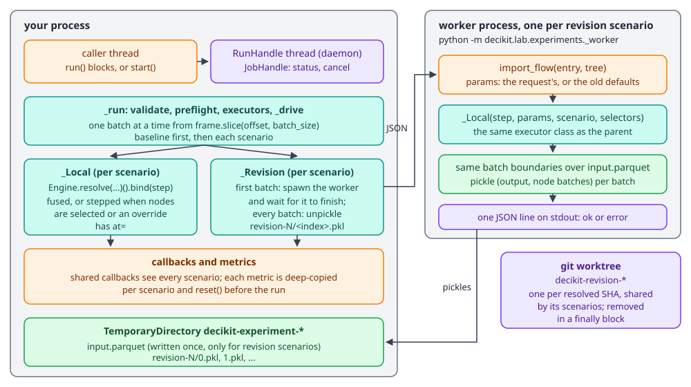

*Everything except revision scenarios runs in the caller's process. Metrics never cross the process boundary; only outputs and node batches do.*
</div>

A run in a scratch repository whose `HEAD^` has `limit = param(0.4)` and `HEAD` has `0.35`, with `batch_size=2` over three records:

```python
def_ = ExperimentDef(
    name="limit-change", flow={"entry": "lending.pipeline:build", "decikit": ">=0.0"},
    input={"path": "loans.parquet"}, batch_size=2,
    scenarios=[{"name": "previous", "revision": "HEAD^"},
               {"name": "previous_tight", "revision": "HEAD^", "params": {"credit": {"approved": {"limit": 0.3}}}}],
    metrics=[{"type": "divergence", "column": "approved"}])
r = run(def_, callbacks=[Order()])   # Order prints each on_batch_end with the elapsed seconds
```

```text
batch 0 baseline 2 0.5731043189880438
batch 0 previous 2 2.312472825986333
batch 0 previous_tight 2 3.9714957589749247
batch 1 baseline 1 3.9747977899969555
batch 1 previous 1 3.9756492219748907
batch 1 previous_tight 1 3.97619673301233
RunStatus.COMPLETED 3.99
baseline completed None 3
previous completed authored='HEAD^' resolved='ed6f4f21616cddc4ff9531f8049865baab545825' 3
previous_tight completed authored='HEAD^' resolved='ed6f4f21616cddc4ff9531f8049865baab545825' 3
baseline 0 []
previous 1 [{'row': 0, 'expected': False, 'actual': True}]
previous_tight 0 []
```

Each revision scenario paid about 1.7 seconds on its first batch (subprocess start, import and the whole run) on this machine, and nothing on the second. The two scenarios share one checkout but each runs its own worker. `previous` approves record 0 (a ratio of 0.38) under the old 0.4 limit. `previous_tight` passes `limit: 0.3` to the old code, which declines record 0 just as the baseline does.

The trade-off is progress: a revision scenario does all its work on the first batch, so `on_progress` does not move while the worker runs.

## Results

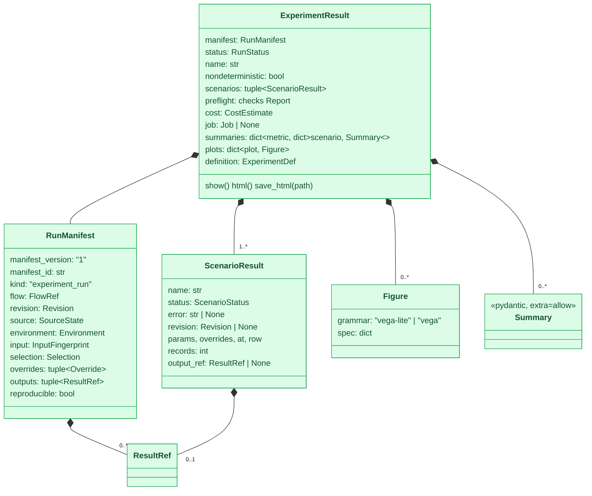

`summaries` is typed `dict[str, dict[str, SerializeAsAny[Summary]]]`. Without `SerializeAsAny`, pydantic would dump each summary as the bare `Summary` base and drop every subclass field.

### Run status

`_status` picks the first that applies:

| Condition | `RunStatus` |
|---|---|
| `run.stop` was set by a callback or `JobProgress` | `cancelled` or `timed_out` |
| the baseline failed | `failed` |
| a baseline rerun differed | `non_reproducible` |
| some scenario failed | `partial` |
| otherwise | `completed` |

None of the others ever reads as `completed`, and the CLI exits 1 for all of them. Each scenario's own status is `completed` or `failed`, and only completed scenarios get summaries:

```python
r = (Experiment("x", credit, frame)
     .scenario("bad_cast", at="credit/ratio", overrides={"ratio": "high"})
     .scenario("tight", params={"credit": {"approved": {"limit": 0.3}}})
     .metric(Divergence(column="approved")).run())
print(r.status, [(s.name, s.status.value, s.error) for s in r.scenarios], list(r.summaries["divergence"]))
```

```text
RunStatus.PARTIAL [('baseline', 'completed', None), ('bad_cast', 'failed', "ValueError: can't set 'ratio' to 'high': it doesn't cast to float64"), ('tight', 'completed', None)] ['baseline', 'tight']
```

A flow whose step reads a counter that changes between calls gives `RunStatus.NON_REPRODUCIBLE` with `nondeterministic=True`.

!!! warning "A failing baseline with a global metric raises"
    When the baseline raises in a batch and another scenario still runs that batch, every global metric gets a `Batch` whose `baseline` is `None`. `Divergence`, `Histogram` and any metric that reads `batch.baseline` then raise `TypeError: 'NoneType' object is not subscriptable` out of `run()`, instead of returning a result with status `failed`. With no scenarios, or no metric that reads the baseline, the run returns `failed` as designed.

### The manifest

`RunManifest` (`decikit/lab/experiments/_manifest.py`) is the small, versioned, immutable record of what ran. It carries references to bulk results, never the results. The runner fills it like this, from the 20,000-record loan run:

```json
{
  "manifest_version": "1",
  "manifest_id": "b361eae7f6054eca8677f934eab210d8",
  "kind": "experiment_run",
  "flow": {"flow_id": null, "name": "loans", "source": "decikit.steps:SequentialStep", "revision": null},
  "revision": {"authored": "HEAD", "resolved": "369d6dfb82cde0b7b0915080c7af51f1f2e32649"},
  "source": {"clean": true, "dirty_paths": [], "fingerprint": null, "fingerprint_scope": ""},
  "environment": {"python": "3.14.5", "decikit": "0.0.2.dev548+g369d6dfb8", "dependencies": []},
  "input": {"dataset": "", "fingerprint": "b185f4a7648060e812c7afe42bda048dc1635c7d6c8e85ca1fc27b33d0736fb7",
            "columns": [["income", "Float64"], ["debt", "Float64"], ["collateral", "Float64"]], "row_count": 20000},
  "selection": {"filter": null, "sample": null, "records": []},
  "overrides": [],
  "outputs": [{"name": "baseline", "location": "out/baseline", "fingerprint": null, "row_count": null}]
}
```

(`outputs` is cut to one entry; there is one per scenario.) Where each field comes from:

- `flow` is `describe(step).flow`, a `FlowRef` built from the root IR node's origin.
- `revision` holds the experiment's authored revision and the SHA `resolve` gave for it.
- `environment` holds the Python version and the installed decider toolkit version from package metadata. `dependencies` is never filled by the runner.
- `input` is an `InputFingerprint`. For an eager frame it comes from `LoadedData.from_frame(frame).summary`, with a content fingerprint. For a lazy frame it has the dataset name, the row count and the schema, and no fingerprint, so nothing scans the data twice. `dataset` is `input.dataset`, or the file name of `input.path`, or empty for a builder run.
- `outputs` has one `ResultRef` per scenario when there is an `out_dir`.
- `source`, `selection` and `overrides` keep their defaults; the runner does not fill them. Scenario overrides are on each `ScenarioResult` instead.

`reproducible` is true when the revision resolved and `source.clean` is true. Since the runner leaves `source` at its default (`clean=True`), every run inside a git repository reports `reproducible=True`, including runs on a dirty working tree. The run above was one.

`manifest_version` is `"1"`, and `check_manifest_version` refuses a newer major version. `manifest_schema()` returns the JSON Schema of `RunManifest` with every model it names under `$defs`.

### Cost estimate

`estimate_cost(step, rows)` in `decikit/lab/experiments/_cost.py` resolves the flow's wiring and counts calls. `CostEstimate` holds `rows`, `calls` and `frame_calls`, and `row_operations = rows * (calls - frame_calls)`: every non-frame call runs once per row, every frame call once. `_run` passes the height of the first batch as `rows`, not the record count. The 20,000-record run with `batch_size=5_000` reported `rows=5000 calls=7 frame_calls=0` and 35,000 row operations.

### Output files

With `out_dir`, the `WriteOutputs` callback writes each scenario's batches to `<out_dir>/<scenario>/<index:06d>.parquet`, and `_run` writes `result.json`:

```text
baseline/000000.parquet ... baseline/000003.parquet
premium_0.08/000000.parquet ... premium_0.08/000003.parquet
no_collateral/...  rate_shock/...  one_record/...
result.json
```

`pl.scan_parquet(f"{out_dir}/baseline/*.parquet")` reads a scenario back. The decider toolkit writes these files where the caller says and owns no storage of its own.

## Jobs and handles

`start()` wraps `_run` in a `RunHandle` (`decikit/lab/experiments/_handle.py`). The handle makes a `JobHandle` of kind `experiment_run`, starts a daemon thread, and passes the job to `_run`, which adds a `JobProgress` callback. `JobHandle` (`decikit/lab/experiments/_jobs.py`) is a small mutable controller around an immutable `Job` snapshot, which is what the editor bridge and MCP read. It is a generic finite-job model; experiments are its main user.

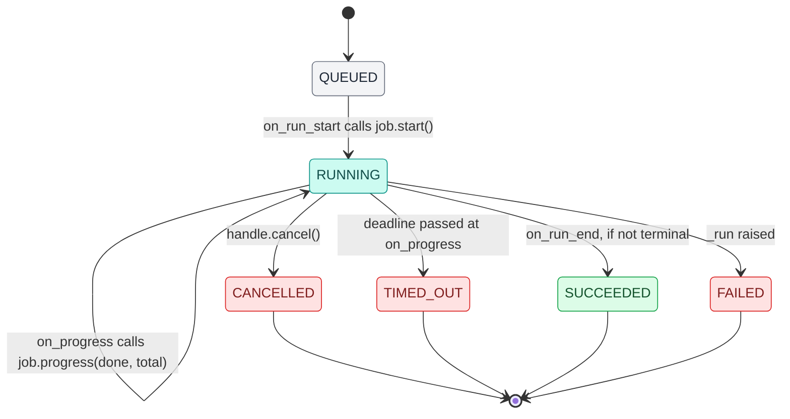

Terminal transitions are one-way; later calls are ignored. `JobProgress.on_progress` checks `job.timed_out` and `job.cancelled` after each batch and sets `run.stop` to `"timed_out"` or `"cancelled"`, which is how a job turns into a `RunStatus`. `RunHandle` exposes `status`, `progress` (`done / total`, or `None`), `cancel()` and `result(timeout=None)`, which joins the thread, raises `TimeoutError` if it is still running, and re-raises whatever `_run` raised.

A run cancelled from another thread while a slow callback holds each batch:

```python
handle = Experiment("slow", credit, big, batch_size=10).callback(Slow()).start()
time.sleep(0.5)
print("running:", handle.status, handle.progress)
handle.cancel()
print("after cancel:", handle.status)
res = handle.result()
print("result:", res.status, [s.records for s in res.scenarios], res.job.status, res.job.done, res.job.total)
```

```text
running: JobStatus.RUNNING 0.2
after cancel: JobStatus.CANCELLED
result: RunStatus.CANCELLED [30] JobStatus.CANCELLED 20 100
```

`cancel()` marks the job `CANCELLED` at once, while the batch in progress is still running. The run stopped after its third batch (30 records), but the job's `done` stayed at 20, because `progress()` is ignored once the job is terminal. `handle.progress` after a cancel shows the last value reported before it.

`PartialResult` and `Job.result` exist on the model for other job kinds; the experiment runner does not fill `partial`, and `JobProgress` sets `result` to `{"status": ...}` on success.

## Callbacks

`Callback` (`decikit/lab/experiments/callbacks.py`) has five hooks, all no-ops by default:

| Hook | When | Receives |
|---|---|---|
| `on_run_start(run)` | once, after executors are built | `Run`: name, step, scenario names, total, batch size, `stop`, `status` |
| `on_node_end(node)` | after a selected node, per scenario per batch | `NodeBatch` |
| `on_batch_end(batch)` | after a scenario finishes a batch | `Batch`: scenario, index, offset, output, baseline |
| `on_progress(run, done)` | after every scenario has run a batch | the record count done so far |
| `on_run_end(run)` | once, after the status is known | `Run` with `status` set |

`overrides(callback, hook)` checks whether a class overrides a hook, so the runner can skip work nobody listens to. Node values are only read, and the flow only runs stepped, when some metric or callback overrides `on_node_end` and has a `nodes` or `node_id` attribute. `selects(callback, path, id)` decides per node: an `fnmatch` glob on the node path, or an exact durable id (12 hex characters, from `decikit ids`).

There are three built-in callbacks. `Progress` prints records done, the total and elapsed time after each batch. `JobProgress` connects a run to a `JobHandle`, as above. `WriteOutputs` writes each batch's output to parquet.

A shared callback sees every scenario and both hooks. A metric is a callback too, but each scenario has its own copy, so a metric's hooks only see that scenario's batches (each with the baseline alongside).

## Metrics

A `Metric` (`metrics/_base.py`) is a pydantic registry model and a `Callback`. It has a `name`, an optional `nodes` glob or `node_id`, a `summary` class variable naming the `Summary` type it returns, `reset()` to clear its state and `summarise()` to reduce it. `on_steps` is true when it reads steps (`nodes` or `node_id` set). Without either it is a global metric and reads the flow's output in `on_batch_end`.

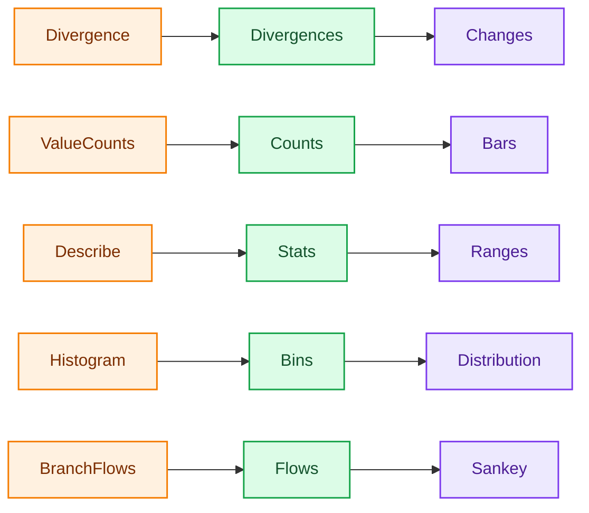

Each metric gives one summary type, and each built-in plot requires one. `validate` checks the pairing before anything runs, and a report section uses the same pairing to pick a default plot for a metric no plot draws.

The figures below come from one run of the example loan flow (`example_projects/experiments/loan_pipeline.py`: `ratio`, `rate`, a `pricing` branch with `secured` and `unsecured` arms, then `approved` and `payment`) over 20,000 synthetic applications in batches of 5,000, with four scenarios:

```python
result = (Experiment("premium-sweep", build(), frame, batch_size=5_000)
          .scenario("premium_0.08", params={"loans": {"pricing": {"unsecured": {"premium": 0.08}}}})
          .scenario("no_collateral", overrides={"collateral": 0.0})
          .scenario("rate_shock", overrides={"rate": 0.25}, at="loans/rate")
          .scenario("one_record", overrides={"income": 1.0}, row=3)
          .metric(Divergence(column="approved"),
                  ValueCounts(column="approved"),
                  Describe(name="payment", column="payment"),
                  Histogram(name="unsecured_rate", column="rate", node_id="03ed37e0af6b", range=(0.1, 0.35)),
                  BranchFlows(outcome="approved"))
          .plot(Changes(metric="divergence"),
                Bars(metric="value_counts"),
                Ranges(metric="payment"),
                Distribution(metric="unsecured_rate", layout="overlay"),
                Sankey(metric="branch_flows", name="flows_premium", scenario="premium_0.08"))
          .run(out_dir="out"))
```

`BranchFlows` defaults to `nodes="*"` and `Histogram` reads a node by id, so this run is stepped.

### Divergence

`Divergence(column, rtol=1e-6, atol=1e-9, samples=5)` counts records whose `column` differs from the baseline's, using the diff module's `changed`: floats with `is_close`, NaN equal to NaN, everything else exactly, null equal only to null. As a global metric it numbers rows by `offset`, so `first` and the sample `row`s index the whole input. As a step metric it joins the scenario's and the baseline's `NodeBatch` values on absolute row number, so it compares only records both runs sent through the node.

```text
divergence premium_0.08  compared=20000 changed=4258  first=3  samples=[{"row": 3, "expected": true, "actual": false}, ...]
divergence rate_shock    compared=20000 changed=15307 first=0
divergence one_record    compared=20000 changed=1     first=3  samples=[{"row": 3, "expected": true, "actual": false}]
divergence no_collateral compared=20000 changed=0
```

Forcing `rate` to 0.25 after `loans/rate` puts every rate above `max_rate` (0.2) once the pricing arm adjusts it, so all 15,307 approvals turn into declines. `no_collateral` moves everyone into the unsecured arm, which raises rates but never past 0.2 for an applicant within the 0.4 ratio limit, so no approval changes.

<div class="diagram" markdown>
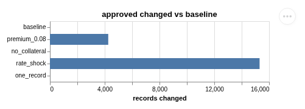

*`Changes(metric="divergence")`.*
</div>

### ValueCounts and Describe

Both read `column` from the output, or from what the selected nodes wrote when the metric is on steps (`_ColumnMetric`). `ValueCounts` keeps a `Counter` keyed by `str(value)` and summarises to `Counts(column, counts)`. `Describe` keeps count, nulls, sum, min and max as batches arrive and summarises to `Stats(column, count, nulls, mean, min, max)`. Neither keeps the values themselves.

```text
value_counts baseline     {"True": 15307, "False": 4693}
value_counts premium_0.08 {"True": 11049, "False": 8951}
value_counts rate_shock   {"False": 20000}
payment baseline     count=20000 nulls=0 mean=106.217 min=0.540 max=899.08
payment rate_shock   count=20000 nulls=0 mean=118.568 min=0.615 max=986.31
payment one_record   count=20000 nulls=0 mean=106.753 min=0.540 max=10841.74
```

<div class="diagram" markdown>
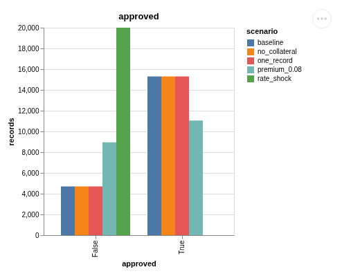

*`Bars(metric="value_counts")`, default `side_by_side` layout.*
</div>

<div class="diagram" markdown>
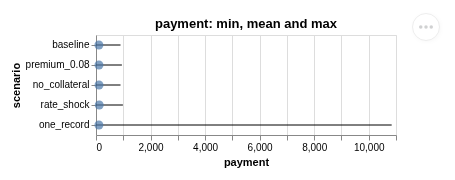

*`Ranges(metric="payment")`. The single record with an income of 1 dominates the axis.*
</div>

### Histogram

`Histogram(column, bins=20, range=None, edges=None)` counts values into fixed bins and summarises to `Bins(column, edges, counts, below, above, nulls)`. `edges` fixes the bins. `range` spans `bins` equal-width bins. With neither, the edges span the baseline's values in the first batch it sees: `Batch.baseline` for a global metric, `NodeBatch.baseline.values` for a step metric. Every scenario sees the baseline's first batch in lockstep, so every scenario counts into the same bins. Values outside the edges count as `below` or `above`, and nulls and NaN as `nulls`.

Here the metric reads the `unsecured` arm by durable id, with `range=(0.1, 0.35)`:

```text
unsecured_rate baseline     counts=[0, 0, 0, 1100, 2626, 2254, 1351, 539, 135, 9, 0, ...] below=0 above=0
unsecured_rate premium_0.08 counts=[0, 0, 0, 0, 0, 0, 366, 1505, 1855, 1653, 1272, 739, 393, 181, 48, 2, 0, ...]
unsecured_rate rate_shock   counts=[..., 0, 3726, 3776, 512, 0, 0]
unsecured_rate one_record   counts=[0, 0, 0, 1100, 2626, 2253, 1351, 539, 135, 9, 0, ...] above=1
```

Each scenario counts only the records that took the unsecured arm (8,014 in the baseline, 20,000 under `no_collateral`).

<div class="diagram" markdown>
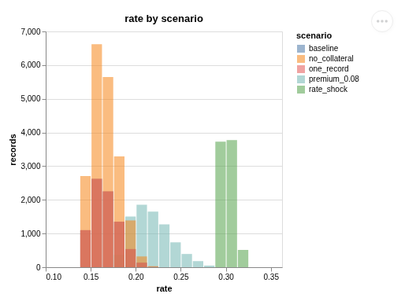

*`Distribution(metric="unsecured_rate", layout="overlay")`. Clicking a legend entry picks one scenario out.*
</div>

### BranchFlows

`BranchFlows(outcome, nodes="*")` counts how records move through branch arms into each value of `outcome`, for a Sankey. On `on_run_start` it maps every arm path to an id `"<branch path>#<arm index>"`, a label (the arm's last path segment) and a pre-order position. On `on_node_end` it records which rows entered which arm, with the loop iteration. On `on_batch_end` it sorts each record's visits by iteration and pre-order position, links consecutive arms (starting from `"in"`), and links each record's last arm to `"out:<value>"`. A record that took no arm links straight from `"in"`. The baseline summary:

```json
{"outcome": "approved",
 "nodes": [{"id": "in", "label": "20000 records", "kind": "input"},
           {"id": "loans/pricing#0", "label": "secured", "kind": "arm"},
           {"id": "loans/pricing#1", "label": "unsecured", "kind": "arm"},
           {"id": "out:False", "label": "approved False", "kind": "outcome"},
           {"id": "out:True", "label": "approved True", "kind": "outcome"}],
 "links": [{"source": "in", "target": "loans/pricing#0", "value": 11986},
           {"source": "in", "target": "loans/pricing#1", "value": 8014},
           {"source": "loans/pricing#0", "target": "out:False", "value": 2809},
           {"source": "loans/pricing#0", "target": "out:True", "value": 9177},
           {"source": "loans/pricing#1", "target": "out:False", "value": 1884},
           {"source": "loans/pricing#1", "target": "out:True", "value": 6130}]}
```

One approximation: a branch inside a loop whose arm order differs per iteration is ordered by pre-order position and iteration, which can misorder arms.

### Writing a metric

A metric subclass declares a `type` literal, a `summary` class, `reset`, the hooks it needs and `summarise`. It is registered when its class is defined, so a JSON definition can name it as soon as its module is imported. The shape is torchmetrics-like (state reset per scenario, accumulate per batch, reduce at the end). Metric state lives in one process; nothing merges metric state across workers, which is why revision workers send outputs back instead of running metrics.

## Plots

A `Plot` (`plots/_base.py`) is a registry model with a `metric` to draw, an optional `name`, `width` and `height`, and a `requires` class variable. `render(summaries)` gets `{scenario: Summary}` for its metric and returns an altair chart or a raw Vega or Vega-Lite spec. `Figure.of` turns either into a `Figure(grammar, spec)`: an object with `to_dict` (altair) becomes Vega-Lite, and a dict is Vega-Lite or Vega by its `$schema`. A figure in a result is plain JSON, so it survives `result.json`.

| Plot | Requires | Options | What it draws |
|---|---|---|---|
| `Changes` | `Divergences` | `width`, `height` | One horizontal bar per scenario: records changed; tooltip with compared, share and first changed record |
| `Bars` | `Counts` | `layout`: `side_by_side`, `stacked`, `rows` | Records per value per scenario |
| `Distribution` | `Bins` | `layout`: `overlay`, `stacked`, `side_by_side`, `rows` | Histogram per scenario; `below` and `above` become one extra bin at each end; legend click selects |
| `Ranges` | `Stats` | `width`, `height` | A rule from min to max with a point at the mean, per scenario |
| `Sankey` | `Flows` | `scenario` (default `baseline`) | Records through branch arms into outcome values, for one scenario |

`Sankey` is the one plot Vega-Lite cannot express. It fills a full Vega spec, `plots/sankey.vg.json`, adapted from David Bacci's MIT-licensed Vega Sankey (`sankey.vg.LICENSE` sits beside it). `render` puts one data row per node and per link into the template. A node's stack is its longest path from the input, so nested arms sit one stack deeper than the arm they are inside, and outcome values always sit in the last stack. A `scenario` with no summary (it failed, or no such scenario) raises `ValueError: no 'x' summary to draw; it failed or isn't a scenario`.

<div class="diagram" markdown>
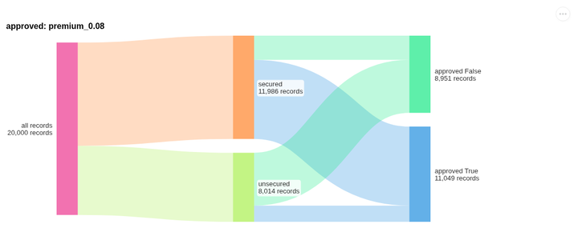

*`Sankey(metric="branch_flows", scenario="premium_0.08")`.*
</div>

`Figure.html()` returns a `<div>` and a script that embeds the spec with vega-embed. Every figure on a page shares one loader promise, `window.decikitVega`, that loads vega, vega-lite and vega-embed once, in order, from jsDelivr at the versions altair pins, and through `requirejs` when the page has it. The reason: figures that each loaded their own scripts raced each other, and in VS Code a report of several charts failed with vega-embed's "compile is not a function". A script that fails to load shows the URL in the chart's place. Specs are JSON-escaped so `</` cannot close the script tag.

## Reports

A `Report` is a `title` and a list of blocks, stored in `ExperimentDef.report`. Blocks are registry models too, so the JSON holds them by `type`.

| Block | Shows |
|---|---|
| `Overview` | Name and status badge, record count, revision, scenario count, a warning when the run was non-reproducible, and a table of scenarios with status, records, revision, what each changed and any error |
| `Text` | Markdown rendered with markdown-it-py, CommonMark with raw HTML off, plus tables |
| `Table` | One metric's summaries, a row per scenario, nested fields flattened to `a.b` columns and long lists shortened |
| `Chart` | One plot by its key in `result.plots` |
| `MetricSection` | A metric's heading, where it reads (output, glob or durable id), its table and every plot that draws it, or the default plot for its summary type when none does |
| `Row` | Blocks side by side, wrapping on narrow pages |
| `Section` | A titled group of blocks |

Without a report, the default is an `Overview` and one `MetricSection` per metric. `result.show()` displays the report as one HTML fragment through IPython, `result.html()` returns a standalone page, and `result.save_html(path)` writes it. A page loads Vega from the CDN when opened; inlining the scripts for offline pages is not built. `validate` runs `report.problems`, so a block that names a missing metric or plot is caught before the run: `the report shows plot 'x', which the experiment doesn't have`.

<div class="diagram" markdown>
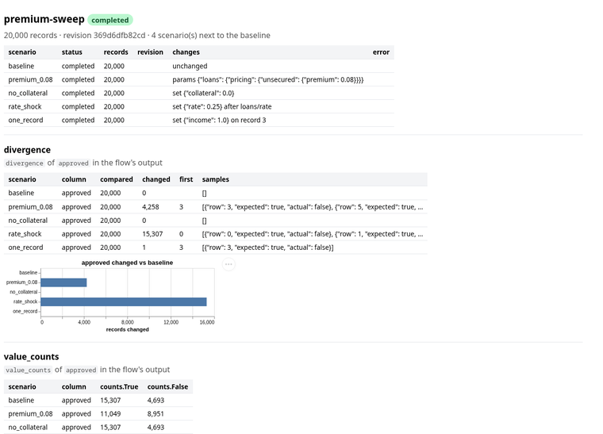

*The default report of the loan run, as `save_html` writes it.*
</div>

## Invariants

- Every scenario sees exactly the baseline's records, in the same batches, after the baseline has run them.
- A metric instance belongs to one scenario and is reset before the run.
- A failing scenario never stops the others, and a stopped, partial or non-reproducible run never reports `completed`.
- Revision code runs only in a fresh process, never imported into the caller's process.
- Plots and summaries are plain JSON in the result.
- `decikit` writes bulk outputs only where the caller's `out_dir` says.

## How it fails

| Symptom | Cause | What to do |
|---|---|---|
| `ValueError: <scenario>: override 'x' is produced, not an input; declare 'at: <step path>'` (and the other `validate` messages) | The definition does not fit the flow | Fix the definition; `validate(def_, step)` lists every problem without running |
| `DecikitError: flow needs decikit ...` | `flow.decikit` excludes the installed version | Install a matching decider toolkit version or widen the window |
| A scenario `failed` with a revision error | The worker could not import the flow at that revision, or the run raised there | The error text is the worker's; the [diff page](diff.md) shows how to drive a worker by hand |
| `TypeError: 'NoneType' object is not subscriptable` from `run()` | The baseline failed while a global metric reads `batch.baseline` (see the warning above) | Run the baseline alone first to see its error |
| A metric or callback raises | Hook exceptions are not caught | The traceback points at the hook |
| `DecikitError: experiment plots need altair: pip install 'decikit[experiments]'` | A plot rendered without altair | Install the extra |
| A chart shows "could not load https://cdn.jsdelivr.net/..." | The page cannot reach the CDN | Open the report where the CDN is reachable |

## What is measured

Stepped mode with a per-node callback reading every call's columns, measured against fused mode reading nothing, on the `ratio, approved, tier` flow of `benchmarks/trace_overhead.py`:

| Records | Fused | Stepped with a per-node callback |
|---|---|---|
| 100,000 | 630M rows/s | 300M rows/s |
| 1,000,000 | 322M rows/s | 306M rows/s |
| 10,000,000 | 392M rows/s | 291M rows/s |

and a whole experiment (baseline, determinism rerun and one scenario) with `benchmarks/experiment_throughput.py`:

| Records | Global metric (fused) | Node metrics (stepped) |
|---|---|---|
| 100,000 | 80 ms | 96 ms |
| 1,000,000 | 104 ms | 168 ms |
| 10,000,000 | 382 ms | 897 ms |

Measured, a worktree checkout takes about 0.5 s and starting a worker and importing the decider toolkit about 0.8 s. The run above saw about 1.7 s for a revision scenario on three records, including its whole run.

## Why it is shaped this way

The first experiment module routed execution, compared outputs with a per-element Python loop, produced a fixed summary shape and a hard-wired Sankey, all inside one `run_experiment`. Adding a measurement meant editing the runner. The redesign is a runner that only feeds batches to hooks, in the style of a training loop's callbacks, and metrics that each own one measurement. Three alternatives were rejected:

- Comparing only summaries, with each scenario run on its own. It is simpler, but loses the row-level "which records changed", which is the comparison people ask for most.
- Live per-row hooks before each call. They force interpreted mode. A column per node gives the same information, and node-level hooks over whole columns measured about 25% overhead in stepped mode.
- Session replay (a debug-session fork) for overrides. The runner writes an override into the state at the `at` checkpoint directly, with the same cast a debug session uses.

Revision scenarios run whole in a worker and are read back batch by batch. A streaming worker (Arrow batches over stdin) would give live progress for revisions too, at the price of a protocol to maintain; the run-whole worker module is about 40 lines.

The larger rule that still holds from the first design: one flat definition, with scenarios as the only axis of change. A "git commit experiment" and a "param sweep experiment" are both scenarios in one `ExperimentDef`, not separate experiment types. An early design argued for registry-based plot types, on the precedent of configurable steps, and against Python callbacks fired from inside compiled kernels; per-node hooks now fire at checkpoints between kernels.
