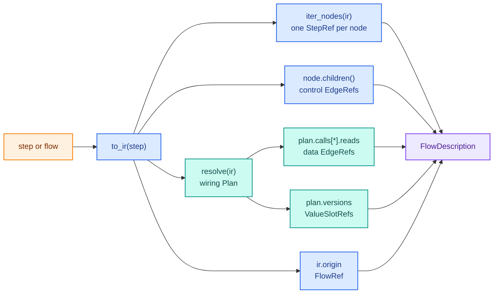
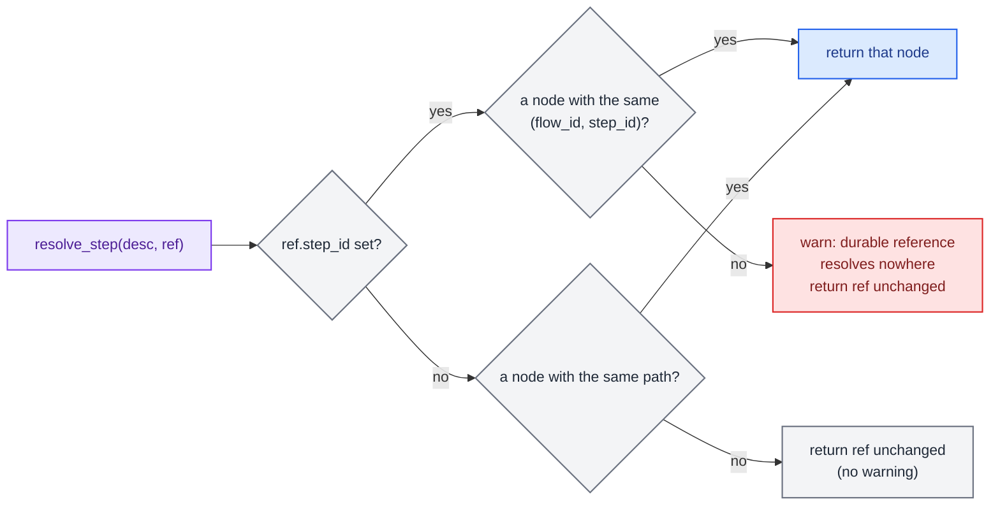
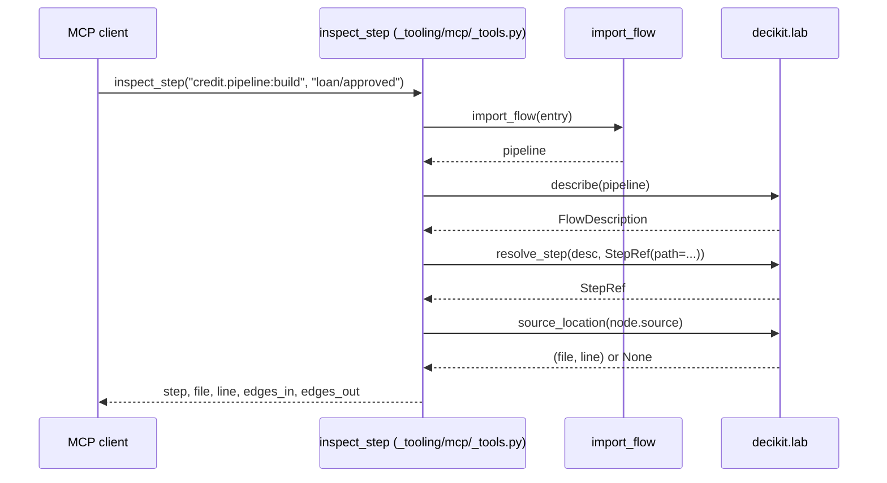

# The lab

`decikit.lab` holds the work done to a flow away from serving: reading data, running static checks over the
source, comparing two versions, asserting that the execution modes agree, and running experiments. Each of
those is a subpackage. The parent package holds the one thing they all share, a set of reference types that
name the parts of a flow, and `describe`, the function that builds them.

| Path | What it holds | Page |
|---|---|---|
| `decikit/lab/__init__.py` | The public surface: `describe`, `resolve_step`, `source_location`, the refs, `CONTRACT_VERSION` | this page |
| `decikit/lab/_refs.py` | `FlowRef`, `StepRef`, `EdgeRef`, `ValueSlotRef`, `RecordRef`, `FlowDescription`, `CONTRACT_VERSION`, `check_version` | this page |
| `decikit/lab/_describe.py` | `describe`, `resolve_step`, `source_location` | this page |
| `decikit/lab/data/` | `read`, `scan`, named datasets and their providers, record keys, `LoadedData` | [Data](data.md) |
| `decikit/lab/checks/` | The `Check` registry, `CheckContext`, the runner, `Report`, and 34 built-in checks | [Checks](checks.md) |
| `decikit/lab/testing/` | `assert_equivalent`, `corpus`, `no_recompile` | [Testing helpers](testing.md) |
| `decikit/lab/diff/` | Structural, output, revision and proof comparison of two versions | [Diff](diff.md) |
| `decikit/lab/experiments/` | Baseline against scenarios over the same records, metrics, plots, reports | [Experiments](experiments.md) |

`describe` is also importable from the top level as `decikit.describe`. It is the one name with two import
paths: it lives beside the refs it returns, and users reach for it often enough to want it at the top.

## Why the five packages share a parent

The package layout keeps the core, the libraries and the tooling as siblings under `decikit/`. The lab is the
one nested group. The reasoning is that `data`, `checks`, `diff`, `testing` and
`experiments` are all things you do to a flow outside serving, they name its parts with the same refs, and their
imports run one way, so they share a parent that also owns the refs and `describe`.

In the layer map that `tests/test_conventions.py` enforces, `lab` sits in layer 3 (libraries). It may import the
core (layer 1: `decikit`, `steps`, `ir`, `debug`, `_engine`) and the foundation (layer 0: `exceptions`,
`_registry`, `_settings`, `ops`, `_suggest`). It may not import `serving` or `_tooling` (layer 4), which are the
consumers. Inside the layer, imports only have to be acyclic.

<div class="diagram" markdown>


*Arrows point from the importer to the imported module. The dashed edge is a lazy import.*
</div>

The real import graph inside the lab is slightly richer than the one-line summary `data <- checks/diff/testing <-
experiments`:

- `data` imports nothing else from the lab. It is the floor.
- `testing` imports nothing else from the lab either. It needs only the engine (`Engine`, `decikit.debug.Session`,
  the wiring `resolve`).
- `diff` imports the refs and `describe`.
- `checks` imports `data` (for `project_root`, to find `checks.yaml`), the refs and `describe`, and `testing`: the
  runtime checks `crash_probe` and `mode_divergence` run over `testing.corpus` and call
  `testing.assert_equivalent`. The structure checks import `decikit.lab.diff._smt` through `importlib` at the moment
  they solve a tree or table, so a missing `z3` is a skipped check and never an import error.
- `experiments` imports `data`, `checks`, `diff`, the refs and `describe`.

## The static-flow contract

The refs are the vocabulary the lab, the editors and the MCP server use to point at a place in a flow. Together
with `FlowDescription` they form a versioned contract: `CONTRACT_VERSION` is `"1"`, every `FlowDescription`
carries it in `contract_version`, and the editor bridge sends it in its `Hello` reply and in `capabilities()`.

The rule for bumping it is in the docstring of `CONTRACT_VERSION`: removing or renaming a field is a major change
and bumps the version; adding an optional field does not. A reader calls `check_version` (in
`decikit/lab/_refs.py`, not exported) on a document it loads. A missing or older version is accepted, a newer
major version is refused, and a version that isn't a number is refused too:

```text
DecikitError: contract version 2 is newer than 1; upgrade decikit to read it
DecikitError: unrecognised contract version 'v1'
```

The experiment manifest has its own version check that mirrors this one (see [Experiments](experiments.md)).

Every ref is a frozen pydantic model with `extra="forbid"`, so a document with an unknown field fails validation
instead of being read with the field silently dropped:

```text
ValidationError: 1 validation error for StepRef
```

### The five refs

<div class="diagram" markdown>


*Each ref names one kind of place: the whole flow, a node, an edge between nodes, a written value, a data record.*
</div>

`FlowRef` names a whole pipeline, the root of a description.

| Field | Meaning |
|---|---|
| `flow_id` | The committed durable id of the root flow (`id=` on `flow(...)`), `None` until `decikit ids` writes one |
| `name` | The root's path, which for a named flow is its name |
| `source` | The import path of the object that produced the root (`decikit.steps:SequentialStep` for a `flow(...)`) |
| `revision` | A resolved source revision, such as a git SHA, when the caller knows one; `describe` leaves it `None` |

`StepRef` names one node.

| Field | Meaning |
|---|---|
| `flow_id`, `step_id` | Together the durable global reference. Both come from committed source, so they survive renames and reordering |
| `path` | The derived path (`loan/approved`), unique within one build and useful for display and discovery |
| `name` | The last path segment |
| `source` | The import path of the code behind the node (`loan:approved`) |
| `locator` | A position inside a `row` node, for nodes that share a fused row kernel |
| `node_type` | `call`, `sequence`, `branch`, `loop`, `scatter_gather` or `state_machine` |
| `kind` | For a call node, `scalar`, `row` or `frame`; `None` otherwise |
| `inputs`, `outputs` | For a call node, the value names it reads and writes |

`decikit.lab.StepRef` is a different class from `decikit.StepRef`. The top-level one is the field type a
`ConfigurableStep` uses for a nested step; the lab one is a contract reference.

`EdgeRef` names an edge by the paths at its two ends. `kind="control"` means `to_path` runs inside `from_path`.
`kind="data"` means `to_path` reads each name in `values` from the node at `from_path`.

`ValueSlotRef` names one written version of a value: `name` produced at `path`, with `path=None` for a pipeline
input column. Its `spec` property spells it the way `State.versions` reads a version:
`"affordability@loan/affordability"`, or just `"income"` for an input. A slot names a place. What a run observed
there lives on the run and debug side (`RunReport`, `Session.events`) and never in a description.

`RecordRef` names one record of a data source by `dataset` and `key`, a mapping from key columns to values.
`durable` is true only when `key` is non-empty. `ordinal` is a row number for display within one session and is
never part of identity, because row order is not stable across loads. How a key is chosen and validated is on the
[Data](data.md) page.

### Derived and committed identity

There are two kinds of identity, and neither stands in for the other. Derived
identity is `path` and `source`, built from names and import paths: good for display, but a rename, an extraction
or a reorder changes it. Committed identity is an opaque 12-hex `id` written into source next to the declaration
(`@step(id="a1b2c3d4e5f6")`, `flow(..., id="0123abcdef45")`), and `decikit ids` inserts missing ones. A step reused
in two flows has one id and two paths, which is why the global reference is the pair `(flow_id, step_id)`.

A rename shows the difference. Both versions below carry the same ids; only the name changes:

```python
from decikit import flow, step
from decikit.lab import describe, resolve_step

@step(id="a1b2c3d4e5f6")
def affordability(income: float, debt: float) -> float:
    return debt / income

@step(id="a1b2c3d4e5f6", name="debt_ratio")
def renamed(income: float, debt: float) -> float:
    return debt / income

before = describe(flow(affordability, name="loan", id="0123abcdef45"))
after = describe(flow(renamed, name="loan", id="0123abcdef45"))
ref = before.nodes[1]
print(ref.flow_id, ref.step_id, ref.path)
found = resolve_step(after, ref)
print(found.flow_id, found.step_id, found.path)
```

```text
0123abcdef45 a1b2c3d4e5f6 loan/affordability
0123abcdef45 a1b2c3d4e5f6 loan/debt_ratio
```

A persisted reference stores the ids and the descriptive fields as they were at capture time. When the id no
longer resolves, the old name, path and source are still there for a person to repair the link.

## How `describe` builds a description

`describe(step)` layers two things the engine already computes. The IR tree gives the nodes and the control
edges. The wiring plan, which knows which node wrote every value version, gives the data edges and the value
slots.



Step by step, in `decikit/lab/_describe.py`:

1. `to_ir(step)` builds the checked IR, then `resolve(ir)` from `decikit/_engine/wiring` builds the `Plan`. A wiring
   problem raises the engine's own `WiringError` here; `describe` adds no error type of its own.
2. The `FlowRef` comes from the root node's `Origin`: `flow_id=origin.id`, `name=origin.path`,
   `source=origin.source`.
3. `iter_nodes(ir)` walks the tree in pre-order. `_node_ref` turns each node into a `StepRef`, mapping the node
   class to `node_type` through a fixed table (`CallNode` to `call`, `BranchNode` to `branch`, and so on). Only
   call nodes get `kind`, `inputs` and `outputs`.
4. Control edges are one `EdgeRef` per `(node, child)` pair from `node.children()`.
5. Data edges come from `plan.calls`. For each read of each call, the producer of the version it reads becomes
   the source of an edge. Reads of pipeline inputs (producer `None`) and a node reading its own output are skipped.
   Names are grouped per `(producer, consumer)` pair and sorted, so one edge carries every value that crosses it.
6. Value slots are one `ValueSlotRef` per `plan.versions` entry, with `path` set to the producer.

Here is the real description of a small loan flow with a branch:

```python
from decikit import branch, flow, param, step
from decikit.lab import describe

def affordability(income: float, debt: float) -> float:
    return debt / income

def approved(affordability: float, limit: float = param(0.4)) -> bool:
    return affordability <= limit

def is_approved(approved: bool) -> bool:
    return approved

@step(output="offer")
def full_offer(income: float, multiple: float = param(3.0)) -> float:
    return income * multiple

@step(output="offer")
def no_offer(income: float) -> float:
    return 0.0

pipeline = flow(affordability, approved,
                branch(is_approved, full_offer, no_offer, modifies=["offer"], name="offer_by_approval"),
                name="loan")
desc = describe(pipeline)
```

The nodes, in the pre-order `describe` returns them:

| `path` | `node_type` | `kind` | `inputs` | `outputs` | `source` |
|---|---|---|---|---|---|
| `loan` | `sequence` | | | | `decikit.steps:SequentialStep` |
| `loan/affordability` | `call` | `scalar` | `income`, `debt` | `affordability` | `loan:affordability` |
| `loan/approved` | `call` | `scalar` | `affordability` | `approved` | `loan:approved` |
| `loan/offer_by_approval` | `branch` | | | | `decikit.steps:BranchStep` |
| `loan/offer_by_approval/is_approved` | `call` | `scalar` | `approved` | `is_approved` | `loan:is_approved` |
| `loan/offer_by_approval/full_offer` | `call` | `scalar` | `income` | `offer` | `loan:full_offer` |
| `loan/offer_by_approval/no_offer` | `call` | `scalar` | `income` | `offer` | `loan:no_offer` |

The edges:

```text
control loan -> loan/affordability ()
control loan -> loan/approved ()
control loan -> loan/offer_by_approval ()
control loan/offer_by_approval -> loan/offer_by_approval/is_approved ()
control loan/offer_by_approval -> loan/offer_by_approval/full_offer ()
control loan/offer_by_approval -> loan/offer_by_approval/no_offer ()
data loan/affordability -> loan/approved ('affordability',)
data loan/approved -> loan/offer_by_approval/is_approved ('approved',)
```

The value slots, as `spec` strings:

```text
income
debt
affordability@loan/affordability
approved@loan/approved
is_approved@loan/offer_by_approval/is_approved
offer@loan/offer_by_approval/full_offer
offer@loan/offer_by_approval/no_offer
offer@loan/offer_by_approval
```

A few things in that output are easy to misread:

- A composite node's `source` is the import path of its step class (`decikit.steps:SequentialStep`,
  `decikit.steps:BranchStep`), not the place in user code where it was built.
- `full_offer` and `no_offer` read `income`, a pipeline input, so no data edge leads to them. Data edges only
  connect two nodes.
- The branch writes its own version of `offer` (`offer@loan/offer_by_approval`): the merge of the two arms that
  `modifies=["offer"]` asks for. Each arm's write is a separate slot.
- None of the nodes have a `step_id`, because nothing in the source declares an `id=`. `checks` reports that as
  `DCD401`.

`FlowDescription` is static. The values a run observed, the params it validated and the events a session
emitted live on `RunReport` and `Session.events`. `desc.model_dump_json()` is the wire form, and
`FlowDescription.model_json_schema()` is its JSON Schema.

## Finding a node again: `resolve_step` and `source_location`

`resolve_step(description, ref)` returns the node of `description` that `ref` names.



A durable ref that matches nothing does not fall back to the path: a step with the same path may be a different
step now. It warns and hands back the ref with its capture-time metadata intact:

```text
UserWarning: durable reference 0123abcdef45/aaaaaaaaaaaa resolves nowhere; kept 'loan/old_name' (loan:old)
```

A path-only ref that matches nothing comes back unchanged and silent. Callers that care check whether the
result came from the description.

`source_location(source)` turns an import-path source such as `loan:approved` into `(file, line)`. It imports the
module, follows the dotted qualname with `getattr`, and asks `inspect` for the file and first line. Any
`ImportError`, `AttributeError`, `TypeError` or `OSError` on the way gives `None`, which callers treat as "no
location" rather than an error:

```text
>>> source_location("loan:approved")
('/…/loan.py', 8)
>>> source_location("no_such_module:thing")
None
```

## How the editors and the MCP server use the contract

The dependency runs one way: the tooling imports the lab.



The MCP tools in `decikit/_tooling/mcp/_tools.py` are plain functions over the lab:

| Tool | What it does with the lab |
|---|---|
| `describe_flow(entry, subgraph=None)` | `describe(...).model_dump(mode="json")`; with `subgraph`, keeps the nodes under that path and only the edges and slots inside it |
| `inspect_step(entry, path)` | `resolve_step` by path, `source_location`, and the edges whose `to_path` or `from_path` is the node |
| `lineage(entry, name)` | Every `ValueSlotRef` named `name` (the writers) and every data edge carrying it (the readers) |
| `source_context(entry, path)` | `resolve_step`, `source_location`, and the eleven lines around that line |
| `check_report(entry, config, data)` | `checks.run(...)` dumped as JSON, with `data` read through `decikit.lab.data.read` |
| `checks_list()` | `checks.catalogue()` |

The editor bridge uses the contract in three places:

- `decikit/_tooling/bridge/schema.py` generates the JSON Schema of the contract (`FlowDescription` plus every ref
  under `$defs`, including `RecordRef`, which `FlowDescription` does not embed) with a `contract_version` key, and
  TypeScript interfaces from the same models.
- `decikit/_tooling/bridge/protocol.py` puts `contract_version` in `Hello` and `Capabilities`, and its generated
  block in `ui/lib/src/model/protocol.ts` carries `step_id` and `flow_id` fields described as the contract's
  `StepRef.step_id` and `FlowRef.flow_id`. A debug session's `Status` reply names the data the run started on as an `InputFingerprint`.
- `decikit/_tooling/bridge/datasets.py` and `rows.py` back the Datasets view and debug-session data with
  `decikit.lab.data` (see [Data](data.md)).

Inside the lab, `Finding.step` is a `StepRef` taken from the same `describe` output, so a check finding joins
directly to a node in an editor's graph, and the experiment manifest records the flow as a `FlowRef` and records
as `RecordRef`s. The [editor bridge](../editor-bridge.md) and [tooling](../tooling.md) pages cover the consumers
in depth.

## Changing the contract

- Adding an optional field to a ref is backward compatible. Regenerate the TypeScript block with
  `uv run python -m decikit._tooling.bridge.protocol` so the editors see it.
- Renaming or removing a field, or changing its meaning, needs a `CONTRACT_VERSION` bump, after which older
  readers refuse new documents through `check_version`.
- `tests/contract/test_contract.py` pins the behaviour: node, edge and slot shapes, data edges carrying the value
  read, the `spec` syntax, `RecordRef.durable`, path fallback, the warning on an unresolved durable ref,
  `check_version`, and that the generated schema and TypeScript cover every ref.

## Where to go next

- [Data](data.md): datasets, providers, record keys and the fingerprint a run records.
- [Checks](checks.md): the check registry, the runner and every built-in family.
- [Testing helpers](testing.md): `assert_equivalent`, `corpus` and `no_recompile`.
- [Diff](diff.md) and [Experiments](experiments.md): comparing versions and running scenarios.
- [The IR](../engine/ir.md) and [wiring](../engine/wiring.md): the structures `describe` reads.
- The user guides for [checks](../../guides/checks.md) and [data and datasets](../../guides/data-and-datasets.md).
