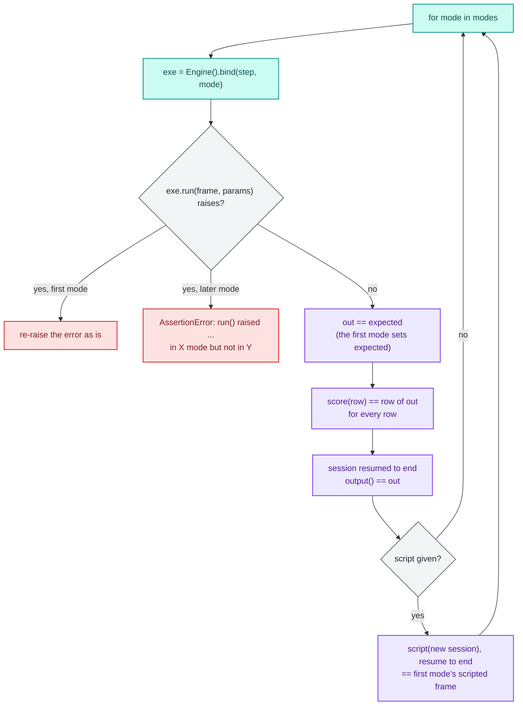
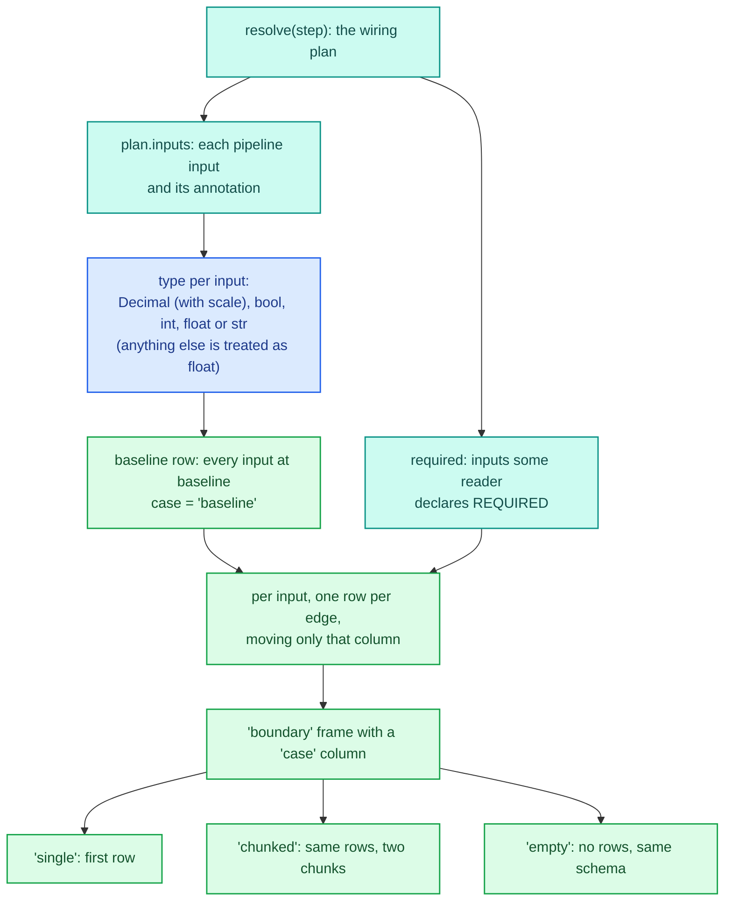
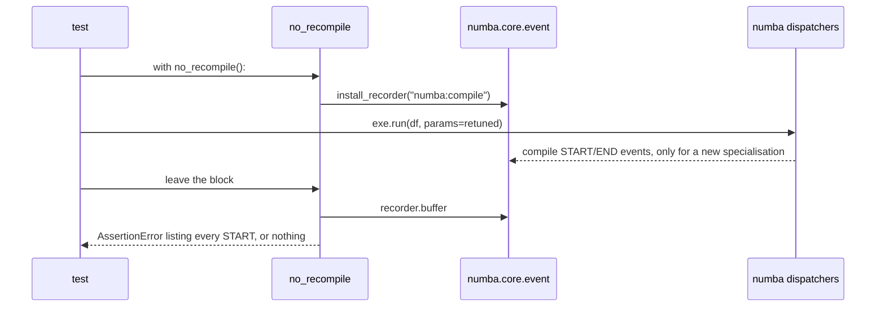

# Testing helpers

`decider.lab.testing` is three helpers for a project's own test suite. `assert_equivalent` proves that the three
execution modes, single-record scoring and the debugger all give the same answer. `corpus` builds the boundary
inputs worth proving it on. `no_recompile` proves that a block of code compiled nothing. The runtime checks
`crash_probe` and `mode_divergence` are built from the first two (see [Checks](checks.md)).

| File | What it holds |
|---|---|
| `decider/lab/testing/__init__.py` | `MODES`, `assert_equivalent`, `corpus`, `no_recompile` |
| `decider/lab/testing/_equivalence.py` | `MODES = ("interpreted", "stepped", "fused")` and `assert_equivalent` |
| `decider/lab/testing/_corpus.py` | `corpus` and its value tables (`TIES`, `LARGE_RAW`, `INT_NEAR_2_53`) |
| `decider/lab/testing/_recompile.py` | `no_recompile`, a context manager over numba's compile events |

The package imports nothing else from the lab. It needs the engine (`Engine`), the debugger (`decider.debug.Session`),
the wiring `resolve`, and numba's event API. The user-level walkthrough is in the
[debugging and testing guide](../../guides/debugging-and-testing.md) and the
[diff and equivalence guide](../../guides/diff-and-equivalence.md).

## Why these three exist

The engine runs a flow three ways: interpreted (plain Python), stepped (one compiled kernel per step) and fused
(adjacent steps compiled into one kernel). On top of that, `Executable.score(record)` runs a single dict record on a
separate path, and a debug `Session` pauses and resumes a run. That is five ways to compute one answer, and the
design promise is that they agree exactly. Kernels use CPython-equal `round(x, n)` and `x ** n` so they can.
[Runners](../engine/runners.md) and [Compile](../engine/compile.md) describe the modes; this package is how a test
holds them to the promise.

The serving path also promises that retuning a parameter value never recompiles (see
[Params](../engine/params.md)). `no_recompile` is how a test holds the engine to that.

## `assert_equivalent`

```python
assert_equivalent(step, frame, params=None, modes=MODES, script=None) -> pl.DataFrame
```

<div class="diagram" markdown>


*Green cells are the references the other modes are held to. Every grey cell is an exact comparison.*
</div>

For each mode in `modes`, in order, it:

1. binds the step with `Engine().bind(step, mode=mode)`;
2. runs `exe.run(frame, params)`. The first mode's output becomes `expected`, and every later mode's output must
   equal it;
3. calls `exe.score(record, params)` for every row of `frame` and compares the dict with the same row of this mode's
   run output (same keys in the same order, equal values);
4. opens `exe.session(frame, params)`, resumes it until `session.finished`, and compares `session.output()` with this
   mode's run output;
5. with `script`, opens a second session, calls `script(session)`, resumes it to the end, and compares the result
   with the first mode's scripted result.

It returns `expected`.



### What "the same" means

Frames are compared with polars' `assert_frame_equal(check_exact=True)`: same column names in the same order, same
dtypes, same values. NaN equals NaN; nothing else is approximate, so a float that differs in the last bit fails.
Records are compared key by key with `==`, with NaN equal to NaN, after checking that the key lists match in order.
Every failure is an `AssertionError` whose message starts with what was compared and in which mode:

| Prefix | Meaning |
|---|---|
| `run() in {mode} mode differs from {first}` | Two modes computed different frames |
| `run() raised {error!r} in {mode} mode but not in {first}` | A later mode crashed where the first didn't |
| `score() of row {i} in {mode} mode differs from run()` | Single-record scoring disagrees with the batch run; the message names the key and both values |
| `a session resumed to the end in {mode} mode differs from run()` | The debugger's output disagrees with the run |
| `the scripted session in {mode} mode differs from {first}` | The same session script gave different frames in two modes |

### Errors

An error in the first mode propagates unchanged. Identical crashes in every mode are not agreement, because
nothing was compared:

```text
RuntimeError: deliberately broken in every mode
```

A crash only in a later mode is a divergence like any other. A `frame` that isn't a `pl.DataFrame` is refused up
front with `TypeError: assert_equivalent needs a polars DataFrame, not dict`.

### A real divergence

To show a failure, this test overloads a helper so compiled code computes `x + 2.0` where Python computes `x + 1.0`:

```python
import polars as pl
from numba.extending import overload
from decider import flow
from decider.lab.testing import assert_equivalent

def bump(x):
    return x + 1.0

@overload(bump)
def _bump_compiled(x):
    return lambda x: x + 2.0

def bumped(x: float) -> float:
    return bump(x)

assert_equivalent(flow(bumped, name="fee"), pl.DataFrame({"x": [1.0, 5.0]}))
```

```text
AssertionError: run() in stepped mode differs from interpreted: DataFrames are different (value mismatch for column "bumped")
[left]: shape: (2,)
Series: 'bumped' [f64]
[
	3.0
	7.0
]
[right]: shape: (2,)
Series: 'bumped' [f64]
[
	2.0
	6.0
]
```

`[left]` is the mode being checked, `[right]` is `expected` from the first mode. The comparison stops at the first
difference, so the fused mode isn't reached. The builtin `round` does not diverge this way: `round(x, 2)` over
`[2.675, 0.125]` passes in all three modes because kernels implement CPython's rounding.

### Scripted sessions

`script` is a function that drives a `Session` (breakpoints, `set`, `resume`) before `assert_equivalent` resumes it
to the end. The plain run is unaffected; the override only lives in the sessions:

```python
def override_debt(s):
    s.break_at("loan/affordability")
    s.resume()
    s.set("debt", 100.0)

out = assert_equivalent(pipeline, df, script=override_debt)
print(out["approved"].to_list())   # [True, False], the unscripted run
```

A script can only touch values every mode stores. A fused session pauses before the whole fused kernel and keeps
only the kernel's boundary values, so setting a value computed inside the kernel fails in the fused mode with the
debugger's own error:

```text
KeyError: "'affordability' is computed inside the fused kernel ['loan/affordability', 'loan/approved'] and never stored; open the session with mode='stepped' to inspect or set it"
```

A breakpoint on a later step of a fused kernel, followed by `set` on that step's input, also differs by design: the
set lands before the kernel's earlier steps run. `tests/testing/test_testing.py` pins this as an expected failure.
Narrow `modes` to `("interpreted", "stepped")` for scripts that need per-step stops.

### Cost

Each mode binds once, runs once, makes one `score` call per row, and runs one or two sessions. The per-row `score`
calls dominate on a large frame, so feed it small, sharp frames: `corpus` adds at most ten rows per input.

## `corpus`

`corpus(step, baseline=1.0)` builds boundary-value frames for every input column the step reads. The cases are the
ones where modes and numeric types most often disagree: zero, a negative, a null, an int one past exact float64,
rounding ties, and large money amounts.



The baseline value per type is `baseline` (`1`, `1.0`, or a decimal at the input's scale), `True` for a `bool` and
`"corpus"` for a `str`. Then, for each input, these edges, each a row that moves only that column:

| Edge | Applies to | Value |
|---|---|---|
| `zero` | every type | `0`, `0.0`, `False`, `""`, or a zero decimal |
| `negative` | `int`, `float`, `Decimal` | minus the baseline |
| `null` | inputs no reader declares required | `None` |
| `int_near_2**53` | `int`, `Decimal` | `2**53 + 1`, the first integer float64 can't hold; for a decimal, that raw int64 at its scale |
| `tie:{v}` | `float` | `0.125`, `0.5`, `1.005`, `1.5`, `2.5`, `2.675`, `-2.5`: ties where half-even and half-up differ, and `1.005` and `2.675`, which sit just below a tie as doubles |
| `large:{k}` | `Decimal` | raw int64 values `10**11`, `10**13` and `2**62 // 1000`, the largest whose product with 1000 still fits int64 |

A required input never gets a null row, because a required null is an error by contract rather than a divergence.
The `case` column names each row as `{edge}:{column}`. Columns are typed from their declarations: `pl.Decimal(38,
scale)` for a `Decimal` or `Currency`, `Boolean`, `Int64`, `Float64` or `String` otherwise.

The four frames:

| Name | Contents |
|---|---|
| `boundary` | the baseline row plus every edge row |
| `single` | the baseline row alone |
| `chunked` | the `boundary` rows as two chunks (`pl.concat(..., rechunk=False)`), to exercise chunked input handling |
| `empty` | no rows, same schema |

A step with no inputs gets a one-row `boundary` that holds only `case`.

For the loan flow (`income` and `debt`, both required floats):

```python
from decider.lab.testing import corpus

frames = corpus(pipeline)
for name, f in frames.items():
    print(name, f.height, f.n_chunks())
print(frames["boundary"]["case"].to_list())
```

```text
boundary 19 1
single 1 1
chunked 19 2
empty 0 1
['baseline', 'zero:income', 'negative:income', 'tie:0.125:income', 'tie:0.5:income', 'tie:1.005:income', 'tie:1.5:income', 'tie:2.5:income', 'tie:2.675:income', 'tie:-2.5:income', 'zero:debt', 'negative:debt', 'tie:0.125:debt', 'tie:0.5:debt', 'tie:1.005:debt', 'tie:1.5:debt', 'tie:2.5:debt', 'tie:2.675:debt', 'tie:-2.5:debt']
```

For a money step, `def fee(principal: Currency["R"], rate: float = param(0.015)) -> Currency["R"]`, the
`principal` column is `Decimal(precision=38, scale=4)` and its rows are:

```text
baseline                     1.0000
zero:principal               0.0000
negative:principal          -1.0000
int_near_2**53:principal     900719925474.0993
large:10**11:principal       10000000.0000
large:10**13:principal       1000000000.0000
large:2**62//1000:principal  461168601842.7387
```

The money rows test the decimal kernels where they are most likely to wrap: `Currency` is an int64 mantissa, so
`2**62 // 1000` is the largest raw amount that a multiply by 1000 keeps in range. Money types are covered in
[Types and money](../../guides/types-and-money.md).

## `no_recompile`

`no_recompile()` is a context manager that fails if numba compiles anything inside it.



It installs numba's event recorder for the `numba:compile` event for the duration of the block, then collects the
events whose status is `START`. Each names the dispatcher's Python function and the argument types of the new
specialisation. A call served by an existing in-memory specialisation compiles nothing and emits nothing, and the helper's
docstring states that a load from numba's disk cache doesn't count either.

The passing case retunes a param on a fused executable:

```python
exe = Engine().bind(pipeline, mode="fused")
exe.run(df)
with no_recompile():
    exe.run(df, params={"loan": {"approved": {"limit": 0.5}}})
```

The failing case binds a flow whose step is a closure, which numba can't serve from the disk cache:

```python
offset = 7.25

def make():
    def shifted(x: float) -> float:
        return x + offset
    return shifted

with no_recompile():
    Engine().bind(flow(make(), name="shift"), mode="stepped").run(pl.DataFrame({"x": [1.0]}))
```

```text
AssertionError: numba compiled 2 specialisation(s): make.<locals>.shifted(float64,), _build_kernel.<locals>.run(int64, UniTuple(Array(float64, 1, 'C', True, aligned=True), 1), Tuple(()), Tuple(()), Tuple(()), Tuple(()), UniTuple(Array(float64, 1, 'C', False, aligned=True), 1))
```

Two compilations show up: the step function itself, then the generated stepped kernel that calls it. How kernels are generated and cached is on
the [Kernels](../engine/kernels.md) and [Cache](../engine/cache.md) pages.

numba's event listeners are process-wide, so the recorder sees every compilation while the block runs. Run tests that use it without other
threads compiling in the background, or a compile elsewhere fails the block.

## How the runtime checks reuse them

`crash_probe` (`DCD501`) binds the flow once in the default mode and runs every `corpus` frame, reporting each
exception by case name. `mode_divergence` (`DCD505`) calls `assert_equivalent` for every `corpus` frame and turns
each `AssertionError` into a finding, ignoring other exceptions so a crash is reported once, by `DCD501`. Both are
opt-in because they compile and run the flow. Details and real output are on the [Checks](checks.md) page.

## What the tests pin

`tests/testing/test_testing.py` holds the behaviour: `assert_equivalent` returns the first mode's output; passes over
every corpus frame; refuses a non-frame; propagates an error that every mode raises; names the mode and both values
on a divergence; names the row when `score` disagrees; catches a session that disagrees with `run`; agrees on a
scripted break, set and resume; catches a scripted session that differs between modes; accepts narrowed `modes`.
The corpus tests pin the shared schema and row counts, per-input typing, single-column moves, the bool and int
edges, nulls only for non-required inputs, rounding ties on every float, decimal columns with large amounts, and a
step with no inputs. The `no_recompile` tests pin a value-only retune passing in stepped and fused modes, and a
closure compile failing.

## Where to go next

- [Checks](checks.md) for `crash_probe` and `mode_divergence`.
- [Runners](../engine/runners.md) and [Debug](../engine/debug.md) for the modes and the session being compared.
- [Diff](diff.md) for comparing two versions of a flow rather than two modes of one.
- The [debugging and testing guide](../../guides/debugging-and-testing.md) for using these in a test suite.
