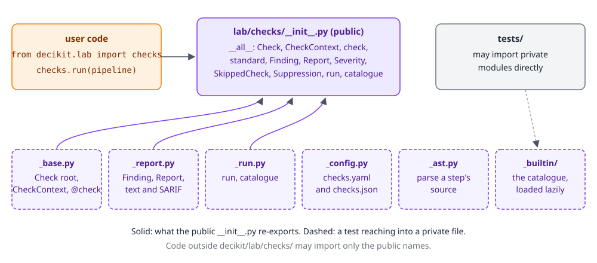
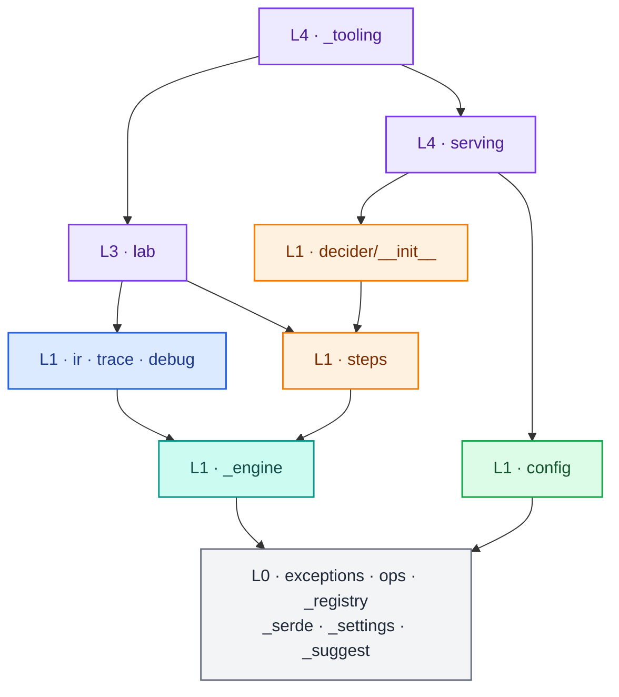
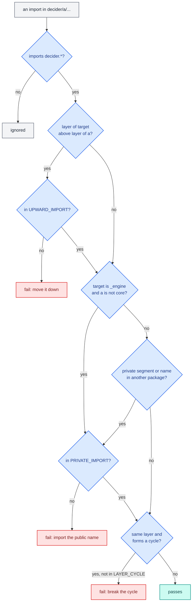
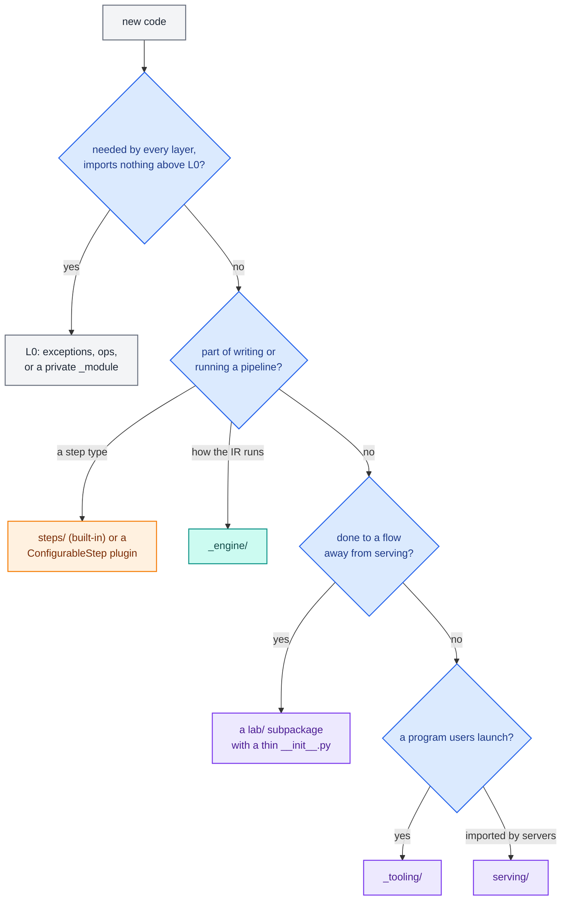

# Package layout

`decider/` is one installable package of about 240 Python files. Three rules shape it: a leading underscore marks
anything private, public packages are thin, and imports only go down a five-level layer map. A test file,
`tests/test_conventions.py`, checks all three on every run, together with a 500-line limit per file. The picture of how the
layers fit together is on the [architecture overview](index.md).

## The three layout rules

The rules come from the Python API redesign, which was implemented on 2026-10-06; the reasons are in
`docs/design_decisions/decisions/api-layout.md`.

1. A leading underscore anywhere in a path means private. `decider/_engine/run/state.py` and
   `decider/lab/checks/_run.py` are private; so is everything under `decider/_engine/`. Inside a private package, files
   keep plain names, because the package's underscore already says it. Every public module defines `__all__`.
2. Public packages are thin. A public package is an `__init__.py` (plus any public subpackages, such as
   `lab.experiments.metrics`) over `_`-prefixed implementation files. Users import from the package, never from one of
   its files.
3. Layers only import downward. Within one layer an import is allowed if it forms no cycle between packages. Only the
   core may import `decider._engine`.

There are no compatibility shims. When a name moves, its callers change in the same commit.

<div class="diagram" markdown>


*A thin public package. `decider.lab.checks` exports eleven names; six private files hold the code.*
</div>

Rule 2 has a few deliberate exceptions where a module is itself the public unit. `decider.ops` is a package of public
modules (`text`, `decimal`, `nested`, `measures`), because a function is reached through its module
(`decimal.round(...)`). The document grammars are public too: `decider.steps.trees.schema` (a package) and
`decider.steps.tables.schema` (a module) hold the classes you build a tree or table from in Python. And
`decider.lab.experiments.callbacks` is a public module beside the `metrics`, `plots` and `report` subpackages.

## The layer map

Each top-level unit (a package or a top-level module) has a layer, written as `LAYERS` in `tests/test_conventions.py`:

| Layer | Units | What it is for |
|---|---|---|
| L4 tooling | `serving`, `_tooling`, `__main__` | the HTTP server users import, and the programs `decider` launches |
| L3 libraries | `lab`, `credit` | everything done to a flow away from serving; `credit` is mapped but not built yet |
| L2 | none | the numbering skips it |
| L1 core | `__init__`, `steps`, `ir`, `trace`, `debug`, `config`, `_engine` | write, run and debug a pipeline; the versioned config store |
| L0 foundation | `exceptions`, `_registry`, `_serde`, `ops`, `_settings`, `_suggest` | what every layer above may use |

The real import graph, counted from the source with the test's own AST walker, looks like this. Each number is the
count of import statements from one unit into another, lazy imports inside functions included:

| From | Imports (statements) |
|---|---|
| `__init__` | `steps` 20, `_engine` 6, `exceptions` 2, `_serde` 1, `lab` 1 |
| `steps` | `_engine` 77, `exceptions` 12, `_serde` 6, `_registry` 2, `_suggest` 2, `ops` 1 |
| `_engine` | `ops` 24, `exceptions` 14, `steps` 10, `_suggest` 5, `_registry` 1, `_serde` 1 |
| `ir`, `trace`, `debug` | `_engine` 41 |
| `config` | `_registry` 1 |
| `lab` | `ir` 45, `steps` 39, `_engine` 19, `exceptions` 13, `_registry` 9, `__init__` 4, `ops` 3, `_settings` 2, `_suggest` 1, `debug` 1 |
| `serving` | `exceptions` 7, `ops` 3, `steps` 3, `__init__` 2, `config` 2, `_settings` 1, `ir` 1 |
| `_tooling` | `lab` 47, `_engine` 14, `steps` 10, `ir` 8, `__init__` 6, `serving` 5, `exceptions` 4, `config` 2, `ops` 2, `_settings` 1, `trace` 1 |
| `_registry` | `_suggest` 1, `exceptions` 1 |
| `_settings` | `config` 1 |
| `__main__` | `_tooling` 1 |

The main downward paths, without the exceptions:



The edges that break the rules are accepted exceptions, each with a reason in `tests/conventions_allowlists.py`:

- `__init__ -> lab` is permanent. `describe` lives in `decider.lab` beside the refs it returns, and is also a top-level
  name for users.
- `_settings -> config`: the settings build a config store from its type tag.
- `_engine <-> steps` is a cycle inside L1. The IR context reaches `steps` lazily for `as_step` and `ParamRef`, and
  the compiler reads `@helper` and `@allow_fallback` marks from `steps/_helpers.py`. Both entries are marked for removal
  once that goes through the IR.
- 46 private imports cross package lines, most of them `lab` and `_tooling` reading `_engine` internals that have no
  public home yet (the resolved plan, param merging, `import_flow`). The redesign's goal is an empty list.

The `CLAUDE.md` engine rule is narrower than the layer map: `_engine/` imports nothing from `steps/trees`,
`steps/tables`, `steps/scorecard`, `config/` or `serving/`. The layer map catches the `serving` case (an upward
import); the rest holds today but no test checks it.

## Public and private

| Kind | Examples | Promise |
|---|---|---|
| The authoring namespace | `decider` (31 names) | what you write in a pipeline file; one canonical path per name |
| Companion packages, one per task | `decider.lab.checks`, `decider.lab.diff`, `decider.serving`, `decider.config` | small `__all__` (at most 25 names unless allowlisted) |
| Facades over the engine | `decider.ir`, `decider.trace`, `decider.debug` | the engine's types for step authors and tools, without importing `_engine` |
| Public modules | `decider.ops.decimal`, `decider.steps.tables.schema`, `decider.lab.experiments.callbacks` | the module is the unit users import |
| Private | `decider._engine`, `decider._registry`, `decider._tooling`, any `_file.py` | no stability promise; tests may import it |

`__all__` alone hides nothing: `dir()` and deep imports still work. The underscore is what IDEs, `help()` and the docs
skip, and what a test can check. Two packages are allowed past the 25-name budget, both in `BIG_ALL`: the top-level
`decider` ("the authoring vocabulary is one namespace by design") and `steps/trees/schema` ("the document grammar is
public by design").

`import decider` stays light. `decider/__init__.py` resolves `Engine`, `Executable`, `TreeConfig`,
`DecisionTableConfig` and `ScorecardConfig` through a module `__getattr__` on first use, because their modules import
numba; `decider.ops` does the same for `Currency` and `Decimal`.

## Every package and file

Directories that hold no Python file are left out, except the non-Python assets listed with their package.

### Top level

| File | Layer | Purpose |
|---|---|---|
| `__init__.py` | L1 | the authoring vocabulary: constructors, `param`, `Engine`, `load_flow`, `describe`, `Step`, `ConfigurableStep`, errors |
| `__main__.py` | L4 | `python -m decider` runs the CLI |
| `GUIDE.md` | | the getting-started guide `decider guide` prints; `tests/test_guide.py` runs every example in it |
| `ir.py` | L1 | facade: node and declaration classes, `to_ir`, `step_map`, `iter_nodes`, `check_name`, `check_id` |
| `trace.py` | L1 | facade: `TraceSink`, `TraceEvent`, `Kind`, `Adapter`, `PassThroughAdapter`, `TraceLossError` |
| `debug.py` | L1 | facade: `Session` and the events it yields |
| `exceptions.py` | L0 | `DeciderError` and its subclasses, `FallbackWarning` |
| `_registry.py` | L0 | type-tag registry for pydantic plugin roots, with entry-point lookup |
| `_settings.py` | L0 | `DECIDER_*` environment settings, read lazily by `get_settings()` |
| `_suggest.py` | L0 | did-you-mean suggestions for error messages |

[Foundation packages](foundation.md) covers the L0 files and `ops/` and `_serde/` in depth.

### `ops/` (L0, public)

| File | Purpose |
|---|---|
| `__init__.py` | re-exports each domain's type: `Text`, `Currency`, `Decimal`, `Columnar`, `Struct`, `Percent`, `Duration`, `FieldMetadata` |
| `text.py` | `Text`, a string a compiled step reads in place as UTF-8 bytes |
| `decimal.py` | `Decimal`, `Currency`, `Rounding`, `round`, `round_float` |
| `nested.py` | `Columnar[Item]` and `Struct[Item]` markers for list and struct columns |
| `measures.py` | `FieldMetadata`, `Percent`, `Duration`, `DecimalSpec`, `metadata_of` |

### `_serde/` (L0, private)

| File | Purpose |
|---|---|
| `__init__.py` | re-exports the two modules |
| `frame.py` | `FrameDoc`: rows plus an optional schema, as JSON, built into a polars frame |
| `schema.py` | `PolarsSchema`, `PrimitiveSchema`: polars dtypes written as JSON, and back |

### `steps/` (L1, public)

| File | Purpose |
|---|---|
| `__init__.py` | the constructors, `Step`, `ConfigurableStep`, `Value`, `ParamRef`, `StepRef`, `helper`, `allow_fallback`, `load_flow` |
| `_base.py` | `Step`: the pipe operator, `named`, `relabel`, `parameters`, `walk`, `compile`, `run`, `session`; `as_step` |
| `_function.py` | `FunctionStep` and `step()` |
| `_frame.py` | `FrameStep` and `frame_step()` |
| `_sequential.py` | `SequentialStep` and `flow()`, `emit`, `drop` |
| `_dag.py` | `DagStep` and `dag()`, the dependency sort |
| `_branch.py` | `BranchStep` and `branch()`, column-name conditions, one-arm branches |
| `_loop.py` | `LoopStep` and `loop()` |
| `_each.py` | `EachStep`, `EachMode` and `each()`, lowered to a `ScatterGatherNode` |
| `_optimise.py` | `OptimiseStep` and `optimise()`, lowered to a sequence around a loop |
| `_configurable.py` | `ConfigurableStep` (registry root, group `steps`), `StepRef`, the lazy built-in tags |
| `_values.py` | `ParamRef`, `TableRef`, `Value`, `TableValue` |
| `_helpers.py` | `@helper(signatures=...)`, `@allow_fallback` and the readers the compiler uses |
| `_composites.py` | the constructors by name, read by `decider ids` and flow files |
| `_entry.py` | `import_flow("module:qualname")`, used by the lab and tooling to import a flow |
| `expr/__init__.py` | `parse`, `Expr`, `ExprError`: a closed arithmetic grammar for computed tree features |
| `expr/_postfix.py` | expressions as postfix opcode rows, evaluated by one njit kernel |
| `flowfile/__init__.py` | `load_flow`, `read_flow`, `components` |
| `flowfile/_load.py` | turns a YAML or JSON flow file into ordinary `flow`, `branch` and `loop` steps |
| `flowfile/_schema.py` | the flow-file shape: step, flow, dag, branch, loop, each and optimise nodes |
| `trees/__init__.py` | `TreeConfig` (alias `tree`), `expr_condition`, `Route`, `Visit` |
| `trees/_condition.py` | `expr_condition`: a boolean expression as a one-output tree |
| `trees/_encode.py` | a `Tree` as the arrays the compiled walker reads, and its row node's declarations |
| `trees/_ops.py` | opcodes for the six threshold comparisons |
| `trees/_reference.py` | the Python tree walker, the compiled walker's twin, reporting each node visited |
| `trees/_routes.py` | `path_columns`: the tree unfolded into one route per leaf |
| `trees/_trace.py` | path numbering for `trace_output` |
| `trees/_walker.py` | the one compiled tree walker |
| `trees/schema/` | the public tree grammar: `conditions.py`, `nodes.py`, `flat.py`, `v3.py`, `tree.py`, `document.py` (format detection), `_output_types.py` |
| `tables/__init__.py` | `DecisionTableConfig` (alias `decision_table`) |
| `tables/_encode.py` | a table's conditions as a program and its rows as packed arrays |
| `tables/_matcher.py` | the one compiled decision-table matcher |
| `tables/_reference.py` | the Python matcher twin, reporting each row it tries |
| `tables/schema.py` | the public table expression classes |
| `scorecard/__init__.py` | `ScorecardConfig` (alias `scorecard`) |
| `scorecard/_config.py` | scorecard variables and bins, and `to_ir` |
| `scorecard/_kernels.py` | the numeric functions a scorecard's IR calls |

[Steps and the IR](steps-and-ir.md) covers the step classes; [Configurable steps](configurable-steps/index.md) covers
trees, tables, scorecards, expressions and flow files.

### `config/` (L1, public)

| File | Purpose |
|---|---|
| `__init__.py` | `ConfigStore`, `JsonFileStore`, `Version`, `VersionPart`, `VersionedConfig` |
| `_store.py` | `ConfigStore`, a registry root (group `config_stores`) |
| `_file.py` | `JsonFileStore` (tag `file:json`), versioned folders of JSON documents |
| `_versions.py` | `Version`, `VersionPart`, `VersionedConfig` |

See [Config store](config-store.md).

### `_engine/` (L1, private)

| Path | Purpose |
|---|---|
| `__init__.py` | `Engine` (lazy), `IRContext`, `to_ir`, `step_map` |
| `types.py` | annotation helpers: representations, `Decimal` info, item schemas, raw types |
| `concurrency.py` | `Cache` and `once` for build-once caches, a per-thread pool for boundary views |
| `ir/nodes.py` | `IRNode`, `CallNode`, `SequenceNode`, `BranchNode`, `LoopNode`, `ScatterGatherNode`, `FiniteStateMachineNode`, `iter_nodes` |
| `ir/decls.py` | `Input`, `Output`, `ParamDecl`, `NullPolicy`, `FeatureKind` |
| `ir/origin.py` | `Origin`, `check_name`, `check_id` |
| `ir/context.py` | `IRContext`, `to_ir`, `step_map`, the build cache, relabelling, IR checks |
| `params/declare.py` | `param()`, `missing_as()` and their marker types |
| `params/harvest.py` | reading inputs, params and outputs from a signature |
| `params/models.py` | `NodeParams`: one generated pydantic model per node; shared-type checks |
| `params/bundles.py` | namedtuple bundle classes by field names, picklable by reference |
| `params/tables.py` | `param_table()`, `ParamTable`, table validation types |
| `params/validate.py` | `Status`, `Validation`, `ParamsCache`, `document_key`, `merge` |
| `params/schema.py` | `parameters()` and `ParamsSchema` (`defaults()`, `json_schema()`) |
| `wiring/interface.py` | the names a node reads and writes |
| `wiring/plan.py` | `NodeVersion`, `Call`, `Sequence`, `Branch`, `Loop`, `ScatterGather`, `Plan` |
| `wiring/resolve.py` | `resolve()`: binding reads to versions, scope and typo checks |
| `run/engine.py` | `Engine`, `Executable`, `RUNNERS` |
| `run/state.py` | `State`: versioned arrays with validity masks; record loading |
| `run/params.py` | `RunParams`, `RunReport` |
| `run/representations.py` | compiled-value representations shared by every runner |
| `run/runners/base.py` | `Runner` protocol, `Checkpoint` |
| `run/runners/interpreted.py` | `InterpretedRunner`, the driver every mode uses |
| `run/runners/stepped.py` | `SteppedRunner`: one kernel per node |
| `run/runners/fused.py` | `FusedRunner`: one kernel per innermost sequence, packed branches and loops |
| `compile/units.py` | `compile_plan`, `Kernel` and `Fallback` units |
| `compile/njit.py` | `jit`, `compile_call`, the fallback error tuple, the salted disk cache |
| `compile/kernel.py` | `fused_kernel`: the kernel body over a step program |
| `compile/packed.py` | `compile_packed`: a branch or loop as one kernel |
| `compile/fingerprint.py` | content fingerprints of functions, `cpu_target` |
| `compile/outputs.py`, `rows.py`, `structs.py`, `sink.py` | output storage, `Columnar[Item]`, `Struct[Item]`, growable output buffers |
| `compile/span.py`, `decimal_type.py` | the numba `SpanType` and `DecimalType` |
| `compile/semantics/` | `numbers.py`, `strings.py`, `decimals.py`: overloads that make kernels answer as Python does; `SALT` |
| `boundary/extract.py`, `dtypes.py`, `nulls.py`, `errors.py` | frame extraction, dtype rules, required-null checks, Arrow errors |
| `boundary/_arrow/` | the nanoarrow shim: `_build.py` (compile with `cc`), `_shim.py` (ctypes), `view.py`, `plan.py`, `kernels.py`, `intrinsics.py`, `nested.py`, `doctor.py`; `c/shim.c` and `vendor/nanoarrow/` |
| `debug/session.py` | `Session` |
| `debug/events.py`, `commands.py`, `wire.py` | events, commands, their JSON adapters |
| `debug/edit.py`, `hot.py` | `replace` and `delete` in a live session; `reload` and `ModuleWatcher` |
| `trace/envelope.py`, `sink.py` | the int64 trace envelope; `TraceSink` and adapters |

The [engine](engine/index.md) pages cover each folder.

### `lab/` (L3, public)

| Path | Purpose |
|---|---|
| `__init__.py` | `describe`, `resolve_step`, `source_location`, the refs, `CONTRACT_VERSION` |
| `_refs.py` | `FlowRef`, `StepRef`, `EdgeRef`, `ValueSlotRef`, `RecordRef`, `FlowDescription` |
| `_describe.py` | `describe()`: nodes from the IR, data edges from the resolved plan |
| `data/` | `read`, `scan`, named datasets: `_load.py`, `_formats.py`, `_keys.py`, `_providers/` (`DatasetProvider` root, group `datasets`) |
| `checks/` | `run`, `Check` root (group `checks`), findings: `_base.py`, `_run.py`, `_report.py`, `_config.py`, `_ast.py`, `_builtin/` (`data`, `determinism`, `ids`, `numeric/`, `params`, `runtime`, `structure`) |
| `diff/` | `structure`, `outputs`, `revisions`, `prove`: `_structure.py`, `_outputs.py`, `_revisions.py`, `_hash.py`, `_prove.py`, `_smt.py` (z3), `_worker.py` |
| `testing/` | `assert_equivalent`, `corpus`, `no_recompile` |
| `experiments/` | `run`, `start`, definitions and results: `_experiments.py`, `_runner.py`, `_worker.py`, `_handle.py`, `_jobs.py`, `_manifest.py`, `_cost.py`, `_entry.py`, `callbacks.py`, `metrics/` (`Metric` root), `plots/` (`Plot` root), `report/` (`Block` root) |

Inside the lab, `data` sits under `checks`, `diff` and `testing`, which sit under `experiments`. See [the lab](lab/index.md).

### `serving/` (L4, public) and `_tooling/` (L4, private)

| Path | Purpose |
|---|---|
| `serving/__init__.py` | `RequestHandler` |
| `serving/_handler.py` | `RequestHandler`: load, warm, stage, activate, score |
| `serving/_parse.py`, `_format.py`, `_errors.py` | request parsing and date coercion, response formats, HTTP errors |
| `serving/_servers/` | `core.py` (shared helpers), `starlette.py`, `sanic.py` app factories |
| `_tooling/cli/` | the `decider` command: `guide`, `ids`, `build`, `serve`, `mcp`, `template`, `check`, `diff`, `experiment`; `ids.py` rewrites source; `templates/` is the starter project |
| `_tooling/mcp/` | `run_stdio`, `build_server`, `Policy`: the MCP server and its tools |
| `_tooling/bridge/` | the editor bridge, run as `python -m decider._tooling.bridge`: protocol models, sessions, timelines, forks, experiments, datasets |

See [Serving](serving.md), [Tooling](tooling.md) and [Editor bridge](editor-bridge.md).

## How the tests enforce it

`uv run pytest tests/test_conventions.py -q` runs eleven tests. All of them read source with `ast`; none imports the
package except the salt test.

| Test | Checks | Allowlist |
|---|---|---|
| `test_no_file_over_500_lines_unless_allowlisted` | no `.py` file over 500 lines | `ALLOWLIST` in the test file (empty) |
| `test_no_references_to_docs_or_experiments` | no `doc 03`, `§` or `EXPERIMENTS` in code | none |
| `test_public_modules_define_all` | every module with no `_` segment has `__all__` | `NO_ALL` (empty) |
| `test_public_packages_stay_within_all_budget` | a public package's `__all__` has at most 25 names | `BIG_ALL` (2) |
| `test_no_private_imports_across_packages` | `decider.<a>._x` imported only inside `decider/<a>/`; `_engine` only from the core | `PRIVATE_IMPORT` (46) |
| `test_every_top_level_package_has_a_layer` | every top-level unit is in `LAYERS` | none |
| `test_imports_only_go_down_the_layer_map` | no import from a lower layer into a higher one | `UPWARD_IMPORT` (2) |
| `test_no_import_cycles_between_packages_in_a_layer` | no cycle between units of one layer | `LAYER_CYCLE` (2) |
| `test_runners_and_executable_keep_no_per_call_state` | runner and `Executable` methods never write `self` outside `__init__` and the locked compile | `SHARED_STATE` (1) |
| `test_kernel_decorators_live_in_the_kernel_library` | `@overload` and `@intrinsic` only in `_engine/compile/semantics/`; `@register_jitable` there or in `ops/` | `KERNEL_DECORATOR` (5) |
| `test_cache_salt_covers_every_semantics_span_decimal_type_and_ops_file` | `SALT` hashes every file it must | none |

Every allowlist test also fails on a stale entry, so an allowlist can only shrink. Each import is classified like this:



The walker resolves relative imports, counts imports nested inside functions, and treats `from decider.x import y` as
an import of the module `decider.x.y` when that file exists, so an allowlist key names a module, never a class.

!!! warning "A failing entry in today's tree"
    `test_no_private_imports_across_packages` fails on the current branch. `decider/lab/_describe.py` imports
    `from decider._engine.wiring import Plan, resolve`, which the walker records as `lab._describe -> _engine.wiring`
    and `lab._describe -> _engine.wiring.resolve`. The allowlist has `lab._describe -> _engine.wiring.Plan`, a key the
    walker never produces.

## Extension points and entry-point groups

Seven pydantic base classes are registry roots (`BaseRegistryModule, root=True`). A subclass registers itself by
import path and by its `type: Literal[...]` alias, a document names it by either, and an installed package can ship
one without the user importing it, by declaring an entry point in the group `decider.<group>`:

| Root | Where | Entry-point group | Built-ins load lazily from |
|---|---|---|---|
| `ConfigurableStep` | `steps/_configurable.py` | `decider.steps` | `tree`, `decision_table`, `scorecard` |
| `ConfigStore` | `config/_store.py` | `decider.config_stores` | |
| `DatasetProvider` | `lab/data/_providers/base.py` | `decider.datasets` | `file`, `folder` |
| `Check` | `lab/checks/_base.py` | `decider.checks` | the `_builtin/` catalogue, by alias |
| `Metric` | `lab/experiments/metrics/_base.py` | `decider.metrics` | |
| `Plot` | `lab/experiments/plots/_base.py` | `decider.plots` | |
| `Block` | `lab/experiments/report/_blocks.py` | `decider.blocks` | |

```toml
# in the plugin package's pyproject.toml
[project.entry-points."decider.steps"]
markup = "credit_risk.steps:Markup"
```

The entry-point name is the type tag. `ConfigurableStep.resolve("markup")` misses the registry, loads the entry point,
and returns the class only if it registered under that root. [Foundation packages](foundation.md) traces the lookup.

Other extension points take a plain subclass or a decorator:

- A new step type subclasses `ConfigurableStep` and implements `to_ir`, with `ctx.call` for one function per row,
  `ctx.expand` to assemble other steps, or the `decider.ir` kit to build row nodes by hand.
- `@helper(signatures=...)` marks a function a compiled step calls; `@allow_fallback` accepts a Python step.
- `FieldMetadata` subclasses say what a value measures, for the debugger to format it.
- `RequestHandler` methods ending in `_fn` are overridden in a project's `inference.py`.
- `Callback` (`decider.lab.experiments.callbacks`) is a plain class on purpose, because callbacks are not saved with
  an experiment definition.
- A trace `Adapter` receives decoded trace events from a `TraceSink`.

Execution modes are a closed set (`RUNNERS` in `_engine/run/engine.py`), and so are the IR node types.

## Where a new feature goes



| Feature | Goes in | Because |
|---|---|---|
| a function users call inside a step, compiled too | `decider/ops/<domain>.py`, written once with `@register_jitable` | the kernel-decorator test allows it there, and the salt covers the file |
| an operator or builtin that must answer as Python does in a kernel | `_engine/compile/semantics/` | the only place `@overload` and `@intrinsic` may live |
| a new kind of configurable step | `steps/<name>/` with a thin `__init__.py` and a lazy alias in `_configurable.py` | the built-ins use the same extension point as a plugin |
| a new check | `lab/checks/_builtin/<family>.py` and an alias in the lazy table in `_base.py` | checks are registry modules with stable codes |
| a new experiment metric, plot or report block | `lab/experiments/metrics/`, `plots/` or `report/` | each is a registry root that experiment JSON names |
| a new CLI command | `_tooling/cli/_<command>.py`, added to the group in `cli/__init__.py` | launched, never imported |
| a new execution mode | `_engine/run/runners/` and `RUNNERS` | modes are engine internals, a closed list |

A file that grows past 500 lines splits into a package: `foo.py` becomes `foo/__init__.py` plus files, the shape
`lab/checks/_builtin/numeric/` has.
