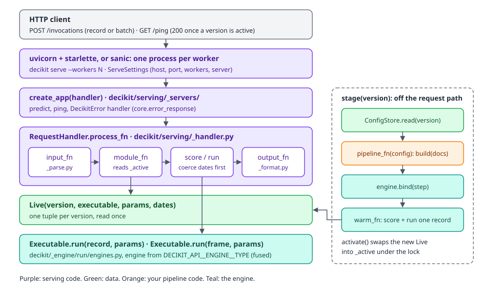
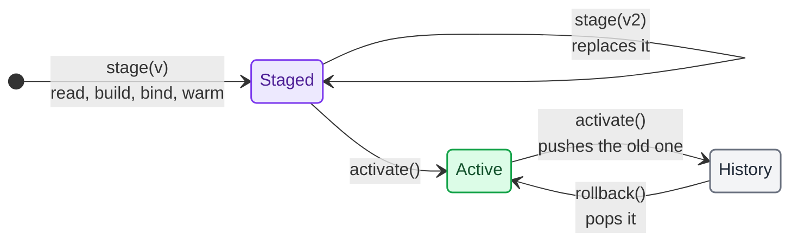
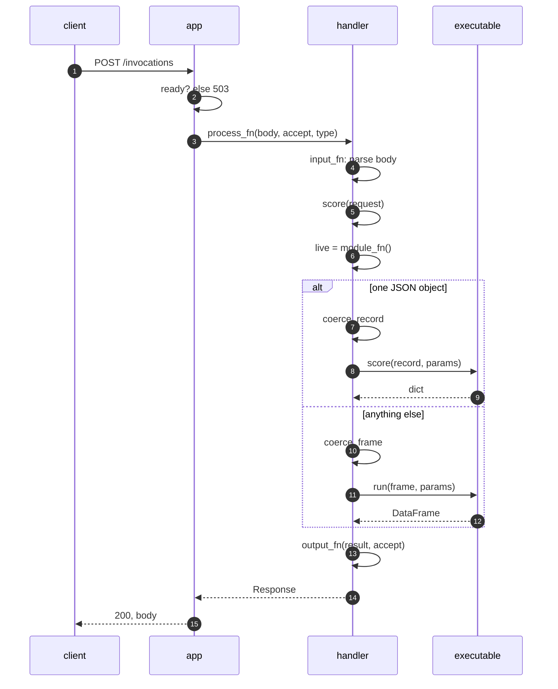
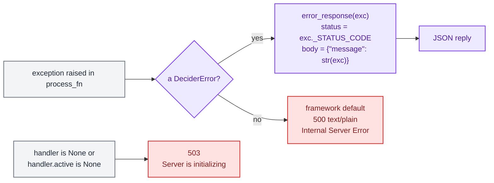
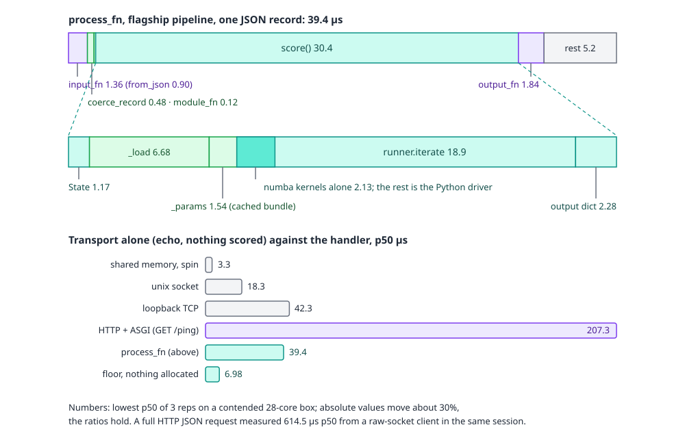
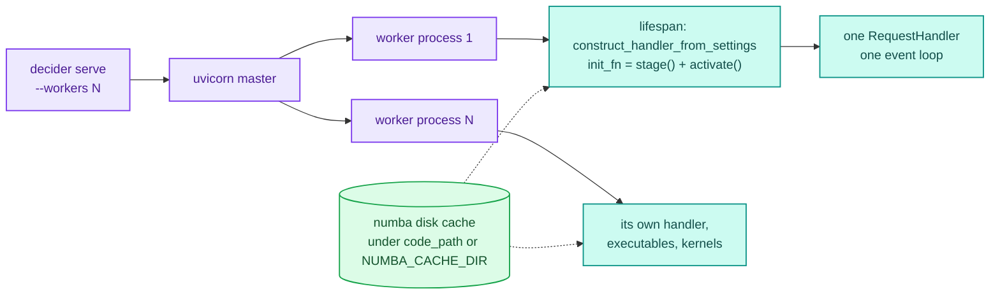

# Serving

`decider.serving` answers HTTP requests with a pipeline that is built from your code and the documents of one config version. It speaks the SageMaker model-server contract: `POST /invocations` scores, `GET /ping` says whether the server can answer. Everything that is not HTTP lives in one class, `RequestHandler`, so the same object scores requests in a test, in a notebook and behind uvicorn.

This page covers the internals: how a config version becomes a live executable, what happens to one request, which errors map to which status, where the microseconds go and how processes and threads share the work. For the task view (template, build, serve, curl) read [Projects and serving](../guides/projects-and-serving.md). The store that holds the versions has its own page, [Config store](config-store.md), and the `decider build` and `decider serve` commands are covered in [CLI and MCP internals](tooling.md).

## Files

| File | What it holds |
|---|---|
| `decider/serving/__init__.py` | Exports `RequestHandler`, the only public name. |
| `decider/serving/_handler.py` | `RequestHandler`, `Live`, the JSON fallback for money values, `construct_handler_from_settings`. |
| `decider/serving/_parse.py` | `DEFAULT_INPUT_HANDLERS` (content type to parser), `coerce_record`, `coerce_frame` and the synthetic warm-up record (`dummy`). |
| `decider/serving/_format.py` | `Response` and `DEFAULT_OUTPUT_FORMATTERS` (Accept header to writer). |
| `decider/serving/_errors.py` | The four HTTP-shaped errors: 415, 400, 406 and 500. |
| `decider/serving/_servers/core.py` | What both servers share: `ready`, `error_response`, `parse_content_headers`, the 503 body. |
| `decider/serving/_servers/starlette.py` | The default app: two routes, a lifespan that builds the handler, the `DeciderError` handler. |
| `decider/serving/_servers/sanic.py` | The same app on sanic, for `decider serve --server sanic`. |
| `decider/_settings.py` | `DeciderSettings`: what to serve (`api`), where (`serve`) and from which store (`config`). |

## The layers

<div class="diagram" markdown>


*A request goes straight down the stack. Building a version happens on the side, never inside a request.*
</div>

The split is deliberate. The server and app layers know about HTTP and nothing about pipelines. `RequestHandler` knows about bytes, content types and config versions and nothing about HTTP: its methods take `bytes` and header strings and return a `Response(content, media_type)`. The engine below knows about records and frames. A test can therefore drive the whole serving path with `handler.process_fn(body, accept, content_type)` (or `handler.score(record)` for a parsed record), which is exactly what the generated project's tests do.

## A version becomes a `Live`

A config version is a set of JSON documents (see [Config store](config-store.md)). Serving it needs a built `Executable`, the params document it runs with and the list of inputs that hold dates. `Live` bundles those four things:

```python
class Live(t.NamedTuple):
    version: Version
    executable: Executable
    params: dict[str, t.Any] | None
    dates: t.Mapping[str, t.Any] = MappingProxyType({})
```

`Live` is immutable (a named tuple whose `dates` is a read-only mapping, pinned by `test_the_default_dates_of_a_live_version_cannot_be_changed`). A request reads the active `Live` once and uses only that, so a version swap halfway through a request cannot mix two versions.

### From documents to a pipeline: `pipeline_fn`

`RequestHandler.pipeline` names the pipeline in one of four ways, and `pipeline_fn(config)` turns it plus the version's documents into a `Step`:

1. A string ending in `.yaml`, `.yml` or `.json` is a flow file. `load_flow(path, documents=config)` builds it, and a `step:` name may resolve to a document of the version (see [Flow files](../guides/flow-files.md)).
2. Any other string is an import path, `"myapp.pipeline:build"`, resolved with `pkgutil.resolve_name`.
3. A `Step` is used as it is.
4. A function is called. Each of its parameters names a key of the version: the document under that key is loaded with `ConfigurableStep.load` and passed in. A parameter with a default may be absent from the version; one without a default raises `KeyError: "the config version has no 'band' document for argument 'band' of 'pipeline:build'"`.

The version's `"params"` key is never passed to the function. It is the params document every request runs with (see [Params](engine/params.md) for how a params document is validated and bound).

### `stage`, `activate`, `rollback`



All three methods take `self._lock`, a `threading.Lock`. `stage(version=None)` does the expensive work inside it:

1. `store.latest_version()` when no version is given, or `RuntimeError("the config store has no versions to stage.")` for an empty store.
2. `store.read(version)` for the documents.
3. `Engine().bind(self.pipeline_fn(config), mode=self.mode)`.
4. `warm_fn(executable, params)`: one record through `score()` and the same record as a one-row frame through `run()`, so every kernel compiles (or loads from numba's disk cache) before a request needs it.
5. A new `Live` in `_staged`.

`activate()` moves `_staged` to `_active` and pushes the previous `_active` onto `_history`. `rollback()` pops `_history` back into `_active`. There is no limit on the history; the code marks that with a `ponytail:` comment, since a process that activates thousands of versions would keep every one of their executables alive.

Here is the whole cycle on a small credit-limit pipeline whose `build(band)` takes a decision table document called `band`. The store has versions `0.0.0` (multiple 3.0) and `0.1.1` (multiple 4.5):

```python
handler = RequestHandler(store, "pipeline:build")
print("staged", handler.stage("0.0.0"), "active", handler.active)
print("activate ->", handler.activate())
body = b'{"income": 9000.0, "expenses": 3000.0, "bureau_score": 640.0}'
print(ask())                       # process_fn(body, "application/json", "application/json")
handler.stage()
print("activate ->", handler.activate(), ask())
print("rollback ->", handler.rollback(), ask())
```

```text
staged 0.0.0 active None
activate -> 0.0.0
('application/json', '{"income":9000.0,"expenses":3000.0,"bureau_score":640.0,"limit":18000.0}')
activate -> 0.1.1 ('application/json', '{"income":9000.0,"expenses":3000.0,"bureau_score":640.0,"limit":27000.0}')
rollback -> 0.0.0 ('application/json', '{"income":9000.0,"expenses":3000.0,"bureau_score":640.0,"limit":18000.0}')
```

Calling them out of order raises a plain `RuntimeError` with the next step in the message:

```text
RuntimeError: no previously active version to roll back to.
RuntimeError: nothing staged; call stage() before activate().
```

A version that fails to build fails at `stage()`, and the active version keeps answering. Version `0.2.0` below sets `multiple` to `-1.0`, which the step's `param(3.0, ge=0.0)` refuses:

```text
ParamsError
invalid params (affects 1 row):
credit/limit: param 'multiple': Input should be greater than or equal to 0 (got -1.0)
still active 0.0.0 ('application/json', '{"income":9000.0,"expenses":3000.0,"bureau_score":640.0,"limit":18000.0}')
```

The invariants the tests pin down:

- A failing `stage` raises and changes nothing that serves (`test_a_failing_stage_raises_and_the_active_version_keeps_serving`).
- Staging a version that changes only params compiles nothing: the kernels are keyed by content, and params are runtime arguments (`test_staging_and_activating_a_params_only_version_compiles_nothing`, which runs under `no_recompile()`). See [Kernel cache](engine/cache.md).
- After staging, the first requests through a string-matching tree compile nothing either (`test_after_staging_the_first_string_tree_requests_compile_nothing`).
- Concurrent requests during repeated swaps each see exactly one version's answers (`test_concurrent_requests_during_swaps_each_see_one_version`, `test_stage_and_activate_under_load_never_serve_a_wrong_answer`).

### Warming up

`warm_fn` needs a record the pipeline can answer. It uses `sample_request` (a JSON file, by default `sample_request.json` in the code path) when the file exists, after converting its dates like a real request. Otherwise it builds a synthetic record with `dummy()`: `1.0` for a float (one, not zero, so a ratio does not divide by zero), `1` for an int, `""` for a string, `2000-01-01` for a date, one element for a list, every field for a TypedDict.

A `ParamsError` from warm-up propagates unchanged. Any other failure is wrapped in a `DeciderError` whose message says how to fix it. A pricing step `1.0 / (rate - floor)` staged without a sample file divides by zero on the synthetic record:

```text
DeciderError
warm-up failed with ZeroDivisionError: division by zero. The synthetic inputs {'rate': 1.0, 'floor': 1.0} don't suit this pipeline; put a representative request in a JSON file passed as RequestHandler(sample_request=...) and staging warms with it instead.
```

With one, it names the file and the TypedDict rule for dates inside a bare `dict`. Override `warm_fn` in a subclass to warm some other way.

## One request, traced



`process_fn` is `output_fn(score(input_fn(data, content_type)), accept)`, and all of its hooks are plain synchronous methods; a subclass that overrides one with `async def` fails with a `TypeError` when the class is created. The steps:

1. `input_fn` looks the `Content-Type` header up in `DEFAULT_INPUT_HANDLERS` by exact string. A missing parser is `UnsupportedContentTypeError` (415). Any exception the parser raises becomes `InputParsingError` (400) with the parser's message.
2. `score(request)` starts with `module_fn()`, which returns `self._active` or raises `RuntimeError("no config version is active; call stage() then activate().")`. The HTTP routes never get that far without an active version because `ready()` answers 503 first. A `dict` then takes the single-record path, `Executable.score`; a `pl.DataFrame` takes the batch path, `Executable.run`. Code in the same process calls `score` directly with a parsed record or frame.
3. `output_fn` writes the result for the `Accept` header (default `*/*` when the header is absent).

### Input formats

| `Content-Type` | Parser | Becomes |
|---|---|---|
| `application/json` | `parse_application_json` (`pydantic_core.from_json`) | an object is a `dict`; an array of objects is a frame via `pl.from_dicts(..., infer_schema_length=None)`; `[]` is a 400 |
| `application/jsonl` | `pl.read_ndjson` | frame |
| `text/csv` | `pl.read_csv` | frame |
| `application/x-parquet` | `pl.read_parquet` | frame |
| `application/vnd.apache.arrow.stream` | `pl.read_ipc_stream` | frame |
| `application/vnd.apache.arrow.file` | `pl.read_ipc` | frame |
| `application/vnd.openxmlformats-officedocument.spreadsheetml.sheet`, `application/vnd.ms-excel` | `pl.read_excel` | frame |

The lookup is exact. `application/json; charset=utf-8` is not in the table, and a request carrying it gets a 415 (checked against a running server):

```text
HTTP/1.1 415 Unsupported Media Type
{"message": "Unsupported content type: 'application/json; charset=utf-8'"}
```

curl without `-H 'content-type: ...'` sends `application/x-www-form-urlencoded`, which is a 415 too. Override `input_fn` in your `Handler` to strip parameters if your callers send them.

### Dates from JSON

JSON has no date type, so `coerce_record` converts ISO strings for the inputs whose declared annotation holds a `date` or `datetime`, at any depth: `date`, `date | None`, `list[date]`, a TypedDict with date fields, a `Struct[Item]` (which arrives as `Item`'s dict). `Live.dates` lists those inputs once per version (`_dates(exe)`), so a pipeline without dates pays only a dict copy, measured at about half a microsecond. Validation goes through a cached pydantic `TypeAdapter(list[annotation])` with `extra="allow"`, so a TypedDict that declares only its date fields keeps the other keys. A bare `dict` input says nothing about which strings are dates and is left as sent.

A frame gets `coerce_frame`, which casts top-level `String` columns declared `date` or `datetime` with `str.to_date()` / `str.to_datetime()`. Nested list and struct fields in a frame are not cast; the code marks that limit with a `ponytail:` comment.

A malformed date is a 400 that names the input:

```text
HTTP/1.1 400 Bad Request
{"message": "input 'applied_on' is declared <class 'datetime.date'> but got '28/01/2026'; send dates as ISO strings like \"2026-01-31\". (Input should be a valid date or datetime, invalid character in year)"}
```

### Output formats

| `Accept` | Media type | Writer |
|---|---|---|
| `*/*` (or no header), `application/json` | `application/json` | a `dict` result: `pydantic_core.to_json`; a frame: `write_json` |
| `application/jsonl` | `application/jsonl` | `write_ndjson` |
| `text/csv` | `text/csv` | `write_csv` |
| `application/x-parquet` | `application/x-parquet` | `write_parquet` |
| `application/vnd.apache.arrow.stream` | same | `write_ipc_stream` |

A `dict` result for any Accept other than JSON is first wrapped in a one-row frame. A frame with exactly one row goes back as a JSON object, not a one-element list: `_json` strips the brackets. So a client that sends `[{...}]` gets `{...}` back:

```text
application/json {"income":9000.0,"expenses":3000.0,"bureau_score":640.0,"limit":27000.0}
```

`Decimal` and `Currency` values in a `dict` result go out as strings of their digits (`_json_fallback`), the way pydantic writes a `decimal.Decimal`. See [Types and money](../guides/types-and-money.md).

The Accept lookup is exact too. There is no content negotiation: `Accept: application/json, text/plain` is a 406.

### What the server sends back

These are real exchanges with `decider serve --workers 1` on the project `decider template loan_check` writes:

```text
$ curl -s -d @sample_request.json -H 'content-type: application/json' localhost:18931/invocations
{"income":1000.0,"debt":250.0,"applied_on":"2026-01-15","approved":true}

$ curl -s -d '[{"income":1000,"debt":350,"applied_on":"2026-01-10"},{"income":1000,"debt":350,"applied_on":"2026-01-28"}]' \
    -H 'content-type: application/json' localhost:18931/invocations
[{"income":1000,"debt":350,"applied_on":"2026-01-10","approved":true},{"income":1000,"debt":350,"applied_on":"2026-01-28","approved":false}]

$ curl -s -d '{"income":1000,"debt":350,"applied_on":"2026-01-28"}' \
    -H 'content-type: application/json' -H 'accept: text/csv' localhost:18931/invocations
income,debt,applied_on,approved
1000,350,2026-01-28,false
```

The answer echoes the request's fields and adds what the pipeline decided. In the batch reply the ints stay ints: `from_dicts` infers `Int64` for `1000`, whereas the single-record path converts to the declared `float`.

## Validation

What is checked, and when:

| Check | When | Failure |
|---|---|---|
| Params document against every step's declared params | `stage()` (inside `Engine.bind` and warm-up) | `ParamsError`, the version is not staged |
| Every document the pipeline function needs is in the version | `stage()` | `KeyError` naming the document and argument |
| The body parses as the declared content type | each request | 400 `InputParsingError` |
| Date inputs are ISO strings | each request | 400 `InputParsingError` naming the input |
| Required inputs are present and not null | each request, in the engine | 400 `MissingInputError` naming the input and step |
| Other input types | not checked by serving | whatever the engine raises (see below) |

Only date inputs are validated per request. The comment in `coerce_record` gives the reason: JSON already delivers numbers, strings and bools as the step expects, and validation costs time on every request. The consequence is that a wrong type surfaces from the engine. Sending `{"income": "abc", ...}` to the template project raised `ValueError: could not convert string to float: 'abc'` in `load_record`, which is not a `DeciderError`, so the client sees a bare 500 (see the next section). Validate in `input_fn` if your callers are not trusted to send the right types.

## Error mapping



Every decider error carries the status a server should answer with as `_STATUS_CODE` (500 unless the class says otherwise). Both apps register one handler for `DeciderError` that returns `error_response(exc)`. The statuses that exist today:

| Error | Status | Raised by |
|---|---|---|
| `UnsupportedContentTypeError` | 415 | `input_fn`, no parser for the Content-Type |
| `InputParsingError` | 400 | `input_fn` (any parser exception), `coerce_record`, `coerce_frame`, an empty JSON array |
| `MissingInputError` | 400 | the engine, a required input absent or null |
| `UnsupportedAcceptError` | 406 | `output_fn`, no writer for the Accept header |
| `OutputFormattingError` | 500 | `output_fn`, a writer raised |
| any other `DeciderError` (`ParamsError`, `EngineError`, `WiringError`, ...) | 500 | JSON body with the message |
| anything else (`ValueError`, `ZeroDivisionError` from a step) | 500 | the framework's plain-text page, the traceback in the server log |

A missing input, from the running template project:

```text
HTTP/1.1 400 Bad Request
{"message": "input 'income' of step 'loan_check/debt_ratio' is required but column 'income' is not in the input frame or record. Fix the data, or declare `income: T = missing_as(fill)` or `income: T | None`."}
```

Runtime errors from steps always propagate; serving does not catch them. With `income: 0` the template's `debt / income` raised `ZeroDivisionError: division by zero in step loan_check/debt_ratio` inside the fused kernel, the client got `500 Internal Server Error` as plain text, and uvicorn logged the traceback. This follows the rule in [Compile and fallback](../guides/compile-and-fallback.md): compile failures fall back with a warning, runtime errors are never swallowed.

## Where the microseconds go

One request was measured at every layer for three pipelines: flagship (5 float inputs, 3 scalar steps), tree (18 inputs, a 127-node tree document) and gated (the same tree behind one `starts_with` string match).

<div class="diagram" markdown>


*The codec is a rounding error; the engine's per-call setup and the HTTP framing are the terms that cost.*
</div>

The in-process budget, fused mode, one record, no HTTP (µs, lowest p50 of three repetitions):

| Term | flagship | tree | gated |
|---|---|---|---|
| `pydantic_core.from_json(body)` | 0.90 | 2.59 | 2.69 |
| `input_fn` | 1.36 | 3.08 | 3.21 |
| `coerce_record` (no date inputs) | 0.48 | 0.57 | 0.59 |
| `module_fn` | 0.12 | 0.12 | 0.12 |
| `score()` | 30.4 | 62.7 | 136.3 |
| `output_fn` | 1.84 | 3.49 | 3.56 |
| `process_fn`, whole | 39.4 | 77.2 | 151.8 |

Inside `score()`, flagship spends 6.68 µs turning the dict into one numpy block per dtype (`_load`), 1.54 µs finding the cached params bundle and 18.9 µs in `runner.iterate`, of which the numba kernels themselves take 2.13 µs. The gated tree's 104 µs `iterate` is almost all the string span builder, which costs 71.7 µs to describe one 3-byte string. The floor, the same kernels with nothing allocated per call, is 6.98 µs for a whole flagship request including `from_json` and `to_json`, so about 5.6x is available inside the process without touching the protocol. That work belongs to the engine; see [Runners](engine/runners.md) and [Boundary](engine/boundary.md).

The same measurement on a shared, loaded development box, with the credit-limit example (a decision table and two scalar steps), gave (p50 of 5000 calls, µs):

```text
from_json(body)          0.7 us
coerce_record            0.5 us
module_fn                0.2 us
score()                 57.8 us
output_fn                1.4 us
process_fn              99.7 us
```

Outside the process, an echo route that scores nothing measured 3.3 µs over shared memory, 18.3 µs over a unix socket, 42.3 µs over loopback TCP and 207.3 µs for HTTP plus ASGI framing. A full HTTP JSON request was 614.5 µs p50. HTTP framing is the largest single term a remote client sees; the JSON codec is 2 to 6% of the in-process time.

## Why JSON, and why no special server

The question was whether an Arrow payload or a dedicated socket server would make single requests faster. The measured answer was no:

- Arrow IPC is a slower codec than JSON for one record. `pl.read_ipc_stream` took 17.1 µs against `from_json`'s 0.90, and writing the reply 40.6 µs against `to_json`'s 1.16. Arrow wins from about 4096 rows, which is where the engine's boundary already borrows buffers.
- `exe.run(one-row frame)` cost 150 µs against `score()`'s 30.4, so a single record must not be routed through a frame. That is why `process_fn` branches on `dict` versus frame.
- A long-lived pyarrow record-batch stream measured slower than every transport except HTTP.
- Swapping `json.loads` for `pydantic_core.from_json` cut `process_fn` from 49.9 to 39.4 µs (flagship). That swap is in the code; its one visible change is that a lone surrogate (`"\ud800"`) is now rejected with a 400.

So the batch content types (Arrow, Parquet, CSV, JSONL) exist for batch callers, and JSON stays the single-record format. `score()` takes a dict rather than keyword arguments because, at 400 inputs, CPython matching keyword names cost 1190 µs against 60 µs for a dict.

## Processes and threads



`decider serve` starts uvicorn with `create_app` as a factory and `workers` processes (default `2 * os.cpu_count() + 1`, computed at serve time on the target host). Each worker builds its own handler in the lifespan hook and stages and activates the store's latest version before `/ping` turns 200. Workers share nothing in memory; they share numba's disk cache, which `decider build` fills ahead of time.

Inside one worker, `process_fn` is a plain method: `score()` runs on the event loop's thread, and nothing in it awaits. One worker therefore scores one request at a time, and throughput scales with worker processes, not with concurrent requests per worker.

`RequestHandler` is still safe to call from many threads at once, which matters when you host it yourself (a thread pool, a notebook, a test). The rules:

- `process_fn` takes no lock. It reads `self._active` once, a single reference read, and uses that `Live` for the whole request.
- `stage`, `activate` and `rollback` serialise on `self._lock`. A long `stage()` blocks another `stage()` or `activate()`, never a request.
- An `Executable` is shared by every request of a version. The engine side of concurrent first calls, per-thread frame views and `nogil=True` kernels is covered in [Concurrency](engine/concurrency.md). `tests/serving/test_concurrency.py` runs cold executables from many threads in every mode and checks they agree with a single thread.

The shipped apps call `stage()` and `activate()` only at startup, through `init_fn`. There is no route for swapping versions in a running server: deploy a new version by restarting, or add a route to your `Handler` subclass that calls `stage()` and `activate()`.

### `decider build` and the CPU target

numba caches compiled kernels on disk for the CPU it compiled on. `decider build` stages a version exactly as `serve` would, which fills that cache, and writes `decider-cpu-target.json` next to it (in `NUMBA_CACHE_DIR`, else `code_path`). `decider serve` compares the recorded target with the host's and prints a warning when they differ, since every worker would then compile at startup. It is a warning, not a failure: warm-up still compiles everything before `/ping` answers. [Kernel cache](engine/cache.md) explains how kernels are keyed.

## Startup: from settings to a handler

`construct_handler_from_settings()` reads `DeciderSettings` (environment variables with the prefix `DECIDER_` and `__` between levels, case-insensitive; the CLI also loads `./.env` without overriding the real environment):

| Setting | Variable | Default |
|---|---|---|
| `api.code_path` | `DECIDER_API__CODE_PATH` | `.` |
| `api.pipeline` | `DECIDER_API__PIPELINE` | `pipeline:build` |
| `api.handler` | `DECIDER_API__HANDLER` | `inference:Handler` |
| `api.mode` | `DECIDER_API__MODE` | `fused` |
| `config.type` and the store's fields | `DECIDER_CONFIG__TYPE`, `DECIDER_CONFIG__BASEPATH` | `file:json`, `configs` |
| `serve.host`, `serve.port`, `serve.workers`, `serve.server` | `DECIDER_SERVE__*` | `0.0.0.0`, `8080`, `2 * CPUs + 1`, `starlette` |

What it does, in order:

1. Puts `code_path` and its parent at the front of `sys.path`, removing them first if they were already further back. A project directory that is itself a package (the template's layout) resolves from its parent, and a second project's `pipeline.py` earlier on the path cannot shadow this one.
2. Resolves the pipeline: a flow file is joined to `code_path`; an import path is imported once to print where it came from. The server log shows `decider: pipeline loan_check.pipeline:build from .../loan_check/pipeline.py`, so a pipeline imported from the wrong project is visible before it serves wrong answers.
3. Looks for the handler module. If `importlib.util.find_spec` finds it, the class must exist there, else `AttributeError` with the fix in the message. If the module does not exist at all, it falls back to the plain `RequestHandler`.
4. Builds the store from `settings.config` (`ConfigStore.resolve(type).model_validate(...)`) and calls the handler class with the store, the pipeline, the mode and `sample_request=<code_path>/sample_request.json`.

## Extending the handler

Every step of a request is a method, and `inference.py` holds a `Handler(RequestHandler)` subclass that can override any of them: `input_fn`, `output_fn`, `process_fn`, `pipeline_fn`, `warm_fn`, `init_fn`, `shutdown_fn`. The startup test replaces the output with a plain-text number:

```python
from decider.serving._format import Response
from decider.serving._handler import RequestHandler

class Handler(RequestHandler):
    def output_fn(self, output, accept):
        return Response(b"%d" % output["capped"], "text/plain")
```

With that `inference.py` in `code_path`, the lifespan builds a `Handler`, activates the latest version and `POST /invocations` answers `b"3000"` (`test_startup_uses_the_inference_handler_and_activates_the_latest_version`).

Keep overrides cheap. `output_fn` and `input_fn` run on every request, and the in-process budget for a whole flagship request is about 40 µs.

## Debugging a server

- `/ping` stays 503 with `{"message": "Server is initializing, please try again shortly."}` until a version is active. If it never turns 200, the worker's startup failed; the uvicorn log has the `stage()` exception.
- `decider build` runs the same staging path without a server and turns any failure into `config version latest failed to build: <Type>: <message>`. Run it first.
- A `FallbackWarning` at startup names a step that runs in Python instead of a kernel. The template's own `month_end(applied_on: date)` prints one, because no kernel takes a `date`.
- `--server sanic` without sanic installed is a clean CLI error: `serving with sanic needs sanic: pip install 'decider[serve-sanic]'`.
- To see what the handler does without HTTP, score through it in-process with `handler.process_fn(body, "application/json", "application/json")`, the same call the generated tests make, or `handler.score(record)` for a parsed record.
