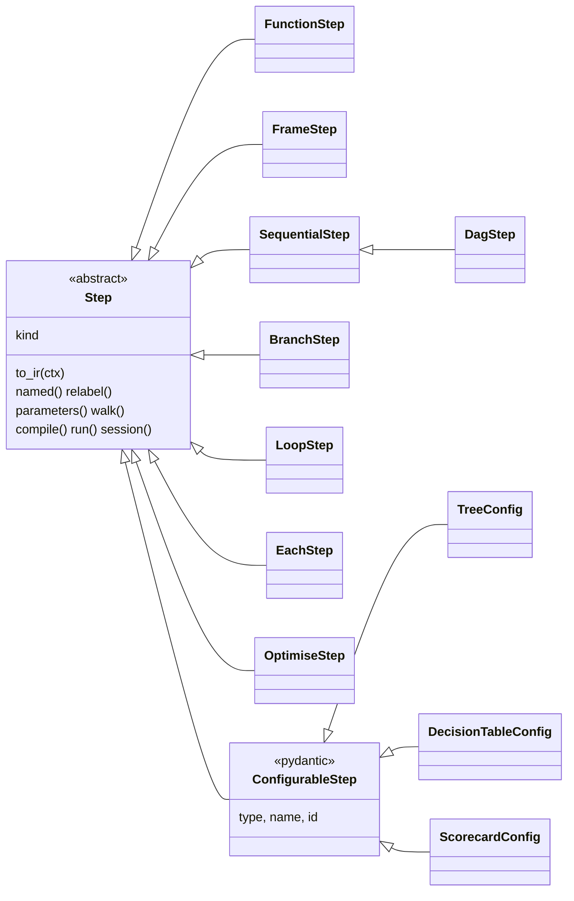
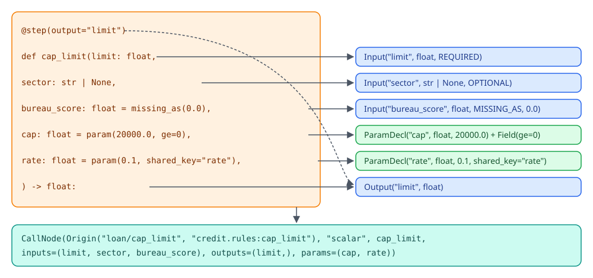
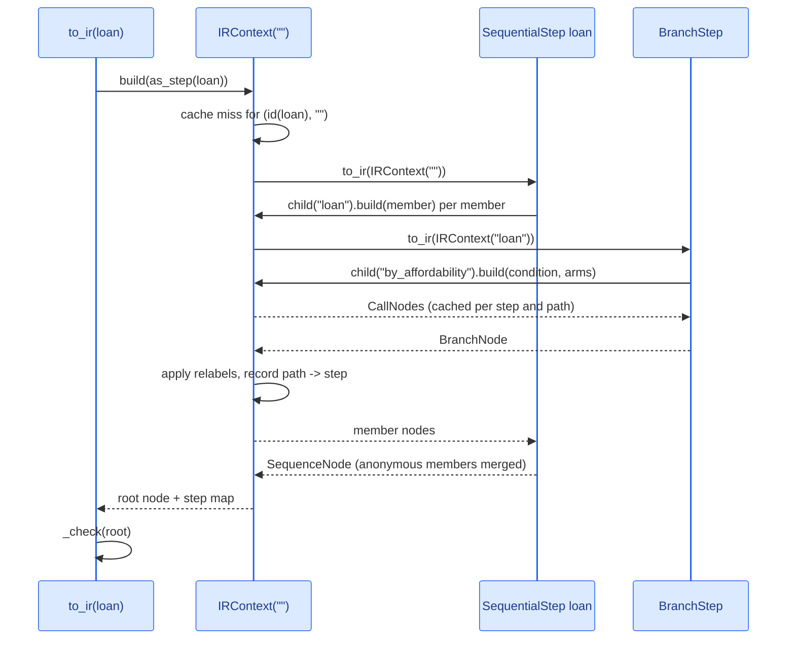
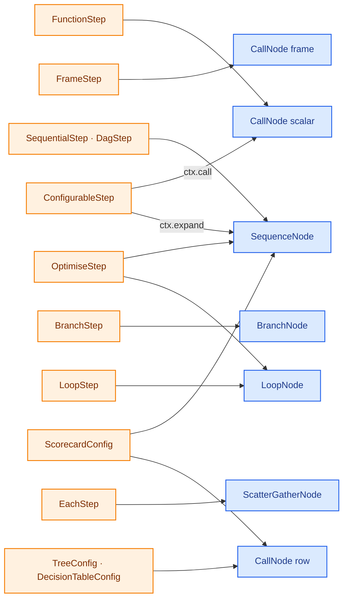

# Steps and the IR

Users write steps; the engine runs IR. A step is an authoring object: a function with its signature, a flow of other
steps, a branch, a tree document. The IR is a small closed set of node types with every name resolved and every node
placed at a path. The bridge between them is one method, `Step.to_ir(ctx)`, which each step type implements to emit
its own fully expanded nodes. Modes, the debugger, the compiler, checks and diffs all read the IR, so a new step type
needs nothing from the engine.

The IR data model itself (node fields, declarations, ids,
hashing, validation) is on [IR internals](engine/ir.md); what happens to the IR next is on [Wiring](engine/wiring.md).
The code is in `decider/steps/` and `decider/_engine/ir/context.py`.

## The Step class hierarchy



| Class | `kind` | Built by | File | Lowers to |
|---|---|---|---|---|
| `FunctionStep` | `function` | `step(fn)`, `@step`, or a plain function | `steps/_function.py` | `CallNode[scalar]` |
| `FrameStep` | `frame` | `frame_step(fn)` | `steps/_frame.py` | `CallNode[frame]` |
| `SequentialStep` | `sequence` | `flow(...)`, <code>a &#124; b</code> | `steps/_sequential.py` | `SequenceNode`, children in written order |
| `DagStep` | `dag` | `dag(...)` | `steps/_dag.py` | `SequenceNode`, children sorted by dependency |
| `BranchStep` | `branch` | `branch(...)` | `steps/_branch.py` | `BranchNode` |
| `LoopStep` | `loop` | `loop(...)` | `steps/_loop.py` | `LoopNode` |
| `EachStep` | `each` | `each(...)` | `steps/_each.py` | `ScatterGatherNode` |
| `OptimiseStep` | `optimise` | `optimise(...)` | `steps/_optimise.py` | `SequenceNode` around a `LoopNode` |
| `ConfigurableStep` | `configurable` | a subclass, `ConfigurableStep.load(doc)` | `steps/_configurable.py` | whatever its `to_ir` returns |

Every built-in step except `ConfigurableStep` is a `@dataclass(frozen=True, slots=True, eq=False)`: immutable, compact,
compared by identity so that one step object placed twice is still one object. `named`, `relabel` and `bind` return
copies through `_replace`, which is `dataclasses.replace` for dataclasses and `model_copy` for the pydantic
`ConfigurableStep`. Each class sets `__module__ = "decider.steps"` so that an origin names the public import path
(`decider.steps:SequentialStep`) rather than the private file.

Most steps share four optional fields: `name`, `id` (a durable 12-hex token), `suppress_checks` (check aliases or codes
the checks package skips for this step) and the `reads` / `writes` pairs a `relabel` stores. `EachStep` and
`OptimiseStep` have no `reads` or `writes` fields; see [relabelling](#relabelling-a-step) for what that means.

A plain function becomes a step wherever one is expected. `as_step` in `steps/_base.py` passes a `Step` through,
wraps a callable in `step(fn)`, and raises `TypeError` for anything else. Python has no `|` between two functions, so
`f | g` is a `TypeError` and the `step` docstring tells users to write `step(f) | g` or `flow(f, g)`; `Step.__or__` and
`__ror__` handle every case with at least one step on either side.

## From a signature to declarations

`decider/_engine/params/harvest.py` reads a function once and returns three tuples: `Input`s, `ParamDecl`s and
`Output`s. `FunctionStep.__post_init__` calls it, so a bad signature fails when the step is made, not when it runs.

<div class="diagram" markdown>


*How one signature becomes one scalar `CallNode`.*
</div>

| Parameter | Becomes |
|---|---|
| `x: float` | `Input("x", float, NullPolicy.REQUIRED)`: a null is an error |
| <code>x: float &#124; None</code> (any default) | <code>Input("x", float &#124; None, NullPolicy.OPTIONAL)</code>: the step receives `None` |
| `x: float = missing_as(0.0)` | `Input("x", float, NullPolicy.MISSING_AS, fill=0.0)` |
| `x: float = param(1.0, ge=0)` | `ParamDecl("x", float, 1.0, field_info=Field(1.0, ge=0))` |
| `x: float = param(1.0, shared_key="k")` | `ParamDecl(..., shared_key="k")`, read from the document's `"shared"` entry |
| `rows: ParamTable = param_table({...})` | a table `ParamDecl` whose annotation validates rows into a namedtuple of arrays |
| `x: float = 1.0` | `IRError`: a bare default is ambiguous |
| `*args`, `**kwargs` | `IRError`: inputs are wired by name |
| return annotation | one `Output` per name in `outputs`; several names need `tuple[...]` of the same length |

The real objects for the signature in the diagram:

```python
from decider import step, param, missing_as, flow
from decider.ir import to_ir

@step(output="limit")
def cap_limit(limit: float,
              sector: str | None,
              bureau_score: float = missing_as(0.0),
              cap: float = param(20000.0, ge=0),
              rate: float = param(0.1, shared_key="rate"),
              ) -> float:
    return min(limit, cap)

n = to_ir(flow(cap_limit, name="loan")).children()[0]
for i in n.inputs: print(i)
for p in n.params: print(p.name, p.annotation, p.default, p.shared_key, p.field_info.metadata)
print(n.outputs, n.origin)
print(cap_limit(50000.0, None), cap_limit.bind(cap=15000.0)(50000.0, None))
```

```text
Input(name='limit', annotation=<class 'float'>, null_policy=<NullPolicy.REQUIRED: 'required'>, fill=None, arg='limit')
Input(name='sector', annotation=str | None, null_policy=<NullPolicy.OPTIONAL: 'optional'>, fill=None, arg='sector')
Input(name='bureau_score', annotation=<class 'float'>, null_policy=<NullPolicy.MISSING_AS: 'missing_as'>, fill=0.0, arg='bureau_score')
cap <class 'float'> 20000.0 None [Ge(ge=0)]
rate <class 'float'> 0.1 rate []
(Output(name='limit', annotation=<class 'float'>),) Origin(path='loan/cap_limit', source='__main__:cap_limit', locator=None, id=None, suppress_checks=())
20000.0 15000.0
```

The step stays a plain function. `param()` returns the default itself (a subclass of `float`, `int`, `str`, `list`,
`dict` or `tuple` carrying the declaration), so `cap_limit(50000.0, None)` sees `cap == 20000.0`. A `bool` or `None`
default can't be subclassed, so it comes back as a marker, and `FunctionStep.__call__` goes through
`call_with_defaults`, which swaps any marker left in the call for its value. `bind(cap=15000.0)` returns a copy whose
`to_ir` rewrites that `ParamDecl`'s default, merging the new default into its `FieldInfo` so the bounds still apply.

`Input.arg` and `ParamDecl.arg` record the function argument a value feeds, separately from `name`, the column or
document key. A relabel changes `name` and never `arg`, so `dti(instalment=...)` still receives its argument after
`relabel(reads={"instalment": "monthly_instalment"})`.

## How to_ir is called

`to_ir` on a step is never called directly by users. The entry point is `decider.ir.to_ir(step)` (also reached
through `resolve`, `Engine.bind`, `parameters()` and every tool), which builds the tree with an `IRContext` and checks
the result.



`IRContext` (`decider/_engine/ir/context.py`) is a frozen dataclass with two fields: `path`, the parent's path, and
`steps`, the `path -> Step` map being collected. It carries no shared-param table; shared types are checked in one pass over the finished IR. Its methods are the whole toolkit a `to_ir` needs:

| Method | Does |
|---|---|
| `child(name)` | the context for members of a step called `name`; `None` (anonymous) returns the same context |
| `origin(step, name=None, locator=None)` | an `Origin` at `path/name` whose source is the import path of the step's `fn` (or its class for a pydantic step), with its `id` and `suppress_checks` |
| `build(step)` | the step's IR placed here: calls `step.to_ir`, applies its relabels, caches the result |
| `expand(owner, helper)` | builds `helper` under `owner`'s name and gives the root node `owner`'s origin |
| `call(owner, fn, inputs, outputs, values)` | a scalar `CallNode` from `fn`'s signature, with config values turned into consts or params |
| `value(v, annotation, arg)` | a literal as itself, a `ParamRef` as a `ParamDecl` |
| `table(v, schema)` | inline rows (`FrameDoc`) as themselves, a `TableRef` as a required table `ParamDecl` |

`build` caches per step object and parent path in a module dict, `_BUILT[id(step)][path]`. A `weakref.finalize` drops
the entry when the step is collected, before its `id` can be reused; `id` is used because pydantic steps compare by
value. So an unchanged step returns the very same node, and re-running one notebook cell rebuilds only the new step:

```python
from decider import step
from decider.ir import to_ir

def heavy(weight: float) -> bool:
    return weight > 20.0

s = step(heavy)
print(to_ir(s) is to_ir(s))
```

```text
True
```

After the tree is built, `_check` walks every node once and raises if a node has no `Origin` or an empty source, if a
path contains a segment named `shared` (the reserved params key), if two nodes share a path, if a `CallNode.params`
holds anything but `ParamDecl`s, or if a shared key is declared with two types. [IR internals](engine/ir.md) covers
the checks in detail.

## Lowering, step by step



Each printout shows a node's type, path, declarations and `Origin.source`, one line per node.
Functions defined in a script have the source `__main__:<name>`; in a project they read `credit.rules:<name>`.

### Function steps

`FunctionStep.to_ir` harvests the signature again (cheap), applies any `bind` defaults, and returns one
`CallNode(kind="scalar")` with the function itself as `fn`. A scalar node is called per row as
`fn(**{i.arg: value}, **consts, **params)`. The output column is `fn.__name__`; a lambda has no usable name, so
`name=` is its output (`step(lambda x: x * 2, name="dbl")` writes `dbl`).

```text
CallNode[scalar] 'affordable'  (dti) -> (affordable)  params=[max_dti (shared max_dti)]  source=__main__:affordable
```

### Frame steps

`FrameStep.to_ir` returns `CallNode(kind="frame")`, called as `fn(df, **params)`. With `reads=` and `writes=`
declared, the node's inputs and outputs are known and typed from a dict form; without them they are `None`, which the
wiring treats as a barrier and checks against the frame's real columns at run time.

```text
CallNode[frame] 'join_bureau'  (client_id) -> (bureau_score)  params=[floor]  source=__main__:join_bureau
CallNode[frame] 'enrich'  (?) -> (?)  source=__main__:enrich
```

### Flows and the pipe operator

`SequentialStep.to_ir` builds each member under `ctx.child(self.name)` and returns a `SequenceNode` with the members
in written order. An anonymous member that lowered to a `SequenceNode` is merged in: its children, emits, drops and
declared inputs join the parent's. That is how `a | b | c` stays one flat flow, since `Step.__or__` simply returns
`flow(self, other)` and the nesting disappears at lowering. A named flow keeps its own node.

```text
== step(disposable_income) | dti | affordable
SequenceNode ''  source=decider.steps:SequentialStep
  CallNode[scalar] 'disposable_income'  (net_income, expenses) -> (disposable_income)  source=__main__:disposable_income
  CallNode[scalar] 'dti'  (disposable_income, instalment) -> (dti)  source=__main__:dti
  CallNode[scalar] 'affordable'  (dti) -> (affordable)  params=[max_dti (shared max_dti)]  source=__main__:affordable

== flow(base, name="inner") | cap_limit
SequenceNode ''  source=decider.steps:SequentialStep
  SequenceNode 'inner'  source=decider.steps:SequentialStep
    CallNode[scalar] 'inner/base'  (income) -> (base)  source=__main__:base
  CallNode[scalar] 'cap_limit'  (limit) -> (limit)  params=[cap]  source=__main__:cap_limit
```

The root of an anonymous pipeline has the empty path `''`. `emit(...)` and `drop(...)` are stored on the step and
copied onto the node as `name` or `name@path` specs; the wiring interprets them.

```text
SequenceNode 'outer' emits=('limit@*',) drops=('income',)  source=decider.steps:SequentialStep
```

### Dags

`DagStep` subclasses `SequentialStep` and changes only the order. It builds every member first, asks
`wiring.interface` for each member's read and write sets, and refuses a name with two writers, suggesting `flow` when
one refines the other and a `relabel` when they are different values. It then runs Kahn's algorithm, always taking the
earliest-written ready member, so members already in dependency order keep their order. Written out of order, the IR
comes back sorted, while `walk()` still shows the authoring order:

```text
SequenceNode 'afford'  source=decider.steps:DagStep
  CallNode[scalar] 'afford/disposable_income'  (net_income, expenses) -> (disposable_income)  source=__main__:disposable_income
  CallNode[scalar] 'afford/dti'  (disposable_income, instalment) -> (dti)  source=__main__:dti
  CallNode[scalar] 'afford/affordable'  (dti) -> (affordable)  params=[max_dti (shared max_dti)]  source=__main__:affordable
[('afford', 'DagStep'), ('afford/affordable', 'FunctionStep'), ('afford/dti', 'FunctionStep'), ('afford/disposable_income', 'FunctionStep')]
```

`dag(single)` with no name, id or suppressions returns the step unchanged.

### Branches

`BranchStep.to_ir` lowers the condition with `condition_node`, which requires one `CallNode` with one output, then
lowers each arm under the branch's name. A `bool` condition needs exactly two arms (arm 0 runs where it is true); an
`int` condition picks the arm by index.

`branch()` does some work before the class sees it. A bare column name as the condition becomes an identity step
reading that column. An anonymous arm is named `arm0`, `arm1` and so on, because it would otherwise share the branch's
path. A single arm gets an empty `SequentialStep` named `arm1` as its else, so the false rows run nothing.

```text
BranchNode 'cap_if_affordable' modifies=('limit',)  source=decider.steps:BranchStep
  CallNode[scalar] 'cap_if_affordable/affordable'  (affordable<-value) -> (affordable)  source=decider.steps._branch:_column_condition.<locals>.identity
  CallNode[scalar] 'cap_if_affordable/cap_limit'  (limit) -> (limit)  params=[cap]  source=__main__:cap_limit
  SequenceNode 'cap_if_affordable/arm1'  source=decider.steps:SequentialStep
```

`affordable<-value` is a relabelled input: the identity function's argument `value` reads the column `affordable`.

### Loops

`LoopStep.to_ir` lowers the condition (one call, one output) and the body under the loop's name. `loop()` names an
anonymous body `body`, requires `carries` and a positive `max_iterations`, which compiled code needs because a kernel
can't be interrupted.

```text
LoopNode 'repay' carries=('balance', 'months') max_iterations=360  source=decider.steps:LoopStep
  CallNode[scalar] 'repay/unpaid'  (balance) -> (unpaid)  source=__main__:unpaid
  SequenceNode 'repay/body'  source=decider.steps:SequentialStep
    CallNode[scalar] 'repay/body/pay'  (balance, payment) -> (balance)  params=[rate]  source=__main__:pay
    CallNode[scalar] 'repay/body/tick'  (months) -> (months)  source=__main__:tick
```

### Each

`EachStep.to_ir` builds the item flow under the step's name and returns a `ScatterGatherNode` over the list column.
The runner scatters the list into one row per element, runs the child over them and gathers the enriched elements
back. The child's params are hoisted onto the node, so `parameters()` lists them under the `each` path and the runner
forwards a tuned value into the child; `hoist` records which child path each one goes to. A shared param or two child
params with the same name are an `IRError` here.

```text
SequenceNode 'order'  source=decider.steps:SequentialStep
  ScatterGatherNode 'order/items' column='items' output='items' hoist=(('heavy_kg', 'order/items/item/heavy'),)  source=decider.steps:EachStep
    SequenceNode 'order/items/item'  source=decider.steps:SequentialStep
      CallNode[scalar] 'order/items/item/heavy'  (weight [missing_as]) -> (heavy)  params=[heavy_kg]  source=__main__:heavy
```

`each()` still takes an `execution_mode` (`EachMode.PER_ROW` or `BATCH`), kept for compatibility; its docstring says
both now scatter, and `to_ir` does not read it.

### Optimise

`optimise` has no node type of its own. `OptimiseStep.to_ir` assembles ordinary steps: the user's `count` step
relabelled to write `count`, a `seed` that initialises five carries, and a `search` loop whose body runs the user's
`evaluate`, a reject step (the `disqualify` step relabelled to write `reject`, or a constant `False`), a `keep` step and
`advance`. Because the result is a plain loop of scalar steps, the fused runner can pack it into one kernel.

```text
SequenceNode 'best' drops=('index',)  source=decider.steps:OptimiseStep
  CallNode[scalar] 'best/bundles'  (items) -> (count)  source=__main__:bundles
  CallNode[scalar] 'best/seed'  (count) -> (index, best_index, best_score, evaluated, disqualified)  source=decider.steps._optimise:_seed
  LoopNode 'best/search' carries=('index', 'best_index', 'best_score', 'evaluated', 'disqualified') max_iterations=256  source=decider.steps:LoopStep
    CallNode[scalar] 'best/search/_more'  (index, count) -> (_more)  source=decider.steps._optimise:_more
    SequenceNode 'best/search/body'  source=decider.steps:SequentialStep
      SequenceNode 'best/search/body/evaluate'  source=decider.steps:SequentialStep
        CallNode[scalar] 'best/search/body/evaluate/margin'  (index, items) -> (score)  source=__main__:margin
      CallNode[scalar] 'best/search/body/reject'  () -> (reject)  source=decider.steps._optimise:_no_reject
      CallNode[scalar] 'best/search/body/keep'  (index, best_index, best_score, evaluated, disqualified, score, reject) -> (best_index, best_score, evaluated, disqualified)  source=decider.steps._optimise:_keep
      CallNode[scalar] 'best/search/body/advance'  (index) -> (index)  source=decider.steps._optimise:_advance
```

With `record=Item`, `to_ir` adds a `best_record` carry and defines four more functions at lowering time
(`seed_record`, `keep_record`, `finalise`, `pass_index`); the first three get `Struct[Item]` annotations built from
the `Item` type.

### Configurable steps

A `ConfigurableStep` is pydantic: frozen, `extra="forbid"`, loaded by its `type` tag through the
[registry](foundation.md). Its `to_ir` usually takes one of two shapes.

`ctx.call(self, fn, inputs=..., values=...)` builds one scalar node from `fn`'s signature, wiring arguments to the
config's columns. A `Value[T]` field holds a literal or a `ParamRef`: a literal goes into the node's `consts`, a
`ParamRef` becomes a `ParamDecl` whose `arg` is the function argument. Consts are runtime arguments like params, never
compiled in, so changing one never recompiles:

```python
class Scaled(ConfigurableStep):
    type: Literal["scaled"] = "scaled"
    column: str
    factor: Value[float] = 1.0

    def to_ir(self, ctx):
        return ctx.call(self, scale, inputs={"x": self.column}, values={"factor": self.factor})
```

```text
CallNode[scalar] 'doubled'  (income<-x) -> (doubled)  consts=(('factor', 2.0),)  source=__main__:Scaled
CallNode[scalar] 'doubled'  (income<-x) -> (doubled)  params=[factor]  source=__main__:Scaled
```

The first line is `factor=2.0`; the second is `factor={"param": "factor", "default": 2.0}`, which also makes
`parameters().defaults()` return `{'doubled': {'factor': 2.0}}`. The source is the class, since a pydantic step has
no `fn`.

`ctx.expand(self, helper)` builds other steps under the config's name and gives the root node the config's origin:

```text
SequenceNode 'app'  source=decider.steps:SequentialStep
  SequenceNode 'app/afford'  source=__main__:Affordability
    CallNode[scalar] 'app/afford/disposable_income'  (net_income, expenses) -> (disposable_income)  source=__main__:disposable_income
    CallNode[scalar] 'app/afford/dti'  (disposable_income, instalment) -> (dti)  source=__main__:dti
```

The built-in configurable steps build nodes directly. A tree and a decision table each lower to one
`CallNode(kind="row")`, called as `fn(row, params, consts)` with tuples in declared order. `fn` is a generic compiled
walker or matcher, the document is encoded into packed arrays whose addresses travel as consts, and `reference` is the
Python twin the interpreted runner calls so a session can step inside the tree. A scorecard is a sequence of row nodes,
one per variable plus a total:

```text
CallNode[row] 'fraud_rules'  (amount [missing_as]) -> (hit)  params=[big_amount]  consts=(('ints', 94080279287568), ('floats', 94080275608880), ('chars', 94080273005424), ('layout', (0, 30, 30, 1, 32, 32, 33, 34, 0, 0, 1)), ('outputs', ((-1, 35, 2, 0),)))  source=decider.steps.trees:TreeConfig
CallNode[row] 'band'  (bureau_score [missing_as]) -> (band)  consts=(('program', 94080281968864), ('entry', 0), ('outputs', ((1, 0),)), ('rows', Rows(ints=94080281973760, floats=94080281969216, chars=94080281972368, n=3)))  source=decider.steps.tables:DecisionTableConfig
SequenceNode 'card' emits=('age_score', 'score')  source=decider.steps.scorecard._config:ScorecardConfig
  CallNode[row] 'card/age'  (age<-x [optional]) -> (age_score)  params=[young]  consts=(('nb', 2), ...)  source=decider.steps.scorecard._config:ScorecardConfig
  CallNode[row] 'card/score'  (age_score) -> (score)  source=decider.steps.scorecard._config:ScorecardConfig
```

A threshold written as `{"param": ...}` becomes a `ParamDecl` (`big_amount`, `young`); everything else in the
document is data in the consts. The [configurable steps](configurable-steps/index.md) pages cover the encodings.

### Helper and allow_fallback

`@helper(signatures=...)` and `@allow_fallback` are not steps and lower to nothing. They set attributes on a function
(`__decider_helper_signatures__`, `__decider_allow_fallback__`) that the compiler reads through
`helper_signatures()` and `allows_fallback()` in `steps/_helpers.py`: a helper is compiled for its declared
signatures when a step calls it, and an allowed fallback runs in Python without a warning. `@allow_fallback` on a
tree, table, scorecard, branch or loop raises `TypeError`, since those fall back as a whole.
[Compilation](engine/compile.md) covers both.

## Relabelling a step

`relabel(reads=..., writes=...)` makes a step read and write other names at its boundary. It works in two stages.

At authoring time, `Step.relabel` builds the step's IR once to learn the names it really reads and writes, then
`_compose` merges the new mapping into the stored `reads` / `writes` pairs. Relabels chain: a key may be the original
name or the current one. An unknown key is a `WiringError` with a suggestion:

```text
WiringError: total.relabel(reads={'nn': 'm'}): it reads no 'nn'; it reads ['n']. Did you mean 'n'?
```

At lowering time, `IRContext.build` calls `to_ir` and then `_relabel` over the result. A name read before the step
produced it comes from outside, so `reads` applies; a name read after one of the step's own writes follows `writes`.
Inputs keep their `arg`. Branch arms are relabelled independently and loops carry their renamed `carries`. For a frame
step with both `reads=` and `writes=` declared, the function is wrapped to copy the renamed columns in and out:

```text
CallNode[scalar] 'dti'  (disposable_income, monthly_instalment<-instalment) -> (dti_ratio)  source=__main__:dti
```

!!! warning "Three relabel gaps"
    `EachStep` and `OptimiseStep` have no `reads` / `writes` fields, so `each(...).relabel(...)` raises
    `AttributeError: 'EachStep' object has no attribute 'reads'`. A flow that contains an `each` accepts `relabel`, but
    building its IR raises `TypeError: can't relabel ScatterGatherNode`. And a frame step without declared `reads=` and
    `writes=` accepts any relabel and ignores it: `add.relabel(writes={"b": "c"})` still writes `b`.

## Paths, origins and the two maps

Every node's `Origin.path` is its id within one IR: the names of the named steps from the root, joined with `/`.
Anonymous flows are transparent, a configurable step's nodes sit under its `name`, and a position inside a row node is
`path#locator` (a tree node such as `risk#n17`). `check_name` refuses an empty name or one containing `/` or `#`, when
a step is made, renamed, or joined into a path.

Three ways to walk a pipeline give three different views. On the loan flow from the
[architecture overview](index.md), with `base_limit` declared `@step(output="limit", id="0123abcdef45",
suppress_checks=["float_money"])`:

```text
== loan.walk(): the authoring tree, named members of flows and dags only
loan                             SequentialStep
loan/disposable_income           FunctionStep
loan/dti                         FunctionStep
loan/affordable                  FunctionStep
loan/base_limit                  FunctionStep
loan/by_affordability            BranchStep

== step_map(loan): the step behind every IR path, conditions and arms included
loan/disposable_income                     FunctionStep
loan/dti                                   FunctionStep
loan/affordable                            FunctionStep
loan/base_limit                            FunctionStep
loan/by_affordability/affordable           FunctionStep
loan/by_affordability/cap_limit            FunctionStep
loan/by_affordability/no_limit             FunctionStep
loan/by_affordability                      BranchStep
loan                                       SequentialStep

== [n.origin.path for n in iter_nodes(to_ir(loan))]: every node, parents first
['loan', 'loan/disposable_income', 'loan/dti', 'loan/affordable', 'loan/base_limit', 'loan/by_affordability',
 'loan/by_affordability/affordable', 'loan/by_affordability/cap_limit', 'loan/by_affordability/no_limit']

== the origin of loan/base_limit
Origin(path='loan/base_limit', source='__main__:base_limit', locator=None, id='0123abcdef45', suppress_checks=('float_money',))
```

- `Step.walk()` follows `steps` attributes only, so it never enters a branch or loop. It is the authoring tree.
- `step_map(step)` is the `path -> Step` map `IRContext` collects while building. Tools use it to jump from a node to
  the object that made it: the editor bridge locates source lines with it, a live session swaps a step at a path with
  it, and checks read a step's own document through it. It is never serialised.
- `iter_nodes(node)` yields the IR pre-order. `parameters()`, `describe()`, the diff hash and most checks iterate it.

`Origin` holds plain strings, so events and traces carry it as is. `source` is `import_path(fn)` for a function step
and the class import path for a configurable step or a step built by a constructor. `id` and `suppress_checks` come
from the step. Origins are metadata: compiled code is keyed by content and never by path, so renaming or nesting a
step keeps its compiled kernel (see [Cache](engine/cache.md)).

A step can be placed more than once, in different flows or under different names, and each placement gets its own
path and node. Inside one flow, `named` gives the second placement its own name:

```text
SequenceNode 'twice'  source=decider.steps:SequentialStep
  CallNode[scalar] 'twice/base_limit'  (disposable_income) -> (limit)  params=[multiple]  source=__main__:base_limit
  CallNode[scalar] 'twice/limit_again'  (disposable_income) -> (limit)  params=[multiple]  source=__main__:base_limit
```

Without `named`, the two nodes would share `twice/base_limit` and `to_ir` would refuse them.

## Errors at build time

Every message below is real. Build-time errors are `WiringError` (a `ValueError`) for names, paths and shape, and
`IRError` (a `TypeError`) for malformed signatures and nodes.

| Mistake | Error |
|---|---|
| a bare default | `IRError: ...bad: parameter 'cap' has a bare default (3.0). Use param(3.0) for a tunable param or missing_as(3.0) to fill nulls.` |
| `outputs=("a", "b")` with `-> float` | `IRError: ...ratio2: outputs ('a', 'b') need a return annotation tuple[...] of 2 types, got <class 'float'>` |
| the same step twice in a flow | `WiringError: two nodes have path 'p/ratio' (__main__:ratio and __main__:ratio); did you mean to name one of them, e.g. .named('ratio_2')?` |
| two writers of one name in a dag | `WiringError: dag 'd': each name has one writer in a dag.` followed by `ratio and ratio_b both write 'ratio': rename one, e.g. ratio_b.relabel(writes={'ratio': 'ratio_2'})` |
| a dag cycle | `WiringError: dag 'd': ['b', 'c'] depend on each other in a cycle` |
| a bool condition with three arms | `WiringError: branch 'b': a bool condition takes 2 arms, got 3` |
| a flow as a condition | `IRError: branch 'b': the condition must be one function step producing one value` |
| one arm on an int condition | `WiringError: branch 'b': a single arm needs a bool condition, not int` |
| no `modifies` | `WiringError: branch 'b' needs modifies=[...]: the names its arms may change` |
| `max_iterations=0` | `WiringError: loop 'l': max_iterations must be a positive int, got 0` |
| no `carries` | `WiringError: loop 'l' needs carries=[...]: the names each iteration updates` |
| one shared key, two types | `IRError: shared param 'cut' is declared int by f/flag and float by f/flag2` |
| a step named `shared` | `WiringError: shared: no step may be named 'shared'; that key holds the shared params` |
| a `/` in a name | `WiringError: step name 'a/b' must be a non-empty string without '/' or '#': paths join names with '/' and mark positions inside a node with '#'` |
| a malformed id | `WiringError: step id 'XYZ' must be 12 lowercase hex characters` |
| <code>f &#124; g</code> on two functions | <code>TypeError: unsupported operand type(s) for &#124;: 'function' and 'function'</code> |

Wiring errors that need the whole graph (typos, reads of a name a branch keeps, emits of unknown names) come one step
later, from `resolve`; [Wiring](engine/wiring.md) lists them.

## Adding a step type

A new step type implements `to_ir` and nothing else. The supported route is a `ConfigurableStep` subclass, which also
gets JSON loading, a type tag, entry-point discovery and `parameters()` for free:

- one function per row: `ctx.call(self, fn, inputs=..., values=...)`;
- an assembly of existing steps: `ctx.expand(self, flow(...))`;
- a row kernel over encoded data, as trees and tables do: build `Input`, `Output` and `ParamDecl` objects and a
  `CallNode(ctx.origin(self), "row", fn, ..., reference=..., consts=...)` from the `decider.ir` kit.

Whatever `to_ir` returns, it must give every node an origin from `ctx.origin`, place members with `ctx.child(...)
.build(...)` so their paths and relabels are right, and return only the node types the engine runs. The [extending
guide](../guides/extending.md) walks through a full example; the built-in configurable steps use exactly these
extension points.
