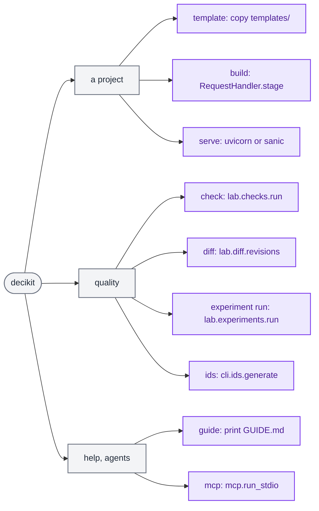
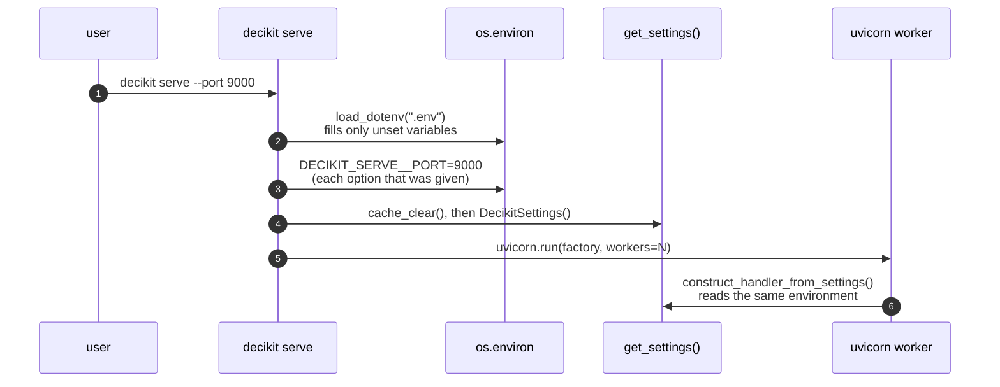
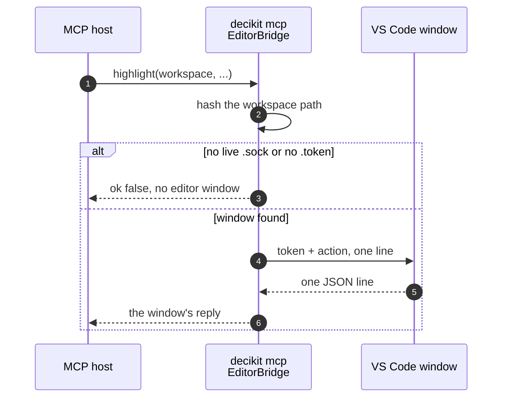

# CLI and MCP internals

`decikit` has two command surfaces over the same library. The `decikit` command is for people and CI: scaffold a project, build it, serve it, check it, diff it, run an experiment. `decikit mcp` is for agents: a Model Context Protocol server over stdio whose tools describe flows, read lineage, summarise runs and, after the user confirms, run things. Neither holds logic of its own. Each command and each tool is a thin adapter that parses arguments, calls one library function and formats what comes back.

Both live in `decikit/_tooling/`, the private package for everything that faces a tool rather than a pipeline author. The third member, the editor bridge, has its own page: [Editor bridge](editor-bridge.md). How to use the commands day to day is in [CLI and MCP](../guides/cli-and-mcp.md).

## Files

| File | What it holds |
|---|---|
| `decikit/_tooling/cli/__init__.py` | The `click` group `cli` and the commands `guide`, `ids`, `build`, `serve`, `mcp`, `template`; it registers `check`, `diff` and `experiment` from their modules. |
| `decikit/_tooling/cli/_check.py` | `decikit check`. |
| `decikit/_tooling/cli/_diff.py` | `decikit diff`, and `_frame`, the data-argument loader `check` reuses. |
| `decikit/_tooling/cli/_experiment.py` | The `experiment` group and its `run` command. |
| `decikit/_tooling/cli/ids.py` | The durable-id generator: `add_ids` (pure) and `generate` (git-checked, writes files). |
| `decikit/_tooling/cli/templates/` | The files `decikit template` copies, with `{{name}}` placeholders. |
| `decikit/__main__.py` | `python -m decikit` runs the same `cli`. |
| `decikit/_tooling/mcp/__init__.py` | Exports `run_stdio`, `build_server`, `Policy`. |
| `decikit/_tooling/mcp/_server.py` | `build_server(policy, bridge)`: registers every tool on a `FastMCP` named `decikit`; `run_stdio`. |
| `decikit/_tooling/mcp/_tools.py` | The tools as plain functions over the core modules, testable without a server. |
| `decikit/_tooling/mcp/_policy.py` | `Policy(raw=False)` and the redaction notice. |
| `decikit/_tooling/mcp/_editor.py` | `EditorBridge`: forwards editor actions to a VS Code window over an authenticated socket. |

## The command tree



The options of each command are in the sections below and in `decikit <command> --help`.

`decikit --help` lists exactly these, and `GUIDE.md` says there are no others:

```text
Commands:
  build       Stage config VERSION (default: the latest) exactly as...
  check       Run the checks over the pipeline ENTRY (module:factory);...
  diff        Compare the pipeline ENTRY (module:factory) at git...
  experiment  Run experiments.
  guide       Print the getting-started guide: concepts, examples,...
  ids         Add durable `id=` tokens to every step and named flow...
  mcp         Serve the FastMCP server over stdio for an MCP host (e.g.
  serve       Serve the latest config version: POST /invocations, GET /ping.
  template    Write a starter project called NAME into DIRECTORY...
```

### How commands are registered

`pyproject.toml` declares the console script `decikit = "decikit._tooling.cli:cli"`, and `decikit/__main__.py` imports the same `cli` so `python -m decikit` works where the script is not on `PATH` (`test_python_dash_m_decikit_runs_the_cli`).

`cli` is a `click.group`. Commands defined in `__init__.py` use `@cli.command()`. Commands in their own module are plain `@click.command()` (or a `@click.group()` for `experiment`) and are attached with `cli.add_command(...)` at the bottom of `__init__.py`. To add a command, write it as a `click.command` in a new module under `decikit/_tooling/cli/` and add one `cli.add_command` line; nothing else discovers commands.

Each command imports what it needs inside its body. The module top imports only `click`, `dotenv`, `decikit._settings` and the two sibling command modules, so a typo in a command name or `decikit --help` never pays for importing the engine or numba.

### Settings, `.env` and overrides



`_settings(**overrides)` in the CLI does three things in order. It loads `./.env` with `python-dotenv`, which never overwrites a variable the real environment already has (`test_the_environment_wins_over_the_project_env_file`). It writes each CLI option that was given into `os.environ` as `DECIKIT_<KEY>` (so `--port` becomes `DECIKIT_SERVE__PORT`). It clears the `functools.cache` on `get_settings()` and reads the settings again. Going through the environment, rather than passing a settings object, is what lets uvicorn and sanic worker processes, which start fresh, see the same settings. The precedence is: CLI option, then the real environment, then `.env`, then the defaults in `decikit/_settings.py`.

## Each command

### `guide`

Prints `decikit/GUIDE.md`, the single user guide that ships inside the wheel. Every Python block in it runs in `tests/test_guide.py`, so it cannot drift from the API.

### `template NAME [DIRECTORY]`

Copies every file under `decikit/_tooling/cli/templates/` into `DIRECTORY` (default `./NAME`), replacing `{{name}}` in paths and contents with the package name. The name is sanitised first (`re.sub(r"\W+", "_", name).strip("_")`) and must then be a Python identifier, else `ClickException: 'NAME' can't name a Python package; start it with a letter, e.g. 'fraud_rules'`. A non-empty target directory is refused. The `.env` file is stored in the package as `env` and renamed on copy, because `.gitignore` (and so the wheel build) skips files named `.env`.

```text
$ decikit template loan_check
created loan_check/README.md
created loan_check/__init__.py
created loan_check/configs/0.0.0/params.json
created loan_check/conftest.py
created loan_check/.env
created loan_check/inference.py
created loan_check/pipeline.py
created loan_check/sample_request.json
created loan_check/tests/test_pipeline.py
```

| Template file | Role |
|---|---|
| `pipeline.py` | `debt_ratio`, `month_end`, `approved` and `build()` returning `flow(..., name=NAME)` |
| `inference.py` | `class Handler(RequestHandler): pass`, the hook for request handling |
| `configs/0.0.0/params.json` | the first config version: `{NAME: {"approved": {"limit": 0.4, "month_end_limit": 0.3}}}` |
| `sample_request.json` | one request; `decikit build` warms with it |
| `tests/test_pipeline.py` | stages and activates the handler, scores raw JSON bytes through `process_fn` |
| `conftest.py` | puts the project's parent on `sys.path` so `import NAME` works under plain `pytest` |
| `__init__.py` | makes the project directory a package |
| `.env` | `DECIKIT_API__PIPELINE=NAME.pipeline:build`, `DECIKIT_API__HANDLER=NAME.inference:Handler`, `DECIKIT_CONFIG__BASEPATH=configs` |
| `README.md` | the same layout in prose and the four commands to run |

`test_the_generated_tests_pass` runs the generated project's tests, and `test_the_template_params_document_matches_the_pipeline` checks the params document against the pipeline's declared params. The directory layout and why the project is its own package are on the [Config store](config-store.md) page.

### `build [VERSION]`

Builds the handler from settings (`construct_handler_from_settings()`, see [Serving](serving.md)) and calls `stage(VERSION)`, which reads the version, builds the pipeline, validates the params document and runs one warm-up record through every kernel. That fills numba's disk cache, so `serve` starts without compiling the user's steps. It then writes `decikit-cpu-target.json` (the `cpu_target()` tuple: triple, CPU name, feature string) next to the cache, in `NUMBA_CACHE_DIR` or else `code_path`:

```text
$ decikit build
decikit: pipeline loan_check.pipeline:build from .../loan_check/pipeline.py
decikit: handler loan_check.inference:Handler from .../loan_check/inference.py
FallbackWarning: loan_check/month_end runs in Python, row by row: reads 'applied_on' as <class 'datetime.date'>, which no kernel takes
built config version 0.0.0 (pipeline loan_check.pipeline:build, mode fused)
```

Any exception from staging becomes one line, `config version <v> failed to build: <Type>: <message>`, and exit status 1. `build` does not start a server and does not activate anything.

### `serve`

Applies the CLI options through `_settings`, compares the recorded CPU target with the host's (a mismatch prints a warning that every worker will compile at startup) and hands off to a server:

- `starlette` (default): `uvicorn.run("decikit.serving._servers.starlette:create_app", factory=True, host, port, workers)`. uvicorn imports the factory in each worker, and the app's lifespan builds the handler there.
- `sanic`: `AppLoader(factory=create_app)` from `decikit/serving/_servers/sanic.py`, with `single_process=True` when `workers == 1`.

A missing server package is a `ClickException` naming the extra to install (`decikit[serve-starlette]` or `decikit[serve-sanic]`). `workers` defaults to `2 * os.cpu_count() + 1`, evaluated at serve time on the host that serves.

### `check`, `diff`, `experiment run`

These three are adapters over the lab:

- `check [ENTRY]` imports the flow with `decikit.steps._entry.import_flow(entry)` (a `module:factory` string), loads `--data` with `_frame` (a file path through `lab.data.read`, else a project dataset name through `lab.data.dataset(name).load()`), calls `lab.checks.run(step, config=..., data=...)` and prints the report as text, JSON or SARIF. `--select` filters findings and skips by code prefix after the run. The exit status is `report.fail_on(level)`: 1 when a finding at or above the level is not suppressed. `--list` prints `lab.checks.catalogue()` instead (34 checks today, `DCD001  wall_clock  determinism  warning` and so on). See [Checks](lab/checks.md).
- `diff BASE HEAD ENTRY` calls `lab.diff.revisions(base, head, entry=entry)`, then `.structure()` and, with `--data`, `.outputs(frame, key=key)`. Exit status 1 means something differs (rows or columns when data is given, structure otherwise). See [Diff](lab/diff.md).
- `experiment run PATH` calls `lab.experiments.run(path, out_dir=out)` and prints the result status and each scenario's status; it exits 0 only for `completed`. See [Experiments](lab/experiments.md).

`DecikitError` and `ValueError` from the library become a `ClickException` with the message, so a user sees the one-line message and exit status 1.

### `ids [PATH]`

Adds a durable `id="<12 hex>"` to every scalar step declaration and every named flow that lacks one. Durable ids let diff, experiments and the editor follow a step through a rename; see [IR](engine/ir.md) for what the id is in the IR.

The generator is in two layers. `add_ids(source, id_for)` is a pure function over one file's text: it parses with `ast`, finds the declarations (`@step`, `@step(...)`, `@frame_step`, `flow(..., name=...)` and the other constructors in `decikit.steps._composites`; an anonymous composite stays id-less) and inserts the keyword with the smallest edit, changing no other byte:

```python
text, changes = add_ids(source, id_for=lambda d: {"ratio": "0a1b2c3d4e5f", ...}[d.name])
```

```text
@step(id="0a1b2c3d4e5f")
def ratio(debt: float, income: float) -> float:
...
@step(output="ok", id="1b2c3d4e5f60")
def approved(ratio: float) -> bool:
...
credit = flow(ratio, approved, name="credit", id="2c3d4e5f6071")

[(3, 'ratio', '0a1b2c3d4e5f'), (7, 'approved', '1b2c3d4e5f60'), (11, 'credit', '2c3d4e5f6071')]
```

`generate(path, fix, check)` wraps it with the safety checks. It refuses to run outside a git repository or on a dirty working tree, so the rewrite can always be reviewed and reverted with git. It parses every file before writing any, validates every name and every existing id (12 lowercase hex characters, a plain string literal), and scans the whole tree for duplicate ids, which usually mean a copy-paste. A duplicate aborts unless `--fix`, which gives the later copies fresh ids. Each file is written with a temp file and `os.replace`. `--check` reports without writing. In this repository, with uncommitted docs changes, it refuses:

```text
$ decikit ids --check .
Error: working tree is not clean; refusing to rewrite source:
   D docs/architecture/engine.md
   M docs/architecture/index.md
   ...
```

The `ClickException` message ends with the remediation the `IdError` carries (here: commit or stash first).

### `mcp [--raw]`

`--raw` has the environment variable `DECIKIT_MCP_RAW=1`, so a plugin's MCP config can turn raw data on without changing the arguments. It calls `run_stdio(raw=raw)`, which builds the server with `Policy(raw=raw)` and an `EditorBridge()` and runs it on stdio until the host closes the pipe. The rest of this page is about that server.

## The MCP server

### What problem it solves

An agent working on a decider toolkit project needs the same facts a person gets from the graph panel: which flows exist, what a step reads and writes, where a value comes from, what a run produced, what the checks say. Reading the source does not give it those facts reliably, because structure is assembled at import time and wiring is resolved by the engine. The MCP server answers from the library's own description of a flow (`decikit.lab.describe`), so the agent sees the structure the engine runs.

### Tool map

<div class="diagram" markdown>


*Each tool names the library call it makes. Flows are named by import path, `module:qualname`.*
</div>

`build_server` registers each tool with `@mcp.tool` as a two-line wrapper that calls the function of the same name in `_tools.py`. The tool's docstring becomes its description for the agent. Listing the tools of a server built in-process with an `EditorBridge` gives the groups and their annotations (47 tools):

```text
discover_flows         destructive=None
describe_flow          destructive=None
inspect_step           destructive=None
lineage                destructive=None
source_context         destructive=None
run_summary            destructive=None
check_report           destructive=None
checks_list            destructive=None
experiment_definition  destructive=None
experiment_results     destructive=None
raw_record             destructive=None
raw_trace              destructive=None
run_flow               destructive=True
run_experiment         destructive=True
start_debug            destructive=True
generate_ids           destructive=True
tree_view              destructive=None    (+ tree_add_node, tree_set_node, tree_remove_node,
                                            tree_set_output, tree_add_rule, tree_remove_rule)
list_configs           destructive=None    (+ read_config, validate_config, write_config,
                                            patch_config, try_config)
table_view             destructive=None    (+ table_add_rows, table_update_rows, table_delete_rows,
                                            table_add_column, table_drop_column)
scorecard_view         destructive=None    (+ scorecard_set_bins)
params_view            destructive=None    (+ params_set)
editor_selection       destructive=None
highlight              destructive=None
reveal_source          destructive=None
show_flow              destructive=None
set_breakpoints        destructive=None
debug_flow             destructive=True
debug_control          destructive=True
debug_evaluate         destructive=True
```

The config-editing tools (`_configs.py`, `_trees.py`, `_tables.py`, `_scorecards.py`, `_params.py`) edit tree, decision table, scorecard and params documents. Each write builds the document first and is refused, file untouched, when it would not build, so they carry no `destructiveHint`; `try_config` runs a document's step on sample rows to check an edit. `debug_evaluate` is also raw-gated: it returns the redaction notice unless the policy allows raw data.

### Data classes and the policy

The module docstrings describe a capability policy with three classes of data:

1. Structural data (flow, step and edge identity, paths, sources) and summarised data (run tallies, check reports) are always available.
2. Raw record and trace data is off by default. `raw_record` and `raw_trace` check `policy.raw` first and return ``{"redacted": "raw data disabled: start `decikit mcp` with --raw (or DECIKIT_MCP_RAW=1) to return it"}`` when it is off. They never return a made-up value in place of the real one.
3. Actions that run code or write files carry the MCP annotation `destructiveHint: True`. Confirmation is the client's job: the host asks the user before calling the tool, and the server does not ask again.

`run_summary` runs the flow but is ungated because it returns only per-output value counts, never a record:

```text
{"entry": "loan:pipeline", "rows": 2, "outputs": {"affordable": [{"value": true, "count": 2}],
 "band": [{"value": 1, "count": 2}], "band_score": [{"value": 10.0, "count": 2}],
 "term_cap": [{"value": 48.0, "count": 1}, {"value": 36.0, "count": 1}],
 "offer": [{"value": 90000.0, "count": 1}, {"value": 49152.0, "count": 1}],
 "risk_band": [{"value": 0, "count": 1}, {"value": 1, "count": 1}]},
 "params": {"validated": ["affordability/affordable", "term/term_cap", "term/cap_by_income",
 "term/by_sector/cap_private", "term/by_sector/cap_public"], "invalid": [], "warnings": []}}
```

With `Policy(raw=True)`, `raw_record` returns what every step wrote for one record (from `bridge.replay.trace`):

```text
{"entry": "loan:pipeline", "record": 0, "values": {"join_bureau": {"bureau_score": 640.0},
 "affordability/disposable_income": {"disposable_income": 5000.0},
 "affordability/ratio": {"ratio": 3.3333333333333335}, "affordability/affordable": {"affordable": true},
 "banding": {"band": 1, "band_score": 10.0}, "term/term_cap": {"term_cap": 60.0},
 "term/cap_by_income": {"term_cap": 48.0}, ...
```

(cut after 400 characters)

The only ways to turn raw data on are `decikit mcp --raw` and `DECIKIT_MCP_RAW=1` in the server's environment; there is no settings key. The redaction notice names both.

### Structural tools, traced

Every structural tool starts from `describe(import_flow(entry))`, which returns a `FlowDescription`: nodes with stable `flow_id`/`step_id`, edges (`control` and `data`, with the values a data edge carries) and value slots (every place a name is written). The tools are projections of it:

- `describe_flow(entry, subgraph)` dumps it, or keeps the nodes at or under `subgraph` and the edges and slots among them.
- `inspect_step(entry, path)` resolves one node with `resolve_step(desc, StepRef(path=path))` and adds `edges_in`, `edges_out` and the node's file and line from `source_location`.
- `lineage(entry, name)` lists the slots for `name`, their paths as writers and the targets of data edges carrying `name` as readers.
- `source_context(entry, path)` adds up to eleven lines of source around the step.
- `discover_flows(root)` walks `*.py` files (skipping `.git`, virtualenvs, `node_modules`, caches, `dist`, `build` and dot-directories), keeps those with a top-level assignment or a `def build`, imports each with the bridge's `load_module` and lists its pipelines with the bridge's `find_pipelines`. A file that fails to import is reported with its error instead of being skipped.

`lineage` on the loan example, which has a `term_cap` value written at five places:

```text
{"name": "term_cap",
 "slots": [{"name": "term_cap", "path": "term/term_cap", "flow_id": null}, ... one per writer ...],
 "writers": ["term/term_cap", "term/cap_by_income", "term/by_sector/cap_private", "term/by_sector/cap_public", "term/by_sector"],
 "readers": ["term/by_sector/cap_private", "term/by_sector/cap_public", "term/cap_by_income"]}
```

The branch `term/by_sector` appears as a writer because a branch's merge writes the value its arms modified. The [Steps and IR](steps-and-ir.md) page explains why a branch declares `modifies`.

### Errors

A tool function raises like any library call. FastMCP turns the exception into a tool error for the client (`test_an_error_surfaces_as_a_tool_error`), so an unknown entry or a bad path reaches the agent as its message.

### Editor-bound tools



`editor_selection`, `highlight`, `reveal_source`, `show_flow`, `set_breakpoints`, `debug_flow`, `debug_control` and `debug_evaluate` are registered only when `build_server` receives an `EditorBridge` (`run_stdio` always passes one; `test_editor_tools_are_registered_only_with_a_bridge`). They are not answered by the MCP process. They forward a small action dict to the editor window that owns the workspace.

The channel is authenticated because it joins a broad read scope to a live editor. Each window owns a Unix-domain socket, a token file and a `.folder` file in `~/.decikit/editor/` (created with mode `0700`), all named by a 16-hex hash of the workspace's resolved path, so a symlinked path finds the same window. The bridge uses the window whose folder is the workspace or its nearest ancestor, else the one live window open on a folder below it. The socket's permissions keep out other users and the token keeps out other local processes of the same user. On Windows the same path names a named pipe; that branch carries a `ponytail:` comment saying it is untested. Every failure (no window, wrong token, dead socket, bad JSON) comes back as `{"ok": false, "error": ...}` so the agent sees a plain answer instead of a tool exception.

The VS Code extension in `ui/vscode` opens that socket: `agentSocket.ts` binds `<hash>.sock` for each workspace folder, writes a fresh `.token` (mode `0600`) and the `.folder` file, replaces a socket left by a crashed window and leaves one a live window owns alone. `agentBridge.ts` answers the actions. With no window open the tools answer `{"ok": false, "error": "no editor window for workspace '...'"}`. The tests in `tests/mcp/test_editor.py` run the protocol against a socket server they start themselves.

## Why the tooling is shaped this way

- One function per tool, no logic in the server. `_tools.py` functions are plain Python over the core modules, so `tests/mcp/test_mcp.py` calls them directly without a running MCP server, and the server file stays a list of registrations.
- The MCP server and the CLI share the library's entry points (`import_flow`, `describe`, `checks.run`, `experiments.run`, `ids.generate`) and the editor bridge's helpers (`load_module`, `find_pipelines`, `replay.trace`). A flow that loads in the CLI loads the same way for an agent and for the editor.
- Gating by data class rather than by tool keeps the rule simple to state to a user: structure and summaries are free, raw records need an opt-in, anything that runs or writes needs a confirmation.
- `decikit ids` refuses a dirty tree because it rewrites source in place. Requiring a clean, committed tree makes `git diff` the review and `git checkout` the undo, with no backup files.
