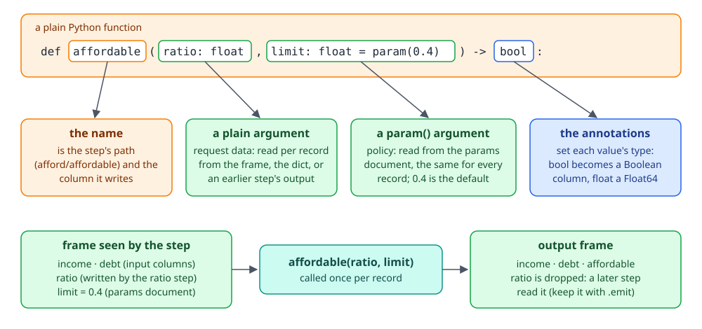
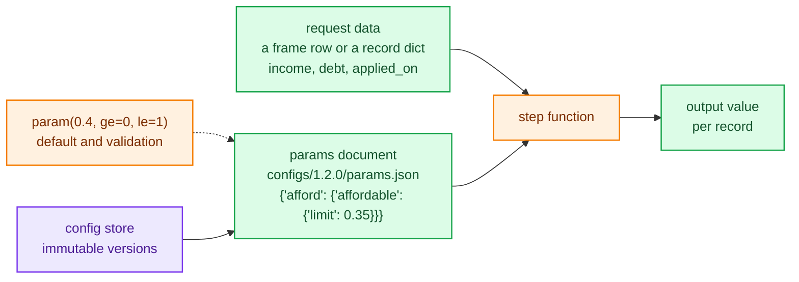
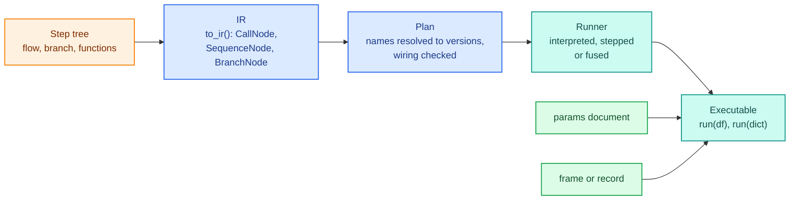

# Core concepts

A decider toolkit pipeline is a set of plain Python functions wired together by the names of their arguments. Each function reads values by name and writes one value under its own name. Some arguments are request data, which changes with every record, and some are params, which hold policy and come from a versioned document. The same pipeline runs over a polars frame or one record at a time, in plain Python or compiled with numba, and gives the same answers either way.

This page builds that model one piece at a time and ends with a glossary. Each term links to the guide that covers it in full.

## A step is a function

A step's signature carries everything the engine needs. The function name is the value it writes. Each plain argument is a value it reads. An argument whose default is `param(...)` is a tunable policy value. The type annotations give each value its type, which becomes the column's dtype in a frame and the machine type in a compiled kernel.

<div class="diagram" markdown>


*`affordable` reads `ratio` from an earlier step and `limit` from the params document, and writes the `affordable` column.*
</div>

Wiring is by name only. If one step writes `ratio` and a later step has an argument called `ratio`, the second reads the first's value. A name nothing writes is an input: it has to be a column of the frame or a key of the record. A step that needs several outputs declares them with `@step(outputs=(...))` and returns a tuple.

The function stays a function. You can still call `affordable(0.3)` directly in a test or a notebook, and the `param()` default works as an ordinary default.

## Request data and params

Every argument is one of two kinds, and the difference decides where its value comes from.



Request data (amounts, dates, ids, bureau scores) arrives with each record. Params (limits, cut-offs, weights, rate ladders) are the same for every record of a run. They live in the params document, a JSON object nested by step path, and a new version of that document changes the decision without a code change, rebuild or recompile.

The engine enforces the split. A value for a param that turns up in the record is ignored, with a warning that says where it belongs:

```python
import warnings

from decikit import flow, param

def ratio(income: float, debt: float) -> float:
    return debt / income

def affordable(ratio: float, limit: float = param(0.4)) -> bool:
    return ratio <= limit

pipeline = flow(ratio, affordable, name="afford")

with warnings.catch_warnings(record=True) as caught:
    warnings.simplefilter("always")
    out = pipeline.compile().run({"income": 1000.0, "debt": 380.0, "limit": 0.3})
print(out["affordable"])
print(caught[0].message)
```

```text
True
'limit' is a param, not an input, so its value in the record or frame is ignored; pass it in the params document instead: {"afford": {"affordable": {"limit": "..."}}}
```

The opposite mistake is the more common one: declaring a request field as a `param()`. It then ignores the request and always answers with the default. Request data is never a `param()`.

## Composing steps

Steps compose into bigger steps. Each composite is itself a step, so it can be named, nested, reused in another pipeline or relabelled to read other column names.

| Construct | What it does | Guide |
|---|---|---|
| `flow(a, b, c, name=...)` | runs members in written order; a later write of a name wins | [Steps and params](guides/steps-and-params.md) |
| `dag(...)` | runs members in dependency order; each name has one writer | [Steps and params](guides/steps-and-params.md) |
| `branch(cond, arm0, arm1, modifies=[...])` | each row takes one arm, chosen by a bool or int condition | [Branches, loops and frames](guides/branches-loops-frames.md) |
| `loop(cond, body, carries=[...], max_iterations=n)` | repeats a body per row while a condition holds | [Branches, loops and frames](guides/branches-loops-frames.md) |
| `@frame_step(reads=, writes=)` | a `DataFrame -> DataFrame` function for joins and group-bys | [Branches, loops and frames](guides/branches-loops-frames.md) |
| `each(column, child)` | runs a child flow on every item of a list column | [Types and money](guides/types-and-money.md) |
| `optimise(count, evaluate, ...)` | tries every candidate per row and keeps the best | [Types and money](guides/types-and-money.md) |
| `TreeConfig`, `DecisionTableConfig`, `ScorecardConfig` | rule sets loaded from JSON documents | [Trees, tables, scorecards](guides/trees-tables-scorecards.md) |

`step(a) | b | c` builds the same flow as `flow(a, b, c)`. (Two plain functions have no `|` operator in Python, so the first one needs `step()`.)

Named members give every step a path, such as `afford/affordable` or `offer/by_eligibility/full_limit`. Paths key the params document, name steps in error messages, and are what breakpoints, traces and diffs refer to.

## Running a pipeline

`run` takes either shape. `run(df)` takes a polars frame and returns a frame: the input columns plus every value nothing else reads. `run(record)` takes one dict and returns a dict. A service passes a dict; analysis, back-testing and experiments pass a frame.

`pipeline.run(df)` is a shortcut that runs in interpreted mode. For repeated calls, compile once with `pipeline.compile(mode)`, which returns an `Executable`, and call `run` on it as often as you like from as many threads as you like. There are three modes:

<div class="diagram" markdown>


*`month_end` reads a `date`, which no kernel holds, so both compiled modes run it in Python; fused mode says so with a `FallbackWarning`.*
</div>

- `"interpreted"` calls each function in Python for each row. It needs no compile, pauses at every step in a debug session, and is the reference the other modes are tested against.
- `"stepped"` compiles every step into its own numba kernel and drives them from Python. Sessions still pause at every step.
- `"fused"` compiles each run of consecutive compilable steps into one kernel, including whole branches and loops made of plain scalar steps. It is the fastest and the default for `decikit serve`.

On the benchmark pipeline (1M rows through `run`, 20k single-record `run` calls), interpreted mode ran 0.25M rows/s with a single-record median of 59.1 µs, stepped 12.9M rows/s and 37.1 µs, and fused 12.5M rows/s and 27.7 µs. [Compiled modes and fallback](guides/compile-and-fallback.md) covers what compiles, what falls back and how to measure your own pipeline.

## From functions to answers

You never write IR, but knowing the stages helps when reading an error message or the architecture pages.



Wiring errors (a typo in an input name, a dag cycle, a branch-local value read outside the branch) surface when the plan is built, before any data is touched. Params errors surface when a params document is first seen. [Steps and IR](architecture/steps-and-ir.md) and the [engine overview](architecture/engine/index.md) follow each stage through the code.

## Around the pipeline

A pipeline on its own is a Python object. These pieces turn it into something you deploy, inspect and compare:

- A project is a package directory with `pipeline.py` (a `build()` function returning the pipeline), `inference.py` (the request handler), `configs/<version>/` and a `.env`. `decikit template NAME` writes one, and `decikit build` and `decikit serve` run it. See [Projects and serving](guides/projects-and-serving.md).
- A config version is one immutable directory under `configs/`, such as `configs/0.0.0/`, holding the params document and any tree, table or scorecard documents. A new version is a new directory; replaying an old decision reads the version it was made with. See the [config store](architecture/config-store.md).
- A trace is the compact evidence of why a record got its answer: which steps ran, which branch arm and loop iteration each row took. It is captured only when you pass a `TraceSink`. See [Tracing](guides/tracing.md).
- A check is a static rule run over a pipeline (and optionally a params document or data), such as a missing durable id or a product that can overflow int64. Each finding has a stable code like `DCD401`. See [Checks](guides/checks.md).
- An experiment runs the unchanged pipeline and one or more scenarios (other params, an overridden value, another git revision) over the same records and measures the difference. See [Experiments](guides/experiments.md).

## Glossary

| Term | Meaning |
|---|---|
| [step](guides/steps-and-params.md) | Anything that can sit in a pipeline. A plain function becomes a step automatically; `step()` overrides its name or outputs. |
| input | A name a step reads that no earlier step writes, so it comes from the frame or the record. |
| [param](guides/steps-and-params.md) | An argument declared `param(default)`: policy read from the params document, validated by pydantic. |
| [params document](guides/steps-and-params.md) | The JSON object of param values, nested by step path (`{"afford": {"affordable": {"limit": 0.4}}}`). `parameters().defaults()` builds a complete one. |
| [parameter table](guides/parameter-tables.md) | A param holding rows (a rate ladder, fee caps), declared with `param_table`. |
| request data | The values that arrive with each record. Always plain arguments, never params. |
| [flow](guides/steps-and-params.md) | Steps in written order; a later write of a name replaces the earlier one (the waterfall). |
| [dag](guides/steps-and-params.md) | Steps in dependency order; each name has exactly one writer. |
| [branch](guides/branches-loops-frames.md) | Per-row choice between arms; `modifies` lists the names it passes on. |
| [loop](guides/branches-loops-frames.md) | Per-row repetition; `carries` lists the names each iteration updates. |
| [frame step](guides/branches-loops-frames.md) | A `DataFrame -> DataFrame` step for whole-frame work. |
| path | A step's position in the tree, such as `credit/approved`. Keys params, errors, breakpoints and traces. |
| run | Run a pipeline over a polars frame; returns a frame. |
| score | Run a pipeline on one record given as a dict; returns a dict. |
| [executable](guides/compile-and-fallback.md) | What `compile(mode)` or `Engine().bind(step, mode)` returns: a bound pipeline with `run`, `fallbacks` and `session`. |
| [interpreted, stepped, fused](guides/compile-and-fallback.md) | The three run modes: plain Python, one kernel per step, one kernel per run of steps. |
| [fallback](guides/compile-and-fallback.md) | A step a compiled mode runs in Python because numba cannot hold its types or compile its body. Reported once by a `FallbackWarning`. |
| [ConfigurableStep](guides/trees-tables-scorecards.md) | A step type loaded from a JSON document with a `type` tag; trees, decision tables and scorecards are the built-in ones. Your own types: [Extending the decider toolkit](guides/extending.md). |
| [IR](architecture/steps-and-ir.md) | The intermediate representation every step lowers to with `to_ir`. |
| [project](guides/projects-and-serving.md) | A package directory with `pipeline.py`, `inference.py`, `configs/` and `.env`. |
| [config version](architecture/config-store.md) | One immutable `configs/<version>/` directory of documents. |
| [session](guides/debugging-and-testing.md) | A debug session over a frame: break at a step, inspect values, override them and resume. |
| [trace](guides/tracing.md) | Per-record decision evidence captured through a `TraceSink`. |
| [check](guides/checks.md) | A static rule run over a pipeline, reporting findings with stable codes. |
| [experiment](guides/experiments.md) | A baseline and scenarios run over the same records and compared with metrics. |
