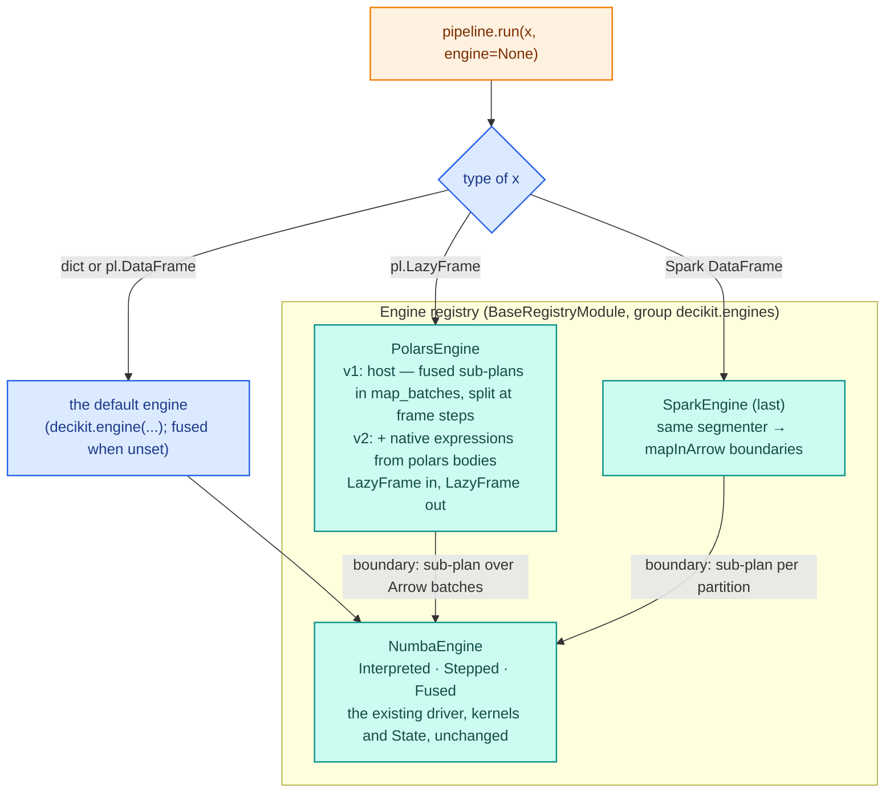
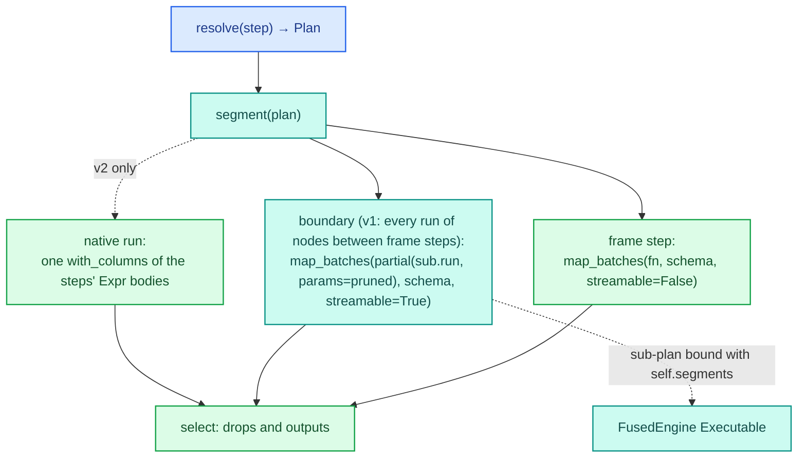

# Target architecture

The design after the rework. Components, how a call flows through each engine, and what each engine
supports. The reasons for each choice are in [03-design-choices.md](03-design-choices.md).



## Engine registry

`Engine` becomes a registry root. An engine is a settings document; `bind` is its factory. Runtime state
(locks, compiled snapshots, plan caches) stays on the runner or the `Executable`, as it does today, so a
frozen pydantic model fits without private attributes.

```python
class Engine(BaseRegistryModule, root=True, group="engines"):
    model_config = ConfigDict(frozen=True, extra="forbid")
    params_validation: Literal["eager", "lazy"] = "eager"

    def bind(self, step_or_ir) -> Executable: ...          # abstract


class NumbaEngine(Engine):
    mode: ClassVar[str]
    strict_compile: bool = False


class InterpretedEngine(NumbaEngine): type: Literal["interpreted"] = "interpreted"; mode = "interpreted"
class SteppedEngine(NumbaEngine):     type: Literal["stepped"] = "stepped";         mode = "stepped"
class FusedEngine(NumbaEngine):       type: Literal["fused"] = "fused";             mode = "fused"


class PolarsEngine(Engine):
    type: Literal["polars"] = "polars"
    segments: FusedEngine = FusedEngine()                   # runs every boundary
```

As built (2026-10-10): `NumbaEngine` has no `mode` attribute; each subclass returns its runner from `_runner()`,
which is also what a third-party numba engine overrides.

- `Engine.resolve("fused")` is the alias lookup; `Step.compile("fused")` becomes
  `Engine.resolve(mode)().bind(self)`, and `compile(FusedEngine(strict_compile=True))` takes an instance.
- `APISettings.engine` is an `EngineSettings(type="fused", extra="allow")` document and `RequestHandler`
  holds the built `Engine`, mirroring `DecikitConfigSettings.get()`. `DECIKIT_API__ENGINE__TYPE=fused
  DECIKIT_API__ENGINE__STRICT_COMPILE=true` works; today neither setting is reachable from serving.
- Built-ins register through `Engine.lazy({...})` so `import decikit` still imports no numba; third parties
  ship an engine as an entry point in `decikit.engines`.
- `capabilities().modes` in the bridge and the engine list in `assert_equivalent` read the registry instead
  of `RUNNERS`.

## NumbaEngine: unchanged

The runners, `State`, kernels, fusion, packing, the cache and the concurrency rules are untouched. The numba
engine never calls a step's polars body: a step that falls back today falls back the same way under every
numba engine. The only change it sees is the registry wrapper around `Engine.bind` and `run` taking a dict.

## Polars bodies on steps (built only if phase P6 goes ahead)

Dropped 2026-10-10: P5 (experiment E2) was a no-go, so P6 is not built and this section is history; see `docs/design_decisions/experiments/polars-host-vs-native.md`.

A polars body is an optional optimisation an author may add to a step; the Python body is always required
and is what serving, debugging and the equivalence baseline run.

```python
@step
def tenure_months(start: date, as_of: date) -> int:
    return (as_of.year - start.year) * 12 + as_of.month - start.month

@tenure_months.impl("polars")
def _(start: pl.Expr, as_of: pl.Expr) -> pl.Expr:
    return (as_of.dt.year() - start.dt.year()) * 12 + as_of.dt.month() - start.dt.month()
```

- `impl(engine)` stores the body on the function object (`__decikit_impls__`), beside `@allow_fallback`'s
  marker in `decikit/steps/_helpers.py`; `decikit.impl(fn, "polars")` is the form for a plain function.
  Storing it on the function means `.named()` and `.relabel()` copies keep it.
- `FunctionStep.to_ir` reads the marker into `CallNode.impls: tuple[tuple[str, Callable], ...]`, a new field
  beside `fn` and `reference`. The IR node set is unchanged.
- At decoration, `harvest(impl)` must give the same input and param names as the main body, in order;
  annotations are free. Output count comes from the main body. A `Decimal` or `Currency` input, output or
  param refuses the impl (v1).
- Body contract: inputs arrive as `pl.Expr` with the null policy already applied, params as Python values;
  the return is an Expr (a tuple for several outputs).
- Only the polars engine's native segments call it. A polars body on a step inside a `loop` is never used,
  because loops are always boundaries; `fallbacks()` says so.

## PolarsEngine: a lazy plan translator

```
run(lf: pl.LazyFrame, params) -> pl.LazyFrame        # the plan; collect, stream or sink as you like
run(df: pl.DataFrame, params)  -> pl.DataFrame        # run(df.lazy()).collect()
run(record: Mapping, params)   -> dict                # delegated to self.segments
```



### v1: the host

The segmenter walks the root sequence's top-level children in order. A child that contains a frame call
anywhere beneath it (a bare frame step, or a branch or loop holding one) becomes a whole-frame segment,
`streamable=False`; consecutive children without one form a streamable segment. Every segment is a
sub-`Executable`: a `SequenceNode` of those children emitting every name they write, bound once with
`self.segments.bind(...)`, and emitted as `lf.map_batches(partial(sub.run, params=pruned), schema,
streamable=...)`. Everything inside (kernels, fallbacks, trees, branches, loops) is the existing code running
on an Arrow batch; a row-local segment is streamable by construction, and a frame-step segment sees the whole
frame, which is the correct semantics for cross-row logic. A pipeline with no frame steps is one segment.

Four details the spike settled: the output schema `map_batches` requires comes from running the
sub-executable on a zero-row frame of the input schema; the params document is pruned per segment, because a
sub-plan rejects an entry for a step it does not hold; a name an earlier segment wrote and a later one only
overwrites is dropped before that segment, or the shadowing check fires; and a final `select` reproduces the
fused output columns, since intermediate names from earlier segments stay in the frame. Shadowing is checked
once on the input schema with the whole pipeline's executable. A `REQUIRED` null raises from a segment's Arrow
read, as it does today. The full design, verified facts and test list: [09-polars-host-design.md](09-polars-host-design.md).

### v2: native segments (conditional on the measurement in P5)

Dropped 2026-10-10: P5 (experiment E2) was a no-go, so P6 is not built and this section is history; see `docs/design_decisions/experiments/polars-host-vs-native.md`.

The segmenter rule becomes the packing rule:

- A `Call` is native if it has a polars impl, or is a frame step.
- A `Branch` is native if its condition and every node in every arm are native scalar calls; it emits
  `pl.when(cond).then(arm0).otherwise(arm1)` per modified name. Otherwise the whole branch is a boundary.
- A `Loop` is always a boundary.
- A `ScatterGather` is native if its body is (the shape `_scatter_gather_vectorized` already has); otherwise a
  boundary.
- Adjacent non-native nodes merge into one boundary.

Native emission wraps each input Expr by its null policy (`MISSING_AS` → `fill_null(lit)`; `OPTIONAL` → as
is; `REQUIRED` → a small streamable `map_batches` before the segment that raises `MissingInputError` with the
step path and null count), validates params through the same `NodeParams` models and bakes them as `pl.lit`,
emits one `with_columns` per maximal native run, and resolves the schema after each native step so a type
error names a step path before anything runs.

### Not supported

`trace=` and `session` raise with "use the numba engine". `fallbacks()` returns the segment report,
`{path: "boundary: <reason>"}` (v1: every step; v2: the steps that did not run natively, with the reason,
including "inside a loop").

## run dispatch and the default engine

`score` is removed. `Step.run(data, params=None, trace=None, *, engine=None)` and `Executable.run` dispatch on
`data`:

| `data` | `Step.run` with `engine=None` | `Executable.run` |
|---|---|---|
| `Mapping` | the default engine's record path (no polars frame) | the record path of its engine (`PolarsEngine` delegates to `segments`) |
| `pl.DataFrame` | the default engine | its engine; `PolarsEngine` collects |
| `pl.LazyFrame` | `PolarsEngine()`, whatever the default | a numba executable collects first; `PolarsEngine` returns a `LazyFrame` |
| Spark `DataFrame` | `SparkEngine()` if installed | `SparkEngine` only |

The default engine is a `ContextVar` read when `engine=None`; `FusedEngine()` when nothing has set it.
`Step.compile()` reads it the same way, so a notebook that sets it once gets that engine for every `run`
and `compile` below. `Step.session()` is the exception: a session opens interpreted unless given an engine,
because a session exists to pause at every node and inside trees; `session(df, engine="fused")` debugs what
production runs.

```python
with decikit.engine("interpreted"):            # instant; what you see is what runs
    pipeline.run(df)
```

`FallbackWarning`s stay on under the fused default: a `str`, `date` or `list` step warns once per step per
executable, as it does in every compiled mode today, and `@allow_fallback` silences one the author accepts.
Serving ignores the default; the handler holds its engine document.

## SparkEngine (last, and shaped by nothing else)

- `run(spark_df) -> spark_df`; the same segmenter; a boundary is `df.mapInArrow(fn, schema)` whose `fn`
  builds the sub-executable once per executor process (a module-level `once` cache keyed by the plan's
  content key) and runs `pl.from_arrow(batch)` → `sub.run` → `to_arrow()`. Native `"spark"` bodies over
  `pyspark.sql.functions` only if polars bodies earned their place first.
- Pipelines are record by record: a `frame_step` raises "cross-row steps are not supported on Spark; run them
  in the job between pipelines". Loops and trees are boundaries, so they just work.
- Lives outside `decikit/_engine` (pyspark is optional): either `decikit[spark]` with a lazy alias, or an
  out-of-tree `decikit-spark` package registering through `decikit.engines`, which is also the first proof
  of the plugin story.

## Feature matrix

| | Interpreted | Stepped | Fused | Polars v1 | Polars v2 | Spark |
|---|---|---|---|---|---|---|
| dict record | ✓ | ✓ | ✓ (serving) | via `segments` | via `segments` | ✗ |
| `pl.DataFrame` | ✓ | ✓ | ✓ | collects | collects | ✗ |
| `pl.LazyFrame` | collects | collects | collects | ✓, lazy out | ✓, lazy out | ✗ |
| Spark DataFrame | ✗ | ✗ | ✗ | ✗ | ✗ | ✓ |
| checkpoints, `Session` | every node | every node | kernel boundaries | ✗ | ✗ | ✗ |
| `TraceSink` | ✓ | ✓ | ✓ | ✗ | ✗ | ✗ |
| `fallbacks()` | `{}` | kernels | kernels | segments | non-native steps | segments |
| `strict_compile` | n/a | ✓ | ✓ | through `segments` | through `segments` | through `segments` |
| `FallbackWarning` (choice 20) | never | never | every non-compiled step, launch-time splits included | from `segments` | from `segments` | from `segments` |
| polars bodies | never | never | never | never | native expressions | never (v1) |
| `frame_step` | ✓ | ✓ | ✓ | whole frame, pipeline breaker | same | refused |
| streaming, larger than memory | ✗ | ✗ | ✗ | ✓ | ✓ | ✓ |
| multi-core | kernels are `nogil`, serial per call | same | same | polars threads run batches in parallel | same, plus native expressions | the cluster |

## What does not change

The numba engine as a whole: the IR node set, wiring, params validation and bundles, the kernel builder, the
fusion and packing rules, the salted disk cache, the concurrency rules, trace, the debugger, the Arrow
boundary, the serving hot path and its numbers. The rework adds beside these; it rewrites none of them.
