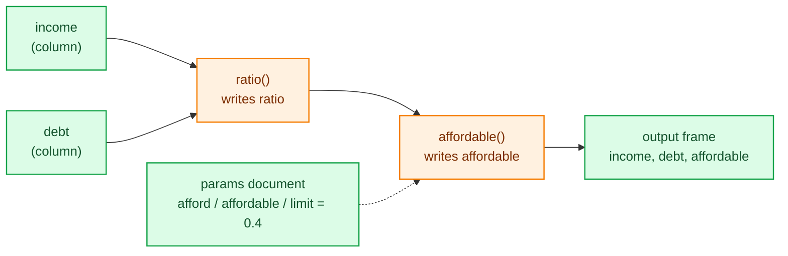
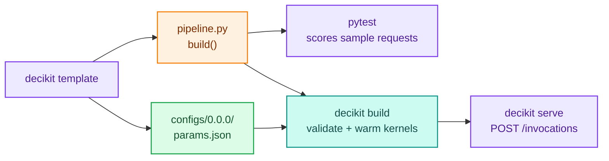

# Getting started

The decider toolkit turns plain Python functions into a decision pipeline. You run the pipeline over a polars frame for batch work and analysis, score one record at a time for serving, and change its policy numbers through a params document without touching the code. On this page you install the package, build a two-step affordability check, run it both ways, retune it, and then generate a starter project that serves over HTTP.

## Install

The decider toolkit needs Python 3.10 or newer. The base install brings polars, pydantic, numba and click, which is everything needed to build and run pipelines:

```bash
pip install decikit
# or, in a uv project
uv add decikit
```

Optional extras add what a particular task needs. These are the extras declared in the package:

| Extra | Installs | Needed for |
|---|---|---|
| `serve-starlette` | uvicorn, starlette | `decikit serve` with the default server |
| `serve-sanic` | sanic | `decikit serve --server sanic` |
| `yaml` | pyyaml | flow files written in YAML |
| `experiments` | altair, ipython, markdown-it-py | experiment plots and reports |
| `notebook` | ipython | notebook display helpers |
| `visualise` | streamlit, graphviz | visual tooling |
| `eval` | simpleeval | expression evaluation |
| `mcp` | fastmcp | `decikit mcp`, the MCP server for agents |
| `prove` | z3-solver | `diff.prove` with the SMT tier |
| `dev` | pytest, pytest-asyncio, anyio | the tests a template project ships |
| `all` | every package above | everything |

```bash
pip install 'decikit[serve-starlette,yaml]'
```

The install puts a `decikit` command on your path. `decikit --help` lists every command; there are no hidden ones.

## Your first pipeline

A [step](concepts.md) is a function. Its arguments are the names it reads, its name is the name it writes, and an argument whose default is `param(...)` is a policy value that comes from configuration instead of from the data.

```python
import polars as pl
from decikit import flow, param

def ratio(income: float, debt: float) -> float:
    return debt / income

def affordable(ratio: float, limit: float = param(0.4)) -> bool:
    return ratio <= limit

pipeline = flow(ratio, affordable, name="afford")

df = pl.DataFrame({"income": [1000.0, 500.0, 800.0], "debt": [200.0, 400.0, 300.0]})
print(pipeline.run(df))
```

```text
shape: (3, 3)
┌────────┬───────┬────────────┐
│ income ┆ debt  ┆ affordable │
│ ---    ┆ ---   ┆ ---        │
│ f64    ┆ f64   ┆ bool       │
╞════════╪═══════╪════════════╡
│ 1000.0 ┆ 200.0 ┆ true       │
│ 500.0  ┆ 400.0 ┆ false      │
│ 800.0  ┆ 300.0 ┆ true       │
└────────┴───────┴────────────┘
```

`flow` wired the two functions by name: `affordable` reads `ratio`, so it gets the value the `ratio` step wrote. Nobody declared that edge. The output holds the input columns plus every value nothing else reads, so the intermediate `ratio` is gone. Ask for it with `emit`:

```python
print(pipeline.emit("ratio").run(df))
```

```text
shape: (3, 4)
┌────────┬───────┬────────────┬───────┐
│ income ┆ debt  ┆ affordable ┆ ratio │
│ ---    ┆ ---   ┆ ---        ┆ ---   │
│ f64    ┆ f64   ┆ bool       ┆ f64   │
╞════════╪═══════╪════════════╪═══════╡
│ 1000.0 ┆ 200.0 ┆ true       ┆ 0.2   │
│ 500.0  ┆ 400.0 ┆ false      ┆ 0.8   │
│ 800.0  ┆ 300.0 ┆ true       ┆ 0.375 │
└────────┴───────┴────────────┴───────┘
```



## Score one record

A service answers one request at a time. Compile the pipeline once, then call `run` with a dict for each record. `"fused"` is the fastest [compiled mode](guides/compile-and-fallback.md): numba turns both steps into one machine-code kernel the first time it runs.

```python
exe = pipeline.compile("fused")
print(exe.run({"income": 1000.0, "debt": 200.0}))
```

```text
{'income': 1000.0, 'debt': 200.0, 'affordable': True}
```

The first call compiles, which takes a noticeable fraction of a second. Later calls reuse the kernel and take tens of microseconds. Every mode gives the same answers, so `pipeline.run(df)` (interpreted, plain Python) is the reference the compiled modes are tested against.

!!! warning "Pass a single record as a dict"
    Do not score one record by building a one-row frame and passing it to `run`. A frame is exported through Arrow and an output frame assembled, which the guide measures at about five times the cost of passing the dict on the same record.

## Retune a param

`parameters()` lists every param in the pipeline by step path, and `defaults()` turns that into a complete params document you can edit:

```python
print(pipeline.parameters())
params = pipeline.parameters().defaults()
print(params)
```

```text
{'afford/affordable': {'limit': {'type': 'float', 'default': 0.4}}}
{'afford': {'affordable': {'limit': 0.4}}}
```

Tighten the limit and pass the document to the same compiled executable. Nothing recompiles: params reach the kernel as arguments.

```python
params["afford"]["affordable"]["limit"] = 0.3
print(exe.run(df, params=params))
print(exe.run({"income": 800.0, "debt": 300.0}, params))
```

```text
shape: (3, 3)
┌────────┬───────┬────────────┐
│ income ┆ debt  ┆ affordable │
│ ---    ┆ ---   ┆ ---        │
│ f64    ┆ f64   ┆ bool       │
╞════════╪═══════╪════════════╡
│ 1000.0 ┆ 200.0 ┆ true       │
│ 500.0  ┆ 400.0 ┆ false      │
│ 800.0  ┆ 300.0 ┆ false      │
└────────┴───────┴────────────┘
{'income': 800.0, 'debt': 300.0, 'affordable': False}
```

In a deployed project that document is `configs/<version>/params.json`, and a new version of it changes the decision without a code release. [Steps, params and run](guides/steps-and-params.md) covers validation, ranges, required and shared params.

## Read the guide from the terminal

The installed package carries its own getting-started guide, kept in step with the code (every Python example in it runs in the package's tests). Print it with:

```bash
decikit guide | less
```

It starts with the mental model, a table of which construct to use for which need, and runnable examples for every feature. The docstrings are current too: `help(decikit.flow)`, `help(decikit.branch)` and so on.

## Start a project

`decikit template NAME` writes a starter project. The directory it creates is itself a Python package, so `import credit_risk` resolves to it.

```bash
decikit template credit_risk
```

```text
created credit_risk/README.md
created credit_risk/__init__.py
created credit_risk/configs/0.0.0/params.json
created credit_risk/conftest.py
created credit_risk/.env
created credit_risk/inference.py
created credit_risk/pipeline.py
created credit_risk/sample_request.json
created credit_risk/tests/test_pipeline.py
```

`pipeline.py` holds the steps and a `build()` function that returns the pipeline:

```python
from datetime import date

from decikit import flow, missing_as, param


def debt_ratio(income: float, debt: float = missing_as(0.0)) -> float:
    return debt / income


def month_end(applied_on: date) -> bool:
    return applied_on.day >= 25


def approved(debt_ratio: float, month_end: bool,
             limit: float = param(0.4, ge=0.0, le=1.0),
             month_end_limit: float = param(0.3, ge=0.0, le=1.0)) -> bool:
    return debt_ratio <= (month_end_limit if month_end else limit)


def build():
    return flow(debt_ratio, month_end, approved, name="credit_risk")
```

The rest of the project:

- `configs/0.0.0/params.json` is the first config version: `{"credit_risk": {"approved": {"limit": 0.4, "month_end_limit": 0.3}}}`.
- `sample_request.json` is one request, used by the tests and to warm the kernels at build time.
- `inference.py` defines `Handler`, the request handler `decikit serve` uses. Override its methods to change how requests are parsed and answered.
- `.env` points the CLI at the code: `DECIKIT_API__PIPELINE=credit_risk.pipeline:build`, `DECIKIT_API__HANDLER=credit_risk.inference:Handler` and `DECIKIT_CONFIG__BASEPATH=configs`.
- `tests/test_pipeline.py` scores requests through the handler, the way the server does.

Then test, build and serve it:

```bash
cd credit_risk
pytest -q                    # 2 passed
decikit build                # validates configs/0.0.0 and warms every kernel with sample_request.json
decikit serve --workers 1    # needs decikit[serve-starlette]
```

`decikit build` prints which pipeline and handler it loaded, and ends with `built config version 0.0.0 (pipeline credit_risk.pipeline:build, engine fused)`. It also prints one `FallbackWarning`, because `month_end` reads a `date`, which no numba kernel holds, so that one step runs in Python while the other two compile. [Compiled modes and fallback](guides/compile-and-fallback.md) explains the warning and how to accept it.

With the server running, post the sample request:

```bash
curl -s -d @sample_request.json -H 'content-type: application/json' localhost:8080/invocations
```

```text
{"income":1000.0,"debt":250.0,"applied_on":"2026-01-15","approved":true}
```

`GET /ping` answers 200 once the worker has staged and activated the latest config version.



## Where to go next

- [Core concepts](concepts.md) has the mental model and a glossary of every term on this site.
- [Steps, params and run](guides/steps-and-params.md) covers steps, params and the errors you will meet first.
- [Branches, loops and frame steps](guides/branches-loops-frames.md) adds per-row logic, iteration and whole-frame work.
- [Types, text, money and nested data](guides/types-and-money.md) covers `Text`, `Currency`, `Decimal` and list columns.
- [Compiled modes and fallback](guides/compile-and-fallback.md) explains what compiles and what runs in Python.
- [Trees, tables and scorecards](guides/trees-tables-scorecards.md) loads rule sets from JSON documents.
- [Projects and serving](guides/projects-and-serving.md) goes deeper on the template, config versions and the HTTP server.
- [Debugging and testing](guides/debugging-and-testing.md) shows sessions, breakpoints and equivalence tests.
