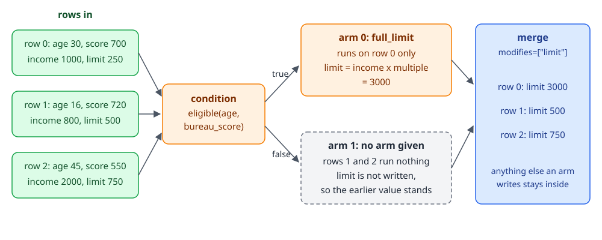
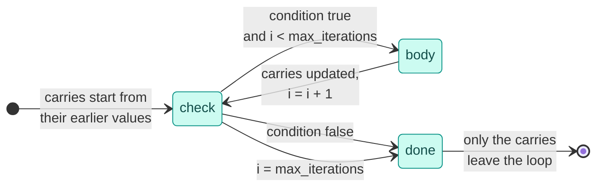

# Branches, loops and frame steps

Most decisions apply different rules to different records, repeat a calculation until it settles, or need data from outside the record. `branch` sends each row down one arm, `loop` repeats a body per row while a condition holds, `frame_step` hands a whole polars frame to your function, and `each` runs a small flow on every item of a list column. All of them are steps, so they nest inside each other and inside `flow` and `dag`.

The examples build on each other; run them top to bottom.

## Branch: one arm per row

`branch(condition, arm0, arm1, modifies=[...], name=...)` evaluates `condition` on every row. A bool condition sends `True` rows to the first arm and `False` rows to the second. `modifies` lists the names the arms may change and the branch passes on.

```python
import polars as pl
from decider import branch, flow, param, step

def eligible(age: int, bureau_score: float) -> bool:
    return age >= 18 and bureau_score >= 600

@step(output="limit")
def full_limit(income: float, multiple: float = param(3.0)) -> float:
    return income * multiple

@step(output="limit")
def no_limit(income: float) -> float:
    return 0.0

offer = flow(branch(eligible, full_limit, no_limit, modifies=["limit"], name="by_eligibility"), name="offer")
applicants = pl.DataFrame({"age": [30, 16, 45], "bureau_score": [700.0, 720.0, 550.0],
                           "income": [1000.0, 800.0, 2000.0]})
print(offer.run(applicants))
print(offer.compile("fused").run(applicants).equals(offer.run(applicants)))
print(offer.parameters().defaults())
```

```text
shape: (3, 4)
┌─────┬──────────────┬────────┬────────┐
│ age ┆ bureau_score ┆ income ┆ limit  │
│ --- ┆ ---          ┆ ---    ┆ ---    │
│ i64 ┆ f64          ┆ f64    ┆ f64    │
╞═════╪══════════════╪════════╪════════╡
│ 30  ┆ 700.0        ┆ 1000.0 ┆ 3000.0 │
│ 16  ┆ 720.0        ┆ 800.0  ┆ 0.0    │
│ 45  ┆ 550.0        ┆ 2000.0 ┆ 0.0    │
└─────┴──────────────┴────────┴────────┘
True
{'offer': {'by_eligibility': {'full_limit': {'multiple': 3.0}}}}
```

The arm steps sit under the branch's path, so `full_limit`'s param lives at `offer/by_eligibility/full_limit` in the params document. An arm can be one step or a whole `flow`; a nameless arm is named `arm0`, `arm1` and so on by position.

### One arm: rows that take no arm keep their values

Give a bool branch only one arm and the `False` rows run nothing. Every name in `modifies` keeps the value it had before the branch on those rows, whether that came from the input frame or from an earlier step:

```python
only_eligible = flow(branch(eligible, full_limit, modifies=["limit"], name="only_eligible"), name="offer")
with_limits = applicants.with_columns(limit=pl.Series([250.0, 500.0, 750.0]))
print(only_eligible.run(with_limits))
```

```text
shape: (3, 4)
┌─────┬──────────────┬────────┬────────┐
│ age ┆ bureau_score ┆ income ┆ limit  │
│ --- ┆ ---          ┆ ---    ┆ ---    │
│ i64 ┆ f64          ┆ f64    ┆ f64    │
╞═════╪══════════════╪════════╪════════╡
│ 30  ┆ 700.0        ┆ 1000.0 ┆ 3000.0 │
│ 16  ┆ 720.0        ┆ 800.0  ┆ 500.0  │
│ 45  ┆ 550.0        ┆ 2000.0 ┆ 750.0  │
└─────┴──────────────┴────────┴────────┘
```

<div class="diagram" markdown>


*The merge writes each `modifies` name from the arm a row took, or keeps the earlier value when the arm did not write it.*
</div>

The same rule applies with two arms: a row whose arm does not write a `modifies` name keeps the earlier value. If no earlier value exists (no input column, no earlier step), the row gets a null.

### More than two arms

An `int` condition picks arm `i`. Use it for tiers, segments or product types:

```python
def tier(bureau_score: float) -> int:
    return 0 if bureau_score >= 700 else 1 if bureau_score >= 600 else 2

@step(output="rate")
def prime(base: float = param(0.10)) -> float:
    return base

@step(output="rate")
def near_prime(base: float = param(0.15)) -> float:
    return base

@step(output="rate")
def sub_prime(base: float = param(0.22)) -> float:
    return base

pricing = flow(branch(tier, prime, near_prime, sub_prime, modifies=["rate"], name="by_tier"), name="pricing")
print(pricing.run(pl.DataFrame({"bureau_score": [720.0, 650.0, 500.0]})))
print(pricing.parameters().defaults())
```

```text
shape: (3, 2)
┌──────────────┬──────┐
│ bureau_score ┆ rate │
│ ---          ┆ ---  │
│ f64          ┆ f64  │
╞══════════════╪══════╡
│ 720.0        ┆ 0.1  │
│ 650.0        ┆ 0.15 │
│ 500.0        ┆ 0.22 │
└──────────────┴──────┘
{'pricing': {'by_tier': {'prime': {'base': 0.1}, 'near_prime': {'base': 0.15}, 'sub_prime': {'base': 0.22}}}}
```

A bool condition sends `True` to arm 0, while an int `1` picks arm 1. Changing a flag from `bool` to a 0/1 `int` therefore swaps the arms. A condition value with no arm is an error, in every mode:

```python
def bad_tier(bureau_score: float) -> int:
    return 3

broken = flow(branch(bad_tier, prime, near_prime, modifies=["rate"], name="b"), name="p")
try:
    broken.compile("fused").run(pl.DataFrame({"bureau_score": [720.0]}))
except ValueError as e:
    print(e)
```

```text
branch p/b: the condition picked arm 3 on 1 row(s), but there are 2 arms
```

### A column as the condition

A bare column name works as a condition. `branch("on_card", ...)` reads the existing bool column `on_card`:

```python
@step(output="fee")
def card_fee(amount: float) -> float:
    return amount * 0.02

fees = flow(branch("on_card", card_fee, modifies=["fee"], name="card"), name="fees")
print(fees.run(pl.DataFrame({"on_card": [True, False], "amount": [100.0, 100.0], "fee": [0.0, 1.5]})))
```

```text
shape: (2, 3)
┌─────────┬────────┬─────┐
│ on_card ┆ amount ┆ fee │
│ ---     ┆ ---    ┆ --- │
│ bool    ┆ f64    ┆ f64 │
╞═════════╪════════╪═════╡
│ true    ┆ 100.0  ┆ 2.0 │
│ false   ┆ 100.0  ┆ 1.5 │
└─────────┴────────┴─────┘
```

### What leaves a branch

Only the names in `modifies` leave the branch. Anything else an arm or the condition writes stays inside: a later step cannot read it, and emitting it by bare name is an error. `emit("name@path")` still outputs it for inspection, with nulls on the rows that took another arm.

```python
from decider.exceptions import WiringError

def factor(bureau_score: float) -> float:
    return bureau_score / 200.0

@step(output="limit")
def scaled_limit(income: float, factor: float) -> float:
    return income * factor

scored = flow(factor, scaled_limit, name="scored")
by_score = branch(eligible, scored, no_limit, modifies=["limit"], name="by_eligibility")

def uses_factor(factor: float) -> float:
    return factor

try:
    flow(by_score, uses_factor, name="offer").run(applicants)
except WiringError as e:
    print(e)

print(flow(by_score, name="offer").emit("factor@offer/by_eligibility/scored/factor").run(applicants))
```

```text
offer/uses_factor reads 'factor', but the only step writing it, offer/by_eligibility/scored/factor, is inside branch offer/by_eligibility, which passes on only modifies=['limit'], so 'factor' is not visible after it. List 'factor' there to pass it on, or rename one of them if offer/uses_factor means an input column.
shape: (3, 5)
┌─────┬──────────────┬────────┬────────┬─────────────────────────────────┐
│ age ┆ bureau_score ┆ income ┆ limit  ┆ factor@offer/by_eligibility/sc… │
│ --- ┆ ---          ┆ ---    ┆ ---    ┆ ---                             │
│ i64 ┆ f64          ┆ f64    ┆ f64    ┆ f64                             │
╞═════╪══════════════╪════════╪════════╪═════════════════════════════════╡
│ 30  ┆ 700.0        ┆ 1000.0 ┆ 3500.0 ┆ 3.5                             │
│ 16  ┆ 720.0        ┆ 800.0  ┆ 0.0    ┆ null                            │
│ 45  ┆ 550.0        ┆ 2000.0 ┆ 0.0    ┆ null                            │
└─────┴──────────────┴────────┴────────┴─────────────────────────────────┘
```

The arms of one branch must agree on the type of each name they modify, and the branch needs `modifies` at all:

```python
@step(output="limit")
def int_limit(income: float) -> int:
    return 0

for build in (lambda: flow(branch(eligible, full_limit, int_limit, modifies=["limit"], name="x"), name="p").run(applicants),
              lambda: branch(eligible, full_limit, no_limit, modifies=[], name="x")):
    try:
        build()
    except WiringError as e:
        print(e)
```

```text
branch p/x: the arms disagree on the type of 'limit': p/x/full_limit writes float, p/x/int_limit writes int
branch 'x' needs modifies=[...]: the names its arms may change
```

### A branch that reads what it modifies

A condition that reads an input column while an arm writes that same name is refused. The condition would see the input column, the steps after the arm would see the arm's value, and decider will not guess which one you meant:

```python
def owes(balance: float) -> bool:
    return balance > 0

@step(output="balance")
def write_off(balance: float) -> float:
    return 0.0

try:
    flow(branch(owes, write_off, modifies=["balance"], name="settle"), name="loan").run(
        pl.DataFrame({"balance": [100.0, 0.0]}))
except WiringError as e:
    print(e)
```

```text
loan/settle/owes reads 'balance' as an input column, but loan/settle/write_off, which runs later, writes 'balance'. Order is execution order: loan/settle/owes saw the input column, while anything after loan/settle/write_off sees loan/settle/write_off's value. Move loan/settle/write_off before loan/settle/owes, or rename one of the two.
```

Compute the flag in an earlier step under a different name (and branch on that column), or write the new value under a new name.

## Loop: repeat per row

`loop(condition, body, carries=[...], max_iterations=n, name=...)` checks `condition` on every row before each iteration and runs `body` on the rows where it holds. `carries` lists the names each iteration updates: the condition and body see the latest values, the body must write every one of them, and they are all that leaves the loop.

```python
from decider import loop

def unpaid(balance: float) -> bool:
    return balance > 0.0

@step(output="balance")
def pay(balance: float, instalment: float, rate: float = param(0.01)) -> float:
    return balance * (1 + rate) - instalment

@step(output="months")
def tick(months: int) -> int:
    return months + 1

repay = loop(unpaid, flow(pay, tick, name="month"), carries=["balance", "months"], max_iterations=360, name="repay")
loans = pl.DataFrame({"balance": [1000.0, 500.0, 0.0, 1000.0], "instalment": [100.0, 100.0, 50.0, 5.0],
                      "months": [0, 0, 0, 0]})
schedule = flow(repay, name="loan")
print(schedule.run(loans))
print(schedule.parameters().defaults())
```

```text
shape: (4, 3)
┌────────────┬──────────────┬────────┐
│ instalment ┆ balance      ┆ months │
│ ---        ┆ ---          ┆ ---    │
│ f64        ┆ f64          ┆ i64    │
╞════════════╪══════════════╪════════╡
│ 100.0      ┆ -41.01512    ┆ 11     │
│ 100.0      ┆ -84.441431   ┆ 6      │
│ 50.0       ┆ 0.0          ┆ 0      │
│ 5.0        ┆ 18474.820664 ┆ 360    │
└────────────┴──────────────┴────────┘
{'loan': {'repay': {'month': {'pay': {'rate': 0.01}}}}}
```

Each row stops on its own: the first after 11 months, the second after 6. The third starts at zero, so its condition fails before the first iteration and the body never runs. The fourth never pays off (5 a month does not cover 1% interest on 1000) and stops at `max_iterations`.



### Loop limits and termination

`max_iterations` is required, because compiled code cannot be interrupted. A row that reaches it stops there without an error, with whatever its carries hold at that point. Lower the limit and the fourth row stops after 12 months:

```python
capped = flow(loop(unpaid, flow(pay, tick, name="month"), carries=["balance", "months"], max_iterations=12,
                   name="repay"), name="loan")
print(capped.run(loans)["months"].to_list(), capped.run(loans)["balance"].round(2).to_list())
```

```text
[11, 6, 0, 12] [-41.02, -84.44, 0.0, 1063.41]
```

A row that silently hits the limit usually means a rule that never converges. Add a carried counter like `months` above and check it against the limit afterwards when that matters.

The loop checks its arguments when you build it:

```python
for build in (lambda: loop(unpaid, pay, carries=[], max_iterations=3, name="x"),
              lambda: loop(unpaid, pay, carries=["balance"], max_iterations=0, name="x"),
              lambda: flow(loop(unpaid, flow(pay, name="m"), carries=["balance", "months"], max_iterations=3,
                                name="x"), name="p").run(loans)):
    try:
        build()
    except WiringError as e:
        print(e)
```

```text
loop 'x' needs carries=[...]: the names each iteration updates
loop 'x': max_iterations must be a positive int, got 0
loop p/x: carries 'months', but the body never writes it
```

### Only carries leave a loop

A value the body writes but the loop does not carry stays inside, just like a branch's arm-private values. Here `months` is not carried, so the output keeps the input column's zeros even though `tick` ran every iteration:

```python
not_carried = flow(loop(unpaid, flow(pay, tick, name="month"), carries=["balance"], max_iterations=3, name="x"),
                   name="p")
print(not_carried.run(loans))
```

```text
shape: (4, 3)
┌────────────┬────────┬───────────┐
│ instalment ┆ months ┆ balance   │
│ ---        ┆ ---    ┆ ---       │
│ f64        ┆ i64    ┆ f64       │
╞════════════╪════════╪═══════════╡
│ 100.0      ┆ 0      ┆ 727.291   │
│ 100.0      ┆ 0      ┆ 212.1405  │
│ 50.0       ┆ 0      ┆ 0.0       │
│ 5.0        ┆ 0      ┆ 1015.1505 │
└────────────┴────────┴───────────┘
```

## Nesting

Branches, loops and flows nest freely. Here only term loans get a repayment schedule; other rows keep their balance and month count:

```python
term_loans = loans.with_columns(on_term=pl.Series([True, True, True, False]))
nested = flow(branch("on_term", flow(repay, name="schedule"), modifies=["balance", "months"], name="by_product"),
              name="loan")
exe = nested.compile("fused")
print(exe.run(term_loans))
print(sorted(exe.runner.packed))
```

```text
shape: (4, 4)
┌────────────┬─────────┬────────────┬────────┐
│ instalment ┆ on_term ┆ balance    ┆ months │
│ ---        ┆ ---     ┆ ---        ┆ ---    │
│ f64        ┆ bool    ┆ f64        ┆ i64    │
╞════════════╪═════════╪════════════╪════════╡
│ 100.0      ┆ true    ┆ -41.01512  ┆ 11     │
│ 100.0      ┆ true    ┆ -84.441431 ┆ 6      │
│ 50.0       ┆ true    ┆ 0.0        ┆ 0      │
│ 5.0        ┆ false   ┆ 1000.0     ┆ 0      │
└────────────┴─────────┴────────────┴────────┘
['loan/by_product', 'loan/by_product/schedule/repay']
```

In fused mode a branch or loop whose every step is a plain scalar function compiles into one kernel, with each row taking its own arm or its own number of iterations inside the kernel. `exe.runner.packed` lists those; here both the outer branch and the inner loop are packed. [Compiled modes and fallback](compile-and-fallback.md) lists what stops a branch or loop from packing.

## Frame steps: whole-frame work

Some work needs the whole frame at once: a join against a lookup table, a group-by, a window, a model that scores a batch. `@frame_step` makes a `DataFrame -> DataFrame` function a step. Declare the columns it reads and writes; arguments after the frame are params like any step's.

```python
from decider import frame_step, missing_as

HISTORY = pl.DataFrame({"client_id": [1, 2, 3], "prior_defaults": [2, 0, 1]})

@frame_step(reads=["client_id"], writes=["prior_defaults"])
def join_history(df: pl.DataFrame) -> pl.DataFrame:
    return df.join(HISTORY, on="client_id", how="left")

@frame_step(reads=["client_id", "amount"], writes=["client_total"])
def client_totals(df: pl.DataFrame, floor: float = param(0.0)) -> pl.DataFrame:
    return df.with_columns(client_total=pl.col("amount").sum().over("client_id").clip(lower_bound=floor))

def risky(prior_defaults: int = missing_as(0), client_total: float = missing_as(0.0)) -> bool:
    return prior_defaults > 0 and client_total > 1000.0

screen = flow(join_history, client_totals, risky, name="screen")
requests = pl.DataFrame({"client_id": [1, 1, 2, 4], "amount": [800.0, 400.0, 5000.0, 50.0]})
print(screen.run(requests))
print(screen.parameters().defaults())
```

```text
shape: (4, 3)
┌───────────┬────────┬───────┐
│ client_id ┆ amount ┆ risky │
│ ---       ┆ ---    ┆ ---   │
│ i64       ┆ f64    ┆ bool  │
╞═══════════╪════════╪═══════╡
│ 1         ┆ 800.0  ┆ true  │
│ 1         ┆ 400.0  ┆ true  │
│ 2         ┆ 5000.0 ┆ false │
│ 4         ┆ 50.0   ┆ false │
└───────────┴────────┴───────┘
{'screen': {'client_totals': {'floor': 0.0}}}
```

Client 4 has no history, so the left join gives a null `prior_defaults`, which `missing_as(0)` fills.

A frame step runs as Python over polars in every mode, so the scalar steps around it still compile. It is not reported as a fallback:

```python
fast = screen.compile("fused")
print(fast.fallbacks())
print(fast.score({"client_id": 1, "amount": 800.0}))
```

```text
{}
{'client_id': 1, 'amount': 800.0, 'risky': False}
```

!!! warning "A frame step sees one row in `score`"
    `score` runs a pipeline with a frame step through a one-row frame. The group-by above then sums one record, so client 1 scores `client_total = 800` and `risky = False`, where the batch run gave `True`. Keep aggregations over other records in the request (precomputed upstream) or in a lookup the step joins, not in a group-by over the batch.

`reads` and `writes` may be left out. Undeclared names are checked against the frame the step returns when it runs, and a step that does not return a column a later step reads fails then:

```python
@frame_step
def doubled(df: pl.DataFrame) -> pl.DataFrame:
    return df.with_columns(double=pl.col("amount") * 2)

@frame_step
def forgot(df: pl.DataFrame) -> pl.DataFrame:
    return df

def plus_one(double: float) -> float:
    return double + 1

print(flow(doubled, plus_one, name="u").run(requests)["plus_one"].to_list())
try:
    flow(forgot, plus_one, name="u").run(requests)
except ValueError as e:
    print(e)
```

```text
[1601.0, 801.0, 10001.0, 101.0]
frame step u/forgot returned no column 'double', which later steps read; it returned ['client_id', 'amount']
```

Declare both `reads` and `writes` when you can. Wiring errors then surface when the pipeline is built, and the step can be `.relabel()`ed. A dict instead of a list gives types: `reads={"accounts": list[Account]}` lets a served JSON request's ISO strings arrive as dates, and `writes={"clean": pl.List(pl.Struct(...))}` keeps a nested column's dtype when its values cannot show it.

## Per-item rules with each

`each(column, child, name=...)` runs a child flow on every item of a list-of-structs column. The child's steps read the item's fields like any request fields, and their outputs are added to each item as new fields. The enriched list is written back to the column, or to `output=` if given.

```python
from decider import each

def heavy(weight: float = missing_as(0.0), heavy_kg: float = param(20.0)) -> bool:
    return weight > heavy_kg

def surcharge(heavy: bool, weight: float = missing_as(0.0), per_kg: float = param(1.5)) -> float:
    return weight * per_kg if heavy else 0.0

order = flow(each("items", flow(heavy, surcharge, name="item"), name="items"), name="order")
orders = pl.DataFrame({"order_id": [1, 2, 3], "items": [[{"weight": 5.0}, {"weight": 25.0}], [], None]})
print(order.run(orders)["items"].to_list())
print(order.parameters().defaults())
```

```text
[[{'weight': 5.0, 'heavy': False, 'surcharge': 0.0}, {'weight': 25.0, 'heavy': True, 'surcharge': 37.5}], [], []]
{'order': {'items': {'heavy_kg': 20.0, 'per_kg': 1.5}}}
```

The child's params move up to the `each` step's own path (`order/items`), so two child steps may not share a param name. A null list reads as a list with no items. To read the enriched items in a later compiled step, annotate the column `Columnar[Item]`; [Types, text, money and nested data](types-and-money.md) covers that, along with `optimise` for trying every candidate and keeping the best.

## Where to go next

- [Types, text, money and nested data](types-and-money.md): `Text`, `Currency`, nested columns, `each` and `optimise` in kernels.
- [Compiled modes and fallback](compile-and-fallback.md): which branches and loops pack into one kernel.
- [Trees, tables and scorecards](trees-tables-scorecards.md): rule sets as documents instead of nested branches.
- [Flow files](flow-files.md): the same branches and loops written in YAML.
- [Debugging and testing](debugging-and-testing.md): stepping into a branch arm or loop iteration in a session.
