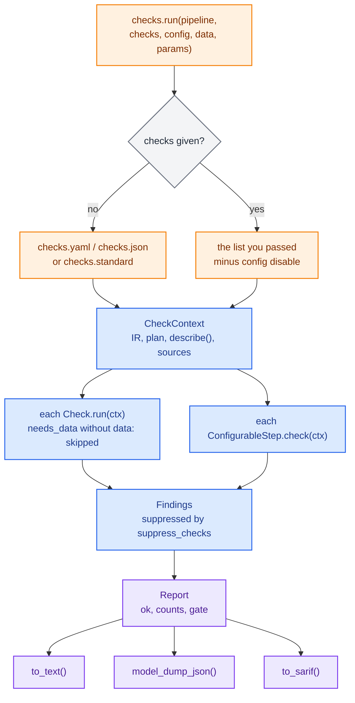
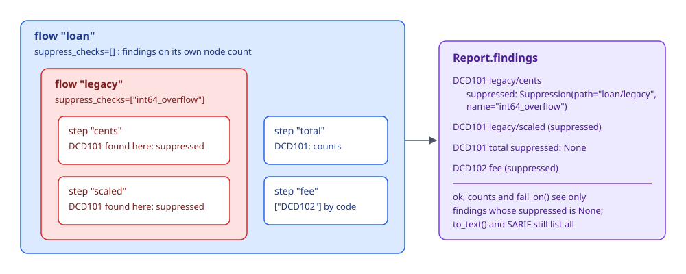

# Checks

Checks read a pipeline and report what is risky about it before it ships: a division by an input that may be zero, a `round()` that gives different answers in Python and in a compiled kernel, a step that reads the clock, a param without bounds, a step without a durable id. Each finding has a stable code (`DCD104`), names the step it is about, points at the file and line where it can, and says in one line what to do instead.

`decider` only reports. Whether a warning blocks a release is your policy, set in `checks.yaml` or on the command line, and enforced by the exit status of `decider check`.

```python
from decider import flow, param
from decider.lab import checks

def ratio(income: float, debt: float) -> float:
    return debt / income

def approved(ratio: float, limit: float = param(0.4)) -> bool:
    return ratio <= limit

report = checks.run(flow(ratio, approved, name="credit"))
print(report.to_text())
```

`checks.run(pipeline)` runs the standard set (every check that needs neither data nor execution) and returns a `Report`. The same report comes out of `decider check` on the command line, the MCP `check_report` tool and the VS Code extension.



## A first report

The loan pipeline below has the problems checks are built to find. `fee` rounds a float with `round()` and returns it into a `Currency` output, `ratio` divides by `income` unguarded, and no param has bounds.

```python
# loanchk/pipeline.py
from decider import flow, param, step
from decider.ops.decimal import Currency


def ratio(income: float, debt: float) -> float:
    return debt / income


def approved(ratio: float, limit: float = param(0.4)) -> bool:
    return ratio <= limit


@step(output="fee")
def fee(amount: float, rate: float = param(0.0175)) -> Currency:
    return round(amount * rate, 2)


def build():
    return flow(ratio, approved, fee, name="loan")
```

```python
from decider.lab import checks
from loanchk.pipeline import build

report = checks.run(build())
print(report.to_text())
print(report.ok, report.counts)
```

```text
loanchk/pipeline.py:17: warning DCD102 float_money: loan/fee: returns float round(amount * rate, 2) into a Decimal output
    fix: return a Decimal: multiply a Decimal by the float, or build one with Currency(major, minor)
loanchk/pipeline.py:17: error DCD103 bare_round: loan/fee: round(amount * rate, 2) rounds differently in Python and compiled modes on .xx5
    fix: use decider.ops.decimal.round(x, n, Rounding.HALF_UP)
loanchk/pipeline.py:8: warning DCD104 division_by_variable: loan/ratio: debt / income divides by income, which may be zero
    fix: guard it (`if b != 0`), use max(b, eps), or bound the param with gt=0
loanchk/pipeline.py:12: info DCD108 nan_propagation: loan/approved: ratio is compared without a NaN guard; a NaN takes the false side silently
    fix: check math.isnan, or fill the null upstream
info DCD301 param_unconstrained: param 'limit' of loan/approved has no bounds
    fix: add `ge=`/`le=` so a bad params document is refused
info DCD301 param_unconstrained: param 'rate' of loan/fee has no bounds
    fix: add `ge=`/`le=` so a bad params document is refused
warning DCD401 durable_ids: flow 'loan' has no committed durable id
    fix: run `decider ids`
warning DCD401 durable_ids: loan/ratio has no committed durable id
    fix: run `decider ids`
warning DCD401 durable_ids: loan/approved has no committed durable id
    fix: run `decider ids`
warning DCD401 durable_ids: loan/fee has no committed durable id
    fix: run `decider ids`
loan: 3 info, 6 warning, 1 error
False {<Severity.INFO: 'info'>: 3, <Severity.WARNING: 'warning'>: 6, <Severity.ERROR: 'error'>: 1}
```

File paths in the report are absolute; they are shortened here. `bare_round` is a warning on a float output and an error on a `Decimal` one, which is why it is the one error above.

The fixed version guards the division, bounds both params and rounds with `decider.ops.decimal.round`:

```python
from decider import flow, param, step
from decider.ops import decimal
from decider.ops.decimal import Currency, Rounding


def ratio(income: float, debt: float) -> float:
    return debt / income if income > 0 else 1.0


def approved(ratio: float, limit: float = param(0.4, ge=0.0, le=1.0)) -> bool:
    return ratio <= limit


@step(output="fee", suppress_checks=["float_money"])
def fee(amount: float, rate: float = param(0.0175, ge=0.0, le=0.1)) -> Currency:
    return decimal.round(amount * rate, 2, mode=Rounding.HALF_UP)


def build():
    return flow(ratio, approved, fee, name="loan")
```

`float_money` still sees a float flowing into a `Currency` output. Here that is deliberate (the rounding happens on purpose before the value becomes a `Currency`), so `fee` suppresses it. Suppressions are covered [below](#suppressing-a-finding).

## The report

| Member | What it is |
|---|---|
| `findings` | a tuple of `Finding`, in the order checks produced them |
| `skipped` | `SkippedCheck(check, code, reason)` for checks that could not run (no data, z3 not installed) |
| `ok` | `True` when no unsuppressed finding is an `error` |
| `counts` | `{Severity: n}` over unsuppressed findings |
| `gate` | the severity `fail_on()` uses by default: the project's `fail_on`, else `error` |
| `fail_on(severity=None)` | `True` when an unsuppressed finding is at least `severity` |
| `to_text()` | one line per finding plus its `fix`, then skipped checks and a summary line |
| `model_dump_json()` | the JSON form, `ok` and `counts` included; `Report.model_validate_json` reads it back |
| `to_sarif()` | SARIF 2.1.0 as a dict, for GitHub code scanning |

A `Finding` carries:

| Field | Example | Meaning |
|---|---|---|
| `code` | `"DCD104"` | stable, never reused; what CI pins and suppressions name |
| `check` | `"division_by_variable"` | the check's alias |
| `severity` | `Severity.WARNING` | `info`, `warning` or `error` |
| `message` | `"loan/ratio: debt / income divides by income, which may be zero"` | one sentence |
| `step` | a `StepRef` | the node, with `path`, `source`, `step_id` and `flow_id`; joins with `describe()` |
| `file`, `line` | `"loanchk/pipeline.py"`, `8` | where to look, when the source is available |
| `fix` | `"guard it ..."` | one line saying what to do instead |
| `detail` | `{}` | machine-readable specifics a check chose to add |
| `suppressed` | `Suppression(path, name)` or `None` | which step's `suppress_checks` silenced it |

`Severity` is an enum with a `rank`, so `f.severity.rank >= Severity.WARNING.rank` compares severities.

## The built-in checks

Codes are grouped by family in their third digit: `DCD0xx` determinism, `DCD1xx` numeric, `DCD2xx` structure, `DCD3xx` params, `DCD4xx` ids, `DCD5xx` runtime. `checks.standard` is every check in the first five families except `table_overlap` and `table_gap`, which `unreachable_branch` reports itself. The runtime family is opt-in: name its checks in a list or in `checks.yaml`.

`decider check --list` prints the catalogue, and `checks.catalogue()` returns it as dicts with each check's config schema.

### Determinism

| Code | Alias | Default | Finds |
|---|---|---|---|
| DCD001 | `wall_clock` | warning | reads of the clock or randomness (`time.time()`, `datetime.now()`, `date.today()`, `random.random()`) inside a step |
| DCD002 | `impure` | warning | `global` and `nonlocal` writes, and mutable default arguments; served steps share one executable across threads, so shared state is a race |
| DCD003 | `mutates_input` | warning | a step changing an argument in place (`.append`, `x[k] = ...`, `inplace=True`) |

### Numeric

| Code | Alias | Default | Finds |
|---|---|---|---|
| DCD101 | `int64_overflow` | warning | integer `*`, `**`, `<<` and running `+=` in a loop, which wrap silently past int64; an error when a `Decimal` is involved |
| DCD102 | `float_money` | warning | a float returned into a `Decimal` output, and `int(x * 100)` truncation |
| DCD103 | `bare_round` | warning | `round(x, n)` and `np.round`, which differ between CPython and numba on `.xx5` ties; an error on a `Decimal` output |
| DCD104 | `division_by_variable` | warning | `/`, `//` or `%` by a value nothing proves non-zero: no guard, no `max(b, eps)`, no `gt=0` param |
| DCD105 | `int_true_division` | info | true division of two ints, which becomes a float and loses precision above 2**53 |
| DCD106 | `pow_exp_overflow` | warning | `**`, `exp` and `pow` with a non-constant exponent, which overflow to inf or underflow to 0 |
| DCD107 | `float_equality` | warning | `==` or `!=` against a float constant or between two floats |
| DCD108 | `nan_propagation` | info | a float input compared without a NaN guard (NaN compares false), and `sqrt` or `log` of a value that may be out of domain |
| DCD109 | `accumulator_dtype` | warning | a loop carry that grows by `+` or `*` in int64, or any carry or accumulator in float32 |
| DCD110 | `unsafe_cast` | warning | `float(decimal)` past 2**53 of its int64, and narrowing casts such as `np.int32` |

### Structure

| Code | Alias | Default | Finds |
|---|---|---|---|
| DCD201 | `unreachable_branch` | warning | a branch arm that can never run: a constant condition, a condition returning an index with no arm, a tree branch or table row no input reaches |
| DCD202 | `dead_output` | info | a value written inside a branch, loop or `each` that nothing reads and that never leaves it |
| DCD203 | `shadowed_write` | warning | a value overwritten by a later step before anything reads it |
| DCD204 | `unused_input` | info | a step argument the body never uses |
| DCD205 | `unbounded_loop` | warning | a loop with a huge `max_iterations`, or a condition that reads none of the carried names |
| DCD206 | `opaque_frame_step` | info | a frame step with unknown lineage; it blocks lineage checks and fusion, and `score()` cannot run it |
| DCD207 | `table_overlap` | info | two decision-table rows that can both match one input (the earlier wins); reported by `unreachable_branch` |
| DCD208 | `table_gap` | info | an input no decision-table row matches, so it takes `default`; reported by `unreachable_branch` |

`unreachable_branch` solves trees and decision tables with z3 (`pip install 'decider[prove]'`). Without z3 that part of the check is listed in `report.skipped` and the rest still runs.

### Params

| Code | Alias | Default | Finds |
|---|---|---|---|
| DCD301 | `param_unconstrained` | info | a numeric `param()` with no bounds; a `Percent` without `ge=0, le=1` is a warning |
| DCD302 | `param_default_out_of_bounds` | warning | a default that breaks its own bounds, or `on_invalid="default"`, which silently swaps bad values for the default |
| DCD303 | `param_unused` | warning | a declared param the body never reads |
| DCD304 | `invalid_params_doc` | error | every problem in a params document passed as `params=`: a key that matches no step, a wrong type, an out-of-bounds value |

### Ids

| Code | Alias | Default | Finds |
|---|---|---|---|
| DCD401 | `durable_ids` | warning | flows and steps without a committed durable `id`; a branch condition or loop test carries its parent's identity and is never flagged |
| DCD402 | `duplicate_ids` | error | two steps or flows with one id, usually a copied definition |
| DCD403 | `unknown_suppression` | warning | a `suppress_checks` entry that names no check |

### Runtime (opt-in)

| Code | Alias | Default | Needs | Finds |
|---|---|---|---|---|
| DCD501 | `crash_probe` | error | executes | runs the flow over generated boundary cases (zero, negative, null, extremes) and reports crashes by case |
| DCD502 | `nan_output` | warning | data, executes | NaN or infinity in an output column |
| DCD503 | `int64_range` | warning | data | observed column ranges pushed through `+ - *` in step source, reporting results beyond int64 |
| DCD504 | `missing_required` | error | data | required inputs absent from the frame or null in it |
| DCD505 | `mode_divergence` | error | executes | interpreted, stepped and fused disagree on the generated cases (option `modes`) |
| DCD506 | `constant_output` | info | data, executes | an output column with one value on every row |

A few more examples, from a deliberately careless offer flow:

```python
from datetime import date
from decider import flow, loop, param, step
from decider.lab import checks

def decided_on(score: float) -> float:
    return float(date.today().toordinal())

@step(output="limit")
def base_limit(income: float) -> float:
    return income * 2

@step(output="limit")
def capped_limit(income: float, cap: float = param(50000.0, ge=0)) -> float:
    return min(income * 3, cap)

def fee(limit: float, channel: str, rate: float = param(0.01, ge=0, le=1), minimum: float = param(5.0, ge=0)) -> float:
    return limit * rate

def still_owing(balance: float) -> bool:
    return balance > 0

@step(output="balance")
def pay(balance: float, instalment: float) -> float:
    return balance - instalment

pipeline = flow(decided_on, base_limit, capped_limit, fee,
                loop(still_owing, flow(pay, name="month"), carries=["balance"], max_iterations=10_000_000, name="repay"),
                name="offer")
report = checks.run(pipeline, [c for c in checks.standard if c != "durable_ids"])
print(report.to_text())
```

```text
c4.py:9: warning DCD001 wall_clock: offer/decided_on reads date.today(); a wall-clock read makes the flow non-deterministic
    fix: pass the value in as an input column
c4.py:23: info DCD108 nan_propagation: offer/repay/still_owing: balance is compared without a NaN guard; a NaN takes the false side silently
    fix: check math.isnan, or fill the null upstream
warning DCD303 param_unused: param 'minimum' of offer/fee is declared but never read
    fix: remove it, or use it
warning DCD203 shadowed_write: offer/base_limit writes 'limit', but offer/capped_limit overwrites it before anything reads it
    fix: read the first value in between, rename one of the two, or drop the first write
c4.py:19: info DCD204 unused_input: offer/fee: argument 'channel' is never used
    fix: remove the argument; if it only orders this step after its producer, keep it and suppress this check
warning DCD205 unbounded_loop: offer/repay: max_iterations is 10000000, so one row may run this long
    fix: set it to the most iterations a row can legitimately need
offer: 2 info, 4 warning, 0 error
```

`checks.standard` is a tuple of aliases, so ordinary tuple operations pick from it.

## Choosing which checks run

The second argument of `checks.run` is a flat list. Each entry is an alias (`"durable_ids"`), a `Check` instance (`NoFloatMoney(allow=["fee"])`), a config dict (`{"type": "durable_ids", "severity": "error"}`), or a set such as `checks.standard`. Sets nest, so `[checks.standard, "crash_probe"]` adds one check to the standard set. Codes work in `suppress_checks` and `disable` but not here: `"DCD401"` in the list raises `RegistryError: 'DCD401' is not a registered Check type`.

### Checks that need data or params

A check with `needs_data` runs only when `data=` is given; otherwise it is listed in `report.skipped`. `invalid_params_doc` reads `params=`.

```python
import polars as pl
from decider.lab import checks
from loanchk.pipeline import build

frame = pl.DataFrame({"income": [1000.0, None], "amount": [5000.0, 200.0]})
report = checks.run(build(), ["missing_required", "nan_output", "constant_output", "int64_range"], data=frame)
print(report.to_text())
print(checks.run(build(), ["missing_required"]).skipped)

bad = {"loan": {"aproved": {"limit": 0.3}, "fee": {"rate": 2.0}}}
print(checks.run(build(), ["invalid_params_doc"], params=bad).to_text())
```

```text
error DCD504 missing_required: required input column 'income' has 1 null row(s) and no default to fill them
    fix: fill the nulls, or declare a default with `missing_as`
error DCD504 missing_required: required input column 'debt' is not in the data and has no default
    fix: add the column, or give the parameter a default
loan: 0 info, 0 warning, 2 error
(SkippedCheck(check='missing_required', code='DCD504', reason='needs data=; none was given'),)
error DCD304 invalid_params_doc: params document: no step with params at 'loan/aproved'. Did you mean 'loan/approved'? The document nests params by step path; steps with params: loan/approved (limit); loan/fee (rate). pipeline.parameters().defaults() builds a complete document.
    fix: use a step path and values from `pipeline.parameters().defaults()`
loan: 0 info, 0 warning, 1 error
```

The data run reports only `missing_required` here: when required inputs are missing the flow cannot run, so `nan_output` and `constant_output` stay quiet rather than report on a crash. A misspelt step path in a params document is reported on its own; fix it and the value errors (`rate` above its `le=0.1`) appear on the next run:

```text
error DCD304 invalid_params_doc: loan/approved: param 'limit': Input should be a valid number, unable to parse string as a number (got 'x')
error DCD304 invalid_params_doc: loan/fee: param 'rate': Input should be less than or equal to 0.1 (got 2.0)
```

### Checks that execute the flow

`crash_probe` and `mode_divergence` build their own inputs with `decider.lab.testing.corpus` and run the flow, in every mode for `mode_divergence`, so they compile kernels and take seconds rather than milliseconds. `nan_output` and `constant_output` run it once, interpreted, over your data.

```python
import polars as pl
from decider import flow, param
from decider.lab import checks

def ratio(income: float, debt: float) -> float:
    return debt / income

def approved(ratio: float, limit: float = param(0.4, ge=0, le=1)) -> bool:
    return ratio <= limit

pipeline = flow(ratio, approved, name="credit")
print(checks.run(pipeline, ["crash_probe", "mode_divergence"]).to_text())

frame = pl.DataFrame({"income": [1000.0, float("nan"), 500.0], "debt": [350.0, 10.0, 100.0]})
print(checks.run(pipeline.emit("ratio"), ["nan_output", "constant_output"], data=frame).to_text())
```

```text
error DCD501 crash_probe: case 'boundary': ZeroDivisionError: division by zero
    fix: guard the input the case moves, or declare it required
error DCD501 crash_probe: case 'chunked': ZeroDivisionError: division by zero
    fix: guard the input the case moves, or declare it required
credit: 0 info, 0 warning, 2 error
warning DCD502 nan_output: output 'ratio' has 1 NaN and 0 infinite row(s) on this data
    fix: guard the division, log or sqrt that produces it, or fill the input that feeds it
credit: 0 info, 1 warning, 0 error
```

`crash_probe` names the corpus frame that crashed (`boundary`, `chunked`), not the row; run `corpus(pipeline)["boundary"]` through a [debug session](debugging-and-testing.md) to find it. `mode_divergence` reported nothing because the modes agree wherever the flow does not crash.

!!! warning "A crashing run silences the data checks"
    `nan_output` and `constant_output` run the flow once over `data`. If that run raises (here, `income=0.0` and `debt=0.0` would raise `ZeroDivisionError` in Python), both checks report nothing and no finding says the run failed. Pair them with `crash_probe`, or run the flow over the data yourself first.

## Suppressing a finding

A finding you have looked at and accepted is suppressed where it occurs. `suppress_checks` takes aliases or codes, on `@step` and on every composite (`flow`, `dag`, `branch`, `loop`, `each`, `optimise`), as `suppress_checks:` in a [flow file](flow-files.md), and as a field on any `ConfigurableStep` document. A suppression on a composite covers every step inside it.

```python
from decider import flow, step
from decider.lab import checks
from decider.ops.decimal import Currency

@step(output="cents")
def cents(units: int) -> int:
    return units * 1000

@step(output="scaled")
def scaled(cents: int) -> int:
    return cents * 100

@step(output="total")
def total(scaled: int, count: int) -> int:
    return scaled * count

@step(output="fee", suppress_checks=["DCD102"])
def fee(total: int, rate: float) -> Currency:
    return total * rate

pipeline = flow(flow(cents, scaled, name="legacy", suppress_checks=["int64_overflow"]), total, fee, name="loan")
report = checks.run(pipeline, ["int64_overflow", "float_money", "unknown_suppression"])
print(report.to_text())
```

```text
c5.py:7: warning DCD101 int64_overflow: loan/legacy/cents: units * 1000 is a product in int64, which wraps silently (suppressed by int64_overflow on loan/legacy)
    fix: bound the operands, or compute in float64 (exact to 2**53)
c5.py:11: warning DCD101 int64_overflow: loan/legacy/scaled: cents * 100 is a product in int64, which wraps silently (suppressed by int64_overflow on loan/legacy)
    fix: bound the operands, or compute in float64 (exact to 2**53)
c5.py:15: warning DCD101 int64_overflow: loan/total: scaled * count is a product in int64, which wraps silently
    fix: bound the operands, or compute in float64 (exact to 2**53)
c5.py:19: warning DCD102 float_money: loan/fee: returns float total * rate into a Decimal output (suppressed by DCD102 on loan/fee)
    fix: return a Decimal: multiply a Decimal by the float, or build one with Currency(major, minor)
loan: 0 info, 1 warning, 0 error, 3 suppressed
```

<div class="diagram" markdown>


*Suppressed findings stay in the report, marked; only `ok`, `counts` and `fail_on` ignore them.*
</div>

A suppressed finding is never dropped. It stays in `findings` with `suppressed=Suppression(path=..., name=...)`, shows in the text report as `(suppressed by ...)`, and becomes an in-source suppression in SARIF, so a reviewer can see what was waved through and where. A name that matches no check is itself a finding:

```text
warning DCD403 unknown_suppression: t/cents suppresses 'int_overflow', which names no check. Did you mean 'int64_overflow'?
    fix: fix the name or remove it
```

To turn a check off for the whole project, use `disable` in `checks.yaml` instead.

## The project policy: `checks.yaml`

`checks.yaml` (or `checks.json`, or `checks.yml`) beside `configs/` is the project's check policy. `checks.run(pipeline)` with no list and `decider check` both read it.

```yaml
extends: standard
checks:
  - {type: durable_ids, severity: error}
  - {type: "acme_checks:NoFloatMoney", allow: [fee]}
disable: [nan_propagation]
fail_on: error
```

| Key | Default | Meaning |
|---|---|---|
| `extends` | `standard` | start from `checks.standard`; set `null` to start from nothing |
| `checks` | `[]` | entries to add; an entry of a type already in `standard` replaces it, so `{type: durable_ids, severity: error}` promotes that check |
| `disable` | `[]` | aliases or codes to drop, from the list and from the findings |
| `fail_on` | `error` | the default gate for `report.fail_on()` and the exit status of `decider check` |

Entries name a check by alias, or by `"module:Class"` for a check that is not registered under an alias. Two entries of one type with different options both run. The file is validated strictly: an unknown key or a bad severity is a `DeciderError` that names the file.

With that file in place, the fixed loan pipeline reports only the promoted id findings and the suppressed `float_money`:

```text
loanchk/pipeline.py:16: warning DCD102 float_money: loan/fee: returns float decimal.round(amount * rate, 2, mode=Rounding.HALF_UP) into a Decimal output (suppressed by float_money on loan/fee)
    fix: return a Decimal: multiply a Decimal by the float, or build one with Currency(major, minor)
error DCD401 durable_ids: flow 'loan' has no committed durable id
    fix: run `decider ids`
error DCD401 durable_ids: loan/ratio has no committed durable id
    fix: run `decider ids`
error DCD401 durable_ids: loan/approved has no committed durable id
    fix: run `decider ids`
error DCD401 durable_ids: loan/fee has no committed durable id
    fix: run `decider ids`
loan: 0 info, 0 warning, 4 error, 1 suppressed
```

How the file and an explicit list combine:

- `checks.run(pipeline)`: the file decides what runs, with its severities.
- `checks.run(pipeline, [...])`: your list decides what runs; the file's `disable` and `fail_on` still apply, its `checks` entries and severities do not.
- `checks.run(pipeline, config="ci/checks.yaml")`: another file in place of the project's.

The file is found through the `checks_path` setting, `${PROJECT_ROOT}/checks.yaml` by default, where the project root is the nearest ancestor of the working directory holding `configs/`. `DECIDER_CHECKS_PATH` points elsewhere.

`durable_ids` tells you to run [`decider ids`](cli-and-mcp.md), which writes ids into `@step(...)` decorators, `step(...)` calls and named composites. A plain undecorated function and a `ConfigurableStep` document get no id from it: decorate the function with `@step`, and add an `"id"` key to the document by hand, or the finding stays.

## `decider check`

```bash
decider check loanchk.pipeline:build
```

`ENTRY` is `module:attribute`, a pipeline or a zero-argument function that builds one, importable from the working directory. The command prints the report and exits 1 when the gate fails, 0 otherwise.

| Option | Effect |
|---|---|
| `--config FILE` | a checks file other than the project's |
| `--data X` | a data file, or a dataset name when no such file exists; enables the data checks |
| `--format text\|json\|sarif` | `text` (default), the report's JSON, or SARIF 2.1.0 |
| `--fail-on error\|warning\|info` | the gate for this run; default is the config's `fail_on`, else `error` |
| `--select PREFIX` | keep only findings (and skipped checks) whose code starts with `PREFIX`, e.g. `DCD1` |
| `--list` | print the catalogue and exit |

`--select` filters before the gate, so `--select DCD1 --fail-on warning` exits 0 when the only numeric finding is suppressed even though there are id errors:

```text
$ decider check loanchk.pipeline:build --select DCD1 --fail-on warning
loanchk/pipeline.py:16: warning DCD102 float_money: loan/fee: returns float decimal.round(amount * rate, 2, mode=Rounding.HALF_UP) into a Decimal output (suppressed by float_money on loan/fee)
    fix: return a Decimal: multiply a Decimal by the float, or build one with Currency(major, minor)
loan: 0 info, 0 warning, 0 error, 1 suppressed
```

### SARIF for code scanning

`--format sarif` writes SARIF 2.1.0. Each finding becomes a result with its code as `ruleId`, its severity as the level (`info` is `note`), its file and line as the location, and a `partialFingerprints["decider/v1"]` of `flow_id/step_id/code` (path and name when there are no ids). Suppressed findings carry an `inSource` suppression.

```json
{
  "ruleId": "DCD102",
  "level": "warning",
  "message": {"text": "loan/fee: returns float decimal.round(amount * rate, 2, mode=Rounding.HALF_UP) into a Decimal output"},
  "partialFingerprints": {"decider/v1": "loan/loan/fee/DCD102"},
  "locations": [{"physicalLocation": {"artifactLocation": {"uri": ".../loanchk/pipeline.py"}, "region": {"startLine": 16}}}],
  "suppressions": [{"kind": "inSource", "justification": "float_money on loan/fee"}]
}
```

A CI job that uploads it to GitHub:

```yaml
- run: decider check credit.pipeline:build --format sarif > checks.sarif
- uses: github/codeql-action/upload-sarif@v3
  if: always()
  with:
    sarif_file: checks.sarif
```

With durable ids committed, the fingerprint survives renaming and moving a step, so code scanning keeps a finding's history.

### Errors from the command

| You see | Cause |
|---|---|
| `Error: Missing argument 'ENTRY' (or pass --list).` | no entry was given |
| a Python traceback ending in `AttributeError: module 'loanchk.pipeline' has no attribute 'nope'` | the entry's attribute does not exist; check the spelling after the colon |
| `Error: .../checks.yaml: invalid checks config: ...` | the policy file failed validation |

## Writing your own check

A check is a `Check` subclass with a `type` alias, a `code` and a `run(ctx)` generator that yields findings built with `ctx.finding`. Give your codes your own prefix (`ACME001`), never `DCD`.

```python
# acme_checks.py
import typing as t

from decider.lab import checks
from decider.lab.checks import Check


class NoFloatMoney(Check):
    """Money-named outputs held as float."""

    type: t.Literal["no_float_money"] = "no_float_money"
    code = "ACME001"
    allow: list[str] = []

    def run(self, ctx):
        for node in ctx.calls():
            for out in node.outputs or ():
                if out.name in self.allow or out.annotation is not float:
                    continue
                if any(word in out.name for word in ("fee", "amount", "price")):
                    yield ctx.finding(node, f"{out.name} is held as a float", fix="annotate it Currency")


@checks.check(code="ACME002", severity="info")
def single_step(ctx):
    if len(ctx.calls()) == 1:
        yield ctx.finding(ctx.ir, "a one-step flow")
```

```python
from decider import flow, param
from decider.lab import checks
from acme_checks import NoFloatMoney, single_step

def admin_fee(amount: float, rate: float = param(0.01, ge=0, le=1)) -> float:
    return amount * rate

print(checks.run(flow(admin_fee, name="fees"), [NoFloatMoney(), single_step]).to_text())
```

```text
warning ACME001 no_float_money: admin_fee is held as a float
    fix: annotate it Currency
info ACME002 single_step: a one-step flow
fees: 1 info, 1 warning, 0 error
```

Fields declared on the class (`allow` here) become options, set in Python (`NoFloatMoney(allow=["fee"], severity="error")`) or in `checks.yaml`. Every check has a `severity` option. Two class variables change how it runs: `needs_data = True` skips it unless `data=` is given, and `executes = True` marks it as running the flow, for the catalogue.

`@checks.check(code=..., severity=..., alias=None)` turns a function into a check instance for a one-off rule; the alias defaults to the function name.

The `CheckContext` a check receives:

| Member | What it gives |
|---|---|
| `ctx.pipeline` | the step passed to `checks.run` |
| `ctx.ir`, `ctx.nodes` | its IR root and every IR node in order |
| `ctx.plan` | the resolved wiring plan |
| `ctx.description` | `describe(pipeline)` |
| `ctx.steps` | the step object behind each path |
| `ctx.calls()` | call nodes of your own code (decider's generated kernels are skipped) |
| `ctx.source(node)` | the parsed source of a call's function, or `None` |
| `ctx.frame`, `ctx.params` | what was passed as `data=` and `params=` |
| `ctx.outputs` | the output frame of running the flow over `data`, and the node producing each column; `None` if it crashed |
| `ctx.finding(node, message, fix=None, *, line=None, code=None, check=None, severity=None, **detail)` | a `Finding` with step, file and suppression filled in |

For a check to load from `checks.yaml` by alias without an import path, ship it in a package under the `decider.checks` entry-point group. [Extending decider](extending.md) covers registries and entry points.

### Checks on a step's own document

AST checks read Python source, so they cannot see inside a tree or a table document. A `ConfigurableStep` subclass reports on its own document by overriding `check(self, ctx)`; `checks.run` calls it for every such step in the pipeline, whatever list of checks you passed. Pass `code=` and `check=` to `ctx.finding`, since no `Check` is running:

```python
def check(self, ctx):
    if self.low > self.high:
        yield ctx.finding(ctx.node, "low is above high", code="ACME010", check="empty_range")
```

## Where checks show up

- [Experiments](experiments.md) run `missing_required` and `invalid_params_doc` on the first batch before anything executes, and keep the report as `result.preflight`.
- The MCP server's `check_report` and `checks_list` tools return the same report and catalogue ([CLI and MCP](cli-and-mcp.md)).
- [Comparing versions](diff-and-equivalence.md) and checks share the z3 encoding of trees and tables.
- The architecture of the checks module is in [Lab: checks](../architecture/lab/checks.md).
