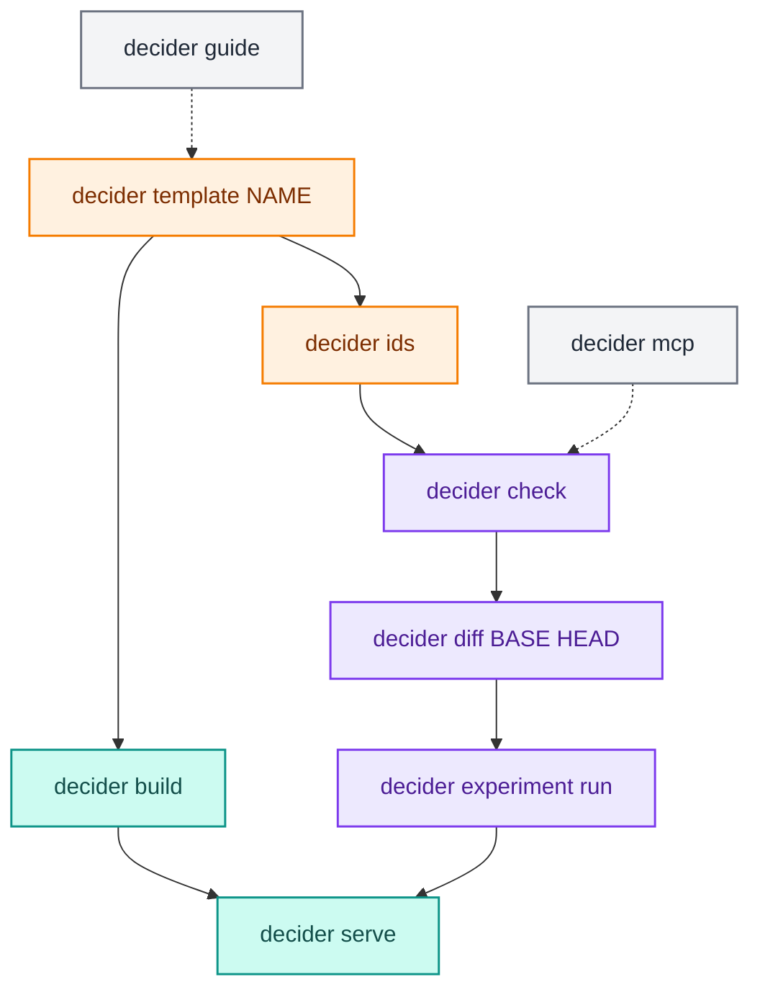

# CLI and MCP

`decider` has two command surfaces over the same library. The `decider` command is for people and CI: start a project, build it, serve it, check it, compare revisions, run experiments, add durable ids. `decider mcp` is for agents: a Model Context Protocol server whose tools describe flows, trace lineage, summarise runs and, after the user confirms, run things. Neither holds logic of its own; each command calls one library function, so everything here can also be done from Python.



## Settings

Commands take few flags. Settings come from `DECIDER_*` environment variables, or from a `.env` file in the current directory, which fills in whatever the real environment does not set. Nested settings use a double underscore: `DECIDER_API__PIPELINE=credit_risk.pipeline:build`, `DECIDER_CONFIG__BASEPATH=configs`, `DECIDER_SERVE__PORT=8080`. `decider --help` lists every command; there are no others.

```text
$ decider --help
Usage: decider [OPTIONS] COMMAND [ARGS]...

  decider: build and serve decision pipelines.

  New here? Run `decider guide` for the getting-started guide, then `decider
  template NAME` for a starter project.

  Settings come from DECIDER_* environment variables, or a .env file in the
  current directory, e.g. DECIDER_API__PIPELINE=mypkg.pipeline:build,
  DECIDER_CONFIG__BASEPATH=configs.

Options:
  --help  Show this message and exit.

Commands:
  build       Stage config VERSION (default: the latest) exactly as...
  check       Run the checks over the pipeline ENTRY (module:factory);...
  diff        Compare the pipeline ENTRY (module:factory) at git...
  experiment  Run experiments.
  guide       Print the getting-started guide: concepts, examples,...
  ids         Add durable `id=` tokens to every step and named flow...
  mcp         Serve the FastMCP server over stdio for an MCP host (e.g.
  serve       Serve the latest config version: POST /invocations, GET /ping.
  template    Write a starter project called NAME into DIRECTORY...
```

`python -m decider` runs the same commands.

## `decider guide`

Prints the getting-started guide that ships inside the installed package (`decider/GUIDE.md`): the mental model, a construct-per-need table, examples for every feature and the common mistakes. It matches the installed version, so it is the first thing to read, and the first thing to hand an agent.

```text
$ decider guide | head -3
# decider: getting started

Don't read the repo's `docs/` folder: it describes an older version. This guide
```

## `decider template NAME [DIRECTORY]`

Writes a starter project into `DIRECTORY` (default `./NAME`). The project directory is itself the package, so `import NAME` resolves to it. `NAME` is turned into a package name (non-word characters become `_`); a name that still is not a Python identifier, or a target directory that exists and is not empty, is refused.

```text
$ decider template credit_risk
created credit_risk/README.md
created credit_risk/__init__.py
created credit_risk/configs/0.0.0/params.json
created credit_risk/conftest.py
created credit_risk/.env
created credit_risk/inference.py
created credit_risk/pipeline.py
created credit_risk/sample_request.json
created credit_risk/tests/test_pipeline.py

$ cat credit_risk/.env
DECIDER_API__PIPELINE=credit_risk.pipeline:build
DECIDER_API__HANDLER=credit_risk.inference:Handler
DECIDER_CONFIG__BASEPATH=configs
```

`pipeline.py` holds the steps and a `build()` function; `inference.py` the request `Handler`; `configs/0.0.0/params.json` the first params version; `sample_request.json` one request the tests and `build` use. [Projects and serving](projects-and-serving.md) walks through each file.

## `decider build [VERSION]`

Stages a config version exactly as `serve` would, then stops. It imports the pipeline, loads the version's documents, validates its params document, and runs `sample_request.json` through every kernel, which fills numba's disk cache so that `serve` starts without compiling. It also records the CPU the cache was built for. `VERSION` defaults to the latest.

```text
$ cd credit_risk && decider build
built config version 0.0.0 (pipeline credit_risk.pipeline:build, mode fused)
```

A version that fails is reported with its error: `Error: config version 9.9.9 failed to build: <ErrorType>: <message>`. Run `build` in CI and in the image build, on the same CPU type you serve on.

## `decider serve`

Serves the latest config version over HTTP: `POST /invocations` scores a request, `GET /ping` answers once the version is staged and active. Each worker imports the pipeline and handler from `DECIDER_API__CODE_PATH` (default: the current directory).

| Option | Default |
|---|---|
| `--host` | `DECIDER_SERVE__HOST` or `0.0.0.0` |
| `--port` | `DECIDER_SERVE__PORT` or `8080` |
| `--workers` | `DECIDER_SERVE__WORKERS` or 2 × CPUs + 1 |
| `--mode interpreted\|stepped\|fused` | `DECIDER_API__MODE` or `fused` |
| `--server starlette\|sanic` | `DECIDER_SERVE__SERVER` or `starlette` |

```text
$ decider serve --workers 1 --port 18931 &
INFO:     Started server process [4015272]
decider: pipeline credit_risk.pipeline:build from .../credit_risk/pipeline.py
decider: handler credit_risk.inference:Handler from .../credit_risk/inference.py
INFO:     Application startup complete.
INFO:     Uvicorn running on http://0.0.0.0:18931 (Press CTRL+C to quit)

$ curl -s -i localhost:18931/ping | head -1
HTTP/1.1 200 OK
$ curl -s -d @sample_request.json -H 'content-type: application/json' localhost:18931/invocations
{"income":1000.0,"debt":250.0,"applied_on":"2026-01-15","approved":true}
```

Starlette needs `pip install 'decider[serve-starlette]'` (uvicorn) and sanic `decider[serve-sanic]`; without them `serve` says which extra to install. If `decider build` recorded a different CPU, `serve` warns that numba's cache will miss and every worker will compile at startup. The serving stack is covered in [Projects and serving](projects-and-serving.md) and [Serving](../architecture/serving.md).

## `decider ids [PATH]`

Adds a durable `id="0123abcdef45"` to every `@step(...)` decorator, `step(...)` and `frame_step(...)` call, and named `flow`, `dag`, `branch`, `loop`, `each` and `optimise` under `PATH` (default `.`) that lacks one. It changes no other byte: it finds declarations with Python's `ast` and splices the keyword in, so comments and formatting survive.

| Option | Effect |
|---|---|
| `--check` | report what would change and write nothing |
| `--fix` | when two declarations share an id, give the later copies fresh ids instead of aborting |

```text
$ decider ids lending --check
would add 1 id(s) in 1 file(s)
  lending/pipeline.py:33  lending  ->  id=78c90554161d

$ decider ids lending
added 5 id(s) in 1 file(s)
  lending/pipeline.py:5  disposable_income  ->  id=61960951899c
  lending/pipeline.py:10  instalment_ratio  ->  id=f18ff80f85b3
  lending/pipeline.py:26  approved  ->  id=647f40f5714d
  lending/pipeline.py:31  credit_limit  ->  id=d05fad52d9f8
  lending/pipeline.py:37  lending  ->  id=f58544a1f4bb
```

(The `--check` run was on a version whose steps were plain functions without `@step`, which get no id; see below.)

It is a deliberate source edit, so it guards itself:

- It refuses to run unless the git working tree is clean, so its change is one reviewable diff:

  ```text
  Error: working tree is not clean; refusing to rewrite source:
     M lending/pipeline.py

  remediation: commit or stash these changes first (untracked files: `git add` then commit), then re-run
  ```

- It parses every file before writing any, and aborts on a syntax error, a malformed id (ids are 12 lowercase hex digits) or a duplicate id, naming the file and line.
- Running it twice changes nothing the second time.

It only edits those Python calls. A plain function passed to `flow` without `@step` gets no id; add the decorator. A tree, table or scorecard document needs an `"id"` key next to its `"name"`, added by hand. There is no Python API for the generator. [Decision tracing](tracing.md) explains what ids are for.

## `decider check [ENTRY]`

Runs the checks over the pipeline `ENTRY` (`module:attr`, a pipeline or a zero-argument function that builds one) with the project's `checks.yaml` policy, prints a report and exits 1 when the gate fails.

```text
$ decider check --help
Usage: decider check [OPTIONS] [ENTRY]

  Run the checks over the pipeline ENTRY (module:factory); exit 1 when the
  gate fails.

Options:
  --config FILE                   A checks file; default is the project's
                                  checks.yaml.
  --data TEXT                     A data file or a project dataset name;
                                  enables the checks that need data.
  --format [text|json|sarif]      [default: text]
  --fail-on [error|warning|info]  Exit 1 when a finding is at least this
                                  severe; default is the config's fail_on,
                                  else error.
  --select TEXT                   Keep only findings whose code starts with
                                  this prefix, e.g. DCD1.
  --list                          List the registered checks instead of
                                  running them.
```

```text
$ decider check loanchk.pipeline:build
loanchk/pipeline.py:16: warning DCD102 float_money: loan/fee: returns float decimal.round(amount * rate, 2, mode=Rounding.HALF_UP) into a Decimal output (suppressed by float_money on loan/fee)
    fix: return a Decimal: multiply a Decimal by the float, or build one with Currency(major, minor)
error DCD401 durable_ids: flow 'loan' has no committed durable id
    fix: run `decider ids`
...
loan: 0 info, 0 warning, 4 error, 1 suppressed
$ echo $?
1
```

`--list` prints the catalogue (`DCD001  wall_clock  determinism  warning`, one per line, with `[needs_data]` and `[executes]` flags), and `--format sarif` writes SARIF for code scanning. A wrong entry currently surfaces as a Python traceback (`AttributeError: module 'loanchk.pipeline' has no attribute 'nope'`) rather than a one-line error. Everything about checks, including `checks.yaml`, is in [Checks](checks.md).

## `decider diff BASE HEAD ENTRY`

Compares the pipeline `ENTRY` at two git revisions, each loaded in its own process from a temporary worktree. Without `--data` it compares structure; with `--data` it also runs both revisions over the data and reports which rows and columns change.

| Option | Effect |
|---|---|
| `--data X` | a data file, or a dataset name when no such file exists |
| `--key COLUMN` | a column that labels rows in the samples |
| `--format text\|json` | `text` (default) or `{"structure": ..., "outputs": ...}` |

```text
$ decider diff v1 v2 lending.pipeline:build --data applications --key application_id
structure: differs
  changed lending/risk_band: code, consts
  changed lending/approved: params
  changed lending/credit_limit: code, inputs
  param lending/approved.max_ratio default: 0.35 -> 0.4
outputs: 567 of 2000 rows changed
  credit_limit: 567 changed, max abs 31154.339999999997
  approved: 69 changed
$ echo $?
1
```

The exit status is 1 when something differs. With `--data` that means a changed row or column; without it, a structure that is not identical, which a pipeline containing a tree or table currently always reports. [Comparing versions](diff-and-equivalence.md) has the details.

## `decider experiment run PATH`

Runs the experiment defined in `PATH` (an `experiment.json`) and prints each scenario's status. `--out DIR` writes each scenario's output as Parquet and the whole result as `DIR/result.json`. The exit status is 0 only when the run completed; `partial`, `non_reproducible`, `failed`, `cancelled` and `timed_out` exit 1.

```text
$ decider experiment run experiments/policy_v2/experiment.json --out results/cli
policy_v2: completed
  baseline: completed
  v1: completed
  ratio_0.45: completed
results in results/cli/result.json
```

`input.path` in the file is relative to the file; `input.dataset` names a dataset of the project holding it. See [Experiments](experiments.md).

## `decider mcp`

`decider mcp` serves a [FastMCP](https://gofastmcp.com) server over stdio for an agent's MCP host. It needs `pip install 'decider[mcp]'`. The host starts and owns the process; the VS Code extension, when running, is a peer the server can talk to, not its parent.

### Connecting an agent

Declare it as a stdio server in the host's MCP configuration, run from the project directory so the pipeline's package imports. For a host that reads an `mcpServers` map (Claude Code's `.mcp.json`, Claude Desktop, and others):

```json
{
  "mcpServers": {
    "decider": {
      "command": "uv",
      "args": ["run", "decider", "mcp"]
    }
  }
}
```

Add `"--raw"` to `args` to allow the per-record tools, or set `DECIDER_MCP_RAW=1` in the server's environment. Tell the agent to run `decider guide` (or read it with the shell) before it writes pipeline code; the guide is written for that reader.

### Tools

<div class="diagram" markdown>


*What an agent can call, and what stands between it and your data or source.*
</div>

Flows are named by import path, `module:attr`, the same `ENTRY` the CLI takes. Every step in a result carries its stable `flow_id` and `step_id`.

| Tool | Arguments | Returns |
|---|---|---|
| `discover_flows` | `root="."` | pipelines found under `root`: `{name, entry, file, line, kind}`, or `{file, error}` for a file that fails to import |
| `describe_flow` | `entry`, `subgraph=None` | the `FlowDescription` (nodes, edges, value slots), or the part under `subgraph` |
| `inspect_step` | `entry`, `path` | one node with its identity, `file`, `line`, `edges_in` and `edges_out` |
| `lineage` | `entry`, `name` | every slot, writer and reader of value `name` |
| `source_context` | `entry`, `path` | the step's file, line and about ten lines of source around it |
| `run_summary` | `entry`, `data` | runs the flow over the file `data`; row count, value counts per output, params validated |
| `check_report` | `entry`, `config=None`, `data=None` | the checks `Report` as JSON |
| `checks_list` | | the check catalogue |
| `experiment_definition` | `path` | an `experiment.json`, validated |
| `experiment_results` | `path` | a saved `result.json` |
| `raw_record` | `entry`, `data`, `record` | every step's output values for one record (raw) |
| `raw_trace` | `entry`, `data`, `record` | the [decision trace](tracing.md) events for one record (raw) |
| `run_flow` | `entry`, `data` | runs the flow; the same summary as `run_summary` plus `ran: true` (gated) |
| `run_experiment` | `definition`, `data` | runs an experiment over the file `data`; the result as JSON (gated) |
| `start_debug` | `entry`, `data` | opens a debug session paused before anything runs and returns its structure (gated) |
| `generate_ids` | `path="."`, `check=True` | `decider ids` on `path`; with `check=False` it writes source (gated) |
| `highlight` | `nodes`, `flow=None`, `workspace="."` | selects and reveals a node in the VS Code flow view (editor) |
| `reveal_source` | `path`, `line`, `workspace="."` | opens a file at a line in VS Code (editor) |
| `editor_selection` | `workspace="."` | what the user is looking at: file, selection, shown flow, selected nodes, debugger pause (editor) |
| `show_flow` | `file`, `pipeline=None`, `workspace="."` | shows a flow in the Structure view and graph; whether it described cleanly (editor) |
| `set_breakpoints` | `nodes`, `workspace="."` | makes the breakpoints exactly these flow nodes; reports those that could not take one (editor) |
| `debug_flow` | `file`, `pipeline=None`, `dataset=None`, `workspace="."` | runs a flow under the VS Code debugger and waits for the first pause (editor, gated) |
| `debug_control` | `action`, `workspace="."` | `continue`, `step_over`, `step_in`, `step_out` or `stop`; waits for the next pause (editor, gated) |
| `debug_evaluate` | `expression`, `workspace="."` | evaluates a Python expression in the paused frame (editor, gated, raw) |

The config-editing tools change tree, decision table, scorecard and params documents. Each write builds the document first and is refused, file untouched, if it would not build.

| Tool | Arguments | Returns |
|---|---|---|
| `list_configs` | `root="."` | config documents under `root`: path, kind, name, version directory |
| `read_config` | `path` | a document and its `problems` (why it would not build; empty when it does) |
| `validate_config` | `path` or `doc` | `problems` for a file or an unsaved document |
| `write_config` | `path`, `doc`, `overwrite=False` | creates a document; an existing file is replaced only with `overwrite` |
| `patch_config` | `path`, `ops`, `dry_run=False` | applies RFC 6902 JSON Patch `ops`, saved if it still builds |
| `try_config` | `path`, `rows`, `params=None` | runs the document's step on `rows` and returns the output rows |
| `tree_view` | `path`, `node=None` | a text outline of a tree plus its nodes as data |
| `tree_add_node`, `tree_set_node`, `tree_remove_node` | `path`, `parent`/`node_id`, `data` | edits a v3 tree node |
| `tree_set_output` | `path`, `values`, `index=None`, `dtypes=None` | appends or replaces a result row |
| `tree_add_rule`, `tree_remove_rule` | `path`, `rule`/`name` | edits a flat rule list |
| `table_view` | `path`, `offset=0`, `limit=200` | columns, outputs, default and rows of a decision table |
| `table_add_rows`, `table_update_rows`, `table_delete_rows` | `path`, `rows`/`updates`/`indexes` | edits table rows |
| `table_add_column`, `table_drop_column` | `path`, `name`, ... | adds or drops a column |
| `scorecard_view` | `path` | each variable's bins, the default and the params the card declares |
| `scorecard_set_bins` | `path`, `variable`, `bins` | replaces one variable's bins |
| `params_view` | `path`, `entry=None` | a params document; with `entry`, its problems and the schema it must meet |
| `params_set` | `path`, `changes`, `entry=None` | sets params by slash path; refused if it adds a problem for `entry` |

`data` arguments are file paths (`.parquet`, `.csv`, `.json`, `.jsonl`), read with [`decider.lab.data.read`](data-and-datasets.md). A tool that raises comes back to the agent as a tool error with the message, for example `Error calling tool 'describe_flow': No module named 'lending.nope'`.

What an agent sees, from the tutorial project:

```text
lineage(entry="lending.pipeline:build", name="band")
{"name": "band", "slots": [{"name": "band", "path": "lending/risk_band", "flow_id": "f58544a1f4bb"}],
 "writers": ["lending/risk_band"], "readers": ["lending/approved"]}

run_summary(entry="lending.pipeline:build", data="datasets/applications.parquet")
rows 2000, approved [{'value': False, 'count': 1433}, {'value': True, 'count': 567}],
params {'validated': ['lending/approved', 'lending/credit_limit'], 'invalid': [], 'warnings': []}

raw_record(..., record=0)          # without --raw
{'redacted': 'raw data disabled: start `decider mcp` with --raw (or DECIDER_MCP_RAW=1) to return it'}

raw_record(..., record=0)          # with --raw
{"entry": "lending.pipeline:build", "record": 0, "values": {"lending/disposable_income": {"disposable_income": 7757.009999999999},
 "lending/instalment_ratio": {"instalment_ratio": 0.516994305795661}, "lending/risk_band": {"band": "C"},
 "lending/approved": {"approved": false}, "lending/credit_limit": {"credit_limit": 0.0}}}
```

### The policy

The server sorts what it can return into three classes, and the `Policy` decides which are allowed:

| Class | Default | Tools |
|---|---|---|
| structural | on | flow, step and edge identity, paths, sources, reads and writes, lineage, check catalogue, experiment definitions |
| summarised | on | run tallies, check reports, experiment results |
| raw | off | per-record values and trace events: `raw_record`, `raw_trace`, `debug_evaluate` |

With raw data off, a raw tool returns the redaction notice above, never a made-up value. `decider mcp --raw` (or `DECIDER_MCP_RAW=1` in the server's environment) turns it on for the session; there is no settings key. Summaries can still reveal something about the data (a value count over a small file is close to the data itself), so point the server at data the agent may see.

Tools that run code or write source (`run_flow`, `run_experiment`, `start_debug`, `generate_ids`, `debug_flow`, `debug_control`, `debug_evaluate`) carry the MCP `destructiveHint` annotation. The host asks the user to confirm before calling them; the server does not ask again. `generate_ids` defaults to `check=True`, which only reports.

### Editor tools

`decider mcp` also registers the editor and debug tools (`editor_selection`, `highlight`, `reveal_source`, `show_flow`, `set_breakpoints`, `debug_flow`, `debug_control`, `debug_evaluate`). They are not answered by the server: each is forwarded to the VS Code window whose workspace matches, over a per-window Unix socket (a named pipe on Windows) in `~/.decider/editor/`, a directory only you can read. The window's secret token sits beside the socket, so other local processes cannot drive your editor. The decider VS Code extension opens the socket for each folder it has open. With no matching window open, the tool returns `{"ok": false, "error": "no editor window for workspace '...'"}` rather than failing. The bridge is described in [Editor bridge](../architecture/editor-bridge.md).

### Limits worth knowing

- `discover_flows` skips every path that has a part starting with `.`, and it checks the absolute path, so a workspace under a dot-directory (for example `~/.work/project`) finds no flows. Pass `entry` directly to the other tools in that case.
- For a step written as a `@step`-decorated function, `inspect_step` and `source_context` currently return `file` and `line` as `None`; plain function steps resolve.
- `start_debug` opens and describes a paused headless session; to step a flow in the VS Code debugger use `debug_flow` and `debug_control`.

How the commands and the server are built is in [CLI and MCP internals](../architecture/tooling.md).
