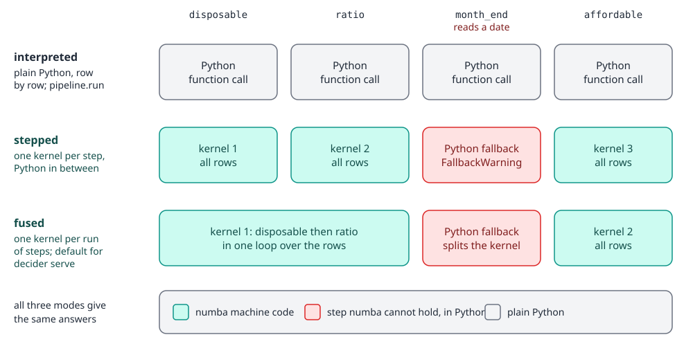
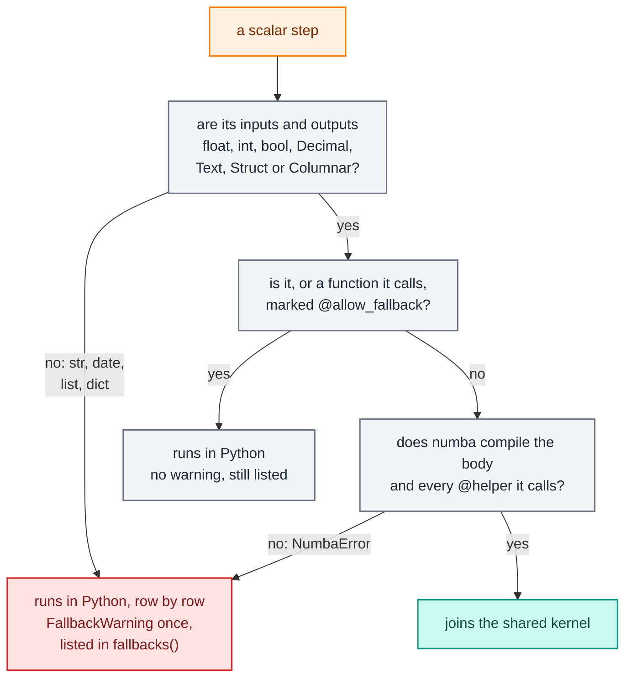

# Compiled modes and fallback

`pipeline.compile(mode)` turns a pipeline into an `Executable` that runs in one of three modes. All three give the same answers; they differ in speed, in where a debug session can pause, and in what happens to a step numba cannot compile. This page explains what compiles, what runs in Python instead and how you are told, how to make the compiler strict, why the first call is slow, and how to measure your own pipeline.

## The three modes

```python
import time
import warnings

import polars as pl
from decikit import FusedEngine, flow, param
from decikit.exceptions import EngineError

def disposable(income: float, expenses: float) -> float:
    return income - expenses

def ratio(debt: float, income: float) -> float:
    return debt / income

def affordable(ratio: float, disposable: float, limit: float = param(0.4), floor: float = param(500.0)) -> bool:
    return ratio <= limit and disposable >= floor

pipeline = flow(disposable, ratio, affordable, name="afford")
record = {"income": 1000.0, "expenses": 300.0, "debt": 200.0}

for mode in ("interpreted", "stepped", "fused"):
    exe = pipeline.compile(mode)          # same as Engine.resolve(mode)().bind(pipeline)
    print(mode, exe.run(record))
```

```text
interpreted {'income': 1000.0, 'expenses': 300.0, 'debt': 200.0, 'affordable': True}
stepped {'income': 1000.0, 'expenses': 300.0, 'debt': 200.0, 'affordable': True}
fused {'income': 1000.0, 'expenses': 300.0, 'debt': 200.0, 'affordable': True}
```

| Engine | What runs | A session pauses at | Use it for |
|---|---|---|---|
| `"interpreted"` | each step as a Python function, row by row | every step, and inside trees | debugging, the reference answer, pipelines that barely run |
| `"stepped"` | each step as its own numba kernel over all rows, with a Python driver between steps | every step | debugging compiled behaviour, finding which step of a kernel raised |
| `"fused"` | one kernel per run of consecutive compilable steps; branches and loops of plain scalar steps packed into one kernel | kernel boundaries only | serving (`decikit serve`'s default), batch runs |

`pipeline.run(df)` and `pipeline.compile()` follow the default engine, which is fused when nothing sets another. Set one for a block with `with decikit.engine("interpreted"):`, or for one call with `run(df, engine="interpreted")`; `session` opens interpreted whatever the default, and `decikit serve` reads its engine from its own document, not from this default. A fused `run` binds and builds on every call (no numba compile after the first), so repeating it on a small frame costs two to three times the interpreted run, about 2 to 3 ms more on a small flow and about 35 ms on a large one: compile once with `compile()` and call the executable, or switch to interpreted while you iterate.

An engine is a settings document named by its tag: `pipeline.compile(FusedEngine(strict_compile=True))` takes the engine options (`strict_compile=`, `params_validation=`), and `Engine.registered()` lists the tags. An unknown tag is refused: `RegistryError: 'fsued' is not a registered Engine type. Did you mean 'fused'?`.

Measured on a flagship pipeline at 1M rows through `run` and 20k single-record `run` calls (CPython 3.14, dev box):

| Engine | Batch rows/s | record p50 | record p99 |
|---|---|---|---|
| interpreted | 0.25M | 59.1 µs | 84.5 µs |
| stepped | 12.9M | 37.1 µs | 47.6 µs |
| fused | 12.5M | 27.7 µs | 34.7 µs |

On branches and loops the gap is wider, because fused mode packs the whole control flow into one kernel. A branch measured 41.6 to 44.3M rows/s fused against 14.8M stepped (1M rows), and a loop of up to 360 iterations at 6.33M rows/s fused against 0.81M stepped (200k rows); `run(record)` through the branch had a p50 of 23 µs fused and 66 µs stepped.

## Kernel boundaries in fused mode

Fused mode groups steps by a fixed rule, never by a cost estimate: consecutive scalar steps that compile share one kernel, and anything that cannot join a kernel (a frame step, a step that falls back to Python) ends the kernel before it and starts a new one after it. The reason: whether fusing helps depends on how much work each step does, the measured ratio swung from 0.11x to 1071x across experiments, and no static signal predicts it.

```python
from datetime import date

def month_end(applied_on: date) -> bool:
    return applied_on.day >= 25

def affordable_now(ratio: float, disposable: float, month_end: bool, limit: float = param(0.4)) -> bool:
    return ratio <= (limit - 0.1 if month_end else limit) and disposable > 0

warnings.simplefilter("ignore")
dated = flow(disposable, ratio, month_end, affordable_now, name="afford").compile("fused")
dated.run({**record, "applied_on": date(2026, 1, 5)})

groups = {}
for call_id, unit in dated.runner.units.items():
    groups.setdefault(id(unit), (type(unit).__name__, []))[1].append(dated.plan.calls[call_id].node.origin.path)
print(list(groups.values()))
```

```text
[('Kernel', ['afford/disposable', 'afford/ratio']), ('Fallback', ['afford/month_end']), ('Kernel', ['afford/affordable_now'])]
```

<div class="diagram" markdown>


*The `date` step splits the fused kernel in two; the steps on either side stay compiled.*
</div>

`exe.runner.units` is an internal view, handy for questions like this one; `fallbacks()` below is the public report.

## What compiles

A numba kernel holds numbers and `Text`. Everything else a step reads or writes makes that step run in Python.



In detail:

| The step | Result |
|---|---|
| reads and writes `float`, `int`, `bool`, `T | None` of those, `Decimal[p, s]`, `Currency` | compiles |
| reads `Text`, compares with literals, constants or `str` params | compiles |
| reads `Struct[Item]`, or returns one as a tuple | compiles |
| reads `Columnar[Item]` | compiles into the shared kernel; `Columnar[Item] | None` runs compiled but one call per row |
| returns `Columnar[Item]` as a list of tuples, or a tuple under `@step(outputs=(...))` | compiles |
| reads or writes `str`, `date`, `dict`, `list[...]`, a `TypedDict` | Python, row by row; for an output, the reason names the declared form that compiles (`Struct`, `Columnar`, `outputs=`), or says none does (a `date`, `bytes`, `set`) |
| writes `Struct[Item] | None`, or returns a dict for a `Struct[Item]` | Python, row by row |
| calls a function without `@helper` that numba cannot compile | Python, with the callee named in the reason |
| has a body numba refuses (`import` inside, unsupported methods) | Python, with numba's error as the reason |
| raises at run time (`ZeroDivisionError`, your own `raise`) | the error propagates; it is never a fallback |
| frame steps | always Python over polars; not a fallback |

Trees, decision tables and scorecards have kernels of their own and read string columns as byte spans, so string rules there compile ([Trees, tables and scorecards](trees-tables-scorecards.md)). [Types, text, money and nested data](types-and-money.md) covers each compiled type.

Branches and loops pack into one fused kernel when every step inside is a plain scalar step that compiles, no step inside has a nullable (`T | None`) output, every merged or carried name is `float`, `int` or `bool` with one type, and nothing made inside except the merged or carried names is a pipeline output. Otherwise they run with stepped mode's Python driver around their per-step kernels and give the same answers. `exe.runner.packed` lists the packed ones; [Branches, loops and frame steps](branches-loops-frames.md) shows it on a nested example.

## Fallback and the FallbackWarning

A step that cannot compile still runs. The compiled modes run it in Python, row by row, and keep the steps before and after it compiled. Fused mode announces each fallback once per executable with a `FallbackWarning` (stepped mode, which exists to inspect one step at a time, does not), and `fallbacks()` lists every one with its reason:

```python
from decikit import FallbackWarning, allow_fallback

def applied_month(applied_on: date) -> int:
    return applied_on.month

def lookup(code: int) -> float:
    rates = {1: 0.1, 2: 0.2}
    return rates.get(code, 0.0)

def flagged(code: int) -> bool:
    import math
    return math.isfinite(code)

@allow_fallback
def legacy_score(code: int) -> float:
    return float(code) * 2

def via_legacy(code: int) -> float:
    return legacy_score(code) + 1

def after(applied_month: int, lookup: float) -> float:
    return applied_month * lookup

mixed = flow(applied_month, lookup, flagged, via_legacy, after, name="mixed")
data = pl.DataFrame({"applied_on": [date(2026, 3, 1)], "code": [1]})

with warnings.catch_warnings(record=True) as caught:
    warnings.simplefilter("always")
    exe = mixed.compile("fused")
    out = exe.run(data)
print(out)
for w in caught:
    if issubclass(w.category, FallbackWarning):
        print(w.message)
for path, reason in exe.fallbacks().items():
    print(path, "->", reason)
```

```text
shape: (1, 5)
┌────────────┬──────┬─────────┬────────────┬───────┐
│ applied_on ┆ code ┆ flagged ┆ via_legacy ┆ after │
│ ---        ┆ ---  ┆ ---     ┆ ---        ┆ ---   │
│ date       ┆ i64  ┆ bool    ┆ f64        ┆ f64   │
╞════════════╪══════╪═════════╪════════════╪═══════╡
│ 2026-03-01 ┆ 1    ┆ true    ┆ 3.0        ┆ 0.3   │
└────────────┴──────┴─────────┴────────────┴───────┘
mixed/applied_month runs in Python, row by row: reads 'applied_on' as <class 'datetime.date'>, which no kernel takes
mixed/flagged runs in Python, row by row: UnsupportedBytecodeError: Use of unsupported opcode (IMPORT_NAME) found. Raised from /path/to/your/steps.py (11)
mixed/applied_month -> reads 'applied_on' as <class 'datetime.date'>, which no kernel takes
mixed/flagged -> UnsupportedBytecodeError: Use of unsupported opcode (IMPORT_NAME) found. Raised from /path/to/your/steps.py (11)
mixed/via_legacy -> @allow_fallback: calls the @allow_fallback function 'legacy_score', which runs in Python
```

Reading the report:

- `applied_month` reads a `date`. The decider toolkit does not even ask numba; no kernel takes it.
- `lookup` builds a dict literal, which numba supports, so it compiled and is not listed.
- `flagged` has an `import` in its body. numba refused it with `UnsupportedBytecodeError`, one of the compile-time errors that trigger a fallback.
- `via_legacy` calls a function marked `@allow_fallback`, which makes the call an intentional Python boundary: no warning, but still listed with `@allow_fallback:` in front.

Interpreted mode never falls back, so its `fallbacks()` is always empty. Because `run` is fused by default, a `run` over such a step prints the warning too: put `@allow_fallback` on the function if you mean it, or run interpreted. The warning text is `FallbackWarning: <path> runs in Python, row by row: <reason>`. Python-row speed is below 1M rows/s in a batch against a kernel's hundreds of millions, and under 10 µs extra on a single `run(record)` (the figures the guide gives).

Only compile-time failures fall back, because catching every exception would turn a real bug, such as a `ZeroDivisionError`, into a silent "needed a fallback". A runtime error always propagates, with a note naming the step:

```python
def per_income(debt: float, income: float) -> float:
    return debt / income

z = flow(disposable, per_income, name="z")
zero = pl.DataFrame({"income": [1000.0, 0.0], "expenses": [1.0, 1.0], "debt": [1.0, 1.0]})
for mode in ("interpreted", "stepped", "fused"):
    try:
        z.compile(mode).run(zero)
    except ZeroDivisionError as e:
        print(mode, e, e.__notes__)
```

```text
interpreted division by zero ['in step z/per_income, row 1']
stepped division by zero ['in step z/per_income']
fused division by zero ["in one of the steps ['z/disposable', 'z/per_income'], fused into one kernel; run in engine='stepped' to see which"]
```

Division by zero raises in every mode, as it does in Python. A fused kernel cannot tell which of its steps raised, so its note lists them all and suggests stepped mode. The notes need Python 3.11 or newer.

### Accepting a fallback

`@allow_fallback` on a step says you accept that it runs in Python: its warning stops, and `strict_compile=True` allows it. `fallbacks()` still reports it, so it stays visible when you chase latency. To silence every fallback warning at once instead, filter the category at start-up:

```python
warnings.filterwarnings("ignore", category=FallbackWarning)
```

`@allow_fallback` is for function steps and the functions they call. A tree, table, scorecard, branch or loop falls back as a whole, and decorating one raises `TypeError`:

```python
from decikit import branch

try:
    allow_fallback(branch("on_card", affordable, modifies=["affordable"], name="b"))
except TypeError as e:
    print(e)
```

```text
@allow_fallback takes a function, or step() of one, not BranchStep. A tree, table, scorecard, branch or loop falls back as a whole: filter decikit.FallbackWarning instead.
```

### Strict compile

`FusedEngine(strict_compile=True)` raises at the first run instead of warning, for any step that would run in Python without `@allow_fallback`. Use it in CI or at service start-up to keep a fallback from slipping in:

```python
try:
    FusedEngine(strict_compile=True).bind(mixed).run(data)
except EngineError as e:
    print(e)

accepted = FusedEngine(strict_compile=True).bind(flow(legacy_score, name="q"))
print(accepted.run({"code": 4}))
```

```text
mixed/applied_month runs in Python, row by row: reads 'applied_on' as <class 'datetime.date'>, which no kernel takes; accept it with @allow_fallback, or run engine='interpreted'
{'code': 4, 'legacy_score': 8.0}
```

The strict error is a `StrictCompileError` (`from decikit import StrictCompileError`), an `EngineError` (a `DecikitError` and a `ValueError`).

`strict_compile=True` also refuses hidden state, in every engine: a step that reads a module-level object (a `HiddenStateWarning` otherwise) makes `bind` raise `EngineError`, so a CI build with one fails.

## The first call and the numba cache

Binding is cheap. The first `run` of a compiled executable compiles: numba types each step from its annotations and builds the kernels, which takes a large fraction of a second for a small pipeline. Later calls reuse the kernels, and so does a second executable built from the same steps in the same process:

```python
def surplus(income: float, expenses: float, buffer: float = param(250.0)) -> float:
    return income - expenses - buffer

def timed(exe):
    t = time.perf_counter()
    exe.run(record)
    return time.perf_counter() - t

fresh = flow(surplus, name="s").compile("fused")
first, warm = timed(fresh), timed(fresh)
again = timed(flow(surplus, name="s").compile("fused"))   # a second executable, same steps
print(first > 100 * warm, again < 10 * warm)
```

```text
True True
```

<div class="diagram" markdown>


*Changing a param value never recompiles; changing a step's code or annotations does.*
</div>

What is cached where:

- Each compiled step function is cached on disk by numba, in `__pycache__` next to the file that defines it (`*.nbi` index and `*.nbc` data files). The cache key includes the function's content and a hash of the decider toolkit's compile semantics, so an edited step or a decider toolkit upgrade recompiles once. A step defined in a notebook cell, an `exec` string or a closure has no file to cache against and compiles in every process.
- The fused and stepped kernels assembled from those steps are built once per process and never written to disk. A new process pays for that part again.
- The disk cache records the CPU it was built on. A cache built on one machine type misses silently on another and recompiles at start-up.
- Each git worktree has its own `__pycache__`, so the first run in a fresh worktree is slow.

To keep compiling off the request path, `decikit build` scores `sample_request.json` through every kernel, and a server worker stages its config version (which warms it the same way) before it answers `/ping`. In your own service, call `run` once with a representative record at start-up.

## Threads and nogil

Every compiled kernel is built with `nogil=True`, so it releases the GIL while it runs, and an `Executable` is safe to call from many threads at once. This matters for serving: with 16 threads calling one kernel, p99 stayed at 883 µs with `nogil=True` and reached 254.1 ms without it, because each call held the GIL for its whole run.

`fastmath` is off. With it off, Python and compiled code agreed bit for bit over a 16-step `log`/`exp`/`sqrt`/division chain; with it on, 46 to 73% of rows differed by up to 17 ULP for a 1.09x speed-up. Kernels also use CPython's semantics for `round(x, n)` and `x ** n`, so the modes agree there too. int64 arithmetic still wraps silently in a kernel where Python would raise ([Types, text, money and nested data](types-and-money.md) shows it).

`step(nogil=...)` is accepted and recorded in the IR, but the compiled modes release the GIL for every kernel regardless of it.

## Measuring your own pipeline

Measure with warm kernels and a params document object you reuse, since `run` caches the validated and converted params by the document's identity:

```python
import statistics

exe = pipeline.compile("fused")
params = pipeline.parameters().defaults()
exe.run(record, params)                                     # compile and warm
samples = []
for _ in range(2000):
    t = time.perf_counter_ns()
    exe.run(record, params)
    samples.append(time.perf_counter_ns() - t)
p50 = statistics.median(samples) / 1000
print(p50 < 1000)                                          # microseconds, well under a millisecond

frame = pl.DataFrame({k: [v] * 100_000 for k, v in record.items()})
exe.run(frame, params=params)
t = time.perf_counter()
exe.run(frame, params=params)
print((time.perf_counter() - t) < 1.0)                     # 100k rows in well under a second
```

```text
True
True
```

Things that skew a measurement:

- Timing the first call measures numba, not your pipeline.
- Scoring one record through `run(one_row_frame)` adds the frame round trip; the guide puts that at about five times the cost of passing the dict.
- A new params dict per call is hashed and validated every time. Converting a 50-module params document measured 170.6 µs against 0.22 µs for a cached bundle.
- A frame step anywhere in the pipeline makes `run` on a record build a one-row polars frame.
- Fallback steps run at Python speed; check `fallbacks()` first.

The repository's `benchmarks/` folder holds plain scripts that measure the engine itself, for example `uv run python benchmarks/modes.py` (batch throughput and single-record latency per mode) and `benchmarks/control_flow.py` (packed branches and loops).

## Where to go next

- [Types, text, money and nested data](types-and-money.md): the types that compile.
- [Branches, loops and frame steps](branches-loops-frames.md): what packs into one kernel.
- [Debugging and testing](debugging-and-testing.md): sessions per mode and `assert_equivalent` across modes.
- [Projects and serving](projects-and-serving.md): `decikit build` and warm-up in a deployed service.
- Architecture: [runners](../architecture/engine/runners.md), [compile](../architecture/engine/compile.md), [kernels](../architecture/engine/kernels.md) and the [numba cache](../architecture/engine/cache.md).
