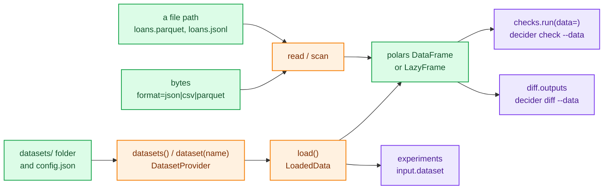
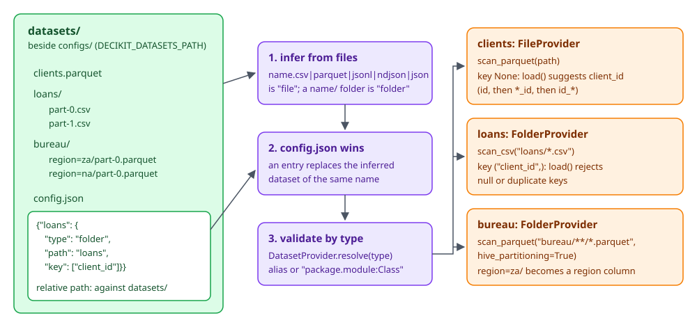

# Data and datasets

`decider.lab.data` loads the records you test, check, compare and experiment on. It reads JSON, CSV and Parquet files (the formats a Redshift `UNLOAD` writes) into polars frames, and it gives a project named datasets, so a check, a diff or an experiment can say `applications` instead of a path that only works on one laptop.

Serving never touches this module. A served pipeline gets its records from the HTTP request; `decider.lab.data` is for the work you do around it.



## Reading a file

`read(source)` returns a polars `DataFrame`. The format comes from the suffix: `.json`, `.jsonl` and `.ndjson` are JSON, `.csv` is CSV and `.parquet` is Parquet.

```python
from pathlib import Path
from decider.lab.data import read

Path("loans.jsonl").write_text('{"client_id": "C-1", "income": 1000.0, "debt": 350.0}\n'
                               '{"client_id": "C-2", "income": 500.0, "debt": 400.0}\n')
Path("loans.json").write_text('[{"client_id": "C-3", "income": 800.0, "debt": 100.0}]')
Path("loans.csv").write_text("client_id,income,debt\nC-4,1200,300\n")

print(read("loans.jsonl"))
print(read("loans.json").to_dicts(), read("loans.csv").to_dicts())
```

```text
shape: (2, 3)
┌───────────┬────────┬───────┐
│ client_id ┆ income ┆ debt  │
│ ---       ┆ ---    ┆ ---   │
│ str       ┆ f64    ┆ f64   │
╞═══════════╪════════╪═══════╡
│ C-1       ┆ 1000.0 ┆ 350.0 │
│ C-2       ┆ 500.0  ┆ 400.0 │
└───────────┴────────┴───────┘
[{'client_id': 'C-3', 'income': 800.0, 'debt': 100.0}] [{'client_id': 'C-4', 'income': 1200, 'debt': 300}]
```

A `.json` file may hold one object per line (what Redshift exports) or one array of objects; `read` tries the line format first and falls back to the array. CSV types are inferred by polars, so `1200` above came back as an integer. Cast in the step's annotation or in polars if that matters.

`read` also takes bytes, for a payload you already hold in memory. Bytes have no suffix, so pass `format=`:

```python
from decider.lab.data import read

df = read(b'{"income": 1000.0}\n{"income": 500.0}\n', format="json")
assert df.height == 2
```

A polars `DataFrame` passed to `read` comes back unchanged, which lets a function accept "a path or a frame" and call `read` on either.

### Lazy reads with `scan`

`scan(path)` returns a `LazyFrame` with the same suffix rules, so polars can push filters and column selection down into the file:

```python
import polars as pl
from decider.lab.data import scan

lazy = scan("loans.jsonl")
print(type(lazy).__name__, lazy.filter(pl.col("debt") > 360).collect().to_dicts())
```

```text
LazyFrame [{'client_id': 'C-2', 'income': 500.0, 'debt': 400.0}]
```

A plain `.json` file cannot be scanned lazily, because the two JSON shapes can only be told apart by reading the file. `scan` reads it eagerly and wraps the result in a `LazyFrame`.

### Read errors

Every failure inside `read` is a `LoadError` (a `DeciderError`) whose message names the file and the reason:

```text
LoadError: could not load 'loans.txt': no data format given; pass format='json'|'csv'|'parquet' or use a .json/.csv/.parquet path
LoadError: could not load 'missing.parquet': No such file or directory (os error 2): missing.parquet
```

`scan` raises a plain `ValueError` for an unknown suffix (`no data format for 'loans.txt'; expected one of json, csv, parquet`).

## Named datasets

A project keeps the data it tests against in a `datasets/` folder next to `configs/`. Every entry in that folder becomes a named dataset, and `datasets()` lists them:

```text
proj/
  configs/
  datasets/
    clients.parquet           # a "file" dataset called clients
    loans/                    # a "folder" dataset called loans
      part-0.csv
      part-1.csv
    bureau/                   # a "folder" dataset with hive partitions
      region=za/part-0.parquet
      region=na/part-0.parquet
    config.json               # optional: overrides and extra datasets
```

<div class="diagram" markdown>


*Inference first, then `config.json`, then validation by `type`.*
</div>

The rules:

- `name.csv`, `name.parquet`, `name.jsonl`, `name.ndjson` or `name.json` is a `file` dataset called `name`.
- A `name/` folder of part files is a `folder` dataset. All parts must share one format; Parquet folders read `key=value/` subfolders as columns (hive partitioning).
- Entries whose name starts with `.` or `_` are skipped, and so is `config.json` itself.
- Two entries that would get the same name (`loans.csv` and `loans/`) are a `DatasetError`.
- Listing never opens a data file.

```python
import polars as pl
from pathlib import Path
from decider.lab.data import datasets

root = Path("proj")
(root / "datasets/loans").mkdir(parents=True, exist_ok=True)
(root / "datasets/bureau/region=za").mkdir(parents=True, exist_ok=True)
(root / "datasets/bureau/region=na").mkdir(parents=True, exist_ok=True)
pl.DataFrame({"client_id": [1, 2], "income": [1000.0, 500.0]}).write_parquet(root / "datasets/clients.parquet")
(root / "datasets/loans/part-0.csv").write_text("client_id,debt\n1,350\n")
(root / "datasets/loans/part-1.csv").write_text("client_id,debt\n2,400\n")
pl.DataFrame({"client_id": [1], "score": [700]}).write_parquet(root / "datasets/bureau/region=za/part-0.parquet")
pl.DataFrame({"client_id": [2], "score": [640]}).write_parquet(root / "datasets/bureau/region=na/part-0.parquet")
(root / "datasets/config.json").write_text('{"loans": {"type": "folder", "path": "loans", "key": ["client_id"]}}')

found = datasets(start=root)
for name, p in found.items():
    print(name, type(p).__name__, p.type, p.key, p.schema())
print(found["bureau"].load().frame.sort("client_id"))
```

```text
bureau FolderProvider folder None {'client_id': 'Int64', 'score': 'Int64', 'region': 'String'}
clients FileProvider file None {'client_id': 'Int64', 'income': 'Float64'}
loans FolderProvider folder ('client_id',) {'client_id': 'Int64', 'debt': 'Int64'}
shape: (2, 3)
┌───────────┬───────┬────────┐
│ client_id ┆ score ┆ region │
│ ---       ┆ ---   ┆ ---    │
│ i64       ┆ i64   ┆ str    │
╞═══════════╪═══════╪════════╡
│ 1         ┆ 700   ┆ za     │
│ 2         ┆ 640   ┆ na     │
└───────────┴───────┴────────┘
```

`start` is any file or directory inside the project; the default is the current directory. The project root is the nearest ancestor holding a `configs/` directory, the same rule `decider serve` uses.

`datasets()` validates every entry and raises one `DatasetError` that lists all the bad ones. `dataset(name)` validates only the one you ask for, so a broken sibling never stops a run that does not use it. Experiments, `decider check --data` and `decider diff --data` all use `dataset(name)`.

```text
DatasetError: unknown dataset 'nope'; known: bureau, clients, loans
DatasetError: mixed formats in folder '.../proj/datasets/loans': csv, json
```

### `config.json`

`datasets/config.json` maps a name to a provider document. An entry replaces an inferred dataset of the same name, which is how a local folder gets a record `key`, and it can add datasets that do not live in the folder at all (a warehouse table, an S3 prefix).

```json
{
  "loans":        {"type": "folder", "path": "loans", "key": ["client_id"]},
  "archive":      {"type": "file", "path": "s3://risk-exports/loans/2026-09.parquet"},
  "applications": {"type": "mypkg.data:RedshiftTable", "table": "risk.applications", "key": ["application_id"]}
}
```

- `type` is `file`, `folder`, the `type` alias of a registered provider class, or `"package.module:Class"`, which is imported on first use.
- A relative `path` resolves against the `datasets/` folder. A path containing `://` is left alone and read by polars with its default credentials.
- `format` (`json`, `csv` or `parquet`) is needed only when the suffix does not say. A remote folder always needs it, because decider cannot list it.
- No `${VAR}` substitution happens in this file. A provider that needs credentials reads them itself.

### The providers

| `type` | Class | Fields | What `scan()` does |
|---|---|---|---|
| `file` | `FileProvider` | `path`, `format=None`, `key=None` | `scan_parquet`, `scan_csv` or `scan_ndjson` by suffix; a glob or `s3://` URL works |
| `folder` | `FolderProvider` | `path`, `format=None`, `key=None` | Parquet: `{path}/**/*.parquet` with hive partitioning; CSV: `{path}/*.csv`; JSON: `{path}/*.jsonl` (or the suffix found) |

Every provider has the same methods:

| Method | Returns |
|---|---|
| `scan()` | the dataset as a `LazyFrame` |
| `schema()` | `{column: dtype}` from the lazy schema, without reading rows |
| `head(n=50)` | the first `n` rows as a `DataFrame` |
| `load()` | the whole dataset as `LoadedData`, key checked |
| `fingerprint(frame)` | the content fingerprint a run records |

## Loading: `LoadedData`

`load()` collects the frame and wraps it with what an experiment manifest records about its input:

```python
from decider.lab.data import datasets

loaded = datasets(start="proj")["loans"].load()
print(loaded.dataset, loaded.row_count, loaded.columns, loaded.suggested_key, loaded.fingerprint[:16])
```

```text
loans 2 (('client_id', 'Int64'), ('debt', 'Int64')) ('client_id',) ac1ad9f9f9c8c43e
```

| Attribute | Meaning |
|---|---|
| `frame` | the polars `DataFrame` |
| `dataset` | the dataset's name |
| `row_count` | rows in `frame` |
| `columns` | `(name, dtype)` pairs in column order |
| `suggested_key` | the provider's `key`, or the id-column guess when there is none |
| `fingerprint` | a content hash of the frame |
| `summary` | the `InputFingerprint` holding all of the above except the frame |

## Record keys

A record key names the column(s) that identify one record. It matters wherever a result has to point back at a record later: a diff table keyed by application, an experiment divergence sample, a debug reproduction.

Declare it with `key` in the provider document. `load()` then checks that every record has a key and that no two share one, and raises a `RecordKeyError` subclass if not:

| Error | When |
|---|---|
| `MissingKeyColumnError` | a key column is not in the data |
| `MissingRecordKeyError` | a key value is null |
| `DuplicateRecordKeyError` | two records share a key value |

```text
DuplicateRecordKeyError: the key columns ['client_id'] do not uniquely identify every record
MissingRecordKeyError: 1 record(s) have a null value in the key columns ['client_id']
MissingKeyColumnError: key column ['loan_id'] is not in the data
```

All three derive from `RecordKeyError`, which is both a `DeciderError` and a `ValueError`, so `except RecordKeyError` catches them together.

Without a `key`, `load()` guesses one and does not check it: the first column called `id`, else the first ending in `_id`, else the first starting with `id_`. The guess lands in `suggested_key` and is a suggestion for a UI to confirm. It is never validated, so do not treat it as durable.

A row number is never a key. `decider.lab.RecordRef` keeps an `ordinal` for display, but its identity is `dataset` plus `key`, because row order is not stable across loads.

## Fingerprints

`fingerprint(frame)` hashes the frame's schema and every row (`hash_rows`) with SHA-256. Two loads of unchanged data give the same fingerprint; any changed value, added row or changed dtype gives a different one. Experiments store it in the run manifest, so a result can say exactly which data it saw.

Hashing every row costs a pass over the data. A provider whose source already has a cheap identity (a table version, an object ETag) should override `fingerprint`.

## Your own provider

For a source that is not a file, subclass `DatasetProvider`, give it a `type` alias and implement `scan()`. Keep the class in an importable module, since `config.json` refers to it by alias or import path.

```python
# warehouse.py
import sqlite3
import typing as t
import polars as pl
from decider.lab.data import DatasetProvider

class SqliteTable(DatasetProvider):
    type: t.Literal["sqlite"] = "sqlite"
    database: str
    table: str

    def scan(self) -> pl.LazyFrame:
        with sqlite3.connect(self.database) as db:
            return pl.read_database(f"select * from {self.table}", db).lazy()

    def fingerprint(self, frame):
        return f"{self.database}:{self.table}:{frame.height}"
```

```json
{"warehouse": {"type": "warehouse:SqliteTable", "database": "clients.db", "table": "clients", "key": ["client_id"]}}
```

```python
from decider.lab.data import datasets

loaded = datasets(start="proj")["warehouse"].load()
print(loaded.frame.to_dicts(), loaded.fingerprint, loaded.suggested_key)
```

```text
[{'client_id': 1, 'income': 1000.0}, {'client_id': 2, 'income': 500.0}] clients.db:clients:2 ('client_id',)
```

Only `path` is resolved against the datasets folder; `database` here is relative to the working directory. Provider documents are validated with `extra="forbid"`, so a misspelt field is an error naming the dataset. An installed package can register providers under the `decider.datasets` entry-point group so the alias works without an import path; [Extending decider](extending.md) covers the registry.

!!! warning "Defining a provider in a script you run directly"
    A class defined in `__main__` and imported again by its module name registers twice, and validation fails with `type alias 'sqlite' is claimed by both __main__:SqliteTable and warehouse:SqliteTable`. Put providers in a module and import them.

## Where the folder is

The folder is the `datasets_path` setting, `${PROJECT_ROOT}/datasets` by default. `${PROJECT_ROOT}` is the only placeholder and means the project root found from `start` (or the current directory when there is no `configs/` above it). Set `DECIDER_DATASETS_PATH` to use another folder; a relative value is relative to the current directory. Both `datasets()` and `dataset()` also take `path=` to override the setting for one call.

`decider` loads `.env` with python-dotenv, which expands `${...}` itself, even inside single quotes, and an unset `PROJECT_ROOT` becomes an empty string. In a `.env`, write an absolute path or a path relative to the directory you run from.

## Using data elsewhere

| Where | How it names data |
|---|---|
| `checks.run(pipeline, data=frame)` | a frame from `read` or `load().frame`; enables the data checks ([Checks](checks.md)) |
| `decider check ENTRY --data X` | `X` is a file path if it exists, else a dataset name |
| `diff.outputs(old, new, frame, key=...)` | a frame; `key` labels rows in the change table ([Comparing versions](diff-and-equivalence.md)) |
| `decider diff BASE HEAD ENTRY --data X` | same rule as `decider check` |
| `ExperimentDef(input={"dataset": "applications"})` | a dataset name, or `{"path": "..."}` for a file ([Experiments](experiments.md)) |
| MCP `run_summary`, `check_report` | a file path ([CLI and MCP](cli-and-mcp.md)) |

The VS Code extension's Datasets view lists the same datasets, previews them with `head`, and opens a debug session on one ([Debugging and testing](debugging-and-testing.md)).
