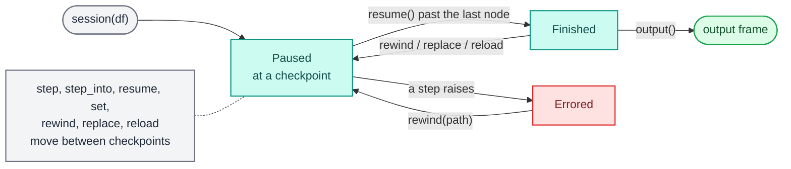
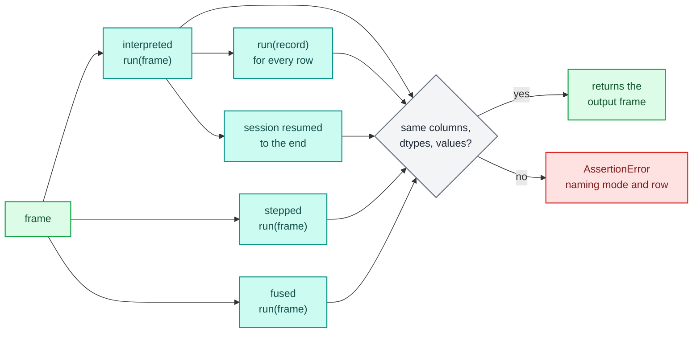

# Debugging and testing

When a record gets an answer you did not expect, you want to see the values each step produced for it, change one and watch the rest follow, and fix the step without starting over. When the answer is right, you want a test that keeps it right in every execution mode. `decikit` gives you both: `describe` for the static shape of a flow, a debug `Session` for stepping through a run, and `decikit.lab.testing` for the assertions your test suite runs.

Every example on this page uses this affordability flow:

```python
# afford.py
import polars as pl
from decikit import branch, flow, param, step


def disposable_income(net_income: float, expenses: float) -> float:
    return net_income - expenses


def affordability_ratio(disposable_income: float, instalment: float) -> float:
    return disposable_income / instalment


def term_cap(requested_term: float) -> float:
    return min(requested_term, 60.0)


def is_private(sector_code: int) -> bool:
    return sector_code == 1


@step(output="term_cap")
def cap_private(term_cap: float, cap: float = param(54.0)) -> float:
    return min(term_cap, cap)


@step(output="term_cap")
def cap_public(term_cap: float, cap: float = param(48.0)) -> float:
    return min(term_cap, cap)


def affordable(affordability_ratio: float, min_ratio: float = param(3.5)) -> bool:
    return affordability_ratio >= min_ratio


pipeline = flow(
    disposable_income,
    affordability_ratio,
    term_cap,
    branch(is_private, cap_private, cap_public, modifies=["term_cap"], name="by_sector"),
    affordable,
    name="afford",
)

df = pl.DataFrame({
    "net_income":  [9200.0, 4100.0, 15000.0],
    "expenses":    [3100.0, 1500.0,  6000.0],
    "instalment":  [1200.0,  800.0,  2500.0],
    "requested_term": [72.0, 36.0, 84.0],
    "sector_code": [     1,      2,       1],
})
```

`pipeline.run(df)` gives `term_cap = [54.0, 36.0, 54.0]` and `affordable = [True, False, True]`.

## Looking at a flow: `describe`

`describe(pipeline)` (also `decikit.lab.describe`) returns the static structure without running anything: every node with its path, kind, inputs and outputs, the control and data edges between them, and every value slot (one version of a value, written by one node).

```python
from decikit import describe
from afford import pipeline

desc = describe(pipeline)
for n in desc.nodes:
    print(f"{n.path:28} {n.node_type:9} {n.kind or '':7} in={n.inputs} out={n.outputs}")
for e in desc.edges:
    if e.kind == "data":
        print("data", e.from_path, "->", e.to_path, e.values)
print([s.spec for s in desc.value_slots])
```

```text
afford                       sequence          in=() out=()
afford/disposable_income     call      scalar  in=('net_income', 'expenses') out=('disposable_income',)
afford/affordability_ratio   call      scalar  in=('disposable_income', 'instalment') out=('affordability_ratio',)
afford/term_cap              call      scalar  in=('requested_term',) out=('term_cap',)
afford/by_sector             branch            in=() out=()
afford/by_sector/is_private  call      scalar  in=('sector_code',) out=('is_private',)
afford/by_sector/cap_private call      scalar  in=('term_cap',) out=('term_cap',)
afford/by_sector/cap_public  call      scalar  in=('term_cap',) out=('term_cap',)
afford/affordable            call      scalar  in=('affordability_ratio',) out=('affordable',)
data afford/affordability_ratio -> afford/affordable ('affordability_ratio',)
data afford/disposable_income -> afford/affordability_ratio ('disposable_income',)
data afford/term_cap -> afford/by_sector/cap_private ('term_cap',)
data afford/term_cap -> afford/by_sector/cap_public ('term_cap',)
['net_income', 'expenses', 'disposable_income@afford/disposable_income', 'instalment', 'affordability_ratio@afford/affordability_ratio', 'requested_term', 'term_cap@afford/term_cap', 'sector_code', 'is_private@afford/by_sector/is_private', 'term_cap@afford/by_sector/cap_private', 'term_cap@afford/by_sector/cap_public', 'term_cap@afford/by_sector', 'affordable@afford/affordable']
```

`term_cap` has four slots: the step that computes it, each arm that rewrites it, and the branch's merge of the two arms. That is why a value can be named as `name@path` everywhere in the debugger. The `FlowDescription` is a pydantic model, so `desc.model_dump_json()` is the form the MCP server and the VS Code extension read. For the IR itself, see `decikit.ir.to_ir` and [Steps and IR](../architecture/steps-and-ir.md).

## A debug session

`pipeline.session(df)` opens a `Session` paused before anything runs. Each command runs synchronously and returns the `Checkpoint` it stopped at, or `None` once the run has finished.

```python
from afford import pipeline, df

s = pipeline.session(df)
s.break_at("afford/affordable")
print(s.resume())
print(s.value("affordability_ratio").to_list())
print(s.value("term_cap").to_list(), s.value("term_cap@afford/by_sector/cap_public").to_list())

s.set("affordability_ratio", [5.0, 3.6, 3.0])      # what-if: one value per row
print(s.resume())                                    # None: the run finished
print(s.output()["affordable"].to_list())
print(s.state.versions("affordability_ratio@*")[-1].producer)
```

```text
Checkpoint(origin=Origin(path='afford/affordable', source='afford:affordable', locator=None, id=None, suppress_checks=()), when='before', arm=None, iteration=None)
[5.083333333333333, 3.25, 3.6]
[54.0, 36.0, 54.0] [None, 36.0, None]
None
[True, True, False]
override@afford/affordable
```

- `value(name)` is the current value as a polars Series. `value("name@path")` is the version one node wrote; `cap_public` only ran on row 1, so its version is null elsewhere.
- `set(name, value)` overrides an input column or any value produced so far, from here on. `value` is one value for every row or a list with one per row (`None` is null), cast to the declared dtype. The override is recorded as a version produced by `override@<current path>`, so the trail shows who changed what.
- `output()` is the frame `run` would have returned, overrides applied. It raises `RuntimeError: the run hasn't finished; resume() it first` before the end.

`session` takes the same arguments as `run` plus a mode: `pipeline.session(df, params=doc, mode="stepped")`. Keyword arguments other than these go to `Engine` (for example `params_validation=`). An `Executable` from `compile()` has `exe.session(df, params)` too.



### Breakpoints

| Target | Pauses |
|---|---|
| `"afford/affordable"` | just before that node |
| `"afford/by_sector"` (a prefix) | before the first node at or under it, once each time the run enters it |
| `"risk/risk_tree#long"` | just after the tree or table node `risk_tree`, if any row reached the position `long` inside it |
| `lambda cp: ...` | wherever the predicate returns true; it sees every checkpoint |

`clear_break(target)` removes one added with the same target. A prefix fires on entry, so `"afford/by_sector"` stops once, not at each of the branch's children. A loop body is entered once per iteration, so a prefix on it stops every iteration.

```python
s = pipeline.session(df)
s.break_at(lambda cp: cp.when == "after" and cp.arm == 1)
cp = s.resume()
print(cp.origin.path, cp.when, cp.arm)
print(s.value("term_cap").to_list())
```

```text
afford/by_sector/cap_public after 1
[None, 36.0, None]
```

Inside an arm, the current `term_cap` is the arm's own version: only the rows that took the arm have a value.

A position inside a tree or table (`"name#locator"`) is a node id of the tree, or a row of a table (`"band#2"`). The interpreted runner reports them; the session counts how many rows reached each position and pauses after the node:

```python
import polars as pl
from decikit import TreeConfig, flow

tree = TreeConfig.load({"type": "tree", "name": "risk_tree", "path_output": "leaf", "tree": {
    "nodes": [{"id": "n0", "data": {"type": "unary", "condition": {"op": ">", "feature": "term", "threshold": 60}}},
              {"id": "long", "data": {"type": "leaf", "result_idx": 0}}],
    "edges": [{"source": "n0", "target": "long", "data": {"sourceIndex": 0}}],
    "output": {"data": [{"risk_band": 1}], "default": {"risk_band": 0}, "dtypes": [["risk_band", "Int64"]]}}})
s = flow(tree, name="risk").session(pl.DataFrame({"term": [72.0, 36.0, 84.0]}))
s.break_at("risk/risk_tree#long")
cp = s.resume()
print(cp.origin.path, cp.when)
print([(e.origin.locator, e.rows) for e in s.events if e.kind == "node_visited"])
```

```text
risk/risk_tree after
[('n0', 3), ('long', 2)]
```

### Stepping

`step()` moves one node: from just before a call, branch or loop it runs the whole node and stops just after it. `step_into()` moves to the very next checkpoint, which enters a branch arm or a loop iteration.

```python
def show(cp):
    print(cp.origin.path, cp.when, cp.arm, cp.iteration)

s = pipeline.session(df)
s.break_at("afford/by_sector")
show(s.resume())
show(s.step())          # the whole branch
show(s.step())

s = pipeline.session(df)
s.break_at("afford/by_sector")
s.resume()
for _ in range(6):
    show(s.step_into())
```

```text
afford/by_sector before None None
afford/by_sector after None None
afford/affordable before None None
afford/by_sector/is_private before None None
afford/by_sector/is_private after None None
afford/by_sector/cap_private before 0 None
afford/by_sector/cap_private after 0 None
afford/by_sector/cap_public before 1 None
afford/by_sector/cap_public after 1 None
```

A step is one node over every row that reaches it, never one row at a time. A branch whose rows go both ways is entered arm by arm, in arm order, each over its own rows; an arm no row takes is skipped. A loop is entered once per iteration over the rows still looping, and `Checkpoint.iteration` counts from 1:

```python
import polars as pl
from decikit import flow, loop, step

def unpaid(balance: float) -> bool:
    return balance > 0.0

@step(output="balance")
def pay(balance: float, instalment: float) -> float:
    return balance - instalment

@step(output="months")
def tick(months: int) -> int:
    return months + 1

repay = flow(loop(unpaid, flow(pay, tick, name="month"), carries=["balance", "months"], max_iterations=60, name="repay"),
             name="plan")
s = repay.session(pl.DataFrame({"balance": [250.0, 100.0], "instalment": [100.0, 100.0], "months": [0, 0]}))
s.break_at("plan/repay/month/tick")
while (cp := s.resume()) is not None:
    print(cp.origin.path, "iteration", cp.iteration,
          "carry", s.value("balance").to_list(), "paid", s.value("balance@plan/repay/month/pay").to_list())
print(s.output()["months"].to_list())
```

```text
plan/repay/month/tick iteration 1 carry [250.0, 100.0] paid [150.0, 0.0]
plan/repay/month/tick iteration 2 carry [150.0, 0.0] paid [50.0, 0.0]
plan/repay/month/tick iteration 3 carry [50.0, 0.0] paid [-50.0, 0.0]
[3, 1]
```

During and after a loop, `value("balance")` is the carry, the value the loop hands on to the next iteration and to the steps after it. The body's own write is `balance@plan/repay/month/pay`.

`pause()` makes a `resume()` running on another thread stop at its next checkpoint. Apart from `pause`, a session is not thread-safe; use one per thread.

### Rewinding

`rewind(path)` goes back to just before the node at (or first under) `path`. Values upstream of it, overrides included, are kept as they are now, and everything from `path` on runs again when you move.

```python
s = pipeline.session(df)
s.break_at("afford/affordable")
s.resume()
s.set("disposable_income", 2000.0)
print(s.rewind("afford/affordability_ratio"))       # paused before affordability_ratio again
s.clear_break("afford/affordable")
s.resume()
print(s.output()["affordable"].to_list())            # computed from 2000.0
```

```text
Checkpoint(origin=Origin(path='afford/affordability_ratio', source='afford:affordability_ratio', locator=None, id=None, suppress_checks=()), when='before', arm=None, iteration=None)
[False, False, False]
```

`rewind` to a path where nothing runs raises `ValueError: no node at or under 'afford/nope' runs` and changes nothing.

### Errors in a session

A step that raises ends the run. The exception propagates from the command that hit it, an `ErrorEvent` naming the path is logged, and the session then accepts only `rewind`:

```text
raised ZeroDivisionError('division by zero')
ErrorEvent(message='ZeroDivisionError: division by zero', path='r/ratio', kind='error')
RuntimeError: the run stopped on an error; rewind() it
```

Set the bad input (or `replace` the step) and `rewind` to the step to try again. Other errors you will meet:

| Error | Cause |
|---|---|
| `KeyError: "'affordable' is neither an input column nor a value produced so far"` | `value` or `set` of something that has not run yet |
| `ValueError: can't set 'instalment' to 'lots': it doesn't cast to float64` | `set` with a value of the wrong type |
| `RuntimeError: the run hasn't finished; resume() it first` | `output()` before the end |
| `RuntimeError: the run is over` | a move after the run finished (use `rewind`) |

## Modes and checkpoints

Every mode supports sessions and gives the same answers. What differs is where they can pause. Interpreted and stepped pause at every node. Fused runs several steps in one compiled kernel, so a kernel is one checkpoint pair with its first step's path:

<div class="diagram" markdown>


*The same flow, stepped through with `step_into()` to the end in each mode.*
</div>

```python
s = pipeline.session(df, mode="fused")
s.break_at("afford/affordability_ratio")
cp = s.resume()
print(cp.origin.path, s.events[-1].kernel)

s = pipeline.session(df, mode="fused")
s.break_at("afford/affordable")
s.resume()
s.value("disposable_income")
```

```text
afford/disposable_income ('afford/disposable_income', 'afford/affordability_ratio', 'afford/term_cap')
KeyError: "'disposable_income' is computed inside the fused kernel ['afford/disposable_income', 'afford/affordability_ratio', 'afford/term_cap'] and never stored; open the session with mode='stepped' to inspect or set it"
```

A breakpoint on any step of a kernel pauses before the whole kernel, and `Paused.kernel` lists its steps. Values a kernel uses only inside itself are never stored, so `value` and `set` on them raise the `KeyError` above. Open the session with `mode="stepped"` when you need to see inside: stepped compiles each step on its own and pauses at every node. The [compile and fallback guide](compile-and-fallback.md) explains how kernels form, and [Debug internals](../architecture/engine/debug.md) how the session drives each runner.

One consequence: in fused mode, breaking on the second step of a kernel and setting a value the first step reads gives a different answer from interpreted mode, where the first step has already run when you pause.

## Editing the pipeline mid-run

A session can swap code while it runs and re-run only what the change affects. Values upstream of the edit, overrides included, are kept; the session pauses just before the edited node (reason `"edit"`), or where it was paused if that comes first.

### `replace` and `delete`

```python
from decikit import step
from afford import pipeline, df

@step(output="affordability_ratio")
def ratio_with_buffer(disposable_income: float, instalment: float) -> float:
    return (disposable_income - 500.0) / instalment

s = pipeline.session(df)
s.resume()
print(s.output()["affordable"].to_list())
s.replace("afford/affordability_ratio", ratio_with_buffer)
s.resume()
print(s.output()["affordable"].to_list())
```

```text
[True, False, True]
[True, False, False]
```

The new step takes the old one's name, so it sits at the same path and its params, breakpoints and `name@path` lookups carry over. Any step can be replaced: a function, a flow, a branch arm, a tree or table config.

`delete(path)` removes a step from its flow and re-runs from where it was. Deleting the only producer of a value a later step reads is refused before anything changes:

```text
WiringError: after editing 'afford/disposable_income' nothing produces 'disposable_income', which 'afford/affordability_ratio' reads; keep a step that writes it, or edit the reader too
```

!!! warning "Steps that update an input column"
    `replace`, `delete` and `reload` currently refuse any pipeline in which a step reads and rewrites one of its own input columns (a waterfall over an input, such as a branch that `modifies=["term_cap"]` where `term_cap` arrives in the frame). The check mistakes the input for an orphaned value and raises `WiringError: after editing ... nothing produces 'term_cap'`. Compute the value in a step first, as `term_cap` does here, and the edit works.

### `reload`: hot reload

`reload(pipeline)` switches to an edited version of the whole pipeline. It compares the two by content (function code, config data, params and wiring), finds the first checkpoint where they differ and re-runs from there. Re-running the notebook cells or re-importing the module that builds the pipeline is enough; the objects do not have to be the same.

```python
from decikit import branch, flow, param, step
from afford import (pipeline, df, disposable_income, affordability_ratio, term_cap,
                    is_private, cap_private, cap_public)

def affordable_v2(affordability_ratio: float, min_ratio: float = param(3.0)) -> bool:
    return affordability_ratio >= min_ratio

edited = flow(disposable_income, affordability_ratio, term_cap,
              branch(is_private, cap_private, cap_public, modifies=["term_cap"], name="by_sector"),
              step(affordable_v2, name="affordable", output="affordable"), name="afford")

s = pipeline.session(df)
s.resume()
cp = s.reload(edited)
print(cp.origin.path, [e for e in s.events if e.kind == "edited"], s.events[-1].reason)
s.resume()
print(s.output()["affordable"].to_list())
print(s.reload(edited))      # nothing changed: nothing happens
```

```text
afford/affordable [Edited(action='replace', path='afford/affordable', kind='edited')] edit
[True, True, True]
None
```

Each changed path gives one `Edited` event (`"replace"`, `"add"` or `"delete"`). A reload that would not wire raises and leaves the session as it was. When nothing changed, `reload` returns the current checkpoint (`None` here, since the run had finished) and logs nothing.

In a notebook, `s.watch(source)` registers an IPython hook that reloads after every cell:

- `s.watch(lambda: pipeline)` picks up a re-run cell that rebuilds `pipeline`.
- `s.watch(lambda: flow(disposable_income, ratio))` also picks up a cell that only redefines `ratio`, because the lambda looks the names up again each time.
- `s.watch("credit.pipeline:pipeline")` re-imports the module, and everything it imports from its own directory, whenever one of those files changes on disk.

A reload that fails to import or build logs a `ReloadFailed` event and raises; the session keeps the pipeline it had and carries on.

Outside a notebook, poll the files yourself with `ModuleWatcher`, which is what `watch("module:attr")` uses. It is not re-exported from `decikit.debug`, so import it from `decikit._engine.debug.hot`:

```python
from pathlib import Path
import polars as pl
from decikit._engine.debug.hot import ModuleWatcher

df = pl.DataFrame({"income": [1000.0, 500.0], "debt": [350.0, 400.0]})
watcher = ModuleWatcher("hotpkg.pipeline:pipeline")
s = watcher.get().session(df)
s.resume()
print(s.output()["approved"].to_list())

src = Path("hotpkg/pipeline.py")          # edit ratio on disk
src.write_text(src.read_text().replace("return debt / income", "return (debt + 100.0) / income"))
new = watcher.poll()                      # the re-imported pipeline, or None if nothing changed
print(s.reload(new).origin.path)
s.resume()
print(s.output()["approved"].to_list())
print(watcher.poll())
```

```text
[True, False]
credit/ratio
[False, False]
None
```

`poll()` drops every watched module from `sys.modules` and imports the target afresh, so a `from features import ratio` in another module never keeps the old function. Only the edited step recompiles in a compiled mode: kernels are cached by the content of the function, so unchanged steps from a re-imported module hit the cache. An edit to one step of a three-step flow, measured from save to updated output, took 5 to 6 ms interpreted and about 150 to 190 ms in stepped or fused (one or two numba compilations); a no-op reload of a larger pipeline took 1.6 ms.

## Events

Everything a session does is appended to `s.events`, a list of frozen dataclasses from `decikit.debug`, each tagged by `kind`:

| Event | When | Carries |
|---|---|---|
| `RunStarted` | the session opened | `rows` |
| `ParamsValidated` | params of some nodes were validated | `paths`, `invalid` |
| `WarningEvent` | a params value was replaced by its default | `message` |
| `NodeStarted` | a node is about to run | `origin`, `arm`, `iteration` |
| `NodeFinished` | a node ran | `origin`, `outputs`: a `RunSummary` per value it produced |
| `NodeVisited` | rows reached a position inside a tree or table | `origin` (with `locator`), `rows` |
| `Paused` | the session stopped | `origin`, `when`, `reason` (`breakpoint`, `step`, `pause`, `rewind`, `edit`), `kernel`, `arm`, `iteration` |
| `Overridden` | `set` changed a value | `name`, `producer`, `value`, `previous` |
| `Edited` | `replace`, `delete` or `reload` changed a path | `action`, `path` |
| `ReloadFailed` | a watched reload could not import or build | `error` |
| `ErrorEvent` | the run raised | `message`, `path` |
| `RunFinished` | the run reached the end | `output`: a `RunSummary` per column |

A `RunSummary` is `dtype`, `rows`, `nulls` and the first five values (`preview`). Events never carry whole columns, which may hold personal data; ask the session for `value(...)` when you need them.

```text
NodeFinished(origin=Origin(path='afford/disposable_income', ...), outputs={'disposable_income': RunSummary(dtype='Float64', rows=3, nulls=0, preview=(6100.0, 2600.0, 9000.0))}, kind='node_finished')
Overridden(name='affordability_ratio', producer='override@afford/affordable', value=RunSummary(dtype='Float64', rows=3, nulls=0, preview=(5.0, 3.6, 3.0)), previous=RunSummary(dtype='Float64', rows=3, nulls=0, preview=(5.083333333333333, 3.25, 3.6)), kind='overridden')
```

### Driving a session from JSON

Editors and agents drive a session with commands in JSON. Each command's `kind` is the name of the `Session` method it calls, and `session.apply(command)` dispatches it. The pydantic adapters `COMMAND`, `EVENT` and `EVENT_LOG` encode and decode them; they and the command classes (`BreakAt`, `ClearBreak`, `StepOver`, `StepInto`, `Resume`, `Pause`, `SetValue`, `Rewind`, `Delete`) live in `decikit._engine.debug`.

```python
from decikit._engine.debug import COMMAND, EVENT_LOG, SetValue

s = watcher.get().session(df)
s.apply(COMMAND.validate_json('{"kind": "break_at", "target": "credit/approved"}'))
s.apply(COMMAND.validate_json('{"kind": "resume"}'))
s.apply(SetValue("ratio", 0.1))
s.apply(COMMAND.validate_json('{"kind": "resume"}'))
print(s.output()["approved"].to_list())
print(EVENT_LOG.dump_json(s.events[-3:-2]).decode())
```

```text
[True, True]
[{"origin":{"path":"credit/approved","source":"hotpkg.pipeline:approved","locator":null,"id":null,"suppress_checks":[]},"outputs":{"approved":{"dtype":"Boolean","rows":2,"nulls":0,"preview":[true,true]}},"kind":"node_finished"}]
```

`replace` takes a Python object, so it has no JSON form.

## Testing a flow

Test through the decider toolkit, not by calling the step functions: only a run through the engine proves that the pipeline wires, validates its params and gives the same answer in every mode. `decikit.lab.testing` has three helpers.

| Helper | Asserts |
|---|---|
| `assert_equivalent(step, frame, params=None, modes=MODES, script=None)` | every mode gives exactly the same answer, by `run` on the frame, by `run` per record and by a session; returns the output frame |
| `corpus(step, baseline=1.0)` | nothing; returns boundary-value frames for every input the flow reads |
| `no_recompile()` | numba compiles nothing inside the block |



### `assert_equivalent`

For each mode in `modes` (default `("interpreted", "stepped", "fused")`), it checks against the first mode's `run(frame)`:

- `run(frame)`: same columns, dtypes and values. NaN equals NaN; nothing else is approximate.
- `run(record)` for every row: the same dict as that row of `run(frame)`.
- A debug session resumed to the end: the same frame as `run`.
- With `script`, a second session driven by `script(session)` and then resumed to the end: the same frame in every mode.

```python
from decikit.lab.testing import assert_equivalent
from afford import pipeline, df

out = assert_equivalent(pipeline, df)
print(out.select("term_cap", "affordable"))

def what_if(s):
    s.break_at("afford/affordable")
    s.resume()
    s.set("affordability_ratio", 4.0)

print(assert_equivalent(pipeline, df, script=what_if)["affordable"].to_list())
```

```text
shape: (3, 2)
┌──────────┬────────────┐
│ term_cap ┆ affordable │
│ ---      ┆ ---        │
│ f64      ┆ bool       │
╞══════════╪════════════╡
│ 54.0     ┆ true       │
│ 36.0     ┆ false      │
│ 54.0     ┆ true       │
└──────────┴────────────┘
[True, False, True]
```

The returned frame is the plain run's, not the scripted one. An error in the first mode propagates as it is; `run` raising only in a later mode is reported as a divergence (`run() raised ... in fused mode but not in interpreted`). A failure names the mode and, for a record run, the row and column.

### `corpus`

`corpus(step)` builds frames that move each input to the values that break pipelines: zero, a negative, null (only for inputs no step declares required), `2**53 + 1` for an int, the rounding ties `0.125, 0.5, 1.005, 1.5, 2.5, 2.675, -2.5` for a float, and large amounts for a `Decimal` or `Currency`. Each row has a `case` column naming what it moved.

```python
from decikit.lab.testing import corpus
from afford import pipeline

frames = corpus(pipeline)
print({k: v.height for k, v in frames.items()})
print(frames["boundary"]["case"].to_list()[:12])
```

```text
{'boundary': 40, 'single': 1, 'chunked': 40, 'empty': 0}
['baseline', 'zero:net_income', 'negative:net_income', 'tie:0.125:net_income', 'tie:0.5:net_income', 'tie:1.005:net_income', 'tie:1.5:net_income', 'tie:2.5:net_income', 'tie:2.675:net_income', 'tie:-2.5:net_income', 'zero:expenses', 'negative:expenses']
```

`"single"` is the first row, `"chunked"` the same rows split into two polars chunks, `"empty"` no rows. Run each through `assert_equivalent` and the corpus finds what the sample data never had. Here it finds that `affordability_ratio` divides by `instalment`, which the `zero:instalment` case sets to 0: `assert_equivalent(pipeline, frames["boundary"])` raises `ZeroDivisionError: division by zero`. The `crash_probe` and `mode_divergence` [checks](checks.md) run the same corpus for you.

!!! warning "Branches over an empty frame"
    On the `"empty"` frame, a branch's merged output currently comes back with a different dtype in different modes (`Float64` in one, `Null` in another), so `assert_equivalent(pipeline, corpus(pipeline)["empty"])` fails for a flow with a branch. Flows without branches pass.

### `no_recompile`

`no_recompile()` fails the block if numba compiles anything inside it. Use it to pin down that retuning params, or adding rows to a [parameter table](parameter-tables.md), reuses the compiled kernel.

```python
from decikit.lab.testing import no_recompile

exe = pipeline.compile("fused")
exe.run(df)                                   # compiles (or loads from the disk cache)
with no_recompile():
    exe.run(df, params={"afford": {"affordable": {"min_ratio": 3.0}}})
```

Only real compilations count: a call served by an existing specialisation, or loaded from numba's disk cache, does not. A failure lists what compiled:

```text
AssertionError: numba compiled 2 specialisation(s): ratio2(float64, float64), _build_kernel.<locals>.run(int64, ...
```

### A test module for a flow

```python
# credit.py
from decikit import flow, param


def debt_ratio(income: float, debt: float) -> float:
    return debt / income if income > 0 else 1.0


def approved(debt_ratio: float, limit: float = param(0.4, ge=0.0, le=1.0)) -> bool:
    return debt_ratio <= limit


def build():
    return flow(debt_ratio, approved, name="credit")
```

```python
# tests/test_credit.py
import polars as pl
import pytest

from decikit import Engine
from decikit.lab.testing import assert_equivalent, corpus, no_recompile

from credit import build

FRAME = pl.DataFrame({"income": [1000.0, 800.0, 0.0], "debt": [500.0, 100.0, 50.0]})


def test_worked_example_gives_exact_answers():
    exe = Engine().bind(build(), mode="fused")
    assert exe.run({"income": 1000.0, "debt": 350.0}) == {
        "income": 1000.0, "debt": 350.0, "approved": True}
    assert exe.run({"income": 1000.0, "debt": 450.0})["approved"] is False


def test_every_mode_agrees_on_the_sample():
    out = assert_equivalent(build(), FRAME)
    assert out["approved"].to_list() == [False, True, False]


@pytest.mark.parametrize("case", ["boundary", "single", "chunked", "empty"])
def test_every_mode_agrees_on_boundary_values(case):
    assert_equivalent(build(), corpus(build())[case])


def test_retuning_the_limit_never_recompiles():
    exe = Engine().bind(build(), mode="fused")
    exe.run(FRAME)
    with no_recompile():
        out = exe.run(FRAME, params={"credit": {"approved": {"limit": 0.6}}})
    assert out["approved"].to_list() == [True, True, False]
```

```text
$ pytest -q tests/test_credit.py
.......                                                                  [100%]
7 passed in 1.77s
```

Assert exact answers of worked examples. A test that checks `>= 0` or `in (True, False)` passes for almost any bug. For a served project, also score the project's `sample_request.json` through the request handler, as the [project template](projects-and-serving.md)'s own test does, which proves the pipeline builds from its config documents and serves.

The first test run compiles the kernels and is slow; numba caches them on disk, so later runs are fast. Each git worktree has its own cache.

## Next

- [Decision tracing](tracing.md) records per-record evidence from production runs, with no session.
- [Checks](checks.md) find risky code before you test it.
- [Comparing versions](diff-and-equivalence.md) tells you what changed between two versions and which records it affects.
- [Debug internals](../architecture/engine/debug.md) and [Lab: testing](../architecture/lab/testing.md) cover how the session and the helpers work inside.
