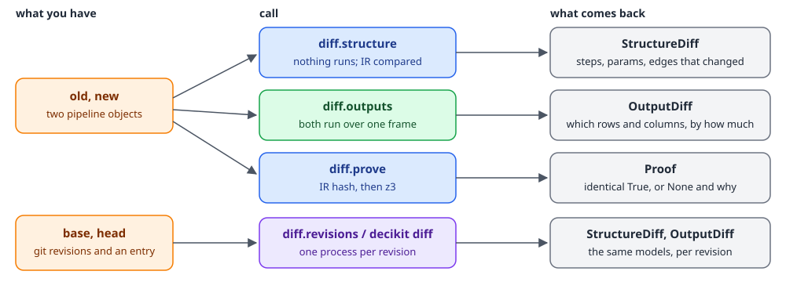
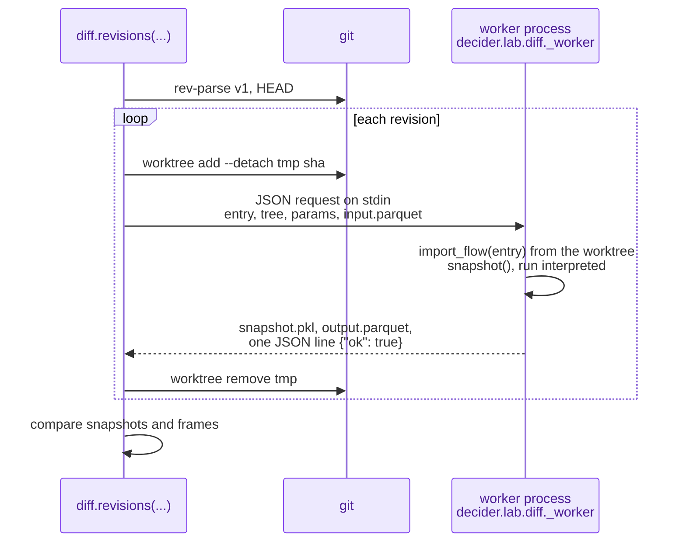

# Comparing versions

Before a new version of a policy ships, someone asks three questions: what changed in the code, which decisions change because of it, and is a refactor really only a refactor. `decider.lab.diff` answers each one without you writing comparison code.

| Question | Call | Runs the flow? |
|---|---|---|
| What changed: steps, params, wiring? | `diff.structure(old, new)` | no |
| Which rows and columns change over this data, and by how much? | `diff.outputs(old, new, frame, key=...)` | yes, both versions, interpreted |
| The same between two git revisions | `diff.revisions(base, head, entry=...)` or `decider diff` | yes, each in its own process |
| Do the two compute the same thing for every input? | `diff.prove(old, new)` | no |

Two neighbouring tools answer different questions. `decider.lab.testing.assert_equivalent` checks that the execution modes of one version agree ([Debugging and testing](debugging-and-testing.md)). [Experiments](experiments.md) run many scenarios over a population batch by batch and measure them with metrics; they reuse `diff`'s comparison of values.

<div class="diagram" markdown>


*Which call takes what, and what it returns.*
</div>

The examples use two versions of a small credit flow. The new one adds a 50 fee to the debt before taking the ratio, and raises the default limit:

```python
import polars as pl
from decider import flow, param, step
from decider.lab import diff

@step(id="0a0a0a0a0a01")
def ratio(income: float, debt: float) -> float:
    return debt / income

@step(id="0a0a0a0a0a02")
def approved(ratio: float, limit: float = param(0.4, ge=0.0, le=1.0)) -> bool:
    return ratio <= limit

@step(output="ratio", name="ratio", id="0a0a0a0a0a01")
def ratio_with_fee(income: float, debt: float) -> float:
    return (debt + 50.0) / income

@step(output="approved", name="approved", id="0a0a0a0a0a02")
def approved_v2(ratio: float, limit: float = param(0.45, ge=0.0, le=1.0)) -> bool:
    return ratio <= limit

old = flow(ratio, approved, name="credit", id="0a0a0a0a0a00")
new = flow(ratio_with_fee, approved_v2, name="credit", id="0a0a0a0a0a00")
```

## What changed: `structure`

`diff.structure(old, new)` compares the two pipelines' IR. Nothing runs.

```python
s = diff.structure(old, new)
print("identical:", s.identical)
for c in s.changed_steps:
    print("changed", c.ref.path, {k: getattr(c, k) for k in ("code", "consts", "inputs", "outputs", "params")})
for p in s.params:
    print("param", p.ref.path, p.name, p.field, p.old, "->", p.new)
print("added", s.added, "removed", s.removed, "renamed", s.renamed, "edges", s.edges)
```

```text
identical: False
changed credit/ratio {'code': True, 'consts': False, 'inputs': False, 'outputs': False, 'params': False}
changed credit/approved {'code': False, 'consts': False, 'inputs': False, 'outputs': False, 'params': True}
param credit/approved limit default 0.4 -> 0.45
added () removed () renamed () edges ()
```

A `StructureDiff` holds:

| Field | Contents |
|---|---|
| `added`, `removed` | `StepRef`s of nodes only in the new or only in the old version |
| `renamed` | `StepMove(old, new)` for a matched node whose name changed |
| `moved` | `StepMove(old, new)` for a matched node whose parent changed |
| `changed_steps` | `StepChange(ref, code, consts, inputs, outputs, params)`: which parts of a matched node differ |
| `params` | `ParamChange(ref, name, field, old, new)`; `field` is `added`, `removed`, `annotation`, `default`, `bounds`, `shared_key` or `on_invalid` |
| `edges` | `EdgeChange(change, edge)`: data edges added or removed (a step now reads a value from a different step) |
| `identical` | `True` only when the two IR content hashes are equal |

`code` covers the function's bytecode, constants, closure and referenced globals (the same fingerprint the numba cache uses), so editing a helper a step calls marks the step changed. `consts` covers values baked into a node, such as a tree's thresholds or a table's rows.

### How steps are matched

Steps match by durable id first, then by path. With ids committed, a rename is a rename:

```python
def ratio(income: float, debt: float) -> float:
    return debt / income

tagged = flow(step(output="ratio", id="0123abcdef45")(ratio), name="credit")
renamed = flow(step(output="ratio", id="0123abcdef45", name="debt_to_income")(ratio), name="credit")
s = diff.structure(tagged, renamed)
print(s.identical, [(m.old.path, m.new.path) for m in s.renamed], s.added, s.removed)

untagged_old = flow(step(output="ratio")(ratio), name="credit")
untagged_new = flow(step(output="ratio", name="debt_to_income")(ratio), name="credit")
s = diff.structure(untagged_old, untagged_new)
print(s.identical, [r.path for r in s.added], [r.path for r in s.removed], s.renamed)
```

```text
True [('credit/ratio', 'credit/debt_to_income')] () ()
True ['credit/debt_to_income'] ['credit/ratio'] ()
```

Without ids, the renamed step shows as one removed and one added. `identical` is `True` in both cases, because names and paths are labels and are not hashed: the two versions compute the same thing. Run [`decider ids`](cli-and-mcp.md) once and commit the result so diffs, traces and experiments can follow a step through renames, extractions and reordering ([Decision tracing](tracing.md) explains durable ids).

!!! warning "Trees and decision tables always show as changed"
    The hash of a tree or decision-table step includes values that differ on every build, so such a step is reported in `changed_steps` (with `code`, and for tables `consts`) and `identical` is `False` even when nothing in its document changed, even for the same object compared with itself. `decider diff` without `--data` therefore reports `structure: differs` and exits 1 for any pipeline with a tree or table. Use `--data` (which judges by outputs) or `diff.prove`, whose z3 tier compares the documents themselves.

## Which records change: `outputs`

`diff.outputs(old, new, frame, key=...)` runs both versions over one frame (interpreted, each with its own param defaults unless you pass `params=`) and reports what differs:

```python
frame = pl.DataFrame({"application_id": ["a", "b", "c", "d"], "income": [1000.0, 500.0, 2000.0, 800.0],
                      "debt": [350.0, 150.0, 900.0, 100.0]})
o = diff.outputs(old.emit("ratio"), new.emit("ratio"), frame, key="application_id")
print(o.rows_compared, o.rows_changed, o.added_columns, o.removed_columns)
print(o.columns["ratio"])
print(o.table())
```

```text
4 4 [] []
changed=4 max_abs=0.10000000000000003 max_rel=0.5 mean_delta=0.05937500000000001 dtype_change=None samples=[{'application_id': 'a', 'old': 0.35, 'new': 0.4}, {'application_id': 'b', 'old': 0.3, 'new': 0.4}, {'application_id': 'c', 'old': 0.45, 'new': 0.475}, {'application_id': 'd', 'old': 0.125, 'new': 0.1875}]
shape: (4, 5)
┌────────────────┬────────┬───────┬────────┬────────┐
│ application_id ┆ column ┆ old   ┆ new    ┆ delta  │
│ ---            ┆ ---    ┆ ---   ┆ ---    ┆ ---    │
│ str            ┆ str    ┆ str   ┆ str    ┆ f64    │
╞════════════════╪════════╪═══════╪════════╪════════╡
│ a              ┆ ratio  ┆ 0.35  ┆ 0.4    ┆ 0.05   │
│ b              ┆ ratio  ┆ 0.3   ┆ 0.4    ┆ 0.1    │
│ c              ┆ ratio  ┆ 0.45  ┆ 0.475  ┆ 0.025  │
│ d              ┆ ratio  ┆ 0.125 ┆ 0.1875 ┆ 0.0625 │
└────────────────┴────────┴───────┴────────┴────────┘
```

`approved` is not in `columns` because no record's decision flipped on this frame: the fee and the higher limit cancel out for these four. `columns` lists only columns with at least one changed row (or a changed dtype).

| `OutputDiff` | Meaning |
|---|---|
| `rows_compared`, `rows_changed` | rows in the frame, and rows where any shared column changed |
| `columns[name]` | a `ColumnDiff` per changed column |
| `added_columns`, `removed_columns` | output columns only one version has |
| `table()` | a polars frame, one row per changed value: key (or `row`), `column`, `old`, `new`, `delta` |

| `ColumnDiff` | Meaning |
|---|---|
| `changed` | rows where this column differs |
| `max_abs`, `max_rel`, `mean_delta` | over numeric deltas (`new - old`), ignoring nulls and non-finite values; `max_abs` is an exact int for an integer column |
| `dtype_change` | `(old_dtype, new_dtype)` when the dtype changed |
| `samples` | the first five changed rows: key, old, new |

Comparison rules: floats compare with `is_close` (`rtol=1e-6`, `atol=1e-9`, both arguments of `outputs`), NaN equals NaN; everything else compares exactly; null equals only null. Two columns that cannot be compared (a number against a string) count every row as changed.

`key` names a column of the output that labels rows in `samples` and `table()`; without it rows are numbered (`row`). A key that is not an output column raises `ValueError: key 'x' is not a column of the output; columns: [...]`. The two versions must produce the same number of rows; a frame step that filters rows differently raises `ValueError: the versions produced N and M rows from one frame; can't align them`.

Intermediates are dropped from a flow's output unless emitted, which is why the example compares `old.emit("ratio")` with `new.emit("ratio")`. Emit what you want compared.

## Between git revisions: `revisions` and `decider diff`

Usually the old version is a commit, not an object in your notebook. `diff.revisions(base, head, entry="module:attr")` checks out each revision into a temporary git worktree and loads its pipeline in a fresh Python process, so the two never share imported modules. `structure()` compares them; `outputs(frame, key=...)` runs both over the frame.



```python
from decider.lab import diff
from decider.lab.data import dataset

frame = dataset("applications").load().frame
r = diff.revisions("v1", "HEAD", entry="lending.pipeline:build")
o = r.outputs(frame, key="application_id")
print(o.rows_changed, o.columns["approved"].changed)
```

```text
567 69
```

A fresh process is what makes this correct. A pipeline module that is already imported cannot be imported again under the same name from another directory, so loading both revisions into one process would silently run the live code twice; the experiment-revision isolation note records that bug and the measured cost of the fix, about 0.5 s for the checkout plus 0.8 s for the new process per revision. The worker uses the decider installed in your environment, not the one the old revision pinned.

The same from the command line:

```bash
decider diff v1 v2 lending.pipeline:build --data applications --key application_id
```

```text
structure: differs
  changed lending/risk_band: code, consts
  changed lending/approved: params
  changed lending/credit_limit: code, inputs
  param lending/approved.max_ratio default: 0.35 -> 0.4
outputs: 567 of 2000 rows changed
  credit_limit: 567 changed, max abs 31154.339999999997
  approved: 69 changed
```

`BASE` and `HEAD` are anything git resolves (`main`, `HEAD^`, a tag, a SHA). `--data` is a file path or a dataset name ([Data and datasets](data-and-datasets.md)); `--format json` prints `{"structure": ..., "outputs": ...}` with the models above. The exit status is 1 when something differs and 0 when nothing does. With `--data`, "differs" means some row or column changed; without it, it means the structure is not identical (see the warning above for trees and tables). Run it from the repository root, with the pipeline's package importable from there.

Errors come back as one line: `Error: revision 'v9' did not resolve`, or `Error: revision 'v1': ModuleNotFoundError: No module named 'lending.nope'` when the entry does not import at that revision.

## Is it only a refactor: `prove`

`diff.prove(old, new)` returns a `Proof`. Its `identical` is `True` only when decider can prove both versions compute the same outputs for every input; otherwise it is `None`, never `False`, because nothing here proves two versions different in general. It never claims equivalence from sampled rows.

<div class="diagram" markdown>


*Two tiers can prove; everything else comes back as `identical=None` with a reason.*
</div>

| Tier | When | `identical` | `evidence` |
|---|---|---|---|
| `"ir_hash"` | the IR content hashes are equal | `True` | `None` |
| `"smt"` | only trees and decision tables changed, and z3 found no input on which they differ | `True` | `SmtEvidence(modelled, steps)` |
| `"smt"` | z3 found an input on which a changed step differs | `None` | `SmtEvidence(..., step, counterexample)` |
| `"none"` | anything else | `None` | the `StructureDiff`, plus `reason` |

### Tier 1: equal IR hashes

A rename with durable ids, or rebuilding the same code, keeps the hash:

```python
print(diff.prove(tagged, renamed))
print(diff.prove(old, new).model_dump(exclude={"evidence"}))
```

```text
tier='ir_hash' identical=True evidence=None reason=None
{'tier': 'none', 'identical': None, 'reason': 'a param declaration differs, and z3 compares only params-free trees and tables'}
```

Any change to a step's code, however equivalent it is in meaning, changes its fingerprint. Arbitrary Python cannot be proven equivalent, so `x * 2` rewritten as `x + x` comes back as tier `none`.

### Tier 2: z3 over trees and decision tables

With the `prove` extra installed (`pip install 'decider[prove]'`, which brings `z3-solver`), `prove` encodes each changed tree or decision-table step as z3 terms and asks for an input row on which the old and new step write different outputs. The tutorial [Compare two policy versions](../walkthroughs/compare-two-policy-versions.md) splits one band of a decision table into two rows, then makes a slip:

```text
# band B split at 650, the same bands as before
smt True ('lending/risk_band',)

# band B now ends at 690 and A starts there
smt None lending/risk_band {'bureau_score': 696.0000000000002}
lending/risk_band: z3 found an input on which the step differs; it judges the step alone, so the flow around it may never produce that input
```

The counterexample is an input row for the step on its own (a `None` in it is a null). It is a real difference in that step, and decider re-runs both steps on it to confirm before reporting it. Whether the surrounding flow can ever produce that row is a separate question: an earlier step may never let a score of 696 through.

What z3 models, from `SmtEvidence.modelled`:

- float features as IEEE float64 (NaN is a null); int features as int64 with a separate null flag; bool and string features with a null flag.
- tree conditions with the walker's three-valued logic: a test on a null is unknown, and a node takes its otherwise branch on unknown.
- computed features built from `+ - *`, unary `-` and `abs` over float64.
- string matches: exact, starts_with, ends_with and contains, case-sensitive and untrimmed.
- tables with inline rows; a null input never matches; the first matching row wins.

Anything outside that makes the step unencodable and the proof falls back to tier `none` with the reason; it never guesses. That covers params inside a tree or table, `null_handling="error"`, `trace_output`, regex or case-insensitive matches, rows from a params document, division in a computed feature, and a step that is neither a tree nor a table. Each z3 query has a 10 second limit.

The other conditions for tier 2 come from the structure diff: no param declaration changed, and no step was added, removed, renamed or moved, and no data edge changed. When one of those fails, `reason` says which, for example `"the pipelines differ in more than the contents of steps, which z3 can't compare"`.

Without the extra, `prove` stops at tier 1 and says `install decider[prove] to compare trees and decision tables with z3`. Because of the warning above, that includes an unchanged pipeline that contains a tree or table.

### What `prove` does not do

`prove` has no sampling or enumeration tier. Running both versions over data is evidence, not proof, and lives in `diff.outputs` and experiments. Proving that arbitrary Python steps agree is not attempted. For those, compare outputs over a population that covers the cases you care about, and add the [corpus](debugging-and-testing.md) of boundary values to it.

## The same encoding in checks

The z3 encoding also powers the `unreachable_branch` check (DCD201), which reports tree branches and table rows no input can reach, and the table overlap and gap findings (DCD207, DCD208). See [Checks](checks.md).

## Next

- [Tutorial: compare two policy versions](../walkthroughs/compare-two-policy-versions.md) walks through structure, outputs, revisions, a proof and an experiment on one project.
- [Experiments](experiments.md) compare whole scenarios over a population, with metrics and plots.
- [Lab: diff](../architecture/lab/diff.md) covers the hashing and the z3 encoding in depth.
