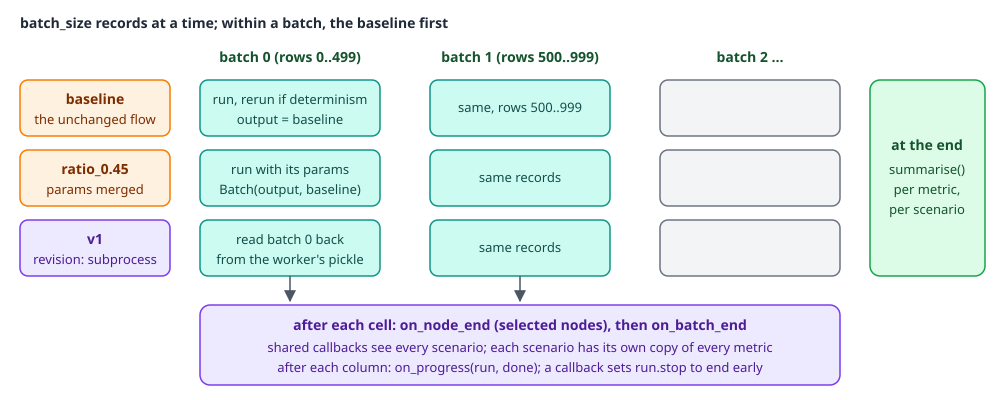
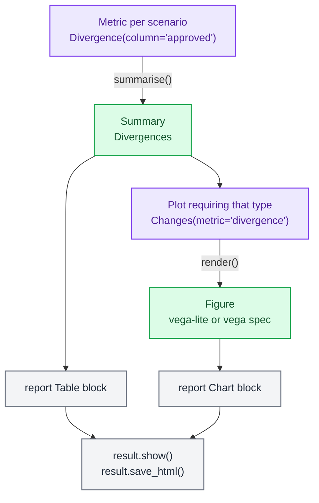

# Experiments

An experiment answers "what happens to the population if we change this": a tighter limit, a stressed income, the version on another branch. It runs the unchanged flow (the baseline) and each scenario over the same records, batch by batch, and measures them with metrics. The result holds a typed summary per metric per scenario, the charts drawn from them, and a manifest saying exactly which code, revision and data produced it.

```python
from credit import pipeline, frame
from decikit.lab.experiments import Experiment
from decikit.lab.experiments.metrics import Divergence, ValueCounts
from decikit.lab.experiments.plots import Changes

result = (Experiment("limits", pipeline, frame)
          .scenario("standard_0.28", params={"credit": {"policy": {"standard": {"limit": 0.28}}}})
          .metric(Divergence(column="approved"), ValueCounts(column="approved"))
          .plot(Changes(metric="divergence"))
          .run())
result.summaries["divergence"]["standard_0.28"].changed     # 1 of 6 records changed
result.show()                                                # in a notebook
```

Plots need altair: `pip install 'decikit[experiments]'`.

The examples on this page use this flow. Thin-file customers (under 12 months on book) get a stricter ratio limit; everyone approved gets an offer of twice their income.

```python
# credit.py
import polars as pl
from decikit import branch, flow, param, step


def ratio(income: float, debt: float) -> float:
    return debt / income if income > 0 else 1.0


def thin_file(months_on_book: int) -> bool:
    return months_on_book < 12


@step(output="approved")
def strict(ratio: float, limit: float = param(0.3, ge=0.0, le=1.0)) -> bool:
    return ratio <= limit


@step(output="approved")
def standard(ratio: float, limit: float = param(0.4, ge=0.0, le=1.0)) -> bool:
    return ratio <= limit


def offer(approved: bool, income: float, multiple: float = param(2.0, ge=0.0)) -> float:
    return income * multiple if approved else 0.0


pipeline = flow(ratio, branch(thin_file, strict, standard, modifies=["approved"], name="policy"), offer,
                name="credit").emit("ratio", "approved")

frame = pl.DataFrame({
    "income":         [1000.0, 500.0, 2000.0, 800.0, 1200.0, 3000.0],
    "debt":           [ 350.0, 150.0,  900.0, 100.0,  300.0,  600.0],
    "months_on_book": [     6,    24,     36,     3,     18,     48],
})
```

## How a run works

<div class="diagram" markdown>


*The runner only executes. Everything it measures, it measures through hooks.*
</div>

For each batch of `batch_size` records (100,000 by default), the runner runs the baseline, then every scenario, over the same records. After each run it calls the hooks of the callbacks and metrics with that scenario's output next to the baseline's. No metric ever needs the whole input in memory, and progress shows batch by batch. Before the first batch it runs the `missing_required` and `invalid_params_doc` [checks](checks.md) on the first batch and keeps the report as `result.preflight`.

A flow runs fused unless a metric or callback reads individual nodes, or a scenario overrides a produced value; then it runs one compiled kernel per node (stepped), which is still compiled.

## Scenarios

A scenario is one controlled change, run next to the baseline. The baseline is always first and always named `baseline`.

| Field | Effect |
|---|---|
| `params` | merged over the baseline's params document |
| `overrides` with no `at` | replaces input columns before anything runs |
| `overrides` with `at="path"` | replaces values right after the step at `path` has run |
| `row` | applies `overrides` to that one record only (its index in the whole input) |
| `revision` | runs the scenario on another git revision (`"HEAD^"`, a tag, a branch) |

```python
from credit import pipeline, frame
from decikit.lab.experiments import Experiment
from decikit.lab.experiments.metrics import (BranchFlows, Describe, Divergence, Histogram, ValueCounts)
from decikit.lab.experiments.plots import Bars, Changes, Distribution, Ranges, Sankey

result = (Experiment("limits", pipeline, frame, batch_size=4)
          .scenario("standard_0.28", params={"credit": {"policy": {"standard": {"limit": 0.28}}}})
          .scenario("income_up", overrides={"income": 1500.0})
          .scenario("ratio_cap", overrides={"ratio": 0.2}, at="credit/ratio")
          .scenario("one_record", overrides={"debt": 0.0}, row=2)
          .metric(Divergence(column="approved"),
                  ValueCounts(column="approved"),
                  Describe(column="offer"),
                  Histogram(column="offer", bins=4, range=(0.0, 8000.0)),
                  ValueCounts(name="strict_arm", column="approved", nodes="credit/policy/strict"),
                  BranchFlows(outcome="approved"))
          .plot(Changes(metric="divergence"), Bars(metric="value_counts"), Ranges(metric="describe"),
                Distribution(metric="histogram"), Sankey(metric="branch_flows"))
          .run())

print(result.status)
for scenario, s in result.summaries["divergence"].items():
    print("divergence", scenario, s.changed, "of", s.compared, "first", s.first, s.samples[:1])
for scenario, s in result.summaries["value_counts"].items():
    print("value_counts", scenario, s.counts)
```

```text
RunStatus.COMPLETED
divergence baseline 0 of 6 first None []
divergence standard_0.28 1 of 6 first 1 [{'row': 1, 'expected': True, 'actual': False}]
divergence income_up 1 of 6 first 0 [{'row': 0, 'expected': False, 'actual': True}]
divergence ratio_cap 2 of 6 first 0 [{'row': 0, 'expected': False, 'actual': True}]
divergence one_record 1 of 6 first 2 [{'row': 2, 'expected': False, 'actual': True}]
value_counts baseline {'True': 4, 'False': 2}
value_counts standard_0.28 {'False': 3, 'True': 3}
value_counts income_up {'True': 5, 'False': 1}
value_counts ratio_cap {'True': 6}
value_counts one_record {'True': 5, 'False': 1}
```

`ratio_cap` overrides a produced value, so it names where: `at="credit/ratio"`, the step that writes `ratio`. Overriding a produced value without `at`, or overriding a name the flow neither reads nor writes, is caught before anything runs (see [Validation](#validation)). An override is written to every version of the name produced so far, the same way a [debug session](debugging-and-testing.md)'s `set` works, so a branch or loop that reads an earlier version sees it too.

### Revision scenarios

`revision="v1"` runs the scenario on the code at that git revision. The runner resolves it to a SHA, checks it out into a temporary git worktree and runs the scenario there in a fresh Python process over the whole input, then reads the output back batch by batch in step with the other scenarios. A separate process is the only way to load another version of a module that the experiment has already imported; without it the "old" scenario would silently run the live code. Several scenarios on one revision share one checkout. A revision that resolves to the experiment's own `revision` (default `HEAD`) runs in-process.

The subprocess imports the flow by `flow.entry`, the `module:attr` the definition names. The builder infers it when the pipeline is a module-level variable; for a pipeline built by a function, give it with `Experiment.from_def` or in `experiment.json`. The worker uses the decider toolkit installed in your environment. To refuse revisions that need another engine, set `flow.decikit` to a version specifier (`">=1.0,<2.0"`); a mismatch raises before anything runs.

The [tutorial](../walkthroughs/compare-two-policy-versions.md) runs a revision scenario against a real git history.

## Metrics

A metric collects through hooks and reduces to a typed `Summary`. Every scenario gets its own copy, reset before the run. A metric is global (it reads the flow's output in `on_batch_end`) unless it sets `nodes`, a glob on step paths, or `node_id`, a step's durable id; then it reads what the matching steps wrote, in `on_node_end`.

| Metric | `type` | Options | Summary | Fields |
|---|---|---|---|---|
| `Divergence` | `divergence` | `column`, `rtol=1e-6`, `atol=1e-9`, `samples=5` | `Divergences` | `column`, `compared`, `changed`, `first`, `samples` (row, expected, actual) |
| `ValueCounts` | `value_counts` | `column` | `Counts` | `column`, `counts` (value as text to count) |
| `Describe` | `describe` | `column` | `Stats` | `column`, `count`, `nulls`, `mean`, `min`, `max` |
| `Histogram` | `histogram` | `column`, `bins=20`, `range=None`, `edges=None` | `Bins` | `column`, `edges`, `counts`, `below`, `above`, `nulls` |
| `BranchFlows` | `branch_flows` | `outcome`, `nodes="*"` | `Flows` | `outcome`, `nodes`, `links` (Sankey data) |

Every metric also takes `name` (the key in `result.summaries`; defaults to the `type`), `nodes` and `node_id`. Two metrics of one type need different names.

```text
strict_arm {'baseline': {'False': 1, 'True': 1}, 'standard_0.28': {'True': 1, 'False': 1}, 'income_up': {'True': 2}, 'ratio_cap': {'True': 2}, 'one_record': {'True': 1, 'False': 1}}
describe baseline column='offer' count=6 nulls=0 mean=1833.3333333333333 min=0.0 max=6000.0
histogram baseline column='offer' edges=[0.0, 2000.0, 4000.0, 6000.0, 8000.0] counts=[4, 1, 0, 1] below=0 above=0 nulls=0
```

`strict_arm` reads only what `credit/policy/strict` wrote, so it counts the two thin-file records.

`Divergence` compares each scenario's column with the baseline's on the same records: floats with `is_close` (NaN equals NaN), everything else exactly, null equal only to null. `first` and the sample `row`s are indexes into the whole input. On steps, it compares what the matching node wrote, on the records both runs sent through it.

`Histogram` needs fixed bins so every scenario counts into the same ones. Give `edges` or a `range`; without either, the bins span the baseline's first batch, and values a scenario moves outside that span count only as `below` or `above`.

### Your own metric

Subclass `Metric` with a `type` alias, a `Summary` subclass for its result, and the hooks you need:

```python
import typing as t
from decikit.lab.experiments.metrics import Metric, Summary

class Total(Summary):
    column: str
    total: float

class SumOf(Metric):
    type: t.Literal["sum_of"] = "sum_of"
    summary: t.ClassVar = Total
    column: str

    def reset(self):
        self._total = 0.0

    def on_batch_end(self, batch):
        if not self.on_steps:
            self._total += float(batch.output[self.column].sum())

    def summarise(self):
        return Total(column=self.column, total=self._total)

result = (Experiment("book", pipeline, frame, batch_size=4)
          .scenario("multiple_3", params={"credit": {"offer": {"multiple": 3.0}}})
          .metric(SumOf(name="book", column="offer"))
          .run())
print({k: v.total for k, v in result.summaries["book"].items()})
```

```text
{'baseline': 11000.0, 'multiple_3': 16500.0}
```

A metric is a registry model, so it loads from `experiment.json` by its `type` once its module is imported, or by `"package.module:Class"`. Ship it in a package under the `decikit.metrics` entry-point group to make the alias work everywhere ([Extending the decider toolkit](extending.md)).

## Plots

A plot draws one metric's summaries, one per scenario. Each plot declares the `Summary` type it can draw, and the experiment checks that before running.



| Plot | `type` | Draws | Options |
|---|---|---|---|
| `Changes` | `changes` | `Divergences`: records changed per scenario | |
| `Bars` | `bars` | `Counts`: records per value per scenario | `layout`: `side_by_side`, `stacked`, `rows` |
| `Distribution` | `distribution` | `Bins`: a histogram per scenario | `layout`: `overlay`, `stacked`, `side_by_side`, `rows` |
| `Ranges` | `ranges` | `Stats`: min to max with the mean | |
| `Sankey` | `sankey` | `Flows`: records through branch arms into outcomes | `scenario="baseline"` |

All take `metric` (the metric's name), `name` (defaults to the metric's name) and `width`/`height`. `result.plots[name]` is a `Figure` with `grammar` (`"vega-lite"`, or `"vega"` for the Sankey, which Vega-Lite cannot express) and the full `spec`; `.show()` draws it in a notebook.

```text
{'divergence': 'vega-lite', 'value_counts': 'vega-lite', 'describe': 'vega-lite', 'histogram': 'vega-lite', 'branch_flows': 'vega'}
```

A plot of your own subclasses `Plot` (`from decikit.lab.experiments.plots import Plot, require_altair`), sets `requires` to the summary type and returns an altair chart or a Vega spec dict from `render(summaries)`.

## Reports

`result.show()` draws a report in a notebook and `result.save_html(path)` writes it as one HTML page whose charts load Vega from a CDN. Without a layout, the report is an overview and a section per metric (its table and every plot that draws it). `.report(...)` lays out your own from blocks in `decikit.lab.experiments.report`:

| Block | Shows |
|---|---|
| `Overview()` | status, size, revision, and a table of the scenarios and what each changed |
| `Text(markdown=...)` | prose; raw HTML is shown as text |
| `Table(metric=...)` | one metric's summaries, a row per scenario |
| `Chart(plot=...)` | one plot |
| `MetricSection(metric=...)` | a metric's heading, table and plots |
| `Row(blocks=[...])` | blocks side by side |
| `Section(title=..., blocks=[...])` | a titled group |

```python
from decikit.lab.experiments.report import Chart, Overview, Section, Table, Text

experiment.report(
    Overview(),
    Section(title="Approvals", blocks=[Table(metric="value_counts"), Chart(plot="value_counts")]),
    Section(title="What changed", blocks=[Text(markdown="Records whose decision differs from the baseline."),
                                          Table(metric="divergence"), Chart(plot="divergence")]),
    title="Policy v2 review")
```

The layout is saved with the definition, so a UI edits it like the metrics. A block that names a metric or plot the experiment does not have is a validation problem.

## Callbacks

A `Callback` sees every scenario; metrics are callbacks copied per scenario. Override the hooks you need:

| Hook | Called |
|---|---|
| `on_run_start(run)` | once, before the first batch |
| `on_node_end(node)` | after a selected node runs, for a callback with `nodes` or `node_id` |
| `on_batch_end(batch)` | after each scenario's run of each batch |
| `on_progress(run, done)` | after every scenario has run the batch ending at record `done` |
| `on_run_end(run)` | once, with `run.status` set |

`Batch` carries `scenario`, `index`, `offset` (the first record's index in the whole input), `output` and the `baseline` output for the same records. `NodeBatch` carries `path`, `id`, `values` (a column per name the node wrote), `rows` (batch positions it ran on), `arm`, `iteration` and the baseline's `NodeBatch` for the same node. `Run` carries `name`, `step`, `scenarios`, `total` and `batch_size`; set `run.stop = "cancelled"` or `"timed_out"` to end the run after the current batch.

```python
from decikit.lab.experiments.callbacks import Callback

class Log(Callback):
    def on_run_start(self, run):
        print("start", run.name, run.scenarios, run.total, run.batch_size)
    def on_batch_end(self, batch):
        print("  batch", batch.scenario, batch.index, batch.offset, batch.output.height)
    def on_run_end(self, run):
        print("end", run.status)

(Experiment("book", pipeline, frame, batch_size=4)
 .scenario("multiple_3", params={"credit": {"offer": {"multiple": 3.0}}})
 .callback(Log())
 .run())
```

```text
start book ('baseline', 'multiple_3') 6 4
  batch baseline 0 0 4
  batch multiple_3 0 0 4
  batch baseline 1 4 2
  batch multiple_3 1 4 2
end completed
```

Built in: `Progress()` prints records done and elapsed time after each batch, and `WriteOutputs(out_dir)` writes each scenario's output to `<out_dir>/<scenario>/<batch>.parquet` (passing `out_dir=` to `run` adds it for you). Callbacks are not saved with the definition.

## Results

`run()` returns an `ExperimentResult`:

| Field | Contents |
|---|---|
| `status` | a `RunStatus` (below) |
| `scenarios` | a `ScenarioResult` per scenario: `status`, `error`, `revision`, `params`, `overrides`, `at`, `row`, `records`, `output_ref` |
| `summaries` | `{metric: {scenario: Summary}}` for scenarios that completed |
| `plots` | `{plot: Figure}` |
| `nondeterministic` | the baseline gave a different answer when rerun on the same batch |
| `preflight` | the checks `Report` from before the run |
| `cost` | `CostEstimate(rows, calls, frame_calls)`; `row_operations` is rows times non-frame calls |
| `manifest` | a `RunManifest`: id, flow reference, revision (authored and resolved SHA), Python and the decider toolkit versions, input fingerprint, output locations |
| `definition` | the `ExperimentDef` that ran |

| `RunStatus` | Means |
|---|---|
| `COMPLETED` | every scenario finished |
| `PARTIAL` | at least one scenario failed; the others ran (a failing scenario never stops the rest) |
| `FAILED` | the baseline failed; the run stopped |
| `NON_REPRODUCIBLE` | a rerun of a baseline batch differed |
| `CANCELLED`, `TIMED_OUT` | stopped early; summaries cover the batches that ran |

None of these reads as `COMPLETED`, so a partial or noisy run never passes for a clean one.

`determinism=True` (the default) reruns every baseline batch and compares. A step that reads randomness shows up straight away:

```python
import random
import polars as pl
from decikit import flow

def jitter(score: float) -> float:
    return score + random.random()

result = (Experiment("noisy", flow(jitter, name="noisy"), pl.DataFrame({"score": [1.0, 2.0]}))
          .metric(ValueCounts(column="jitter")).run())
print(result.status, result.nondeterministic)
```

```text
RunStatus.NON_REPRODUCIBLE True
```

The `wall_clock` check (DCD001) finds such steps statically.

The manifest's input fingerprint is filled in when the input is an in-memory frame. For a lazily scanned input (`input.path` or `input.dataset`), the manifest records the dataset name, columns and row count, and `fingerprint` is `None`.

## Saving and running headlessly

The definition is data: `ExperimentDef`, saved as `experiment.json`. `Experiment.save(path)` writes it (inferring `flow.entry` when it can) and `Experiment.load(path)` reads it back, importing the flow from `flow.entry` and scanning `input.path` (relative to the JSON file) or `input.dataset` (from the project holding it) unless you pass `step=` and `frame=`.

```python
from decikit.lab.experiments import ExperimentDef
from decikit.lab.experiments.metrics import Divergence

definition = ExperimentDef(
    name="policy_v2",
    flow={"entry": "lending.pipeline:build"},
    input={"dataset": "applications"},
    batch_size=500,
    scenarios=[{"name": "v1", "revision": "v1"},
               {"name": "ratio_0.45", "params": {"lending": {"approved": {"max_ratio": 0.45}}}}],
    metrics=[Divergence(column="approved")],
)
```

```json
{
  "version": "2",
  "name": "policy_v2",
  "description": "",
  "flow": {"entry": "lending.pipeline:build", "decikit": ""},
  "revision": "HEAD",
  "input": {"path": "", "dataset": "applications"},
  "scenarios": [
    {"name": "v1", "revision": "v1", "params": {}, "overrides": {}, "at": null, "row": null},
    {"name": "ratio_0.45", "revision": null, "params": {"lending": {"approved": {"max_ratio": 0.45}}},
     "overrides": {}, "at": null, "row": null}
  ],
  "metrics": [{"type": "divergence", "name": "", "nodes": null, "node_id": null, "column": "approved",
               "rtol": 1e-6, "atol": 1e-9, "samples": 5}],
  "plots": [],
  "batch_size": 500,
  "determinism": true,
  "report": null
}
```

| `ExperimentDef` field | Default | Meaning |
|---|---|---|
| `version` | `"2"` | the format; a newer one than the decider toolkit supports is refused |
| `name`, `description` | | labels |
| `flow.entry`, `flow.decikit` | | `module:attr` of the pipeline; a version specifier for the decider toolkit |
| `revision` | `"HEAD"` | the baseline's revision, recorded in the manifest |
| `input.path` or `input.dataset` | | a `.parquet`, `.csv`, `.json` or `.jsonl` file, or a [dataset](data-and-datasets.md) name; not both |
| `scenarios`, `metrics`, `plots`, `report` | empty | as above |
| `batch_size` | 100000 | records per batch |
| `determinism` | `true` | rerun baseline batches and flag a difference |

Run a saved definition from Python with `decikit.lab.experiments.run(path, out_dir=...)`, or from the command line:

```bash
decikit experiment run experiments/policy_v2/experiment.json --out results/policy_v2
```

```text
policy_v2: completed
  baseline: completed
  v1: completed
  ratio_0.45: completed
results in results/policy_v2/result.json
```

The command exits 0 only when the status is `completed`. `--out` gets `result.json` (the whole `ExperimentResult`) and a folder of Parquet outputs per scenario; read one back with `pl.scan_parquet("results/policy_v2/baseline/*.parquet")` and `ExperimentResult.model_validate_json(...)` for the result. A summary read back from JSON loads as the base `Summary` with its fields intact (`s.changed` still works), because the JSON does not name the subclass. `decikit` does not own where results go; you choose `out_dir`.

## Background runs and jobs

`start()` runs an experiment in a background thread and returns a `RunHandle`:

```python
handle = Experiment.load("experiment.json", step=pipeline, frame=frame).start()
r = handle.result()               # waits; raises what the run raised
print(handle.status, handle.progress, r.status)
```

```text
JobStatus.SUCCEEDED 1.0 RunStatus.COMPLETED
```

`handle.status` is a `JobStatus` (`QUEUED`, `RUNNING`, then `SUCCEEDED`, `FAILED`, `CANCELLED` or `TIMED_OUT`), `handle.progress` the fraction of records done (`None` before the total is known), `handle.cancel()` stops after the batch in progress and `handle.result(timeout=None)` waits for the `ExperimentResult`. A cancelled run returns a result with status `CANCELLED` and the summaries of the batches that ran. `decikit.lab.experiments.start(path)` does the same for a saved definition.

The handle wraps a `JobHandle`, the decider toolkit's general controller for finite work, whose immutable snapshot `Job` (`job_id`, `kind`, `status`, `done`, `total`, `logs`, `error`, `partial`, `result`) is the form VS Code and the MCP server read; `result.job` holds the final snapshot.

## Validation

`decikit.lab.experiments.validate(definition, step)` returns every problem with a definition instead of raising on the first, and `run()` raises a `ValueError` joining them all before anything executes:

```python
bad = (Experiment("bad", pipeline, frame)
       .scenario("baseline", params={})
       .scenario("ratio_up", overrides={"ratio": 0.5})
       .scenario("nope", overrides={"salary": 1.0})
       .metric(ValueCounts(column="approved"), SumOf(column="offer"))
       .plot(Changes(metric="value_counts"), Bars(metric="missing")))
for p in validate(bad.def_, pipeline):
    print("problem:", p)
```

```text
problem: 'baseline' is the unchanged run; give the scenario another name
problem: ratio_up: override 'ratio' is produced, not an input; declare 'at: <step path>'
problem: nope: override 'salary' is neither an input nor a produced value
problem: plot 'value_counts' needs a Divergences summary; metric 'value_counts' gives Counts
problem: plot 'missing' draws metric 'missing', which the experiment doesn't collect
```

It also catches duplicate scenario, metric and plot names, a `nodes` glob or `node_id` that matches no step, a revision scenario with no importable `flow.entry`, and report blocks that name missing metrics or plots.

## Next

- [Tutorial: compare two policy versions](../walkthroughs/compare-two-policy-versions.md) runs a revision scenario and checks the result against `decikit.lab.diff`.
- [Comparing versions](diff-and-equivalence.md) for record-level and proof-level comparison.
- [Experiments internals](../architecture/lab/experiments.md) for the runner, the worker process and the registries.
