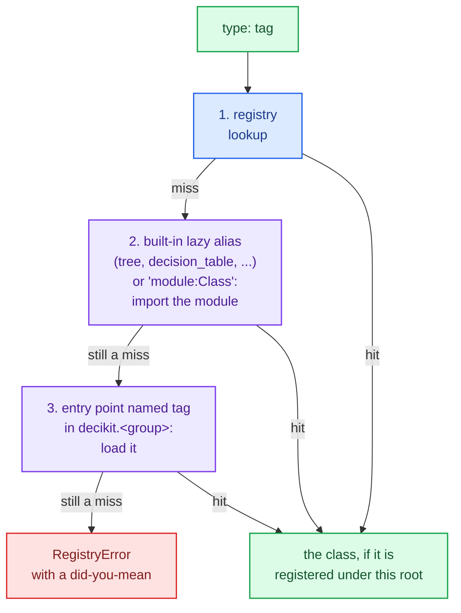

# Extending the decider toolkit

The decider toolkit has a small number of extension points, and each is an ordinary Python class you subclass. A step type of your own loads from JSON like a tree or a table. A check runs in `decikit check` beside the built-in ones. A dataset provider reads records from your warehouse. A trace adapter sends decision evidence where your audit store wants it. A config store keeps versions in a database instead of a folder. Each of them can live in your project, or ship in an installed package that decider toolkit finds without anyone importing it.

## How config finds your classes

Configurable steps, checks, dataset providers, config stores, experiment metrics, plots and report blocks are each a registry root. A subclass registers itself when its class is defined, under its import path (`"credit_steps.steps:CappedMarkup"`) and under the short alias it declares as `type: Literal["capped_markup"] = "capped_markup"`. A document names the class by either spelling in its `type` field.

<div class="diagram" markdown>


*Every registry root resolves a `type` tag the same way.*
</div>

`resolve(tag)` looks the tag up in this order:



Only a class registered under that root is ever returned, so a config document cannot name arbitrary code:

```text
'os:system' is not a registered ConfigurableStep type. Import the module that defines it first, or name it by import path, '<module>:<Class>'.
```

Two classes claiming one alias is an error at class definition. Redefining a class at the same import path (a notebook re-run) replaces it. Tags resolve by dictionary lookup at validation time, so a late registration is never lost, and nested steps keep their own fields when dumped.

## A step type of your own

Subclass `ConfigurableStep`, declare the fields the document holds, and implement `to_ir`. For most step types `to_ir` is one call: `ctx.call(self, fn, ...)` runs a plain function per row, reading the function's signature the way `step(fn)` does.

```python
from typing import Literal

from decikit import ConfigurableStep, Value


def capped_markup(amount: float, rate: float, cap: float) -> float:
    return min(amount * rate, cap)


class CappedMarkup(ConfigurableStep):
    """A markup of `column` at `rate`, capped at `cap`; either can be a param."""

    type: Literal["capped_markup"] = "capped_markup"
    column: str
    rate: Value[float] = 0.1
    cap: Value[float] = 1000.0

    def to_ir(self, ctx):
        return ctx.call(self, capped_markup, inputs={"amount": self.column},
                        values={"rate": self.rate, "cap": self.cap})
```

`ctx.call(owner, fn, inputs=, outputs=, values=)`:

- `inputs` maps a function argument to the column it reads, for arguments that don't read the column of their own name.
- `outputs` names what `fn` writes; the default is the step's `name`. Several outputs need a `tuple[...]` return annotation.
- `values` maps a function argument to a `Value[T]` field. A literal (`165.0`) is passed as a constant; a `{"param": "fee_rate", "default": 0.15}` reference becomes a param of the step, so retuning it never rebuilds anything.

Every `ConfigurableStep` also has `name` (required), `id` (a durable id) and `suppress_checks`. Configs are frozen and forbid unknown fields, so a misspelt key in a document is an error. `model_dump(mode="json")` round-trips through `ConfigurableStep.load`.

To build a step type out of other steps, return `ctx.expand(self, helper)`. The helper's nodes sit under the step's name. A field typed `list[StepRef]` holds other configured steps of any registered type:

```python
from typing import Literal
import polars as pl
from decikit import ConfigurableStep, StepRef, flow, param


def disposable(income: float, expenses: float) -> float:
    return income - expenses


def affordable(disposable: float, instalment: float, buffer: float = param(0.2)) -> bool:
    return instalment <= disposable * (1.0 - buffer)


class Affordability(ConfigurableStep):
    """Two plain steps packaged as one configurable step."""

    type: Literal["affordability"] = "affordability"

    def to_ir(self, ctx):
        return ctx.expand(self, flow(disposable, affordable))


class Gate(ConfigurableStep):
    """Runs other configured steps, in order; each can be any registered type."""

    type: Literal["gate"] = "gate"
    steps: list[StepRef]

    def to_ir(self, ctx):
        return ctx.expand(self, flow(*self.steps))


gate = ConfigurableStep.load({"type": "gate", "name": "checks", "steps": [
    {"type": "affordability", "name": "afford"},
    {"type": "decision_table", "name": "band", "columns": {"lo": "Float64", "hi": "Float64", "band": "String"},
     "rows": [{"lo": None, "hi": 600.0, "band": "C"}, {"lo": 600.0, "hi": None, "band": "A"}],
     "expression": {"type": "between", "variable": "score", "lower_bound_column": "lo", "upper_bound_column": "hi"},
     "outputs": ["band"]}]})
df = pl.DataFrame({"income": [5000.0, 3000.0], "expenses": [2000.0, 2500.0], "instalment": [1000.0, 1000.0],
                   "score": [650.0, 550.0]})
print(flow(gate, name="app").run(df))
print(flow(gate, name="app").parameters().defaults())
print(gate.model_dump(mode="json")["steps"][1]["type"])
```

```text
shape: (2, 6)
┌────────┬──────────┬────────────┬───────┬────────────┬──────┐
│ income ┆ expenses ┆ instalment ┆ score ┆ affordable ┆ band │
│ ---    ┆ ---      ┆ ---        ┆ ---   ┆ ---        ┆ ---  │
│ f64    ┆ f64      ┆ f64        ┆ f64   ┆ bool       ┆ str  │
╞════════╪══════════╪════════════╪═══════╪════════════╪══════╡
│ 5000.0 ┆ 2000.0   ┆ 1000.0     ┆ 650.0 ┆ true       ┆ A    │
│ 3000.0 ┆ 2500.0   ┆ 1000.0     ┆ 550.0 ┆ false      ┆ C    │
└────────┴──────────┴────────────┴───────┴────────────┴──────┘
{'app': {'checks': {'afford': {'affordable': {'buffer': 0.2}}}}}
decision_table
```

The dump keeps each nested step's own type and fields. Anything beyond `ctx.call` and `ctx.expand`, such as a row kernel over packed arrays the way trees and tables work, means building IR nodes by hand from the `decikit.ir` kit (`Input`, `Output`, `ParamDecl`, `NullPolicy`, `CallNode`, `IRContext`); the [steps and IR](../architecture/steps-and-ir.md) and [configurable steps](../architecture/configurable-steps/index.md) architecture pages show how the built-in ones do it.

### Checking a step's own document

A `ConfigurableStep` can report problems in its document that source checks can't see by overriding `check(self, ctx)`. `checks.run` calls it for every such step in the flow:

```python
    def check(self, ctx):
        if isinstance(self.rate, float) and not 0.0 <= self.rate <= 1.0:
            yield ctx.finding(ctx.node, f"{self.name}: rate {self.rate} is outside 0 to 1",
                              fix="write the rate as a fraction", code="CRS010", check="markup_rate")
```

The finding appears in the next section's output.

## Shipping types in a package

A step type defined in your project's own code loads once its module is imported. To make `{"type": "capped_markup"}` load for anyone who installs your package, with nothing imported first, declare it as an entry point in the group for its root, named by its alias:

```toml
# credit_steps/pyproject.toml
[project]
name = "credit-steps"
version = "0.1.0"
requires-python = ">=3.10"

[project.entry-points."decikit.steps"]
capped_markup = "credit_steps.steps:CappedMarkup"

[project.entry-points."decikit.checks"]
no_float_money = "credit_steps.checks:NoFloatMoney"

[build-system]
requires = ["hatchling"]
build-backend = "hatchling.build"
```

The groups are `decikit.steps`, `decikit.checks`, `decikit.datasets`, `decikit.config_stores`, `decikit.metrics`, `decikit.plots` and `decikit.blocks`. On a registry miss, `resolve` loads the entry point of that name, which imports the module and registers the class. An entry point that names a class not registered under the root is still refused.

With the package installed (here into a throwaway environment with `uv run --with ./credit_steps python use_plugin.py`), a document loads the type before anything imports `credit_steps`:

```python
import sys
import polars as pl
from decikit import ConfigurableStep, flow
from decikit.lab import checks

print("credit_steps" in sys.modules)
fee = ConfigurableStep.load({"type": "capped_markup", "name": "fee", "column": "amount",
                             "rate": {"param": "fee_rate", "default": 0.15}, "cap": 165.0})
print(type(fee).__module__, type(fee).__name__, "credit_steps" in sys.modules)
pricing = flow(fee, name="pricing")
df = pl.DataFrame({"amount": [500.0, 5000.0]})
print(pricing.run(df)["fee"].to_list())
print(pricing.parameters())
print(pricing.compile("fused").run(df, params={"pricing": {"fee": {"fee_rate": 0.02}}})["fee"].to_list())
print(ConfigurableStep.load(fee.model_dump_json()) == fee, fee.model_dump(mode="json"))

bad = ConfigurableStep.load({"type": "capped_markup", "name": "fee", "column": "amount", "rate": 15.0})
report = checks.run(flow(bad, name="pricing"), ["no_float_money"])
for f in report.findings:
    print(f.code, f.check, f.step.path, f.message)
```

```text
False
credit_steps.steps CappedMarkup True
[75.0, 165.0]
{'pricing/fee': {'fee_rate': {'type': 'float', 'default': 0.15}}}
[10.0, 100.0]
True {'type': 'capped_markup', 'name': 'fee', 'id': None, 'suppress_checks': [], 'column': 'amount', 'rate': {'param': 'fee_rate', 'default': 0.15, 'shared': False}, 'cap': 165.0}
CRS001 no_float_money pricing/fee fee is money in a float
CRS010 markup_rate pricing/fee fee: rate 15.0 is outside 0 to 1
```

The check `no_float_money` resolved through the `decikit.checks` entry point the same way, and the step's own `check` hook added `CRS010`.

!!! warning "Pin the decider toolkit dependency"
    The example package above lists no dependencies, because the environment that installs it already has the decider toolkit. Given a bare `dependencies = ["decikit"]`, a fresh `uv` environment installs whatever release the package index offers, which can be older than the API you use: an early 0.0.1 release had no `ConfigurableStep`, and the import failed with `ImportError`. Pin the version your projects run, or leave the decider toolkit to the host environment.

## A check

A `Check` subclass has a `type` alias, a stable `code` with your own prefix (never reused), and a `run(ctx)` that yields findings built with `ctx.finding(node, message, fix=...)`. Set the class variable `needs_data = True` for a check that only runs given a frame, and `executes = True` for one that runs the flow.

```python
from typing import Literal

from decikit.lab.checks import Check


class NoFloatMoney(Check):
    """Flags step outputs named like money that are typed float."""

    type: Literal["no_float_money"] = "no_float_money"
    code = "CRS001"
    words: tuple[str, ...] = ("fee", "amount", "instalment")

    def run(self, ctx):
        for node in ctx.calls():
            for out in node.outputs:
                if out.annotation is float and any(w in out.name for w in self.words):
                    yield ctx.finding(node, f"{out.name} is money in a float", fix="annotate it Currency")
```

`ctx` is a `CheckContext`: `ctx.calls()` lists the call nodes of authored code (the generated kernels of trees and tables are skipped), `ctx.source(node)` parses a node's function source, `ctx.ir`, `ctx.plan` and `ctx.description` are the flow's IR, resolved plan and description, and `ctx.frame` and `ctx.params` are the data and params passed to `checks.run`. Fields on the class (`words` above) are options, set in `checks.yaml` as `{type: no_float_money, words: [fee]}`.

For a one-off rule, decorate a function instead:

```python
from decikit import flow
from decikit.lab import checks


def disposable(income: float, expenses: float) -> float:
    return income - expenses


@checks.check(code="ACME002", severity="info")
def single_step(ctx):
    if len(ctx.calls()) == 1:
        yield ctx.finding(ctx.ir, "a one-step flow")


print([(f.code, f.message) for f in checks.run(flow(disposable, name="d"), [single_step]).findings])
```

```text
[('ACME002', 'a one-step flow')]
```

[Checks](checks.md) covers running checks, suppressions and `checks.yaml`.

## A dataset provider

A `DatasetProvider` subclass declares where a dataset lives and implements `scan()`, returning a polars `LazyFrame`. `schema()`, `head()`, `load()` (with key checks) and `fingerprint()` come from the base class. Name the provider in `datasets/config.json` by its `type`, or by `"package.module:Class"`, which is imported on demand.

```python
import sqlite3
import typing as t
from pathlib import Path

import polars as pl
from decikit.lab.data import DatasetProvider, datasets


class SqliteTable(DatasetProvider):
    type: t.Literal["sqlite"] = "sqlite"
    database: str
    table: str

    def scan(self) -> pl.LazyFrame:
        with sqlite3.connect(self.database) as db:
            return pl.read_database(f"select * from {self.table}", db).lazy()


with sqlite3.connect("bureau.db") as db:
    db.execute("drop table if exists applications")
    db.execute("create table applications (application_id integer, income real, debt real)")
    db.execute("insert into applications values (1, 1000.0, 350.0), (2, 500.0, 400.0)")
Path("datasets/config.json").write_text(
    '{"applications": {"type": "sqlite", "database": "bureau.db", "table": "applications",'
    ' "key": ["application_id"]}}')

found = datasets()
print({name: provider.type for name, provider in found.items()})
print(found["applications"].schema())
loaded = found["applications"].load()
print(loaded.dataset, loaded.suggested_key, loaded.frame.height)
```

```text
{'applications': 'sqlite'}
{'application_id': 'Int64', 'income': 'Float64', 'debt': 'Float64'}
applications ('application_id',) 2
```

`datasets()` reads `datasets/` beside the nearest folder holding `configs/` (or `DECIKIT_DATASETS_PATH`), so run it inside a project. Credentials are the provider's business: read them from the environment in `scan()`, never from `config.json`. Override `fingerprint()` when the source has a cheaper identity than hashing the frame (a table version, a snapshot id). [Data and datasets](data-and-datasets.md) covers the built-in `file` and `folder` providers.

## A trace adapter

Decision tracing is off unless a run is given a `TraceSink`. The sink checks that no evidence went missing and keeps the events; to send them anywhere else, give it an adapter. An adapter is any object with an `accept(events)` method. It runs on the request path, so keep it short (enqueue, don't upload) and let it own redaction and retention:

```python
import json
import polars as pl
from decikit import flow, param
from decikit.trace import TraceSink


class JsonLinesAdapter:
    """Writes each event as one JSON line, keeping only what the audit store needs."""

    def __init__(self, path):
        self.file = open(path, "w")

    def accept(self, events):
        for e in events:
            self.file.write(json.dumps({"kind": e.kind.name, "step": e.origin.path, "record": e.record,
                                        "arm": e.arm, "iteration": e.iteration}) + "\n")
        self.file.flush()


def ratio(income: float, debt: float) -> float:
    return debt / income


def approved(ratio: float, limit: float = param(0.4)) -> bool:
    return ratio <= limit


exe = flow(ratio, approved, name="credit").compile("fused")
sink = TraceSink(JsonLinesAdapter("trace.jsonl"))
exe.run(pl.DataFrame({"income": [1000.0, 500.0], "debt": [200.0, 400.0]}), trace=sink)
print(sink.status())
print(open("trace.jsonl").read())


class Failing:
    def accept(self, events):
        raise ConnectionError("queue down")


sink = TraceSink(Failing())
print(exe.score({"income": 1000.0, "debt": 200.0}, trace=sink)["approved"], sink.status())
```

```text
{'delivered': 4, 'dropped': 0, 'failed': 0, 'errors': 0}
{"kind": "STEP", "step": "credit/ratio", "record": 0, "arm": null, "iteration": null}
{"kind": "STEP", "step": "credit/approved", "record": 0, "arm": null, "iteration": null}
{"kind": "STEP", "step": "credit/ratio", "record": 1, "arm": null, "iteration": null}
{"kind": "STEP", "step": "credit/approved", "record": 1, "arm": null, "iteration": null}

True {'delivered': 0, 'dropped': 0, 'failed': 2, 'errors': 2}
```

An adapter that raises does not stop the decision: the run returns its answer and the sink counts the failure in `status()`, so monitoring can see it. `TraceSink` itself is not meant to be subclassed; `max_events` and `sample_rate` bound what it keeps for a batch. [Tracing](tracing.md) covers the event fields and what a run emits.

## A config store

A `ConfigStore` subclass keeps versions somewhere other than a folder. Implement `versions()`, `read(version)` and `_write(versioned)`; `latest_version()` and `create_version()` come from the base class. Keep versions immutable: `_write` must refuse a version that exists.

```python
import copy, typing as t
from decikit import flow, param
from decikit.config import ConfigStore, Version, VersionedConfig
from decikit.serving import RequestHandler

_VERSIONS: dict[str, dict[str, dict]] = {}       # stands in for a database table


class MemoryStore(ConfigStore):
    type: t.Literal["memory"] = "memory"
    namespace: str = "default"

    def versions(self) -> list[Version]:
        return sorted(Version.parse(v) for v in _VERSIONS.get(self.namespace, {}))

    def read(self, version) -> VersionedConfig:
        version = Version.parse(version)
        return VersionedConfig(version, copy.deepcopy(_VERSIONS[self.namespace][str(version)]))

    def _write(self, versioned: VersionedConfig) -> None:
        bucket = _VERSIONS.setdefault(self.namespace, {})
        if str(versioned.version) in bucket:
            raise FileExistsError(f"config version {versioned.version} already exists")
        bucket[str(versioned.version)] = versioned.config


def ratio(income: float, debt: float) -> float:
    return debt / income


def approved(ratio: float, limit: float = param(0.4)) -> bool:
    return ratio <= limit


store = ConfigStore.resolve("memory").model_validate({"type": "memory", "namespace": "credit"})
store.create_version({"params": {"credit": {"approved": {"limit": 0.4}}}})
store.create_version({"params": {"credit": {"approved": {"limit": 0.2}}}})
print(store.versions())
handler = RequestHandler(store, flow(ratio, approved, name="credit"))
handler.stage()
handler.activate()
print(handler.process_fn(b'{"income": 1000, "debt": 300}', "application/json", "application/json").content)
```

```text
[Version(major=0, minor=0, patch=0), Version(major=0, minor=1, patch=0)]
b'{"income":1000,"debt":300,"approved":false}'
```

The server builds its store from settings the same way: `DECIKIT_CONFIG__TYPE=memory` picks the class, and the other `DECIKIT_CONFIG__*` variables are its fields (`DECIKIT_CONFIG__NAMESPACE=credit`). Ship the class in a package under `decikit.config_stores`, or name it by import path, so the server process can resolve it.

## Other hooks

- Request handling: subclass `RequestHandler` in the project's `inference.py`; see [projects and serving](projects-and-serving.md).
- Experiments: subclass `Metric`, `Plot` or a report `Block` (registry roots, saved in `experiment.json`), or `Callback` (a plain class, not saved); see [experiments](experiments.md).
- Display units in the debugger: subclass `decikit.ops.FieldMetadata`; see [types and money](types-and-money.md).

## Where to go next

- [Trees, tables and scorecards](trees-tables-scorecards.md): the built-in configurable steps.
- [Steps and IR](../architecture/steps-and-ir.md): what `to_ir` returns and how steps lower.
- [Foundation](../architecture/foundation.md): the registry and the other shared building blocks.
