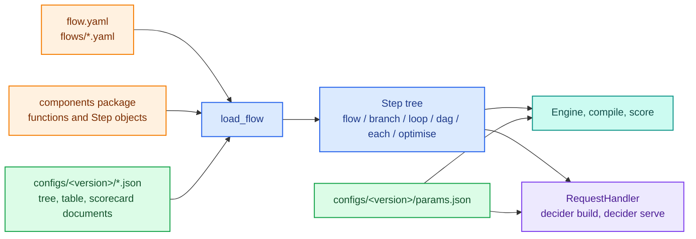

# Flow files

A flow file states a pipeline's structure in YAML or JSON: which steps run, in what order, inside which branches and loops. The steps themselves stay plain Python functions in a components package, and tree, table and scorecard documents stay in the config version. `load_flow` turns the file into the same `flow`, `branch` and `loop` objects you would write by hand, so the engine, the compiler, serving, the debugger and experiments see an ordinary `Step`.

Use a flow file when people who review policy want to read the shape of the decision without reading Python, or when a structure change should show up as a small diff in one reviewed file. The file is code: it lives in the repository next to the components it names and is deployed with them. It never lives in a config version, so structure cannot change without a deploy.



## A project with a flow file

This project screens an applicant, sets a credit limit from a decision table when they are eligible, and caps it:

```text
flowapp/
  flow.yaml                 # the root flow
  flows/
    screen.yaml             # `flow: screen` with no `steps:` loads this
  components/
    __init__.py             # plain functions and Step objects, by name
  configs/
    0.0.0/
      params.json
      limit_band.json       # a decision table; `step: limit_band` loads it
  sample_request.json
  .env
```

`flow.yaml`:

```yaml
flow: credit
components: components
steps:
  - flow: screen                         # flows/screen.yaml
  - branch: offer
    when: eligible                       # the `eligible` component, run as the condition
    modifies: [limit]
    then: [{step: limit_band}]           # configs/<version>/limit_band.json
    else: [{step: no_offer}]
  - branch: capped
    when: {expr: "limit > 150000"}
    modifies: [limit]
    then: [{step: cap_limit}]
```

`flows/screen.yaml`:

```yaml
flow: screen
steps:
  - step: debt_ratio
  - step: adult
```

`components/__init__.py`:

```python
from decider import param, step


def debt_ratio(income: float, debt: float) -> float:
    return debt / income


def adult(age: float) -> bool:
    return age >= 18


def eligible(adult: bool, debt_ratio: float, max_ratio: float = param(0.45)) -> bool:
    return adult and debt_ratio <= max_ratio


@step(output="limit")
def no_offer(income: float) -> float:
    return 0.0


@step(output="limit")
def cap_limit(limit: float, cap: float = param(150000.0)) -> float:
    return min(limit, cap)
```

`configs/0.0.0/limit_band.json`:

```json
{"type": "decision_table", "name": "limit_band",
 "columns": {"lo": "Float64", "hi": "Float64", "limit": "Float64"},
 "rows": [{"lo": null, "hi": 10000, "limit": 15000},
          {"lo": 10000, "hi": 40000, "limit": 60000},
          {"lo": 40000, "hi": null, "limit": 200000}],
 "expression": {"type": "between", "variable": "income", "lower_bound_column": "lo", "upper_bound_column": "hi"},
 "outputs": ["limit"], "default": [0.0]}
```

`configs/0.0.0/params.json`:

```json
{"credit": {"offer": {"eligible": {"max_ratio": 0.45}}, "capped": {"cap_limit": {"cap": 150000.0}}}}
```

## Loading and running it

`load_flow(path, components=..., documents=...)` builds the pipeline. `components` defaults to the file's own `components:` key, imported as a module. `documents` maps a name to a parsed tree, table or scorecard document, which is what a config version holds:

```python
import sys
from pathlib import Path
import polars as pl
from decider import load_flow
from decider.config import JsonFileStore
from decider.ir import step_map

root = Path("flowapp")
sys.path.insert(0, str(root))             # so `components: components` imports

store = JsonFileStore(basepath=str(root / "configs"))
config = store.read(store.latest_version()).config
pipeline = load_flow(root / "flow.yaml", documents=config)
print(list(step_map(pipeline)))
print(pipeline.parameters().defaults())
df = pl.DataFrame({"age": [30.0, 16.0, 45.0, 52.0], "income": [8000.0, 20000.0, 30000.0, 90000.0],
                   "debt": [1000.0, 0.0, 20000.0, 10000.0]})
print(pipeline.run(df, params=config["params"]))
exe = pipeline.compile("fused")
print(exe.score({"age": 52.0, "income": 90000.0, "debt": 10000.0}, config["params"]))
print(exe.fallbacks())
```

```text
['credit/screen/debt_ratio', 'credit/screen/adult', 'credit/screen', 'credit/offer/eligible', 'credit/offer/limit_band', 'credit/offer/no_offer', 'credit/offer', 'credit/capped/capped_when', 'credit/capped/cap_limit', 'credit/capped/arm1', 'credit/capped', 'credit']
{'credit': {'offer': {'eligible': {'max_ratio': 0.45}}, 'capped': {'cap_limit': {'cap': 150000.0}}}}
shape: (4, 4)
┌──────┬─────────┬─────────┬──────────┐
│ age  ┆ income  ┆ debt    ┆ limit    │
│ ---  ┆ ---     ┆ ---     ┆ ---      │
│ f64  ┆ f64     ┆ f64     ┆ f64      │
╞══════╪═════════╪═════════╪══════════╡
│ 30.0 ┆ 8000.0  ┆ 1000.0  ┆ 15000.0  │
│ 16.0 ┆ 20000.0 ┆ 0.0     ┆ 0.0      │
│ 45.0 ┆ 30000.0 ┆ 20000.0 ┆ 0.0      │
│ 52.0 ┆ 90000.0 ┆ 10000.0 ┆ 150000.0 │
└──────┴─────────┴─────────┴──────────┘
{'age': 52.0, 'income': 90000.0, 'debt': 10000.0, 'limit': 150000.0}
{}
```

The `config` dict also holds `params`; `load_flow` ignores a `documents` entry named `params` and anything without a `type`. The `capped_when` step is the `expr` condition, compiled as a one-rule tree; `arm1` is the empty else arm of a one-arm branch. Everything compiled: `fallbacks()` is empty.

<div class="diagram" markdown>


*Each node of the file becomes the step its Python constructor would build, at the same path.*
</div>

## The same pipeline in Python

The flow file above is exactly this Python. `step_map`, the params document and the outputs in every mode all agree:

```python
import sys
from pathlib import Path
import polars as pl
from decider import ConfigurableStep, branch, flow, load_flow
from decider.config import JsonFileStore
from decider.ir import step_map
from decider.lab.testing import assert_equivalent
from decider.steps.trees import expr_condition

root = Path("flowapp").resolve()
sys.path.insert(0, str(root))
import components as c

config = JsonFileStore(basepath=str(root / "configs")).read("0.0.0").config
from_file = load_flow(root / "flow.yaml", documents=config)
by_hand = flow(
    flow(c.debt_ratio, c.adult, name="screen"),
    branch(c.eligible, ConfigurableStep.load(config["limit_band"]), c.no_offer, modifies=["limit"], name="offer"),
    branch(expr_condition("limit > 150000", name="capped_when"), c.cap_limit, modifies=["limit"], name="capped"),
    name="credit")

df = pl.DataFrame({"age": [30.0, 16.0, 45.0, 52.0], "income": [8000.0, 20000.0, 30000.0, 90000.0],
                   "debt": [1000.0, 0.0, 20000.0, 10000.0]})
print(list(step_map(from_file)) == list(step_map(by_hand)))
print(from_file.parameters().defaults() == by_hand.parameters().defaults())
print(assert_equivalent(from_file, df, params=config["params"]).equals(
    assert_equivalent(by_hand, df, params=config["params"])))
```

```text
True
True
True
```

`assert_equivalent` runs every mode, scores each row on its own and runs a debug session, and checks they all agree; see [debugging and testing](debugging-and-testing.md).

## Node reference

Every entry in a `steps:` list is a mapping with exactly one of these keys. Every composite node takes an optional `id:` (a durable id) and `suppress_checks:` (check aliases or codes to silence), as its Python constructor does.

| Node | Keys | Python equivalent |
|---|---|---|
| `step: name` | `as` (run it again under another name), `suppress_checks`, `path_columns` (trees only) | the component or document itself; `.named(as)` |
| `flow: name` | `steps` (inline), or none to load `flows/name.yaml` (or `.yml`, `.json`) | `flow(*steps, name=name)` |
| `branch: name` | `when`, `modifies` (required), `then`, `else` (optional) | `branch(when, then, else, modifies=..., name=name)` |
| `loop: name` | `while`, `carries` (required), `max` (required), `steps` | `loop(while, body, carries=..., max_iterations=max, name=name)` |
| `dag: name` | `steps`, `inputs` | `dag(*steps, inputs=..., name=name)` |
| `each: name` | `column`, `steps`, `output` | `each(column, body, output=..., name=name)` |
| `optimise: name` | `count`, `evaluate` (lists of nodes), `max_candidates` (required), `score` (an output name, default `score`), `disqualify` (a list of nodes) | `optimise(count, evaluate, score=..., disqualify=..., max_candidates=..., name=name)` |

The root document has `flow` (its name), `steps`, and optionally `components`, `id` and `suppress_checks`. Keys are checked: an unknown key is an error, not ignored.

A list of more than one node inside `then`, `else`, `steps` (of a loop or each), `count` or `evaluate` becomes an unnamed `flow` of those nodes; a single node is used as it is.

### Names: components and documents

A `step:` name resolves to one of two things:

- a public function or `Step` object in the components module or package (and its submodules), by the function's name or the step's `name`;
- a document in `documents` with that name, loaded by its `type` (`tree`, `decision_table`, `scorecard` or a type of your own).

A name defined in both places is an error, never a precedence rule. `components(module)` lists what a components package offers, and `read_flow(path)` reads a flow file into its raw dict without building anything:

```python
import sys
from pathlib import Path
from decider.steps.flowfile import components, read_flow

sys.path.insert(0, "flowapp")
import components as comp_module

print(read_flow(Path("flowapp/flow.yaml")))
print(sorted(components(comp_module)))
```

```text
{'flow': 'credit', 'components': 'components', 'steps': [{'flow': 'screen'}, {'branch': 'offer', 'when': 'eligible', 'modifies': ['limit'], 'then': [{'step': 'limit_band'}], 'else': [{'step': 'no_offer'}]}, {'branch': 'capped', 'when': {'expr': 'limit > 150000'}, 'modifies': ['limit'], 'then': [{'step': 'cap_limit'}]}]}
['adult', 'cap_limit', 'debt_ratio', 'eligible', 'no_offer']
```

A function counts only if it is defined in that module (an imported helper is skipped), and names starting with `_` are skipped. Two modules of one package defining the same name is an error.

### Shared subflows

`- flow: screen` with no `steps:` loads `flows/screen.yaml` (or `.yml`, `.json`). The `flows/` folder sits beside the root file, or the root file can itself sit in `flows/`. Several root flows can reference one subflow file instead of copying it. A referenced file must declare `flow: screen` to match the reference, may repeat the root's `components:` but not name another, and may reference further subflows; a cycle is an error.

### Conditions

`when:` on a branch and `while:` on a loop take one of three forms:

- the name of a component: that step runs as the condition, under the branch's path (`credit/offer/eligible` above);
- the name of a bool column already written by an earlier step, when no component has that name;
- `{expr: "..."}`, a Python boolean expression over column names.

!!! warning "A component name wins over a column name"
    If a component is called `eligible` and an earlier step already wrote an `eligible` column, `when: eligible` runs the component again as the condition; it does not read the column. Give the condition step and the column different names, or drop the earlier step, as `screen.yaml` does above.

An `expr` supports numeric comparisons, string equality against a quoted literal, `and`, `or`, `not`, a bare name as a boolean column, and arithmetic on one side (`income - expenses > 1000`). It compiles as a one-rule tree, so it runs in the tree kernel. An expression is false wherever an input it reads is null, under `not` too:

```python
import json, types
from pathlib import Path
import polars as pl
from decider import load_flow, step

@step(output="fast_track")
def fast_track(score: float) -> bool:
    return True

components = types.ModuleType(__name__)   # stands in for a components package
components.fast_track = fast_track

Path("expr.json").write_text(json.dumps({"flow": "route", "steps": [
    {"branch": "fast", "when": {"expr": 'score >= 600 and channel == "app" and not blacklisted'},
     "modifies": ["fast_track"], "then": [{"step": "fast_track"}]}]}))
pipeline = load_flow("expr.json", components=components)
df = pl.DataFrame({"score": [650.0, 650.0, None, 700.0], "channel": ["app", "branch", "app", "app"],
                   "blacklisted": [False, False, False, None], "fast_track": [False] * 4})
print(pipeline.run(df))
print(pipeline.compile("fused").fallbacks())
```

```text
shape: (4, 4)
┌───────┬─────────┬─────────────┬────────────┐
│ score ┆ channel ┆ blacklisted ┆ fast_track │
│ ---   ┆ ---     ┆ ---         ┆ ---        │
│ f64   ┆ str     ┆ bool        ┆ bool       │
╞═══════╪═════════╪═════════════╪════════════╡
│ 650.0 ┆ app     ┆ false       ┆ true       │
│ 650.0 ┆ branch  ┆ false       ┆ false      │
│ null  ┆ app     ┆ false       ┆ false      │
│ 700.0 ┆ app     ┆ null        ┆ false      │
└───────┴─────────┴─────────────┴────────────┘
{}
```

`{expr: ..., feature_types: {months: int}}` passes feature types through to the tree, for exact comparison of int columns. A comparison between two columns (`a > b`) is evaluated in float as `(a) - (b) > 0`, so exact equality of large ints can be off.

### Lists, dependency order and search

`dag`, `each` and `optimise` nodes take the same arguments as their Python constructors:

```python
import sys
from pathlib import Path
import polars as pl
from decider import load_flow

Path("comp_pkg").mkdir(exist_ok=True)
Path("comp_pkg/__init__.py").write_text('''
from typing import TypedDict
from decider import missing_as, param, step
from decider.ops import Columnar


def large(balance: float = missing_as(0.0), large_balance: float = param(20000.0)) -> bool:
    return balance > large_balance


class Account(TypedDict):
    balance: float
    instalment: float


def total_balance(accounts: Columnar[Account]) -> float:
    t = 0.0
    for j in range(len(accounts.balance)):
        t += accounts.balance[j]
    return t


def total_instalments(accounts: Columnar[Account]) -> float:
    t = 0.0
    for j in range(len(accounts.instalment)):
        t += accounts.instalment[j]
    return t


def dti(total_instalments: float, income: float) -> float:
    return total_instalments / income


@step(output="count")
def terms() -> int:
    return 5


@step(output="score")
def term_fit(index: int, dti: float, max_term: int = param(60)) -> float:
    months = 12 * index
    return -abs(months - max_term * (1.0 - dti))
''')
Path("flow.yaml").write_text('''
flow: affordability
components: comp_pkg
steps:
  - each: accounts                      # per-item steps over a list column
    column: accounts
    steps: [{step: large}]
  - dag: totals                         # dependency order, whatever the listed order
    steps: [{step: dti}, {step: total_instalments}, {step: total_balance}]
  - optimise: best_term
    count: [{step: terms}]
    evaluate: [{step: term_fit}]
    max_candidates: 8
''')
sys.path.insert(0, ".")
pipeline = load_flow("flow.yaml")
df = pl.DataFrame({"income": [20000.0, 8000.0],
                   "accounts": [[{"balance": 50000.0, "instalment": 2000.0}, {"balance": 3000.0, "instalment": 500.0}],
                                [{"balance": 1000.0, "instalment": 4000.0}]]})
out = pipeline.emit("dti").run(df)
print(out.select("dti", "total_balance", "best_index", "best_score"))
print(out["accounts"].to_list()[0])
print(pipeline.parameters().defaults())
```

```text
shape: (2, 4)
┌───────┬───────────────┬────────────┬────────────┐
│ dti   ┆ total_balance ┆ best_index ┆ best_score │
│ ---   ┆ ---           ┆ ---        ┆ ---        │
│ f64   ┆ f64           ┆ i64        ┆ f64        │
╞═══════╪═══════════════╪════════════╪════════════╡
│ 0.125 ┆ 53000.0       ┆ 4          ┆ -4.5       │
│ 0.5   ┆ 1000.0        ┆ 2          ┆ -6.0       │
└───────┴───────────────┴────────────┴────────────┘
[{'balance': 50000.0, 'instalment': 2000.0, 'large': True}, {'balance': 3000.0, 'instalment': 500.0, 'large': False}]
{'affordability': {'accounts': {'large_balance': 20000.0}, 'best_term': {'search': {'body': {'term_fit': {'max_term': 60}}}}}}
```

The params path of a step inside an `optimise` node runs through the loop it lowers to (`best_term/search/body/term_fit`); read it from `parameters()` rather than guessing it. [Branches, loops and frames](branches-loops-frames.md) covers what each construct does.

### Other node options

- `as:` runs a step a second time under another name, with its own params: `- {step: full_limit, as: full_limit_again}`.
- `path_columns: fn` on a `step:` node that names a tree sets the tree's `path_columns` to the function `fn` from components. A step that is not a tree refuses it.
- `suppress_checks: [durable_ids]` on any node silences those checks for that node and everything inside it; see [checks](checks.md).
- `id: "0123abcdef45"` gives a node a durable id. `decider ids` rewrites Python source only, so write flow-file ids by hand.

## Serving a flow file

Set `DECIDER_API__PIPELINE` to the file instead of an import path. It is resolved against `DECIDER_API__CODE_PATH` (the current directory by default), and the store's documents are passed as `documents`:

```bash
$ cat .env
DECIDER_API__PIPELINE=flow.yaml
DECIDER_CONFIG__BASEPATH=configs
$ decider build
decider: pipeline from flow file /…/flowapp/flow.yaml
built config version 0.0.0 (pipeline flow.yaml, mode fused)
```

In-process, pass the path to `RequestHandler`:

```python
import sys
from decider.config import JsonFileStore
from decider.serving import RequestHandler

sys.path.insert(0, ".")                       # so `components: components` imports
handler = RequestHandler(JsonFileStore(basepath="configs"), "flow.yaml")
handler.stage()
handler.activate()
body = b'{"age": 52, "income": 90000, "debt": 10000}'
print(handler.process_fn(body, "application/json", "application/json").content.decode())
```

```text
{"age":52,"income":90000,"debt":10000,"limit":150000.0}
```

The pipeline is rebuilt from the file for each staged config version, so a version with a new `limit_band.json` gets the new table. Everything else about serving is in [projects and serving](projects-and-serving.md).

YAML files need the YAML parser: `pip install 'decider[yaml]'`. JSON files need nothing extra and use the same schema.

## Errors

Every error is a `WiringError` naming the file and the position of the node:

```text
errs/flow.json: steps[0]: unknown step 'eligble'. Did you mean 'eligible'?
errs/flow.json: steps[0]: step 'eligible' is defined in both components and documents
errs/flow.json: steps[0]: a node needs exactly one of step/flow/dag/branch/loop/each/optimise, got none
errs/flow.json: steps[0]: flow 'screen' has no inline steps and no flows/screen.yaml|.yml|.json
errs/flow.json: steps[0]: 1 validation error for BranchNode
modifies
  Field required [type=missing, input_value={'branch': 'b', 'when': '... [{'step': 'eligible'}]}, input_type=dict]
```

A misspelt root key reads as two errors, the missing one and the extra one:

```text
errs/flow.json: 2 validation errors for RootDoc
steps
  Field required [type=missing, input_value={'flow': 'credit', 'step': [{'step': 'eligible'}]}, input_type=dict]
step
  Extra inputs are not permitted [type=extra_forbidden, input_value=[{'step': 'eligible'}], input_type=list]
```

Other errors name the problem the same way: `flow 'screen' has inline steps, but flows/screen.yaml also exists`, `declares flow 'x', expected 'screen'`, `flow reference cycle: credit -> a -> credit`, `path_columns 'fn' is not a function in components`.

## What a flow file cannot hold

- Code. A condition is a component name, a column or an `expr`; anything more is a component.
- Params values. They stay in `configs/<version>/params.json`.
- Tree, table and scorecard bodies. They stay in the config version and are named by `step:`.
- `emit` and `drop` on a flow node. Call `.emit(...)` on the loaded pipeline in Python if you need intermediates in the output.
- A multi-way `cases:` node. Nest branches with `expr` conditions.

## Where to go next

- [Projects and serving](projects-and-serving.md): the config store, `decider build`, `decider serve`.
- [Trees, tables and scorecards](trees-tables-scorecards.md): the documents a `step:` can name.
- [Expressions and flow files architecture](../architecture/configurable-steps/expr-and-flowfile.md): how `load_flow` and `expr_condition` are built.
