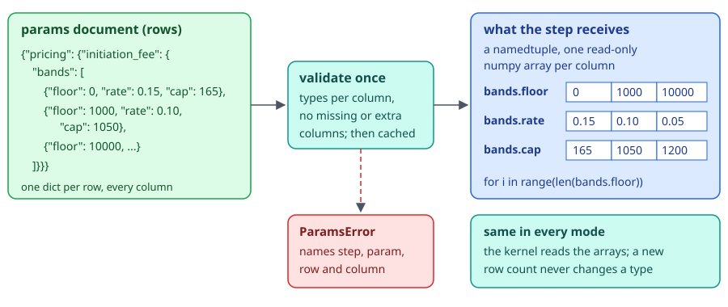
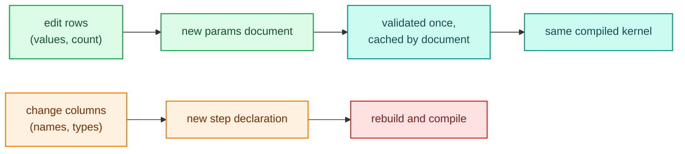

# Parameter tables

A parameter table is a param whose value is a list of rows: a fee ladder, a rate ladder by score, term caps, band floors. The rows live in the params document like any other [param](steps-and-params.md), so pricing or credit policy can change them per config version, or per call, without a code change. Adding rows, removing rows or changing their values never rebuilds or recompiles the pipeline. Only changing the columns does.

A plain Python step declares one with `param_table({column: type}, default=[...])` and loops over it. The step receives the table as a namedtuple holding one numpy array per column, in every mode, so the same loop runs in plain Python and inside a numba kernel.

## A first table

An initiation fee is a percentage of the loan amount, capped, with the percentage and cap stepping down by band:

```python
import polars as pl
from decider import ParamTable, flow, param_table


def initiation_fee(amount: float,
                   bands: ParamTable = param_table(
                       {"floor": float, "rate": float, "cap": float},
                       default=[{"floor": 0.0, "rate": 0.15, "cap": 165.0},
                                {"floor": 1000.0, "rate": 0.10, "cap": 1050.0}])) -> float:
    fee = 0.0
    for i in range(len(bands.floor)):
        if amount >= bands.floor[i]:
            fee = min(amount * bands.rate[i], bands.cap[i])
    return fee


pricing = flow(initiation_fee, name="pricing")
df = pl.DataFrame({"amount": [500.0, 5000.0, 20000.0]})
print(pricing.run(df))
print(pricing.parameters())
print(pricing.parameters().defaults())
```

```text
shape: (3, 2)
┌─────────┬────────────────┐
│ amount  ┆ initiation_fee │
│ ---     ┆ ---            │
│ f64     ┆ f64            │
╞═════════╪════════════════╡
│ 500.0   ┆ 75.0           │
│ 5000.0  ┆ 500.0          │
│ 20000.0 ┆ 1050.0         │
└─────────┴────────────────┘
{'pricing/initiation_fee': {'bands': {'type': 'table', 'schema': {'floor': 'float', 'rate': 'float', 'cap': 'float'}, 'default': [{'floor': 0.0, 'rate': 0.15, 'cap': 165.0}, {'floor': 1000.0, 'rate': 0.1, 'cap': 1050.0}]}}}
{'pricing': {'initiation_fee': {'bands': [{'floor': 0.0, 'rate': 0.15, 'cap': 165.0}, {'floor': 1000.0, 'rate': 0.1, 'cap': 1050.0}]}}}
```

`parameters()` declares the table with `"type": "table"`, its column schema and its default rows. `defaults()` is the params document with those rows filled in: the table sits where a scalar `param()` value would, under the step's path, as a list with one dict per row and a value for every column.

<div class="diagram" markdown>


*Rows are written as dicts and read as columns.*
</div>

## Retuning the rows

Pass a params document with other rows. A compiled executable reuses its kernel whatever the number of rows:

```python
import polars as pl
from decider import ParamTable, flow, param_table
from decider.lab.testing import no_recompile


def initiation_fee(amount: float,
                   bands: ParamTable = param_table(
                       {"floor": float, "rate": float, "cap": float},
                       default=[{"floor": 0.0, "rate": 0.15, "cap": 165.0},
                                {"floor": 1000.0, "rate": 0.10, "cap": 1050.0}])) -> float:
    fee = 0.0
    for i in range(len(bands.floor)):
        if amount >= bands.floor[i]:
            fee = min(amount * bands.rate[i], bands.cap[i])
    return fee


pricing = flow(initiation_fee, name="pricing")
df = pl.DataFrame({"amount": [500.0, 5000.0, 20000.0]})
exe = pricing.compile("fused")
print(exe.run(df)["initiation_fee"].to_list())
three_bands = {"pricing": {"initiation_fee": {"bands": [
    {"floor": 0.0, "rate": 0.15, "cap": 165.0},
    {"floor": 1000.0, "rate": 0.10, "cap": 1050.0},
    {"floor": 10000.0, "rate": 0.05, "cap": 1200.0}]}}}
with no_recompile():
    print(exe.run(df, params=three_bands)["initiation_fee"].to_list())
    print(exe.score({"amount": 20000.0}, three_bands))
print(exe.fallbacks())
```

```text
[75.0, 500.0, 1050.0]
[75.0, 500.0, 1000.0]
{'amount': 20000.0, 'initiation_fee': 1000.0}
{}
```

`no_recompile()` raises if anything compiles inside it, so the third band reached the kernel as data. `fallbacks()` is empty: the loop compiled. The note on table rows as runtime arrays records the trade, measured on decision tables: compile cost stops depending on the number of rows, and the cost moves to answer time instead (a linear scan, 70 ns per row with 2 bands and 1045 ns per row with 1000).



!!! warning "Pass a new document, don't edit one in place"
    `run` and `score` treat a params document as immutable. The executable validates a document once and remembers the last document object it was given, so passing the same dict again skips validation and hashing. Mutating that dict in place (appending a row to `params["pricing"]["initiation_fee"]["bands"]`) and passing it again can return answers from the old rows. Build a new dict, for example with `copy.deepcopy`, for each change.

In a project the rows go in `configs/<version>/params.json`, and a new config version carries new rows; see [projects and serving](projects-and-serving.md).

## Required tables

`required=True` declares a table with no default rows. A params document must supply them:

```python
import polars as pl
from decider import ParamTable, flow, param_table
from decider.exceptions import ParamsError


def base_rate(score: int, ladder: ParamTable = param_table({"floor": int, "rate": float}, required=True)) -> float:
    rate = 0.25
    for i in range(len(ladder.floor)):
        if score >= ladder.floor[i]:
            rate = ladder.rate[i]
    return rate


pricing = flow(base_rate, name="pricing")
print(pricing.parameters())
print(pricing.parameters().defaults())
df = pl.DataFrame({"score": [580, 640, 720]})
try:
    pricing.run(df)
except ParamsError as e:
    print(e)
params = {"pricing": {"base_rate": {"ladder": [{"floor": 600, "rate": 0.18}, {"floor": 700, "rate": 0.12}]}}}
print(pricing.run(df, params=params)["base_rate"].to_list())
```

```text
{'pricing/base_rate': {'ladder': {'type': 'table', 'schema': {'floor': 'int', 'rate': 'float'}, 'required': True}}}
{'pricing': {'base_rate': {'ladder': []}}}
invalid params (affects 3 rows):
pricing/base_rate: param 'ladder' is required but missing; expected a list of rows like [{"floor": int, "rate": float}, ...]
[0.25, 0.18, 0.12]
```

`defaults()` shows a required table as `[]` to say where its rows go. An empty list is a valid value, so a document that sets `"ladder": []` runs, with a zero-length array in the loop; it is leaving the key out that fails. `param_table` takes either `default` rows or `required=True`, never both and never neither.

## One table for several steps

`shared_key="term_caps"` reads the rows from the document's top-level `"shared"` entry instead of the step's own path, so several steps read one table and an editor changes it once:

```python
import polars as pl
from decider import ParamTable, flow, param_table

CAPS = {"term": int, "max_amount": float}


def term_cap(term: int, caps: ParamTable = param_table(CAPS, required=True, shared_key="term_caps")) -> float:
    cap = 0.0
    for i in range(len(caps.term)):
        if term <= caps.term[i]:
            return caps.max_amount[i]
    return cap


def headroom(term: int, amount: float,
             caps: ParamTable = param_table(CAPS, required=True, shared_key="term_caps")) -> float:
    for i in range(len(caps.term)):
        if term <= caps.term[i]:
            return caps.max_amount[i] - amount
    return -amount


limits = flow(term_cap, headroom, name="limits")
print(limits.parameters())
params = {"shared": {"term_caps": [{"term": 24, "max_amount": 50000.0}, {"term": 60, "max_amount": 150000.0}]}}
print(limits.run(pl.DataFrame({"term": [12, 48, 72], "amount": [20000.0, 100000.0, 5000.0]}), params=params))
```

```text
{'shared': {'term_caps': {'type': 'table', 'schema': {'term': 'int', 'max_amount': 'float'}, 'required': True, 'used_by': ['limits/term_cap', 'limits/headroom']}}}
shape: (3, 4)
┌──────┬──────────┬──────────┬──────────┐
│ term ┆ amount   ┆ term_cap ┆ headroom │
│ ---  ┆ ---      ┆ ---      ┆ ---      │
│ i64  ┆ f64      ┆ f64      ┆ f64      │
╞══════╪══════════╪══════════╪══════════╡
│ 12   ┆ 20000.0  ┆ 50000.0  ┆ 30000.0  │
│ 48   ┆ 100000.0 ┆ 150000.0 ┆ 50000.0  │
│ 72   ┆ 5000.0   ┆ 0.0      ┆ -5000.0  │
└──────┴──────────┴──────────┴──────────┘
```

`parameters()` reports the shared table once, with `used_by` listing every step that reads it. Steps sharing a key must declare the same columns: two different declarations are an `IRError` when the flow is built (`shared param 'term_caps' is declared ... by limits/term_cap and ... by limits/headroom`). Declaring the schema once, as `CAPS` above, keeps them in step.

## What the step receives

The argument is a namedtuple with one field per column, in declaration order. Each field is a read-only numpy array (`int64`, `float64` or `bool`), indexed by row: `bands.rate[i]`, `len(bands.floor)`. It is the same object shape in every mode, which is why the loop compiles. Iterate with `range(len(...))` over one column; `for row in bands` iterates the columns, not the rows.

Calling the function directly, outside decider, passes the default table, so a unit test of the bare function still works:

```python
from decider import ParamTable, param_table


def show(x: float, bands: ParamTable = param_table({"floor": float, "rate": float},
                                                   default=[{"floor": 0.0, "rate": 0.15}])) -> float:
    print(type(bands).__name__, bands._fields, type(bands.floor).__name__, bands.floor.dtype, bands.floor.flags.writeable)
    return bands.rate[0]


print(show(1.0))
```

```text
Params_ParamSpec ('floor', 'rate') ndarray float64 False
0.15
```

Testing through decider (`flow(...).run`, or the handler in a project) is still the test that proves the table wires and validates.

## Column types

Columns are `int`, `float` or `bool`. Column names must be Python identifiers that don't start with `_`, since they become namedtuple fields. A string column is refused when the step is defined:

```text
param_table: column 'product' is <class 'str'>; columns are int, float or bool (code a string key as an int, or use a DecisionTableConfig)
```

Code a product or channel as an int, or use a decision table, which matches string columns in its kernel.

## Validation errors

Rows are checked when the params document arrives, before any record runs. Each error names the step, the param, the row and the column, and ends with the shape the table expects. `parameters().validate(document)` returns them without running anything:

```python
from decider import ParamTable, flow, param_table


def base_rate(score: int, ladder: ParamTable = param_table({"floor": int, "rate": float}, required=True)) -> float:
    rate = 0.25
    for i in range(len(ladder.floor)):
        if score >= ladder.floor[i]:
            rate = ladder.rate[i]
    return rate


pricing = flow(base_rate, name="pricing")
for rows in ([{"floor": 600, "rate": "low"}],
             [{"floor": 600}],
             [{"floor": 600, "rate": 0.1, "fee": 1.0}],
             [{"floor": 600.5, "rate": 0.1}],
             {"floor": 600, "rate": 0.1}):
    validation = pricing.parameters().validate({"pricing": {"base_rate": {"ladder": rows}}})
    print(validation.errors[0])
```

```text
pricing/base_rate: param 'ladder': row 0, column 'rate': Input should be a valid number (got 'low'); expected a list of rows like [{"floor": int, "rate": float}, ...]
pricing/base_rate: param 'ladder': row 0, column 'rate': Field required; expected a list of rows like [{"floor": int, "rate": float}, ...]
pricing/base_rate: param 'ladder': row 0, column 'fee': Extra inputs are not permitted (got 1.0); expected a list of rows like [{"floor": int, "rate": float}, ...]
pricing/base_rate: param 'ladder': row 0, column 'floor': Input should be a valid integer (got 600.5); expected a list of rows like [{"floor": int, "rate": float}, ...]
pricing/base_rate: param 'ladder': Input should be a valid list (got {'floor': 600, 'rate': 0.1}); expected a list of rows like [{"floor": int, "rate": float}, ...]
```

`run` and `score` raise the same messages as a `ParamsError` (`invalid params (affects 3 rows):` followed by the list). In a served project, `decider build` and `RequestHandler.stage` validate the version's params document, so a bad row stops the version from being staged and the active version keeps serving.

## Parameter table or decision table

Both keep rows in the params document and both retune without recompiling. They differ in who does the matching:

| | `param_table()` | `DecisionTableConfig` with `"rows": {"table": ...}` |
|---|---|---|
| Matching logic | your Python loop | declared `eq`, `between`, `in`, `is_true` expressions, first match wins |
| Column types | `int`, `float`, `bool` | polars dtypes, including `String` and `List[String]` |
| String outputs | none | `Enum` columns |
| Declared in | a function signature | a JSON document |
| Good for | ladders, caps and curves a calculation steps through, interpolation, cumulative sums | lookups: a rate card by grade and amount band, a fee by channel |

See [trees, tables and scorecards](trees-tables-scorecards.md) for decision tables, and the [params architecture page](../architecture/engine/params.md) for how table params are validated and bundled.

## Where to go next

- [Steps and params](steps-and-params.md): scalar `param()` declarations and the params document.
- [Projects and serving](projects-and-serving.md): versioned params documents in a config store.
- [Tutorial: loan granting and pricing](../walkthroughs/loan-granting-and-pricing.md) retunes a rate ladder through a new config version.
