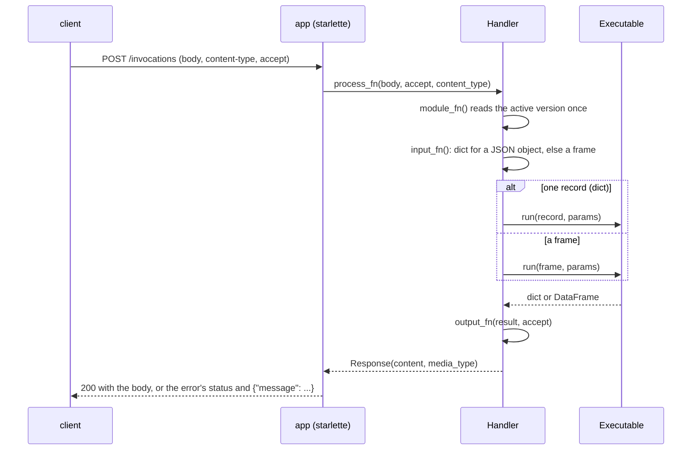
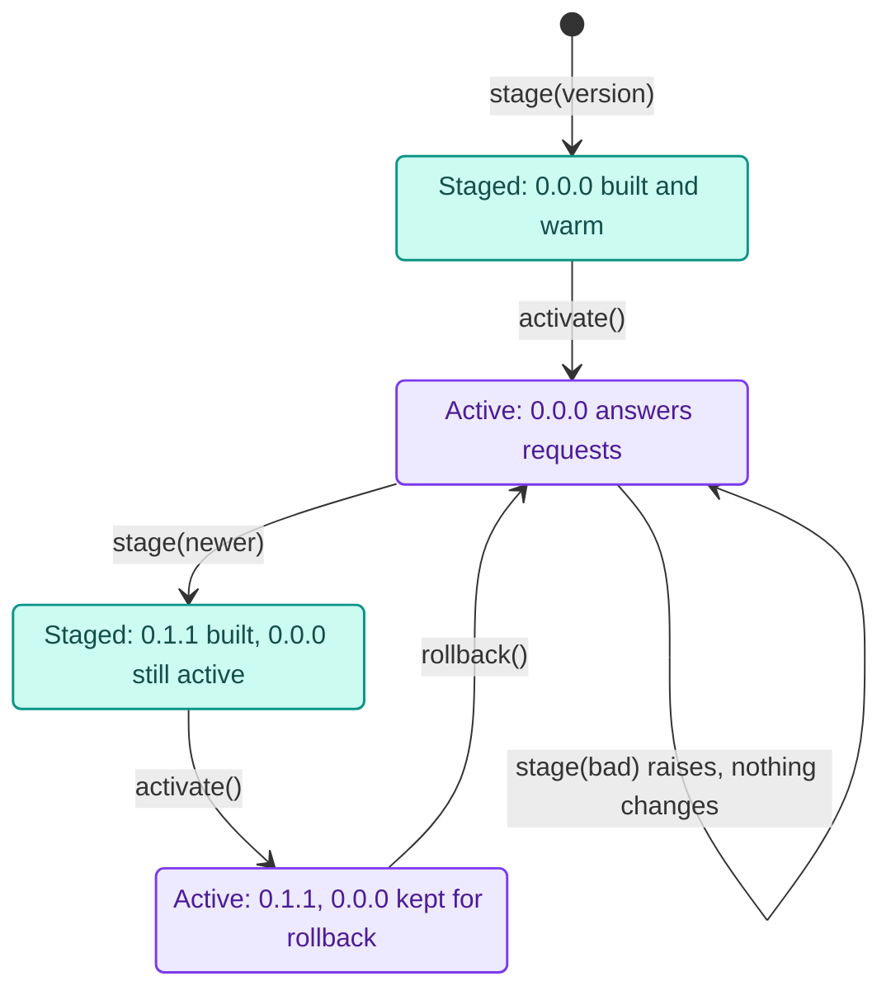

# Projects and serving

A pipeline in a notebook becomes a service in four commands. `decikit template` writes a project, `decikit build` checks a config version and warms its kernels, and `decikit serve` answers `POST /invocations` over HTTP. The pipeline's code lives in the project's Python package; its params and its tree, table and scorecard documents live in versioned config folders, so policy changes ship as a new config version without a code release.

This guide walks through that path with a real project, then covers config versions, the request handler, request and response formats, errors, and reusing another project. How the server and the store are built inside is on the [serving](../architecture/serving.md) and [config store](../architecture/config-store.md) architecture pages.

## Starting a project

```bash
$ decikit template credit_risk
created credit_risk/README.md
created credit_risk/__init__.py
created credit_risk/configs/0.0.0/params.json
created credit_risk/conftest.py
created credit_risk/.env
created credit_risk/inference.py
created credit_risk/pipeline.py
created credit_risk/sample_request.json
created credit_risk/tests/test_pipeline.py
```

`decikit template NAME [DIRECTORY]` refuses a directory that exists and is not empty, and a name that cannot be a Python package. The project directory is itself the package, so `import credit_risk` resolves to it and two projects on one path never shadow each other's `pipeline.py`.

<div class="diagram" markdown>


*`decikit build` and `decikit serve` stage a version the same way; build stops there.*
</div>

`pipeline.py` holds the steps and a `build()` function:

```python
from datetime import date

from decikit import flow, missing_as, param


def debt_ratio(income: float, debt: float = missing_as(0.0)) -> float:
    return debt / income


def month_end(applied_on: date) -> bool:
    return applied_on.day >= 25


def approved(debt_ratio: float, month_end: bool,
             limit: float = param(0.4, ge=0.0, le=1.0),
             month_end_limit: float = param(0.3, ge=0.0, le=1.0)) -> bool:
    return debt_ratio <= (month_end_limit if month_end else limit)


def build():
    return flow(debt_ratio, month_end, approved, name="credit_risk")
```

The other files:

| File | Holds |
|---|---|
| `inference.py` | `class Handler(RequestHandler): pass`, the place to override request handling |
| `configs/0.0.0/params.json` | `{"credit_risk": {"approved": {"limit": 0.4, "month_end_limit": 0.3}}}`, the first config version |
| `sample_request.json` | `{"income": 1000.0, "debt": 250.0, "applied_on": "2026-01-15"}`, used by the tests and to warm kernels |
| `tests/test_pipeline.py` | tests that score raw JSON bytes through the handler, as the server does |
| `conftest.py` | puts the project's parent directory on `sys.path` for plain `pytest` |
| `.env` | the settings `decikit build` and `decikit serve` read |

`.env`:

```text
DECIKIT_API__PIPELINE=credit_risk.pipeline:build
DECIKIT_API__HANDLER=credit_risk.inference:Handler
DECIKIT_CONFIG__BASEPATH=configs
```

The tests pass straight away:

```bash
$ cd credit_risk && pytest -q
2 passed, 1 warning in 1.43s
```

The warning is a `FallbackWarning`: `month_end` reads a `date`, which no numba kernel holds, so that one step runs in Python while the others compile. Same answers, slower step; [compile and fallback](compile-and-fallback.md) explains it and how to silence it.

## Building a version

`decikit build [VERSION]` does what a server worker does at startup and then stops. It imports the pipeline, reads the version (the latest by default), loads its documents, validates its params document, and scores `sample_request.json` through both the single-record and the frame path, which compiles every kernel into numba's disk cache. It also records the CPU it built for in `decikit-cpu-target.json`:

```bash
$ decikit build
decikit: pipeline credit_risk.pipeline:build from /…/credit_risk/pipeline.py
decikit: handler credit_risk.inference:Handler from /…/credit_risk/inference.py
built config version 0.0.0 (pipeline credit_risk.pipeline:build, mode fused)
```

The first two lines say which files were imported, so a pipeline picked up from the wrong project shows before it serves wrong answers. A version that fails stops the build with exit code 1 and `config version 0.1.0 failed to build: ParamsError: ...`. Run `decikit build` in CI and on the image the server runs on; `decikit serve` warns when it starts on a CPU other than the one recorded, because numba's cache then misses and every worker compiles at startup.

Without a `sample_request.json`, staging warms with a synthetic record (1.0 for numbers, `False`, `2000-01-01` for dates). If that record makes your pipeline fail, the error says so and asks for a representative sample request.

## Serving

```bash
$ decikit serve --workers 1 --port 60777 --host 127.0.0.1
INFO:     Started server process [3922280]
INFO:     Waiting for application startup.
decikit: pipeline credit_risk.pipeline:build from /…/credit_risk/pipeline.py
decikit: handler credit_risk.inference:Handler from /…/credit_risk/inference.py
INFO:     Application startup complete.
INFO:     Uvicorn running on http://127.0.0.1:60777 (Press CTRL+C to quit)
```

```bash
$ curl -s -i localhost:60777/ping
HTTP/1.1 200 OK
server: uvicorn
content-length: 0

$ curl -s -d @sample_request.json -H 'content-type: application/json' localhost:60777/invocations
{"income":1000.0,"debt":250.0,"applied_on":"2026-01-15","approved":true}
```

Each worker process imports the pipeline and the handler, then stages and activates the store's latest version before `/ping` answers 200. Until then both routes answer 503 with `{"message": "Server is initializing, please try again shortly."}`. The routes follow the SageMaker container convention.

`decikit serve` options (each also a setting):

| Option | Setting | Default |
|---|---|---|
| `--host` | `DECIKIT_SERVE__HOST` | `0.0.0.0` |
| `--port` | `DECIKIT_SERVE__PORT` | `8080` |
| `--workers` | `DECIKIT_SERVE__WORKERS` | 2 × CPUs + 1 |
| `--mode` | `DECIKIT_API__MODE` | `fused` (also `stepped`, `interpreted`) |
| `--server` | `DECIKIT_SERVE__SERVER` | `starlette` (uvicorn); `sanic` needs `decikit[serve-sanic]` |

The starlette server needs `pip install 'decikit[serve-starlette]'`.

### Container image

`docker/Dockerfile` builds an image that serves with sanic as a non-root user. Run the commands from a checkout of the repository. They were tested with podman; docker needs BuildKit for `--build-context` and the bind mount in the project stage, and was not tested.

```bash
podman build -t decider:latest -f docker/Dockerfile .                          # library only, no project
podman run --rm -p 8080:8080 -v $PWD/my-project:/opt/ml/model/code:ro,Z decider:latest   # project mounted
```

To bake a project in, so that `decikit build` runs while the image is built (a bad config or a missing document fails the build, not the first request):

```bash
podman build --target project --build-context app=/path/to/my-project \
    --build-arg PIPELINE=my_pkg.pipeline:build -t my-app -f docker/Dockerfile .
```

or, from your own Dockerfile on top of the library image (`bake` installs `requirements.txt` if there is one, then runs `decikit build`):

```dockerfile
FROM decider:latest
COPY . /opt/ml/model/code
ENV DECIKIT_API__PIPELINE=my_pkg.pipeline:build
RUN bake
```

- A baked image keeps numba's disk cache for your step functions, which skips their compilation at start (measured: 16 s instead of 35 s to `/ping` for one worker of `examples/loan-granting-pricing`, 39 s instead of 119 s for `examples/transaction-fraud`). The fused kernels are still built in every worker at start, so wait for `GET /ping` before sending traffic.
- The image compiles for a generic x86-64 CPU (`CPU_TARGET=generic`, the default), so the baked cache hits on any x86-64 host; per record that measured the same as code for the build machine's CPU. `--build-arg CPU_TARGET=host` compiles for the build machine instead: on another CPU model `decikit serve` then warns and every worker compiles at start, 2 to 3 times slower to `/ping`.
- Rootless podman: the mounted folder must be readable by "others", or add `--userns=keep-id`.
- The header of `docker/Dockerfile` lists every build argument and variable. `docker/smoke.sh` builds, runs and checks each example under `examples/`.

### Settings

Settings are `DECIKIT_*` environment variables, with `__` between nested names. A `.env` file in the current directory fills in whatever the real environment does not set. There are no other flags; `decikit --help` lists every command.

| Variable | Meaning | Default |
|---|---|---|
| `DECIKIT_API__CODE_PATH` | the project directory; it and its parent go first on `sys.path` | `.` |
| `DECIKIT_API__PIPELINE` | `package.module:function` returning the pipeline, or a `.yaml`/`.yml`/`.json` [flow file](flow-files.md) | `pipeline:build` |
| `DECIKIT_API__HANDLER` | `package.module:Class` of the handler; if the module does not exist, plain `RequestHandler` is used | `inference:Handler` |
| `DECIKIT_API__MODE` | `interpreted`, `stepped` or `fused` | `fused` |
| `DECIKIT_CONFIG__TYPE` | the config store type | `file:json` |
| `DECIKIT_CONFIG__BASEPATH` | the `JsonFileStore` folder | `configs` |
| `DECIKIT_BUILD__WARN_SHADOWED_TABLES` | `false` stops the `ShadowedTableWarning` that staging a version (`decikit build`, a server's start) gives when its params document sets a `param_table(..., seeded_from=...)` | `true` |

If the handler module exists but has no class of that name, startup fails with `inference.py has no 'Handler'; define class Handler(RequestHandler) there, or point DECIKIT_API__HANDLER at the module:class that holds your handler`.

## Requests and responses



A JSON object is one record and goes through `run` as a dict, the single-record path that never builds a polars frame. Anything else is a frame and goes through `run` as a frame:

| `content-type` | Read as |
|---|---|
| `application/json` | an object: one record; an array of objects: a frame |
| `application/jsonl` | a frame, one object per line |
| `text/csv` | a frame |
| `application/x-parquet` | a frame |
| `application/vnd.apache.arrow.stream`, `application/vnd.apache.arrow.file` | a frame |
| Excel (`application/vnd.openxmlformats-officedocument.spreadsheetml.sheet`, `application/vnd.ms-excel`) | a frame |

| `accept` | Response |
|---|---|
| `*/*` (also when the header is missing), `application/json` | JSON |
| `application/jsonl` | one JSON object per line |
| `text/csv` | CSV |
| `application/x-parquet` | Parquet |
| `application/vnd.apache.arrow.stream` | Arrow IPC stream |

The response holds the request's input columns plus every output of the pipeline. JSON dates arrive as ISO strings (`"2026-01-15"`) and are converted to the declared `date` and `datetime` inputs, including inside `list[date]`, `date | None` and TypedDict fields; a bare `dict` input is left as sent. A `Decimal` or `Currency` output goes out as a string of its digits.

Through the handler in-process, with raw bytes as the server would see them:

```python
import sys, warnings
from pathlib import Path
from decikit import FallbackWarning
from decikit.config import JsonFileStore
from decikit.serving import RequestHandler

warnings.filterwarnings("ignore", category=FallbackWarning)
sys.path.insert(0, str(Path("..").resolve()))       # the parent of the credit_risk package

handler = RequestHandler(JsonFileStore(basepath="../credit_risk/configs"), "credit_risk.pipeline:build")
handler.stage()
handler.activate()


def call(body: bytes, accept="application/json", content_type="application/json"):
    response = handler.process_fn(body, accept, content_type)
    return response.media_type, response.content.decode()


print(call(b'{"income": 1000, "debt": 250, "applied_on": "2026-01-15"}'))
print(call(b'[{"income": 1000, "debt": 250, "applied_on": "2026-01-15"}]'))
print(call(b'[{"income": 1000, "debt": 250, "applied_on": "2026-01-15"},'
           b' {"income": 1000, "debt": 350, "applied_on": "2026-01-28"}]'))
print(call(b'income,debt,applied_on\n1000,250,2026-01-15\n', accept="application/jsonl", content_type="text/csv"))
```

```text
('application/json', '{"income":1000,"debt":250,"applied_on":"2026-01-15","approved":true}')
('application/json', '{"income":1000,"debt":250,"applied_on":"2026-01-15","approved":true}')
('application/json', '[{"income":1000,"debt":250,"applied_on":"2026-01-15","approved":true},{"income":1000,"debt":350,"applied_on":"2026-01-28","approved":false}]')
('application/jsonl', '{"income":1000,"debt":250,"applied_on":"2026-01-15","approved":true}\n')
```

!!! note "A one-element array comes back as an object"
    The second call sent a list of one record and got back an object, not a one-element list: the JSON formatter writes a one-row frame as an object. A client that always sends arrays should accept both shapes, or ask for `application/jsonl`.

### One record at a time

Send a single decision as a JSON object, not as a one-element array or a CSV. The object takes the single-record path: the record goes straight into one-row arrays and comes back as a dict. In Python the same rule holds: `executable.run(record_dict, params)` takes a dict (never keyword arguments) and costs about a fifth of `run` on a one-row frame, which builds a frame, exports it through Arrow and assembles an output frame (the figure `decikit guide` gives). The measured breakdown of a served request is in `docs/design_decisions/experiments/serving-latency-budget.md`. Arrow IPC costs more to encode and decode than a typical pipeline takes to run, so keep it for batches.

### Error responses

A `DecikitError` becomes a JSON body `{"message": ...}` with the error's HTTP status. These were returned by the server above:

| Request | Status | Body |
|---|---|---|
| no `income` | 400 | `{"message": "input 'income' of step 'credit_risk/debt_ratio' is required but column 'income' is not in the input frame or record. Fix the data, or declare ..."}` |
| `"income": null` | 400 | `{"message": "input 'income' of step 'credit_risk/debt_ratio' is required but column 'income' has 1 null row(s) of 1. Fix the data, or declare ..."}` |
| `"applied_on": "15/01/2026"` | 400 | `{"message": "input 'applied_on' is declared <class 'datetime.date'> but got '15/01/2026'; send dates as ISO strings like \"2026-01-31\". (Input should be a valid date or datetime, invalid character in year)"}` |
| body `{"income": 1000,` | 400 | `{"message": "EOF while parsing a value at line 1 column 16"}` |
| body `[]` | 400 | `{"message": "request body is an empty array; send at least one record or a single object"}` |
| `content-type: application/xml` | 415 | `{"message": "Unsupported content type: 'application/xml'"}` |
| no `content-type` (curl sends a form type) | 415 | `{"message": "Unsupported content type: 'application/x-www-form-urlencoded'"}` |
| `accept: application/xml` | 406 | `{"message": "Unsupported Accept type: 'application/xml'"}` |
| `GET /invocations` | 405 | `Method Not Allowed` |

`debt: null` is fine because `debt` is declared `missing_as(0.0)`.

Errors that are not `DecikitError`s are not translated. A string where a number is expected (`"income": "lots"`) raised `ValueError: could not convert string to float: 'lots'`, and `"income": 0` raised `ZeroDivisionError: division by zero in step credit_risk/debt_ratio`. Both came back as status 500 with the plain-text body `Internal Server Error`, and the traceback went to the server log. Validate types at the edge (an `input_fn` override) and guard divisions in the step (`debt / income if income > 0 else 1.0`) when you need a structured error.

A `ParamsError` (a bad params document) has status 500. It surfaces when a version is staged, not per request.

## Config versions

A config store holds immutable versions. `JsonFileStore(basepath="configs")` keeps each version in a folder, `configs/<major.minor.patch>/<key>.json`, and a dotted key is a subfolder (`"credit.params"` is `configs/1.2.0/credit/params.json`). Each version's `params` document is what every request runs with; each other key is a document that `build()` can ask for by argument name.

```python
import json, shutil
from pathlib import Path
from decikit.config import JsonFileStore, Version, VersionPart

shutil.copytree("credit_risk/configs", "store_demo")
store = JsonFileStore(basepath="store_demo")
print(store.versions(), store.latest_version())
v0 = store.read("0.0.0")
print(v0.version, v0.config)

params = json.loads(json.dumps(v0.config["params"]))
params["credit_risk"]["approved"]["limit"] = 0.3
new = store.create_version({"params": params})
print(new.version, store.versions())
print(store.create_version({"params": params}, bump=VersionPart.PATCH).version)
print(sorted(p.relative_to("store_demo").as_posix() for p in Path("store_demo").rglob("*.json")))
print(Version.parse("0.10.0") > Version(0, 9, 0), str(Version(1, 2, 0).bump(VersionPart.MAJOR)))
```

```text
[Version(major=0, minor=0, patch=0)] 0.0.0
0.0.0 {'params': {'credit_risk': {'approved': {'limit': 0.4, 'month_end_limit': 0.3}}}}
0.1.0 [Version(major=0, minor=0, patch=0), Version(major=0, minor=1, patch=0)]
0.1.1
['0.0.0/params.json', '0.1.0/params.json', '0.1.1/params.json']
True 2.0.0
```

`create_version(config, bump=VersionPart.MINOR)` writes the whole version (every key it should hold, not a patch on the last one) one bump past the latest; the first version of an empty store is `0.0.0`. It deep-copies the dict, writes into a hidden staging folder and renames it into place, so a failed write never shows up as a version, and an existing version is never overwritten (`FileExistsError: config version 0.1.0 already exists in 'store_demo'`). Versions sort numerically, so `0.10.0` is newer than `0.9.0`.

To replay a stored decision, run it against `store.read(version)` for the version that made it, never against whatever `configs/` holds now.

### Staging, activating and rolling back

`RequestHandler` swaps versions explicitly. `stage(version)` builds and warms a version off the request path, `activate()` swaps it in atomically, and `rollback()` returns to the version it replaced. A request reads the active version once, so it never mixes two.



```python
from decikit.config import JsonFileStore
from decikit.exceptions import DecikitError
from decikit.serving import RequestHandler

store = JsonFileStore(basepath="store_demo")
handler = RequestHandler(store, "credit_risk.pipeline:build")
body = b'{"income": 1000, "debt": 350, "applied_on": "2026-01-15"}'


def call(body):
    return handler.process_fn(body, "application/json", "application/json").content.decode()


try:
    call(body)
except RuntimeError as e:
    print("RuntimeError", e)
print(handler.stage("0.0.0"), handler.staged, handler.active)
print(handler.activate(), handler.active)
print(call(body))
print(handler.stage(), handler.activate())          # the latest: 0.1.1, limit 0.3
print(call(body))
print(handler.rollback())
print(call(body))

bad = store.create_version({"params": {"credit_risk": {"approved": {"limit": 1.5}}}})
try:
    handler.stage(bad.version)
except DecikitError as e:
    print(type(e).__name__, e._STATUS_CODE, e)
print("still serving", handler.active)
```

```text
RuntimeError no config version is active; call stage() then activate().
0.0.0 0.0.0 None
0.0.0 0.0.0
{"income":1000,"debt":350,"applied_on":"2026-01-15","approved":true}
0.1.1 0.1.1
{"income":1000,"debt":350,"applied_on":"2026-01-15","approved":false}
0.0.0
{"income":1000,"debt":350,"applied_on":"2026-01-15","approved":true}
ParamsError 500 invalid params (affects 1 row):
credit_risk/approved: param 'limit': Input should be less than or equal to 1 (got 1.5)
still serving 0.0.0
```

`limit` is declared `param(0.4, ge=0.0, le=1.0)`, so a version with `1.5` never gets staged. A running `decikit serve` stages the latest version once, at startup; to serve a new version, restart the workers (after `decikit build`), or call `stage()` and `activate()` from your own code.

A store of your own (a database, an object store) is a `ConfigStore` subclass implementing `versions`, `read` and `_write`, named by `DECIKIT_CONFIG__TYPE`; see [extending the decider toolkit](extending.md).

## Documents in a version

Each argument of `build` names a key of the config version; that document is loaded with `ConfigurableStep.load` and passed in. A version holding `params.json` and `risk.json`:

```python
from decikit import flow


def build(risk):                       # configs/<version>/risk.json, already loaded as a TreeConfig
    return flow(debt_ratio, risk, decide, name="credit")
```

A missing document is an error naming it (`the config version has no 'risk' document for argument 'risk' of 'credit.pipeline:build'`) unless the argument has a default. Each staged version calls `build` again with its own documents, so a new version with a changed tree builds a new pipeline. The [tutorial](../walkthroughs/loan-granting-and-pricing.md) builds a project this way with a decision table and a scorecard.

## Changing request handling

Override any `*_fn` method in `inference.py`'s `Handler`. `input_fn(data, content_type)` parses the body, `output_fn(output, accept)` formats the result, `process_fn` does both around scoring, `warm_fn(executable, params)` warms a staged version, `pipeline_fn(config)` builds the pipeline from a version, and `init_fn` / `shutdown_fn` run at server start and stop. The hooks are plain methods: one defined with `async def` fails with a `TypeError` when the class is created. In-process, `handler.score(record_or_frame)` runs the scoring step alone, converting date strings as the server does.

```python
import sys
from pathlib import Path
from pydantic_core import to_json
from decikit.config import JsonFileStore
from decikit.serving import RequestHandler
from decikit.serving._format import Response

sys.path.insert(0, str(Path("..").resolve()))


class Handler(RequestHandler):
    def input_fn(self, data, content_type):
        request = super().input_fn(data, content_type)
        if isinstance(request, dict):                      # one record: accept the channel's field names
            request["income"] = request.pop("gross_monthly_income", request.get("income"))
        return request

    def output_fn(self, output, accept):
        if isinstance(output, dict):                       # one record: say which config answered
            body = {"approved": output["approved"], "config_version": str(self.active)}
            return Response(to_json(body), "application/json")
        return super().output_fn(output, accept)


handler = Handler(JsonFileStore(basepath="../credit_risk/configs"), "credit_risk.pipeline:build")
handler.stage()
handler.activate()
body = b'{"gross_monthly_income": 1000, "debt": 250, "applied_on": "2026-01-15"}'
print(handler.process_fn(body, "application/json", "application/json").content.decode())
```

```text
{"approved":true,"config_version":"0.0.0"}
```

`Response` is a named tuple of `(content: bytes, media_type: str)`; its import path is private. Raise a `DecikitError` subclass with a `_STATUS_CODE` from an override to answer with that status and a JSON message.

To run the app under your own ASGI setup, the starlette factory is `decikit.serving._servers.starlette:create_app` (for example `uvicorn --factory decikit.serving._servers.starlette:create_app`); without a handler argument it builds one from the settings at startup.

## Reusing another project

Import the other project's package and put its pipeline inside yours. With `decikit template` projects side by side, `credit_core/` and `offers/`, the offers project builds on the core one:

```python
# offers/pipeline.py
from decikit import flow, param

from credit_core.pipeline import build as build_core


def offer(approved: bool, income: float, multiple: float = param(2.0)) -> float:
    return income * multiple if approved else 0.0


def build():
    core = build_core().relabel(reads={"debt": "total_debt"})     # this channel sends total_debt
    return flow(core, offer, name="offers")
```

```python
import polars as pl
from offers.pipeline import build

pipeline = build()
print(pipeline.parameters().defaults())
print(pipeline.run(pl.DataFrame({"income": [1000.0, 1000.0], "total_debt": [100.0, 900.0]})))
```

```text
{'offers': {'credit_core': {'approved': {'limit': 0.4}}, 'offer': {'multiple': 2.0}}}
shape: (2, 3)
┌────────┬────────────┬────────┐
│ income ┆ total_debt ┆ offer  │
│ ---    ┆ ---        ┆ ---    │
│ f64    ┆ f64        ┆ f64    │
╞════════╪════════════╪════════╡
│ 1000.0 ┆ 100.0      ┆ 2000.0 │
│ 1000.0 ┆ 900.0      ┆ 0.0    │
└────────┴────────────┴────────┘
```

The core pipeline's params nest under the offers pipeline (`offers/credit_core/approved`), so the offers project's own config versions carry them. `relabel(reads=...)` maps a column the core reads to the name this project has; `relabel(writes=...)` does the same for outputs.

Import the other project as a package, never a sibling file through `importlib`. `decikit build` and `decikit serve` put the project directory and its parent first on `sys.path`, so a sibling project in the same parent folder imports with no extra setup (`decikit build` in `offers/` above succeeded with nothing else configured). When the consumed project lives elsewhere, add the folder that contains it to `PYTHONPATH`, after your own project.

## Testing a project

Test through the decider toolkit, not by calling the step functions: the handler test proves the pipeline wires, the version loads, the params validate and a raw request scores. The template's tests do that with `Handler(...).process_fn(...)`. Before reporting that a build works, run `decikit build` and score `sample_request.json` over HTTP against `decikit serve`. [Debugging and testing](debugging-and-testing.md) covers `assert_equivalent` and sessions, and [checks](checks.md) covers `decikit check` in CI.

## Where to go next

- [Tutorial: loan granting and pricing](../walkthroughs/loan-granting-and-pricing.md): a project with a decision table, a parameter table and a scorecard, built, served and retuned.
- [Flow files](flow-files.md): serve a YAML pipeline with `DECIKIT_API__PIPELINE=flow.yaml`.
- [Tracing](tracing.md): capture decision evidence from a served pipeline.
- [Serving architecture](../architecture/serving.md) and [config store architecture](../architecture/config-store.md).
