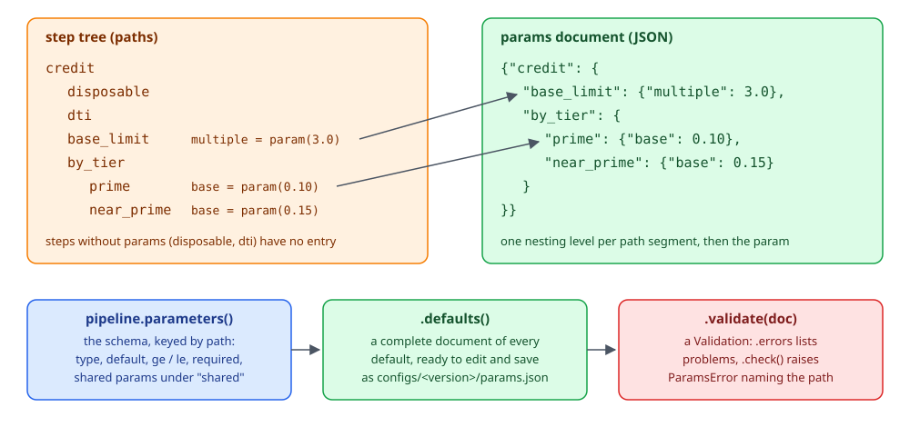
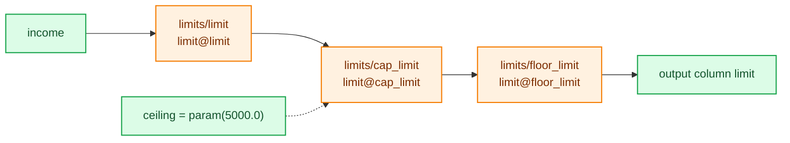
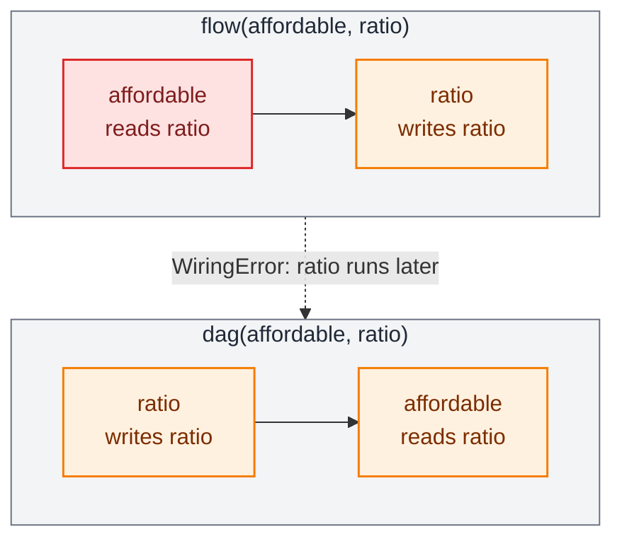

# Steps, params and run

Write each calculation as a plain function, wire the functions into a pipeline, keep the policy numbers in a params document, and run the result over a frame or one record at a time. Everything on this page runs in every mode; the examples build on each other, so run them top to bottom.

## Functions as steps

A function becomes a step the moment you put it in a `flow`. Its arguments are the names it reads, its name is the name it writes, and its annotations give the types.

```python
import polars as pl
from decikit import flow, missing_as, param, step

def disposable(income: float, expenses: float = missing_as(0.0)) -> float:
    return income - expenses

def dti(debt: float, income: float) -> float:
    return debt / income

@step(outputs=("band", "band_score"))
def banding(dti: float) -> tuple[int, float]:
    return (1, 10.0) if dti > 0.5 else (0, 0.0)

@step(output="limit", name="base_limit")
def limit_from_income(disposable: float, multiple: float = param(3.0, ge=0.0, le=10.0)) -> float:
    return disposable * multiple

credit = flow(disposable, dti, banding, limit_from_income, name="credit")
df = pl.DataFrame({"income": [1000.0, 2000.0], "expenses": [400.0, None], "debt": [600.0, 500.0]})
print(credit.run(df))
```

```text
shape: (2, 6)
┌────────┬──────────┬───────┬──────┬────────────┬────────┐
│ income ┆ expenses ┆ debt  ┆ band ┆ band_score ┆ limit  │
│ ---    ┆ ---      ┆ ---   ┆ ---  ┆ ---        ┆ ---    │
│ f64    ┆ f64      ┆ f64   ┆ i64  ┆ f64        ┆ f64    │
╞════════╪══════════╪═══════╪══════╪════════════╪════════╡
│ 1000.0 ┆ 400.0    ┆ 600.0 ┆ 1    ┆ 10.0       ┆ 1800.0 │
│ 2000.0 ┆ null     ┆ 500.0 ┆ 0    ┆ 0.0        ┆ 6000.0 │
└────────┴──────────┴───────┴──────┴────────────┴────────┘
```

`disposable` and `dti` were read by later steps, so they are intermediates and left out. `band`, `band_score` and `limit` are read by nothing, so they are the pipeline's outputs. The null `expenses` on the second row became `0.0` because of `missing_as(0.0)`.

`step()` is only needed to override a default:

| Argument | Default | Use it to |
|---|---|---|
| `name=` | the function's name | give the step another path segment (`credit/base_limit`) |
| `output=` | the function's name | write a different name (`limit`) |
| `outputs=(...)` | | write several names; the return annotation must be a `tuple[...]` of the same length |
| `id=` | none | attach a durable 12-hex id used by traces and diffs |
| `suppress_checks=` | none | silence named [checks](checks.md) for this step |

Every named step has a path. `walk()` lists them:

```python
for path, s in credit.walk():
    print(path, type(s).__name__)
```

```text
credit SequentialStep
credit/disposable FunctionStep
credit/dti FunctionStep
credit/banding FunctionStep
credit/base_limit FunctionStep
```

A lambda takes its name from `name=`, and `|` joins steps in written order. Python has no `|` for two plain functions, so wrap the first one in `step()`:

```python
double = step(lambda income: income * 2, name="double_income")
print((step(disposable) | double).run(df).columns)
```

```text
['income', 'expenses', 'debt', 'disposable', 'double_income']
```

The function itself is unchanged, so it stays testable as plain Python. A `param()` default works as an ordinary default on a direct call:

```python
print(limit_from_income(100.0))
```

```text
300.0
```

## Missing values

An argument with no default is required: a null or absent value is an error, raised before the step runs. There are two ways to accept a null:

- `missing_as(fill)` replaces the null with `fill` before the step sees it.
- An annotation of `T | None` passes the null through as `None`, and the step decides.

```python
def bonus(income: float | None) -> float:
    return 0.0 if income is None else income * 0.1

print(flow(bonus, name="b").run(pl.DataFrame({"income": [1000.0, None]})))
```

```text
shape: (2, 2)
┌────────┬───────┐
│ income ┆ bonus │
│ ---    ┆ ---   │
│ f64    ┆ f64   │
╞════════╪═══════╡
│ 1000.0 ┆ 100.0 │
│ null   ┆ 0.0   │
└────────┴───────┘
```

A step can return `None` when its output is declared `T | None`; the output column then holds a null on that row, in every mode.

A required input that is null, or a column that is not there at all, raises `MissingInputError`. The message names the input, the step and how many rows are affected:

```python
from decikit import DecikitError

try:
    credit.run(pl.DataFrame({"income": [1000.0, None], "debt": [1.0, 2.0]}))
except DecikitError as e:
    print(type(e).__name__, e)

try:
    credit.compile().run({"income": 1000.0})
except DecikitError as e:
    print(type(e).__name__, e)
```

```text
MissingInputError input 'income' of step 'credit/disposable' is required but column 'income' has 1 null row(s) of 2. Fix the data, or declare `income: T = missing_as(fill)` or `income: T | None`.
MissingInputError input 'debt' of step 'credit/dti' is required but column 'debt' is not in the input frame or record. Fix the data, or declare `debt: T = missing_as(fill)` or `debt: T | None`.
```

When the pipeline is served, `MissingInputError` becomes an HTTP 400 response. Two more rules:

- `missing_as(None)` raises ``TypeError: missing_as(None) fills a null with a null; annotate the input `T | None` instead``.
- A bare default such as `client_total: float = 0.0` is refused when the step is built, because it is ambiguous: `IRError: risky: parameter 'client_total' has a bare default (0.0). Use param(0.0) for a tunable param or missing_as(0.0) to fill nulls.`

## Params

`param(default)` declares a policy value. Every keyword besides the ones below goes to pydantic's `Field`, so `ge`, `le`, `gt`, `lt`, `description` and the rest validate the params document.

| Keyword | Meaning |
|---|---|
| `default` | the value used when the document does not set it; any value, including `None` and `bool` |
| `required=True` | no default; a document that does not set it is invalid |
| `shared_key="name"` | read the value from the document's top-level `"shared"` entry, so several steps share one number |
| `on_invalid=` | `"error"` (the default) fails, `"warn"` records a warning and uses the default, `"default"` uses the default silently |

`pipeline.parameters()` is the schema: every param by step path, with its type, default and constraints. `defaults()` turns it into a complete params document.

```python
print(credit.parameters())
params = credit.parameters().defaults()
print(params)

params["credit"]["base_limit"]["multiple"] = 2.0
print(credit.run(df, params=params)["limit"].to_list())
```

```text
{'credit/base_limit': {'multiple': {'type': 'float', 'default': 3.0, 'ge': 0.0, 'le': 10.0}}}
{'credit': {'base_limit': {'multiple': 3.0}}}
[1200.0, 4000.0]
```

<div class="diagram" markdown>


*The document nests one level per path segment; a step with no params has no entry.*
</div>

### Validating a document

Validation happens once per document, before any row runs. `validate` returns a `Validation`; `.errors` lists the problems and `.check()` raises `ParamsError`:

```python
from decikit.exceptions import ParamsError

bad = {"credit": {"base_limit": {"multiple": -1}}}
print(credit.parameters().validate(bad).errors)

for doc in ({"credit": {"base_limit": {"multiple": "high"}}},
            {"credit": {"base_limit": {"multiple": 50.0}}},
            {"credit": {"base_limt": {"multiple": 2.0}}}):
    try:
        credit.run(df, params=doc)
    except ParamsError as e:
        print(e)
```

```text
("credit/base_limit: param 'multiple': Input should be greater than or equal to 0 (got -1)",)
invalid params (affects 2 rows):
credit/base_limit: param 'multiple': Input should be a valid number, unable to parse string as a number (got 'high')
invalid params (affects 2 rows):
credit/base_limit: param 'multiple': Input should be less than or equal to 10 (got 50.0)
params document: no step with params at 'credit/base_limt'. Did you mean 'credit/base_limit'? The document nests params by step path; steps with params: credit/base_limit (multiple). pipeline.parameters().defaults() builds a complete document.
```

A misspelt step path gets a suggestion and the list of steps that do have params. A document is validated once and then cached by identity, so treat it as immutable: to change a value, pass a new dict, not the same one edited in place.

`FusedEngine(params_validation="lazy")` validates a node's params the first time a row reaches that node, so an invalid param in a branch arm no row takes never fails a run. The default, `"eager"`, validates everything up front.

### Required, shared and lenient params

```python
def needs(x: float, k: float = param(required=True)) -> float:
    return x * k

try:
    flow(needs, name="r").run(pl.DataFrame({"x": [1.0]}))
except ParamsError as e:
    print(e)

def fee(x: float, rate: float = param(0.1, shared_key="base_rate")) -> float:
    return x * rate

def markup(x: float, rate: float = param(0.1, shared_key="base_rate")) -> float:
    return x + rate

shared = flow(fee, markup, name="s")
print(shared.parameters())
print(shared.run(pl.DataFrame({"x": [10.0]}), params={"shared": {"base_rate": 0.5}}))

def scaled(x: float, k: float = param(2.0, ge=0, on_invalid="warn")) -> float:
    return x * k

lenient = flow(scaled, name="w").compile()
print(lenient.run(pl.DataFrame({"x": [1.0]}), params={"w": {"scaled": {"k": -3.0}}})["scaled"].to_list())
print(lenient.report.warnings)
```

```text
invalid params (affects 1 row):
r/needs: param 'k' is required but missing
{'shared': {'base_rate': {'type': 'float', 'default': 0.1, 'used_by': ['s/fee', 's/markup']}}}
shape: (1, 3)
┌──────┬─────┬────────┐
│ x    ┆ fee ┆ markup │
│ ---  ┆ --- ┆ ---    │
│ f64  ┆ f64 ┆ f64    │
╞══════╪═════╪════════╡
│ 10.0 ┆ 5.0 ┆ 10.5   │
└──────┴─────┴────────┘
[2.0]
["w/scaled: param 'k': Input should be greater than or equal to 0 (got -3.0); using the default"]
```

A required scalar param is left out of `defaults()`, so the document it produces is not yet valid. `Executable.report` describes the params validation of the latest call on the calling thread.

Two smaller points about params:

- A `bool` or `None` default comes back from `param()` as a marker that tests like its value, so `if flag:` works on a direct call but `flag is False` does not. Write `if not flag:`.
- `step(fn).bind(name=value)` returns a copy whose param defaults to `value`, handy when one function is used twice with different policies.

A parameter whose value is a table of rows (a rate ladder, fee caps) is a `param_table`; see [Parameter tables](parameter-tables.md).

### Request data is never a param

A param holds policy that is the same for every record. A value that arrives with the request is a plain argument. If a record or frame carries a column named like a param, the decider toolkit ignores it and warns once:

```python
import warnings

with warnings.catch_warnings(record=True) as caught:
    warnings.simplefilter("always")
    credit.compile().run({"income": 1000.0, "debt": 600.0, "multiple": 5.0})
print(caught[0].message)
```

```text
'multiple' is a param, not an input, so its value in the record or frame is ignored; pass it in the params document instead: {"credit": {"base_limit": {"multiple": "..."}}}
```

## Flow and dag order

`flow` runs its members in the order written. When two steps write the same name, the later one wins for everything after it. That is the waterfall: a base value, then caps and floors applied in turn.

```python
def limit(income: float) -> float:
    return income * 3

@step(output="limit", name="cap_limit")
def cap(limit: float, ceiling: float = param(5000.0)) -> float:
    return min(limit, ceiling)

@step(output="limit", name="floor_limit")
def floor(limit: float) -> float:
    return max(limit, 500.0)

waterfall = flow(limit, cap, floor, name="limits")
limits_df = pl.DataFrame({"income": [100.0, 1000.0, 4000.0]})
print(waterfall.emit("limit@*").run(limits_df))
```

```text
shape: (3, 5)
┌────────┬────────┬─────────────┬─────────────────┬───────────────────┐
│ income ┆ limit  ┆ limit@limit ┆ limit@cap_limit ┆ limit@floor_limit │
│ ---    ┆ ---    ┆ ---         ┆ ---             ┆ ---               │
│ f64    ┆ f64    ┆ f64         ┆ f64             ┆ f64               │
╞════════╪════════╪═════════════╪═════════════════╪═══════════════════╡
│ 100.0  ┆ 500.0  ┆ 300.0       ┆ 300.0           ┆ 500.0             │
│ 1000.0 ┆ 3000.0 ┆ 3000.0      ┆ 3000.0          ┆ 3000.0            │
│ 4000.0 ┆ 5000.0 ┆ 12000.0     ┆ 5000.0          ┆ 5000.0            │
└────────┴────────┴─────────────┴─────────────────┴───────────────────┘
```

`emit("limit@*")` kept every version of `limit`, named after the step that wrote it. `emit("limit@limits/cap_limit")` keeps just one, by path.



Written order is execution order. A flow that reads a name before the step that writes it raises a `WiringError` when it is wired, before any data is read:

```python
from decikit import dag
from decikit.exceptions import WiringError

def affordable(ratio: float, max_ratio: float = param(0.4)) -> bool:
    return ratio <= max_ratio

def ratio(debt: float, income: float) -> float:
    return debt / income

small = pl.DataFrame({"income": [10.0], "debt": [2.0]})
try:
    flow(affordable, ratio, name="w").run(small)
except WiringError as e:
    print(e)
```

```text
w/affordable reads 'ratio' as an input column, but w/ratio, which runs later, writes 'ratio'. Order is execution order: w/affordable saw the input column, while anything after w/ratio sees w/ratio's value. Move w/ratio before w/affordable, or rename one of the two.
```

`dag` sorts its members by dependency instead, so the order you write them in does not matter. Each name has exactly one writer in a dag, and two writers is an error whose fix depends on whether one refines the other:

```python
from decikit.ir import to_ir

d = dag(affordable, ratio, name="d")
print([node.origin.path for node in to_ir(d).children_])
print(d.run(small))

@step(output="limit", name="other_limit")
def other(income: float) -> float:
    return income

for members in ((limit, cap), (limit, other)):
    try:
        dag(*members, name="c").run(limits_df)
    except WiringError as e:
        print(e)
```

```text
['d/ratio', 'd/affordable']
shape: (1, 3)
┌────────┬──────┬────────────┐
│ income ┆ debt ┆ affordable │
│ ---    ┆ ---  ┆ ---        │
│ f64    ┆ f64  ┆ bool       │
╞════════╪══════╪════════════╡
│ 10.0   ┆ 2.0  ┆ true       │
└────────┴──────┴────────────┘
dag 'c': each name has one writer in a dag.
  limit and cap_limit both write 'limit': use flow(limit, cap_limit) to apply them in that order, the later winning
dag 'c': each name has one writer in a dag.
  limit and other_limit both write 'limit': rename one, e.g. other_limit.relabel(writes={'limit': 'limit_2'})
```



Use `flow` for waterfalls and anything where order carries meaning. Use `dag` when steps are independent calculations and you would rather not order them by hand.

## Run and score

`run(df)` returns the input columns plus every value nothing reads. `emit(...)` keeps intermediates and `drop(...)` removes columns:

```python
print(credit.emit("dti", "disposable").run(df).columns)
print(credit.drop("expenses").run(df).columns)
```

```text
['income', 'expenses', 'debt', 'band', 'band_score', 'limit', 'dti', 'disposable']
['income', 'debt', 'band', 'band_score', 'limit']
```

`run(record)` takes one dict and returns one dict: the record's own keys plus the outputs. Values come back as Python objects: `float`, `int`, `bool`, and the decider toolkit's `Decimal` or `Currency` for money.

```python
exe = credit.compile("fused")
print(exe.run({"income": 1000.0, "debt": 600.0}))
print(exe.run({"income": 1000.0, "debt": 600.0}, params))
```

```text
{'income': 1000.0, 'debt': 600.0, 'band': 1, 'band_score': 10.0, 'limit': 3000.0}
{'income': 1000.0, 'debt': 600.0, 'band': 1, 'band_score': 10.0, 'limit': 2000.0}
```

`pipeline.run(df)` binds a fresh interpreted executable on every call. For anything repeated, compile once and keep the `Executable`: it caches validated params documents and compiled kernels, and is safe to call from many threads.

| | `run(df)` | `run(record)` |
|---|---|---|
| takes | a polars `DataFrame` | a `dict` |
| returns | a `DataFrame` | a `dict` |
| used by | analysis, back-tests, experiments, `assert_equivalent` | `decikit serve`, the request handler |
| params | `run(df, params=doc)` | `run(record, doc)` |

A column in the input that the pipeline itself produces is refused, so neither value silently hides the other:

```python
from decikit.exceptions import EngineError

try:
    credit.run(df.with_columns(dti=pl.lit(0.1)))
except EngineError as e:
    print(e)
```

```text
'dti' is produced by this pipeline and is also a column of the input frame. Drop or rename the frame column 'dti', or relabel the step that writes it (`.relabel(writes={'dti': 'dti_2'})`), so neither silently shadows the other.
```

## Reusing a step

`.named("x")` places the same step twice under different paths, each with its own params entry. `.relabel(reads=..., writes=...)` makes a step read and write other names at its boundary, which is how you reuse a step (or a whole pipeline) on columns named differently:

```python
def term_cap(term: float, max_term: float = param(48.0)) -> float:
    return min(term, max_term)

print(flow(term_cap, step(term_cap).named("cap_again"), name="t").parameters().defaults())
relabelled = step(term_cap).relabel(reads={"term": "requested_term"}, writes={"term_cap": "capped_term"})
print(flow(relabelled, name="t").run(pl.DataFrame({"requested_term": [60.0]})))
```

```text
{'t': {'term_cap': {'max_term': 48.0}, 'cap_again': {'max_term': 48.0}}}
shape: (1, 2)
┌────────────────┬─────────────┐
│ requested_term ┆ capped_term │
│ ---            ┆ ---         │
│ f64            ┆ f64         │
╞════════════════╪═════════════╡
│ 60.0           ┆ 48.0        │
└────────────────┴─────────────┘
```

A misspelt relabel key is caught when you call `relabel`, with a suggestion: `WiringError: term_cap.relabel(reads={'trem': 'x'}): it reads no 'trem'; it reads ['term']. Did you mean 'term'?`

## Helper functions

A step may call other functions. In a compiled mode numba has to compile those too, so mark each one with `@helper` and the input and output types it is called with. The step then stays in the kernel:

```python
from decikit import helper

@helper(signatures=[((float,), float)])
def discounted(price: float) -> float:
    return round(price * 0.9, 2)

def price(list_price: float) -> float:
    return discounted(list_price) + 1.0

priced = flow(price, name="h").compile("fused")
print(priced.run({"list_price": 10.555}), priced.fallbacks())
```

```text
{'list_price': 10.555, 'price': 10.5} {}
```

Without `@helper`, numba may still compile the call (an `@overload` or a supported numpy function works). When it cannot, the step runs in Python and its fallback reason names the function: `calls 'discounted' without @helper or @allow_fallback: ...`. [Compiled modes and fallback](compile-and-fallback.md) covers fallbacks.

## Rounding

`round(x, 2)` inside a step rounds the exact value of the double, half to even, exactly as CPython does, in every mode. `2.675` is stored as 2.67499999..., so it rounds to `2.67`. For any other rounding rule call `decimal.round` from `decikit.ops`. Its `mode` is `Rounding.HALF_UP` (the default, ties away from zero), `Rounding.HALF_EVEN` or `Rounding.DOWN` (toward zero), and it runs the same in Python and inside a kernel.

```python
from decikit.ops import decimal
from decikit.ops.decimal import Rounding

def inst(amount: float) -> float:
    return round(amount / 3, 2)

def inst_up(amount: float) -> float:
    return decimal.round(amount / 8, 2)

def inst_even(amount: float) -> float:
    return decimal.round(amount / 8, 2, mode=Rounding.HALF_EVEN)

def inst_down(amount: float) -> float:
    return decimal.round(amount / 8, 2, mode=Rounding.DOWN)

rounding = flow(inst, inst_up, inst_even, inst_down, name="r")
amounts = pl.DataFrame({"amount": [100.0, 0.2, 1.0]})
print(rounding.compile("fused").run(amounts))
print(rounding.compile("fused").run(amounts).equals(rounding.run(amounts)))
print([decimal.round(2.5), decimal.round(2.5, mode=Rounding.HALF_EVEN), decimal.round(-2.5),
       decimal.round(-2.99, 1, Rounding.DOWN), decimal.round(1234.5, -2)])
```

```text
shape: (3, 5)
┌────────┬───────┬─────────┬───────────┬───────────┐
│ amount ┆ inst  ┆ inst_up ┆ inst_even ┆ inst_down │
│ ---    ┆ ---   ┆ ---     ┆ ---       ┆ ---       │
│ f64    ┆ f64   ┆ f64     ┆ f64       ┆ f64       │
╞════════╪═══════╪═════════╪═══════════╪═══════════╡
│ 100.0  ┆ 33.33 ┆ 12.5    ┆ 12.5      ┆ 12.5      │
│ 0.2    ┆ 0.07  ┆ 0.03    ┆ 0.03      ┆ 0.02      │
│ 1.0    ┆ 0.33  ┆ 0.13    ┆ 0.12      ┆ 0.12      │
└────────┴───────┴─────────┴───────────┴───────────┘
True
[3.0, 2.0, -3.0, -2.9, 1200.0]
```

`1.0 / 8` is exactly 0.125, a true tie, so the three modes give 0.13, 0.12 and 0.12. `0.2 / 8` is a double slightly above 0.025, so both half modes round it up. Negative `digits` round to tens, hundreds and so on. For money, use `Currency` and `Decimal` from [Types, text, money and nested data](types-and-money.md), which are exact.

## Errors you will hit

| Error | Raised when | What to do |
|---|---|---|
| `MissingInputError: input 'debt' of step 'credit/dti' is required but column 'debt' is not in the input frame or record.` | a required input is null or absent | fix the data, or declare `missing_as(fill)` or `T | None` |
| `ParamsError: invalid params (affects 2 rows): credit/base_limit: param 'multiple': Input should be less than or equal to 10 (got 50.0)` | a params document fails validation | fix the document; `parameters().validate(doc).errors` lists every problem |
| `ParamsError: params document: no step with params at 'credit/base_limt'. Did you mean 'credit/base_limit'?` | a document names a path with no params | use `parameters().defaults()` as the template |
| `WiringError: a/affordable: input 'disposable_incom' is not produced by any earlier step. Did you mean 'disposable_income' ...` | an input looks like a typo of a produced name, even when the frame has that column | rename it, or declare it a real input with `flow(..., inputs=["disposable_incom"])` |
| `WiringError: w/affordable reads 'ratio' as an input column, but w/ratio, which runs later, writes 'ratio'.` | a flow reads a name before the step that writes it | reorder, or use `dag` |
| `WiringError: dag 'c': each name has one writer in a dag.` | two dag members write one name | `flow` for a waterfall, or `.relabel(writes=...)` one of them |
| `EngineError: 'dti' is produced by this pipeline and is also a column of the input frame.` | the frame already has a column the pipeline writes | drop or rename the column, or relabel the step |
| `IRError: risky: parameter 'client_total' has a bare default (0.0).` | an argument has a plain default | `param(0.0)` or `missing_as(0.0)` |
| `TypeError: unsupported operand type(s) for |: 'function' and 'function'` | `f | g` on two plain functions | `step(f) | g` or `flow(f, g)` |
| warning: `'multiple' is a param, not an input, so its value in the record or frame is ignored` | request data carries a param's name | pass it in the params document, or make it a plain argument if it really is request data |

The first eight rows are subclasses of `DecikitError`, so `except DecikitError` catches all of them in one place.

## Where to go next

- [Branches, loops and frame steps](branches-loops-frames.md): different logic per row, iteration and whole-frame work.
- [Types, text, money and nested data](types-and-money.md): `Text`, `Currency`, `Decimal`, list and struct columns.
- [Compiled modes and fallback](compile-and-fallback.md): what each mode compiles and how to read a `FallbackWarning`.
- [Parameter tables](parameter-tables.md): table-valued params.
- [Debugging and testing](debugging-and-testing.md): sessions, breakpoints and `assert_equivalent`.
- [Steps and IR](../architecture/steps-and-ir.md): how each step lowers to IR.
