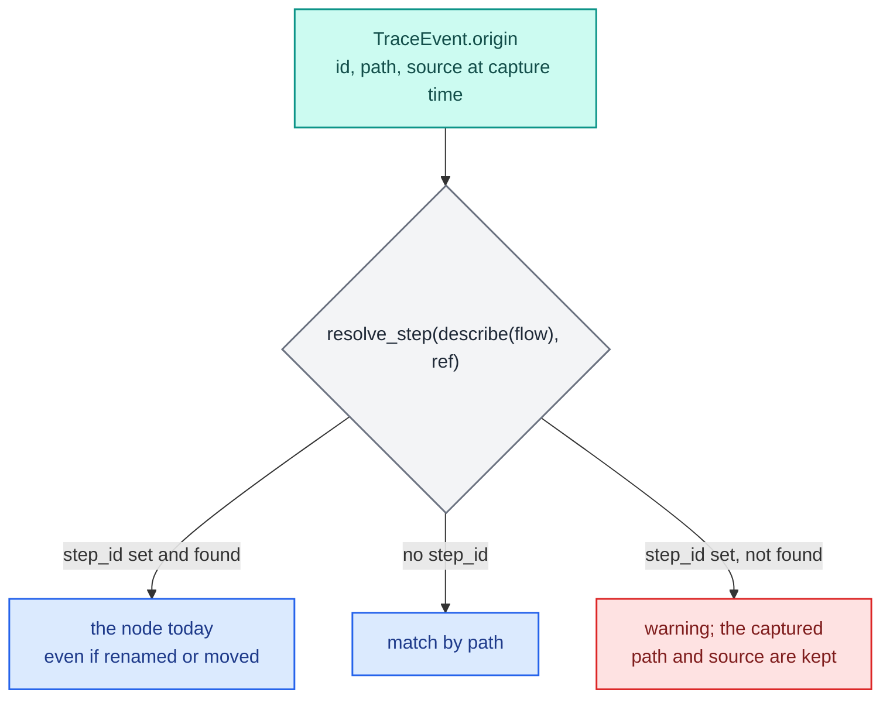

# Decision tracing

A decision trace answers "why did record 1 get this answer" after the fact, from a production or batch run, without a debugger. Pass a `TraceSink` to `run` or `score` and every step that ran for every record leaves an event: which step (by durable id), in which branch arm and loop iteration, for which record. Hand the events to an adapter and they go wherever your audit trail lives.

Tracing is off by default. A run without a sink captures nothing and, in a compiled mode, runs a kernel with no trace code in it.

```python
import polars as pl
from decider import flow, param
from decider.trace import Kind, TraceSink

def ratio(income: float, debt: float) -> float:
    return debt / income

def approved(ratio: float, limit: float = param(0.4)) -> bool:
    return ratio <= limit

pipeline = flow(ratio, approved, name="credit")
sink = TraceSink()
pipeline.compile("fused").run(pl.DataFrame({"income": [1000.0], "debt": [200.0]}), trace=sink)
assert [e.origin.path for e in sink.events() if e.kind is Kind.STEP] == ["credit/ratio", "credit/approved"]
assert sink.status()["dropped"] == 0
```

<div class="diagram" markdown>


*What happens to each event between the runner and your adapter.*
</div>

## Durable ids

A trace outlives the code that wrote it. A month later the step may have been renamed or moved into a sub-flow, so a trace that only says `credit/ratio` can stop pointing anywhere. Every event therefore carries the step's `Origin`: its durable `id` when the step has one, plus the `path` and `source` it had at capture time.

A durable id is an opaque 12-hex-digit token you commit in the source, next to the declaration:

```python
@step(id="a1b2c3d4e5f6")
def disposable_income(net_income: float, expenses: float) -> float:
    return net_income - expenses
```

You do not invent them. `decider ids` writes one into every `@step(...)` decorator, `step(...)` and `frame_step(...)` call, and named `flow`, `dag`, `branch`, `loop`, `each` and `optimise` that lacks one, and changes no other byte. It refuses to run on a dirty git tree, so the change is one reviewable diff:

```text
$ decider ids lending
added 5 id(s) in 1 file(s)
  lending/pipeline.py:5  disposable_income  ->  id=61960951899c
  lending/pipeline.py:10  instalment_ratio  ->  id=f18ff80f85b3
  lending/pipeline.py:26  approved  ->  id=647f40f5714d
  lending/pipeline.py:31  credit_limit  ->  id=d05fad52d9f8
  lending/pipeline.py:37  lending  ->  id=f58544a1f4bb
```

The generator only edits those Python calls. A plain function used as a step without `@step` gets no id; decorate it first. A tree, table or scorecard document takes an `"id"` key next to `"name"`, which you add by hand. The `durable_ids` check (DCD401) lists what is still missing. [CLI and MCP](cli-and-mcp.md) covers the command's options.

Ids are additive. With `id=None`, the default, names, paths, the params document and execution are unchanged, so a project that never adds ids works as before and its traces carry `id=None`. The reference to a step is the pair (flow id, step id); one function reused in two flows has one id and two paths.

## What an event holds

`sink.events()` returns a tuple of `TraceEvent`, in order. This branch flow, with ids, run over two records:

```python
import polars as pl
from decider import branch, flow, param, step
from decider.trace import TraceSink


@step(id="a1b2c3d4e5f6")
def disposable_income(net_income: float, expenses: float) -> float:
    return net_income - expenses


@step(id="0badc0ffee01")
def is_private(sector_code: int) -> bool:
    return sector_code == 1


@step(output="limit", id="5e5e5e5e5e01")
def private_limit(disposable_income: float, multiple: float = param(3.0)) -> float:
    return disposable_income * multiple


@step(output="limit", id="5e5e5e5e5e02")
def public_limit(disposable_income: float, multiple: float = param(2.0)) -> float:
    return disposable_income * multiple


pipeline = flow(
    disposable_income,
    branch(is_private, private_limit, public_limit, modifies=["limit"], name="by_sector", id="b4b4b4b4b4b4"),
    name="limit", id="f1f1f1f1f1f1")

df = pl.DataFrame({"net_income": [9200.0, 4100.0], "expenses": [3100.0, 1500.0], "sector_code": [1, 2]})

for mode in ("interpreted", "fused"):
    sink = TraceSink()
    out = pipeline.compile(mode).run(df, trace=sink)
    print(mode, out["limit"].to_list(), sink.status())
    for e in sink.events():
        print("  ", e.kind.name, e.step, e.origin.path, e.origin.id, "arm", e.arm, "iter", e.iteration, "rec", e.record)
```

```text
interpreted [18300.0, 5200.0] {'delivered': 8, 'dropped': 0, 'failed': 0, 'errors': 0}
   STEP 1 limit/disposable_income a1b2c3d4e5f6 arm None iter None rec 0
   STEP 1 limit/disposable_income a1b2c3d4e5f6 arm None iter None rec 1
   STEP 2 limit/by_sector/is_private 0badc0ffee01 arm None iter None rec 0
   STEP 2 limit/by_sector/is_private 0badc0ffee01 arm None iter None rec 1
   BRANCH_ARM 0 limit/by_sector b4b4b4b4b4b4 arm 0 iter None rec 0
   STEP 3 limit/by_sector/private_limit 5e5e5e5e5e01 arm 0 iter None rec 0
   BRANCH_ARM 0 limit/by_sector b4b4b4b4b4b4 arm 1 iter None rec 1
   STEP 4 limit/by_sector/public_limit 5e5e5e5e5e02 arm 1 iter None rec 1
fused [18300.0, 5200.0] {'delivered': 6, 'dropped': 0, 'failed': 0, 'errors': 0}
   STEP 1 limit/disposable_income a1b2c3d4e5f6 arm None iter None rec 0
   STEP 1 limit/disposable_income a1b2c3d4e5f6 arm None iter None rec 1
   STEP 2 limit/by_sector/is_private 0badc0ffee01 arm None iter None rec 0
   STEP 3 limit/by_sector/private_limit 5e5e5e5e5e01 arm 0 iter None rec 0
   STEP 2 limit/by_sector/is_private 0badc0ffee01 arm None iter None rec 1
   STEP 4 limit/by_sector/public_limit 5e5e5e5e5e02 arm 1 iter None rec 1
```

| Field | Meaning |
|---|---|
| `schema_version` | the trace format version (1); a reader rejects events from a newer one |
| `kind` | a `Kind` (below) |
| `step` | the call's position in the run's step table, from 1; 0 on `BRANCH_ARM` and `LOOP_ITERATION` events, whose `origin` is the branch or loop |
| `origin` | the step's `Origin`: `id` (durable, may be `None`), `path` and `source` at capture time |
| `arm` | the branch arm the event ran in, from 0; `None` outside a branch |
| `iteration` | the loop iteration, from 1; `None` outside a loop |
| `record` | the row index within this run; `None` for an event that belongs to no record |
| `value` | a numeric payload, for the kinds that carry one |

Events carry no input or output values. They say which logic decided, not what the data was; pair them with the request and the response you already log, keyed by the same record.

### Kinds

| Kind | Emitted by | Meaning |
|---|---|---|
| `STEP` | every mode | a step ran for this record |
| `BRANCH_ARM` | interpreted and stepped | the record entered this arm of the branch |
| `LOOP_ITERATION` | interpreted and stepped | the record started this iteration of the loop |
| `FRAME` | every mode | a frame step ran; one event per row of its frame |
| `TABLE_ROW`, `TREE_PATH`, `BAND`, `ROUNDING`, `REASON`, `VALUE`, `OVERRIDE` | none yet | reserved for payload-carrying evidence; no runner emits them, so `value` is `None` on every event today |

`STEP` events are the same in every mode: the same steps, records, arms and iterations. Fused kernels record the arm and iteration inside the `STEP` event itself instead of emitting separate `BRANCH_ARM` and `LOOP_ITERATION` events, so read arms and iterations from `STEP` events if your code must work in every mode.

Order is guaranteed within one record's events. Across records the order is the driver's: interpreted mode goes step by step over all records, fused goes record by record.

### Loops and frame steps

```python
import polars as pl
from decider import flow, frame_step, loop, step
from decider.trace import TraceSink

@frame_step(reads=["client_id"], writes=["bureau_score"])
def join_bureau(df: pl.DataFrame) -> pl.DataFrame:
    return df.join(pl.DataFrame({"client_id": [1, 2], "bureau_score": [700, 650]}), on="client_id", how="left")

def unpaid(balance: float) -> bool:
    return balance > 0.0

@step(output="balance")
def pay(balance: float, instalment: float) -> float:
    return balance - instalment

repay = flow(join_bureau, loop(unpaid, flow(pay, name="month"), carries=["balance"], max_iterations=12, name="repay"),
             name="plan")
frame = pl.DataFrame({"client_id": [1, 2], "balance": [250.0, 100.0], "instalment": [100.0, 100.0]})
sink = TraceSink()
repay.compile("fused").run(frame, trace=sink)
print([(e.kind.name, e.origin.path, e.iteration, e.record) for e in sink.events()])
```

```text
[('FRAME', 'plan/join_bureau', None, 0), ('FRAME', 'plan/join_bureau', None, 1),
 ('STEP', 'plan/repay/unpaid', 1, 0), ('STEP', 'plan/repay/month/pay', 1, 0),
 ('STEP', 'plan/repay/unpaid', 2, 0), ('STEP', 'plan/repay/month/pay', 2, 0),
 ('STEP', 'plan/repay/unpaid', 3, 0), ('STEP', 'plan/repay/month/pay', 3, 0),
 ('STEP', 'plan/repay/unpaid', 4, 0),
 ('STEP', 'plan/repay/unpaid', 1, 1), ('STEP', 'plan/repay/month/pay', 1, 1),
 ('STEP', 'plan/repay/unpaid', 2, 1)]
```

Record 0 owed 250, paid three times and stopped when the condition failed at iteration 4; record 1 paid once. The interpreted run of the same flow emits the same `STEP` events, plus a `LOOP_ITERATION` event for each record at the start of each iteration.

## One record: `score`

`score(record, trace=sink)` traces a single decision, the shape a serving handler sees. Every event has `record=0`.

```python
sink = TraceSink()
exe = pipeline.compile("fused")
print(exe.score({"net_income": 4100.0, "expenses": 1500.0, "sector_code": 2}, trace=sink))
print([(e.origin.path, e.arm, e.record) for e in sink.events()])
```

```text
{'net_income': 4100.0, 'expenses': 1500.0, 'sector_code': 2, 'limit': 5200.0}
[('limit/disposable_income', None, 0), ('limit/by_sector/is_private', None, 0), ('limit/by_sector/public_limit', 1, 0)]
```

Tracing never changes the answer: the result is the same with and without a sink, in every mode.

## Reading a decision back

Group events by `record`, and resolve each event's step against the current flow with `decider.lab.resolve_step`. A durable reference resolves by `(flow_id, step_id)`, so it survives renames; without ids it falls back to the path.



```python
from collections import defaultdict
import polars as pl
from decider import describe
from decider.lab import StepRef, resolve_step
from decider.trace import TraceSink

sink = TraceSink()
big = pl.DataFrame({"net_income": [9200.0, 4100.0, 15000.0], "expenses": [3100.0, 1500.0, 6000.0],
                    "sector_code": [1, 2, 1]})
exe.run(big, trace=sink)

by_record = defaultdict(list)
for e in sink.events():
    by_record[e.record].append(e)

desc = describe(pipeline)
for e in by_record[1]:
    node = resolve_step(desc, StepRef(flow_id=desc.flow.flow_id, step_id=e.origin.id, path=e.origin.path))
    print(node.path, node.step_id, node.source, "arm", e.arm)
```

```text
limit/disposable_income a1b2c3d4e5f6 t1:disposable_income arm None
limit/by_sector/is_private 0badc0ffee01 t1:is_private arm None
limit/by_sector/public_limit 5e5e5e5e5e02 t1:public_limit arm 1
```

Record 1 is public sector: it took arm 1 of `by_sector` and its limit came from `public_limit`. If a durable id no longer resolves (the step was deleted), `resolve_step` warns and returns the reference as captured, with its old path and source, so the evidence still renders and a person can repair the link.

To see the values behind the decision, replay the record in a [debug session](debugging-and-testing.md) on the same code and params version: the trace tells you where to put the breakpoint.

## Adapters

`decider` emits evidence; it does not store, redact or deliver it. That is the adapter's job. An adapter is any object with `accept(events)`; `TraceSink(adapter)` calls it as events arrive, on the request path.

```python
import json
from decider.trace import TraceSink

class JsonLines:
    def __init__(self, path):
        self.file = open(path, "w")

    def accept(self, events):
        for e in events:
            self.file.write(json.dumps({"kind": e.kind.name, "step_id": e.origin.id, "path": e.origin.path,
                                        "arm": e.arm, "iteration": e.iteration, "record": e.record}) + "\n")

adapter = JsonLines("trace.jsonl")
sink = TraceSink(adapter)
exe.run(big, trace=sink)
adapter.file.close()
print(open("trace.jsonl").read().splitlines()[0], sink.status())
```

```text
{"kind": "STEP", "step_id": "a1b2c3d4e5f6", "path": "limit/disposable_income", "arm": null, "iteration": null, "record": 0} {'delivered': 9, 'dropped': 0, 'failed': 0, 'errors': 0}
```

- Keep `accept` fast. It runs synchronously inside `run` and `score`; enqueue and deliver on another thread or process if the destination is slow.
- An adapter that raises does not stop the run. The event is counted as `failed` in `status()` and the run goes on. The sink keeps every event in `events()` either way.
- `PassThroughAdapter` collects events in its `events` list, for tests.
- The sink checks for lost evidence before the adapter sees anything, so an adapter that drops or redacts events cannot hide a loss that happened earlier.

```text
# an adapter whose accept raises ConnectionError
[18300.0, 5200.0, 27000.0] {'delivered': 0, 'dropped': 0, 'failed': 9, 'errors': 9} 9
```

## Bounding and sampling

A batch run over millions of records produces millions of events. Two options keep that in check, and both count what they leave out as `dropped`:

```python
sink = TraceSink(max_events=4)          # keep the first 4
exe.run(big, trace=sink)
print(sink.status(), len(sink.events()))

sink = TraceSink(sample_rate=0.5)       # keep every 2nd event
exe.run(big, trace=sink)
print(sink.status(), [(e.origin.path, e.record) for e in sink.events()])
```

```text
{'delivered': 4, 'dropped': 5, 'failed': 0, 'errors': 0} 4
{'delivered': 4, 'dropped': 5, 'failed': 0, 'errors': 0} [('limit/disposable_income', 1), ('limit/by_sector/is_private', 0), ('limit/by_sector/is_private', 1), ('limit/by_sector/is_private', 2)]
```

`sample_rate` keeps one event in every `round(1 / sample_rate)`, by position, so it is deterministic. It samples events, not records: a record's trace can come back partial. To trace whole records, select the records yourself and run them with a full sink. `sample_rate` must be in (0, 1]; `TraceSink(sample_rate=0)` raises `ValueError: sample_rate must be in (0, 1], not 0`.

| `status()` key | Counts |
|---|---|
| `delivered` | events kept (and accepted by the adapter, if there is one) |
| `dropped` | events left out by `max_events` or `sample_rate`, plus events a kernel failed to write when `strict=False` |
| `failed` | events the adapter raised on |
| `errors` | adapter exceptions |

## `TraceLossError`

A compiled kernel whose event count is known in advance (one without a packed branch or loop, where the count depends on the data) declares how many trace events it will write. After it runs, the sink compares that with what it actually wrote. A shortfall means an optimisation dropped a trace point, and evidence is missing. With `strict=True` (the default) the run raises `TraceLossError` with the message `trace conservation failed: <written> of <expected> declared events were captured; an optimisation dropped a trace point`.

With `TraceSink(strict=False)` the shortfall is added to `dropped` and the run continues. You should never see this error; if you do, it is a bug in decider's code generation, so report it with the flow that triggered it.

## Limits

- A sink is not thread-safe. Use one per `run` or `score` call.
- `TraceSink` keeps every delivered event in memory for `events()`. Bound it with `max_events` on large batches, or let the adapter be the only consumer and discard the sink after the call.
- Traces identify logic, not data. The VS Code debugger and [debug sessions](debugging-and-testing.md) are where you look at values; the MCP server's `raw_trace` tool returns trace events only when the raw-data policy allows it ([CLI and MCP](cli-and-mcp.md)).
- Branch condition calls and loop tests carry their own `STEP` events (`is_private`, `unpaid` above), so a record's trace shows what was tested as well as what decided.

How events are packed into one int64 in a kernel, and what tracing costs, is in [Decision traces](../architecture/engine/trace.md).
